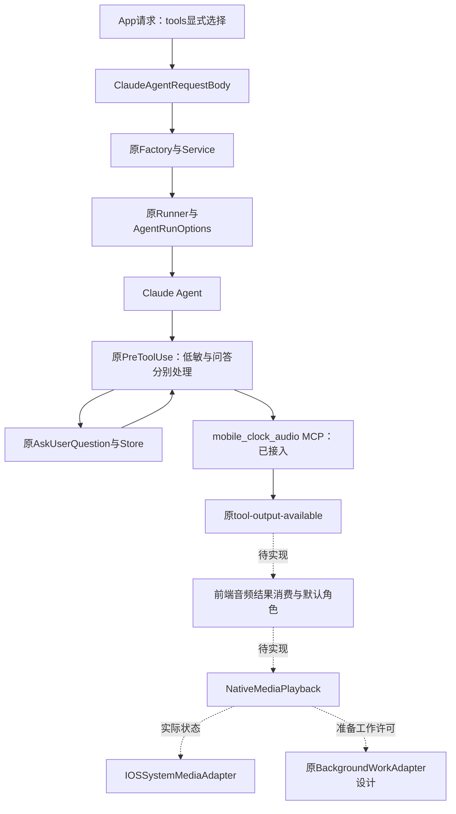
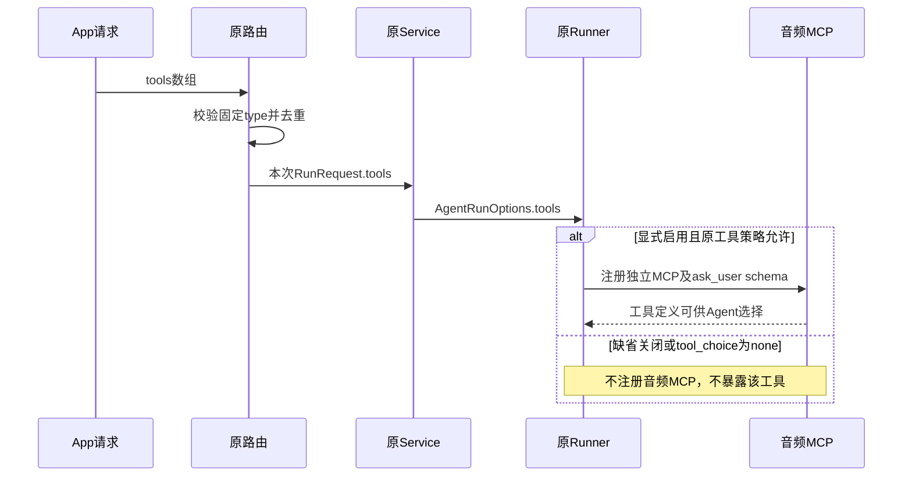
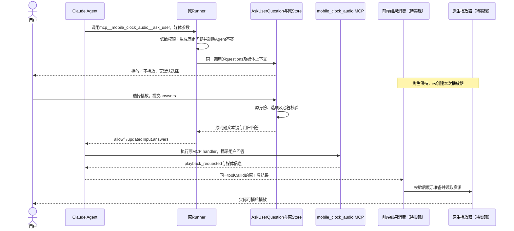
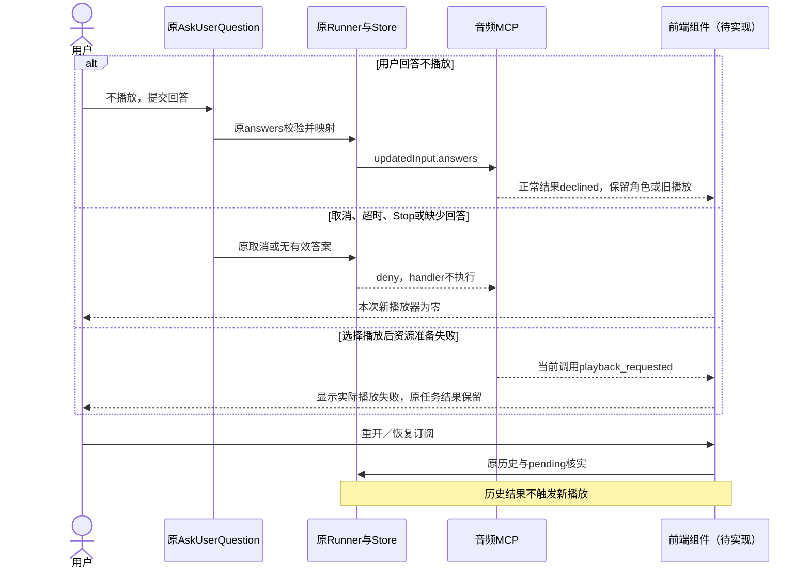
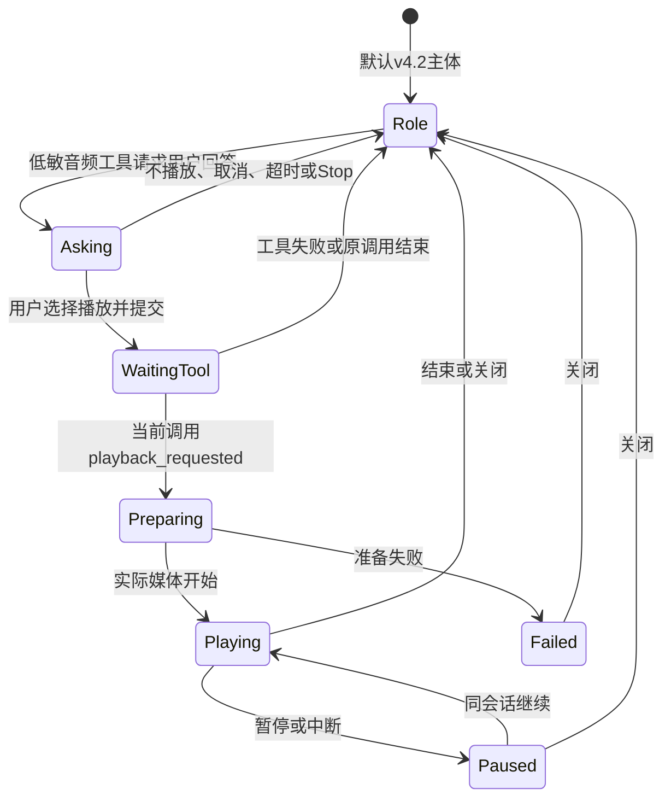
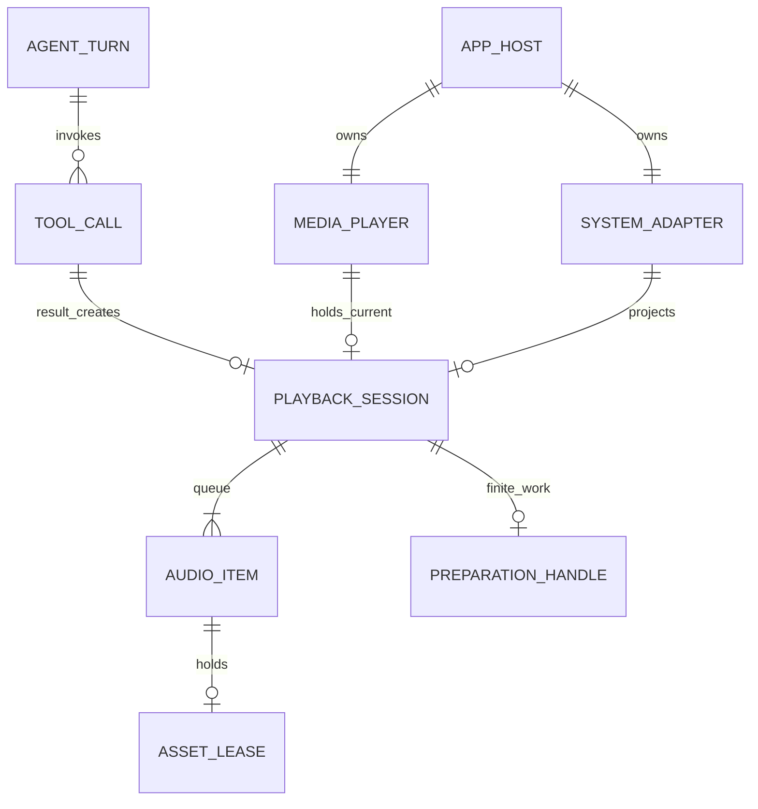

<!-- [Sync] 2026-11-13: Chat工具入口开发稿独立维护，音频媒体与原生接线继续本专项。 -->
<!-- [Input] 平台tools选择要求、现行Editor PreToolUse确认链与iOS播放器需求。 -->
<!-- [Output] 已实现的请求/MCP入口，及待实现的前端播放器、系统组件和后台适配接口。 -->
<!-- [Pos] iOS音频工具与系统播放器开发合同；前端接入详见mobile-clock-audio-frontend.md。 -->
<!-- [Sync] 2026-11-04: 默认关闭的mobile_clock_audio为低敏工具，沿AskUserQuestion问题/选项/answers通道取得播放选择。 -->

# App音频MCP与iOS播放器开发合同

## 背景与问题

音频播放由Claude调用后端发布的MCP工具发起。当前[editor_mcp_server.py](../../../backend/libs/claude_agent_kit/server/editor_mcp_server.py)已承载笔记写工具；本轮在同一模块增加独立音频MCP工厂，并由公开请求显式选择。Agent输出文本、媒体文件出现和页面状态变化均不直接触发播放器。

[纠正前四稿与原图](history/ios-player-before-mcp-entry-20261104.md)保留。产品身份与呈现归[独立组件设计](../../prd/mobile-app/ios-system-player.md)，前端确认卡及结果消费归[前端接入设计](mobile-clock-audio-frontend.md)。

## 目标与边界

后端接入范围：`ClaudeAgentRequestBody.tools` → `ClaudeAgentRunRequest.tools` → `AgentRunOptions.tools` → 原Runner选装MCP；音频工具列为Low-Sensitivity Tools，复用AskUserQuestion收集用户播放选择，再返回端侧所需媒体信息。默认tools为空。

音频前端业务接线、AVPlayer、系统媒体控制、系统返回路由和后台适配器保持待实现。用户回答“播放”时，MCP返回`playback_requested`，表示工具已生成播放请求；回答“不播放”返回`declined`；实际资源读取、可播、播放位置及播放成功由未来播放器反馈。语音合成、文件生成、跨设备推送和数据库新增退出本轮范围。

## 概念与规则

### 模块与命名

| 对象 | 标识／代码位置 | 职责与状态 |
| --- | --- | --- |
| Agent | 原Factory、Service及Claude Runtime | 选择已暴露工具并提供参数，等待用户回答及工具结果；原运行链保持 |
| 平台工具选择 | `tools: [{"type":"mobile_clock_audio"}]` | 请求本次turn暴露后端固定工具组；本轮已接入，缺省关闭 |
| MCP Server | `mobile_clock_audio`；`create_mobile_clock_audio_mcp_server` | 独立命名空间，发布音频工具schema与handler；位于editor_mcp_server.py，本轮新增 |
| MCP Tool | `mcp__mobile_clock_audio__ask_user` | 接收音频、原因与队列操作；使用AskUserQuestion收集回答，返回playback_requested或declined，本轮新增 |
| 原问答通道 | Runner.PreToolUse → Service → ToolConfirmationStore → 原tool-confirm | 原问答表单展示问题与选项，Store验证answers并回填；低敏工具无额外授权提示，无新增Store或HTTP |
| 前端组件 | 原AskUserQuestion、建议音频媒体内容组件 | 展示本次MCP调用参数，提交answers；工具成功结果到达后请求播放器，待实现 |
| 原生播放器 | 建议NativeMediaPlayback | 准备资源并播放，持有队列、真实进度、文件引用，待实现 |
| 系统组件 | 建议IOSSystemMediaAdapter、原ThreadActivityWidget | 默认角色及媒体状态投影；不执行Agent或MCP，新增媒体呈现待实现 |
| 后台适配器 | 原BackgroundWorkAdapter设计合同 | 管理计算与媒体准备的系统许可；不负责工具注册或批准，待实现 |

### 请求合同与默认值

参考[OpenAI tools的web_search例子](https://developers.openai.com/api/docs/guides/tools)采用按type选择工具组的数组形式；`mobile_clock_audio`为Dream自定义type。

```json
{
  "id": "<原Thread>",
  "message": {"id": "<原消息>", "parts": [{"type": "text", "text": "播放整理的音频"}]},
  "tool_choice": "auto",
  "tools": [{"type": "mobile_clock_audio"}]
}
```

| 输入 | 后端行为 |
| --- | --- |
| 省略tools、`tools: []` | 不暴露、不启动音频MCP；上一条消息选择不继承 |
| `tools: [{"type":"mobile_clock_audio"}]` | 原Runner允许该工具且tool_choice允许工具时，注册独立音频MCP；Low-Sensitivity调用仍需问答answers |
| `tool_choice: "none"` | 原禁用工具规则优先，音频MCP不启动 |
| 未知type、null、客户端传入command/url/schema等额外字段 | 原请求schema拒绝；只允许后端固定工具定义 |
| 重复同type | 路由去重，加载一份 |
| reconnect | 只观察原运行；不重新装配工具 |
| 排队消息 | 每条消息携带自己的tools；默认空，不继承当前运行的选择 |
| 定时派发／服务端新建任务 | 端侧tools缺省空；公开scheduled入口固定空，保持原无人值守规则 |

客户端选择表示工具可见性。原会话认证、Thread归属、资源权限和tool_choice保持。客户端不能提交MCP地址、可执行文件、工具schema或权限策略。原Runner的server-owned显式allowed_tools继续限制工具可见性。

### 后端入口与实现位置

| 路径 | 本轮接入 |
| --- | --- |
| [公开路由](../../../backend/routers/claude_agent.py) | 严格`PlatformToolDescriptor`数组；普通发送和排队传递去重后的type |
| [Service](../../../backend/claude_agent/service.py)、[Kit类型](../../../backend/libs/claude_agent_kit/types.py) | tools缺省空tuple，逐次传入原Runner |
| [Factory](../../../backend/claude_agent/thread_factory.py) | 排队条目保存当次tools，出队时替换原请求tools |
| [Runner](../../../backend/libs/claude_agent_kit/server/agent_runner.py) | 显式启用、有效allowlist及tool_choice共同决定注册；内部MCP名称保留，远端MCP不能覆盖 |
| [音频协议](../../../backend/libs/claude_agent_kit/server/mobile_clock_audio.py) | selector、音频参数schema及metadata-only结果；固定AskUserQuestion问题、剥除Agent自填answers；零文件读取与网络请求 |
| [工厂](../../../backend/libs/claude_agent_kit/server/editor_mcp_server.py) | 原Editor工具清单保持；新增独立音频factory，启用音频无需Editor Session；__ask_user后缀复用原问答识别 |
| [stdio入口](../../../backend/libs/claude_agent_kit/server/mobile_clock_audio_stdio.py) | 仅运行音频MCP，清除继承环境，不使用Editor/账户broker |
| [iOS MCP适配](../../../backend/mobile_runtime/ios_mcp.py) | 固定工厂映射适配原SDK内存传输，核对原入口并恢复原私有投影 |

### MCP参数与返回值

调用输入：

```json
{
  "items": [{
    "title": "河边散步 · 声音片段",
    "resource_uri": "workspace://files/audio/walk.m4a",
    "source_label": "当前对话整理结果",
    "duration_seconds": 252
  }],
  "queue_mode": "replace",
  "reason": "播放本次整理的声音"
}
```

- items非空；title与reason为非空文本。source_label、duration_seconds可省略；时长必须为有限正数。
- resource_uri限定当前Thread已有文件的`workspace://files/`引用，拒绝绝对文件URL、外部网络URL和路径越界。工具只校验引用格式；App读取时继续核对原账户与当前Thread资源归属、实际媒体类型及可播性。
- queue_mode为replace或append，缺省replace；确认区域展示该影响。目标固定为当前请求来自的App，MCP不接收任意远端设备控制参数。
- 工具description只定义音频请求职责，字段约束由schema和handler表达。用户提供的工具实现和schema不参与注册。

用户选择播放、原问答回填后，工具返回JSON文本：

```json
{
  "type": "mobile_clock_audio",
  "status": "playback_requested",
  "choice": "播放",
  "items": [{"title":"河边散步 · 声音片段","resource_uri":"workspace://files/audio/walk.m4a","source_label":"当前对话整理结果","duration_seconds":252}],
  "queue_mode": "replace",
  "reason": "播放本次整理的声音"
}
```

返回值沿原`tool-output-available`事件及toolCallId进入前端。`status`只描述工具请求已生成；不声明音频已下载、队列已创建或实际开始播放。MCP handler没有播放器、资源下载、系统组件和后台许可调用。

### Low-Sensitivity与AskUserQuestion

`mcp__mobile_clock_audio__ask_user`精确列入原低敏工具清单，独立工具授权提示为零。它同时为answer-form工具：调用许可与用户回答分别处理，低敏auto-allow和full-access均不跳过问答。

1. Agent提供媒体信息调用音频工具。Runner调用prepare_audio_question，校验媒体、移除Agent提供的questions/answers并生成固定问题。原问题为“是否在这台设备播放以下音频？”，选项“播放／不播放”，无默认答案。
2. 原PreToolUse调用同一Service/ToolConfirmationStore问答入口。工具名的`__ask_user`后缀由现有Store和前端识别为AskUserQuestion，policy.kind为ask_user，媒体参数进入同一输入fingerprint。
3. 原问题表单收集选择，经原confirmToolCall和tool-confirm提交`approved:true`与answers；这里approved表示提交问答。取消提交approved:false。
4. 原Store校验必答、选项和调用身份，将前端q0或问题文本键统一映射为问题文本。Runner把用户回答写入`updatedInput.answers`，再allow执行原MCP handler。无回答、取消、超时及缺少问答回调均保持不可播放。
5. handler核对固定问题与回答。“播放”返回playback_requested，“不播放”返回declined；declined为正常工具结果。未知或缺少回答返回MCP错误，不生成播放请求。
6. 前端只消费同一当前调用的成功playback_requested结果；declined保持角色／旧播放。工具低敏权限不授予文件读取或音频播放权限，资源准备继续核对原会话与当前Thread。

问答输入由运行时补全：

```json
{
  "questions": [{"question":"是否在这台设备播放以下音频？","type":"radio","required":true,"multiSelect":false,"options":[{"label":"播放","description":"按所示队列方式播放这些音频。"},{"label":"不播放","description":"保留角色或当前播放。"}]}]
}
```

原问答POST示例：

```json
{"thread_id":"<原Thread>","tool_call_id":"<本次调用>","approved":true,"answers":{"q0":"不播放"}}
```

该回答经原Store回填为`answers: {"是否在这台设备播放以下音频？":"不播放"}`，MCP返回`status:"declined"`。未改原POST、Store决定协议或前端问答识别。权限策略及精确例外归[Permission Policy](../claude-agent/claude-agent-permission-policy.md)。独立Editor批准、MediaApprovalReceipt、activateApprovedMedia与第二次接收确认退出方案。

## 接入拓扑



## 后端加载时序



## 正常业务时序



full-access沿相同问答路径收集回答；工具许可与问题回答分开，新增工具授权弹窗为零。

## 异常与恢复时序



## 前端与播放器状态



## 原生所有权与后台适配（待实现）

原App宿主持有一个NativeMediaPlayback及一个IOSSystemMediaAdapter。RN页面仅订阅；退订不停止已交付播放。原Factory继续拥有Agent计算与Stop。Widget仅消费状态，零Python/Node、音频网络和计算许可。



关系均为运行期关联，新增数据库表为零。原工具调用身份建立来源关系；Agent结束后，已交付播放可独立继续。

| 接口／原模块 | 后续接入合同 |
| --- | --- |
| 建议前端`consumeAudioToolResult` | 当前owner/runtime/Thread/turn/toolCallId、原工具名、成功output；只消费当前执行事件一次，历史读取与重复事件零新播放 |
| 建议NativeMediaPlayback.prepare | 归一化音频列表、queue_mode与原调用引用；原账户和当前Thread授权读取，取得可播资源后发布实际状态 |
| 建议NativeMediaPlayback.command | 同一媒体会话与item代次；暂停、继续、定位；新Agent媒体操作继续走MCP |
| 建议IOSSystemMediaAdapter.reconcile | 默认角色、准备和真实播放快照；单一ActivityKit仲裁、Now Playing及Remote Command接线 |
| 原NativeThreadPresence | 保持账户绑定及Thread观察；未来收敛其init/reconcile/clear的直接活动写入，避免结束角色或媒体活动 |
| 原NativeWorkspaceFileRead／NativePickedFileStore | 认证GET与acquire/finish/release；播放器保留使用期store强引用，RN卸载不触发文件提前删除 |
| 原BackgroundWorkAdapter设计 | 沿request/bind/report/finish/release；原Agent计算和独立native_media_prepare分别持有许可，无进展确认等待释放系统许可 |

当前文件reader仅完整200响应，Range/HLS与流资源仍需独立合同。当前`hasActiveThread: Bool`继续二值业务定义；未来系统展示字段可选扩展并验证旧活动解码，未知观察只省略状态行。系统默认角色展示按ActivityKit允许期限管理，App内保持原v4.2交互，不循环创建活动或播放静音音频续驻。

AVAudioSession.Category.playback和UIBackgroundModes=audio仅用于实际音频播放。计算权限独立于音频；确认等待及缓冲空闲不提供持续计算许可。MPNowPlayingInfoCenter使用实际标题、时长、位置和rate；系统命令复用同一播放实例，按owner/session/item代次拒绝迟到回调；清理只释放本实例command token、观察及文件引用。

## 开发任务与验证层次

| 阶段 | 工作项 | 状态与验证 |
| --- | --- | --- |
| 后端入口 | Body.tools、RunRequest/Options、排队选择、按需MCP工厂、AskUserQuestion、低敏精确分类与iOS适配 | 本轮已接入；provider-free验证结果归执行记录 |
| 前端选择 | App能力就绪时显式传type；Web省略；发送/排队一致 | 设计完成，业务接线待实现 |
| 前端确认 | 原AskUserQuestion区域增加媒体预览；同一问题/选项/answers，无额外授权或接收步骤 | 待实现；拒绝/超时/Stop及原笔记确认回归 |
| 前端结果 | 原tool-output-available精确调用匹配、结果校验、单次消费、历史零自动播放 | 待实现；重连、重复、迟到及账户切换合同 |
| 原生媒体 | 文件生命周期、AVPlayer、音频会话、代次校验 | 待实现；Simulator、真机和真实资源分项 |
| 系统与后台 | 单一系统投影、原返回路由、独立准备许可与计算许可 | 待实现；原后台适配合同继续适用 |

当前后端工具技术验证与原生播放验收分开。前端未发送type时，新工具保持关闭；本轮没有播放器可用或持续后台计算通过的结论。

Chat工具入口与输入栏的组件合同见[独立Chat开发稿](../claude-agent/chat-agent-tool-composer.md)，媒体问答、结果消费及原生播放器继续本专项与音频前端稿。
