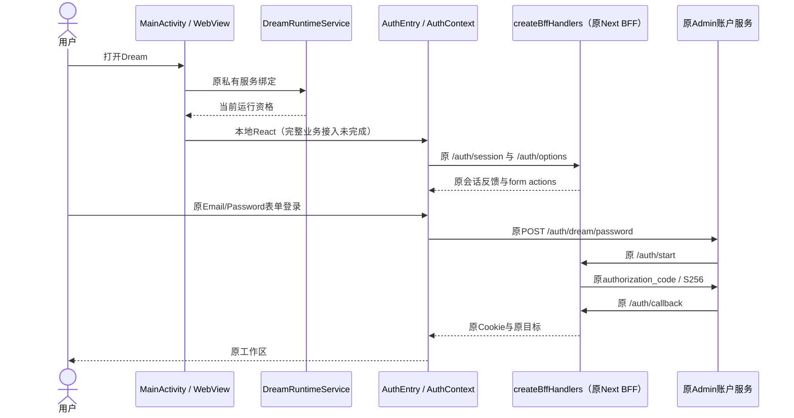
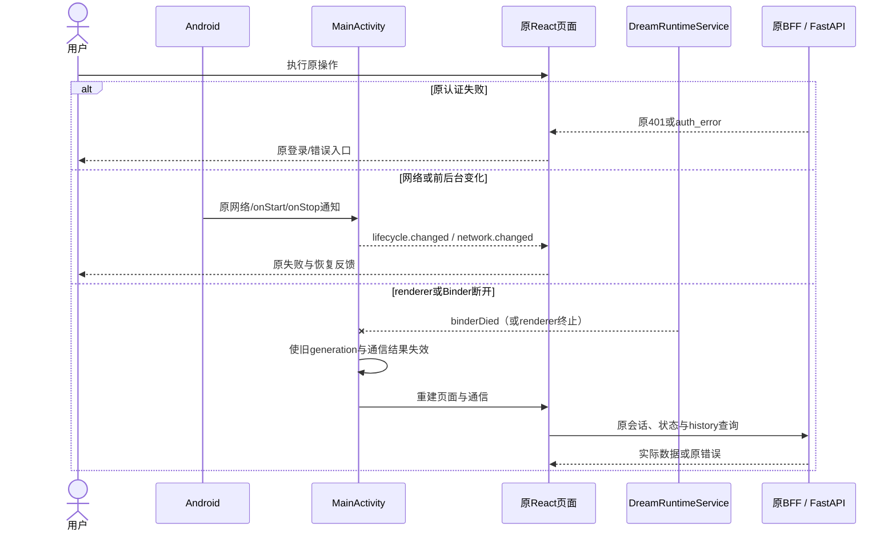
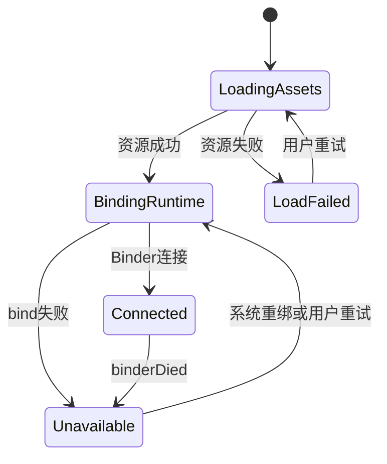

<!-- [Sync] 2026-10-27: RN框架目标保持，按原生与网页区域减少迁移范围。 -->
<!-- [Input] 当前Dream网页业务、Kotlin/WebView工程及移动平台约束。 -->
<!-- [Output] Android容器、正常网页登录、交互和验证边界。 -->
<!-- [Pos] Android独立正式交互设计；业务规则来自现有React和Python。 -->
<!-- [Sync] 2026-10-25: 端侧部署决定复用既有关闭Claude命令沙箱配置，保留Android应用隔离和原工具审批。 -->

<!-- [Sync] 2026-10-27: 增加RN目标、App级后端生命周期和HTTP业务；工作台创建退出端侧范围。 -->

# Ink & Memory Android交互设计

## 现行Android工程与交互

原生工程归`frontend/android/`，`MainApplication`持有RN Host，`MainActivity`继承ReactActivity，Gradle消费`frontend/index.native.js`；旧静态网页资源任务已退役。共享界面与业务时序见[统一工程设计](react-native-web-project-structure.md)。

原私有`:dream_runtime` Service及系统资源适配保留。Android Python/Claude尚待嵌入与资格验证，InkRuntime启动明确返回CAPABILITY_UNAVAILABLE，完整Android业务与APK/AAB状态保持未验收。App生命周期、权限、签名和渠道要求单独执行。

## 原平台实现与历史交互记录

以下保留原Kotlin/WebView分析及图示；新RN主界面与发布链退出旧容器策略。

RN作为App入口，现有Kotlin及私有runtime Service用于平台适配。页面按[RN内的复用取舍](frontend-reuse-tradeoffs.md)逐区迁移，保留DOM业务继续WebView运行；Android Python/Claude资格独立验证。

## React Native目标接入

目标采用RN原生主界面，正常网页登录保留受限Android WebView。[RN交互稿](mobile-react-native-interaction.md)定义HTTP业务、范围与时序，[运行时架构](mobile-runtime-architecture.md#实例所有权与生命周期)定义实例生命周期。以下保留Kotlin/WebView工程现状及旧图示。

App组合根持有BackendRuntimeManager（建议、未实现），与原runtime service明确绑定；Activity配置变化及RN Root重建复用原所有者。Python、Node/Claude及ABI继续独立验证。HTTP客户端与WebView Cookie接入保持原Cookie、CSRF、来源与权限。

返回先处理键盘、弹窗与详情，inset沿原主题。后台不新增常驻或全局扫描；进程重开按原HTTP与Session恢复。工作台创建、初始生成和审核确认退出移动展示与适配。账户与数据访问公网Admin；原文的Mac内网联调保留历史归属。

## 背景与问题

Android使用Kotlin/WebView承载现有React，计划在同应用身份内运行Dream Python。当前工程含固定appassets来源、WebMessage、私有runtime service与系统文件适配；Python和Claude尚未接入，Android构建/真机回执仍缺失。

本稿使用[PRD](../../prd/dream-workspace/mobile-app.md)与[共享交互](./mobile-app-interaction.md)中的正常网页业务；平台容器不另建账户和任务流程。

## 目标与边界

保留原网页登录、Cookie/CSRF、账户、入口、任务、附件、权限和存储。Android只负责WebView资源装配、应用内部通信、系统返回、键盘/inset、文件选择与生命周期通知。Mac上的原Admin供本轮内网联调，原认证来源与HTTPS校验保持。

私有`:dream_runtime` service只是解释器装配边界，不获得后台常驻或全局任务领取能力。当前无合格Python/Claude制品；未完成路径以技术阻断记录，不派生精简业务或远程执行。

端侧Dream进程沿用[部署稿的既有关闭配置](../../deploy/mobile-app-release.md#端侧claude命令沙箱配置)，保留Android应用UID、存储权限和原工具审批，不增加沙箱设置页。当前Android工程尚未接入该配置或完整命令执行；安装、真实业务和发布分别验收。

## 概念与规则

| 模块 | 职责与现状 |
| --- | --- |
| `MainActivity` / `WebViewAssetLoader` | 本地React资源、WebView生命周期；本轮允许原HTTPS顶层网页和资源 |
| `MobileBridgeHandler` | 仅appassets主frame可调用；page generation隔离迟到响应 |
| `DreamRuntimeService` / `IDreamRuntime` | 非导出私有服务、Binder通信；当前请求失败关闭 |
| `AndroidPlatformActions` | 系统文件选择/保存/分享适配；业务接线与资格待验证 |
| `AuthEntry` / 原Next BFF | 原form登录、callback、Cookie/CSRF和退出；Android不保存OAuth用户令牌 |

源码：[宿主](../../../frontend/android/app/src/main/java/com/inkmemory/mobile/MainActivity.kt)、[bridge](../../../frontend/android/app/src/main/java/com/inkmemory/mobile/bridge/MobileBridgeHandler.kt)、[runtime service](../../../frontend/android/app/src/main/java/com/inkmemory/mobile/runtime/DreamRuntimeService.kt)、[原登录](../../../frontend/app/_dream/components/Auth/AuthEntry.tsx#L34)。

### 页面与操作

使用[PRD正文骨架](../../prd/dream-workspace/mobile-app.md#页面骨架)与原响应式页面。Back先处理IME和当前原弹窗，再按原业务历史返回；根页面交给系统。键盘/inset保证原输入区和Login、发送/停止按钮可见，不重写原页面或原提交条件。

保持WebView第一方Cookie与原顶层form导航。远程认证页面无法调用本地bridge。文件适配需返回原业务可消费的文件输入，保留`useFileUpload`上传和`AIInputDock`写workspace顺序；原生临时副本无法定义新业务存储。

## 正常业务时序

容器到原BFF及端侧Python的完整接入均未完成。

## 异常与恢复时序

后台通知不新增业务保存、任务状态、自动重发或恢复承诺。任何任务终态均由原业务记录判断。

## 容器状态转换

账户、Run和Thread状态继续采用原定义；本图只描述宿主通信。

## 实施与验收

原生认证methods/event已经从协议删除。文件、下载和分享只接原业务入口，不增加权限申请或产品流程。未实现的Python、Claude、BFF接线、完整流与取消继续列为阻断。Android工具链条件、安装包和真机覆盖分别验收；当前改动只取得源码/协议验证时，保留该限制。

构建、签名、APK/AAB和渠道条件见[发布稿](../../deploy/mobile-app-release.md)。共同验证见[复审矩阵](../../exec/mobile-app-design-review-20261024.md#本轮复审验收矩阵)。
