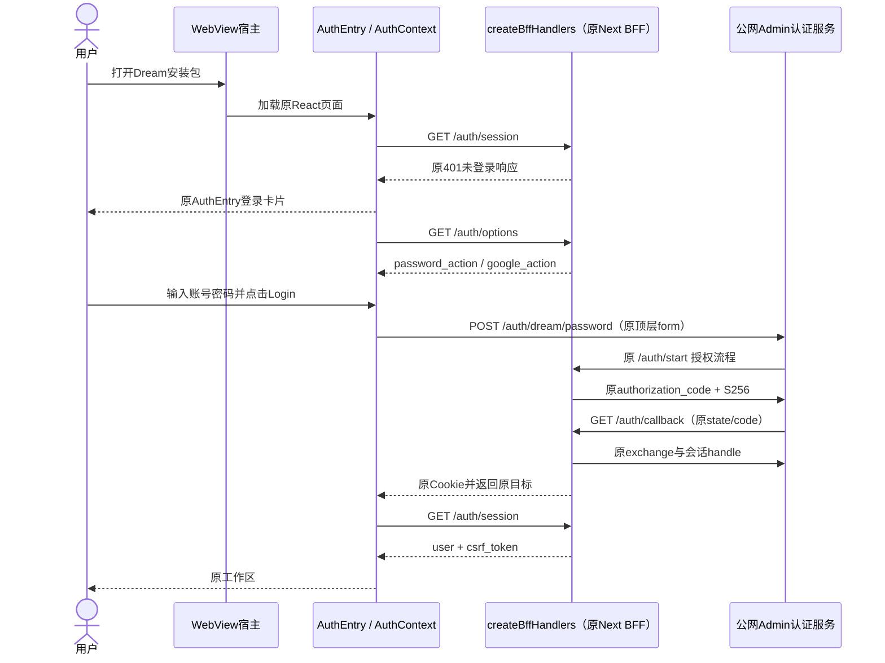
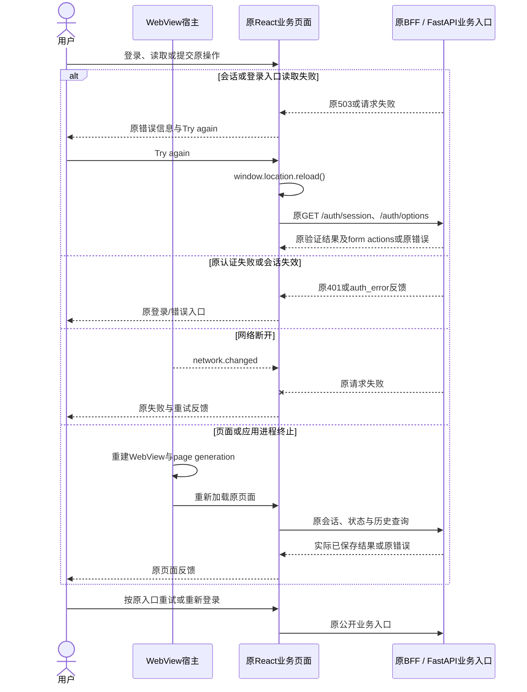
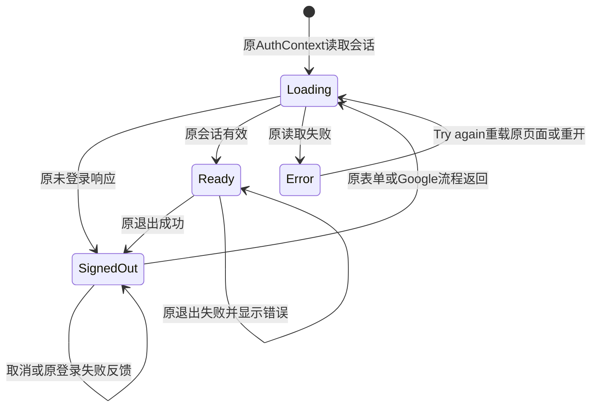

<!-- [Sync] 2026-10-27: 迁移multi-platform；本文保留既有WebView合同，现行RN主界面见mobile-react-native-interaction.md。 -->
<!-- [Input] 当前Dream网页业务、正常网页登录要求和双原生宿主。 -->
<!-- [Output] 保持原业务的共享用户旅程、交互时序、页面状态与适配边界。 -->
<!-- [Pos] 移动共享交互；平台实现分别归iOS和Android设计。 -->
<!-- [Sync] 2026-10-25: 明确公网Admin网页登录及Simulator真实业务回执。 -->
<!-- [Sync] 2026-10-25: 原登录读取失败提供用户触发的页面重载；既有表单、会话和任务处理保持。 -->
<!-- [Sync] 2026-10-25: iOS Simulator应用宿主完成现有网页登录、会话与一次真实Chat。 -->
<!-- [Sync] 2026-10-25: 删除独立原生认证、业务能力裁剪、新任务状态和附件流程改写。 -->

<!-- [Sync] 2026-10-27: 保留WebView实现参照，RN目标与工作台创建排除由RN交互稿定义。 -->

# 移动应用共享交互

2026-10-27当前目标见[React Native正式交互稿](mobile-react-native-interaction.md)。业务继续HTTP访问，App级模块管理后端生命周期；端侧隐藏工作台创建与审核确认入口，相关流程退出适配。以下保留既有WebView实现与回执，图示适用范围为原网页路径。

## 背景与问题

移动端复用Dream网页交互和端侧Python业务。宿主提供WebView、解释器、平台输入和必要系统操作。前稿将技术缺口转成了独立认证、文件规则与业务状态，现行稿已删除这些设计。

[PRD与骨架](../../prd/dream-workspace/mobile-app.md)、[架构](./mobile-runtime-architecture.md)、[iOS](./mobile-ios-interaction.md)、[Android](./mobile-android-interaction.md)、[发布稿](../../deploy/mobile-app-release.md)与[复审记录](../../exec/mobile-app-design-review-20261024.md#2026-10-25-保留网页业务的设计复审与实现修正)共同定义范围。

## 目标与边界

保留现有登录卡片、账户、导航、任务、附件、数据归属、权限、停止和恢复。只增加对应平台的资源装配、线程/进程通信、返回、键盘、安全区和系统选择器适配。普通Web继续执行原Next/BFF业务路径。

正常图描述既有网页业务。iOS Simulator应用宿主已通过公网Admin完成该登录时序与一次真实Chat；物理iPhone和Android回执、端侧完整后端仍待验证。

## 概念与规则

| 对象 | 规则与来源 |
| --- | --- |
| 登录页面 | 现有`AuthEntry`，原表单action、注册、Google及错误反馈；会话/options读取失败显示页面重载入口 |
| 会话 | 原`/auth/session`、BFF Cookie/CSRF；原`/auth/logout`成功后清理 |
| 任务 | 原FastAPI路由、Runner、持久化、SSE parser和既有状态 |
| 附件 | 原`useFileUpload`与`AIInputDock`流程；系统选择器仅提供文件输入 |
| 平台生命周期 | 向页面报告可见性与网络；无额外业务写入、自动重发或终态推断 |
| 容器启动 | 资源/解释器/传输技术状态；不定义账户状态或隐藏业务入口规则 |

不增加原生认证bridge、原生用户令牌仓库、替代Agent、后台保存协议、本机/云端新文件栏目或第二套业务UI。

## 正常业务时序

账号验证、OAuth与会话处理继续由公网Admin和原BFF执行。当前独立iOS包在应用内运行原Next和端侧Python，沿用现有前后端env及权限传递；原账户、消息持久化与真实模型已有阶段回执，结束反馈稳定性和完整工具继续待验收。早期Mac relay回执保留于执行历史。

## 异常与恢复时序

宿主无权根据断流、后台或进程终止写入业务完成/取消状态。已有停止回执与任务终态分别按原实现处理。

## 页面状态转换

图中状态为页面展示概念，后端Run/Thread状态沿原定义。平台generation仅隔离旧页面响应，不作为业务revision、任务状态或持久化字段。

## 平台交互与复用

- iOS保持WKWebView第一方Cookie，允许原HTTPS form/navigation；远程页面无本地bridge权限。
- Android保持WebView第一方Cookie，允许原HTTPS网页及资源；桥接限定appassets主frame。
- 键盘、安全区、滚动和返回由平台适配，原业务弹窗、按钮和提交条件保持一致。
- 附件、预览、下载、分享、外链与授权取消按原入口反馈；只为实际系统操作添加适配。
- Codex参考的订阅、快照、旧响应隔离只用于现有Dream页面的通信可靠性；不引入其任务状态、界面、文件存储或认证协议。

验收见[复审矩阵](../../exec/mobile-app-design-review-20261024.md#本轮复审验收矩阵)。
