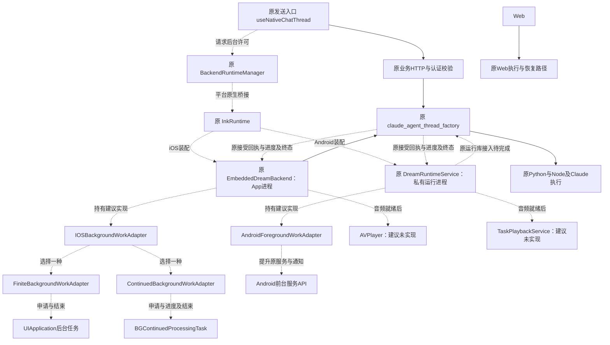
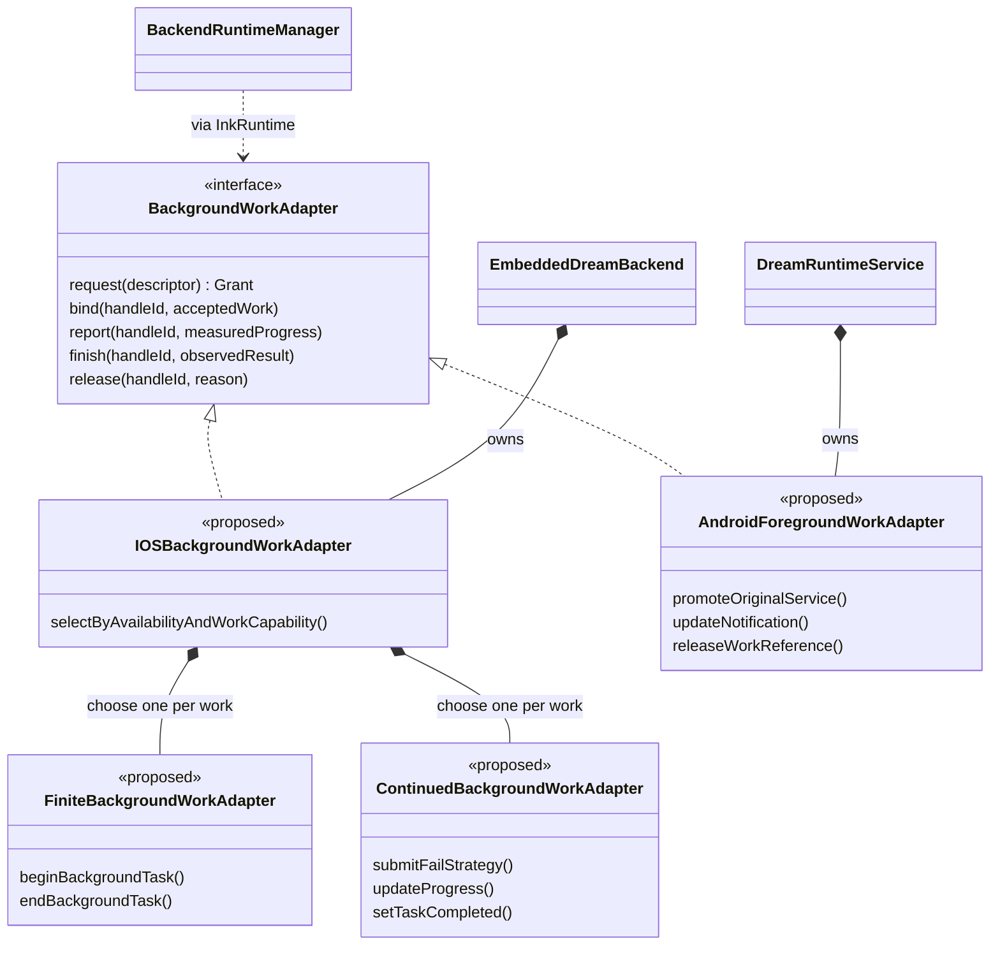
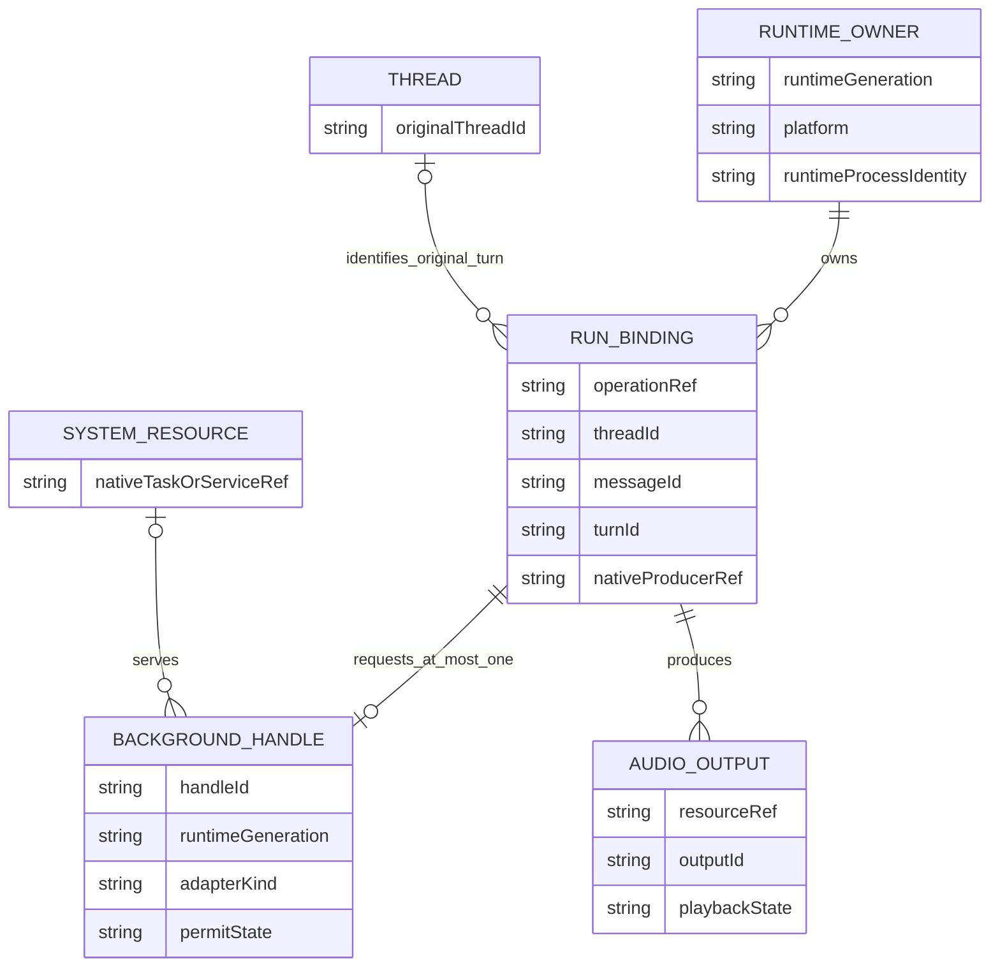
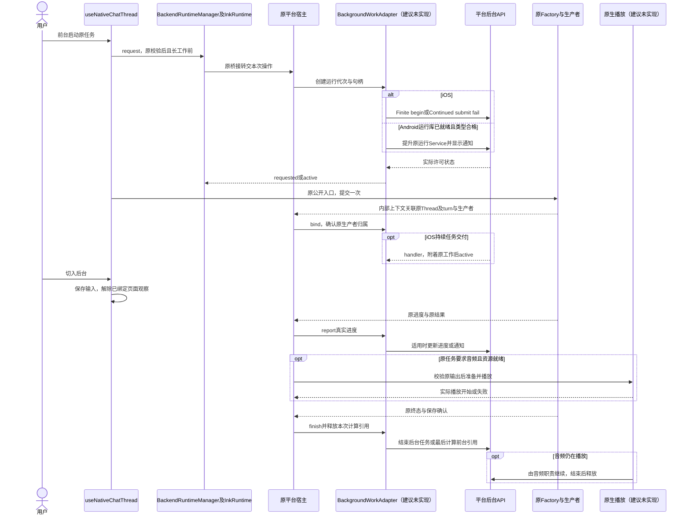
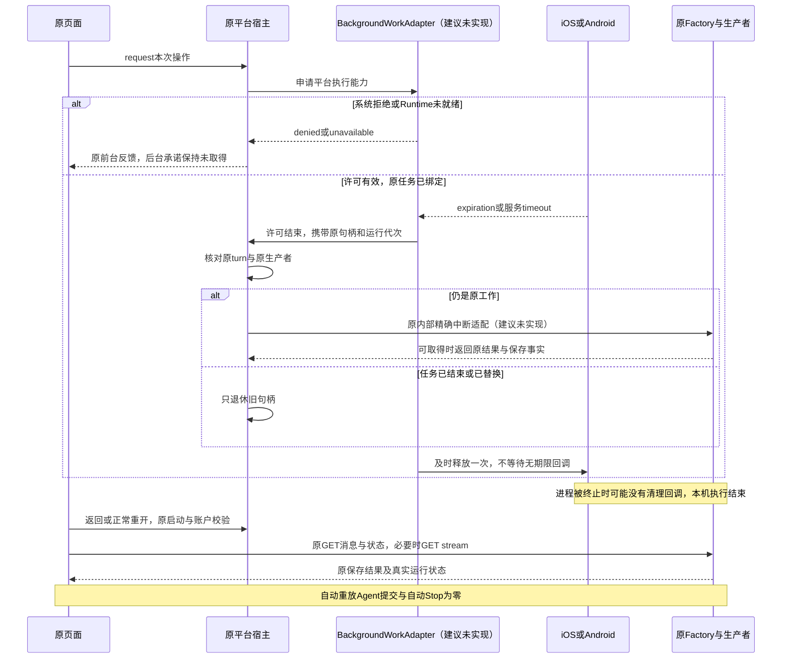
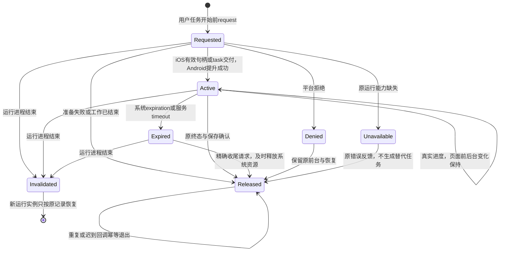
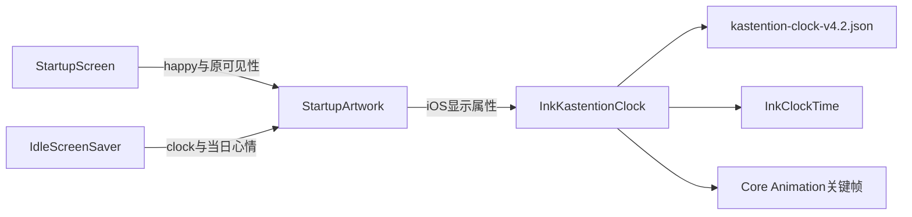

<!-- [Sync] 2026-11-03: v4.2角色时钟采用单一共享组件及iOS原生关键帧，避免JS逐帧计算。 -->
<!-- [Sync] 2026-11-03: 落实Factory账户只读观察、RN屏保及Widget候选；后台计算适配继续暂停。 -->
<!-- [Sync] 2026-11-03: 补应用内无操作屏保及iOS Live Activity，共用只读Thread二值聚合；新增接线建议未实现。 -->
<!-- [Input] 本机Agent源码、iOS后台任务、Android前台服务及APP-04产品交互。 -->
<!-- [Output] 移动端后台执行适配器拓扑、对象关系、接口、平台操作、音频衔接与开发验收。 -->
<!-- [Pos] APP-04开发文档；新增适配器及接口均为建议、未实现；Web沿原路径。 -->
<!-- [Sync] 2026-11-03: 从混合稿拆出技术职责，补iOS/Android平台实现、拓扑/类图/对象关系及先计算后播放时序。 -->

# 本机 Agent 后台执行开发文档

## 背景与问题

目标链路为：用户前台启动原任务，手机内原Agent继续计算，音频资源就绪时按需启动播放，原结果完成保存后分别释放计算与音频资源。产品规则归[交互设计](mobile-recovery-interaction.md)，页面骨架归[移动PRD](../../prd/mobile-app/mobile-app.md#前后台与进程重开恢复2026-11-02)，实施状态与命令回执归[执行记录](../../exec/app-experience-foreground-recovery-20261102.md)。

本文所有新增适配器、关联对象、观察回调和播放接线均为**建议、未实现**。图中的现有宿主与Factory继续使用原实现。前稿正文和原六幅图完整保留于[历史快照](history/mobile-recovery-mixed-draft-20261103.md)，快照中的相对路径按原目录解释。

### 当前源码事实

| 模块 | 已有行为 | 开发缺口 |
| --- | --- | --- |
| [BackendRuntimeManager](../../../frontend/src/runtime/BackendRuntimeManager.ts) | 共享一次启动Promise、启动事实和原诊断 | 缺少后台工作接口与许可状态投影 |
| [InkRuntime](../../../frontend/ios/InkMemory/InkReactNative.swift)、[EmbeddedDreamBackend](../../../frontend/ios/InkMemory/EmbeddedDreamBackend.swift) | iOS App内启动CPython与原Node Runtime，保留原实例 | 缺少后台任务注册、系统句柄和独立于页面的工作观察 |
| [iOS组合根](../../../backend/mobile_runtime/ios.py) | 原Factory、ASGI和运行库装配 | 缺少本次提交与后台句柄的内部关联、宿主观察和精确到期收尾 |
| [useNativeChatThread](../../../frontend/app/_dream/components/chat/useNativeChatThread.native.ts) | background关闭reader及准备；active读取原history/status | 页面reader、准备取消与生产者存续需分别处理 |
| [公开Agent入口](../../../backend/routers/claude_agent.py)、[Factory](../../../backend/claude_agent/thread_factory.py) | POST响应开始消费才进入Factory；生产者由bg_task持有，subscriber释放只unsubscribe | 缺少按原turn及生产者匹配的宿主观察/中断接口 |
| [Android InkRuntime](../../../frontend/android/app/src/main/java/com/inkmemory/mobile/InkRuntimePackage.kt) | ensureStarted明确返回CAPABILITY_UNAVAILABLE | Python/Node/Claude、认证与原业务接入尚未就绪 |
| [DreamRuntimeService](../../../frontend/android/app/src/main/java/com/inkmemory/mobile/runtime/DreamRuntimeService.kt)、[Manifest](../../../frontend/android/app/src/main/AndroidManifest.xml) | 非导出、独立:dream_runtime进程的Binder服务骨架 | 缺少实际Runtime、前台服务类型/权限、通知及工作持有 |
| [iOS Info.plist](../../../frontend/ios/InkMemory/Info.plist)及两端原生目录 | 当前未见本文所需后台任务与音频接线 | 后台声明、可播放资源交接和原生播放器均待实现 |

Agent在手机本机运行表示任务编排、工具执行及原Runtime位于手机。原有模型或数据服务的网络调用保持；本方案不改变模型执行位置。Android运行进程与UI进程分离，iOS原运行库由App进程持有。

## 目标与边界

- 在原BackendRuntimeManager与平台宿主职责内增加小型后台执行适配，原业务只提交一次。
- iOS实现系统后台任务适配，Android实现原私有运行服务的前台执行适配。Web保留现有路径，新增Web适配器、空实现和后台系统调用为零。
- 适配器只管理执行许可、实际进度、到期通知与资源释放；原Factory持有任务生产者、认证、权限、消息保存、结算和Stop。
- 持续计算为目标，有限时间为兼容能力。iOS普通Chat尚缺原生观察和准确进度接入；Android尚缺端侧Runtime及前台服务接入。上述缺口闭合前，持续计算验收保持未通过。
- 后台执行均受系统资源与用户停止约束。跨进程自动续跑、任务迁移、新Manager、新业务HTTP、数据库表和业务队列退出范围。

## 概念与规则

### 运行拓扑：谁调用谁，工作在哪个进程

实线表示原有调用方向；虚线表示建议、未实现的后台适配、观察或音频接线。图中的适配选择发生在平台装配层。

后台系统回调附着已由用户发起的原任务。系统回调创建Thread、重复派发Agent或迁移执行位置的次数均为零。Web入口不加载Native模块；复用现有平台解析与组合根完成装配。

### 适配器类图：统一接口与平台实现

下列类图表达建议代码责任，新增类型均未实现。iOS内部继续区分两种系统API；Android实现复用原Service。

### 对象关系：句柄如何绑定原任务

本图为建议的内存对象关系图。RunBinding、BackgroundHandle与AudioOutput表示运行期关联对象，新增数据库表和持久化schema为零。原Thread与消息仍使用原业务记录。

- 同一用户操作最多申请一个后台句柄。iOS系统任务与句柄逐次关联；Android多个活动句柄共享同一前台Service与通知生命周期，按活动引用释放，最后一个引用结束才降级服务。
- request早于原Thread/turn创建时，RunBinding只持operationRef；原Factory建立生产者后补齐原身份与nativeProducerRef，bind最多成功一次。
- runtimeGeneration来自原运行宿主：iOS使用当前App运行实例，Android使用实际:dream_runtime实例。Activity或RN页面重建不生成新的运行任务；运行进程重建使旧句柄失效。
- nativeProducerRef只由原Factory/宿主保存；JS、网页和外部输入不能指定生产者、终态或已保存事实。所有账户与Thread校验继续经过原公开入口。
- 一个turn可产生多个音频输出，按原资源及输出身份去重；音频完成不等于turn完成。重开恢复不自动重播或创建新输出。

### 接口契约与调用位置（建议、未实现）

以下为逻辑DTO与方法合同，具体Swift/Kotlin类型由对应平台实现；接口归现有宿主，未形成新业务API。

| 操作 | 调用者、输入 | 返回/副作用 | 失败处理 |
| --- | --- | --- | --- |
| request | 原发送入口经BackendRuntimeManager/InkRuntime；传本次用户操作引用、工作类型、音频输出要求；任务进度能力由宿主核实 | 返回handleId、adapterKind、requested/active/denied/unavailable；原生生成句柄与运行代次 | 缺Runtime返回unavailable；拒绝保留前台原业务，尚未存在的Android运行库保持fail closed |
| bind | 原宿主内部；传handleId与已认证原请求的threadId/messageId/turnId/原生产者 | 校验运行代次与同一提交，保存只读关联；提交归属就绪后方可退出POST reader | 归属冲突释放本次后台句柄并沿原读取核实；不重放写入 |
| report | 原生产者的内部观察；传同一handleId、实际已完成/总单位及单位含义 | 持续任务更新Progress；Android更新通知；有限实现仅保留事实 | 无可测总量时不生成百分比，不用Token、时间或字符数推算完成比例 |
| finish | 原宿主观察到原任务终态及保存回执 | 成功且保存确认后报告系统成功，失败按实际结果结束；系统资源释放一次 | 保存失败或终态未明时系统完成不写业务成功；原历史与状态继续核实 |
| release | 原宿主；传handleId和实际释放原因 | 串行校验、退出观察、关闭本句柄；Android递减本任务引用 | 重复或迟到调用幂等退出；保持其他任务和音频资源 |

许可事件使用granted、denied、expired、released及unavailable事实。事件带handleId与runtimeGeneration。bind/report/finish为宿主内部调用；RN只读投影许可状态，不接收设置业务终态的权限。release本身只释放后台资源，原任务中断由原执行者处理。

#### 原提交与后台句柄如何关联

1. 用户发送校验通过，原入口调用request；原生创建本次operationRef与handleId。
2. 原Native HTTP装配将句柄关联放入**本机传输内部上下文**，由既有请求所有者携带。该关联需补接线，新增公开HTTP header、URL参数和业务DTO字段为零；Web传输保持。
3. [NativeASGITransport](../../../backend/mobile_runtime/asgi_transport.py)为对应请求消费安装内部关联上下文。原认证/权限通过后，Factory在bg_task与current_turn_id建立时通知同一宿主；宿主核对原请求归属后bind。
4. iOS通过原同进程组合根完成观察；Android经原私有Binder通知实际运行服务，再投影到UI。精确关联的Native传输参数、内部上下文及Factory回调均为待实现项；前台reader不可用来替代这一观察。
5. 原POST懒启动阶段保持提交reader，直至生产者归属确认或原请求失败。绑定后UI可退出消息观察，原生产者及宿主终态观察保持。原[EventBus](../../../backend/claude_agent/event_bus.py)继续承载既有事件，不新增消息队列。

### iOS适配器操作

| 步骤 | 操作与条件 |
| --- | --- |
| 选择 | 编译SDK具备符号、运行时iOS 26及以上，原工作具备可测进度、结束回执和受控收尾时选择Continued；其他情况使用Finite。保留现有最低系统兼容 |
| Finite申请 | 用户工作开始前调用UIApplication.beginBackgroundTask；有效identifier记active；后台切换不重新申请或循环延长 |
| Continued注册与申请 | 在原宿主生命周期注册Bundle ID派生的允许identifier；前台用户动作触发submit，显式使用.fail；提交成功记requested，系统handler交付才记active |
| 系统handler | 核对原句柄及运行代次，只附着原工作。前台业务沿原入口执行一次，无需等待handler取得前台执行资格；迟到handler结束自己的过期任务 |
| 进度与结束 | 原执行者报告真实Progress；计算及保存结束后endBackgroundTask或setTaskCompleted；已结束但尚未交付的请求及时撤销 |
| 到期 | expirationHandler只说明许可结束，回调无原因参数；按原turn和生产者请求有界收尾，及时结束系统句柄，不等待无期限网络/模型/JS |

[Apple持续任务说明](https://developer.apple.com/documentation/backgroundtasks/performing-long-running-tasks-on-ios-and-ipados)要求前台用户动作、进度上报和结束处理，系统可因资源不足终止任务。[有限后台时间](https://developer.apple.com/documentation/uikit/extending-your-app-s-background-execution-time)需在工作开始前申请并及时释放；多个identifier共享系统给予App的时间。API版本依据[官方metadata](https://developer.apple.com/tutorials/data/documentation/backgroundtasks/bgcontinuedprocessingtask.json)。

普通Chat当前的text-delta、tool事件、局部计数和finish尚未接成该后台任务的完整进度契约。**待解决项为原生产者如何提供准确进度及宿主观察**；不能仅填写进度数字即声明合格。有限实现可先改善其许可区间，持续计算目标保留独立验收项。

### Android适配器操作

1. 先完成原DreamRuntimeService内Python/Node/Claude、原认证和公开业务入口。当前ensureStarted拒绝保持；仅增加通知无法补齐运行能力。
2. 在前台用户启动任务时，由InkRuntime经原RuntimeClient调用ContextCompat.startForegroundService启动原运行Service，并经原Binder关联本次request。Service在onStartCommand内及时调用ServiceCompat.startForeground提升并创建任务通知；原业务仍派发一次。
3. Android 14及以上按实际工作声明foregroundServiceType及对应权限。普通Agent工作需要先核对实际用途；未被既有类型覆盖的合法用途可评估specialUse，并声明PROPERTY_SPECIAL_USE_FGS_SUBTYPE及FOREGROUND_SERVICE_SPECIAL_USE。该选择属于待核对方案，Google Play对应声明需审查。
4. dataSync仅适用于符合其定义的数据操作，mediaPlayback仅用于实际播放，shortService只覆盖短时工作；不能将任意Agent计算统一归入这些类型。
5. 原Service持有活动工作与后台句柄；任务进度更新通知，点击返回对应原Thread。通知中显式停止操作沿原认证和精确turn停止；用户通过系统界面停止进程可能没有清理回调，恢复依赖原记录。
6. 最后一个计算引用结束后移除计算前台状态；Service仍有原前台绑定时保留既有宿主实例。无任务、无播放职责且无绑定时结束服务。onTimeout、Binder死亡与服务销毁按实际情况及时清理，START_STICKY重放任务和BOOT_COMPLETED自动启动退出本方案。

具体类型、权限、通知配置与目标SDK从原Android工程读取，不硬编码新版本阈值或运行时长。[启动规则](https://developer.android.com/develop/background-work/services/fgs/launch)限制从后台启动服务，[服务类型](https://developer.android.com/develop/background-work/services/fgs/service-types)定义权限与用途；后台执行时长及存活不作无限承诺。唤醒锁需按真实CPU执行需求独立评估，前台服务状态不自动授予永久唤醒或忽略电池策略。

### 计算到音频：独立所有权与交接

音频输入为原任务实际生成、当前账户可读取的音频资源引用及输出身份。语音合成/生成能力按原任务与已配置能力核对；本文不增加语音模型或把文本直接当作可播放资源。当前尚无本文要求的原生播放实现，音频生成来源、格式与资源交接为开发前置。

| 平台 | 播放启动与存续（建议、未实现） | 计算与音频的结束条件 |
| --- | --- | --- |
| iOS | 原宿主持有AVPlayer；音频资源验证后激活AVAudioSession.Category.playback，Info.plist按实际播放声明UIBackgroundModes=audio；处理音频中断与路由变化 | 播放实际开始确认后可释放已完成计算的句柄，音频独立继续；播放结束或用户停止时释放播放器及会话 |
| Android | 建议由专门TaskPlaybackService继承MediaSessionService持有Player与MediaSession，真实播放使用mediaPlayback声明与权限；独立于Activity及计算Service | 计算Service与播放Service分别持有自身前台状态；播放就绪后才退出已完成计算的引用，播放结束释放Player/MediaSession |

Android新增播放Service仅承载实际媒体与系统播放控制，计算继续由原DreamRuntimeService持有。控制入口需校验当前输出归属及允许的媒体控制客户端，资源引用沿原权限；不放宽私有计算Service的exported边界。 Android从后台启动或提升播放Service仍须满足当前系统的启动条件，计算前台Service存活不直接证明新增播放Service已获准。前台任务声明音频输出时可预先准备播放连接；实际资源就绪后再次核对启动资格，拒绝时保留待播放结果并沿原页面反馈。

交接顺序为：音频资源就绪 → 当前运行代次及原turn/输出校验 → 平台播放准备与开始确认 → 释放已完成的计算许可。播放启动失败时保存原结果并反馈播放失败，及时结束已完成计算的许可。系统已挂起或结束运行进程时，禁止宣称音频能由未执行的本地回调自行启动。

暂停播放不取消原计算；原Stop继续处理任务。任务仍在计算时，计算许可与音频许可分别保持。完整结果已保存而音频仍播放时，计算许可可独立释放。音频缓冲耗尽、用户暂停或播放结束后，无音频期间的计算继续依赖计算适配器。[iOS播放能力](https://developer.apple.com/documentation/avfaudio/avaudiosession/category-swift.struct/playback)、[Apple用途规则](https://developer.apple.com/app-store/review/guidelines/#software-requirements)与[Android媒体后台服务](https://developer.android.com/media/media3/session/background-playback)分别约束对应平台。

### 正常调用时序：两端计算与按需播放（新增接口均建议、未实现）

### 异常时序：拒绝、到期、精确收尾与重开

### 后台句柄状态

### 到期收尾、停止与读取恢复

原[stop_thread](../../../backend/claude_agent/thread_factory.py)按Thread定位当前bg_task。新增宿主中断入口须在原Factory内核对expected runtimeGeneration、turnId和生产者引用，匹配后复用原取消、持久化与结算；该窄适配为建议、未实现，后台旧回调不得停止后续turn或其他Thread。

用户Stop继续走requestClaudeSubmittedThreadStop及原回执。iOS expirationHandler无原因参数，系统界面取消和资源到期统一记录许可结束事实，业务终态只采信原生产者。Android系统直接停止服务/进程可能无回调，清理与恢复须覆盖该情况。

useNativeChatThread.closeReader需拆开页面订阅释放和准备取消。许可有效且生产者未确认时保持原准备与POST读取；确认后可退出呈现reader，原生观察保持。无许可或到期时取消未派发准备并恢复输入；提交结果未明只读核实。已派发写入始终按原请求身份处理。

返回前台调用原hydrateClaudeThreadSession读取messages/status；running才接续同Thread GET stream。进程重开使用正常启动与原账户校验，读取Settings选择指针、草稿和已上传资源引用，再查原记录。Settings不保存凭据、临时文件字节或任务执行栈；not_found不合成业务成功或取消。Writing侧对话经原入口重新准备活上下文，原发送保护保持。

### 应用内静态动画与iOS系统组件（源码候选，验证独立登记）

本增量对应[双入口产品规则](mobile-recovery-interaction.md#应用内静态动画与系统组件2026-11-03)。复用一份当前账户、本机运行代次的只读状态，分别交RN屏保层和iOS Live Activity。两种显示均不取得任务生命周期控制权。

#### 实现前基线与当前最小适配

| 代码事实 | 本增量适配 |
| --- | --- |
| [原status入口](../../../backend/routers/claude_agent.py):2792–2837经过原账户及Thread归属校验，`running`等于原`lifecycle == running` | 活跃口径沿原状态，SSE连接、页面可见性、CPU采样及后台许可均不代替任务状态。 |
| [Factory](../../../backend/claude_agent/thread_factory.py):1188–1189已提供`list_session_snapshots`；[Pool snapshot](../../../backend/claude_agent/thread_pool.py):280–289只有公共诊断投影；当前turn身份在[私有字段](../../../backend/claude_agent/thread_pool.py):195–201 | 列表快照缺少账户归属字段。沿`observe_thread_presence`内部观察接线，在Factory内按已认证`current_user_id`与原运行状态做只读聚合；既有公共snapshot和HTTP DTO保持。 |
| [Factory原启动](../../../backend/claude_agent/thread_factory.py):460–477记录本次身份并进入RUNNING | 从原状态转换观察首次及后续快照，覆盖全部入口；RN保留的主/侧页面和历史当前页仅提供局部状态。首次快照与观察登记需在同一事件循环序列完成，覆盖其间转换。 |
| [Native Hook](../../../frontend/app/_dream/components/chat/useNativeChatThread.native.ts)已有`visible`输入及Thread读取所有权；[Business](../../../frontend/src/App.tsx):123传入栏目与侧对话可见性 | 屏保显示时在同一输入增加可见条件，底层消息UI停止发布，原运行实例与事件处理保持。其他业务页面保持挂载。 |
| [StartupArtwork](../../../frontend/src/components/StartupArtwork.native.tsx)及[共享路径](../../../frontend/src/assets/startup-artwork.json)已有SVG、主题和减少动态效果处理；[package.json](../../../frontend/package.json)已有react-native-svg，无独立虚化组件 | 屏保叶子复用路径与主题，不挂载StartupScreen的启动文案或重新执行准备。候选已增加时钟指针及心情模式，原三套主题继续复用，视觉效果按Simulator截图验收。 |
| [StateChooser](../../../frontend/app/_dream/components/StateChooser.tsx)沿StateConfig及selectedState显示心情 | 屏保只消费当前账户当日已取得的心情；多笔沿原时间排序取最近已保存项。`unhappy`投影悲伤，原`happy`及其余值投影开心；其他／缺失值默认开心，不写回笔记或修改状态定义。 |
| [iOS工程](../../../frontend/ios/InkMemory.xcodeproj/project.pbxproj):505最低系统为16.4；[Info.plist](../../../frontend/ios/InkMemory/Info.plist)及当前工程未见Live Activity扩展 | 保持最低系统，按可用性装配ActivityKit；需增加Widget扩展及NSSupportsLiveActivities，候选已沿原签名配置派生扩展标识并装配目标，组件资源归同一来源。 |

#### 只读聚合与实例所有权

1. 原生产者宿主观察负责当前已认证账户的**完整本机运行集合**；聚合为`hasActiveThread: Bool`。任一归属已校验的原状态为RUNNING即可投影true；只有完整集合核实后才投影false。等待确认、停止收尾继续由原lifecycle决定。原输入队列和未来任务的业务状态保持，独立队列记录不直接增加该值。
2. 观察包内部带`ownerId/generation/sequence/observedAt`供归属、顺序及陈旧校验；这些元数据不增加业务状态。错误和不完整观察保持原值，首次缺少快照时不提供Bool。原actor、原状态和原持久化均只读，权限校验保持。
3. 原BackendRuntimeManager及平台宿主持有一份聚合快照与订阅，生命周期归当前认证与运行代次；退出登录／换账户清理旧订阅、快照及活动，迟到事件拒绝更新。宿主观察独立于可卸载的RN页面和本地SSE reader，覆盖主、侧及其他本机任务；没有原生观察接线时，此项完整性保持未通过。
4. 屏保层只在可见时消费状态与既有心情快照；ActivityKit接线由原iOS宿主持有，单账户仅一张本轮汇总卡。布尔值变化或必要的进入后台／恢复核对触发发布；逐token推送、独立网络轮询和新的监测进程为零。

#### 候选代码与实例归属（2026-11-03）

| 实例／接口 | 归属与生命周期 | 行为 |
| --- | --- | --- |
| `ThreadFactory.observe_thread_presence` | 原Factory事件循环；当前账户订阅注册到原生账户退出 | 原RUNNING转换后汇总全部本机Thread，初始回执与登记无await；观察异常保留原业务 |
| `mobile_runtime.ios.thread_presence` | 原持久CPython循环；单账户generation绑定 | 二值变化去重并附sequence，旧generation释放不清理新绑定 |
| `NativeThreadPresence` | 原InkRuntime模块；同一正常Session校验后的订阅 | 原`/auth/session`核对user.id，拒绝重定向；同时发布RN事件与ActivityKit；换账户清理 |
| `BackendRuntimeManager` 的presence store | 原App管理器；当前公开owner绑定 | 丢弃旧账户、旧时间及错误回执，未知时省略状态行 |
| `useIdleScreenSaver` | 原Business实例；前台且无占用时一个timeout | genuine触摸更新25秒期限；键盘、心情弹窗、原生选择器／确认和诊断占用延后 |
| `IdleScreenSaver` | 仅覆盖期间挂载；关闭／后台释放 | 每秒指针、原SVG、当日已知心情和同一二值；原页面保持挂载，关闭触摸消费 |
| `ThreadActivityWidget` | iOS ActivityKit管理的独立扩展 | 同一hasActiveThread内容，最近确认标记；false结束本轮，系统决定移除时间 |

`InkRuntime.canShowIdleOverlay`在计时届满时检查当前可见UIKit编辑视图及可见WKWebView的`document.activeElement`编辑属性；查询仅返回布尔值，不读取正文。WKContentView在DOM失焦后仍可保留UIKit responder，因此Web文档使用DOM焦点作为占用依据；隐藏文档跳过。原生确认、系统选择器和诊断占用继续延后显示。

`InkIdleBackdrop`为原生系统材质视图，未保存底层截图。心情通过既有`chooser-view.createdAt`只读投影；chooser.expanded占用回调沿Writing→MoreNavigator→Business传递。新增HTTP、表、APNs、后台常驻和任务控制接口数量为零。Android虚化及系统组件保持未验证。

#### App内无操作层

`frontend/src/components/IdleScreenSaver.native.tsx`提供单一呈现叶子，计时与显示状态由原Business持有，不新增业务管理器。前台且已登录、无键盘焦点及模态交互时，按Notion产品值25秒登记一个可取消timeout；用户触摸、滚动、按键及导航更新最后操作时间。原生局部Web文档沿原焦点／交互观察接入；缺少必要信号时只补文档范围的交互通知，带原documentId/revision，不含正文，不改变业务DTO。

显示前复核账户、页面、前台状态和交互占用，防止迟到timeout盖住确认操作。前后台、页面／账户卸载和任何计时重置清理旧timeout。屏保覆盖业务内容，底层保持挂载；显示期间屏蔽底层触摸与辅助功能焦点，整次关闭手势由屏保消费，恢复原焦点与滚动位置。原工具确认到达时关闭屏保并交原确认UI，保持原权限要求。

SVG路径与画面布局复用现有素材；开屏表情与屏保时钟共用StartupArtwork，当前可见前台实例维护一个整秒计时，隐藏与后台立即停止。时钟模式使用实际本地时间定位三根指针；减少动态效果时取消形变并直接更新真实时间。秒级显示只更新图形，Thread状态由独立的原宿主观察提供。最低一秒开屏展示计时保持原规则，v4.2图形及设备验证按下方现行章节和专项执行记录登记。

页面虚化需核实当前RN渲染能力。当前Info.plist声明`RCTNewArchEnabled=false`，实施优先在原宿主加局部UIVisualEffectView呈现适配；Android按原平台渲染能力核对最小实现。半透明遮罩只作为视觉降级反馈，虚化缺失单列验收；为此升级RN架构、抓取并保存页面截图或加入通用特效框架退出范围。屏保、计时和模糊均不调用后台许可的request/release，不启动新的Runtime。

#### 共享角色／时钟渲染（v4.2）

`StartupArtwork.native.tsx`为唯一角色渲染入口；`StartupScreen`与`IdleScreenSaver`只传模式、心情、尺寸和可见性。iOS的`InkKastentionClock`平台视图将同一七条原路径、十二时位与预声明关键帧交给Core Animation。共享数据由`sync-clock-artwork.py`从用户v4.2原型和原SVG数据生成；该生成器复用现有字体构建工具fontTools 4.60.1，应用依赖与锁文件保持。

候选包括RN SVG的JS插值、局部WebView和原生图层关键帧。JS插值需要逐帧脚本工作，局部WebView增加独立文档实例；原生图层关键帧复用UIKit，满足原路径、预声明时序和无JS逐帧要求，作为本轮选定适配。

单个可见实例维护一个对齐整秒的一次性Timer。`InkClockTime`定义设备本地离散角度与连续整秒判断；分钟、小时边界分别推进一格，漏秒、时间或时区修正直接定位。`CAKeyframeAnimation`执行指针transform及三条发丝path关键帧，嘴部采用原路径间的290ms形变。JS逐帧回调、Bezier采样、WebView、动画框架和独立渲染进程新增数量为零。隐藏、后台与卸载清理timer及在播动画；减少动态效果继续整秒读时并直接定位。

原生资源缺失时保留原静态StartupArtwork图像，构建资源校验与Simulator视觉验收识别该降级。Android当前沿同一组件入口采用静态SVG及整秒位置，Native发丝关键帧和十二时位适配资格保持待验证。系统Live Activity继续使用同源静态SVG图标，时钟动效的执行范围为App内共享组件。

平台依据：2026-11-03读取本地react-native-svg 15.15.0实现及[官方项目](https://github.com/software-mansion/react-native-svg)，当前接口采用其已支持的元素；iOS预声明关键帧使用[CAKeyframeAnimation](https://developer.apple.com/documentation/quartzcore/cakeyframeanimation)、[values](https://developer.apple.com/documentation/quartzcore/cakeyframeanimation/values)及[keyTimes](https://developer.apple.com/documentation/quartzcore/cakeyframeanimation/keytimes)。HTML的SMIL时序转换为原生关键帧，保留设计数值和路径。

#### iOS锁屏／灵动岛

- `InkThreadActivity`为一个Widget扩展目标，文件归`frontend/ios/InkThreadActivity/`；最小内容为ActivityAttributes与SwiftUI呈现。原App和扩展共同编译同一Attributes类型，动态`ContentState`只含`hasActiveThread: Bool`。共享StartupArtwork资源源文件及两套主题视觉，扩展中不加载React Native、WebView、Python或Node。
- 原iOS宿主`NativeThreadPresence`经当前账户运行观察调用ActivityKit。前台原任务确认活跃后使用`Activity.request`创建活动；系统未授权或拒绝时沿原诊断记录，原任务继续。系统后台执行句柄及其强制进度要求继续归前文适配器，本组件字段保持有／无。
- App可执行期间使用`Activity.update`发布有／无；最后一条确认结束时以false作为`Activity.end`最终内容，由系统决定保留与移除。新的前台任务开启新一轮活动，不循环创建活动延长展示。同一连续活跃期仅成功创建一次；用户移除卡片后该期保持退出展示，全部空闲后再次活跃开启新一轮。原Stop仍在原业务入口。
- 固定显示“最近确认”，保留`ActivityContent.staleDate`陈旧语义：采用该次后台许可可确认的有效截止，无可确认截止时按本次观测时间标记。扩展保持最近二值并采用系统陈旧呈现；不增加“未知”状态或把观察失败写成false。App真正挂起／结束后无本地持续刷新承诺；返回时用`Activity.activities`核对并结束遗留、重复及旧账户活动。
- 点击采用系统默认打开App，随后由原SessionGate、唯一启动Promise和nativeChatRecovery读取恢复。该汇总卡不携带Thread ID、正文、账户ID或凭据；OAuth专用scheme及回调合同保持。多个活跃Thread沿原Chat历史入口查看，新增路由协议为零。

本轮为拟议文档：原生观察、屏保事件、时钟／心情、虚化、Widget扩展和ActivityKit调用均未实现。状态完整性、关闭手势穿透、焦点／确认、原Web相邻回归、系统挂起及进程重开需分别验收。背景服务、APNs服务、数据库表、离线库及独立监测轮询为零。

## 开发拆解与验收

| 开发项 | 归属与修改范围 | 必须取得的证据 |
| --- | --- | --- |
| 统一合同和平台装配 | 原BackendRuntimeManager、平台解析与InkRuntime桥接 | iOS/Android加载各自实现；Web零适配调用，原启动Promise保持 |
| 工作精确关联 | 原Native传输、ASGI、Factory与平台组合根；Android原Binder | POST懒启动前后取消、原turn绑定、旧句柄和迟到handler、零重复派发 |
| iOS两个实现 | 原EmbeddedDreamBackend、InkRuntimeModule、App入口、Info.plist | Finite与Continued各自实际系统回调、真实进度、单次结束与到期处理 |
| Android本机运行前置 | 原InkRuntimePackage、DreamRuntimeService、运行库和认证接线 | 实际手机内Runtime、原账户与公开业务入口；缺失继续unavailable |
| Android后台适配 | 原Service、Binder、Manifest及通知配置 | 合格类型与权限、前台启动、可见通知、多工作引用、timeout/系统停止/进程结束 |
| 音频交接 | iOS宿主AVPlayer、Android媒体播放Service、原音频输出资源 | 无音频时零播放，资源校验、开始确认、中断/失败、独立释放；不借播放替代计算许可 |
| 页面与输入恢复 | 原Chat hook、nativeChatRecovery、Business及SessionGate | 原Stop、确认、主/侧草稿、Writing保护、账户切换、附件恢复及零自动重发 |

先完成精确关联、原生观察与受控收尾合同，再分别接平台实现；iOS持续路径需准确进度，Android需本机运行库与服务用途条件。隔离合同验证、Simulator/模拟器、真机和正常账户模型验收分别留证。文档图示和静态检查只确认设计结构。

## 方案评审

选择“同一原业务执行路径、两个平台适配、iOS内部两种系统机制、音频独立交接”。该结构直接对应平台后台API及既有宿主差异；Web保持原路径。用户任务在原入口启动，适配器结束时只释放本次系统资源。

当前方案给出了开发边界和调用合同。普通Chat准确进度、原生产者宿主观察、精确到期中断、Android本机Runtime/前台服务资格及音频资源来源仍是开发依赖；持续后台计算的产品目标须用实际任务验收。无限常驻和进程终止后继续本地执行超出系统能力承诺。

## 官方资料

2026-11-03核对当前官方资料；平台版本与目标SDK在实施时按实际工程复核。

- [Apple持续后台任务](https://developer.apple.com/documentation/backgroundtasks/bgcontinuedprocessingtask)：系统进度展示、取消和资源回收。
- [Apple expirationHandler](https://developer.apple.com/documentation/backgroundtasks/bgtask/expirationhandler)与[完成API](https://developer.apple.com/documentation/backgroundtasks/bgtask/settaskcompleted(success:))：系统任务结束合同。
- [Apple音频会话使用指引](https://developer.apple.com/library/archive/documentation/Audio/Conceptual/AudioSessionProgrammingGuide/AudioGuidelinesByAppType/AudioGuidelinesByAppType.html)：实际播放、音频会话释放和中断处理。
- [Android用户停止前台服务](https://developer.android.com/develop/background-work/services/fgs/handle-user-stopping)：系统停止与回调限制。
- [Apple Live Activities](https://developer.apple.com/documentation/activitykit/displaying-live-data-with-live-activities)：2026-11-03查阅；Widget扩展及SwiftUI呈现、ActivityKit请求／更新／结束、系统保留期限和重开核对。官方Markdown通过同源`.md`地址读取。
- [Apple Activity.update](https://developer.apple.com/documentation/activitykit/activity/update(_:))与[ActivityState.stale](https://developer.apple.com/documentation/activitykit/activitystate/stale)：2026-11-03查阅；前后台可执行期间更新及陈旧数据语义。组件展示、应用内屏保与系统后台执行资格分别处理。
