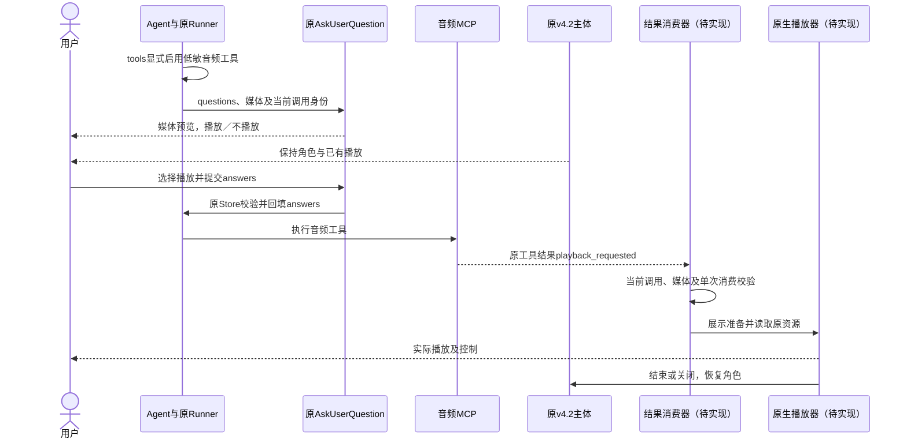
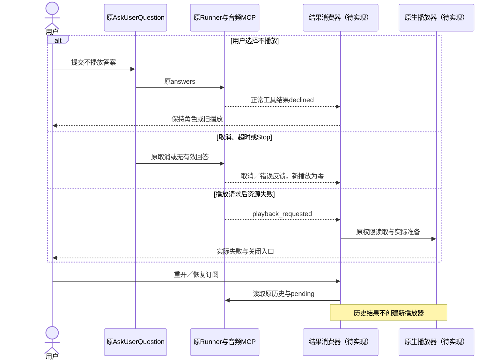
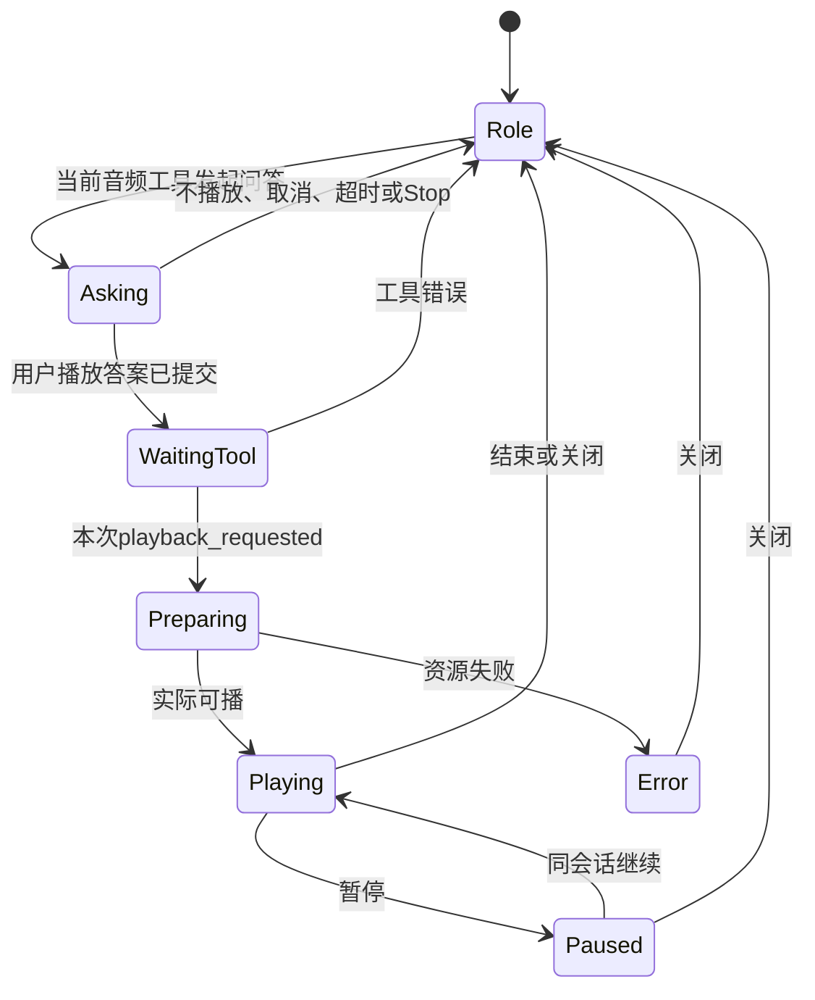

<!-- [Sync] 2026-11-13: Chat工具按当前Thread和逐条消息选择；资源设置只管理连接及认证。 -->
<!-- [Sync] 2026-11-13: Chat工具交互与通用MCP管理分别迁至独立专项；原六图完整保留为历史。 -->
<!-- [Sync] 2026-11-12: 补Web/App共用MCP卡片管理与加载职责；音频仍为App设备工具，默认关闭。 -->
<!-- [Input] Web/App资源连接卡片需求、原MCP管理能力、端侧音频问答与v4.2角色。 -->
<!-- [Output] 两端MCP管理/加载接口、平台工具选择、音频问答与播放器组件接线设计。 -->
<!-- [Pos] 前端接入设计；媒体预览/播放器新增接线待实现，后端已接入。 -->
<!-- [Sync] 2026-11-04: 低敏工具无授权弹窗，AskUserQuestion收集播放选择，成功工具结果驱动播放器。 -->

# 工具连接与App时钟音频前端接入设计

## 背景与问题

后端提供默认关闭的`mobile_clock_audio`平台工具组，工具名为`mcp__mobile_clock_audio__ask_user`。Agent提交媒体信息时，原运行时使用AskUserQuestion收集用户选择，随后执行MCP并返回结果。前端负责媒体问答预览及播放器显示，MCP注册与Agent调度由后端承担。

产品规则与桌面／窄屏骨架归[独立组件设计](../../prd/mobile-app/ios-system-player.md)，schema、低敏分类和后端接线归[开发合同](ios-system-player-technical.md)。本轮新增前端媒体组件与原生播放器均待实现。

## 目标与边界

正常显示v4.2脸型交互主体。App调用方明确启用且本机播放器能力就绪时，发送`tools: [{"type":"mobile_clock_audio"}]`；缺省false时省略或传空数组。Web与App的工具连接卡片共用下文管理交互；音频type只由App设备工具选择提供，原Editor及其他工具继续沿原配置和tool_choice。

音频工具为Low-Sensitivity Tools，工具授权弹窗为零。AskUserQuestion独立收集本次播放选择，auto/manual/full-access均保留问答。组件不设置权限策略、不执行Agent循环、不注册MCP、不签发播放批准回执。

## 概念与规则

### 模块、输入与输出

| 模块 | 输入 | 责任／输出 |
| --- | --- | --- |
| 建议调用方选项 | enableMobileClockAudio缺省false，原Native播放器能力事实 | 普通发送与排队的当次tools选择 |
| 原Chat请求／观察 | 原消息、Thread、tools和原事件 | 原鉴权、保存、Stop、草稿和恢复；零新增SSE |
| 原AskUserQuestion区域 | 音频工具当前input中的questions、媒体及toolCallId | 展示问题/选项，提交answers或取消；不再显示独立工具批准 |
| 建议音频问答内容组件 | 音频列表、原因、队列影响 | 原问题内的媒体预览，原表单继续管理选项和提交 |
| 建议结果消费器 | 当前音频调用的tool-output-available、isError、output | 匹配与校验；playback_requested交播放器，declined保持原呈现 |
| 原v4.2组件 | 原时钟／心情／主题 | 默认主体与原交互，不消费Agent文本播放指令 |
| 建议NativeMediaPlayback | 本次播放请求及当前资源上下文 | 认证读取、实际准备与播放、真实状态 |
| 建议IOSSystemMediaAdapter | 角色及实际媒体快照 | 系统状态投影，不持有MCP或Agent，不直接读取媒体 |

### 请求构造

```ts
type AppAudioOptions = { enableMobileClockAudio?: boolean }; // default false
// 建议：在原请求构造处投影；本轮前端接线待实现。
const tools = options.enableMobileClockAudio === true && audioPlaybackReady
  ? [{ type: 'mobile_clock_audio' as const }]
  : [];
```

[useNativeChatThread](../../../frontend/app/_dream/components/chat/useNativeChatThread.native.ts)及原共享请求构造传递当次选择，发送与排队保持一致。下一条消息缺省关闭，重连只观察原运行。平台能力来自原App/Native入口，UA猜测与部署环境名称不参与选择。设备工具选择归Chat当前Thread，默认关闭；原生音频能力及播放结果消费接线待实现，不增加问答前的授权确认。

### AskUserQuestion输入与回答

原[toolConfirmation](../../../frontend/app/_dream/components/chat/toolConfirmation.ts)与后端Store已经通过`__ask_user`后缀识别问答。音频工具采用该命名规则，原[ToolConfirmationDock.native](../../../frontend/app/_dream/components/chat/ToolConfirmationDock.native.tsx)和[AskUserQuestionUI](../../../frontend/app/_dream/components/chat/AskUserQuestionUI.tsx)可沿原问题/选项/answers协议处理；媒体预览呈现分支待实现。

Runner根据媒体信息生成固定问题“是否在这台设备播放以下音频？”，选项“播放／不播放”，无默认选择。Agent自填questions/answers在询问前移除。问题同当前Thread、turn、toolCallId及媒体参数fingerprint绑定。

媒体预览位于原问题区域，显示音频标题、来源、类型、已知时长、原因、接收“这台设备”及替换／追加影响。长列表独立滚动，选项与“取消／提交选择”保持可见；未知时长省略数字。角色与已有播放保持。

原`confirmToolCall`与`POST /api/claude-agent/tool-confirm`继续提交：

```json
{"thread_id":"<原Thread>","tool_call_id":"<本次调用>","approved":true,"answers":{"q0":"播放"}}
```

approved在此表示提交回答。用户选择“不播放”时同样提交approved:true与对应answers，MCP返回declined；取消问答时approved:false，原调用被取消。原Store验证必答与选项，将q0映射为原问题文本；Runner回填updatedInput.answers后执行MCP。无第二个工具授权弹窗、接收步骤、新pending Store或媒体批准HTTP。

提交回答成功后保持“等待工具结果”，新播放器仍为零。前端不从approved布尔值推断用户选择播放，不从低敏或full-access推断答案。

### 原工具结果消费

结果来自原tool-output-available。工具名可通过先前tool-input事件按toolCallId取得，不能依赖结果事件一定携带toolName。建议消费器位于App宿主的原事件观察路径，页面仅订阅状态。

消费条件：当前请求显式选中音频工具；owner/runtime、Thread、turn、toolCallId均匹配；工具名精确为`mcp__mobile_clock_audio__ask_user`；isError为false；按原文本/内容块归一化读取本合同JSON。

| 结果 | 组件处理 |
| --- | --- |
| type为mobile_clock_audio，status为playback_requested，choice为播放，媒体与当前调用相符 | 单次消费，展示播放器准备，再交原生认证读取与实际播放 |
| status为declined，choice为不播放 | 记录已回答，保持角色／已有播放，新播放器为零 |
| 取消、超时、Stop、工具错误或无有效结果 | 沿原问答／工具反馈，保留原任务结果，不开始播放 |
| 历史加载、重新挂载、重复或旧代次事件 | 不创建新播放器；当前已消费调用返回原会话，同ID异内容拒绝 |

原资源准备继续核对会话、Thread归属、实际媒体类型和可播性。MCP播放请求与实际播放开始分开。身份或执行情况无法核实时保留原结果，零自动重发与零自动播放。

### 显示与生命周期

默认角色使用原v4.2路径、时钟与心情交互。问答和等待工具结果期间保持主体；资源准备、播放、暂停、失败在收到播放请求后呈现。结束或关闭返回角色。系统入口按允许生命周期显示并返回App，零封面点击代答。

原Agent Stop取消原任务与pending问题；已成功交付播放器的媒体沿独立生命周期。等待用户时释放无实际进展的计算许可，资源准备按独立适用许可执行。原生播放和系统音频能力不承载前面的通用Agent计算。

## 正常接入时序（前端新增接线待实现）



## 异常与恢复时序



## 状态转换



## 开发顺序与验收

| 工作项 | 责任位置与验收 |
| --- | --- |
| tools投影 | 原Native请求构造；默认/Web关闭，显式启用、排队与下一条关闭一致 |
| 问题内媒体呈现 | 原AskUserQuestion区域；媒体、原因、队列影响、滚动与必答；无工具授权步骤 |
| 回答与结果消费 | 原Store/answers及原工具流；不播放为declined，取消为原取消；重复/历史/旧账户零新播放 |
| 播放器与系统 | 原App宿主及原生媒体对象；资源权限、文件使用期、真实状态与结束回角色 |
| 相邻业务 | 原AskUserQuestion、Editor批准、tool_choice/full-access、Stop、草稿与Thread保持 |

后端专项、文档原型、前端功能、Simulator、真机及真实资源播放分别留证。当前前端交付为设计。


## 相关前端专项

- [Chat Agent与工具输入栏](../../prd/chat/agent-tool-composer.md)：输入、选择与问答交接。
- [Chat开发接线](../claude-agent/chat-agent-tool-composer.md)：组件、原发送接口与工具范围。
- [资源连接前端](../claude-agent/mcp-tool-management-frontend.md)：连接卡片、保存及管理时序。
- [拆分前完整原文与六图](history/mobile-clock-audio-frontend-before-chat-split-20261113.md)。

<a id="web与app共用的mcp管理交互2026-11-12"></a>

## Web与App共用的MCP管理交互（2026-11-12）

原章节已迁至[独立资源前端稿](../claude-agent/mcp-tool-management-frontend.md)，保留此入口供历史引用定位。Chat交互由[Chat专项](../../prd/chat/agent-tool-composer.md)维护。
