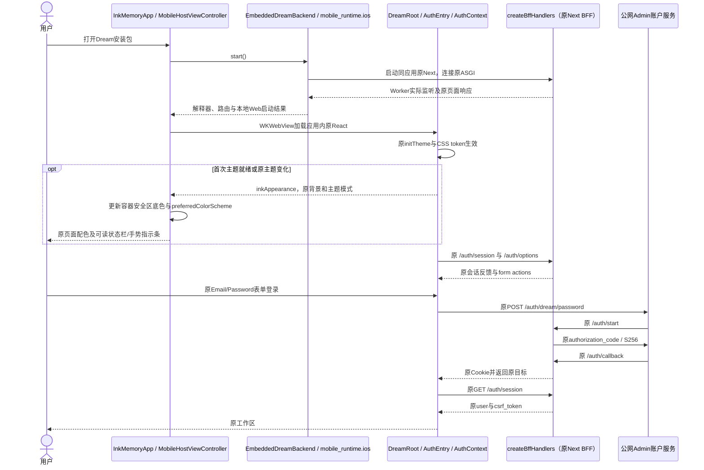
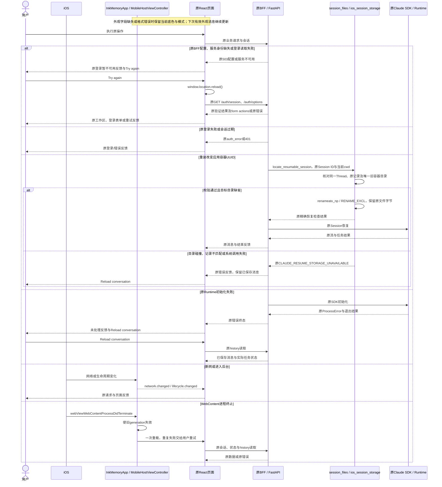
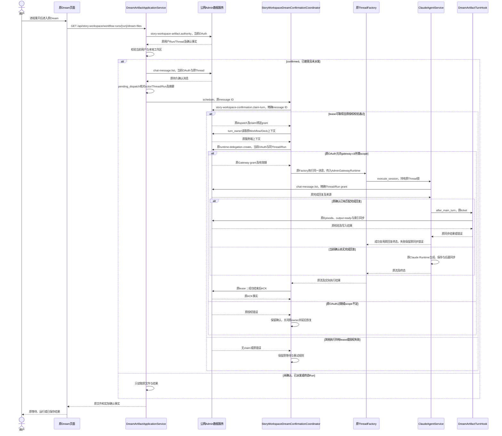
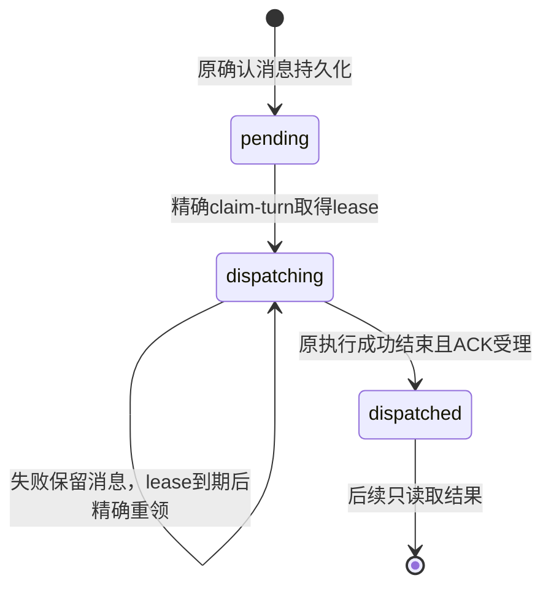
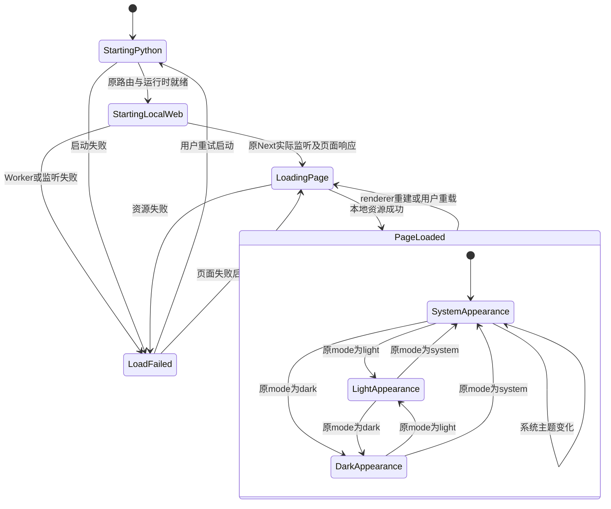
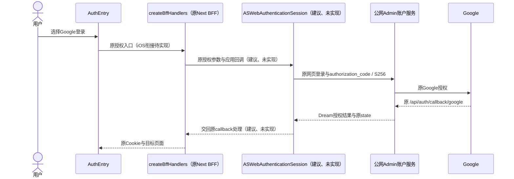
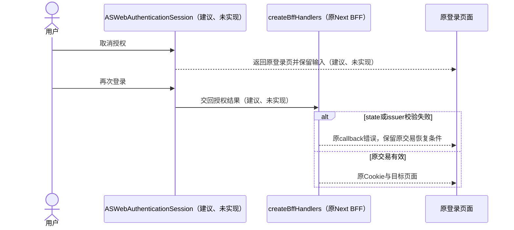

<!-- [Sync] 2026-10-27: RN框架目标保持，按原生与网页区域减少迁移范围。 -->
<!-- [Sync] 2026-10-26: recovery of an already completed confirmation reuses its saved reply and retries workspace synchronization without repeating generation. -->
<!-- [Sync] 2026-10-26: 已保存Dream确认在当前用户重开同Run时经原消息claim恢复，保留等待与实际ACK反馈。 -->
<!-- [Sync] 2026-10-26: 前后台切换遵循系统挂起及原失败/恢复反馈，专项回执保留首次工具失败与原重试结果。 -->
<!-- [Sync] 2026-10-26: Dream原审核操作栏位于窄屏主导航上方，确认内容和提交规则保持。 -->
<!-- [Sync] 2026-10-25: 关闭命令沙箱的原SDK Bash/停止/恢复和Runner技术通过；真实工具业务与真机继续验收。 -->
<!-- [Sync] 2026-10-25: 原inputs读取重叠修复后，同会话真实追问取得分层EOF、页面终态与正常持久化结算。 -->
<!-- [Sync] 2026-10-25: 原Chat终态与普通重开通过；同步原会话目录适配、失败反馈及真实追问复验范围。 -->
<!-- [Sync] 2026-10-25: 原登录读取失败提供页面重载，重新执行同一会话/options读取，表单和授权规则保持。 -->
<!-- [Sync] 2026-10-25: 明确系统安全区与Settings搜索输入视口。 -->
<!-- [Sync] 2026-10-25: 保留原网页登录，普通env接线进入本机验收；Google系统浏览器与应用回调待实现。 -->
<!-- [Input] 当前Dream网页业务、Swift/WKWebView宿主及iPhone Python执行回执。 -->
<!-- [Output] iOS容器、正常网页登录、平台交互、失败恢复与未完成项。 -->
<!-- [Pos] iOS独立正式交互设计；复用原业务状态与共享React。 -->
<!-- [Sync] 2026-10-25: 原Next和原ASGI在应用内通信，加载原登录卡片，保留未授权与配置失败反馈。 -->
<!-- [Sync] 2026-10-25: 区分关闭relay后的原后端/Runtime技术回执与此前Mac联调业务回执。 -->
<!-- [Sync] 2026-10-25: 公网Admin网页登录与完整Chat在Simulator应用宿主通过。 -->
<!-- [Sync] 2026-10-25: Simulator应用宿主完成原网页密码登录、BFF会话与真实Chat。 -->
<!-- [Sync] 2026-10-25: 删除原生账户流程与业务改写，保留正常网页表单。 -->

<!-- [Sync] 2026-10-27: 增加RN目标，复用原iOS运行库与网页登录；工作台创建退出端侧范围。 -->

# Ink & Memory iOS交互设计

## 现行iOS工程与交互

实际入口`frontend/ios/InkMemory/InkMemoryApp.swift`加载Metro生成的`main.jsbundle`和RN应用`InkMemory`。`InkReactNative.swift`导出运行库启动、HTTP响应增量读取、取消读取和原网页登录；整页业务WebView视图注册已退役。原Python/Node/Next/Claude装配继续复用原生脚本。

当前SwiftUI入口使用`.ignoresSafeArea(.container)`延伸容器背景并保留系统键盘避让，向RN提供调整后的可见区域。RN页面在iOS关闭额外的`KeyboardAvoidingView`调整，内部滚动使用该区域，系统安全区组件处理状态栏和Home Indicator。`MarkdownInputEditor.native`局部文档不持有App级键盘布局。Agent弹层根据键盘顶部及触发器锚点选择展开方向，关闭后保留当前Agent和草稿。该合同需用系统软件键盘验证输入、Send/Stop和弹层均可操作。

共享界面与状态、正常/异常时序及生命周期见[统一工程设计](react-native-web-project-structure.md)。运行中切后台遵循iOS挂起约束，回前台通过原history/status恢复。签名与发行继续使用现有Team配置，账号与发行资格单独核验。

## 原平台实现与历史交互记录

以下正文保留原WKWebView工程、业务回执与图示；新RN主界面另行验证。当前源码目录统一为`frontend/ios/`，下文旧路径保留历史归属。

RN作为App入口，现有Swift/Objective-C/C++用于平台适配与运行库。页面按[RN内的复用取舍](frontend-reuse-tradeoffs.md)逐区迁移，保留的DOM业务继续WebView运行；生命周期与业务合同保持。

## React Native目标接入

目标采用RN原生主界面，正常网页登录保留受限WKWebView。[RN交互稿](mobile-react-native-interaction.md)定义HTTP业务、范围与时序，[运行时架构](mobile-runtime-architecture.md#实例所有权与生命周期)定义实例生命周期。以下旧图示和回执保留WebView实现归属。

App组合根持有BackendRuntimeManager（建议、未实现），复用`EmbeddedDreamBackend.shared`、CPython、Node和Next；Scene、页面与RN Root重建只更新订阅。WKWebView Cookie接入原生HTTP存储时保持原来源、HttpOnly与CSRF，Cookie值保留原生层。Google系统浏览器回调独立验收。

安全区沿原主题，键盘和返回遵循iOS操作。后台保留实例并服从系统调度；进程重开后按原HTTP读取历史与Session。工作台创建、初始生成和审核确认退出端侧菜单、页面和适配清单。

## 背景与问题

iOS使用Swift/WKWebView加载现有React，Dream Python在应用进程内运行。物理iPhone已经执行CPython 3.13.17、FastAPI和11个原业务模块，原生8项测试通过。此前iOS Simulator容器通过Mac联调路径完成原网页登录、BFF会话与一次真实Chat。当前关闭Mac relay的独立Simulator已运行24个原业务路由、原Factory/Runner、原Claude Runtime和原user MCP；应用内fixture已验证原协议及工具。第五次原Chat提交取得真实模型回复，原React已显示且停止按钮退出，正常Admin已保存消息和结算。第四次停止按钮持续显示的现象在复验中未复现，根因仍待证实。物理iPhone独立业务与完整工具执行仍待完成。

本稿采用[移动PRD](../../prd/dream-workspace/mobile-app.md)和[共享交互](./mobile-app-interaction.md)的原网页业务。前稿的原生登录、Keychain账户令牌、独立回调、新任务状态和附件先导入流程已删除。

## 目标与边界

- Swift负责WKWebView、解释器装配、消息传输、键盘/安全区和生命周期通知。
- 页面、原登录表单、账户、任务、附件、权限、存储和计费继续由现有业务实现负责。
- 公网Admin以HTTPS提供现有账户和数据服务；localhost Dream client继续使用既有来源与callback配置。
- 完整BFF和Claude兼容问题作为实施阻断；容器不通过另建认证、放宽校验或替代Agent绕过。

端侧部署按[现有关闭配置](../../deploy/mobile-app-release.md#端侧claude命令沙箱配置)运行Claude命令，iOS系统应用沙箱及原工具审批保持。页面、确认入口与业务状态不增加沙箱管理流程。当前iOS候选包已装配关闭值，原SDK Bash/停止/恢复及原Runner技术用例通过；端侧Bash、停止和恢复继续按实际结果验收。

## 概念与规则

| 模块 | 归属和现状 |
| --- | --- |
| `MobileHostViewController` | WKWebView、来源/generation、生命周期及加载失败处理；本轮允许原HTTPS顶层form/navigation |
| `AppURLSchemeHandler` | 保留原静态资源适配；独立iOS路径从应用内原Next HTTP加载原页面 |
| `EmbeddedDreamBackend` / `DreamPython` | 串行初始化CPython，并行调用持久ASGI loop；响应读取与取消可并行执行 |
| `mobile_runtime.ios` | Native Runtime就绪后，同一ASGI实例装配公共路由与原24个业务模块；原DTO与鉴权保留，`businessReady=false` |
| `AuthEntry` / 原Next BFF | 原网页登录和会话所有权；相同Next standalone在应用Node Worker执行，原Cookie/CSRF/PKCE和服务身份校验保持 |
| 原Claude SDK/CLI | 原SDK协议接到同应用Node24 Worker中的原Runtime；原Runner、user MCP、Read/Write、拒绝、恢复和停止已有Simulator技术回执；Bash与完整业务继续待完成 |

源码证据：[iOS宿主](../../../frontend/ios/InkMemory/MobileHostViewController.swift)、[解释器](../../../frontend/ios/InkMemory/DreamPython.m)、[原登录卡片](../../../frontend/app/_dream/components/Auth/AuthEntry.tsx#L34)、[原BFF](../../../frontend/app/api/_auth/handlers.ts#L30)、[端侧组合](../../../backend/mobile_runtime/ios.py#L61)。

### 页面与操作

页面骨架复用[PRD正文](../../prd/dream-workspace/mobile-app.md#页面骨架)。iPhone单栏、iPad按可见宽度使用原响应式布局；原页面、栏目、弹窗和提交条件保持一致。WKWebView位于系统安全区内，顶部操作避开状态栏和刘海。窄屏Settings搜索框使用16px字号，输入聚焦保持页面视口。键盘出现时输入和主操作可见；消息区与输入区分别滚动。原登录卡片中的Email、Password、Login、Google和Register继续使用原form，不增加原生登录页。

安全区底色从原页面`--color-bg-app`读取，`data-theme-mode`继续由`theme.ts`管理。原生UserScript只在主文档观察现有主题属性与系统主题变化，通过私有`inkAppearance`外观消息将背景与模式传给`MobileHostViewController`。背景接受现有`#RRGGBB`值，模式接受原`light/dark/system`；字段缺失或格式错误时保留当前外观，下次有效消息继续更新。SwiftUI背景仅延伸至容器安全区，原WebView与键盘内容边界保持；显式主题同步系统文字/指示条，跟随系统时恢复系统外观。原业务bridge的methods/events、账户和任务状态保持。

Dream工作台的原审核操作栏位于窄屏主导航上方，沿用同一主导航高度和安全区尺寸。人物、场景、分镜列表及编辑区继续在原页面滚动，“确认并继续”、当前修改数量和revision可见可达。原审核内容、提交条件、接口与权限保持；桌面操作栏继续使用原位置。

WKWebView使用持久`WKWebsiteDataStore`，保持第一方Cookie。正常HTTPS顶层导航允许加载；远程页面无法通过主frame来源检查调用bridge。系统文件选择、导出和分享只适配原业务操作，不改变上传时机、附件DTO或文件归属。

`AuthEntry`在`AuthContext.authError`或options读取失败时显示`Try again`。点击调用`window.location.reload()`，原`AuthProvider`与`AuthEntry`重新读取同一`/auth/session`及`/auth/options`；原401、DTO、Cookie与CSRF处理保持。重载重置未提交表单内容，密码和Google授权继续通过原顶层form。凭证错误保留原编辑/提交交互。

## 正常业务时序

下图定义原网页登录业务。独立Simulator的原表单、会话、CSRF与Thread/Deck/模型目录读取已通过；完整模型任务按后文实际提交回执验收。

## 异常与恢复时序

宿主不在后台主动新增业务写入或任务终态。Python进程被系统终止后，只能按原持久化和恢复入口读取实际结果。

用户切出应用后，端侧执行可能随系统挂起；回到应用时展示原任务结果、工具失败和实际保存的消息。原Claude的后续执行沿现有业务处理，宿主不补发任务或替换结果。2026-10-26模拟器专项中首次工具失败，原重试后回复完成；本次后台时序诊断及验收调用次数控制仍有缺口，[专项验收保持未通过](../../exec/mobile-app-design-review-20261024.md#前后台恢复诊断与有界验收)。系统规则依据[Apple生命周期](https://developer.apple.com/documentation/uikit/managing-your-app-s-life-cycle)，2026-10-26查阅；物理iPhone单独验收。

共享Chat的队列后台读取在上次读取结束后继续更新，离开会话时取消已离开页面的读取；队列操作、失败反馈与状态规则保持。

## 容器状态转换

### 已保存Dream确认的进程重开恢复

用户已完成原“确认并继续”后，重新进入同一Dream保留人物、场景、分镜及确认内容。当前恢复候选已通过无模型合同检查，原账户实际续接继续验收。页面复用原等待、运行、停止和消息结果；用户无需第二次确认。以下参与模块和接口均为已有生产入口，恢复接线归`DreamArtifactApplicationService`。

完成回复的恢复沿用原消息和文件。服务端只在相同用户、Run、Thread及确认消息均匹配，且原完成回复结构有效时重试同步；同步成功后原确认变为已派发。同步失败保留原反馈和等待，不增加用户确认、模型重发或助手消息。普通Simulator已完成该恢复，确认实际ACK且零新增模型；物理设备完整业务继续验收。

原metadata状态保持以下转换；图中dispatching不表示Run完成。损坏、重复或跨账户/Thread/Run消息停止本次恢复，原文件继续可读。

### 容器与页面外观

图中定义容器启动和页面外观状态。账户与Run/Thread状态采用原业务定义。bridge中已删除`auth.*`及`auth.callback`，不向网页返回用户凭证。

## 实施与验收

本轮调度修复后的第11次原会话提交完成新增回复、原Session连续性、正常消息及结算，原后端与浏览器流均结束，页面停止按钮退出。该次正常结束验收通过；真实生成中的停止、完整工具及iPhone保持后续验收项。分层回执见[执行记录](../../exec/mobile-app-design-review-20261024.md#2026-10-25-队列读取重叠修复与结束状态定位)。

当前代码保留真实Python与原业务路由，恢复正常form/navigation。此前Mac relay联调完成过一次真实Chat。当前关闭relay的独立Simulator已完成原密码登录及保护数据读取；第五次原Chat取得真实回复、原`turnStatus=completed`、消息和结算，页面停止按钮退出，终态复验通过。普通应用重开已恢复原会话与已完成消息。同会话真实追问暴露长路径格式和重装后的容器目录变化，兼容代码通过目标系统调用及原SDK恢复fixture；第七次提交恢复原Session并取得新增真实回复和结算，页面结束反馈失败。早期包通过ENOSYS拒绝Bash；后续候选已装配关闭配置，原SDK Bash、运行中停止和恢复技术验证通过，完整工具和物理iPhone业务继续验收。具体Thread、Gateway请求与回执见[独立终态复验](../../exec/mobile-app-design-review-20261024.md#独立simulator原chat终态复验通过)；此前失败原文保留。

后续顺序：Simulator同应用原Next/React与ASGI接线 → 原网页登录、合法端侧业务授权、真实模型与持久化 → 原停止/恢复与文件回归 → 物理iPhone同项业务 → 正式签名分发。每一步保持原业务合同，禁止用修改产品行为补齐技术缺口。见[验收矩阵](../../exec/mobile-app-design-review-20261024.md#本轮复审验收矩阵)和[发布稿](../../deploy/mobile-app-release.md)。

本地Web启动使用原env中已登记的localhost回环来源，宿主核对IPv4或IPv6实际监听。监听占用或Worker失败保持启动失败；宿主不切换到Mac服务。WebContent重载复用原Node/Python所有者；应用进程被系统终止后按原会话及业务恢复规则处理。当前包读取原frontend/backend env，原BFF和Python request/data owner沿原身份校验执行；配置缺失时保留原失败反馈。

关闭relay后的WKWebView已实际运行原React。早期无env包的截图`/tmp/ink-ios-local-next-20261025.png`及18项技术回执保留为历史；当前普通env包已通过原账号会话、CSRF、Thread/Deck读取、真实模型响应、第五次原Chat的页面结束反馈及普通重开后的历史读取。真实停止/恢复、文件及完整业务继续验收。

## 当前env接线与Google回调

应用内Python与Node读取现有普通env，原登录卡片、用户、Cookie、CSRF、PKCE和权限规则继续复用。当前本机安装包包含原Dream服务配置；外部分发凭证评审保持待完成。原页面及本地HTTP的通过范围由[执行回执](../../exec/mobile-app-design-review-20261024.md#普通env接线与原登录验收)记录。

Google授权页交给iOS系统浏览器会话。Google先返回公网Admin，Admin继续原授权流程，再返回应用；取消回到原登录页并保留输入。当前宿主尚未实现这段系统浏览器衔接，Google登录保持待验收。

### 原Chat启动失败与恢复

当前保留原“The message was not processed”与Reload conversation反馈。Runtime初始化失败按原错误终止本次执行，已保存的用户消息保留。平台兼容完成后，通过原New或原恢复入口发起后续操作，用户权限、模型选择、消息提交和任务状态保持原业务定义。当前iOS命令兼容候选已通过原SDK Bash技术验证，真实工具业务仍待验收；该能力缺口按[端侧关闭配置与执行接线](../../deploy/mobile-app-release.md#端侧claude命令沙箱配置)和执行记录跟踪。

