<!-- [Sync] 2026-10-31: 索引端侧目标编译与原登录认证方案、排障指南和分平台资格；本轮仅文档维护。 -->
<!-- [Sync] 2026-10-31: 公网构建11保留原Web回调及登录/失败恢复图；Google本机采用与公网前提分列。 -->
<!-- [Sync] 2026-10-31: 普通Simulator采用精确账号回调，系统取消/密码关闭/真实Chat通过；完整Google、Notion授权与真机单列。 -->
<!-- [Sync] 2026-10-31: Native账号会话/原Cookie观察暂停与复制形成源码候选，16项iOS技术通过，系统授权/登记/普通包采用分列。 -->
<!-- [Sync] 2026-10-31: BFF原账号回调地址兼容形成源码候选，58项技术及Web类型通过，Native/登记/包采用继续实施。 -->
<!-- [Sync] 2026-10-31: Google正常账户授权补精确回调/Cookie交易连续性方案、原Client复用及未实现前提；原图保留。 -->
<!-- [Sync] 2026-10-31: 区分已实现的App级运行库协调、当前Release设备开发包及历史RN接入提案。 -->
<!-- [Sync] 2026-10-27: RN框架目标保持，按原生与网页区域减少迁移范围。 -->
<!-- [Sync] 2026-10-26: recovery of an already completed confirmation reuses its saved reply and retries workspace synchronization without repeating generation. -->
<!-- [Sync] 2026-10-26: 已保存Dream确认在当前用户重开同Run时经原消息claim恢复，保留等待与实际ACK反馈。 -->
<!-- [Sync] 2026-10-26: 前后台切换遵循系统挂起及原失败/恢复反馈，专项回执保留首次工具失败与原重试结果。 -->
<!-- [Sync] 2026-10-26: Dream原审核操作栏位于窄屏主导航上方，确认内容和提交规则保持。 -->
<!-- [Sync] 2026-10-25: 关闭命令沙箱的原SDK Bash/停止/恢复和Runner技术通过；真实工具业务与真机继续验收。 -->
<!-- [Sync] 2026-10-25: 原inputs读取重叠修复后，同会话真实追问取得分层EOF、页面终态与正常持久化结算。 -->
<!-- [Sync] 2026-10-25: 原Chat终态与普通重开通过；同步原会话目录适配、失败反馈及真实追问复验范围。 -->
<!-- [Sync] 2026-10-25: 原登录读取失败提供页面重载，重新执行同一会话/options读取，表单和授权规则保持。 -->
<!-- [Sync] 2026-10-25: 明确系统安全区与Settings搜索输入视口。 -->
<!-- [Sync] 2026-10-25: 保留原网页登录，普通env接线进入本机验收；Google系统浏览器与应用回调待实现。 -->
<!-- [Input] 当前Dream网页业务、Swift/WKWebView宿主及iPhone Python执行回执。 -->
<!-- [Output] iOS容器、正常网页登录、平台交互、失败恢复与未完成项。 -->
<!-- [Pos] iOS独立正式交互设计；复用原业务状态与共享React。 -->
<!-- [Sync] 2026-10-25: 原Next和原ASGI在应用内通信，加载原登录卡片，保留未授权与配置失败反馈。 -->
<!-- [Sync] 2026-10-25: 区分关闭relay后的原后端/Runtime技术回执与此前Mac联调业务回执。 -->
<!-- [Sync] 2026-10-25: 公网Admin网页登录与完整Chat在Simulator应用宿主通过。 -->
<!-- [Sync] 2026-10-25: Simulator应用宿主完成原网页密码登录、BFF会话与真实Chat。 -->
<!-- [Sync] 2026-10-25: 删除原生账户流程与业务改写，保留正常网页表单。 -->

<!-- [Sync] 2026-10-27: 增加RN目标，复用原iOS运行库与网页登录；工作台创建退出端侧范围。 -->

# Ink & Memory iOS交互设计

现行登录认证、目标编译与配置职责见[运行库认证合同](mobile-runtime-architecture.md#端侧登录认证与目标编译合同2026-10-31)，操作指南见[认证排障](../../deploy/mobile-auth-troubleshooting.md)。iOS已有登录文档、系统授权和Cookie适配源码；公网Google精确回调与完整业务资格待验收。下方旧日期阶段保留其原始状态，本轮设备/账号复测0。

## 现行iOS工程与交互

实际入口`frontend/ios/InkMemory/InkMemoryApp.swift`加载Metro生成的`main.jsbundle`和RN应用`InkMemory`。`InkReactNative.swift`导出运行库启动、HTTP响应增量读取、取消读取和原网页登录；整页业务WebView视图注册已退役。原Python/Node/Next/Claude装配继续复用原生脚本。

当前SwiftUI入口使用`.ignoresSafeArea(.container)`延伸容器背景并保留系统键盘避让，向RN提供调整后的可见区域。RN页面在iOS关闭额外的`KeyboardAvoidingView`调整，内部滚动使用该区域，系统安全区组件处理状态栏和Home Indicator。`MarkdownInputEditor.native`局部文档不持有App级键盘布局。Agent弹层根据键盘顶部及触发器锚点选择展开方向，关闭后保留当前Agent和草稿。该合同需用系统软件键盘验证输入、Send/Stop和弹层均可操作。

共享界面与状态、正常/异常时序及生命周期见[统一工程设计](react-native-web-project-structure.md)。运行中切后台遵循iOS挂起约束，回前台通过原history/status恢复。签名与发行继续使用现有Team配置，账号与发行资格单独核验。

2026-10-31源码现状：[BackendRuntimeManager](../../../frontend/src/runtime/BackendRuntimeManager.ts#L8)已由[SessionGate](../../../frontend/src/platform/SessionGate.native.tsx#L28)调用，复用[InkRuntime.ensureStarted](../../../frontend/ios/InkMemory/InkReactNative.swift#L51)和原EmbeddedDreamBackend singleton；成功Promise在页面重建期间保留，启动失败允许原重试。当前Release设备全量构建与已有开发签名IPA完成，普通Simulator、Release真机业务和商店资格按[当前发布稿](../../deploy/mobile-app-release.md#2026-10-31当前release设备包)分别验收。

## 原平台实现与历史交互记录

以下正文保留原WKWebView工程、业务回执与图示；新RN主界面另行验证。当前源码目录统一为`frontend/ios/`，下文旧路径保留历史归属。

RN作为App入口，现有Swift/Objective-C/C++用于平台适配与运行库。页面按[RN内的复用取舍](frontend-reuse-tradeoffs.md)逐区迁移，保留的DOM业务继续WebView运行；生命周期与业务合同保持。

## React Native目标接入

目标采用RN原生主界面，正常网页登录保留受限WKWebView。[RN交互稿](mobile-react-native-interaction.md)定义HTTP业务、范围与时序，[运行时架构](mobile-runtime-architecture.md#实例所有权与生命周期)定义实例生命周期。以下旧图示和回执保留WebView实现归属。

历史提案（2026-10-27）：App组合根持有BackendRuntimeManager（建议、未实现），复用`EmbeddedDreamBackend.shared`、CPython、Node和Next；Scene、页面与RN Root重建只更新订阅。WKWebView Cookie接入原生HTTP存储时保持原来源、HttpOnly与CSRF，Cookie值保留原生层。Google系统浏览器回调独立验收。

安全区沿原主题，键盘和返回遵循iOS操作。后台保留实例并服从系统调度；进程重开后按原HTTP读取历史与Session。工作台创建、初始生成和审核确认退出端侧菜单、页面和适配清单。

## 背景与问题

iOS使用Swift/WKWebView加载现有React，Dream Python在应用进程内运行。物理iPhone已经执行CPython 3.13.17、FastAPI和11个原业务模块，原生8项测试通过。此前iOS Simulator容器通过Mac联调路径完成原网页登录、BFF会话与一次真实Chat。当前关闭Mac relay的独立Simulator已运行24个原业务路由、原Factory/Runner、原Claude Runtime和原user MCP；应用内fixture已验证原协议及工具。第五次原Chat提交取得真实模型回复，原React已显示且停止按钮退出，正常Admin已保存消息和结算。第四次停止按钮持续显示的现象在复验中未复现，根因仍待证实。物理iPhone独立业务与完整工具执行仍待完成。

本稿采用[移动PRD](../../prd/dream-workspace/mobile-app.md)和[共享交互](./mobile-app-interaction.md)的原网页业务。前稿的原生登录、Keychain账户令牌、独立回调、新任务状态和附件先导入流程已删除。

## 目标与边界

- Swift负责WKWebView、解释器装配、消息传输、键盘/安全区和生命周期通知。
- 页面、原登录表单、账户、任务、附件、权限、存储和计费继续由现有业务实现负责。
- 公网Admin以HTTPS提供现有账户和数据服务；localhost Dream client继续使用既有来源与callback配置。
- 完整BFF和Claude兼容问题作为实施阻断；容器不通过另建认证、放宽校验或替代Agent绕过。

端侧部署按[现有关闭配置](../../deploy/mobile-app-release.md#端侧claude命令沙箱配置)运行Claude命令，iOS系统应用沙箱及原工具审批保持。页面、确认入口与业务状态不增加沙箱管理流程。当前iOS候选包已装配关闭值，原SDK Bash/停止/恢复及原Runner技术用例通过；端侧Bash、停止和恢复继续按实际结果验收。

## 概念与规则

| 模块 | 归属和现状 |
| --- | --- |
| `MobileHostViewController` | WKWebView、来源/generation、生命周期及加载失败处理；本轮允许原HTTPS顶层form/navigation |
| `AppURLSchemeHandler` | 保留原静态资源适配；独立iOS路径从应用内原Next HTTP加载原页面 |
| `EmbeddedDreamBackend` / `DreamPython` | 串行初始化CPython，并行调用持久ASGI loop；响应读取与取消可并行执行 |
| `mobile_runtime.ios` | Native Runtime就绪后，同一ASGI实例装配公共路由与原24个业务模块；原DTO与鉴权保留，`businessReady=false` |
| `AuthEntry` / 原Next BFF | 原网页登录和会话所有权；相同Next standalone在应用Node Worker执行，原Cookie/CSRF/PKCE和服务身份校验保持 |
| 原Claude SDK/CLI | 原SDK协议接到同应用Node24 Worker中的原Runtime；原Runner、user MCP、Read/Write、拒绝、恢复和停止已有Simulator技术回执；Bash与完整业务继续待完成 |

源码证据：[iOS宿主](../../../frontend/ios/InkMemory/MobileHostViewController.swift)、[解释器](../../../frontend/ios/InkMemory/DreamPython.m)、[原登录卡片](../../../frontend/app/_dream/components/Auth/AuthEntry.tsx#L34)、[原BFF](../../../frontend/app/api/_auth/handlers.ts#L30)、[端侧组合](../../../backend/mobile_runtime/ios.py#L61)。

### 页面与操作

页面骨架复用[PRD正文](../../prd/dream-workspace/mobile-app.md#页面骨架)。iPhone单栏、iPad按可见宽度使用原响应式布局；原页面、栏目、弹窗和提交条件保持一致。WKWebView位于系统安全区内，顶部操作避开状态栏和刘海。窄屏Settings搜索框使用16px字号，输入聚焦保持页面视口。键盘出现时输入和主操作可见；消息区与输入区分别滚动。原登录卡片中的Email、Password、Login、Google和Register继续使用原form，不增加原生登录页。

安全区底色从原页面`--color-bg-app`读取，`data-theme-mode`继续由`theme.ts`管理。原生UserScript只在主文档观察现有主题属性与系统主题变化，通过私有`inkAppearance`外观消息将背景与模式传给`MobileHostViewController`。背景接受现有`#RRGGBB`值，模式接受原`light/dark/system`；字段缺失或格式错误时保留当前外观，下次有效消息继续更新。SwiftUI背景仅延伸至容器安全区，原WebView与键盘内容边界保持；显式主题同步系统文字/指示条，跟随系统时恢复系统外观。原业务bridge的methods/events、账户和任务状态保持。

Dream工作台的原审核操作栏位于窄屏主导航上方，沿用同一主导航高度和安全区尺寸。人物、场景、分镜列表及编辑区继续在原页面滚动，“确认并继续”、当前修改数量和revision可见可达。原审核内容、提交条件、接口与权限保持；桌面操作栏继续使用原位置。

WKWebView使用持久`WKWebsiteDataStore`，保持第一方Cookie。正常HTTPS顶层导航允许加载；远程页面无法通过主frame来源检查调用bridge。系统文件选择、导出和分享只适配原业务操作，不改变上传时机、附件DTO或文件归属。

`AuthEntry`在`AuthContext.authError`或options读取失败时显示`Try again`。点击调用`window.location.reload()`，原`AuthProvider`与`AuthEntry`重新读取同一`/auth/session`及`/auth/options`；原401、DTO、Cookie与CSRF处理保持。重载重置未提交表单内容，密码和Google授权继续通过原顶层form。凭证错误保留原编辑/提交交互。

## 正常业务时序

下图定义原网页登录业务。独立Simulator的原表单、会话、CSRF与Thread/Deck/模型目录读取已通过；完整模型任务按后文实际提交回执验收。

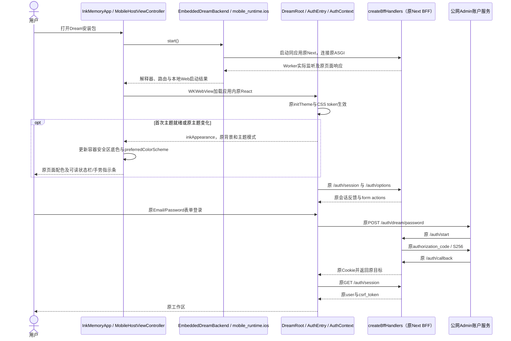

## 异常与恢复时序

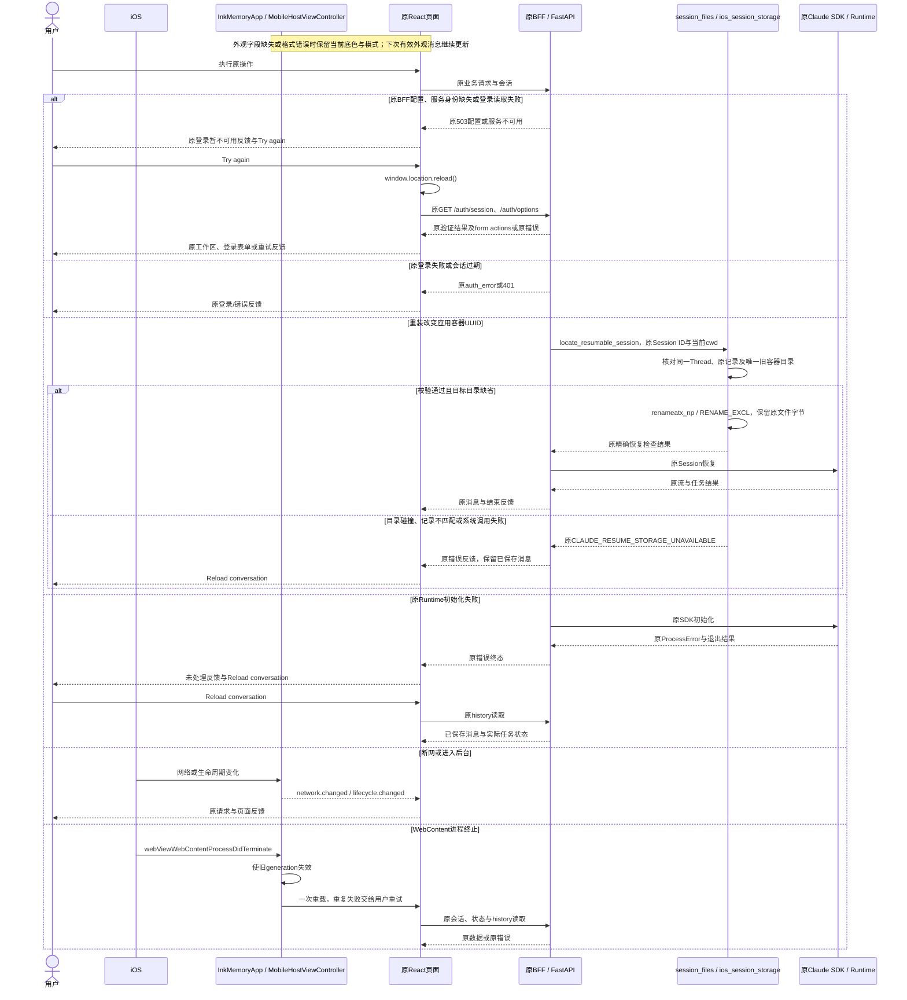

宿主不在后台主动新增业务写入或任务终态。Python进程被系统终止后，只能按原持久化和恢复入口读取实际结果。

用户切出应用后，端侧执行可能随系统挂起；回到应用时展示原任务结果、工具失败和实际保存的消息。原Claude的后续执行沿现有业务处理，宿主不补发任务或替换结果。2026-10-26模拟器专项中首次工具失败，原重试后回复完成；本次后台时序诊断及验收调用次数控制仍有缺口，[专项验收保持未通过](../../exec/mobile-app-design-review-20261024.md#前后台恢复诊断与有界验收)。系统规则依据[Apple生命周期](https://developer.apple.com/documentation/uikit/managing-your-app-s-life-cycle)，2026-10-26查阅；物理iPhone单独验收。

共享Chat的队列后台读取在上次读取结束后继续更新，离开会话时取消已离开页面的读取；队列操作、失败反馈与状态规则保持。

## 容器状态转换

### 已保存Dream确认的进程重开恢复

用户已完成原“确认并继续”后，重新进入同一Dream保留人物、场景、分镜及确认内容。当前恢复候选已通过无模型合同检查，原账户实际续接继续验收。页面复用原等待、运行、停止和消息结果；用户无需第二次确认。以下参与模块和接口均为已有生产入口，恢复接线归`DreamArtifactApplicationService`。

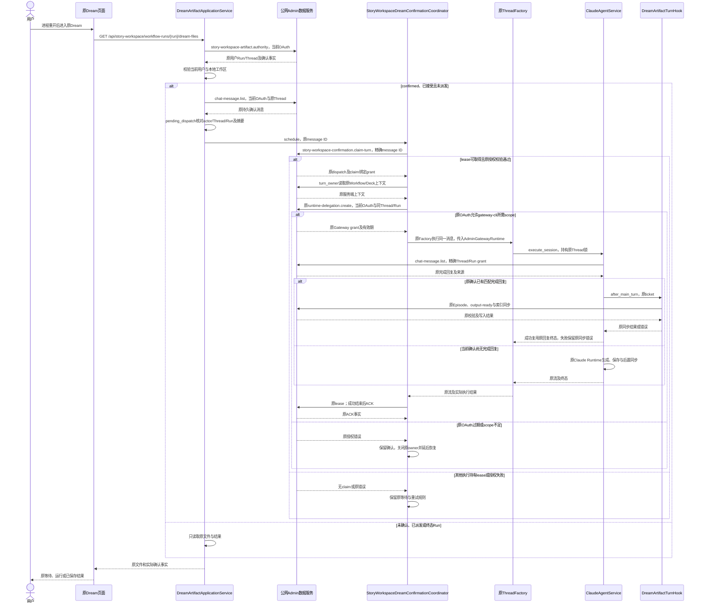

完成回复的恢复沿用原消息和文件。服务端只在相同用户、Run、Thread及确认消息均匹配，且原完成回复结构有效时重试同步；同步成功后原确认变为已派发。同步失败保留原反馈和等待，不增加用户确认、模型重发或助手消息。普通Simulator已完成该恢复，确认实际ACK且零新增模型；物理设备完整业务继续验收。

原metadata状态保持以下转换；图中dispatching不表示Run完成。损坏、重复或跨账户/Thread/Run消息停止本次恢复，原文件继续可读。

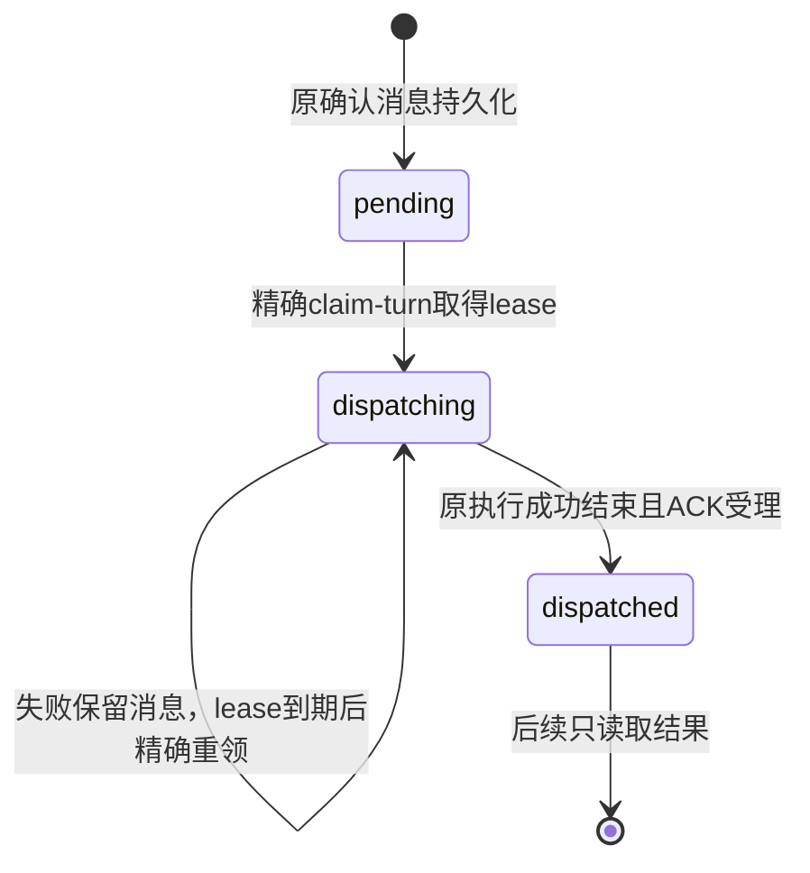

### 容器与页面外观

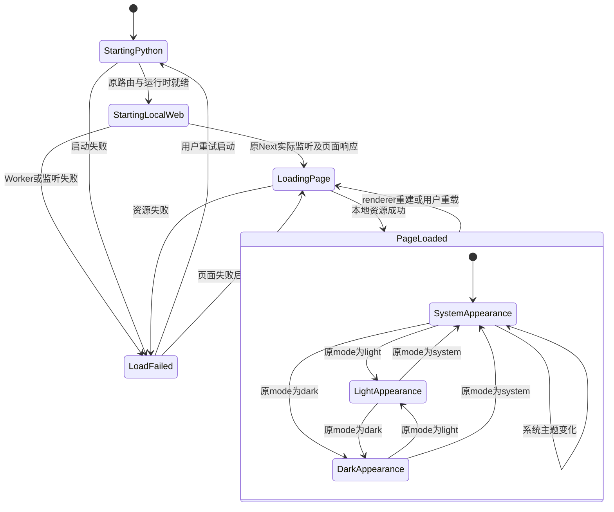

图中定义容器启动和页面外观状态。账户与Run/Thread状态采用原业务定义。bridge中已删除`auth.*`及`auth.callback`，不向网页返回用户凭证。

## 实施与验收

本轮调度修复后的第11次原会话提交完成新增回复、原Session连续性、正常消息及结算，原后端与浏览器流均结束，页面停止按钮退出。该次正常结束验收通过；真实生成中的停止、完整工具及iPhone保持后续验收项。分层回执见[执行记录](../../exec/mobile-app-design-review-20261024.md#2026-10-25-队列读取重叠修复与结束状态定位)。

当前代码保留真实Python与原业务路由，恢复正常form/navigation。此前Mac relay联调完成过一次真实Chat。当前关闭relay的独立Simulator已完成原密码登录及保护数据读取；第五次原Chat取得真实回复、原`turnStatus=completed`、消息和结算，页面停止按钮退出，终态复验通过。普通应用重开已恢复原会话与已完成消息。同会话真实追问暴露长路径格式和重装后的容器目录变化，兼容代码通过目标系统调用及原SDK恢复fixture；第七次提交恢复原Session并取得新增真实回复和结算，页面结束反馈失败。早期包通过ENOSYS拒绝Bash；后续候选已装配关闭配置，原SDK Bash、运行中停止和恢复技术验证通过，完整工具和物理iPhone业务继续验收。具体Thread、Gateway请求与回执见[独立终态复验](../../exec/mobile-app-design-review-20261024.md#独立simulator原chat终态复验通过)；此前失败原文保留。

后续顺序：Simulator同应用原Next/React与ASGI接线 → 原网页登录、合法端侧业务授权、真实模型与持久化 → 原停止/恢复与文件回归 → 物理iPhone同项业务 → 正式签名分发。每一步保持原业务合同，禁止用修改产品行为补齐技术缺口。见[验收矩阵](../../exec/mobile-app-design-review-20261024.md#本轮复审验收矩阵)和[发布稿](../../deploy/mobile-app-release.md)。

本地Web启动使用原env中已登记的localhost回环来源，宿主核对IPv4或IPv6实际监听。监听占用或Worker失败保持启动失败；宿主不切换到Mac服务。WebContent重载复用原Node/Python所有者；应用进程被系统终止后按原会话及业务恢复规则处理。当前包读取原frontend/backend env，原BFF和Python request/data owner沿原身份校验执行；配置缺失时保留原失败反馈。

关闭relay后的WKWebView已实际运行原React。早期无env包的截图`/tmp/ink-ios-local-next-20261025.png`及18项技术回执保留为历史；当前普通env包已通过原账号会话、CSRF、Thread/Deck读取、真实模型响应、第五次原Chat的页面结束反馈及普通重开后的历史读取。真实停止/恢复、文件及完整业务继续验收。

## 当前env接线与Google回调

应用内Python与Node读取现有普通env，原登录卡片、用户、Cookie、CSRF、PKCE和权限规则继续复用。当前本机安装包包含原Dream服务配置；外部分发凭证评审保持待完成。原页面及本地HTTP的通过范围由[执行回执](../../exec/mobile-app-design-review-20261024.md#普通env接线与原登录验收)记录。

Google授权页交给iOS系统浏览器会话。Google先返回公网Admin，Admin继续原授权流程，再返回应用；取消回到原登录页并保留输入。当前宿主尚未实现这段系统浏览器衔接，Google登录保持待验收。

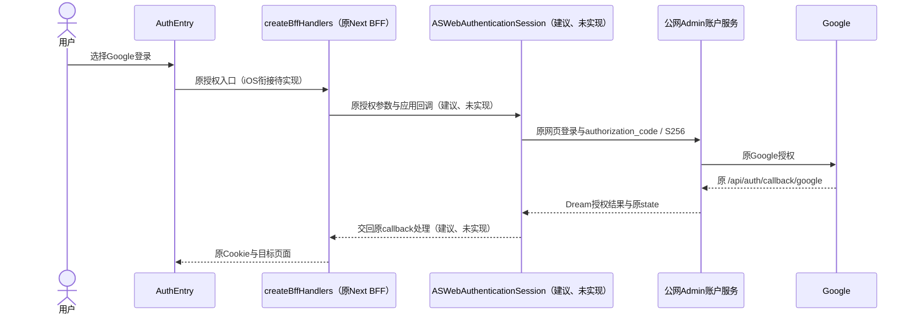

### 原Chat启动失败与恢复

当前保留原“The message was not processed”与Reload conversation反馈。Runtime初始化失败按原错误终止本次执行，已保存的用户消息保留。平台兼容完成后，通过原New或原恢复入口发起后续操作，用户权限、模型选择、消息提交和任务状态保持原业务定义。当前iOS命令兼容候选已通过原SDK Bash技术验证，真实工具业务仍待验收；该能力缺口按[端侧关闭配置与执行接线](../../deploy/mobile-app-release.md#端侧claude命令沙箱配置)和执行记录跟踪。

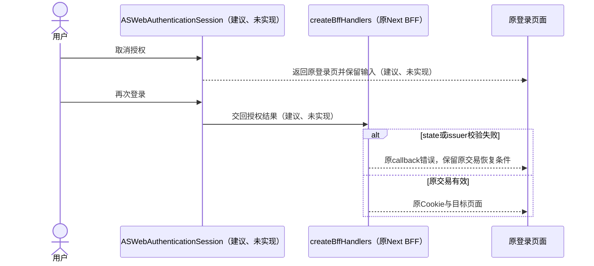

## Google正常账户授权的回调兼容

范围说明：本节已发布登记、密码App回调与系统会话取消回执来自前阶段本机Admin。2026-10-31公网构建10未取得公网登记采用；当前构建11保留已登记Web回调，采用下节“公网密码网页登录与配置回调保留”。本节Google方案、图示及本机资格保留，公网完整Google授权继续待验收。

### 背景与问题

修订前代码事实：`AuthEntry`仍以原POST表单调用`/auth/dream/google`；Admin负责Google OAuth与原账户会话。Dream `/auth/start`使用已有Browser Client ID与S256，公开客户端`tokenEndpointAuthMethod=none`；`/auth/callback`继续读取加密交易Cookie并调用原browser-sessions/exchange。BFF旧构造器要求与publicOrigin同源，Admin配置要求HTTP(S)同源，exchange要求等于该service单一redirectUri。修订前普通安装包的ASWebAuthenticationSession绑定MCP资源operation，仅登记MCP scheme；本次实现新增独立账号会话与账号scheme。

2026-10-31修订前技术探针调用上述原函数，9项通过：HTTP回调及原交易接受，缺失/另一交易Cookie、Native配置及MCP替代回调均拒绝；真实账户、网络和数据库调用0。该结果说明已有Client ID与PKCE能力可复用，账户回调地址与交易Cookie承接构成实际兼容缺口。当前NativeLoginSessionProbe从WK数据存储复制当前来源Cookie，再检查原session；系统会话适配需要保持这段次序。

BFF当前实现已区分`callbackUri`与`callbackRequestUri`：前者保留配置的OAuth注册地址，原authorize/exchange继续使用该值；后者为当前loopback来源的原`/auth/callback` HTTP入口。私有配置限定规范反向域名`.auth:/auth/callback`、HTTP精确loopback来源，无authority/query/hash或路径变体；原Web配置按既有同源规则处理。`fromRequest`在loopback来源选择时保留原私有注册URI，交易Cookie按各来源分别加密。原state/issuer/code/期限、请求来源、CSRF和未知exchange恢复保持。五文件58项技术合同及Web类型通过。

Native当前实现由`InkRuntime.presentLogin`创建`NativeAccountLogin`，原`MobileHostViewController.accountNavigation`仅在登录实例内转交导航，原表单、输入与DOM保留。`NativeLoginSessionProbe.pause`推进代次、取消旧读取，`copyWebCookies`和`copyNativeCookies`分别按当前来源复制平台Cookie，`resume`沿原session验证。候选Info.plist登记独立`.auth`与原`.mcp`；本机同Client目录已发布并读回，前阶段BFF env目标映射源码曾采用；本机构建普通Simulator已采用；系统授权启动/取消及原密码登录通过，完整Google账户与真机继续实施。固定源码增量编译和独立QA包16项XCTest通过，其中5项账号合同包含真实WK→原Native适配器→同App HTTP 303/Set-Cookie→原session验证器。测试上游为具名合成fixture，系统Google页面及真实账户验收单列。

前阶段本机Admin已采用兼容源码并在本机正常服务发布同Client精确回调：保留原Web地址、S256及用户权限，增加两个目标App地址与SDK所需native元数据。8文件53项合同、类型/lint及29项跨仓库探针通过，独立构建通过；原PostgreSQL数据目录保持，原发布入口apply verified=true，后续真实read-only事务dry-run为0差异，数据库/端口/主体匹配。普通Simulator包已采用，原密码App回调登录、系统授权启动/取消及一项真实Chat通过；完整Google账户与真机分列验收。实现与评审依据见[Admin同Client回调兼容](../../exec/mobile-app-design-review-20261024.md#2026-10-31-admin同client回调兼容)。

普通包采用复验：原host曾在启动Next时把配置的账号URI覆盖为HTTP地址；`host.cjs`修订为保留既有env值，缺失时沿原HTTP派生。原`startWeb`的16项环境/绑定合同及原Resolver6项通过。实际App `/auth/start`返回303、目标账号URI与S256，原密码表单完成exchange200及自动关闭；系统会话进入原Admin页面并取消返回。旧默认代理下的Mac loopback探针502归harness记录，直连探针与实际App分别取证。[采用与业务回执](../../exec/mobile-app-design-review-20261024.md#2026-10-31-普通包账号回调采用与notion授权核对)。

官方依据，查阅2026-10-31：Google的[OAuth Policies](https://developers.google.com/identity/protocols/oauth2/policies)禁止开发者控制的嵌入式user-agent承载Google授权，[WKWebView错误说明](https://developers.google.com/identity/protocols/oauth2/native-app#disallowed_useragent)列出对应拒绝。Apple提供[ASWebAuthenticationSession](https://developer.apple.com/documentation/authenticationservices/aswebauthenticationsession/)与[customScheme callback](https://developer.apple.com/documentation/authenticationservices/aswebauthenticationsession/callback/customscheme(_:))；[RFC8252](https://www.rfc-editor.org/rfc/rfc8252)定义外部user-agent、原生私有URI与PKCE。Google→Admin继续使用Admin的Google回调；Admin→Dream的App回调按当前Admin客户端注册管理，Google客户端注册与Dream客户端登记分别所有。

### 目标与边界

完整Google账户链路继续按实际目标验收：复用同一App Client ID、原S256交易及原BFF接口，用现有AuthenticationServices完成Google账户授权并回到原登录弹窗。BFF、Native与本机Admin同Client登记已由前阶段普通Simulator采用。公网构建11保留原Web回调；公网Google私有回调采用继续待验收。Web原POST、密码登录、Cookie/CSRF、角色、scope与业务接口保持；正常Admin原env只增加所属service的精确URI集合，原数据库保持；覆盖安装沿同一App ID保留数据容器inode及会话。MCP资源回调继续由原operation所有。

| 方案 | 判断依据 | 处理 |
| --- | --- | --- |
| Google继续进入原WKWebView | Google官方user-agent规则拒绝该承载 | 排除，保留原Web普通浏览器流程 |
| 直接打开系统浏览器并依赖原WK Cookie观察 | 原BFF缺少交易Cookie即拒绝，现有观察者只读取WK存储 | 排除单步替换；禁止读取系统浏览器Cookie或绕过state |
| 原BFF准备PKCE，系统会话执行原Admin授权，精确App回调交回原BFF | 原client/接口/状态与权限可复用，差异集中在回调URI和Native Cookie次序 | 选定最小适配；Admin代码与登记已采用，普通Simulator已采用，完整Google账户及真机继续实施 |

### 概念与规则

- 三段回调各自绑定：Google→Admin沿原`/api/auth/callback/google`；Admin→Dream采用源码Info.plist的`$(PRODUCT_BUNDLE_IDENTIFIER).auth:/auth/callback`；MCP沿现有`.mcp:/oauth/callback`。同Client账号回调登记已发布并读回，普通Simulator包已采用，真机继续验收。
- Native源码在原presentLogin内保留WK实例，接收主frame显式Google POST，暂停Cookie观察，读取原`/auth/options`核对提交目标。通过平台HTTP读取原`/auth/start`，以manual redirect保留原加密交易Cookie，取得原Admin authorize URL；App Client、resource、scope、state、nonce和S256值沿原响应。当前页面return_to保留查询参数编码并移除原auth_error。
- 系统会话打开原Admin authorize，用户在原Admin登录页面选择Google。该最小方案沿已有账户页面完成授权，直接跳Google的一键入口优化独立评估；自动提交中转页、Google专用客户端/SDK与第二套PKCE流程排除。已有Admin会话需按现有provider支持的`prompt=login`保留明确重新登录意图，其协议行为需技术验证。
- Native接收回调时校验当前登录operation、目标scheme、host、path与query单值，再通过同一平台Cookie存储请求原本机`/auth/callback`。BFF当前实现已区分已登记的OAuth redirect URI与本机接收地址，原state/issuer/code/TTL、请求来源、S256及exchange输入匹配全部保持。
- 原BFF成功响应的Cookie按原属性进入平台存储，限定本次BFF来源同步至WK，等待原交易Cookie删除及新Cookie写入后恢复原NativeLoginSessionProbe，并重读原登录文档。Probe确认原session与CSRF后，沿finishLogin关闭登录弹窗，再由SessionGate重读并进入主页。系统Google/Admin Cookie保持在系统会话中。
- 原密码表单沿现有POST。配置为App账号URI时，WK收到精确回调后创建当前操作，复制原WK交易Cookie，沿同一BFF callback验证；原HTTP回调配置继续原导航。原BFF加密交易Cookie执行state、issuer、期限与PKCE校验。
- 取消只结束当前系统会话并恢复原登录页输入。未知exchange结果保留同一交易及回调，用户重试沿原幂等exchange；过期或明确失效按原错误进入新登录。旧operation回调拒绝，成功/取消/关闭仅结算一次。
- 配置继续使用普通env及现有公开Client ID。打包脚本按原env复制BFF redirect URI，应用标识变化保持该账号值；私有App URI需先由所属Admin登记，再显式配置并验收；Admin源码在原service增加可选`redirectUris`，默认保持原主Web回调。新增URI只进入所属Client，exchange只接受当前已认证service的精确集合。带私有账号URI的原Client沿已安装SDK使用`applicationType=native`，原grant/scope/PKCE与subject规则保持。原发布脚本仅在新增规范账号URI且其他字段全部匹配时允许web→native，保持原行锁、事务、读回和幂等；未知URI、通配、回调缩小及权限漂移继续拒绝。

| 实例 | 创建与保留 | 结束与恢复 |
| --- | --- | --- |
| 原登录WK/导航弹窗 | presentLogin创建，系统授权期间保留输入 | 成功dismiss后结算；取消系统授权返回原实例 |
| 账号系统会话 | 仅显式Google操作创建一份，绑定原登录实例与operation | 成功/取消/关闭清理；MCP会话继续互斥 |
| 原BFF交易Cookie | 原start生成，限定当前BFF来源、state/nonce/verifier/期限 | 原callback成功清理；未知exchange保留原交易 |
| 原Cookie观察者 | 原登录期间监听WK，原session验证确认账户 | 系统授权及本机callback期间暂停并推进代次；旧异步复制/读取拒绝，Cookie同步后恢复 |
| BackendRuntimeManager/业务任务 | 继续App级原所有权 | 登录弹窗与系统会话结束保持原运行库及任务生命周期 |

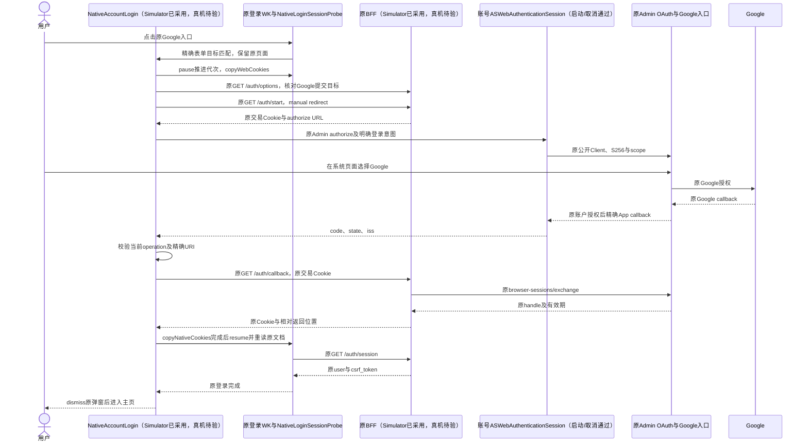

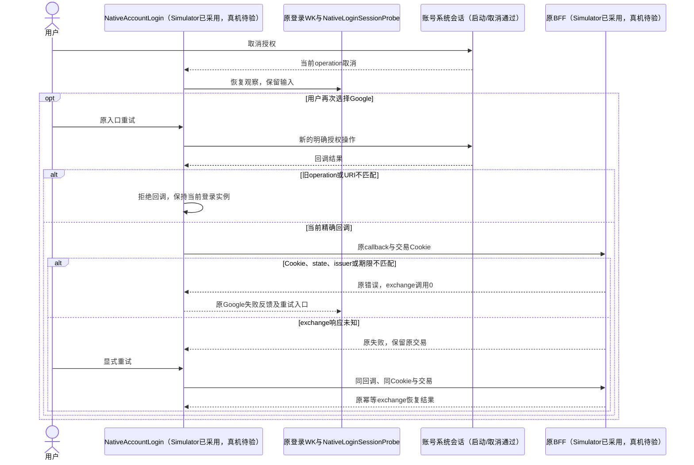

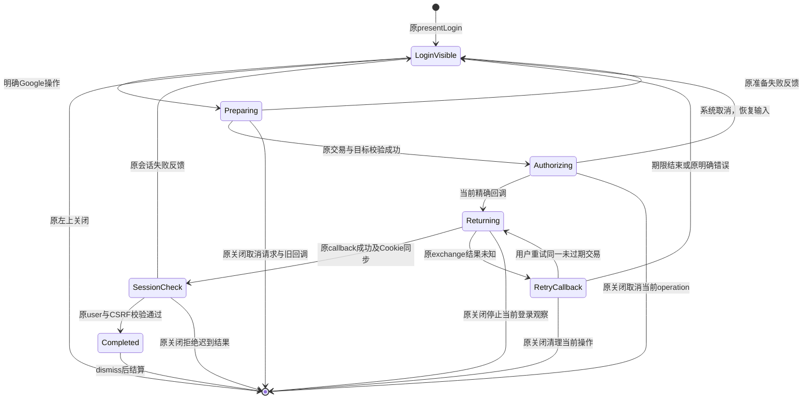

### 实施与验收

| 工作项 | 最小归属 | 验收条件 |
| --- | --- | --- |
| 原BFF回调地址兼容 | login-boundary及原handlers合同；已采用实现与58项技术通过 | 原Web默认值/拒绝规则保持；精确Native地址与本机接收路径区分；缺失/跨交易Cookie、state/issuer、重复query、过期均拒绝；未知exchange同交易恢复；普通Simulator采用通过，真机待验 |
| 同Client精确回调登记 | Admin现有config、oauthClientCatalog、BrowserSessionService；代码/登记已采用并读回 | 保留原Web callback与同Client ID；新地址仅来自服务端配置；无新账户/role/scope/grant/schema；应用类型通过SDK URI规则 |
| Native系统授权与Cookie次序 | 原InkRuntime/登录Host与Probe、InkAccountLogin、目标Info.plist；源码编译与16项技术通过；普通Simulator启动/取消及密码登录通过 | 精确表单拦截、operation绑定、取消/迟到回调、暂停/同步/恢复、关闭一次及主屏登录成功；真实系统页面/普通密码业务回归独立验收 |
| 普通env与制品采用 | 原bundle-node与工程目标配置 | 源env保留，目标App账号scheme与包内既有redirect URI匹配；MCP地址保持，服务凭证范围沿原发布审核 |
| 技术与真实验收 | 原Node/Swift/浏览器harness与正常入口 | 合成provider验证原生产入口；实际系统会话另验；真实Google账户操作、授权同意、重开及Web回归分别取证 |

源码证据：[原表单](../../../frontend/app/_dream/components/Auth/AuthEntry.tsx#L73)、[原start/callback](../../../frontend/app/api/_auth/handlers.ts#L54)、[私有注册地址及HTTP接收地址](../../../frontend/app/api/_auth/login-boundary.ts#L128)、[账号适配](../../../frontend/ios/InkMemory/InkAccountLogin.swift#L86)、[Probe暂停与Cookie次序](../../../frontend/ios/InkMemory/InkReactNative.swift#L452)、[原账号弹窗](../../../frontend/ios/InkMemory/InkReactNative.swift#L355)。Admin源码证据：`/Users/dmeck/project/ink-admin-memory/app/lib/auth/config.ts:48`、`oauthClientCatalog.ts:395`、`browserSessionService.ts:54`；运行采用、目录apply与read-only读回归[同Client实施记录](../../exec/mobile-app-design-review-20261024.md#2026-10-31-admin同client回调兼容)。

| 评审项 | 发现 | 处理方式 | 修订结果 | 剩余依赖 |
| --- | --- | --- | --- | --- |
| 同一账号业务 | 已有公开Client和S256可复用 | 保持原Admin主体/权限与BFF接口 | 原handlers原Client/S256及exchange/session技术合同通过 | 完整Google账户与真机 |
| 系统授权 | WK入口和MCP系统会话分别所有 | 账号操作独立绑定，复用系统框架 | 账号源码和目标编译通过，原MCP保持 | 完整Google账户及真机 |
| 回调边界 | BFF地址源码兼容，Admin同Client集合已发布 | 保留精确注册地址与独立HTTP接收校验 | Web/API/Apps及Native合同通过，目录apply后0差异读回 | 真机与原Web相邻回归 |
| Cookie连续性 | 原异步WK复制会覆盖新Native Cookie | 暂停/代次、原callback成功同步后恢复 | 独立存储竞态及真实WK/同App HTTP303处理通过 | 真实Google Cookie与普通账号业务 |
| 复杂度 | 另建令牌移交、登录中转页或专用客户端会扩大范围 | 原start/callback/session及同Client所有权 | 新业务API、表、插件框架与发布平台排除 | 其余目标及发行资格 |

方案评审：待满足明确前提后通过。历史9项探针、Dream25项与Admin19项合同保留原审计状态；BFF五文件58项技术/Web类型与Native源码、16项目标技术通过。Admin同Client代码、配置与登记已采用并读回。BFF env映射与host转交已由普通Simulator采用；原密码登录及八项短文Chat真实完成，系统会话启动/取消通过。完整Google账户、Notion本地授权、真机及发行继续验收，Release制品保留原阶段摘要。历史证据归[认证兼容审计](../../exec/mobile-app-design-review-20261024.md#2026-10-31-google账户回调兼容审计)，当前代码归[BFF实施记录](../../exec/mobile-app-design-review-20261024.md#2026-10-31-bff端侧账户回调源码兼容)及[Native实施记录](../../exec/mobile-app-design-review-20261024.md#2026-10-31-native账号会话与cookie交接)。

## 公网密码网页登录与配置回调保留

### 背景与问题

公网构建10将原密码网页登录的HTTP回调自动替换为未登记的私有URI，Admin返回`invalid_redirect`，原OAuth错误导航进入Admin页面。构建11恢复既有`http://localhost:5173/auth/callback`，同一公开Client及原PKCE交易继续使用。该故障范围为打包配置；账户、角色、scope、管理端页面及业务接口保持原所有权。

### 目标与边界

App沿原可见网页登录，成功关闭登录弹窗后回到RN主页；失败沿原错误和重试入口恢复。Python/Node/Next/Claude实例继续由App运行库所有，登录页结束保持业务实例。Google系统会话及私有URI方案沿上节保留，公网完整授权需独立采用和验证。当前普通Simulator完成密码授权、session200及弹窗关闭；物理设备构建11安装完成、普通启动被Locked拒绝，完整设备业务待验收。

发现依据为实际打包脚本和公网授权请求；问题收敛为自动回调替换。方案比较结果：保留已登记env回调可恢复现有密码业务，所需源码修改限原资源脚本；公网新增私有回调依赖Admin兼容制品与登记发布；重写登录页面或权限规则缺少需求。当前交付采用第一项，Google采用保留独立工作项。

### 概念与规则

- `bundle-node.py`沿原`frontend/.env.local`复制BFF配置，账号`INK_DREAM_BFF_REDIRECT_URI`保持原值。`host.cjs/startWeb`继续保留已配置值，缺失值沿原HTTP派生。MCP回调继续由原operation和独立env键所有。
- `AuthEntry`原密码表单提交Admin `/auth/dream/password`，原`/auth/start`生成state、nonce、verifier和加密交易Cookie；Admin authorize返回精确已登记URI；`createBffHandlers`继续原callback校验及browser-session exchange。scheme登记能力保持可用，当前密码流程采用HTTP导航。
- `NativeLoginSessionProbe`从当前来源WK数据存储复制Cookie，经原`/auth/session`确认用户及CSRF；`finishLogin`先关闭导航弹窗，再结算登录结果，`SessionGate.native`重读会话后显示原RN页面。未知或失效会话保持原失败反馈。
- 网络5xx、超时或会话读取失败时，原Try again重读原会话/options；交换已完成的账号保留Cookie，客户端重试读取。已提交密码的重发须由用户新登录操作触发。未知exchange仍执行原幂等恢复合同。
- 左上关闭仅结束当前登录弹窗和所属观察任务，原App运行库继续；关闭后可重开。系统Google取消返回所属原登录实例。进程结束沿系统回收，重开沿原Cookie与session验证恢复。

| 实例/状态 | 创建与有效期 | 结束与恢复 |
| --- | --- | --- |
| 登录导航及WK | 用户点击原登录入口创建，账号操作期间保留 | 原session确认后dismiss；左上关闭清理本实例 |
| BFF交易Cookie | 原start创建，绑定当前来源、PKCE、state与期限 | 原callback成功删除；失效沿原重新登录 |
| NativeLoginSessionProbe | 绑定当前登录WK与来源 | 成功/关闭停止；读取错误由原入口重试 |
| RN SessionGate | 原App根视图持有 | 登录返回后重读；原会话失效显示原登录入口 |
| App运行库与Agent任务 | BackendRuntimeManager原App级所有权 | 登录弹窗成功/关闭保持运行；进程回收和任务恢复按原持久化合同 |

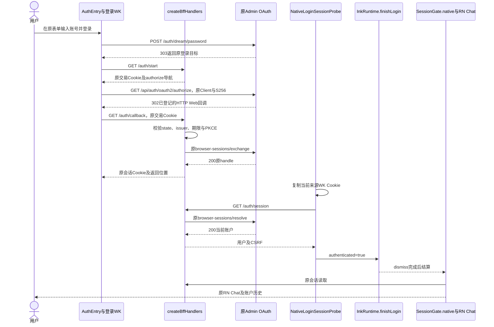

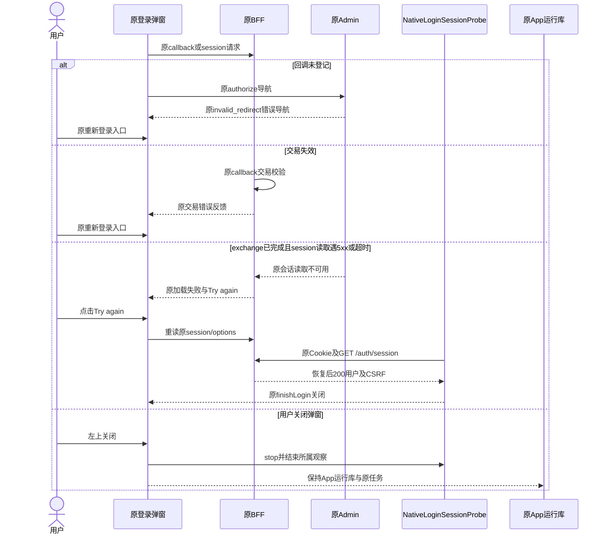

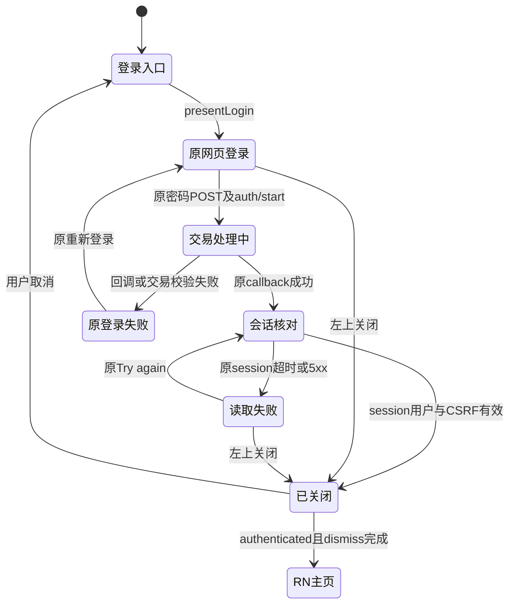

当前验收与剩余依赖见[公网构建11执行记录](../../exec/mobile-app-design-review-20261024.md#2026-10-31-公网构建11恢复原网页登录)。桌面/窄屏骨架继续复用[移动PRD](../../prd/dream-workspace/mobile-app.md)，主页面、菜单、权限与接口变更0。

公网构建12配置补充：原`AdminProductConfig`使用`INK_ADMIN_PRODUCT_API_BASE_URL`访问公网Admin，原Product Origin保持所属Client校验。登录弹窗、上述业务图和App运行库实例保持；包内原用量200，session/模型目录的实际503沿原重试反馈。端点清单和当前制品归[发布设计](../../deploy/mobile-app-release.md#公网端侧包的既有http配置清单)，实际密码登录资格继续采用构建11回执，完整12业务另验。
