<!-- [Sync] 2026-11-03: APP-07补原工具资源、Notion线程home与Transport PATH默认交付、方案取舍及正常/异常/状态图，真实资格单列。 -->
<!-- [Sync] 2026-11-03: APP-04现行生命周期与恢复方案独立维护，旧章节与图示保留，暂停状态保持。 -->
<!-- [Sync] 2026-11-03: iOS构建选择同版Undici标量HTTP解析器；原创建、流式、期限及取消协议保持。 -->
<!-- [Sync] 2026-11-03: 恢复四项验收；回顾正文按同一实测区域分配高度，原手势复用，APP-04保持暂停。 -->
<!-- [Sync] 2026-11-02: 汇入回顾截图、原pending/task_id恢复、错误去重及三类业务图，网络根因与新候选验收保持未确认。 -->
<!-- [Sync] 2026-11-02: 汇入原启动阶段计时、CPU解释边界与图示，性能归因和Simulator测量保持待执行。 -->
<!-- [Sync] 2026-11-02: 现行应用品牌采用Kastention，中文称谓采用卡片结构；原技术身份和历史回执保留。 -->
<!-- [Sync] 2026-11-02: 汇入前后台与重开恢复的原输入、任务查询、正常/异常时序和状态，保留验证暂停范围。 -->
<!-- [Sync] 2026-11-02: 汇入App删除确认的正常/异常时序和状态图，原业务与验证暂停边界保持。 -->
<!-- [Sync] 2026-11-02: 系统Google操作携带明确选择，原provider签名验证后继续原social流程；失败停止自动跳转。 -->
<!-- [Sync] 2026-11-02: 修复公网包账号回调映射与现有诊断接线，原HTTP回调、Client、PKCE和用户权限保持。 -->
<!-- [Sync] 2026-11-01: 移动应用PRD迁至docs/prd/mobile-app/mobile-app.md，更新现行引用，保留历史回执。 -->
<!-- [Sync] 2026-11-01: 端侧网页链接统一系统默认浏览器，修复Notion默认Linking接收者及同步失败恢复。 -->
<!-- [Sync] 2026-10-31: 索引端侧目标编译与原登录认证方案、排障指南和分平台资格；本轮仅文档维护。 -->
<!-- [Sync] 2026-10-31: 公网构建11保留原Web回调及登录/失败恢复图；Google本机采用与公网前提分列。 -->
<!-- [Sync] 2026-10-31: 普通Simulator采用精确账号回调，系统取消/密码关闭/真实Chat通过；完整Google、Notion授权与真机单列。 -->
<!-- [Sync] 2026-10-31: Native账号会话/原Cookie观察暂停与复制形成源码候选，16项iOS技术通过，系统授权/登记/普通包采用分列。 -->
<!-- [Sync] 2026-10-31: BFF原账号回调地址兼容形成源码候选，58项技术及Web类型通过，Native/登记/包采用继续实施。 -->
<!-- [Sync] 2026-10-31: Google正常账户授权补精确回调/Cookie交易连续性方案、原Client复用及未实现前提；原图保留。 -->
<!-- [Sync] 2026-10-31: 区分已实现的App级运行库协调、当前Release设备开发包及历史RN接入提案。 -->
<!-- [Sync] 2026-10-27: RN框架目标保持，按原生与网页区域减少迁移范围。 -->
<!-- [Sync] 2026-10-26: recovery of an already completed confirmation reuses its saved reply and retries workspace synchronization without repeating generation. -->
<!-- [Sync] 2026-10-26: 已保存Dream确认在当前用户重开同Run时经原消息claim恢复，保留等待与实际ACK反馈。 -->
<!-- [Sync] 2026-10-26: 前后台切换遵循系统挂起及原失败/恢复反馈，专项回执保留首次工具失败与原重试结果。 -->
<!-- [Sync] 2026-10-26: Dream原审核操作栏位于窄屏主导航上方，确认内容和提交规则保持。 -->
<!-- [Sync] 2026-10-25: 关闭命令沙箱的原SDK Bash/停止/恢复和Runner技术通过；真实工具业务与真机继续验收。 -->
<!-- [Sync] 2026-10-25: 原inputs读取重叠修复后，同会话真实追问取得分层EOF、页面终态与正常持久化结算。 -->
<!-- [Sync] 2026-10-25: 原Chat终态与普通重开通过；同步原会话目录适配、失败反馈及真实追问复验范围。 -->
<!-- [Sync] 2026-10-25: 原登录读取失败提供页面重载，重新执行同一会话/options读取，表单和授权规则保持。 -->
<!-- [Sync] 2026-10-25: 明确系统安全区与Settings搜索输入视口。 -->
<!-- [Sync] 2026-10-25: 保留原网页登录，普通env接线进入本机验收；Google系统浏览器与应用回调待实现。 -->
<!-- [Input] 当前Dream网页业务、Swift/WKWebView宿主及iPhone Python执行回执。 -->
<!-- [Output] iOS容器、正常网页登录、平台交互、失败恢复与未完成项。 -->
<!-- [Pos] iOS独立正式交互设计；复用原业务状态与共享React。 -->
<!-- [Sync] 2026-10-25: 原Next和原ASGI在应用内通信，加载原登录卡片，保留未授权与配置失败反馈。 -->
<!-- [Sync] 2026-10-25: 区分关闭relay后的原后端/Runtime技术回执与此前Mac联调业务回执。 -->
<!-- [Sync] 2026-10-25: 公网Admin网页登录与完整Chat在Simulator应用宿主通过。 -->
<!-- [Sync] 2026-10-25: Simulator应用宿主完成原网页密码登录、BFF会话与真实Chat。 -->
<!-- [Sync] 2026-10-25: 删除原生账户流程与业务改写，保留正常网页表单。 -->

<!-- [Sync] 2026-10-27: 增加RN目标，复用原iOS运行库与网页登录；工作台创建退出端侧范围。 -->

# Kastention iOS交互设计

当前名称规则见[应用名称需求](../../prd/mobile-app/app-brand.md)。默认展示Kastention，中文本地化应用称谓使用卡片结构。

现行登录认证、目标编译与配置职责见[运行库认证合同](mobile-runtime-architecture.md#端侧登录认证与目标编译合同2026-10-31)，操作指南见[认证排障](../../deploy/mobile-auth-troubleshooting.md)。iOS已有登录文档、系统授权和Cookie适配源码；构建26的真机账号错误日志复验通过，当前构建27已安装启动。公网Google完整授权与新账户创建资格按[本轮执行记录](../../exec/ios-account-entry-fix-20261102.md)登记。下方旧日期阶段保留其原始状态。

## 现行iOS工程与交互

实际入口`frontend/ios/InkMemory/InkMemoryApp.swift`加载Metro生成的`main.jsbundle`和RN应用`InkMemory`。`InkReactNative.swift`导出运行库启动、HTTP响应增量读取、取消读取和原网页登录；整页业务WebView视图注册已退役。原Python/Node/Next/Claude装配继续复用原生脚本。

当前SwiftUI入口使用`.ignoresSafeArea(.container)`延伸容器背景并保留系统键盘避让，向RN提供调整后的可见区域。RN页面在iOS关闭额外的`KeyboardAvoidingView`调整，内部滚动使用该区域，系统安全区组件处理状态栏和Home Indicator。`MarkdownInputEditor.native`局部文档不持有App级键盘布局。Agent弹层根据键盘顶部及触发器锚点选择展开方向，关闭后保留当前Agent和草稿。该合同需用系统软件键盘验证输入、Send/Stop和弹层均可操作。

共享界面与状态、正常/异常时序及生命周期见[统一工程设计](react-native-web-project-structure.md)。运行中切后台遵循iOS挂起约束，回前台通过原history/status恢复。签名与发行继续使用现有Team配置，账号与发行资格单独核验。

2026-10-31源码现状：[BackendRuntimeManager](../../../frontend/src/runtime/BackendRuntimeManager.ts#L8)已由[SessionGate](../../../frontend/src/platform/SessionGate.native.tsx#L28)调用，复用[InkRuntime.ensureStarted](../../../frontend/ios/InkMemory/InkReactNative.swift#L51)和原EmbeddedDreamBackend singleton；成功Promise在页面重建期间保留，启动失败允许原重试。当前Release设备全量构建与已有开发签名IPA完成，普通Simulator、Release真机业务和商店资格按[当前发布稿](../../deploy/mobile-app-release.md#2026-10-31当前release设备包)分别验收。

## 原平台实现与历史交互记录

以下正文保留原WKWebView工程、业务回执与图示；新RN主界面另行验证。当前源码目录统一为`frontend/ios/`，下文旧路径保留历史归属。

RN作为App入口，现有Swift/Objective-C/C++用于平台适配与运行库。页面按[RN内的复用取舍](frontend-reuse-tradeoffs.md)逐区迁移，保留的DOM业务继续WebView运行；生命周期与业务合同保持。

## React Native目标接入

目标采用RN原生主界面，正常网页登录保留受限WKWebView。[RN交互稿](mobile-react-native-interaction.md)定义HTTP业务、范围与时序，[运行时架构](mobile-runtime-architecture.md#实例所有权与生命周期)定义实例生命周期。以下旧图示和回执保留WebView实现归属。

历史提案（2026-10-27）：App组合根持有BackendRuntimeManager（建议、未实现），复用`EmbeddedDreamBackend.shared`、CPython、Node和Next；Scene、页面与RN Root重建只更新订阅。WKWebView Cookie接入原生HTTP存储时保持原来源、HttpOnly与CSRF，Cookie值保留原生层。Google系统浏览器回调独立验收。

安全区沿原主题，键盘和返回遵循iOS操作。后台保留实例并服从系统调度；进程重开后按原HTTP读取历史与Session。工作台创建、初始生成和审核确认退出端侧菜单、页面和适配清单。

## 背景与问题

iOS使用Swift/WKWebView加载现有React，Dream Python在应用进程内运行。物理iPhone已经执行CPython 3.13.17、FastAPI和11个原业务模块，原生8项测试通过。此前iOS Simulator容器通过Mac联调路径完成原网页登录、BFF会话与一次真实Chat。当前关闭Mac relay的独立Simulator已运行24个原业务路由、原Factory/Runner、原Claude Runtime和原user MCP；应用内fixture已验证原协议及工具。第五次原Chat提交取得真实模型回复，原React已显示且停止按钮退出，正常Admin已保存消息和结算。第四次停止按钮持续显示的现象在复验中未复现，根因仍待证实。物理iPhone独立业务与完整工具执行仍待完成。

本稿采用[移动PRD](../../prd/mobile-app/mobile-app.md)和[共享交互](./mobile-app-interaction.md)的原网页业务。前稿的原生登录、Keychain账户令牌、独立回调、新任务状态和附件先导入流程已删除。

## 目标与边界

- Swift负责WKWebView、解释器装配、消息传输、键盘/安全区和生命周期通知。
- 页面、原登录表单、账户、任务、附件、权限、存储和计费继续由现有业务实现负责。
- 公网Admin以HTTPS提供现有账户和数据服务；localhost Dream client继续使用既有来源与callback配置。
- 完整BFF和Claude兼容问题作为实施阻断；容器不通过另建认证、放宽校验或替代Agent绕过。

端侧部署按[现有关闭配置](../../deploy/mobile-app-release.md#端侧claude命令沙箱配置)运行Claude命令，iOS系统应用沙箱及原工具审批保持。页面、确认入口与业务状态不增加沙箱管理流程。当前iOS候选包已装配关闭值，原SDK Bash/停止/恢复及原Runner技术用例通过；端侧Bash、停止和恢复继续按实际结果验收。

## 概念与规则

| 模块 | 归属和现状 |
| --- | --- |
| `MobileHostViewController` | WKWebView、来源/generation、生命周期及加载失败处理；本轮允许原HTTPS顶层form/navigation |
| `AppURLSchemeHandler` | 保留原静态资源适配；独立iOS路径从应用内原Next HTTP加载原页面 |
| `EmbeddedDreamBackend` / `DreamPython` | 串行初始化CPython，并行调用持久ASGI loop；响应读取与取消可并行执行 |
| `mobile_runtime.ios` | Native Runtime就绪后，同一ASGI实例装配公共路由与原24个业务模块；原DTO与鉴权保留，`businessReady=false` |
| `AuthEntry` / 原Next BFF | 原网页登录和会话所有权；相同Next standalone在应用Node Worker执行，原Cookie/CSRF/PKCE和服务身份校验保持 |
| 原Claude SDK/CLI | 原SDK协议接到同应用Node24 Worker中的原Runtime；原Runner、user MCP、Read/Write、拒绝、恢复和停止已有Simulator技术回执；Bash与完整业务继续待完成 |

源码证据：[iOS宿主](../../../frontend/ios/InkMemory/MobileHostViewController.swift)、[解释器](../../../frontend/ios/InkMemory/DreamPython.m)、[原登录卡片](../../../frontend/app/_dream/components/Auth/AuthEntry.tsx#L34)、[原BFF](../../../frontend/app/api/_auth/handlers.ts#L30)、[端侧组合](../../../backend/mobile_runtime/ios.py#L61)。

### 页面与操作

页面骨架复用[PRD正文](../../prd/mobile-app/mobile-app.md#页面骨架)。iPhone单栏、iPad按可见宽度使用原响应式布局；原页面、栏目、弹窗和提交条件保持一致。WKWebView位于系统安全区内，顶部操作避开状态栏和刘海。窄屏Settings搜索框使用16px字号，输入聚焦保持页面视口。键盘出现时输入和主操作可见；消息区与输入区分别滚动。原登录卡片中的Email、Password、Login、Google和Register继续使用原form，不增加原生登录页。

安全区底色从原页面`--color-bg-app`读取，`data-theme-mode`继续由`theme.ts`管理。原生UserScript只在主文档观察现有主题属性与系统主题变化，通过私有`inkAppearance`外观消息将背景与模式传给`MobileHostViewController`。背景接受现有`#RRGGBB`值，模式接受原`light/dark/system`；字段缺失或格式错误时保留当前外观，下次有效消息继续更新。SwiftUI背景仅延伸至容器安全区，原WebView与键盘内容边界保持；显式主题同步系统文字/指示条，跟随系统时恢复系统外观。原业务bridge的methods/events、账户和任务状态保持。

Dream工作台的原审核操作栏位于窄屏主导航上方，沿用同一主导航高度和安全区尺寸。人物、场景、分镜列表及编辑区继续在原页面滚动，“确认并继续”、当前修改数量和revision可见可达。原审核内容、提交条件、接口与权限保持；桌面操作栏继续使用原位置。

WKWebView使用持久`WKWebsiteDataStore`，保持第一方Cookie。正常HTTPS顶层导航允许加载；远程页面无法通过主frame来源检查调用bridge。系统文件选择、导出和分享只适配原业务操作，不改变上传时机、附件DTO或文件归属。

`AuthEntry`在`AuthContext.authError`或options读取失败时显示`Try again`。点击调用`window.location.reload()`，原`AuthProvider`与`AuthEntry`重新读取同一`/auth/session`及`/auth/options`；原401、DTO、Cookie与CSRF处理保持。重载重置未提交表单内容，密码和Google授权继续通过原顶层form。凭证错误保留原编辑/提交交互。

## 正常业务时序

下图定义原网页登录业务。独立Simulator的原表单、会话、CSRF与Thread/Deck/模型目录读取已通过；完整模型任务按后文实际提交回执验收。

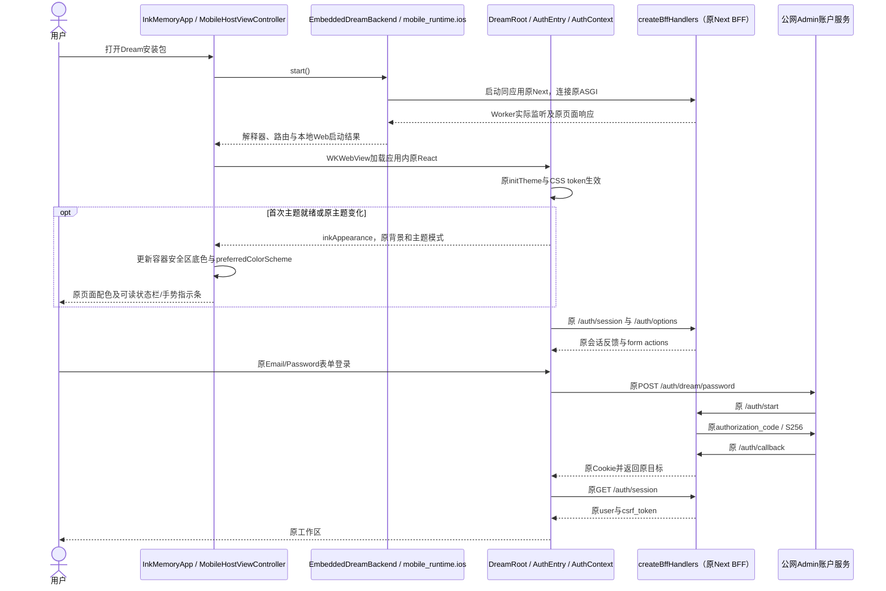

## 异常与恢复时序

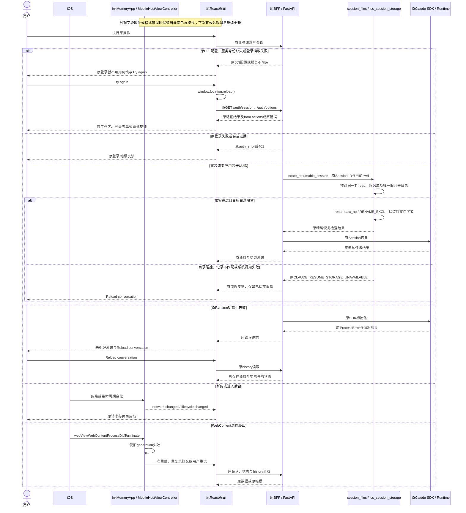

宿主不在后台主动新增业务写入或任务终态。Python进程被系统终止后，只能按原持久化和恢复入口读取实际结果。

用户切出应用后，端侧执行可能随系统挂起；回到应用时展示原任务结果、工具失败和实际保存的消息。原Claude的后续执行沿现有业务处理，宿主不补发任务或替换结果。2026-10-26模拟器专项中首次工具失败，原重试后回复完成；本次后台时序诊断及验收调用次数控制仍有缺口，[专项验收保持未通过](../../exec/mobile-app-design-review-20261024.md#前后台恢复诊断与有界验收)。系统规则依据[Apple生命周期](https://developer.apple.com/documentation/uikit/managing-your-app-s-life-cycle)，2026-10-26查阅；物理iPhone单独验收。

共享Chat的队列后台读取在上次读取结束后继续更新，离开会话时取消已离开页面的读取；队列操作、失败反馈与状态规则保持。

## 容器状态转换

### 已保存Dream确认的进程重开恢复

用户已完成原“确认并继续”后，重新进入同一Dream保留人物、场景、分镜及确认内容。当前恢复候选已通过无模型合同检查，原账户实际续接继续验收。页面复用原等待、运行、停止和消息结果；用户无需第二次确认。以下参与模块和接口均为已有生产入口，恢复接线归`DreamArtifactApplicationService`。

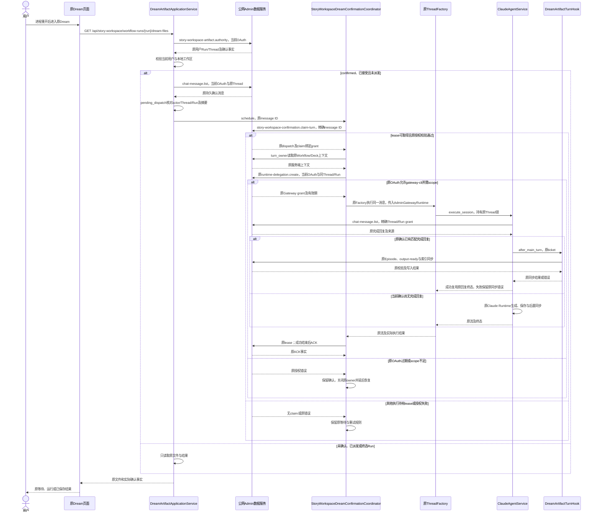

完成回复的恢复沿用原消息和文件。服务端只在相同用户、Run、Thread及确认消息均匹配，且原完成回复结构有效时重试同步；同步成功后原确认变为已派发。同步失败保留原反馈和等待，不增加用户确认、模型重发或助手消息。普通Simulator已完成该恢复，确认实际ACK且零新增模型；物理设备完整业务继续验收。

原metadata状态保持以下转换；图中dispatching不表示Run完成。损坏、重复或跨账户/Thread/Run消息停止本次恢复，原文件继续可读。

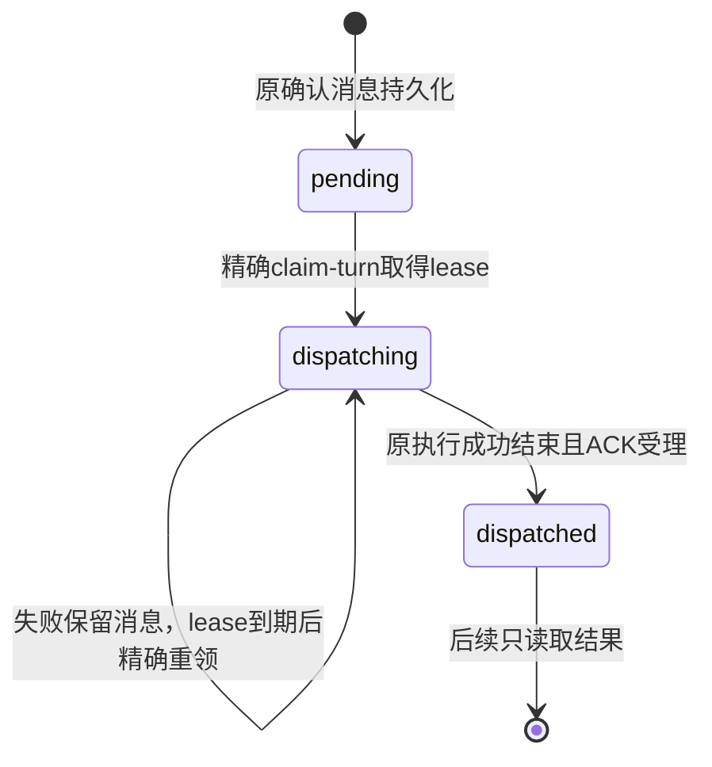

### 容器与页面外观

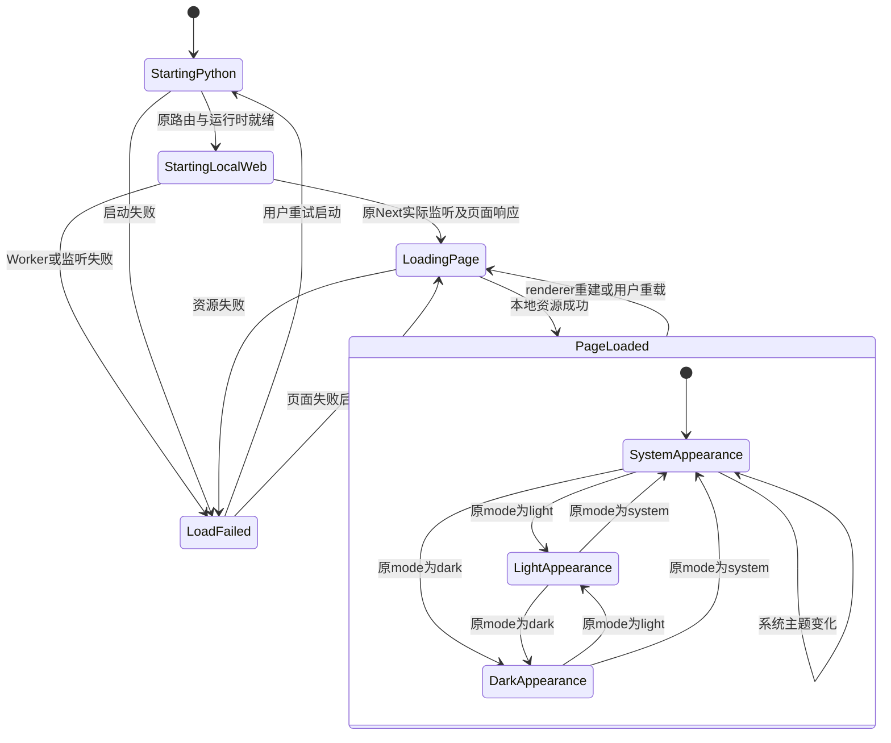

图中定义容器启动和页面外观状态。账户与Run/Thread状态采用原业务定义。bridge中已删除`auth.*`及`auth.callback`，不向网页返回用户凭证。

## 实施与验收

本轮调度修复后的第11次原会话提交完成新增回复、原Session连续性、正常消息及结算，原后端与浏览器流均结束，页面停止按钮退出。该次正常结束验收通过；真实生成中的停止、完整工具及iPhone保持后续验收项。分层回执见[执行记录](../../exec/mobile-app-design-review-20261024.md#2026-10-25-队列读取重叠修复与结束状态定位)。

当前代码保留真实Python与原业务路由，恢复正常form/navigation。此前Mac relay联调完成过一次真实Chat。当前关闭relay的独立Simulator已完成原密码登录及保护数据读取；第五次原Chat取得真实回复、原`turnStatus=completed`、消息和结算，页面停止按钮退出，终态复验通过。普通应用重开已恢复原会话与已完成消息。同会话真实追问暴露长路径格式和重装后的容器目录变化，兼容代码通过目标系统调用及原SDK恢复fixture；第七次提交恢复原Session并取得新增真实回复和结算，页面结束反馈失败。早期包通过ENOSYS拒绝Bash；后续候选已装配关闭配置，原SDK Bash、运行中停止和恢复技术验证通过，完整工具和物理iPhone业务继续验收。具体Thread、Gateway请求与回执见[独立终态复验](../../exec/mobile-app-design-review-20261024.md#独立simulator原chat终态复验通过)；此前失败原文保留。

后续顺序：Simulator同应用原Next/React与ASGI接线 → 原网页登录、合法端侧业务授权、真实模型与持久化 → 原停止/恢复与文件回归 → 物理iPhone同项业务 → 正式签名分发。每一步保持原业务合同，禁止用修改产品行为补齐技术缺口。见[验收矩阵](../../exec/mobile-app-design-review-20261024.md#本轮复审验收矩阵)和[发布稿](../../deploy/mobile-app-release.md)。

本地Web启动使用原env中已登记的localhost回环来源，宿主核对IPv4或IPv6实际监听。监听占用或Worker失败保持启动失败；宿主不切换到Mac服务。WebContent重载复用原Node/Python所有者；应用进程被系统终止后按原会话及业务恢复规则处理。当前包读取原frontend/backend env，原BFF和Python request/data owner沿原身份校验执行；配置缺失时保留原失败反馈。

关闭relay后的WKWebView已实际运行原React。早期无env包的截图`/tmp/ink-ios-local-next-20261025.png`及18项技术回执保留为历史；当前普通env包已通过原账号会话、CSRF、Thread/Deck读取、真实模型响应、第五次原Chat的页面结束反馈及普通重开后的历史读取。真实停止/恢复、文件及完整业务继续验收。


## 当前env接线与Google回调

应用内Python与Node读取现有普通env，原登录卡片、用户、Cookie、CSRF、PKCE和权限规则继续复用。当前本机安装包包含原Dream服务配置；外部分发凭证评审保持待完成。原页面及本地HTTP的通过范围由[执行回执](../../exec/mobile-app-design-review-20261024.md#普通env接线与原登录验收)记录。

Google授权页交给iOS系统浏览器会话。Google先返回公网Admin，Admin继续原授权流程，再返回应用；取消回到原登录页并保留输入。当前宿主尚未实现这段系统浏览器衔接，Google登录保持待验收。

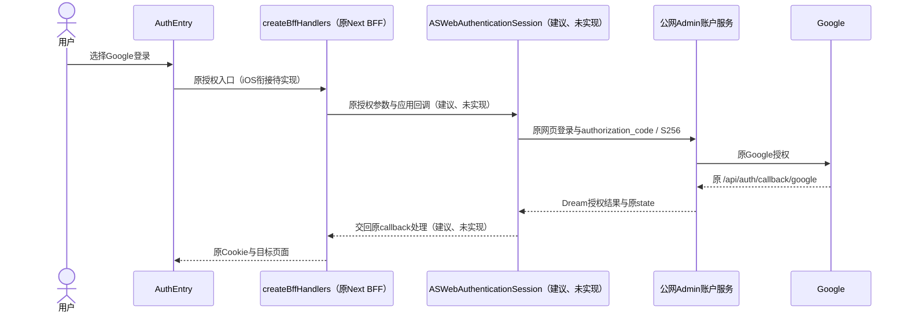

### 原Chat启动失败与恢复

当前保留原“The message was not processed”与Reload conversation反馈。Runtime初始化失败按原错误终止本次执行，已保存的用户消息保留。平台兼容完成后，通过原New或原恢复入口发起后续操作，用户权限、模型选择、消息提交和任务状态保持原业务定义。当前iOS命令兼容候选已通过原SDK Bash技术验证，真实工具业务仍待验收；该能力缺口按[端侧关闭配置与执行接线](../../deploy/mobile-app-release.md#端侧claude命令沙箱配置)和执行记录跟踪。

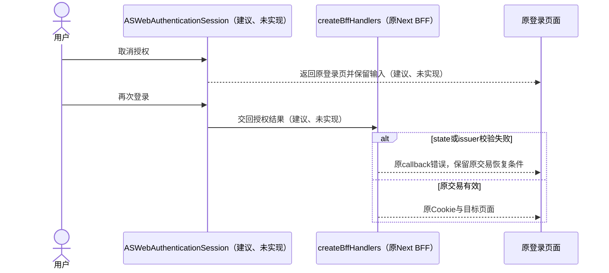


## Google正常账户授权的回调兼容

范围说明：本节已发布登记、密码App回调与系统会话取消回执来自前阶段本机Admin。2026-10-31公网构建10未取得公网登记采用；当前构建11保留已登记Web回调，采用下节“公网密码网页登录与配置回调保留”。本节Google方案、图示及本机资格保留，公网完整Google授权继续待验收。

### 背景与问题

修订前代码事实：`AuthEntry`仍以原POST表单调用`/auth/dream/google`；Admin负责Google OAuth与原账户会话。Dream `/auth/start`使用已有Browser Client ID与S256，公开客户端`tokenEndpointAuthMethod=none`；`/auth/callback`继续读取加密交易Cookie并调用原browser-sessions/exchange。BFF旧构造器要求与publicOrigin同源，Admin配置要求HTTP(S)同源，exchange要求等于该service单一redirectUri。修订前普通安装包的ASWebAuthenticationSession绑定MCP资源operation，仅登记MCP scheme；本次实现新增独立账号会话与账号scheme。

2026-10-31修订前技术探针调用上述原函数，9项通过：HTTP回调及原交易接受，缺失/另一交易Cookie、Native配置及MCP替代回调均拒绝；真实账户、网络和数据库调用0。该结果说明已有Client ID与PKCE能力可复用，账户回调地址与交易Cookie承接构成实际兼容缺口。当前NativeLoginSessionProbe从WK数据存储复制当前来源Cookie，再检查原session；系统会话适配需要保持这段次序。

BFF当前实现已区分`callbackUri`与`callbackRequestUri`：前者保留配置的OAuth注册地址，原authorize/exchange继续使用该值；后者为当前loopback来源的原`/auth/callback` HTTP入口。私有配置限定规范反向域名`.auth:/auth/callback`、HTTP精确loopback来源，无authority/query/hash或路径变体；原Web配置按既有同源规则处理。`fromRequest`在loopback来源选择时保留原私有注册URI，交易Cookie按各来源分别加密。原state/issuer/code/期限、请求来源、CSRF和未知exchange恢复保持。五文件58项技术合同及Web类型通过。

Native当前实现由`InkRuntime.presentLogin`创建`NativeAccountLogin`，原`MobileHostViewController.accountNavigation`仅在登录实例内转交导航，原表单、输入与DOM保留。`NativeLoginSessionProbe.pause`推进代次、取消旧读取，`copyWebCookies`和`copyNativeCookies`分别按当前来源复制平台Cookie，`resume`沿原session验证。候选Info.plist登记独立`.auth`与原`.mcp`；本机同Client目录已发布并读回，前阶段BFF env目标映射源码曾采用；本机构建普通Simulator已采用；系统授权启动/取消及原密码登录通过，完整Google账户与真机继续实施。固定源码增量编译和独立QA包16项XCTest通过，其中5项账号合同包含真实WK→原Native适配器→同App HTTP 303/Set-Cookie→原session验证器。测试上游为具名合成fixture，系统Google页面及真实账户验收单列。

前阶段本机Admin已采用兼容源码并在本机正常服务发布同Client精确回调：保留原Web地址、S256及用户权限，增加两个目标App地址与SDK所需native元数据。8文件53项合同、类型/lint及29项跨仓库探针通过，独立构建通过；原PostgreSQL数据目录保持，原发布入口apply verified=true，后续真实read-only事务dry-run为0差异，数据库/端口/主体匹配。普通Simulator包已采用，原密码App回调登录、系统授权启动/取消及一项真实Chat通过；完整Google账户与真机分列验收。实现与评审依据见[Admin同Client回调兼容](../../exec/mobile-app-design-review-20261024.md#2026-10-31-admin同client回调兼容)。


普通包采用复验：原host曾在启动Next时把配置的账号URI覆盖为HTTP地址；`host.cjs`修订为保留既有env值，缺失时沿原HTTP派生。原`startWeb`的16项环境/绑定合同及原Resolver6项通过。实际App `/auth/start`返回303、目标账号URI与S256，原密码表单完成exchange200及自动关闭；系统会话进入原Admin页面并取消返回。旧默认代理下的Mac loopback探针502归harness记录，直连探针与实际App分别取证。[采用与业务回执](../../exec/mobile-app-design-review-20261024.md#2026-10-31-普通包账号回调采用与notion授权核对)。

官方依据，查阅2026-10-31：Google的[OAuth Policies](https://developers.google.com/identity/protocols/oauth2/policies)禁止开发者控制的嵌入式user-agent承载Google授权，[WKWebView错误说明](https://developers.google.com/identity/protocols/oauth2/native-app#disallowed_useragent)列出对应拒绝。Apple提供[ASWebAuthenticationSession](https://developer.apple.com/documentation/authenticationservices/aswebauthenticationsession/)与[customScheme callback](https://developer.apple.com/documentation/authenticationservices/aswebauthenticationsession/callback/customscheme(_:))；[RFC8252](https://www.rfc-editor.org/rfc/rfc8252)定义外部user-agent、原生私有URI与PKCE。Google→Admin继续使用Admin的Google回调；Admin→Dream的App回调按当前Admin客户端注册管理，Google客户端注册与Dream客户端登记分别所有。

### 目标与边界

完整Google账户链路继续按实际目标验收：复用同一App Client ID、原S256交易及原BFF接口，用现有AuthenticationServices完成Google账户授权并回到原登录弹窗。BFF、Native与本机Admin同Client登记已由前阶段普通Simulator采用。公网构建11保留原Web回调；公网Google私有回调采用继续待验收。Web原POST、密码登录、Cookie/CSRF、角色、scope与业务接口保持；正常Admin原env只增加所属service的精确URI集合，原数据库保持；覆盖安装沿同一App ID保留数据容器inode及会话。MCP资源回调继续由原operation所有。

| 方案 | 判断依据 | 处理 |
| --- | --- | --- |
| Google继续进入原WKWebView | Google官方user-agent规则拒绝该承载 | 排除，保留原Web普通浏览器流程 |
| 直接打开系统浏览器并依赖原WK Cookie观察 | 原BFF缺少交易Cookie即拒绝，现有观察者只读取WK存储 | 排除单步替换；禁止读取系统浏览器Cookie或绕过state |
| 原BFF准备PKCE，系统会话执行原Admin授权，精确App回调交回原BFF | 原client/接口/状态与权限可复用，差异集中在回调URI和Native Cookie次序 | 选定最小适配；Admin代码与登记已采用，普通Simulator已采用，完整Google账户及真机继续实施 |

### 概念与规则

- 三段回调各自绑定：Google→Admin沿原`/api/auth/callback/google`；Admin→Dream采用源码Info.plist的`$(PRODUCT_BUNDLE_IDENTIFIER).auth:/auth/callback`；MCP沿现有`.mcp:/oauth/callback`。同Client账号回调登记已发布并读回，普通Simulator包已采用，真机继续验收。
- Native源码在原presentLogin内保留WK实例，接收主frame显式Google POST，暂停Cookie观察，读取原`/auth/options`核对提交目标。通过平台HTTP读取原`/auth/start`，以manual redirect保留原加密交易Cookie，取得原Admin authorize URL；App Client、resource、scope、state、nonce和S256值沿原响应。当前页面return_to保留查询参数编码并移除原auth_error。
- 系统会话打开原Admin authorize，用户在原Admin登录页面选择Google。该最小方案沿已有账户页面完成授权，直接跳Google的一键入口优化独立评估；自动提交中转页、Google专用客户端/SDK与第二套PKCE流程排除。已有Admin会话需按现有provider支持的`prompt=login`保留明确重新登录意图，其协议行为需技术验证。
- Native接收回调时校验当前登录operation、目标scheme、host、path与query单值，再通过同一平台Cookie存储请求原本机`/auth/callback`。BFF当前实现已区分已登记的OAuth redirect URI与本机接收地址，原state/issuer/code/TTL、请求来源、S256及exchange输入匹配全部保持。
- 原BFF成功响应的Cookie按原属性进入平台存储，限定本次BFF来源同步至WK，等待原交易Cookie删除及新Cookie写入后恢复原NativeLoginSessionProbe，并重读原登录文档。Probe确认原session与CSRF后，沿finishLogin关闭登录弹窗，再由SessionGate重读并进入主页。系统Google/Admin Cookie保持在系统会话中。
- 原密码表单沿现有POST。配置为App账号URI时，WK收到精确回调后创建当前操作，复制原WK交易Cookie，沿同一BFF callback验证；原HTTP回调配置继续原导航。原BFF加密交易Cookie执行state、issuer、期限与PKCE校验。
- 取消只结束当前系统会话并恢复原登录页输入。未知exchange结果保留同一交易及回调，用户重试沿原幂等exchange；过期或明确失效按原错误进入新登录。旧operation回调拒绝，成功/取消/关闭仅结算一次。
- 配置继续使用普通env及现有公开Client ID。打包脚本按原env复制BFF redirect URI，应用标识变化保持该账号值；私有App URI需先由所属Admin登记，再显式配置并验收；Admin源码在原service增加可选`redirectUris`，默认保持原主Web回调。新增URI只进入所属Client，exchange只接受当前已认证service的精确集合。带私有账号URI的原Client沿已安装SDK使用`applicationType=native`，原grant/scope/PKCE与subject规则保持。原发布脚本仅在新增规范账号URI且其他字段全部匹配时允许web→native，保持原行锁、事务、读回和幂等；未知URI、通配、回调缩小及权限漂移继续拒绝。

| 实例 | 创建与保留 | 结束与恢复 |
| --- | --- | --- |
| 原登录WK/导航弹窗 | presentLogin创建，系统授权期间保留输入 | 成功dismiss后结算；取消系统授权返回原实例 |
| 账号系统会话 | 仅显式Google操作创建一份，绑定原登录实例与operation | 成功/取消/关闭清理；MCP会话继续互斥 |
| 原BFF交易Cookie | 原start生成，限定当前BFF来源、state/nonce/verifier/期限 | 原callback成功清理；未知exchange保留原交易 |
| 原Cookie观察者 | 原登录期间监听WK，原session验证确认账户 | 系统授权及本机callback期间暂停并推进代次；旧异步复制/读取拒绝，Cookie同步后恢复 |
| BackendRuntimeManager/业务任务 | 继续App级原所有权 | 登录弹窗与系统会话结束保持原运行库及任务生命周期 |

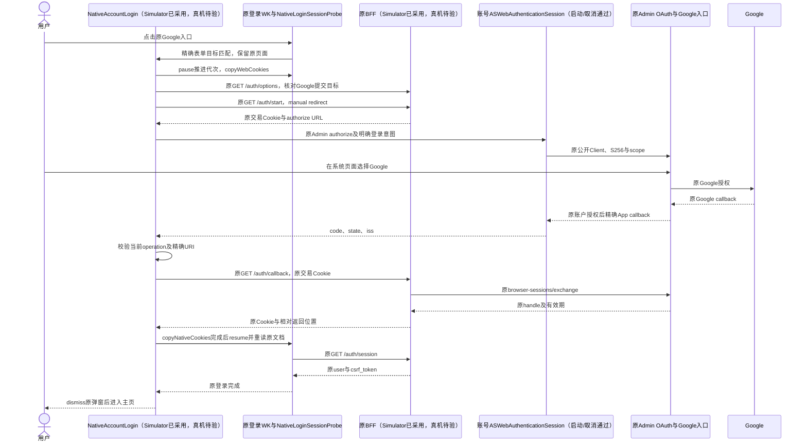

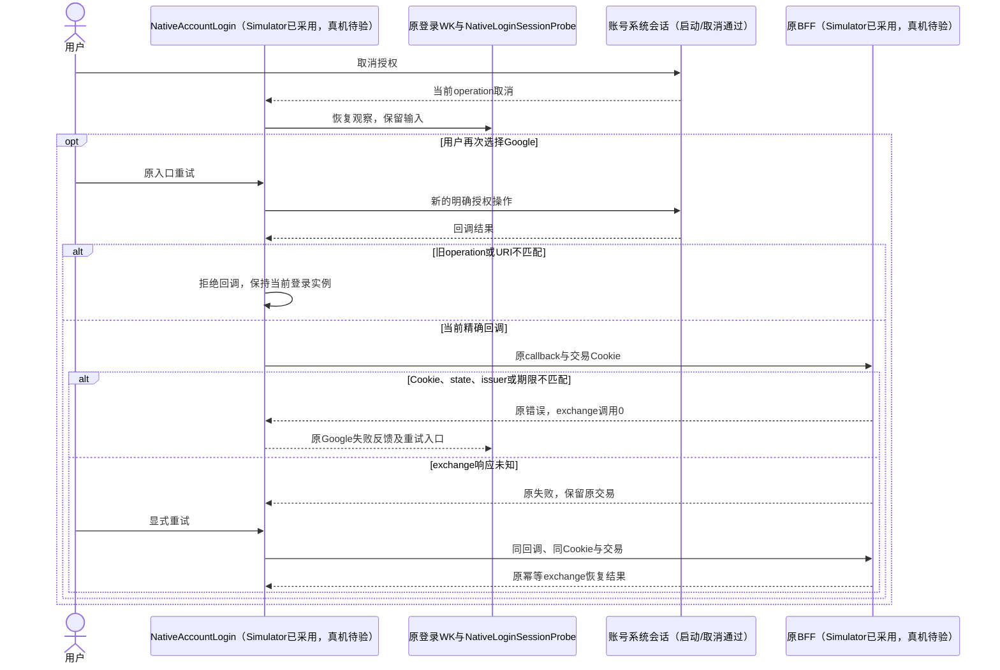

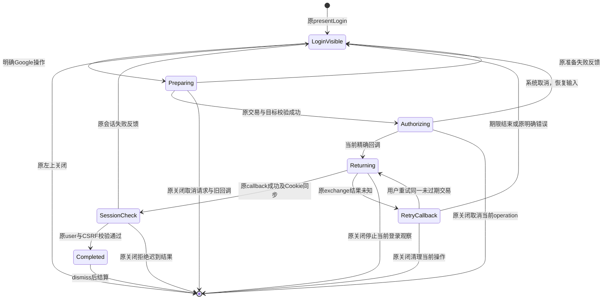

### 实施与验收

| 工作项 | 最小归属 | 验收条件 |
| --- | --- | --- |
| 原BFF回调地址兼容 | login-boundary及原handlers合同；已采用实现与58项技术通过 | 原Web默认值/拒绝规则保持；精确Native地址与本机接收路径区分；缺失/跨交易Cookie、state/issuer、重复query、过期均拒绝；未知exchange同交易恢复；普通Simulator采用通过，真机待验 |
| 同Client精确回调登记 | Admin现有config、oauthClientCatalog、BrowserSessionService；代码/登记已采用并读回 | 保留原Web callback与同Client ID；新地址仅来自服务端配置；无新账户/role/scope/grant/schema；应用类型通过SDK URI规则 |
| Native系统授权与Cookie次序 | 原InkRuntime/登录Host与Probe、InkAccountLogin、目标Info.plist；源码编译与16项技术通过；普通Simulator启动/取消及密码登录通过 | 精确表单拦截、operation绑定、取消/迟到回调、暂停/同步/恢复、关闭一次及主屏登录成功；真实系统页面/普通密码业务回归独立验收 |
| 普通env与制品采用 | 原bundle-node与工程目标配置 | 源env保留，目标App账号scheme与包内既有redirect URI匹配；MCP地址保持，服务凭证范围沿原发布审核 |
| 技术与真实验收 | 原Node/Swift/浏览器harness与正常入口 | 合成provider验证原生产入口；实际系统会话另验；真实Google账户操作、授权同意、重开及Web回归分别取证 |

源码证据：[原表单](../../../frontend/app/_dream/components/Auth/AuthEntry.tsx#L73)、[原start/callback](../../../frontend/app/api/_auth/handlers.ts#L54)、[私有注册地址及HTTP接收地址](../../../frontend/app/api/_auth/login-boundary.ts#L128)、[账号适配](../../../frontend/ios/InkMemory/InkAccountLogin.swift#L86)、[Probe暂停与Cookie次序](../../../frontend/ios/InkMemory/InkReactNative.swift#L452)、[原账号弹窗](../../../frontend/ios/InkMemory/InkReactNative.swift#L355)。Admin源码证据：`/Users/dmeck/project/ink-admin-memory/app/lib/auth/config.ts:48`、`oauthClientCatalog.ts:395`、`browserSessionService.ts:54`；运行采用、目录apply与read-only读回归[同Client实施记录](../../exec/mobile-app-design-review-20261024.md#2026-10-31-admin同client回调兼容)。

| 评审项 | 发现 | 处理方式 | 修订结果 | 剩余依赖 |
| --- | --- | --- | --- | --- |
| 同一账号业务 | 已有公开Client和S256可复用 | 保持原Admin主体/权限与BFF接口 | 原handlers原Client/S256及exchange/session技术合同通过 | 完整Google账户与真机 |
| 系统授权 | WK入口和MCP系统会话分别所有 | 账号操作独立绑定，复用系统框架 | 账号源码和目标编译通过，原MCP保持 | 完整Google账户及真机 |
| 回调边界 | BFF地址源码兼容，Admin同Client集合已发布 | 保留精确注册地址与独立HTTP接收校验 | Web/API/Apps及Native合同通过，目录apply后0差异读回 | 真机与原Web相邻回归 |
| Cookie连续性 | 原异步WK复制会覆盖新Native Cookie | 暂停/代次、原callback成功同步后恢复 | 独立存储竞态及真实WK/同App HTTP303处理通过 | 真实Google Cookie与普通账号业务 |
| 复杂度 | 另建令牌移交、登录中转页或专用客户端会扩大范围 | 原start/callback/session及同Client所有权 | 新业务API、表、插件框架与发布平台排除 | 其余目标及发行资格 |

方案评审：待满足明确前提后通过。历史9项探针、Dream25项与Admin19项合同保留原审计状态；BFF五文件58项技术/Web类型与Native源码、16项目标技术通过。Admin同Client代码、配置与登记已采用并读回。BFF env映射与host转交已由普通Simulator采用；原密码登录及八项短文Chat真实完成，系统会话启动/取消通过。完整Google账户、Notion本地授权、真机及发行继续验收，Release制品保留原阶段摘要。历史证据归[认证兼容审计](../../exec/mobile-app-design-review-20261024.md#2026-10-31-google账户回调兼容审计)，当前代码归[BFF实施记录](../../exec/mobile-app-design-review-20261024.md#2026-10-31-bff端侧账户回调源码兼容)及[Native实施记录](../../exec/mobile-app-design-review-20261024.md#2026-10-31-native账号会话与cookie交接)。


## 公网密码网页登录与配置回调保留

### 背景与问题

公网构建10将原密码网页登录的HTTP回调自动替换为未登记的私有URI，Admin返回`invalid_redirect`，原OAuth错误导航进入Admin页面。构建11恢复既有`http://localhost:5173/auth/callback`，同一公开Client及原PKCE交易继续使用。该故障范围为打包配置；账户、角色、scope、管理端页面及业务接口保持原所有权。

### 目标与边界

App沿原可见网页登录，成功关闭登录弹窗后回到RN主页；失败沿原错误和重试入口恢复。Python/Node/Next/Claude实例继续由App运行库所有，登录页结束保持业务实例。Google系统会话及私有URI方案沿上节保留，公网完整授权需独立采用和验证。当前普通Simulator完成密码授权、session200及弹窗关闭；物理设备构建11安装完成、普通启动被Locked拒绝，完整设备业务待验收。

发现依据为实际打包脚本和公网授权请求；问题收敛为自动回调替换。方案比较结果：保留已登记env回调可恢复现有密码业务，所需源码修改限原资源脚本；公网新增私有回调依赖Admin兼容制品与登记发布；重写登录页面或权限规则缺少需求。当前交付采用第一项，Google采用保留独立工作项。

### 概念与规则

- `bundle-node.py`沿原`frontend/.env.local`复制BFF配置，账号`INK_DREAM_BFF_REDIRECT_URI`保持原值。`host.cjs/startWeb`继续保留已配置值，缺失值沿原HTTP派生。MCP回调继续由原operation和独立env键所有。
- `AuthEntry`原密码表单提交Admin `/auth/dream/password`，原`/auth/start`生成state、nonce、verifier和加密交易Cookie；Admin authorize返回精确已登记URI；`createBffHandlers`继续原callback校验及browser-session exchange。scheme登记能力保持可用，当前密码流程采用HTTP导航。
- `NativeLoginSessionProbe`从当前来源WK数据存储复制Cookie，经原`/auth/session`确认用户及CSRF；`finishLogin`先关闭导航弹窗，再结算登录结果，`SessionGate.native`重读会话后显示原RN页面。未知或失效会话保持原失败反馈。
- 网络5xx、超时或会话读取失败时，原Try again重读原会话/options；交换已完成的账号保留Cookie，客户端重试读取。已提交密码的重发须由用户新登录操作触发。未知exchange仍执行原幂等恢复合同。
- 左上关闭仅结束当前登录弹窗和所属观察任务，原App运行库继续；关闭后可重开。系统Google取消返回所属原登录实例。进程结束沿系统回收，重开沿原Cookie与session验证恢复。

| 实例/状态 | 创建与有效期 | 结束与恢复 |
| --- | --- | --- |
| 登录导航及WK | 用户点击原登录入口创建，账号操作期间保留 | 原session确认后dismiss；左上关闭清理本实例 |
| BFF交易Cookie | 原start创建，绑定当前来源、PKCE、state与期限 | 原callback成功删除；失效沿原重新登录 |
| NativeLoginSessionProbe | 绑定当前登录WK与来源 | 成功/关闭停止；读取错误由原入口重试 |
| RN SessionGate | 原App根视图持有 | 登录返回后重读；原会话失效显示原登录入口 |
| App运行库与Agent任务 | BackendRuntimeManager原App级所有权 | 登录弹窗成功/关闭保持运行；进程回收和任务恢复按原持久化合同 |

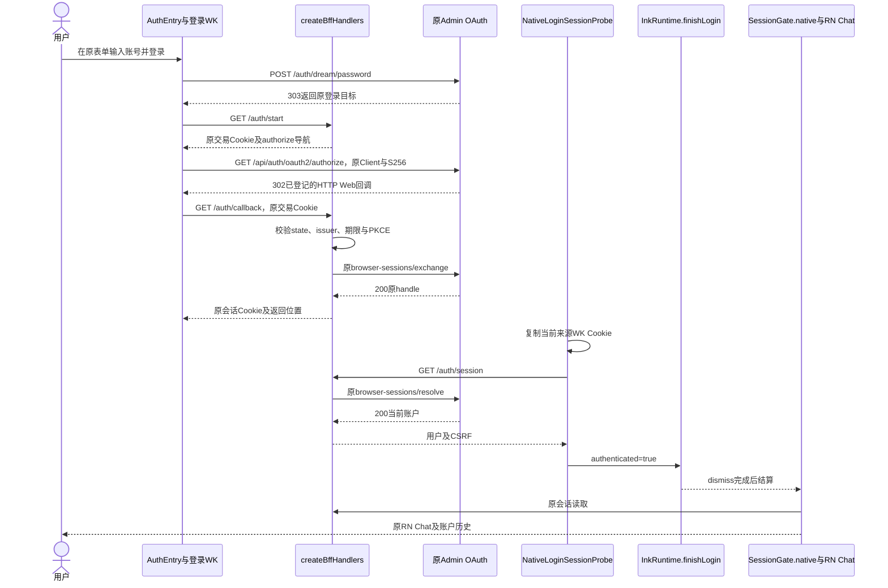

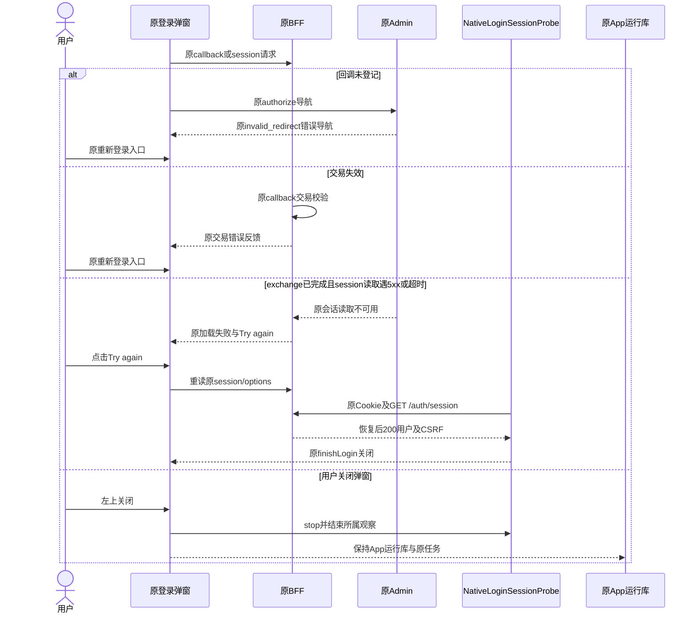

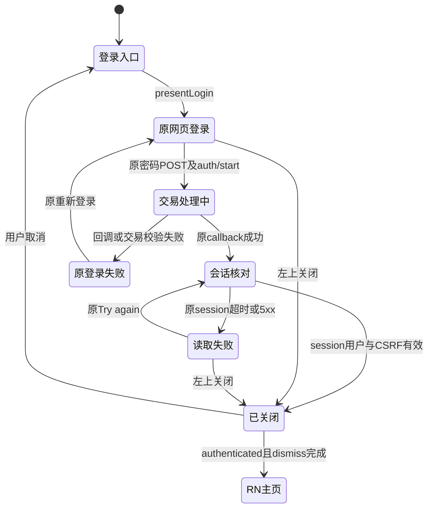

当前验收与剩余依赖见[公网构建11执行记录](../../exec/mobile-app-design-review-20261024.md#2026-10-31-公网构建11恢复原网页登录)。桌面/窄屏骨架继续复用[移动PRD](../../prd/mobile-app/mobile-app.md)，主页面、菜单、权限与接口变更0。


公网构建12配置补充：原`AdminProductConfig`使用`INK_ADMIN_PRODUCT_API_BASE_URL`访问公网Admin，原Product Origin保持所属Client校验。登录弹窗、上述业务图和App运行库实例保持；包内原用量200，session/模型目录的实际503沿原重试反馈。端点清单和当前制品归[发布设计](../../deploy/mobile-app-release.md#公网端侧包的既有http配置清单)，实际密码登录资格继续采用构建11回执，完整12业务另验。


## 端侧网页链接与Notion授权恢复（2026-11-01）

### 背景与问题

用户在构建21点击Notion授权链接后闪退。手机崩溃记录进入React Native致命JavaScript异常处理。原Notion组件默认参数提取`Linking.openURL`方法，原方法内部使用`this._validateURL`；独立函数调用丢失接收者。关于页与回顾页存在相同默认值。原Notion页面在调用返回后注册`.catch`，同步异常越过该处理。

### 目标与边界

端侧网页链接统一交给本机默认浏览器。Notion验证码链接、资源说明、聊天正文、工具结果、附件、工作区、Writing、回顾与关于使用同一平台动作。原页面结构、桌面Web、用户输入、当前Thread、授权会话、轮询、凭证目录及资源权限保持原合同。账号登录与MCP授权的协议、回调及权限继续由原模块管理。

比较三个局部闭包与统一平台函数后，选用`frontend/src/platform/externalLinks.native.ts::openExternalLink`；三处相同默认值与App/Writing的现有调用提供复用依据。该函数只有URL解析与系统打开职责，新增原生桥接、浏览器页面、依赖、账号配置、确认步骤及自动重试增加数均为0。

### 概念与规则

- `openExternalLink(url, origin?)`在async函数内保留`Linking.openURL`的方法接收者，原相对地址通过当前origin解析；错误统一返回拒绝的Promise。
- HTTP和HTTPS链接由系统网页处理入口打开，浏览器选择来自设备设置；应用保持当前页面及业务状态。用户返回后继续原AppState/页面可见性读取。
- Notion、关于和回顾沿原错误位置显示链接失败反馈。Notion和关于同时捕获调用方同步抛出及异步拒绝；再次点击只重试链接打开，原授权会话保持。
- Chat、Plan、文件、工作区及Writing沿原错误反馈处理失败。应用内的页面切换、文件预览及工作区定位由原组件继续所有。
- 每次点击发起一次系统打开。打开失败后由用户重试，自动重试与新增业务写入均为0；原认证提交禁用规则、轮询及资源保存防重复规则保持。
- [Apple默认浏览器合同](https://developer.apple.com/documentation/xcode/preparing-your-app-to-be-the-default-browser)定义系统HTTP(S)网页处理入口；验证记录浏览器实际前台与App返回状态。查阅日期：2026-11-01。

正常时序：

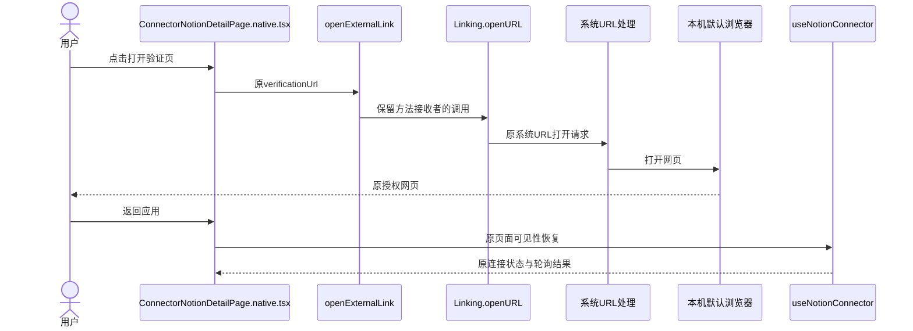

异常与恢复时序：

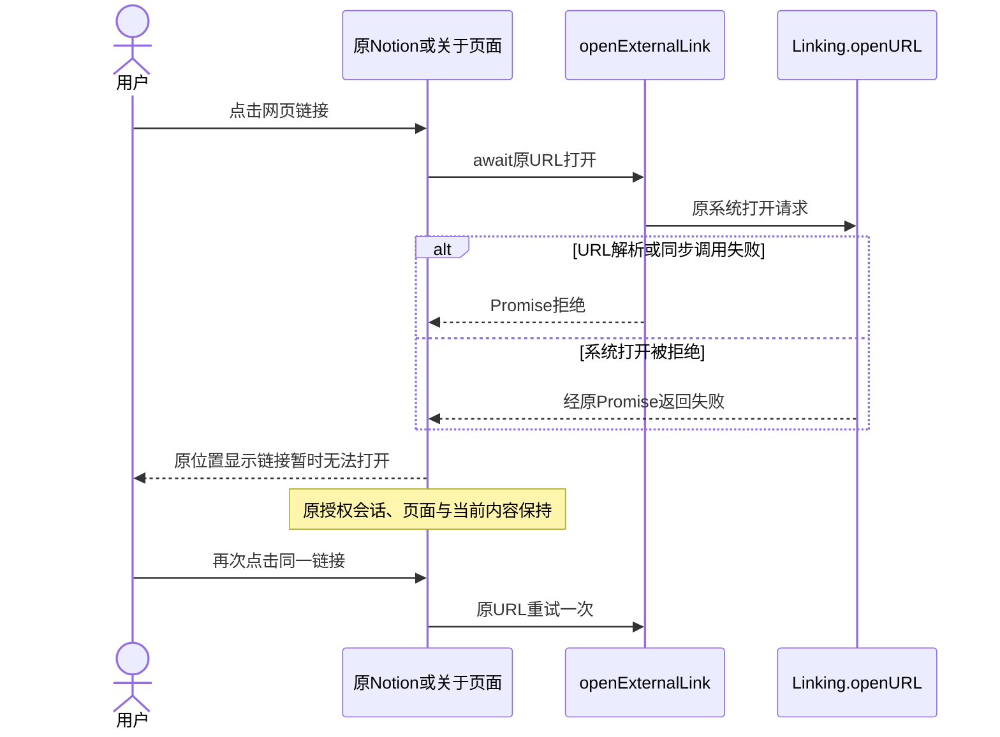

页面与系统转换：

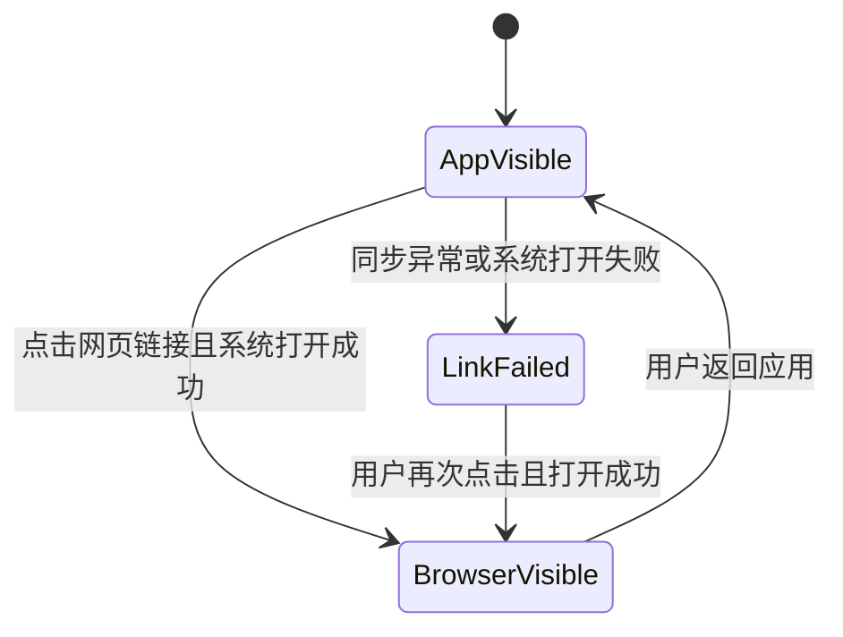

当前实现为局部程序修订；模拟器复现、默认浏览器实际打开与返回、同步失败恢复及七项Web回归已通过，构建22已在原iPhone安装启动。实际命令及真实授权资格分别归[本轮执行记录](../../exec/ios-notion-links-20261101.md)。技术fixture的授权页使用明确合成地址，真实Notion授权及内容读取继续沿原正常账户入口独立验收。


## 公网包账号回调与诊断接线（2026-11-02）

设备构建24的`Info.plist`接收`com.inkmemory.mobile.auth:/auth/callback`，其包内BFF采用`http://localhost:5173/auth/callback`。`NativeAccountCallback.authorization`的精确匹配拒绝该Google操作。公网对应Client同时缺少App回调登记。注册入口在原iPhone可切换到Create Account，表单与按钮正常；账户创建成功尚需独立验证。

选定最小修订：`bundle-node.py`只对包内前端env的既有`INK_DREAM_BFF_REDIRECT_URI`投影目标App回调，先按实际bundle identifier解析Info中的Xcode宏并精确核对；仓库env保持。Admin沿同一loopback服务和Client增量登记App回调，保留原HTTP回调、S256、scope、grant和密钥；browser-session交换按所属服务的精确URI校验。未知回调继续拒绝。构建25的App原生接收地址与BFF配置一致。

正常交互沿原表单、系统授权、原BFF交易Cookie及session验证。用户切换注册继续现有字段与POST；Google系统会话仍执行现有Admin授权与账户页面，Google身份验证由原provider处理。登录成功后关闭原窗口，再由原`SessionGate`进入主页。系统取消、左上关闭及重开继续原规则。

错误观测复用[启动交互中的账号错误接入](mobile-startup-interaction.md#账号错误接入2026-11-02)。公开`auth_error`保留credentials、registration或google对应来源；options HTTP状态、页面加载NSError和Google各阶段错误进入现有错误列表，页面刷新退出请求重放职责。收集范围排除表单、Cookie和授权查询值。原启动与账号实例生命周期保持。

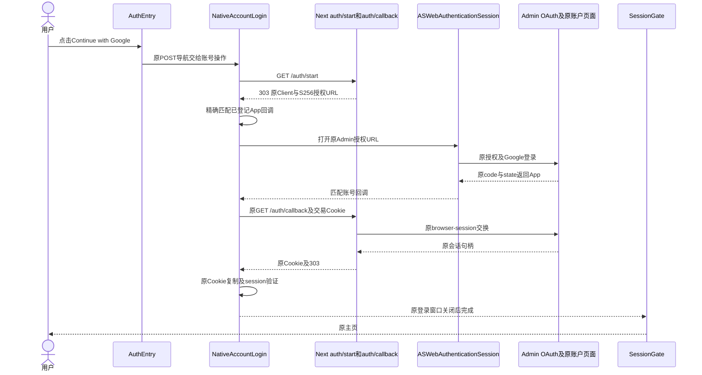

该图定义现有成功路径，真实Google账户验证状态以[本轮执行记录](../../exec/ios-account-entry-fix-20261102.md)为准。历史本机及公网阶段回执继续保留。

## Google选择连续性（2026-11-02）

### 背景与问题

原iOS宿主将Google表单转换为通用authorize，系统账户页要求再次选择Google。该分支改变原按钮的一次选择交互。现行修订保留同一Client及系统浏览器，在原授权查询携带单值`identity_provider=google`。

### 目标与边界

Admin原provider签名该查询，`selectedGoogleLogin`核对签名、有效期及单值Google选择；`AuthSignIn`沿原`adminAuthClient.signIn.social`继续。该参数只控制原页面入口。原PKCE、state、Cookie、scope、账户关联与权限处理保持。三份Admin实现、一个宿主方法及对应回归承载修订；新接口、依赖和数据表为0。原设计中手动第二次选择Google的图示与回执保留历史状态。

### 概念与规则

当前页面最多自动发起一次Google操作，准备阶段显示正在打开Google。API失败保留原错误与重试；Google错误回调在原页面使用`#google-error`恢复控件，移除provider追加的`error`和`error_description`后保留原签名查询，避免再次自动跳转并允许显式重试。系统取消仍结束本次账号操作并回到原登录弹窗。签名、Client、回调和授权同意继续由原模块分别校验。完整Google身份验证按实际回执登记。

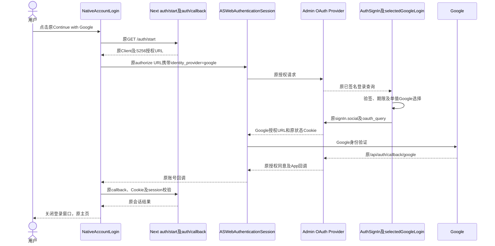

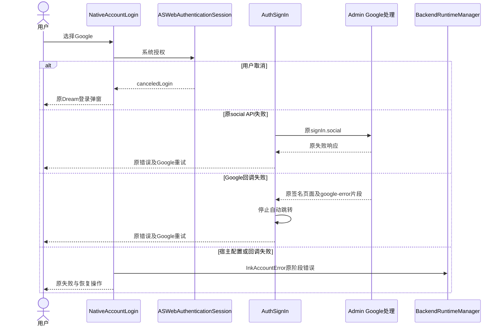

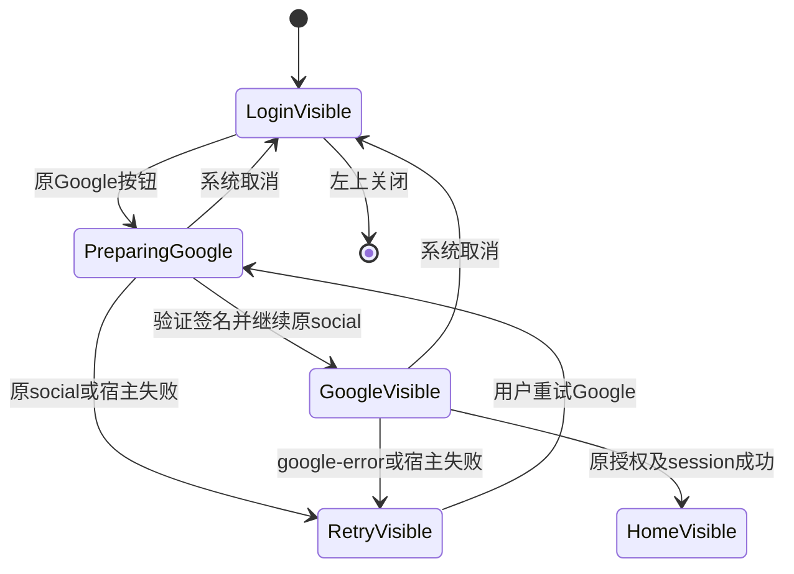

评审：修订恢复原Google按钮的一次选择语义；原网页、账户和授权边界保持。技术验证、Admin部署、系统授权进入Google页面与完整身份验证分别记录，当前进度归[执行记录](../../exec/ios-account-entry-fix-20261102.md)。

当前采用回执：构建27原iPhone的Google入口与取消/关闭通过，真实Google账号选择页已目视核对；公网候选Linux制品采用并返回200。独立出口修复后的Google登录由用户真机复验确认通过；新账户创建继续独立登记，详细命令与退出码见[最终采用记录](../../exec/ios-account-entry-fix-20261102.md#最终制品与服务采用)。

### 服务端兑换网络与弹窗验收

2026-11-02用户实际Google网页登录后停在认证服务登录页，公开error=invalid_code。原Admin出口上游无监听并返回CONNECT502，原App成功回调尚未触发。当前采用独立Docker Clash出口，原Client、PKCE、scope、账户、回调和finishLogin保持；服务名tun-proxy，容器使用现有混合端口配置。

正常流程仍按原Google回调、Admin授权、App回调、BFF exchange/session及finishLogin执行；网络失败沿原错误页与重新发起恢复。公开端点连通记录为服务端网络验证。2026-11-02用户确认修复后真机复验通过；自动化runner受系统签名信任拦截，逐阶段会话及界面证据继续按缺失登记。部署范围与用户验收回执见[账号执行记录](../../exec/ios-account-entry-fix-20261102.md#google回调兑换与独立出口2026-11-02后续)。

## App删除确认与目标辨认（2026-11-02）

### 背景与问题

Chat首页、活动列表和工作区文件的触屏删除需要执行前确认；已有Deck/Agent与写作确认需要显示所选对象。发现依据、入口清单及源码候选归[APP-01](../../exec/app-experience-delete-20261102.md)。

### 目标与边界

复用原生Alert和原网页确认，保持原删除接口、归属校验、持久化和任务语义。原生确认直接满足目标辨认及取消；自定义弹层需要额外焦点与布局处理，撤销存储需要新增业务生命周期。本轮选择现有确认能力和已有对象快照。

### 概念与规则

`Business.deleteThread`从同ID历史/活动或当前Thread取得原名称及已有摘要，保存本次操作身份。确认一次后调用原`useNativeChatHistory.remove`；成功沿原历史移除、活动投影和当前选择更新，失败保留原对象。账户实例卸载使旧确认失效。异步文档关闭后再次读取当前选择，保护已打开的其他Thread。

`FileSidebar.native::remove`显示已有相对路径及文件夹删除范围，确认后核对原Thread/Workspace身份、组件存活及面板可见性。Deck/Agent与CalendarPopup沿原确认补名称、首行或日期，原mutation、保存及授权继续原模块所有。

### 删除正常时序

```mermaid
sequenceDiagram
  actor U as 用户
  participant UI as ChatHistoryList.native / ActivitySidebar.native
  participant App as App.tsx Business
  participant Alert as 原生Alert
  participant H as useNativeChatHistory.native
  participant API as deleteChatThread
  U->>UI: 点击目标删除
  UI->>App: deleteThread(id, 当前显示名称)
  App->>Alert: 显示同ID名称与永久删除范围
  alt 用户取消或关闭
    Alert-->>App: cancel
    App-->>UI: 保留目标及当前选择
  else 用户确认
    Alert->>App: onPress（同操作执行一次）
    App->>H: remove(id)
    H->>API: 原认证DELETE
    API-->>H: 成功
    H-->>App: true，移除同ID历史行
    App->>App: activity.removeChat(id)
    opt 当前选择仍为id
      App->>App: closeToolResultDocuments；再次核对选择
      App->>App: session.newChat及原输入实例更新
    end
    App-->>UI: 展示更新后的列表/当前对话
  end
```

### 删除失败与恢复

```mermaid
sequenceDiagram
  actor U as 用户
  participant App as App.tsx Business
  participant H as useNativeChatHistory.native
  participant API as deleteChatThread
  U->>App: 辨认目标并确认删除
  App->>H: remove(id)
  H->>API: 原认证DELETE
  API-->>H: 失败或请求异常
  H-->>App: false，deleteError=true，保留原行
  App-->>U: 删除失败，原条目与当前选择保持
  U->>App: 再次点击目标删除
  App-->>U: 重新显示同ID名称及确认
  U->>App: 确认重试
  App->>H: remove(id)
  H->>API: 原认证DELETE
  API-->>H: 成功
  H-->>App: true
  App-->>U: 更新对应历史及活动行
```

### 删除操作状态

```mermaid
stateDiagram-v2
  [*] --> Ready
  Ready --> Confirming: 点击目标删除并保存操作身份
  Confirming --> Ready: 取消或关闭 / 零DELETE
  Confirming --> Deleting: 确认一次 / 原DELETE
  Confirming --> Retired: 账户实例卸载或文件身份变更
  Deleting --> Failed: 失败 / 保留对象及当前选择
  Failed --> Confirming: 再次点击删除
  Deleting --> Removed: 成功 / 移除同ID行
  Removed --> Ready: 核对当前选择并沿原流程收尾
  Retired --> [*]
```

文件分支沿`FileSidebar.native::remove`执行相同确认、取消、原DELETE和失败保留路径，确认内容采用`file.path`；成功沿原目录刷新。Deck与Agent保留原确认及mutation路径，提示新增所选名称。


### 评审与验收状态

选择已有确认组件，新增页面、接口、数据库及后台撤销为0。页面骨架归[移动PRD](../../prd/mobile-app/mobile-app.md#app删除确认与目标辨认2026-11-02)。本轮代码及设计为待验证候选；用户已暂停luna-test-stage，文档路径/Mermaid、Web回归与Simulator完整旅程均记为待执行。评审结论为待满足明确测试前提后通过，执行与剩余依赖归[总清单](../../exec/app-experience-fixes-20261102.md)。

## 前后台与进程重开恢复（2026-11-02）

2026-11-03现行方案见[APP-04专项恢复设计](mobile-recovery-interaction.md)。下文保留原候选、图示与阶段评审；当前事实、实例生命周期、恢复边界及后续验收以专项方案为准，APP-04实现与行为验收继续暂停。

### 背景与问题

原前后台reader释放与任务GET恢复已存在。进程重开缺少当前Thread及未发送输入的恢复。当前候选复用原iOS Settings和输入Hook，详见[APP-04](../../exec/app-experience-foreground-recovery-20261102.md)。

### 目标与边界

恢复客户端选择与输入，服务端继续所有消息、任务、权限和终态。Settings保存当前公开owner、主/侧Thread范围、Thread ID、未发送文本及已完成上传的storageKey元数据。任务、消息正文、凭据及未完成上传字节退出该记录。新的数据库、后台常驻及自动重发为0。

### 概念与规则

`App.Business`按原已校验账户与显式侧Thread装配`nativeChatRecovery`；`useComposerDraft`提供原输入快照，`AIInputDock.native`读取初始输入。选择变化使旧输入写入代次失效；Settings解析和存储错误只记录固定类别，原JSON及正文不写入诊断。

`useNativeChatThread`通过原history/status/stream恢复，后台关闭本地reader及尚未派发的准备，前台重新读取同一Thread，队列后台暂停轮询。迟到入队结果按原选择代次处理，Stop沿原接口及恢复。后台前已被原服务接受的任务以服务状态为准，客户端不自动重放提交。

主Business还可保存一个原侧对话指针；显式initialThreadId的侧Business不递归创建侧弹层。进程重开后恢复原侧对话阅读与独立草稿。Writing活文档回调无法持久化，来源未重建时保留原writingContextUnavailable发送保护；用户点击原“写作”入口后，通过原GET核对session id、editor_state.id与writingThreadId，再沿editorJump打开原来源。普通侧对话保持原发送能力。关闭、主导航或侧内改选使同一指针失效；迟到来源读取按实例与原指针匹配处理。无新Writing协议、业务映射或自动保存/重发。


生命周期：App与嵌入式Python/Node同进程存续；进程终止后本地执行结束。原`claude_agent_thread_status`先执行`_admin_thread`归属校验，本地session缺失返回`running=false/lifecycle=not_found`；stream只在原运行实例存在时读取。客户端展示原历史和原状态，不合成completed、cancelled或助手消息。模型中断写入、Gateway结算和任务状态仍需Simulator集成证据。

### 正常业务时序

```mermaid
sequenceDiagram
  actor U as 用户
  participant A as App.Business
  participant C as useComposerDraft
  participant R as nativeChatRecovery
  participant S as useNativeChatThread
  participant H as 原history/status/stream
  participant W as 原Writing入口
  U->>C: 输入文本并添加已上传附件
  C->>R: 原输入状态快照
  R->>R: 按owner和scope写入Settings
  U->>S: 切入后台
  S->>S: 递增epoch并关闭本地reader
  U->>S: 返回前台
  S->>H: GET messages与status
  H-->>S: 原消息及running
  alt running为true
    S->>H: GET stream
    H-->>S: 原增量事件
  else running为false
    S-->>U: 显示原保存结果
  end
  Note over C,R: 同一输入实例保留草稿与附件
  U->>A: 进程结束后重新打开
  A->>R: 原账户就绪后读取恢复记录
  R-->>A: 当前Thread与未发送输入
  A->>S: 装配原Hook与Thread指针
  A->>C: 装配原输入Hook
  S->>H: 原GET恢复并校验服务器归属
  H-->>S: 原任务与消息状态
  opt 保存一个侧对话指针
    A->>R: 主Business读取侧指针
    R-->>A: 原侧Thread与可选writingSessionId
    A->>S: 装配侧Business并执行原GET恢复
    Note over A,S: 侧Business自动装配侧指针数为零
    alt 有Writing来源
      A-->>U: 原消息与草稿，发送禁用，提供写作入口
      U->>A: 点击写作
      A->>H: GET原Session并核对id和writingThreadId
      H-->>A: 来源校验通过
      A->>W: 原editorJump，用户显式导航
      U->>W: 打开原关联对话
      W->>A: 原live WritingThreadContext
    else 普通侧对话
      A-->>U: 原阅读、输入与发送
    end
  end
```

### 异常与恢复时序

```mermaid
sequenceDiagram
  actor U as 用户
  participant C as useComposerDraft
  participant S as useNativeChatThread
  participant H as 原HTTP与SSE
  U->>C: 点击发送
  C->>S: 原send
  S->>H: 原创建Thread请求
  U->>S: 创建响应返回前进入后台
  S->>S: 递增epoch并关闭准备任务
  H-->>S: 创建响应迟到
  S-->>C: 选择代次变化，结束后续派发
  C-->>U: 原拒绝恢复草稿
  U->>S: 原任务返回前台
  S->>H: GET messages/status
  H-->>S: 网络错误
  S-->>U: 原待核实反馈与读取重试
  U->>S: 网络恢复后重试读取
  S->>H: 原GET
  H-->>S: 运行中或原终态
  U->>S: 显式Stop
  S->>H: 原Stop请求
  H-->>S: 原允许关闭reader的回执
  S->>S: 递增epoch并关闭旧reader
  S->>H: 原history/status恢复
  H-->>S: 原取消结果及空闲
  H-->>S: 旧reader迟到事件
  S->>S: epoch不匹配，退出当前投影
  U->>S: Writing侧对话点击写作
  S->>H: GET原Session
  H-->>S: 403或来源关联不匹配
  S-->>U: 原来源错误与写作重试，保留草稿和发送保护
```

### 状态转换

```mermaid
stateDiagram-v2
  [*] --> Restoring: 原会话就绪且有保存Thread
  [*] --> Ready: 原会话就绪且无保存Thread
  Ready --> Preparing: 用户发送
  Preparing --> Ready: 后台中断派发前准备并恢复输入
  Preparing --> Running: 原用户提交获准
  Running --> Background: AppState background
  Ready --> Background: AppState background
  Background --> Restoring: AppState active且有Thread
  Background --> Ready: AppState active且无Thread
  Restoring --> Unknown: 原读取失败
  Unknown --> Restoring: 原读取重试
  Restoring --> Running: 原status为running
  Restoring --> Ready: 原status为空闲
  Restoring --> WritingSourceRequired: 保存的侧指针带Writing来源
  WritingSourceRequired --> WritingSourceRequired: 来源GET失败，保留草稿并显式重试
  WritingSourceRequired --> WritingSource: 用户点击写作，原来源GET匹配并经editorJump打开
  WritingSource --> Ready: 用户从原入口重开关联Chat，取得原活准备回调
  Running --> Stopping: 用户Stop
  Stopping --> Restoring: 原Stop回执后核实
  Running --> Restoring: 原finish或读取结束
  Background --> [*]: 系统结束进程
  Ready --> [*]: 用户结束进程
```

图中Background描述页面生命周期；任务状态继续由原服务返回。进程结束后的运行实例重新装配，继续读取既有Thread；记录中保留原消息及其终态。

### 评审与验收状态

采用已有Settings与当前输入Hook，新增适配只对应账户与侧对话范围差异。现有任务查询、停止及权限保持原模块所有。桌面/窄屏骨架归[移动PRD](../../prd/mobile-app/mobile-app.md#前后台与进程重开恢复2026-11-02)。代码和测试规格已形成候选；luna-test-stage、文档校验与Simulator执行按用户要求暂停。评审结论为待满足明确测试前提后通过；恢复页面与真实模型执行分别验收。

## 端侧启动阶段耗时定位（2026-11-02）

### 背景与问题

已有端到端启动和接口耗时样本包含解释器、Node、原模块装配及Admin等待，当前证据无法给出CPython计算性能损失比例。已选方案先在原启动语句外增加固定阶段计时，性能优化以同条件测量为前提，原始样本及来源归[APP-03](../../exec/app-experience-python-performance-20261102.md)。

### 目标与边界

复用原EmbeddedDreamBackend、CPython适配和mobile_runtime.ios装配，记录启动阶段墙钟与进程CPU元数据。保持原初始化顺序、锁、ready缓存、调用结果、异常和认证。新解释器、新运行服务、后台执行和全面模块延迟导入退出本轮范围。

### 概念与规则

- Native记录队列等待、合并调用、缓存命中、两次Python启动、Node启动/endpoint等待和总体启动；同进程attempt用于关联同一次启动。
- CPython记录解释器初始化、GIL等待、入口模块导入及原入口调用。启动活动期间原Admin传输记录固定等待阶段，原payload、结果和GIL释放行为保持。
- Python在原插件、Notion、Admin认证、Factory、业务路由、监听和Next准备周围记录固定阶段；计时输出失败按诊断局部处理，原业务异常继续传播。
- 日志仅含固定层/阶段/结果、单调耗时、进程CPU耗时、时间和PID等关联元数据。请求地址、凭据、身份、正文及原始payload退出计时日志。
- 进程CPU包含同进程Node及其他线程活动，嵌套阶段耗时不可直接相加。原Admin传输阶段包含重新获得GIL的时间，字段按该测量边界解释。
- 冷启动、同进程缓存路径、不同制品和失败样本分别保存。Simulator仅报告Simulator条件，真实iPhone性能及jetsam另行验收。

```mermaid
sequenceDiagram
  actor U as 用户
  participant S as SessionGate
  participant M as BackendRuntimeManager
  participant E as EmbeddedDreamBackend
  participant P as IMDreamPythonCall / mobile_runtime.ios
  participant N as IMDreamNodeStart
  participant A as 原Admin接口
  U->>S: 打开App
  S->>M: ensureStarted
  M->>E: start
  E->>P: start(nil)，记录初始化与导入
  P-->>E: 原公开ASGI健康回执
  E->>N: 启动原Node并等待该PID endpoint
  N-->>E: endpoint就绪
  E->>P: start(runtimeEndpoint)
  P->>A: 原Factory按原规则加载policy
  A-->>P: 原结果或原LKG处理
  P->>P: 装配原路由、ASGI及Next，记录阶段耗时
  P-->>E: 原ready facts
  E-->>M: 原成功结果
  M-->>S: 共享启动结果与原总耗时
  S->>A: 原会话、配置与目录读取
  A-->>S: 原公开DTO
  S-->>U: 原主页与原业务操作可用
```

```mermaid
sequenceDiagram
  actor U as 用户
  participant E as EmbeddedDreamBackend
  participant P as mobile_runtime.ios
  participant W as 原Next Worker
  participant D as 原RuntimeDiagnostics
  U->>E: 原启动入口
  E->>P: 第二次start(runtimeEndpoint)
  P->>W: 原start_native_web
  W-->>P: 原监听或请求错误
  P->>P: next_web_ready记录failed，原异常继续传播
  P-->>E: 原失败
  E->>E: 记录bind及startup_total failed，释放本轮waiters
  E-->>D: 原NSError沿既有诊断链显示
  D-->>U: 原错误与恢复说明
  U->>E: 沿原恢复入口重开或重试
  E->>P: 保留原已绑定owner，执行原恢复
  P-->>E: 原成功或失败回执
```

```mermaid
stateDiagram-v2
  [*] --> Idle
  Idle --> Starting: 原start
  Starting --> Starting: 合并waiter
  Starting --> Ready: 原ready facts
  Starting --> Failed: 原异常
  Failed --> Starting: 原后续start
  Ready --> Ready: cached_ready复用原facts
  Ready --> ProcessEnded: 原App进程结束
  Failed --> ProcessEnded: 原App进程结束
  ProcessEnded --> Idle: 新进程原入口
```

图中为原启动状态与本次观测边界；图示、源码评审和文档修订均未替代运行验收。本次无页面或弹窗修订，桌面和窄屏继续[现行启动PRD骨架](../../prd/mobile-app/mobile-startup.md#页面设计)。

### 评审与验收状态

新增计时只对应当前阶段不可分辨的证据缺口，源码候选未调整原业务调度、返回DTO和原权限。公开会话、配置、目录、历史及核心任务作为同一旅程的终点；日志生成和网络连通分别记录。用户暂停luna-test-stage后，合同脚本、构建、文档图示与Simulator测量均待执行；尚无当前瓶颈归因、同条件基线或性能改善数值。评审结论为待满足明确测量与测试前提后通过。

## 回顾分析失败反馈与原提交恢复（2026-11-02）

### 背景与问题

截图前段来自reflectionCreateError对未映射且非401创建失败的通用反馈，后段来自原待确认提交恢复提示。相同错误存在多处呈现。截图仅显示21:23，实际日期、构建、请求状态及task_id未知，不能据此完成网络根因判断。证据和源码映射归[APP-02](../../exec/app-experience-reflections-20261102.md)。

### 目标与边界

复用原createReflectionTask、任务查询、显式start及报告接口，保持来源冻结、request_key、body、权限与任务语义。原pending记录兼容增加可选task_id，候选采用已有服务端创建后失败DTO。无新增服务端接口、数据库或自动模型重发。

### 概念与规则

已存在pending时，useReflections先处理原提交，退出同日新分析选择流程。AnalysisView.native显示明确恢复按钮和原输入说明，在一个原错误区域按完整文案去重；历史和报告保存错误各自保留原位置。

已知task_id优先GET原任务，保留原输入及请求身份。运行中或终态采用原任务读取；准备态只沿原显式继续规则启动。创建结果未知时，原幂等恢复沿同一request_key和body；明确拒绝与未确认状态分别处理。报告任务读取失败保留reportRetryTaskId，retryReportSave恢复同一任务的原报告。

统计使用传入的账户timezone，旧effect退出后忽略迟到结果；日记date_key由同一时区的getLocalDayKey计算。统计刷新独立于原历史与任务恢复，原Web/Native继续共享同一Hook与DTO。

### 正常业务时序

```mermaid
sequenceDiagram
  actor U as 用户
  participant M as MoreNavigator.native
  participant V as AnalysisView.native
  participant H as useReflections
  participant A as createReflectionsApi
  participant S as 原Reflections任务及报告接口
  U->>M: 更多中选择回顾
  M->>V: 账户timezone和原API及storage
  V->>H: 原页面状态
  H->>A: fetchSessionsAggregate(timezone)
  A-->>H: 统计及日记摘要
  H-->>V: 统计及账户时区日期
  U->>V: 选择原Notion和Agent后生成
  opt 当天已有报告
    V-->>U: 原再次分析弹窗及日记选择
    U->>V: 确认原来源组合
  end
  H->>A: runReflectionsTask
  A->>S: 原POST tasks及request_key
  S-->>A: 原task_id
  A->>S: 原GET events后POST start
  S-->>V: 原任务进度及结果
  H->>S: 原任务时间读取及报告保存
  S-->>H: 原历史和来源
  H-->>V: 原报告阅读
  U->>V: 原章节与条目阅读后返回
  V-->>U: 原回顾主页及历史入口
```

### 异常与恢复时序

```mermaid
sequenceDiagram
  actor U as 用户
  participant M as MoreNavigator.native
  participant H as useReflections
  participant A as createReflectionsApi
  participant S as 原任务及报告接口
  H->>A: 统计读取A
  M->>H: 账户timezone更新
  H->>H: 使读取A的effect失效
  H->>A: 统计读取B
  A-->>H: 读取B返回
  H->>H: 更新统计与候选日期
  A-->>H: 读取A延迟返回
  H->>H: 忽略失效effect结果
  Note over H,S: 原历史及任务观察继续
  opt 原创建请求结果未知
    A-->>U: 原恢复提示
    U->>H: 显式重试
    H->>A: 原request_key及body
    A->>S: 恢复原创建回执
  end
  opt 原报告保存失败
    H-->>U: 保留结果和重试保存入口
    U->>H: 重试保存
    H->>S: 原task_id的report接口
  end
  opt 完成后任务信息读取失败
    S-->>H: 任务日期或来源读取错误
    H->>H: 保留原task_id供原保存重试
    H-->>U: 错误反馈及原重试保存入口
    U->>H: 重试保存
    H->>S: 原report接口及历史读取
    S-->>H: 同一任务的报告与来源
    U->>H: 从原历史入口重开报告
  end
  U->>M: 返回更多
  M->>H: 原实例保留
  Note over M,S: 页面隐藏无任务停止请求
```

### 状态图

```mermaid
stateDiagram-v2
  [*] --> 回顾主页
  回顾主页 --> 来源选择: 原分析内容入口
  来源选择 --> 回顾主页: 关闭并保留选择
  回顾主页 --> 同日选择: 当天已有报告
  同日选择 --> 回顾主页: 取消
  回顾主页 --> 任务观察: 原显式生成或活动任务恢复
  同日选择 --> 任务观察: 原所选内容提交
  任务观察 --> 任务观察: 时区刷新仅更新统计
  任务观察 --> 回顾主页: 原失败反馈
  任务观察 --> 报告待恢复: 完成后任务信息读取失败
  报告待恢复 --> 回顾主页: 原保存重试成功并刷新历史
  任务观察 --> 报告阅读: 原完成或部分成功
  报告阅读 --> 报告阅读: 原手柄及章节和条目切换
  报告阅读 --> 回顾主页: 原返回
  回顾主页 --> 回顾主页: 时区刷新及过期响应隔离
```

### 评审与验收状态

修订直接对应错误重复、恢复含义及已创建任务读回缺口，复用原幂等提交和任务接口。原始提交失败的HTTP原因尚无本次证据；用户暂停后未执行修订后检查，修订前12项fixture结果只说明原基线。文档/Mermaid、Web相邻、22项原生规格与Simulator完整业务均待执行，评审结论为待满足明确测试和请求取证前提后通过。页面骨架归[移动PRD](../../prd/mobile-app/mobile-app.md#回顾分析失败反馈与原提交恢复2026-11-02)。

### 2026-11-03原生正文分配与当前验收

上方暂停状态保留2026-11-02历史含义。当前APP-01/02/03/05已恢复验收，APP-04持续暂停，实际命令与结论归[总清单](../../exec/app-experience-fixes-20261102.md)。

`ReflectionBlogPage.native.tsx`在原阅读区域的`onLayout`更新实测高度；列表及详情分别使用该高度乘以原`useReflectionDetailSheet.fraction`计算的互补高度。固定高度区禁用flex伸缩，正文ScrollView填充手柄、标题/关闭和播放器之间的剩余空间；布局变化继续触发同一区域测量。正文观察标识为`reflection-detail-body`，供原生验收读取几何与触摸滚动。原停靠点、PanResponder、选择、报告和任务状态均复用。

原安装候选的XCUITest已确认手柄真实上下拖动和诊断覆盖/返回通过；默认正文被挤压的修订采用独立候选构建，正文滚动按新候选另行验收。源码评审选择局部高度分配，未引入新弹窗、接口、后端服务或报告状态。

## iOS HTTP解析器资源选择（2026-11-03）

回顾沿原`createReflectionTask`、Next `forwardBackendRequest`与Python Reflections路由创建任务。固定NodeMobile `24.21.0-0`的polywasm会在函数首次执行时编译WASM指令；Undici `6.28.1`默认SIMD llhttp在该阶段触发`Unsupported instruction: 0xFD`，对应本地BFF创建HTTP502。相同版本自带的标量`llhttp-wasm.js`已通过具名provider-free的原生产转发入口：POST202、SSE200和读取首块后的AbortError。

`frontend/ios/scripts/prepare-next.py`在生成iOS standalone的服务端webpack配置时，将精确的`../llhttp/llhttp_simd-wasm.js`资源请求映射到已安装同版Undici的`llhttp-wasm.js`。业务源码、共享Web构建、依赖锁、HTTP解析器ABI和第三方包文件保持。该选择归iOS目标构建适配；客户端、Python与Claude实例的生命周期及业务状态按前文规则执行。

原POST `headersTimeout:0`保留来源准备期间的响应头等待，原GET事件流`bodyTimeout:0`保留稀疏进度事件，连接限制、调用方AbortSignal、认证头及Cookie所有权继续由原模块执行。构建校验核对实际内联WASM字节与同版标量资产摘要，并核对包内Next source receipt；普通Simulator沿原pending请求恢复，新的任务创建、执行、报告保存和历史重读另取真实业务回执。

方案比较与评审：选择构建资源别名以复用同版解析器；全局WebAssembly包装、共享HTTP替换、取消期限和运行库升级均无当前需求。本节交付目标适配方案及源码；技术验证、Simulator真实业务和物理iPhone资格按[APP-02执行记录](../../exec/app-experience-reflections-20261102.md)逐项登记。

官方资料查阅日期2026-11-03：[固定polywasm源码](https://github.com/fogtape/nodejs-mobile/blob/v24.21.0-0/deps/polywasm/polywasm.js)、[Undici原解析器与同版回退资源](https://github.com/nodejs/undici/blob/v6.28.1/lib/dispatcher/client-h1.js)、[webpack精确别名](https://webpack.js.org/configuration/resolve/#resolvealias)。

## iOS Reflections工作区定位（2026-11-03）

Admin通过原`reflection-task.worker-load`在服务与任务归属校验后返回`ReflectionWorkerLoadOutputDTO`，其`workspace_path`来自Admin主机配置。iOS执行器的物理目录位于App数据容器，原`AGENT_CWD`由Native endpoint指定。Simulator实际调用链在`ReflectionsTaskEngine._assemble_context`→`_prepare_task_workspace`→`canonical_reflection_workspace`拒绝跨主机绝对路径，返回`REFLECTION_WORKSPACE_BINDING_CONFLICT`。

目标适配由原`canonical_reflection_workspace`处理：iOS接受规范绝对路径、标准小写任务UUID及精确`task_id/memory`末段，将任务定位映射到当前`AGENT_CWD/task_id/memory`。Admin路径的祖先不参与本地文件访问；任务ID继续来自已认证worker-load及原DTO校验。Linux和Web服务继续按原规则要求定位与配置根完全匹配。

本地根校验、逐层符号链接拒绝、Task根0700、O_NOFOLLOW写入及原任务归属继续执行；相对路径、其他任务、遍历、错误末段均拒绝。原`CLAUDE_CODE_TMPDIR`、Thread workspace、模型权限及发布capability保持。本项复用原函数及配置，无新增HTTP、env键、数据库字段、Admin部署或权限入口。

用户交互继续执行原任务状态：未确认提交沿原pending恢复；已保存FAILED的任务保留失败和历史，新的分析由原新建入口显式提交。源码修复及技术检查完成后，由总控限定下一次新分析完成任务、报告和历史验证；失败任务的状态与原始记录保持。原正常、异常与状态图继续适用。

## iOS命令工具与Notion正文读取（APP-07）

### 背景与问题

原Runtime将`process.platform=ios`用于内置ripgrep路径，`prepare-node.py`原先只复制JavaScript。原Notion Read hook使用直属Thread workspace的`.notion-home`，Node `notion-cli`入口原先只接受用户级`notion-runtime`子目录。截图显示`rg ENOENT`和`NOTION_CAPABILITY_UNAVAILABLE`；定向回归复现线程home被拒。

### 目标与边界

复用原SDK、Runtime、ChildProcess、guest、Read hook、CLI、权限与输出。构建从同版Runtime Linux ARM64制品提取静态rg，沿现有host暂存并恢复执行位；精确一处iOS selector适配从Worker读取host绑定路径。Node接受规范化直属thread `.notion-home`，其余env、精确ntn与资源归属校验保持。Mac业务替代、新HTTP接口、宽泛cwd、工具注册及新授权方式为0。

### 概念与规则

`node-dependencies.json`锁定完整制品和资源摘要，`prepare-node.py`生成单处适配回执，`bundle-node.py`核对后入包。host只绑定固定guest rg路径，Worker在会话env投影后写入`INK_IOS_RIPGREP_PATH`。原Grep/Glob仍由Runtime执行。

Notion命令cwd接受原`notion-runtime`子目录及`workspaceRoot/<thread>/.notion-home`。原`realpath===cwd`和目录检查继续执行，外部路径、嵌套home、symlink、其他命令、ambient `HOME/NOTION_API_TOKEN`和错误keyring继续拒绝。actor、页面选择和auth文件所有权由原Python边界校验。原失败反馈、Stop、临时结果0700/0600及原Thread关系保持。

`IOSClaudeTransport.connect`在SDK显式env缺少`PATH`时补充当前服务端PATH，保留显式值及显式空值。该默认路径包含原`prepare_notion_runtime`登记的已校验ntn实体目录；其余父进程凭据保持隔离。原Runtime的`notionProjection`继续校验当前Thread、owner、mode、原生文件及PATH shadow，拒绝时清除Notion子进程绑定。actor及thread中的默认workspace配置保持原文件归属。

方案评审：原工具所需资源和已存在的thread home分别补齐；替代工具与共享用户home会增加协议或改变凭证归属，已排除。评审、源码和分项验证回执归[APP-07](../../exec/app-experience-claude-notion-20261103.md)。以下图示描述当前候选执行；设备验收按回执确认。

### 正常业务时序

```mermaid
sequenceDiagram
    actor U as 用户
    participant UI as ChatPage.native
    participant T as IOSClaudeTransport
    participant R as ClaudeAgentRunner / Runtime
    participant H as host.cjs / worker.mjs
    participant G as DreamGuestProcess
    participant P as apply_notion_page_read_redirect
    participant N as NotionOperationClient / ntn
    participant API as Notion API
    U->>UI: 原对话提交搜索或正文读取任务
    UI->>R: 原Chat请求及当前Thread
    R->>T: 原SDK参数与显式env
    T->>T: 显式PATH优先，缺失时补服务端默认值
    T->>H: 原Worker连接帧与环境
    H-->>R: 原Runtime就绪
    R->>R: 原工具审批与输入校验
    alt Grep / Glob / Bash
        opt Bash子进程Notion绑定
            R->>R: notionProjection核对Thread及ntn
        end
        R->>H: 原ChildProcess及host绑定执行文件
        H->>G: 已打包命令 / cwd / env
        opt ntn api只读调用
            G->>API: 原授权API请求
            API-->>G: 原响应或错误
        end
        G-->>R: stdout / stderr / exit
    else Read已选Notion页面
        R->>P: .notion/pages/id.json
        P->>P: 校验Thread索引与private home
        P->>N: get_page_markdown(id)
        N->>H: 精确ntn及thread .notion-home
        H->>H: 校验目录 / env / 执行文件摘要
        H->>G: 原CLI命令
        G->>API: 已授权页面读取
        API-->>N: 页面Markdown与完整性字段
        N-->>P: 原OperationResult
        P-->>R: 同Thread私有临时结果
    end
    R-->>UI: 原工具结果及回复
    UI-->>U: 原卡片与正文，保存后可重开
```

### 异常与恢复时序

```mermaid
sequenceDiagram
    actor U as 用户
    participant UI as ChatPage.native / Notion详情页
    participant R as ClaudeAgentRunner / Runtime
    participant H as host.cjs / worker.mjs
    participant P as apply_notion_page_read_redirect
    participant N as NotionOperationClient
    U->>UI: 提交原对话任务
    UI->>R: 原Chat请求
    alt Notion CLI绑定校验拒绝
        R->>R: notionProjection清除Notion子进程绑定
        R->>H: 原Bash请求
        H-->>R: 原ntn非零退出与错误
        R-->>UI: 原工具失败结果
    else 命令缺失或非零退出
        R->>H: 原执行请求
        H-->>R: 原错误或exit回执
        R-->>UI: 原工具失败结果
    else Notion读取失败
        R->>P: 原Read输入
        P->>N: 原页面读取
        N-->>P: 认证 / 权限 / 执行 / 请求失败
        P-->>R: 原安全错误码与恢复操作
        R-->>UI: 同一对话失败反馈
    end
    UI-->>U: 保留原消息 / 资源选择 / 轻索引
    opt 需要授权恢复
        U->>UI: 原Notion详情重新连接或授权页面
        UI-->>U: 原浏览器流程完成并返回
    end
    U->>UI: 原对话明确重试
    UI->>R: 原Thread继续请求
    R-->>UI: 新工具结果，旧失败保留
    opt 用户停止当前执行
        U->>UI: Stop
        UI->>R: 原cancel / interrupt
        R->>H: 原terminate与退出等待
        H-->>R: 原exit回执
        R-->>UI: 原停止状态
    end
```

### 对话工具状态

```mermaid
stateDiagram-v2
    [*] --> Ready
    Ready --> Pending: 用户提交
    Pending --> Running: 原审批允许及输入有效
    Pending --> Failed: 原审批拒绝或输入失败
    Running --> Completed: 原结果成功
    Running --> Failed: 执行或页面读取失败
    Running --> Stopped: 用户Stop及原退出回执
    Failed --> Pending: 用户在原Thread明确重试
    Stopped --> Pending: 用户继续提交
    Completed --> History: 保存并重开
    Failed --> History: 原失败结果保存并重开
    History --> Pending: 用户发起新读取
```
