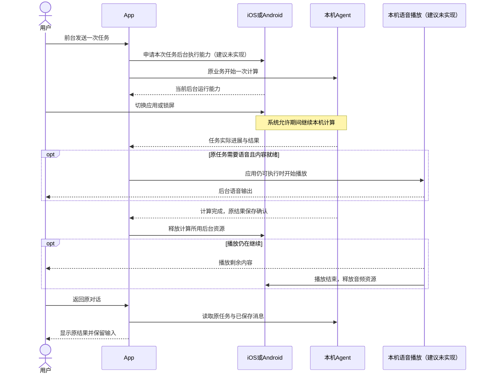
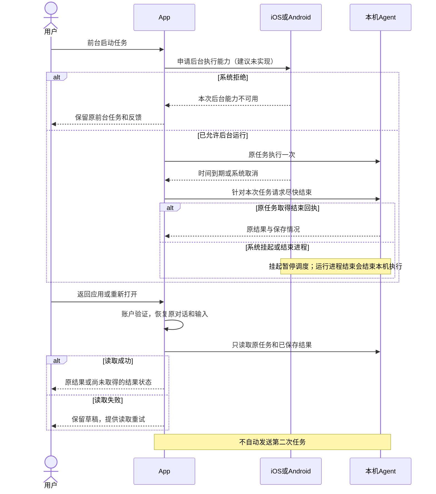
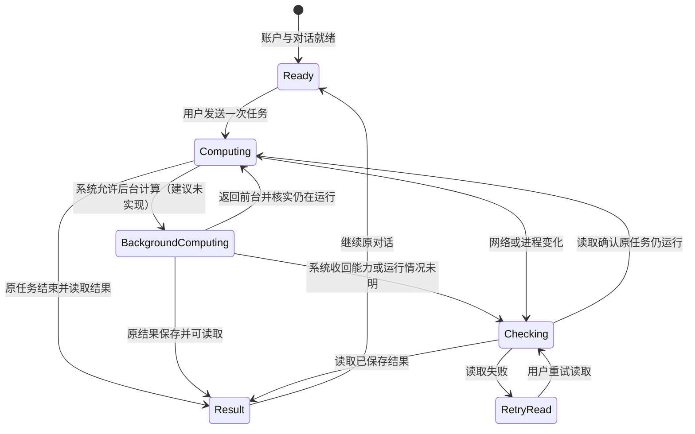
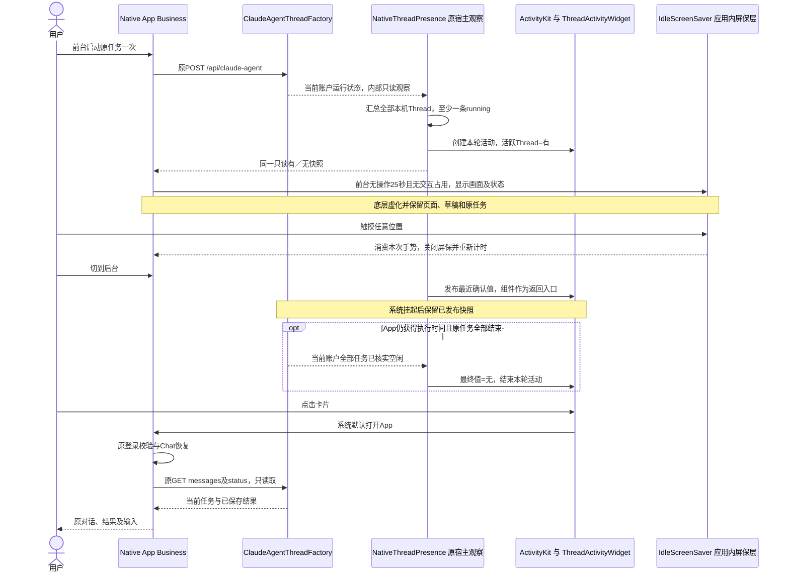
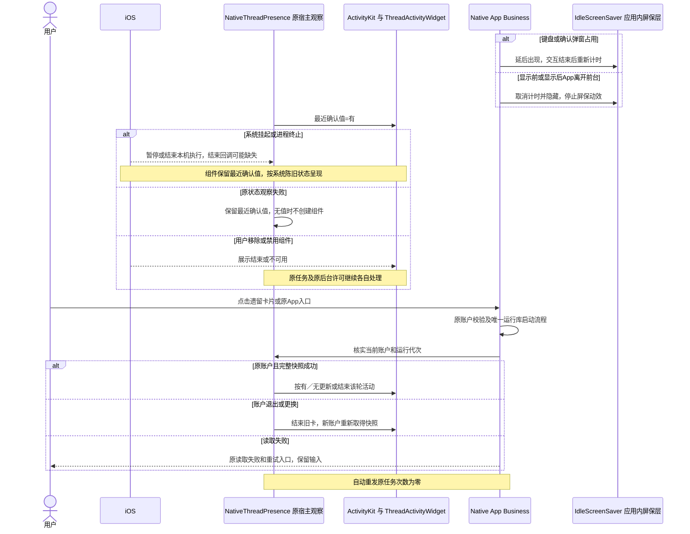
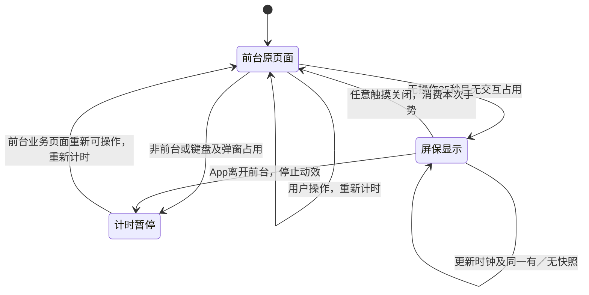
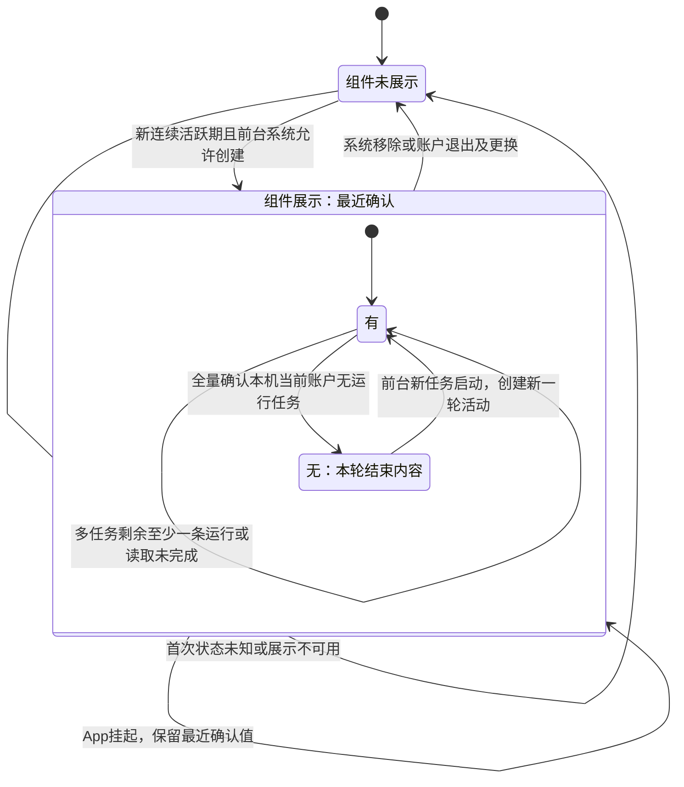

<!-- [Sync] 2026-11-04: 屏保采用v3.1整页无框布局，原统一时钟、状态和关闭交互保持。 -->
<!-- [Sync] 2026-11-03: 按用户v4.2参考统一启动角色与屏保时钟，原脸型承载离散指针及发丝。 -->
<!-- [Sync] 2026-11-03: 用户授权实现屏保与二值系统组件，按候选源码更新接线；持续后台计算与音频适配继续暂停。 -->
<!-- [Sync] 2026-11-03: APP-04纳入应用内无操作屏保静态动画和iOS系统组件，共享二值状态；实现保持暂停。 -->
<!-- [Input] 手机本机Agent任务、后台计算优先需求及现有对话和输入恢复规则。 -->
<!-- [Output] iOS与Android后台计算、按需播放、失败反馈和恢复的产品交互。 -->
<!-- [Pos] APP-04产品交互设计；接口、适配器和平台机制归独立开发文档，实施证据归exec。 -->
<!-- [Sync] 2026-11-03: 原混合稿完整归档；产品正文与开发文档分离，明确iOS/Android适配、Web沿原路径。 -->

# 手机本机 Agent 后台计算与恢复交互设计

## 背景与问题

用户在手机前台发起Agent任务后，希望切到其他应用或锁屏时继续计算，任务需要语音输出时再开始播放。Agent及工具调度在手机本机执行；联网模型调用、账户和数据访问沿原业务。

前稿混合了用户操作、平台接口和实施状态，缺少适配器关系及“计算后播放”的完整说明。[前稿原文与六幅图](history/mobile-recovery-mixed-draft-20261103.md)保留。本文定义用户操作与反馈，[开发文档](mobile-background-execution-technical.md)定义平台选择、调用关系、接口和失败处理。

## 目标与边界

首要目标为**用户发起的同一次任务在后台继续计算，需要语音时播放结果**。iOS和Android分别适配各自的系统能力；Web保留现有运行方式，本专项不增加Web后台适配。

系统可能拒绝后台运行、收回执行时间或结束进程。此时保存已经取得的结果，返回应用后核实原任务，保留对话和未发送输入。有限后台时间仅覆盖其允许的执行区间，持续计算目标的满足情况需按实际任务和系统分别验收。

本方案覆盖一次用户任务的后台运行与恢复。跨设备迁移、进程结束后自动续跑、自动重发、长期空闲常驻和新增账户体系退出范围。语音仅在任务具有语音输出要求且可播放内容就绪后启动；计算期间保持无音频播放。

## 概念与规则

### 平台与用户可见行为

| 平台 | 后台计算 | 系统反馈与恢复 |
| --- | --- | --- |
| iOS | 为前台用户启动的任务申请适用后台执行能力；新系统支持持续处理的任务需提供真实进度并响应取消 | 合格持续任务由系统展示进度和取消；有限时间结束后按实际执行情况显示原结果或待核实状态 |
| Android | 任务由本机运行服务持有；符合系统条件时以可见的前台服务继续计算 | 显示任务通知和返回对话入口；系统停止或服务进程结束后，重新打开核实原记录 |
| Web | 沿用现有执行方式 | 沿用原页面、任务和恢复行为 |

Android本机运行能力仍待接入；iOS后台执行适配与两端按需语音播放均为拟议行为。当前实施状态、依赖和验证结果归[执行记录](../../exec/app-experience-foreground-recovery-20261102.md)。

### 发起与后台计算

1. 用户在现有对话中发送一次任务。发送前的账户、权限、附件和上下文检查沿原业务；任务使用原对话与原消息。
2. 应用在任务开始时申请后台执行能力。用户切到后台无需重复确认，原任务按实际获得的能力继续计算。
3. 后台运行期间保持输入草稿和当前对话。返回应用时读取原任务及结果，运行中的任务继续显示原输出和停止入口。
4. 后台能力申请失败时保留前台任务。用户继续在应用内查看；切到后台后的连续执行受当前系统能力约束。
5. 任务需要用户确认工具操作时保留原确认要求。等待确认期间释放无实际进展的后台运行资源；用户返回并确认后继续原业务。

### 计算完成与按需播放

1. 原任务要求语音输出时，应用先计算并准备实际语音内容。没有语音输出要求的任务只展示原结果。
2. 内容就绪且应用仍可执行时，启动对应平台的播放。计算尚有后续步骤时，计算与播放分别保持各自的运行条件。
3. 计算完成、播放完成分别记录。播放失败保留已取得的任务结果，显示播放失败反馈；计算失败沿原任务错误处理。
4. 用户暂停或停止播放只控制声音。原任务的停止按钮继续控制本次计算，已生成内容按原结果保留。
5. 系统已挂起应用时，本机计算暂停；系统结束运行进程后，本次本机计算结束。重新打开读取原记录，待用户明确操作后继续后续业务。

### 到期、停止与恢复

| 事件 | 用户反馈与恢复 |
| --- | --- |
| 后台时间到期或系统回收资源 | 尽快结束当前计算并保存可保存的结果；实际结束情况由原任务确认 |
| 用户使用应用内停止 | 沿原停止操作与反馈处理，保留原对话及输入 |
| 用户取消系统持续任务 | 对应计算进入结束处理；结果按实际保存情况展示 |
| 返回前台或短暂遮挡结束 | 核实同一对话和任务，保持草稿；恢复操作只读取 |
| 进程重新打开 | 验证账户后恢复原对话、已保存消息、草稿和已上传附件；未完成上传提示重新选择 |
| 网络失败、结果尚未确认 | 保留输入和原反馈，提供读取重试；原任务自动重发次数为零 |

系统回调可能无法区分用户取消与资源到期；页面展示采用已确认事实。消息读取失败、应用不可见、任务完成和进程结束分别表达。

主对话和侧对话分别恢复自己的草稿。写作关联对话缺少当前写作上下文时保留发送保护，用户经原写作入口准备后继续。切换账户、关闭侧对话和新建对话沿原归属及输入更新规则。

## 正常业务时序

图中后台计算、系统任务展示和按需播放均为建议、未实现；原发送、停止和消息读取继续复用。

## 异常与恢复时序

## 用户可见状态

本图表达任务查看过程。播放使用独立的播放、暂停及结束状态；播放状态不决定计算结果。

## 验收条件

| 用户场景 | 通过条件 |
| --- | --- |
| 手机本机执行 | 原任务由本机运行库持有，任务执行位置可核实；联网调用仍沿原业务 |
| iOS后台计算 | 按实际系统与任务分别核实持续运行、有限时间、拒绝和到期；仅有有限时间回执时持续计算目标保持待满足 |
| Android后台计算 | 本机运行库就绪，系统通知可见，任务在服务内继续；服务启动失败和进程结束可恢复读取 |
| 先计算后播放 | 无语音内容时只计算；实际音频就绪后才开始播放，播放完成后计算与音频资源各自结束 |
| 返回与重开 | 原对话、已保存结果及独立草稿恢复，未完成上传提示重新选择 |
| 停止、确认与迟到结果 | 原停止和工具确认保持；旧任务结果保持原归属，自动重发为零 |
| Web | 沿原路径工作，本专项新增后台适配调用为零 |

页面骨架归[移动应用PRD](../../prd/mobile-app/mobile-app.md#前后台与进程重开恢复2026-11-02)。开发拆解与平台条件归[开发文档](mobile-background-execution-technical.md)，交付进度与证据归[执行记录](../../exec/app-experience-foreground-recovery-20261102.md)。

## 应用内静态动画与系统组件（2026-11-03）

实施范围：本节屏保、Factory只读观察与iOS Live Activity已形成源码候选。持续后台计算、系统后台适配器和音频播放保持拟议状态；Simulator、真机与发布资格归[执行记录](../../exec/app-experience-foreground-recovery-20261102.md)。

### 背景与问题

用户补充[Notion需求](https://app.notion.com/p/40b30b7547c380cd9930c384ab35023c#40d30b7547c3805aa2e4c01e7f7a492f)：APP-04挂起后，通过通知区域组件查看有无活跃Thread，状态只有“有／无”；App内无操作时出现的静态动画同属本次需求。来源页定义25秒无操作屏保、原页面虚化、点击任意位置关闭，以及Kastention时钟和当日心情表情。

### 目标与边界

交付两处显示：App前台无操作时的屏保静态动画层，以及iOS锁屏／灵动岛Live Activity。两者共享当前账户本机全部Thread的汇总状态，业务值只有“有／无”，视觉沿Kastention素材。屏保点击只关闭并回到原页面，系统组件点击启动App并沿原Chat恢复。后台执行资格继续由前文APP-04方案管理；屏保显示保持App前台及原任务执行。

### 概念与规则

| 对象与事件 | 显示与操作 |
| --- | --- |
| 活跃Thread | 原任务状态仍为running；涵盖主/侧对话及其他本机入口，运行中的等待确认、停止收尾按原状态纳入。任务标题、正文、数量和进度均不进入本卡。 |
| 有 | 已确认当前账户至少一条本机Thread仍运行。多个任务完成其中一条时，只要还有其他活跃任务，保持“有”。 |
| 无 | 已完整确认当前账户在本机的原任务均无运行实例。最后一条结束后，将本轮卡片最终值置为“无”并结束活动；系统决定保留和移除时间。 |
| 挂起及读取失败 | 保留最近确认值，固定栏目“最近确认”说明观测口径。页面离开、读流退出、断网、执行许可到期本身均不将值改为“无”；以原任务实际结束为准。 |
| 首次没有状态或系统展示不可用 | 保持组件未展示；原App入口和任务反馈继续可用。“未展示”归组件生命周期，业务状态集合保持有／无。 |
| 点击、移除及账户变化 | 点击整卡打开App，经原账户校验恢复原Chat；多任务沿原历史入口查看。系统移除组件保持原任务。退出登录或换账户清理旧卡，新账户重新取得快照。 |

### 应用内无操作屏保

1. **出现条件**：已登录业务页面处于前台，连续25秒没有用户操作。触摸、滚动、键盘输入和导航重新计时；SSE、任务进度和配置回执保持计时。键盘／编辑焦点、工具确认、未关闭弹窗、系统选择器及登录流程占用时延后出现，结束后重新计时。
2. **画面**：原页面上方显示Kastention时钟／表情和同一“最近确认，活跃 Thread：有／无”；底层页面虚化、保留挂载、滚动位置和未发送输入。按[v3.1界面规范](../../prd/Kastention-App-UI-Guidelines-v3.1.pdf)第3、5–7页采用整页无框布局：主题画布色铺底，角色与字标居中，状态使用次级文本色，底部独立放置关闭提示。内容组透明，面板边线、圆角底板和阴影为零；原角色笔迹保持。角色尺寸同时适配视口宽高，短视口保留状态与提示间距。屏保没有独立滚动区和任务操作按钮，状态尚未取得时仅省略状态行。
3. **静态画面与动效**：复用现有SVG路径和主题色，时钟采用实际本地时间的三根指针，显示期间每秒更新；当日笔记可确认的开心／悲伤映射到对应表情，其他或缺失值默认开心。心情来自当前账户已有笔记读取，屏保只消费已取得快照；心情与活跃Thread分别投影。减少动态效果开启时展示静态画面，显示内容和关闭方式保持。
4. **关闭**：触摸任意位置统一关闭屏保，消费完整这次手势，回到原页面后重新计时。控件点击在本层同样关闭；后续独立触摸才执行底层按钮。屏保无确认弹窗、无心情写回、无消息提交。
5. **任务和平台切换**：屏保只暂停底层可见UI刷新，原本机运行实例和事件接收保持；系统后台执行仍由原许可控制。App离开前台时取消屏保及自身计时／动画，iOS系统组件按最近确认值继续展示；返回前台显示原业务页面，从用户重新可操作时计时。

屏保与系统卡分别持有展示生命周期；两者共用二值状态口径。系统组件采用静态视觉，应用内秒针动效只在屏保可见且App前台时更新。

首个活跃任务在前台启动时创建本轮活动，进入后台前写入最近确认值。应用获得执行时间期间，值变化时更新；单条text-delta和重复“有”保持当前内容。系统挂起期间保留已发布快照，返回后读取核实并更新或结束旧活动。进程终止后的遗留卡属于此前观测，应用重新打开后核对并清理；持续实时监测在挂起期间的覆盖能力须按平台实测。

### 一体化角色时钟（v4.2，2026-11-03）

依据[离散跳针与发丝原型](../../prd/Kastention-一体化时间时钟-v4.2-离散跳针与发丝.html)与[时钟交互规范](../../prd/Kastention-时钟交互规范-v4.2.md)，原始脸型直接作为表盘。启动页和屏保共同使用`StartupArtwork`；屏保层负责虚化、Thread状态和关闭，角色、指针、发丝与嘴部由同一组件呈现。旧外圈圆盘与中央小脸组合退出当前呈现。

- 启动页传入`happy`模式及原可见性；屏保传入`clock`模式及已确认的当日心情。组件支持`clock/happy/sad`三种显示模式；嘴部跟随显示输入。屏保整层点击关闭、用户输入和原任务规则保持。
- 时针每小时30°、分针每分钟6°、秒针每秒6°，各自静止等待所属时间边界；单次跳格按原型停留、起动、跃迁、回弹、归位，持续355／300／240ms。
- 三条原始发丝使用预声明路径，每个连续整秒摆动520ms并归位；开心、悲伤和时钟模式共用。减少动态效果时直接定位指针并关闭路径形变，时间继续更新。
- 后台与隐藏时停止计时和动画，返回直接同步真实时间；遗漏时间段保持无补播。主题与原路径保持统一，原型十二时位图形作为当前宿主的装饰刻度。原型中的概念说明页和演示模式按钮仍归研究原型，当前宿主继续原导航与关闭操作。

### 正常业务时序（屏保与组件候选接线）

### 异常与恢复时序

### 状态转换

应用内屏保的显示生命周期独立于Thread二值及系统挂起状态：

系统卡片的业务状态保持二值，组件未展示归生命周期：

### 验收与评审

| 场景 | 预期结果 | 验证方式与前提 |
| --- | --- | --- |
| 一条／多条运行任务 | 只有一张汇总卡、值为有；完成其中一条保持有，最后一条确认结束为无 | 后续隔离原状态回执合同及真机Live Activity；当前账户和本机运行库已就绪 |
| APP-04系统挂起、断网或关闭页面读取 | 保留最近确认值，组件自身不发业务请求或重新启动后端 | 后续真机系统行为与日志对照；本机Thread只读观察已接线 |
| 权限确认／停止收尾 | 值按原running状态；停止或批准次数保持原值 | 后续原完整对话旅程；具备相应普通任务及工具权限 |
| 进程重开与点击卡片 | 正常登录及原任务只读核实，遗留卡更新或结束，无自动重发 | 后续真机正常账户旅程；允许保留本轮运行记录 |
| 换账户、首次读取失败、旧代次迟到 | 旧卡结束；新账户没有快照时未展示；旧回执不能覆盖新卡 | 后续隔离身份与运行代次合同，无跨账户正文展示 |
| 禁用、移除、系统到期 | 原App可用，原任务保持既有执行规则 | 后续真机Live Activities系统设置及移除路径 |
| 前台25秒无操作、触摸及阅读滚动 | 到期显示屏保；实际操作重新计时；底层位置和输入保留，任务增量不重置计时 | 后续受控clock与原RN页面旅程，覆盖原生页面及局部Web文档 |
| 关闭屏保、键盘及确认弹窗 | 首次触摸只关闭、无底层点击；键盘／弹窗存在时延后，原工具权限保持 | 后续真机完整输入、附件、工具确认和返回旅程 |
| 动画、心情与应用切换 | 静态画面／时钟和既有主题一致；缺少已读心情默认开心；离开前台后屏保秒级刷新为零 | 后续浅／深色、减少动态效果及性能采样，屏保无额外业务读取 |

评审采用同一Bool、应用内单层显示、系统单卡和原宿主只读观察。新增独立业务页面、任务平台、推送服务、离线数据库和任务控制按钮为零。虚化和时钟／表情渲染由实际平台资格验证，原启动画面的存在只证明可复用素材。屏保、账户聚合观察与Widget目标已有源码候选，Simulator限定方法和截图已有回执；系统活跃卡、真机和真实模型资格按执行记录单独登记。后台计算适配及音频保持拟议状态。
