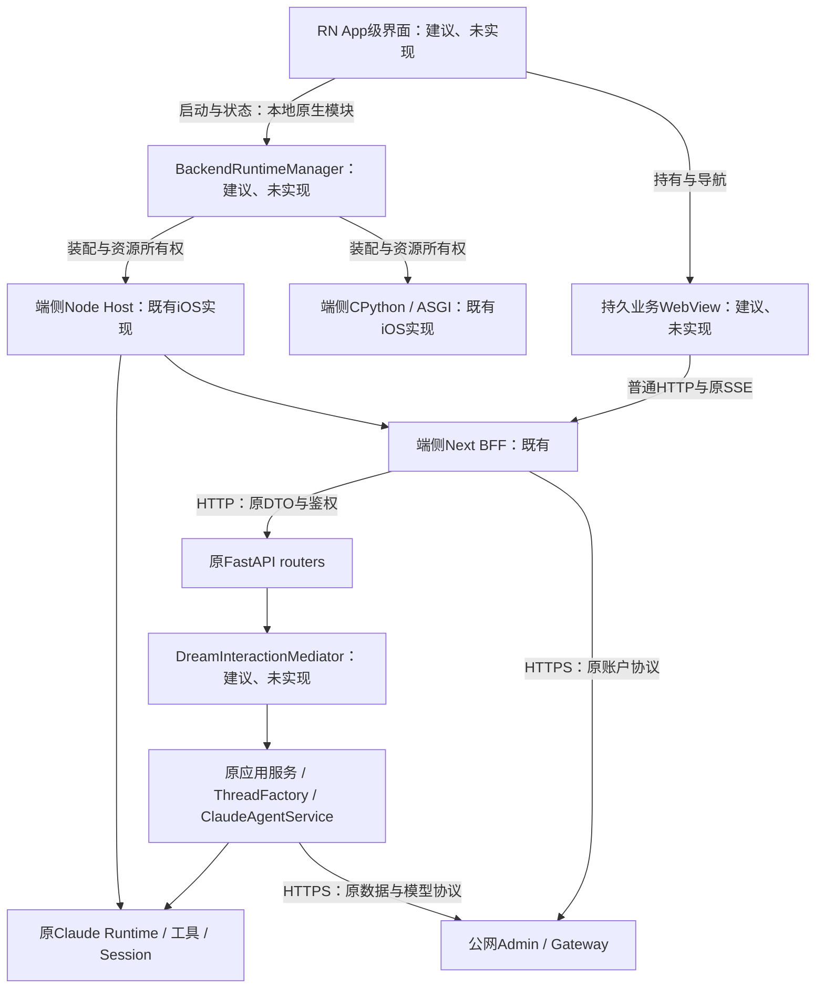
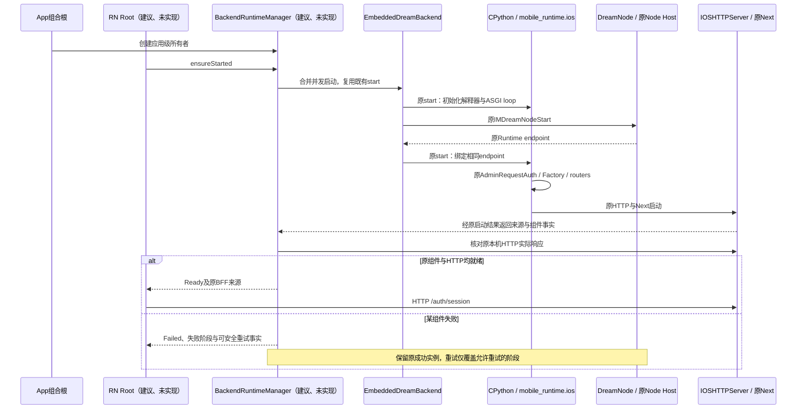
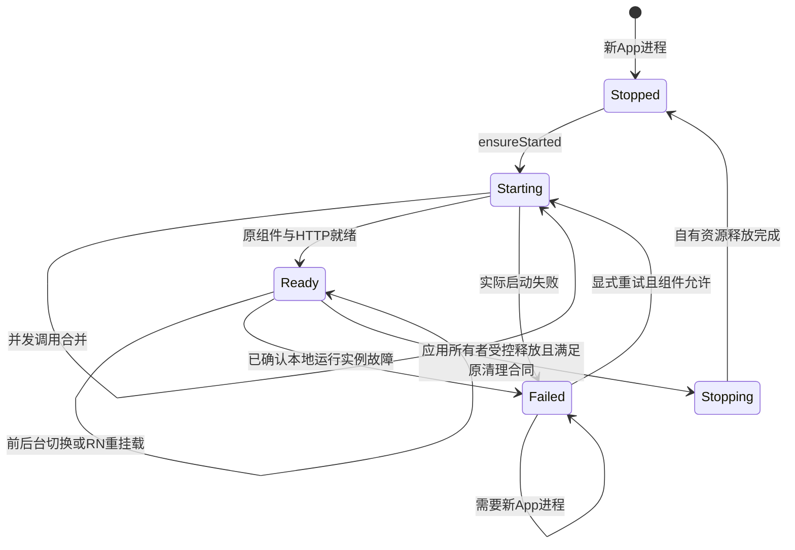

<!-- [Input] RN原生App级页面、持久业务WebView、现有Next/Python/Claude、HTTP协议和App实例所有权。 -->
<!-- [Output] 当前选定跨平台架构、中介者、管理器、生命周期、复用边界和实施资格。 -->
<!-- [Pos] docs/design/multi-platform/技术架构；产品与业务时序归同目录正式交互稿。 -->
<!-- [Sync] 2026-10-27: 收敛当前目标，旧原型与阶段原文完整归档。 -->

# 跨平台客户端与端侧运行时架构

## 2026-10-27现行工程合同

现行主界面、发布工程与HTTP接线以[RN/RNW统一工程设计](react-native-web-project-structure.md)为准：共享源码归`frontend/src`，Xcode与Gradle归`frontend/ios`、`frontend/android`，原`mobile/`构建退出主发布链。App管理器继续持有端侧Python、Node、Next和Claude；原Factory与业务服务持有任务，前端直接调用原HTTP接口。

## 原运行库设计与历史前端策略记录

以下保留原分析、运行库边界及图示。完整业务WebView、旧mobile路径与“建议未实现”的历史接线状态适用原稿日期；新主界面与实例状态见现行工程合同。

## 背景与问题

当前React DOM/Next前端保留为业务页面，Web继续原部署及BFF，RN生成iOS、Android应用并提供App级页面、导航和系统能力。移动业务执行位置保持端侧Python/Node/Claude，业务请求使用HTTP。用户明确要求App级后端管理器和后端应用服务中介者，排除端侧Dream工作台创建与审核确认。

## 目标与边界

RN原生化启动、一级导航、恢复层和系统操作；一个持久业务WebView承载范围内现有页面。Web继续Next构建与原部署；移动端保留原BFF和原Python业务。管理器拥有运行实例，中介者拥有具体用例协调；原权限、Cookie/CSRF/PKCE、DTO、持久化、资源策略及停止/恢复语义保持。新增模块均为建议、未实现。

正式业务结果与三端总体结构见[RN/RNW交互设计](react-native-web-project-structure.md)。历史原文与原型见[迁移前快照](../../exec/history/mobile-design-before-multi-platform-20261027.md)。

## 前端取舍适用范围

React Native为统一App框架，Next Web、端侧Python/Claude、HTTP、后端中介者和App生命周期管理目标保持。具体路由、页面、组件与修改边界见[页面承载与组件复用设计](frontend-page-component-allocation.md)。

原平台Swift/Kotlin代码用于RN的运行库和系统适配。现有DOM/CSS业务在一个持久WebView内运行；RN只适配App级页面与系统能力。RN Web退出首发前置条件。禁止将全部现有组件作为改写清单，禁止按UI组件强建后端包装。

## React Native目标架构（2026-10-27）

### 当前事实、目标与方案比较

| 分类 | 依据及结论 |
| --- | --- |
| 当前代码事实 | [frontend/package.json](../../../frontend/package.json#L8)使用Next构建，依赖React DOM、Tiptap与网页渲染组件；[AuthEntry](../../../frontend/app/_dream/components/Auth/AuthEntry.tsx#L67)和[ChatPanel](../../../frontend/app/_dream/components/chat/ChatPanel.tsx#L1466)包含DOM/CSS。首发通过持久WebView保留这些视图。 |
| 当前代码事实 | [EmbeddedDreamBackend](../../../frontend/ios/InkMemory/EmbeddedDreamBackend.swift#L9)已有应用共享实例和串行启动队列；`start`先初始化Python，再启动Node，最后绑定原后端与Next。当前模块缺少本文完整生命周期状态和RN接入。 |
| 当前代码事实 | [ios.py](../../../backend/mobile_runtime/ios.py#L62)初始化ASGI，[运行时绑定](../../../backend/mobile_runtime/ios.py#L87)装配原Factory、路由、HTTP和Next；[IOSFactoryOwner.close](../../../backend/mobile_runtime/ios_factory.py#L55)已有资源策略与Factory清理。 |
| 当前代码事实 | [apiAuthorization](../../../frontend/app/api/_auth/api-proxy.ts#L10)与[CSRF](../../../frontend/app/api/_auth/login-boundary.ts#L275)属于原BFF；[Chat路由](../../../backend/routers/claude_agent.py#L1056)及[现有应用协调服务](../../../backend/services/deck/story_workflow_application.py#L1123)继续拥有原业务入口。 |
| 拟议方案 | React Native承担App级原生界面并持有一个业务WebView；普通HTTP承担全部业务请求；App级BackendRuntimeManager管理本地运行实例；后端应用服务按中介者模式协调。新增名称均为建议、未实现。 |
| 待验证 | RN所选版本与现有原生工程、React依赖、Node/CPython库共存；原Cookie/CSRF接入；HTTP增量流；移动实例释放；内存峰值；双平台构建和真实业务。 |

选定方案使用RN原生App级页面和一个持久业务WebView。该结构复用全部网页业务，保留RN应用入口、导航、生命周期和系统能力。Next服务器、Python和Claude继续使用各自端侧运行组件，不进入RN JavaScript运行时。

官方资料于2026-10-27查阅：[环境与构建工具](https://reactnative.dev/docs/set-up-your-environment)、[原生组件](https://reactnative.dev/docs/intro-react-native-components)、[既有App集成](https://reactnative.dev/docs/integration-with-existing-apps)、[Turbo Native Modules](https://reactnative.dev/docs/turbo-native-modules-introduction)、[Hermes](https://reactnative.dev/docs/hermes)。工程保留Xcode/Gradle与既有签名路径；Hermes承担RN界面JavaScript，原Node继续承担Next和Claude。React Native的原生打包能力独立于Python/Node/Claude制品与渠道资格，发行检查继续按原发布稿执行。

### Next与React Native的首发边界及Web兼容

Web继续使用Next.js与原部署入口。首发移动业务页面通过持久WebView加载同一React DOM树，RN入口位于`mobile/react-native/`，业务共用原HTTP与后端。RN Web和DOM转RN不属于首发工作包；后续业务页原生化需要新的产品范围和独立评审。

| 当前内容 | 移动迁移处理 | Web处理 |
| --- | --- | --- |
| App启动、失败、恢复和一级导航 | 新建RN页面与组件 | Web不消费这些App级页面 |
| 现有React DOM、CSS和网页编辑器 | 在持久WebView原样运行 | 继续当前Next页面与样式 |
| 文件选择、保存、分享和外链 | RN/native调用现有平台适配 | Web继续浏览器操作 |
| DTO、SSE parser/reducer和纯计算 | 核对`ai`、流API等依赖后提取共用 | 调用相同逻辑，业务合同保持 |
| Cookie/CSRF、OAuth与Route Handlers | 首阶段保留原Next BFF，通过HTTP访问 | 原BFF路径保持 |
| Python业务、Factory、Claude及工具 | 复用端侧组件与原权限 | 原运行拓扑与业务入口保持 |

移除Next BFF需要另行迁移其认证、代理和服务端运行职责。当前设计不将该工作绑定到RN视图迁移，不变更Web入口或要求Web改用RN。中介者提取影响的共享业务必须执行Web相邻回归。

RN Web保留为后续能力。首发不新增`frontend/shared/ui/`、发布包或通用UI框架。原生后端管理模块只在原生入口引用，Web服务启动与部署生命周期保持原实现。工作台创建和审核确认页面保留Web原实现，退出移动显示与适配。

React Hooks和DOM组件继续在WebView内使用。未来明确原生化某个完整业务页时，再依据Hook内部的平台访问、Ref目标、事件类型和返回视图拆分；当前不为`ActivitySidebar`、`Icons`或`Modal`建立RN副本。

2026-10-27只读源码盘点：`frontend/app/_dream`排除测试后有137个TSX文件、46,592行，33个CSS文件、13,210行；Chat目录43个TSX、15,527行；工作台目录42个TSX、9,315行，其中含共用内容。69个TSX文本命中浏览器对象或类型，属于待核对候选。目录统计存在包含关系，禁止相加作为工作量；代码行数包含可复用逻辑，禁止等同于重写行数。

此前3–5人周与10–16人周估算对应业务页原生化范围，退出当前首发计划。RN App级页面、持久WebView、运行库接线与双平台验收需依据本文文件清单重新估算；Android运行库移植、真机Claude兼容及渠道审核周期单列。

### HTTP与原生运行控制

1. App级界面使用RN渲染，业务页面在一个持久WebView运行；Next Web继续当前React DOM树。DTO、parser/reducer和纯业务计算保持原模块，禁止复制第二套业务状态机。
2. 业务继续使用`/api/**`、`/auth/**`与原multipart/SSE协议。持久WebView绑定管理器公开的原本机BFF来源；端侧ASGI HTTP来源供原BFF使用，禁止借中介者绕过鉴权直接调用Factory。
3. 本机HTTP限定loopback绑定；端口、来源与callback按现有env和登记配置确定。端口占用保留启动失败，禁止随机切换来源绕过回调校验。公网通信继续使用HTTPS。
4. RN原生模块仅公开启动、公开运行事实和生命周期订阅，必要的文件/系统操作按实际入口接入。业务DTO、正文、流式结果及停止请求由WebView走HTTP；`runtime.request/read/cancel`保持原用途。
5. WebView传输必须验证Cookie、`x-ink-csrf`、Origin、上传体、下载、增量读取、Abort和错误状态。缺少所需增量能力时只补充现有transport适配，保持原URL、headers、status和SSE字节。
6. 登录沿用原AuthEntry、form、PKCE及BFF；认证与业务使用同一WebView Cookie容器。公开Client ID及原env键保持原配置方式；服务端密钥仍由其原消费者持有，进入RN bundle的配置单独核查，禁止复制Node/Python私有env至界面JavaScript。

### App级后端管理器

`BackendRuntimeManager`为建议、未实现的原生应用模块。iOS由App组合根持有，复用`EmbeddedDreamBackend.shared`及现有Python/Node启动代码。Android主进程的应用级管理器持有原生Service连接，既有私有`:dream_runtime`进程中的Service持有Python/Node；业务仍通过loopback HTTP，Binder仅处理运行时控制。现状依据为[AndroidManifest](../../../frontend/android/app/src/main/AndroidManifest.xml#L28)与[DreamRuntimeService](../../../frontend/android/app/src/main/java/com/inkmemory/mobile/runtime/DreamRuntimeService.kt#L14)，后者当前返回未接入能力。RN Root、页面、Activity或Scene只订阅状态，禁止各自创建运行时；本文不新增独立守护进程。

管理器公开`ensureStarted()`、`getStatus()`及状态订阅；名称为建议、未实现。并发`ensureStarted`共享同一个启动结果；RN热重载、页面重挂载、Android配置变化和重新进入前台均不重复初始化。返回的公开事实只含组件状态、当前本机来源与失败码；凭证和业务正文保留原所有者。

内部职责为：读取原配置与资源 → 初始化一次CPython → 启动一次原Node Host → 绑定原Factory与ASGI → 启动原HTTP及Next → 核对原组件所有权和实际HTTP响应 → 发布Ready。Ready表示本地组件可接收原协议请求，账户、模型、数据库和公网可用性分别通过原业务入口判断。

管理器内部释放以停止接收新请求、结束已许可的订阅、调用现有close和释放自有句柄为顺序。活跃业务仍由原停止/清理协议处理，页面卸载、退出登录与进入后台均不触发全局shutdown。已有库仅支持进程内单次初始化时，失败结果明确要求新App进程，禁止销毁后循环重新初始化Python或Node。

公网超时、401和模型错误沿原HTTP反馈，管理器保留本地实际状态。操作系统挂起属于调度状态；管理器禁止将其改写为Stopped、任务取消或任务成功。系统结束某个进程时，该进程内实例结束，终止回调与最后一次写入均无保证；下一次启动创建或重新关联实际运行实例，通过原HTTP读取持久化事实。Android主进程与runtime Service分别观察进程退出和Binder断开，禁止由Activity销毁推定后端退出，也不通过后台自动拉起维持常驻。

### 后端应用服务中介者

`DreamInteractionMediator`为建议、未实现的Python应用服务对象，按后端组合根注入原服务；Python模块不导入React Native、原生控件或页面对象。它接收已经通过原HTTP边界校验的用例输入和请求上下文，协调原Factory/应用服务并返回原DTO或原异步事件流。

| 用例职责 | 原执行所有者 | 中介者处理 |
| --- | --- | --- |
| Chat发送、继续及工具审批 | 原路由校验、ThreadFactory、ClaudeAgentService、原SDK | 转交原输入和上下文，保持Thread锁、资源策略、权限和持久化顺序 |
| 原停止操作 | 原`stop_thread`及Service清理 | 转交显式停止，返回原回执；HTTP disconnect只结束订阅 |
| 历史、状态和恢复 | 原Admin数据服务、Thread/Session读取 | 委托原查询与恢复合同，不补发未知结果的写请求 |
| 附件与文件 | 原storage/workspace及其应用服务 | 继续原HTTP入口与归属校验；没有跨服务协调需求的路由保持原实现 |
| 工作台创建与审核确认 | 现有Web及原后端 | 端侧入口退出范围，管理器和中介者不新增主动创建、扫描、确认或适配 |

优先复用已有应用协调服务。仅将确有跨服务协调的代码移入中介者；简单查询和直转路由保留原委托，禁止为全部路由增加空包装。中介者使用具体用例方法，禁止引入通用命令总线、动态插件注册、额外队列、数据库表或新的业务HTTP接口。Web与RN继续共用同一路由和用例实现。

建议源码归属：RN App级页面与`BusinessWebSurface`位于`mobile/react-native/`；生命周期组合根位于现有`mobile/ios/`及`mobile/android/`；Python中介者按实际用例放入`backend/services/`并由现有组合根注入。现有业务页面、DTO与parser继续由`frontend/`持有，当前设计不新增共享框架或代码包。

### 实例所有权与生命周期

下表为目标所有权。当前代码仅具备表中注明的原组件；新增管理器、中介者与RN实例尚未接线。

| 实例 | 创建者与作用域 | 创建/就绪条件 | 释放或结束 | 持久化与重开规则 |
| --- | --- | --- | --- | --- |
| App主进程 | iOS/Android系统，单次主进程 | 用户打开或系统创建 | 系统终止或进程退出 | 新进程重新装配/关联实际组件；禁止依赖终止回调落库 |
| Android runtime Service / 进程 | 原私有`:dream_runtime`服务，由应用管理器绑定 | 原Service绑定成功且原运行组件就绪 | 原Service释放或该进程被终止 | 与主进程分别观察；断开后显式重连核对，禁止后台常驻 |
| BackendRuntimeManager | App主进程组合根，一个逻辑所有者 | 原生App初始化后，页面订阅前 | 应用所有者受控释放或主进程终止 | 内存状态不持久化为业务状态 |
| RN Hermes / Root | RN宿主，每个实际RN运行时 | 原生RN装配完成 | RN运行时销毁或进程终止 | Root重挂载可重订阅，后端所有者保持 |
| 持久业务WebView / DreamRoot | RN Root在本机HTTP就绪后创建，每个App进程一个业务页面实例 | WebView加载原Next入口且`DreamRoot`完成原会话检查 | Web内容进程终止、RN运行时销毁或App进程终止 | 栏目切换不重建；Cookie、历史和业务状态继续通过原HTTP与持久化恢复 |
| Web Next文档 | 原Next渲染与浏览器文档 | 当前DOM页面构建及SSR/客户端边界通过 | 原Web文档或渲染范围结束 | 浏览器关闭不停止Web服务；不导入原生后端管理器 |
| CPython解释器 | iOS原EmbeddedDreamBackend；Android由runtime Service持有 | 原资源、扩展与初始化成功 | 所属进程退出；显式finalize须独立资格验证 | 不把解释器对象序列化，不默认支持原地重启 |
| ASGI loop / App / HTTP监听 | 原`mobile_runtime.ios`组合根，App级 | 原配置、Factory与路由绑定 | 原lifespan/监听关闭并等待自有句柄 | 重开装配相同业务路由，不复活旧内存任务 |
| Node Host | 原DreamNode，App级 | 原库与Runtime endpoint已核对 | 原受控清理或进程终止 | Hermes与Node分别持有引擎，不相互替代 |
| Next BFF / 本机HTTP | 原Node启动代码，App级 | 原来源、回调配置和ASGI来源有效 | 原HTTP监听与Worker关闭 | 原Cookie/CSRF及env合同保持 |
| DreamInteractionMediator | Python组合根，App级 | 所需原服务注入完成 | 随组合根释放 | 禁止持有全局“当前用户”；身份来自单个HTTP请求 |
| HTTP请求上下文 | 原BFF与路由依赖，每个请求 | 原Cookie、CSRF、鉴权与DTO通过 | 响应结束、断连或请求取消 | 未知写结果通过原查询确认，禁止通用重放 |
| HTTP/SSE订阅 | 页面HTTP客户端与原服务，每次连接 | 原请求获准并返回响应头 | 正常EOF、断连、取消订阅或页面结束 | 重连读取原status/messages并订阅原stream；断连不等于stop |
| ThreadFactory / policy owner | 原IOSFactoryOwner或Android对应组合根，App级 | 原运行时与资源策略装配 | 原`close`、Factory `aclose`及refresher停止 | 原LKG/default/desired/effective/revision合同保持 |
| Thread执行 / Runner | 原Factory，按原Thread与执行范围 | 原锁、admission与权限允许 | 原终态及原清理完成 | 原持久化和Session恢复；同Thread并发规则保持 |
| SDK client / Claude Worker | 原SDK连接所有者 | 原`IOSClaudeTransport.connect` | 原`close`及Worker退出等待 | 原连接范围继续沿用；禁止强制每页面一个Worker |
| Claude Session文件 | 原Runtime，原身份与工作区归属 | 原执行创建或校验既有Session | 按原用户数据保留合同 | JSONL与Session身份保留，升级路径按原容器校验 |
| MCP连接与guest命令 | 原SDK/MCP/命令所有者 | 原工具、权限、cwd与临时目录有效 | 原关闭、停止、超时与句柄等待 | 工具副作用与结果按原持久化；禁止退出时猜测成功 |
| 网页登录视图与Cookie | 持久业务WebView中的AuthEntry与AuthProvider | 原AuthEntry与本机BFF就绪 | WebView或App进程结束；原logout按合同清理Cookie | 登录与业务共享同一WebView Cookie容器；原页面读取公开会话结果 |
| 文件选择/上传/预览 | 当前用户操作与原文件服务 | 系统选择及原访问校验通过 | 取消、完成或对应视图结束 | 原附件记录保留；只清理该实例自有临时文件 |

### 平台与实施资格

iOS复用现有Swift/Objective-C/C++与嵌入式运行库，RN通过官方原生模块接入生命周期事实。Android复用现有Kotlin工程及明确的运行时service所有者；Activity销毁不承担App后端终止职责。两平台分别核对HTTP来源、文件URI、Cookie、系统返回及构建配置。

官方[AppState](https://reactnative.dev/docs/appstate)仅提供前后台等通知；[Apple生命周期](https://developer.apple.com/documentation/uikit/managing-your-app-s-life-cycle)与[Android Activity生命周期](https://developer.android.com/guide/components/activities/activity-lifecycle)分别约束系统调度与组件重建，查阅日期2026-10-27。本设计保持前台业务路径，不新增后台常驻、推送、自动业务调度或全局确认扫描。

实施顺序：原生工程集成RN并证明原组件共存 → 管理器单实例与失败恢复 → 持久WebView中的原网页登录、Cookie/CSRF与HTTP增量 → RN主导航及范围内Chat/Decks/More和文件桥接 → 双平台真实业务和构建发布资格。工作台创建模块全程退出端侧适配。原业务时序与验收见[RN正式交互稿](mobile-react-native-interaction.md)。

### 主要风险与通过条件

| 风险 | 影响 | 最小控制与通过条件 |
| --- | --- | --- |
| 持久WebView布局与平台差异 | 键盘、安全区、滚动和系统返回可能影响现有页面 | 使用RN App级容器统一安全区和返回入口；按现有窄屏布局逐项验证，不批量改写DOM组件 |
| WebView桥与来源边界 | 文件、外链和MCP内容可能跨越WebView与系统能力边界 | 只保留现有allowlist方法，核对来源、消息ID、参数schema和结果匹配；MCP iframe协议保持 |
| WebView会话与回调 | Google系统浏览器返回后可能缺失原Cookie或停留在错误页面 | 登录与业务共享同一WebView Cookie容器；双平台核对Cookie属性、来源、CSRF、取消、失效、退出和回调返回 |
| HTTP流与取消差异 | 首帧被缓冲、末帧丢失、HTTP取消误作任务停止 | 原SSE字节与parser合同、真实首帧/终态、Stop、重连与持久化一致后再迁移更多页面 |
| Hermes/Node/CPython共存 | 增加包体、峰值内存、启动耗时与链接复杂度 | 先构建真实集成包，测量冷启动、空闲/任务峰值与现有资源策略；沿原配置处理，禁止降低admission或权限绕过失败 |
| 生命周期与部分初始化 | 重挂载重复启动、原生库无法原地重启、残留监听或命令句柄 | App级单所有者；并发启动和逐阶段失败检查；验证close与新进程恢复，不默认支持解释器重启 |
| Android运行库资格 | 当前service仅有未接入响应，iOS回执无法替代Android | 先取得Python、Node/Claude、ABI与HTTP实际回执，按原渠道签名安装测试 |
| 共享中介者改动影响Web | 服务调用顺序、锁、身份或流终态漂移 | 只提取具体协调用例；Web与RN共用同一生产路由，执行原合同与相邻Web回归 |
| 原生制品与渠道资格 | RN构建成功无法覆盖内嵌运行库来源、签名和应用审核要求 | 沿原发布稿逐项核对制品来源、许可证、签名和渠道条件，真实提交前重新查阅官方要求 |

最小实施切片为“原网页登录 → 原Chat真实流式任务 → 原停止 → 普通重开恢复”，先在iOS Simulator独立通过，再取得物理iPhone与Android同项回执。该切片用于验证首发集成，保留范围内其余业务的后续实施与验收责任。

## 执行位置与代码归属

| 位置 | 目标职责 | 当前状态 |
| --- | --- | --- |
| `frontend/` | 原Next Web、登录/BFF及持久WebView内的原业务页面 | 当前已有React DOM与Next实现；首发保留DOM/CSS |
| `mobile/react-native/` | RN App级入口、启动/恢复、一级导航、持久WebView和平台操作适配 | 建议、未实现 |
| `mobile/ios/`、`mobile/android/` | App组合根、运行管理与原生库 | 已有原生工程；RN管理接线待实施 |
| `backend/mobile_runtime/` | 端侧装配、原解释器/运行库接线 | 已有iOS实现；Android独立资格待验证 |
| `backend/routers/`、`backend/services/` | 原HTTP校验、业务服务及按需提取的中介者 | 原路由/服务已有；中介者接线待实施 |

## 端侧部署配置：关闭Claude命令沙箱

沿用原普通env：`INK_AGENT_SANDBOX_ENABLED=false`，由现有配置消费者生成原Claude settings。iOS、Android目标一致；系统应用隔离、原工具审批、资源策略及精确`CLAUDE_CODE_TMPDIR`/0700合同保持。禁止新增逐命令隔离后端、Lua虚拟机或通用插件框架。详见[发布稿](../../deploy/mobile-app-release.md#端侧claude命令沙箱配置)。

## 既有实现与历史引用

### 独立iPhone执行的实施边界

原iOS端侧运行库、真机技术回执及安装历史继续保留各自范围。RN App级界面、持久WebView会话和完整真机业务分别验收；Android结果单独取得。见[迁移前原文](../../exec/history/mobile-design-before-multi-platform-20261027.md)与[执行记录](../../exec/mobile-app-design-review-20261024.md)。

### iOS长路径会话恢复

原[ios_session_storage.py](../../../backend/mobile_runtime/ios_session_storage.py)保持Session身份、应用容器路径、JSONL字节和原归属校验。RN迁移复用该实现，禁止通过界面切换创建替代Session；连续升级/重开列入原生验收。

### 已接受确认消息的进程重开恢复

该能力属于现有工作台业务的已实现接线，原代码及Web使用保持。工作台创建与审核确认退出RN端侧入口、适配和主动恢复清单。原消息/claim/lease/Hook/ACK与历史图示见[iOS既有实现说明](mobile-ios-interaction.md#已保存dream确认的进程重开恢复)及[迁移前原文](../../exec/history/mobile-design-before-multi-platform-20261027.md)。
