<!-- [Sync] 2026-11-01: 专项页面与状态已接入源码，后台初始化和Native接口保持。 -->
<!-- [Sync] 2026-11-01: 本次异步启动方案迁至mobile-startup-interaction.md，旧章节保留导航。 -->
<!-- [Sync] 2026-11-01: 移动应用PRD迁至docs/prd/mobile-app/mobile-app.md，更新现行引用，保留历史回执。 -->
<!-- [Sync] 2026-11-01: 保留现有Python后台异步启动，仅设计最少前端状态与开发者入口；性能专项和新Native监测退出范围。 -->
<!-- [Sync] 2026-11-01: 同一iPhone20原登录协议、配置、历史和一次真实Claude持久化/结算通过；弹窗及页面显示保留独立验收。 -->
<!-- [Sync] 2026-11-01: 依据19复用连接头前超时，20增加失败池退役、在途排空及原调用方超时分类；实际资格分项登记。 -->
<!-- [Sync] 2026-10-31: 构建18补原认证传输的定向阶段日志；构建17受控503/503/200保留独立回执。 -->
<!-- [Sync] 2026-10-31: 索引端侧目标编译与原登录认证方案、排障指南和分平台资格；本轮仅文档维护。 -->
<!-- [Sync] 2026-10-31: 补端侧原登录认证/目标编译合同、三类图、分平台缺口和排障指南；本轮仅文档。 -->
<!-- [Sync] 2026-10-31: 增加Admin系统HTTP的具体语言绑定、正常/异常/状态图及分项验收，原业务与权限保持。 -->
<!-- [Sync] 2026-10-31: 补构建8物理Node/ntn暂存与独立Stop恢复的范围，完整Python/CLI和认证业务保留待验收。 -->
<!-- [Sync] 2026-10-31: 原host规范Native父目录兼容iPhone路径别名，子路径和Notion摘要检查保持；补路径回归及构建7分项资格。 -->
<!-- [Sync] 2026-10-31: 依据当前产品实现补iOS实例、启动与失败恢复图；早期整页WebView和未实现描述归历史，原文保持。 -->
<!-- [Input] RN原生App级页面、持久业务WebView、现有Next/Python/Claude、HTTP协议和App实例所有权。 -->
<!-- [Output] 当前选定跨平台架构、中介者、管理器、生命周期、复用边界和实施资格。 -->
<!-- [Pos] docs/design/multi-platform/技术架构；产品与业务时序归同目录正式交互稿。 -->
<!-- [Sync] 2026-10-27: 收敛当前目标，旧原型与阶段原文完整归档。 -->

<!-- [Sync] 2026-11-01: 新增启动分段证据、等待判断、两方案取舍及未实现安全观测合同；本轮只改文档。 -->

# 跨平台客户端与端侧运行时架构

## 启动等待与最小调整（2026-11-01）

本次方案已拆为[独立交互与技术设计](mobile-startup-interaction.md)及[独立PRD](../../prd/mobile-app/mobile-startup.md)。现有Python后台队列与单实例继续复用；新增状态展示和开发者入口已接入源码，安装采用及平台验收分别记录。原章节保留文档入口，下方既有运行库合同及历史回执保持。

## 2026-10-31 iOS现行实例与启动合同

### 背景与问题

当前产品Simulator已采用RN Chat、Decks、More及局部持久业务文档，原密码登录、真实Chat/Bash、Stop、冷重开和运行中前后台已有分项回执。下方2026-10-27原稿中的单个整页业务WebView、管理器未接线和拟议方法属于早期阶段记录。现行业务范围与逐模块取舍归[统一工程设计](react-native-web-project-structure.md#当前候选与验收范围)，当前实现及验收范围归[本轮执行记录](../../exec/mobile-app-design-review-20261024.md#2026-10-31-release前端来源与运行实例核对)。

### 目标与边界

RN承担主界面和导航，原DOM编辑器、工具/MCP App与Mermaid等文档按业务实例保留。Next BFF、Python ASGI、原Factory及Claude执行归App；当前iPhone包连接已部署Admin/Gateway，PostgreSQL由Admin持有，Mac承担构建与安装。Web的[App.web.tsx](../../../frontend/src/App.web.tsx#L1)继续装配原DreamRoot。Dream工作台创建、初始生成和审核确认退出端侧入口。

当前实现公开`BackendRuntimeManager.ensureStarted()`，复用原原生模块及异步启动结果。独立`getStatus`、通用运行时订阅、显式解释器重启和新的`DreamInteractionMediator`类保留早期拟议状态；本轮无新增需求。原BFF、路由和应用服务继续承担请求校验与用例协调，业务通过原HTTP入口执行。

### 概念与规则

| 实例 | 当前创建者与职责 | 结束及恢复规则 | 代码依据 |
| --- | --- | --- | --- |
| RN Root / Business | Swift创建`RCTRootView`；SessionGate按公开user.id创建Business；Chat/Decks/More由Business组合 | 账户变化释放对应文档与界面，栏目隐藏保留当前业务实例；App进程结束后沿原持久化读取 | [InkMemoryApp](../../../frontend/ios/InkMemory/InkMemoryApp.swift#L41)、[App](../../../frontend/src/App.tsx#L211) |
| BackendRuntimeManager | JS模块持有一个启动Promise；并发请求共享结果，失败清除Promise | RN重挂载可复用当前模块结果；原生共享实例持有实际运行库 | [管理器](../../../frontend/src/runtime/BackendRuntimeManager.ts#L9) |
| InkRuntime | Native模块调用共享后端，校验loopback来源；持有HTTP读取、登录及文件操作实例 | 单个请求取消只结束该请求；登录关闭等待原sheet结束；原后端任务继续归原业务模块 | [ensureStarted](../../../frontend/ios/InkMemory/InkReactNative.swift#L54)、[原生HTTP](../../../frontend/src/platform/transport.native.ts#L19) |
| EmbeddedDreamBackend.shared | 串行启动队列合并waiters，成功缓存readyFacts；先Python、后Node，再绑定原运行时 | 页面关闭与后台切换保留共享实例；启动错误按现有错误回调返回，重试保留已有原生初始化所有权 | [共享后端](../../../frontend/ios/InkMemory/EmbeddedDreamBackend.swift#L12) |
| CPython / ASGI / Factory / Node / Next | `mobile_runtime.ios`绑定原鉴权、24路由、Factory、HTTP与Next，原Node Worker执行Claude和ntn | 原Thread、Session、工具和文件继续各自存储规则；终止App后内存实例消失，重开重新装配 | [iOS组合根](../../../backend/mobile_runtime/ios.py#L75) |
| 局部业务文档 | 原输入、Writing、工具/MCP及图表组件分别持有文档；原组件与HTTP合同复用 | 栏目隐藏保留已挂载文档；Thread/账户离开按原释放握手处理，取消文档读取保持后端任务语义 | [文档离开次序](../../../frontend/src/App.tsx#L1)、[实例矩阵](react-native-web-project-structure.md#实例生命周期) |
| 登录与会话 | SessionGate读取原`/auth/session`；InkRuntime提供原网页登录与系统授权适配 | 密码成功等待弹窗关闭再刷新；左上关闭取消；前台/401沿原会话读取，Cookie/CSRF留在原所有者 | [SessionGate](../../../frontend/src/platform/SessionGate.native.tsx#L24)、[账号交互](mobile-ios-interaction.md#google正常账户授权的回调兼容) |

`ready`表示当前本机来源可供原HTTP调用。账户认证、模型调用、Notion授权、各业务操作和物理设备执行分别验收。iOS组合根绑定原confirmation worker并启动原Factory；desktop `server.py`中的Memory、定时任务、confirmation全局扫描和builtin seed启动处理器拥有独立执行归属。24路由的资源一致性仅证明共享源码装配，全部后台业务资格保持分项验收；本轮启动全局领取循环0。

### Native容器父路径与Notion启动校验

物理iPhone构建6控制台记录`IOS_NOTION_CLI_PATH_INVALID`并退出1。原guest子目录均为普通目录，原host将含平台祖先别名的endpoint父路径直接拼入guestRoot，Notion暂存父目录与realpath比较时拒绝。Simulator的常规路径执行资格保留其平台范围。

[host.cjs](../../../frontend/ios/runtime/host.cjs#L32)先对Native已创建的endpoint父目录执行`realpathSync`，再追加manifest固定guest digest和相对路径。规范化发生于Native父目录，guest后代路径的符号链接检查保持；ntn仍校验锁定摘要、固定执行路径、原Notion cwd和私有Worker认证。临时文件继续wx写入后rename，执行位0755；Node、Next、Python及Claude实例所有权保持原表。

[路径回归脚本](../../../frontend/ios/scripts/check-notion-staging-paths.mjs)调用原host启动片段，覆盖常规路径、Native祖先别名、Notion父目录符号链接、目标文件符号链接及摘要错误。旧实现复现退出1，修复5项通过；既有resolver6项通过。合成CLI字节仅用于路径校验，CLI执行、网络和凭证读取0。

构建7 Simulator原Python另行执行真实包内ntn的版本/帮助，两项退出0；设备IPA静态检查通过。构建7物理执行、有效Notion授权与业务资格继续待验收，原始命令归[本阶段记录](../../exec/mobile-app-design-review-20261024.md#2026-10-31-真机ntn启动路径修复与构建7)。本修复复用既有模块、配置与接口，新增生产模块0。

构建8物理iPhone已完成无线覆盖安装，Node/Next及ntn实际暂存通过，原Native祖先路径拒绝未复现。当前完整Python/CLI与账号业务待取得有效执行及同一本机Admin网络回执；调试驱动的未就绪标签退出实际解释器状态依据。Native主Chat的Stop获准后结束旧读取epoch，并由原schedule独立读取原messages/status，详见[现行停止恢复](react-native-web-project-structure.md#停止回执后的独立读取恢复)。App级运行库、原Thread/Session与队列所有权保持。

### 正常启动与会话读取

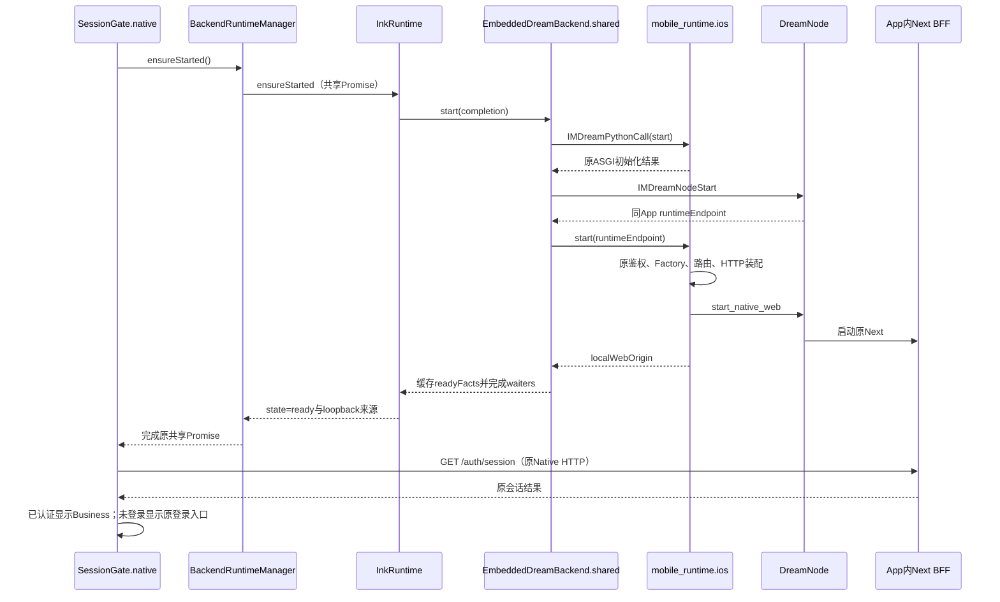

### 启动失败与恢复读取

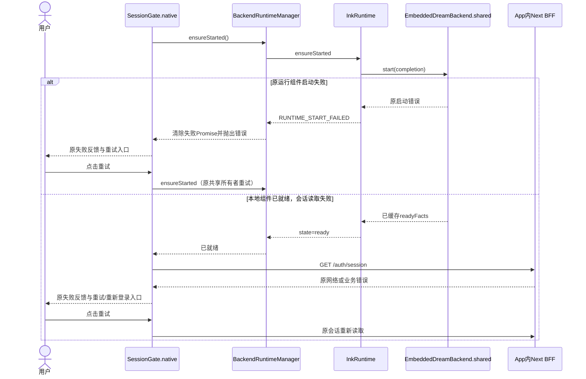

### 运行时结果与界面生命周期

下图描述当前启动Promise及原生缓存的设计状态；公开就绪字段为`ready`，错误通过原Promise拒绝返回。SessionGate和业务状态由各自原模块持有。

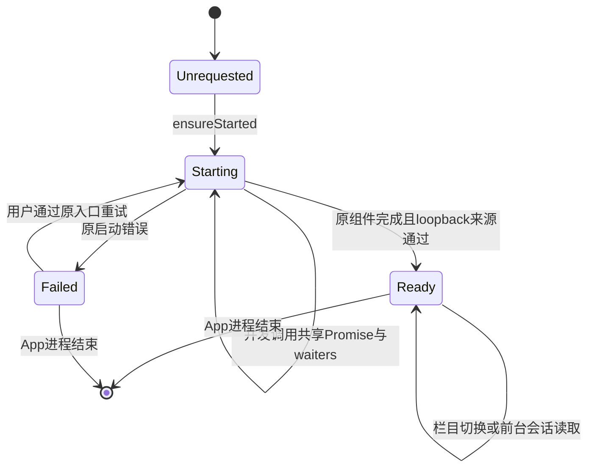

本节为代码与文档一致性修订，新增运行组件、业务接口、权限、后台机制与状态协议均0。Simulator正常业务、技术验证、真机和发行分别沿原回执判定。

## 2026-10-31 Admin JSON HTTP平台兼容

### 背景与问题

物理iPhone的Node/Next已正常启动。构建13/14原`/auth/session`读取记录`UND_ERR_CONNECT_TIMEOUT`、`BFF_ADMIN_UNAVAILABLE`，原历史读取记录`ADMIN_TIMEOUT`。同一手机的系统HTTPS与原密码表单协议取得有效响应。原会话恢复后，原PKCE交换及用户资料200，RN主界面到达“新建对话”；这些结果归构建14阶段，当前构建的资格按[实机记录](../../deploy/ios-iphone-install-release.md#十九2026-10-31工作区读取与系统http适配)分别判定。

| 判断 | 决策依据 | 处理 |
| --- | --- | --- |
| 当前代码事实 | [Next客户端](../../../frontend/app/api/_auth/admin-client.ts#L137)和[Python原解析器](../../../backend/services/admin_data/http_transport.py#L19)继续拥有认证、请求ID与错误恢复 | 保留原调用方 |
| 当前执行事实 | 内置服务就绪与原账号会话检查拥有独立结果；超时后原重试入口仍存在 | 原业务页面和反馈继续复用 |
| 方案比较 | 外层HTTP期限已配置30秒；旧Node连接期限与读取仍失败，新建连接的历史对照记录会话超时 | 参数调整尚缺少稳定性证据 |
| 采用方案 | [既有NativeHTTPResponse](../../../frontend/ios/InkMemory/InkReactNative.swift#L539)已持有URLSession、响应头、背压和取消 | 增加原始字节读取及私有语言绑定，共用同一系统传输 |
| 范围收敛 | 当前需求为端侧Admin JSON后通道 | 新增业务页面、HTTP路由、依赖、配置键、数据库表及Mac业务代理均0 |

### 目标与边界

Next BFF、Python ASGI、原Factory与Claude执行继续归App。当前iPhone制品连接公网Admin/Gateway；PostgreSQL继续由Admin持有。Mac承担构建、安装及Simulator宿主职责。React Native主界面、Web页面、账号密码入口、Client/S256、Cookie/CSRF、JWT、scope、工具审批及业务状态机保持原实现。

适配来源取既有`INK_ADMIN_DREAM_TRANSPORT_BASE_URL`或`INK_ADMIN_DREAM_BASE_URL`。路径限定既有`/api/auth/oauth2/token`、`/api/auth/jwks`和`/api/internal/dream/v1/`。Next适配接受原manual重定向策略；其余请求继续原fetch。Python同步HTTPX在iOS组合根绑定当前来源与路径，其他来源、协议路径及异步传输继续原实现。Gateway流、App内ASGI/SSE与Runtime Worker沿原传输，完整Claude任务继续独立验收。

### 概念与规则

| 对象 | 现有/新增职责及生命周期 | 代码 |
| --- | --- | --- |
| `ios-admin-http` | Next Worker启动时绑定一次；原fetch构造请求，返回原Response，保留调用方AbortSignal | [适配入口](../../../frontend/ios/runtime/ios-admin-http.mjs#L4)、[Worker](../../../frontend/ios/runtime/worker.mjs#L108) |
| `AdminHTTPJob` | 单请求的libuv队列与回调；取消前置检查阻止尚未启动的请求；环境关闭等待本次任务退出并释放V8引用 | [Node私有绑定](../../../frontend/ios/InkMemory/DreamNodeProcess.cc#L319) |
| `IMDreamHTTPPerform` | Node和CPython共用私有C ABI；调用方在后台线程等待，URLSession回调归主队列 | [ABI](../../../frontend/ios/InkMemory/DreamHTTP.h#L1)、[Native入口](../../../frontend/ios/InkMemory/InkReactNative.swift#L717) |
| `NativeHTTPResponse` | Admin请求复用App级URLSession，每个Task持有当前NativeHTTPResponse为delegate；字节与UTF-8读取互斥，取消仅结束当前Task，原前端传输继续其独立Session生命周期 | [共享传输](../../../frontend/ios/InkMemory/InkReactNative.swift#L539) |
| `ios_admin_http` | iOS组合根按原Admin配置绑定HTTPX同步传输；原客户端继续构造DTO、验证JWT和执行恢复 | [绑定](../../../backend/mobile_runtime/ios.py#L101)、[适配模块](../../../backend/mobile_runtime/ios_admin_http.py#L19) |

Native请求使用原HTTP期限及`max_response_bytes`。Admin绑定以同一原期限设置独立主队列定时器，保证底层任务挂起或缺少回调时返回原timeout错误；结束或取消后撤销本次定时器。原响应缓冲排空时立即恢复已挂起任务，待完成状态继续按原EOF处理。聚合正文保留上限加1字节供原客户端执行超限拒绝；响应头延续`Content-Type/Retry-After`投影。系统TLS校验保持，公开明文地址继续拒绝，原loopback HTTP允许条件保持。后通道共享一个App级临时URLSession连接池，Cookie与系统凭据存储关闭；原浏览器Cookie继续由现有登录模块所有。认证头与正文仅在请求内存中传递。

Native层按单次请求执行，重定向保持manual。共享Session在成功和普通取消后保留；连接丢失或原期限超时后退役，后续Task取得新Session；旧Session排空其余在途Task。每个Task在resume前绑定当前delegate，完成或取消清理本次Task。请求墙钟期限继续按各调用方原值，Session共享范围限定Admin后通道。Python原`request_admin_dto`继续区分只读恢复与写入未知结果；写入单次派发。Node取消转发至当前Native任务，队列中的取消请求在网络启动前结束。Python同步调用释放GIL，按原HTTP期限返回；异步取消与原任务Stop继续由原模块持有。新增组件承担传输和清理，业务请求ID、角色、授权和持久化规则继续原调用方所有。

### iPhone 503定向采证（2026-10-31，构建18）

构建17本轮受控读取返回会话503/BFF_ADMIN_UNAVAILABLE（30.600秒）、配置503/同码（8.394秒）、随后历史200（6.718秒、1项）。该结果确认构建17失败具有请求差异；18的阶段证据与19恢复实现见下节。构建18仅补现有适配的阶段观测，业务实现、原期限、取消、恢复、接口与权限保持。

| 阶段 | 当前观测点 | 实施状态与限制 |
| --- | --- | --- |
| 发起、传输选择 | ios-admin-http的selected-native | 已实现；限token、JWKS、capabilities、resolve与profile五类固定路径；原页面请求继续由原反馈持有 |
| 序列化、排队 | serialized时间与native-enter时间 | 已实现；两者差值包含绑定与工作队列等待，单独队列耗时尚未拆分 |
| Native、主队列、网络开始 | native-enter、main-start、network-start | 已实现；时间与原生阶段附带applicationState，0表示active |
| 连接、响应头、正文 | network-metrics、headers、network-complete、native-result | 已实现；DNS/连接/TLS时段、原数字错误码、状态、字节数，不记录地址、头值或正文 |
| Native返回、Next结果 | native-return、native-callback、next-result | 已实现；同traceId关联；requestId沿原x-request-id，缺失时保留日志内UUID，业务DTO保持 |
| 取消、期限、原页面反馈 | cancel、deadline、network-error与原SessionGate错误/重试 | 适配观测已实现；原页面继续原加载、错误、重试、登录弹窗关闭规则 |

日志使用现有stderr设施，原请求编号与日志内UUID仅用于关联。Native与Next均记录毫秒时间和各自单调耗时。网络指标描述URLSession实际报告的时段；缺失指标保留未知。App挂起、网络失败、调试器附加与取消分别登记。技术合同和目标构建通过仅证明源码可执行；真机安装与原业务结果单独验收。新增全局监控、业务字段、配置键、依赖与认证放行均0。

### 本轮网络失败证据与最小恢复

构建18请求`f345842e-2b36-4a51-a67f-54a46142512a`的session-resolve在active状态于8.958秒返回NSURLErrorDomain/-1005，响应头缺失、接收字节0、系统指标reused=1。Native于同毫秒返回，Next于约2毫秒后收到失败。另一请求`9c922e84-41b4-4c80-8bc0-2ec9dbe2ba75`于原30秒期限取消，响应头缺失且0字节；取消后的-999归本次清理。该证据将失败定位至系统网络请求的响应头前阶段；具体网络设备或链路原因保持未知。传输选路、Native回调及Next结果均取得直接回执。

恢复限定原Admin适配内的固定认证读取：GET JWKS/capabilities、POST browser-sessions/resolve与user-profile.current。仅NSURLErrorDomain/-1005、status=0、累计正文0、调用方未取消且原期限尚有剩余时，创建一次后续Task；同一墙钟定时器和连接所有者继续使用，后续Task的timeoutInterval取剩余期限。最多恢复1次。响应头/正文已到达、取消、其他错误、服务token、exchange/revoke和其他业务写入均按原失败返回。

resolve沿原handle解析合同。Admin的BrowserSessionService.resolve持有原handle行锁，按当前已保存token读取或串行续期；再次解析读取当前状态。授权码exchange与handle撤销保持各自原合同，传输层不重放。配置和历史继续原BFF认证及Python只读恢复，未添加通用POST重放。

修复源码将各请求阶段暂存于当前适配实例；只在失败或发生恢复时输出。普通成功阶段随请求释放。Next以私有recoveryCount关联发生恢复的成功响应，业务Response/DTO保持。新增观测不持有Cookie/认证头/正文，未引入诊断页面、服务或配置开关。构建19已安装到同一iPhone并保留原数据；会话、配置、历史均200，原账户与CSRF匹配。真实任务和可见网页登录结果沿执行记录单列。

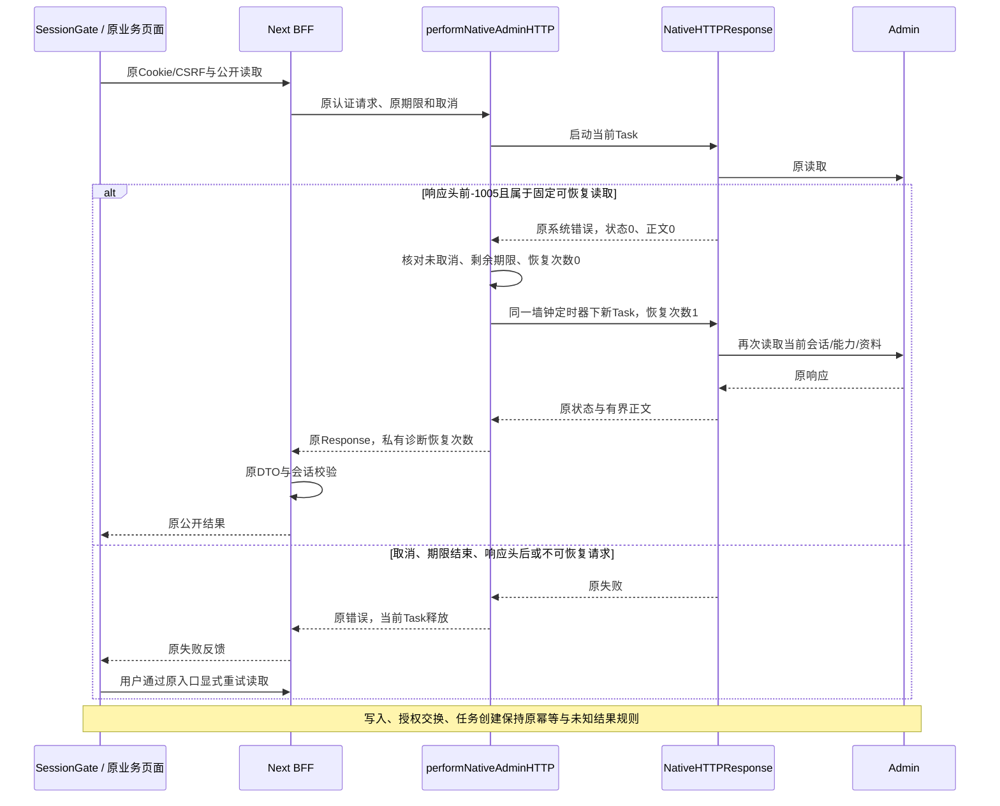

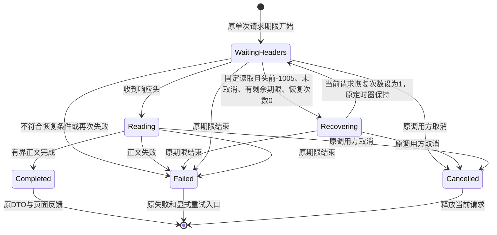

### 失败连接池生命周期（2026-11-01，构建20）

19后续受控复现保留两项独立结果：冷启动/auth/options 200、7.591秒；随后同一PID的journey在该GET返回503、30.070秒，密码提交0、模型提交0。对应service-token请求已进入Native和系统网络，active前台、reused=1、响应头缺失、正文0，原调用方30秒取消后Native返回。19成功回执仅覆盖对应请求；反复复用失败Session的恢复缺口继续修复。物理链路原因保持未知。

20在现有适配内部使用NativeAdminConnectionPool。所有获取与退役操作归主队列，Task开始时取得当前Session。系统-1005或原期限timeout退役当前Session，finishTasksAndInvalidate保留旧Task的原结果与期限。旧Session后续失败只影响其自身，当前新Session保持。普通取消只取消原Task。Node通过原cancelAdminHTTP的可选私有参数传递TimeoutError分类，C ABI取消回调0/1/2分别表示执行、取消、超时；Python未使用取消回调的调用继续原期限。

固定认证读取仍仅在头前-1005、未取消且原期限有余量时恢复一次，恢复Task取得新池。超时只使后续请求更换池，本次请求保留原失败；服务token、exchange/revoke、任务创建与业务写入单次发送。原登录弹窗、加载、失败、重试、Cookie/CSRF、权限和DTO保持。普通成功阶段静默，失败及恢复按现有阶段日志输出。实施状态：源码、8项Node及24项Native源合同、Release20构建通过；同一iPhone20原登录协议、配置/历史和一次App内Python→Claude SDK/CLI任务完成，正常Admin单次结算通过。原网页可见登录、弹窗关闭和历史显示仍待独立回执；具体物理网络原因及真机恢复触发保留未验证。构建20早期/auth/options 503/9.332秒保留，后续受控读取成功按各请求登记。

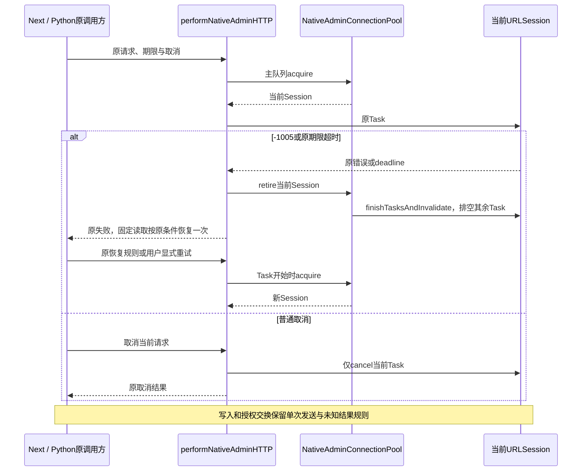

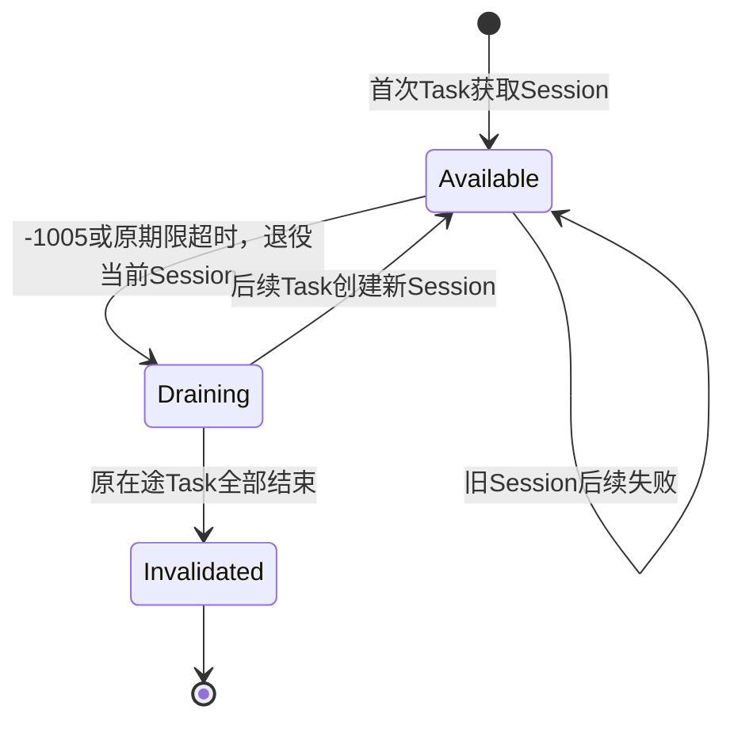

### 正常读取时序

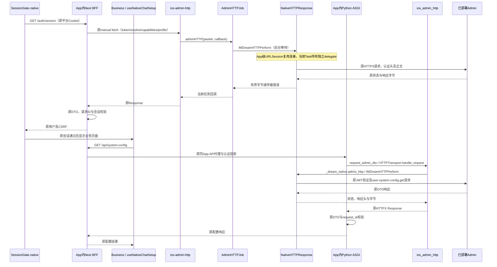

### 失败与恢复时序

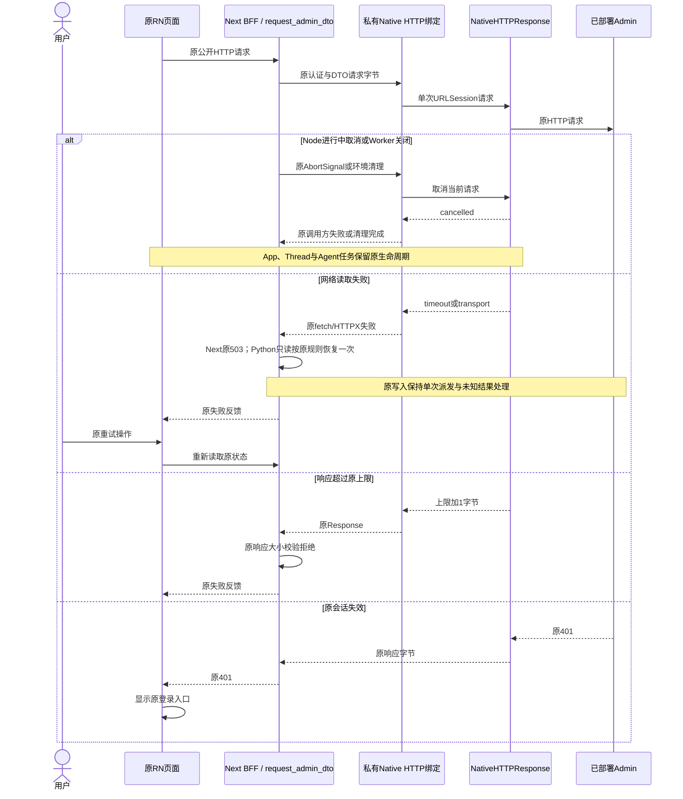

### 传输状态

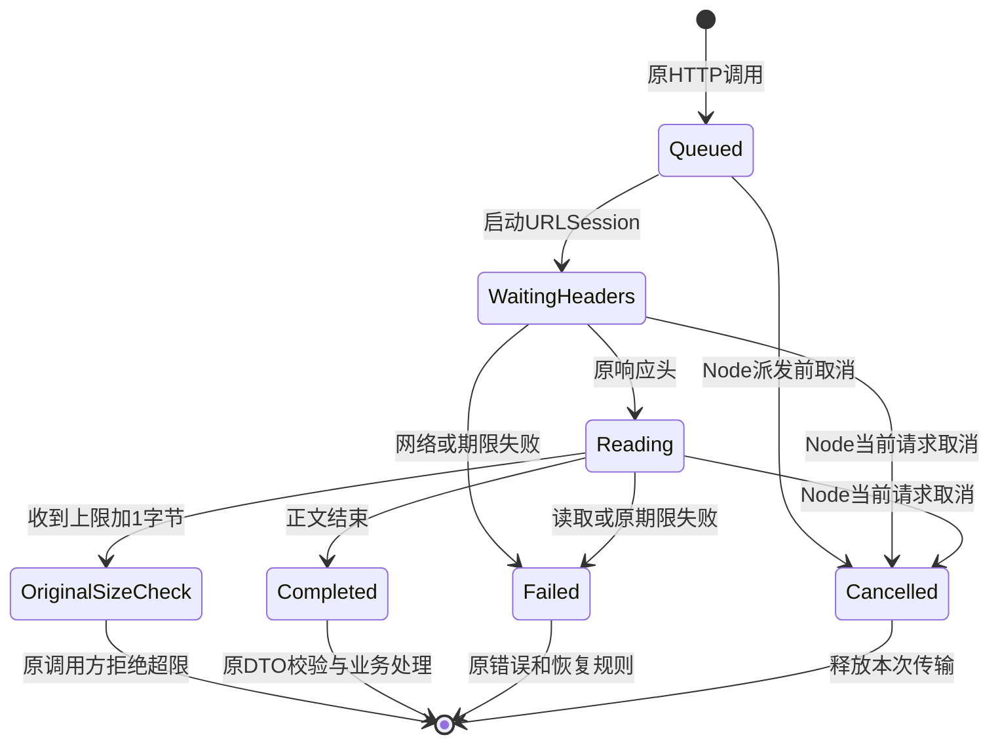

### 评审与验收归属

| 评审项 | 发现 | 处理方式 | 修订结果 | 剩余依赖 |
| --- | --- | --- | --- | --- |
| 执行位置 | App已持有原Python、Node和Next | 复用原组合根 | 无新增Mac执行业务路径 | 真机完整任务资格 |
| 认证与业务 | 原DTO、JWT与权限已有完整所有者 | 仅转换HTTP字节 | 原登录、scope及写入未知结果保持 | 公网真实读取稳定性 |
| 新增对象 | 两种端侧语言需要同一系统网络能力 | 共享既有NativeHTTPResponse与一个C ABI | 两份薄适配及私有绑定，无新框架/服务/配置键 | 后续ABI维护 |
| 输入与页面 | 本轮无页面规则变化 | 原PRD、页面骨架及导航继续复用 | Hermes摘要保持，原UTF-8读取合同验证通过 | 原UI与真实数据分项验收 |
| 取消与大小 | 队列、V8引用及正文具有不同生命周期 | 当前请求取消、有界聚合、原客户端再次校验 | Node/Python合同及Native源合同分开取证 | 物理挂起与终止复核 |
| 发布 | 沿现有Team与开发profile | 同Bundle覆盖，保留数据 | 构建、安装及业务分项记录 | profile续期、商店条件 |

构建17阶段结论：方案评审待满足明确前提后通过；真机17工作区实现验收不通过。源码适配及隔离合同已完成，普通Simulator17冷启动自动恢复账号、配置与20项真实历史；物理17原会话、配置和历史503保持待修复，当前手机锁屏。后续普通前台console、实际传输绑定与超时阶段、完整Claude任务及正式发行继续按[执行记录](../../exec/mobile-app-design-review-20261024.md#2026-10-31-ios-admin系统http兼容与工作区读取)判定。手机锁屏期间的回执缺项保留待复核状态。

官方资料查阅日期2026-10-31：[Apple URLSessionDataDelegate](https://developer.apple.com/documentation/foundation/urlsessiondatadelegate)、[HTTPX自定义传输](https://www.python-httpx.org/advanced/transports/#custom-transports)。Apple网页需要JavaScript，具体方法同时按当前Xcode SDK、既有Native实现和本轮源合同验证核对。HTTPX接口说明支持单次Request/Response转换，当前来源/路径选择与私有绑定为本项目平台设计。

2026-10-31连接复用补充：构建16物理会话503、配置200与历史504取得独立回执。后通道改为同一临时URLSession和每个Task的delegate，单个请求完成或取消保持连接池存续。官方[URLSessionTask.delegate](https://developer.apple.com/documentation/foundation/urlsessiontask/delegate)查阅日期2026-10-31；网页JavaScript/Markdown抓取未取得正文，当前Xcode iPhoneOS18.5 SDK的Foundation/NSURLSession.h第314–322行明确task-specific delegate、resume前设置、持有至完成及iOS15可用性，项目最低iOS16.4覆盖该接口。主Agent当前Swift源在macOS Foundation隔离URLProtocol中编译执行10项合同退出0，新增同一Session的取消隔离与后续连续请求，iOS实际资格按后续制品登记。

## 端侧登录认证与目标编译合同（2026-10-31）

### 背景与问题

当前RN主界面、App内Python/Node/Next和原BFF已具有明确入口。安装、进程启动、认证恢复和业务读取拥有不同结果；build17 Simulator冷启动读取通过，真机会话/配置/历史503保持未修复。本节定义当前职责和后续处理方案；操作顺序与错误决策归[端侧认证排障指南](../../deploy/mobile-auth-troubleshooting.md)，逐次状态归[设备手册](../../deploy/ios-iphone-install-release.md#二十一2026-10-31-admin连接复用与构建17)。

发现依据为当前代码与build17回执；核心问题收敛为目标配置可追踪、原网页登录闭环和真实请求的失败阶段。方案比较后采用现有所有者、薄平台适配和原脚本/CI的最小补齐；新认证业务、Device Flow替换、原生密码表单、全量网络重写、独立发布平台均退出本次范围。当前界面和页面骨架继续归[移动PRD](../../prd/mobile-app/mobile-app.md#页面骨架)及[iOS交互](mobile-ios-interaction.md#公网密码网页登录与配置回调保留)。

### 目标与边界

保持正常密码网页登录、已发布Client和scope、S256、Cookie/CSRF、原角色和写入恢复。普通env继续原字段及消费者；制品目标取显式配置，业务路径保持统一。App Client ID由原capabilities返回，PKCE verifier/state/nonce由原BFF按每次事务生成。App内服务身份/BFF配置的外部分发资格单列审查，本轮无凭据迁移、服务或数据库变更。

### 概念与规则

| 对象/所有者 | 当前代码事实与边界 | 证据 |
| --- | --- | --- |
| SessionGate.native | 先ensureStarted再读/auth/session；前台刷新合并inFlight；401、503与取消按原前端处理 | [入口](../../../frontend/src/platform/SessionGate.native.tsx#L24)、[会话DTO](../../../frontend/app/_dream/lib/browserSession.ts#L39) |
| InkRuntime / NativeLoginSessionProbe | 保留首方登录文档，匹配本机来源Cookie；原session200和user/CSRF通过后关闭，dismiss完成才resolve | [弹窗](../../../frontend/ios/InkMemory/InkReactNative.swift#L356)、[关闭次序](../../../frontend/ios/InkMemory/InkReactNative.swift#L408)、[probe](../../../frontend/ios/InkMemory/InkReactNative.swift#L435) |
| NativeAccountLogin | Google使用系统授权，绑定当前操作并保留原文档；App协议严格匹配后交还本机BFF | [回调校验](../../../frontend/ios/InkMemory/InkAccountLogin.swift#L9)、[授权](../../../frontend/ios/InkMemory/InkAccountLogin.swift#L136) |
| createBffHandlers / BffLoginBoundary | options投影产品表单；start取得原Client与scope，callback验证事务并交换，session解析handle和profile，logout原撤销 | [处理器](../../../frontend/app/api/_auth/handlers.ts#L31)、[边界](../../../frontend/app/api/_auth/login-boundary.ts#L110) |
| AdminBffClient / api-proxy | 原服务令牌、DTO、request_id及权限所有权；Cookie请求解析原handle后投影Bearer到App内Python | [客户端](../../../frontend/app/api/_auth/admin-client.ts#L137)、[代理](../../../frontend/app/api/_auth/api-proxy.ts#L14) |
| NativeHTTPResponse及两种语言绑定 | RN本机请求与Admin后通道分别持有Cookie策略；Admin共用系统池，原DTO/权限继续调用方负责 | [池](../../../frontend/ios/InkMemory/InkReactNative.swift#L633)、[Next选择](../../../frontend/ios/runtime/ios-admin-http.mjs#L14)、[Python绑定](../../../backend/mobile_runtime/ios.py#L97) |
| Android InkRuntime | RN入口已接入；ensureStarted返回CAPABILITY_UNAVAILABLE，登录与HTTP/Cookie方法待补齐 | [模块](../../../frontend/android/app/src/main/java/com/inkmemory/mobile/InkRuntimePackage.kt#L8)、[Manifest](../../../frontend/android/app/src/main/AndroidManifest.xml#L19) |

build17普通密码回调继续http://localhost:5173/auth/callback。Google系统授权的App协议、Admin同Client精确登记、交换服务兼容、普通env及本机接收映射须同时具备；采用前回归两种登录。账号.auth、Admin的Google Provider回调、MCP.mcp分别由原所有者管理。当前端侧完整Google资格待验收。

编译依赖链为：共享RN源到平台Hermes资源，原Next源到standalone资源，原Python/Node资源到同App执行环境，普通env到包内对应消费者，显式目标配置在签名前校验。host.cjs按包内applicationEnvironment创建Next Worker并绑定实际本机地址；Python dotenv保留override=False。需要核对源配置、制品配置和运行时有效公开值，结果只记录非敏感值和匹配布尔值。[装配](../../../frontend/ios/scripts/bundle-node.py#L54)、[Worker投影](../../../frontend/ios/runtime/host.cjs#L119)、[dotenv](../../../backend/mobile_runtime/ios.py#L27)。当前公网制品仍包含私有staging覆盖步骤，稳定仓库入口列后续工作。

### 原密码网页登录正常时序

图示为当前原密码路径的处理合同，实际通过状态按平台和build登记。

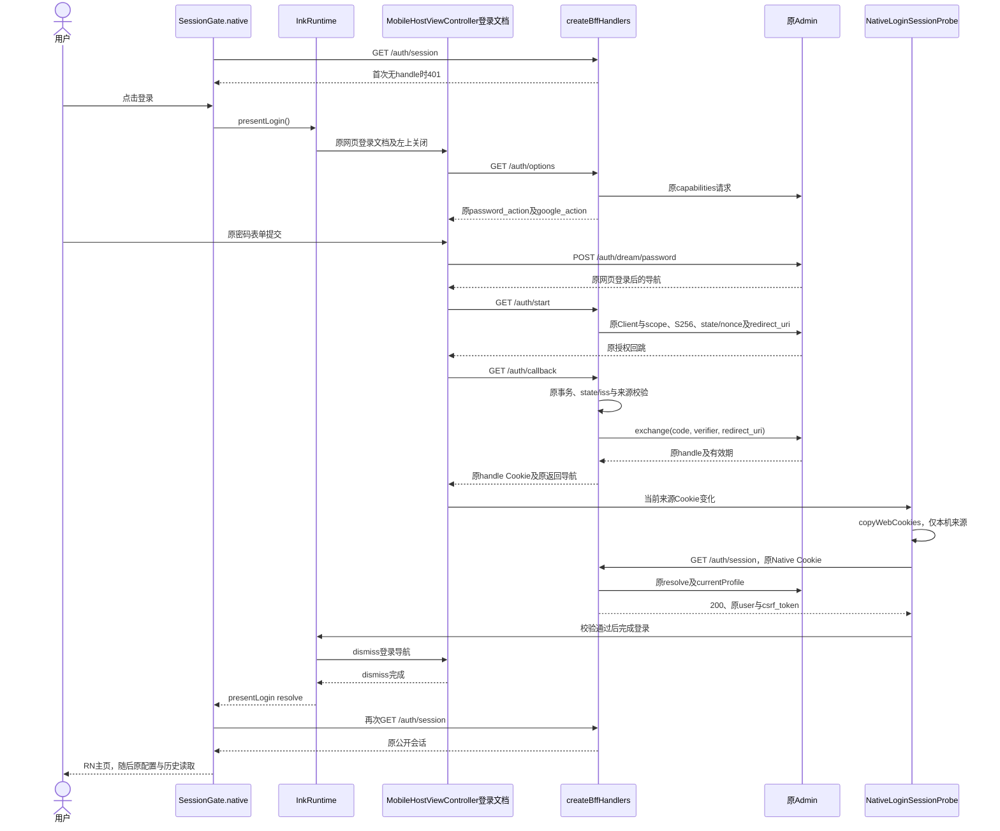

### 异常、取消与恢复时序

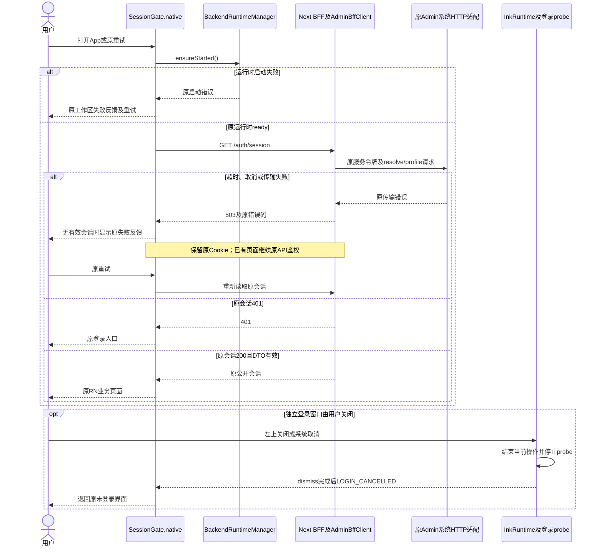

### 会话与窗口状态投影

状态名用于解释现有session/loading/error/loginPending变量，额外状态存储和新状态机实现0。

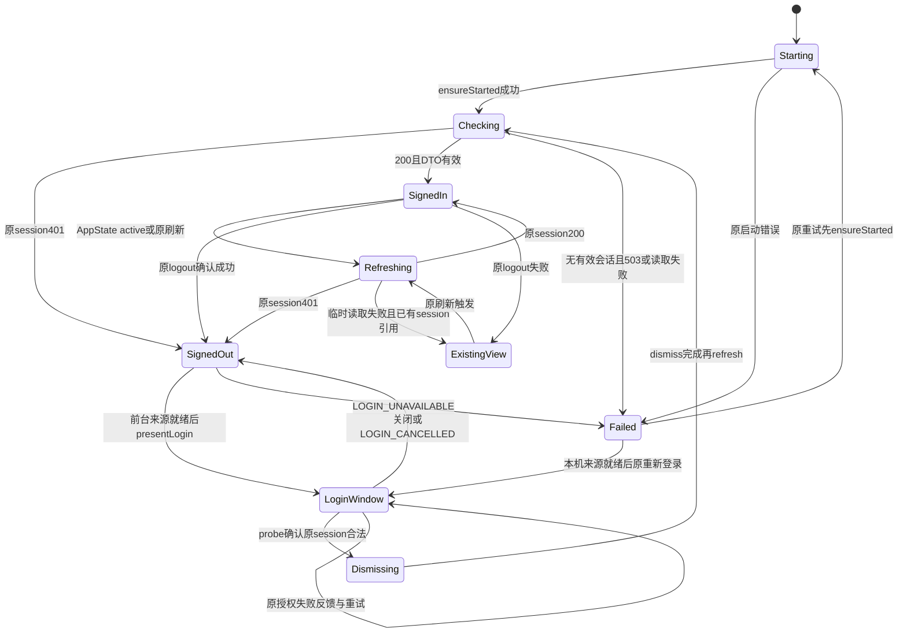

App/后端实例继续原生命周期；登录关闭仅结束当前登录操作，Agent Stop沿原业务入口。首次无有效会话与已有页面时的临时错误分别处理。前台事件合并到旧inFlight后的恢复次序需专项验证，当前根因未定；后台常驻、离线认证缓存及自动重放写请求均退出本节范围。

### 方案评审和实施次序

| 评审项 | 发现 | 处理方式 | 修订结果 | 剩余依赖 |
| --- | --- | --- | --- | --- |
| 业务保持 | 原网页登录、BFF与权限已具备完整入口 | 复用原所有者及HTTP接口 | 新登录业务、Client分叉与Device Flow替换0 | 真实前台回归 |
| 编译配置 | 普通env复制、Worker投影与私有公网装配分别存在 | 原键、签名前目标核对、来源回执 | 新env体系和发布平台0 | 原脚本/CI稳定入口 |
| 平台差异 | iOS有窗口/Cookie/系统授权，Android保护拒绝 | 两平台按原RN模块合同实施 | 主界面继续RN，Android缺口显式登记 | Android运行时及桥接 |
| 证据与错误 | 17 Simulator通过、物理3项GET503 | 按平台/build/接口登记，先只读采证 | 当前真机实现验收未通过 | 解锁前台console、绑定/阶段定位 |
| 凭据范围 | 普通包包含服务身份/BFF配置 | 外部分发资格独立审查 | 签名和Keychain不作为静态secret保密证明 | 原认证所有者的scope/发放/撤销评审 |

结论：方案评审待满足明确前提后通过，真机工作区实现验收未通过。后续先完成目标与普通前台采证，再定位实际传输/超时并恢复原会话和读取；Google、Android、真实Claude及外部分发继续各自验收。[后续任务与矩阵](../../deploy/mobile-auth-troubleshooting.md#八后续工作项和验收)定义责任、前提和关闭条件。本轮仅文档交付，代码、依赖、服务、构建、设备、账号及模型操作0。

## 2026-10-27现行工程合同

现行主界面、发布工程与HTTP接线以[RN/RNW统一工程设计](react-native-web-project-structure.md)为准：共享源码归`frontend/src`，Xcode与Gradle归`frontend/ios`、`frontend/android`，原`mobile/`构建退出主发布链。App管理器继续持有端侧Python、Node、Next和Claude；原Factory与业务服务持有任务，前端直接调用原HTTP接口。

## 原运行库设计与历史前端策略记录

以下保留原分析、运行库边界及图示。完整业务WebView、旧mobile路径与“建议未实现”的历史接线状态适用原稿日期；新主界面与实例状态见现行工程合同。

## 背景与问题

当前React DOM/Next前端保留为业务页面，Web继续原部署及BFF，RN生成iOS、Android应用并提供App级页面、导航和系统能力。移动业务执行位置保持端侧Python/Node/Claude，业务请求使用HTTP。用户明确要求App级后端管理器和后端应用服务中介者，排除端侧Dream工作台创建与审核确认。

## 目标与边界

RN原生化启动、一级导航、恢复层和系统操作；一个持久业务WebView承载范围内现有页面。Web继续Next构建与原部署；移动端保留原BFF和原Python业务。管理器拥有运行实例，中介者拥有具体用例协调；原权限、Cookie/CSRF/PKCE、DTO、持久化、资源策略及停止/恢复语义保持。新增模块均为建议、未实现。

正式业务结果与三端总体结构见[RN/RNW交互设计](react-native-web-project-structure.md)。历史原文与原型见[迁移前快照](../../exec/history/mobile-design-before-multi-platform-20261027.md)。

## 前端取舍适用范围

React Native为统一App框架，Next Web、端侧Python/Claude、HTTP、后端中介者和App生命周期管理目标保持。具体路由、页面、组件与修改边界见[页面承载与组件复用设计](frontend-page-component-allocation.md)。

原平台Swift/Kotlin代码用于RN的运行库和系统适配。现有DOM/CSS业务在一个持久WebView内运行；RN只适配App级页面与系统能力。RN Web退出首发前置条件。禁止将全部现有组件作为改写清单，禁止按UI组件强建后端包装。

## React Native目标架构（2026-10-27）

### 当前事实、目标与方案比较

| 分类 | 依据及结论 |
| --- | --- |
| 当前代码事实 | [frontend/package.json](../../../frontend/package.json#L8)使用Next构建，依赖React DOM、Tiptap与网页渲染组件；[AuthEntry](../../../frontend/app/_dream/components/Auth/AuthEntry.tsx#L67)和[ChatPanel](../../../frontend/app/_dream/components/chat/ChatPanel.tsx#L1466)包含DOM/CSS。首发通过持久WebView保留这些视图。 |
| 当前代码事实 | [EmbeddedDreamBackend](../../../frontend/ios/InkMemory/EmbeddedDreamBackend.swift#L9)已有应用共享实例和串行启动队列；`start`先初始化Python，再启动Node，最后绑定原后端与Next。当前模块缺少本文完整生命周期状态和RN接入。 |
| 当前代码事实 | [ios.py](../../../backend/mobile_runtime/ios.py#L62)初始化ASGI，[运行时绑定](../../../backend/mobile_runtime/ios.py#L87)装配原Factory、路由、HTTP和Next；[IOSFactoryOwner.close](../../../backend/mobile_runtime/ios_factory.py#L55)已有资源策略与Factory清理。 |
| 当前代码事实 | [apiAuthorization](../../../frontend/app/api/_auth/api-proxy.ts#L10)与[CSRF](../../../frontend/app/api/_auth/login-boundary.ts#L275)属于原BFF；[Chat路由](../../../backend/routers/claude_agent.py#L1056)及[现有应用协调服务](../../../backend/services/deck/story_workflow_application.py#L1123)继续拥有原业务入口。 |
| 拟议方案 | React Native承担App级原生界面并持有一个业务WebView；普通HTTP承担全部业务请求；App级BackendRuntimeManager管理本地运行实例；后端应用服务按中介者模式协调。新增名称均为建议、未实现。 |
| 待验证 | RN所选版本与现有原生工程、React依赖、Node/CPython库共存；原Cookie/CSRF接入；HTTP增量流；移动实例释放；内存峰值；双平台构建和真实业务。 |

选定方案使用RN原生App级页面和一个持久业务WebView。该结构复用全部网页业务，保留RN应用入口、导航、生命周期和系统能力。Next服务器、Python和Claude继续使用各自端侧运行组件，不进入RN JavaScript运行时。

官方资料于2026-10-27查阅：[环境与构建工具](https://reactnative.dev/docs/set-up-your-environment)、[原生组件](https://reactnative.dev/docs/intro-react-native-components)、[既有App集成](https://reactnative.dev/docs/integration-with-existing-apps)、[Turbo Native Modules](https://reactnative.dev/docs/turbo-native-modules-introduction)、[Hermes](https://reactnative.dev/docs/hermes)。工程保留Xcode/Gradle与既有签名路径；Hermes承担RN界面JavaScript，原Node继续承担Next和Claude。React Native的原生打包能力独立于Python/Node/Claude制品与渠道资格，发行检查继续按原发布稿执行。

### Next与React Native的首发边界及Web兼容

Web继续使用Next.js与原部署入口。首发移动业务页面通过持久WebView加载同一React DOM树，RN入口位于`mobile/react-native/`，业务共用原HTTP与后端。RN Web和DOM转RN不属于首发工作包；后续业务页原生化需要新的产品范围和独立评审。

| 当前内容 | 移动迁移处理 | Web处理 |
| --- | --- | --- |
| App启动、失败、恢复和一级导航 | 新建RN页面与组件 | Web不消费这些App级页面 |
| 现有React DOM、CSS和网页编辑器 | 在持久WebView原样运行 | 继续当前Next页面与样式 |
| 文件选择、保存、分享和外链 | RN/native调用现有平台适配 | Web继续浏览器操作 |
| DTO、SSE parser/reducer和纯计算 | 核对`ai`、流API等依赖后提取共用 | 调用相同逻辑，业务合同保持 |
| Cookie/CSRF、OAuth与Route Handlers | 首阶段保留原Next BFF，通过HTTP访问 | 原BFF路径保持 |
| Python业务、Factory、Claude及工具 | 复用端侧组件与原权限 | 原运行拓扑与业务入口保持 |

移除Next BFF需要另行迁移其认证、代理和服务端运行职责。当前设计不将该工作绑定到RN视图迁移，不变更Web入口或要求Web改用RN。中介者提取影响的共享业务必须执行Web相邻回归。

RN Web保留为后续能力。首发不新增`frontend/shared/ui/`、发布包或通用UI框架。原生后端管理模块只在原生入口引用，Web服务启动与部署生命周期保持原实现。工作台创建和审核确认页面保留Web原实现，退出移动显示与适配。

React Hooks和DOM组件继续在WebView内使用。未来明确原生化某个完整业务页时，再依据Hook内部的平台访问、Ref目标、事件类型和返回视图拆分；当前不为`ActivitySidebar`、`Icons`或`Modal`建立RN副本。

2026-10-27只读源码盘点：`frontend/app/_dream`排除测试后有137个TSX文件、46,592行，33个CSS文件、13,210行；Chat目录43个TSX、15,527行；工作台目录42个TSX、9,315行，其中含共用内容。69个TSX文本命中浏览器对象或类型，属于待核对候选。目录统计存在包含关系，禁止相加作为工作量；代码行数包含可复用逻辑，禁止等同于重写行数。

此前3–5人周与10–16人周估算对应业务页原生化范围，退出当前首发计划。RN App级页面、持久WebView、运行库接线与双平台验收需依据本文文件清单重新估算；Android运行库移植、真机Claude兼容及渠道审核周期单列。

### HTTP与原生运行控制

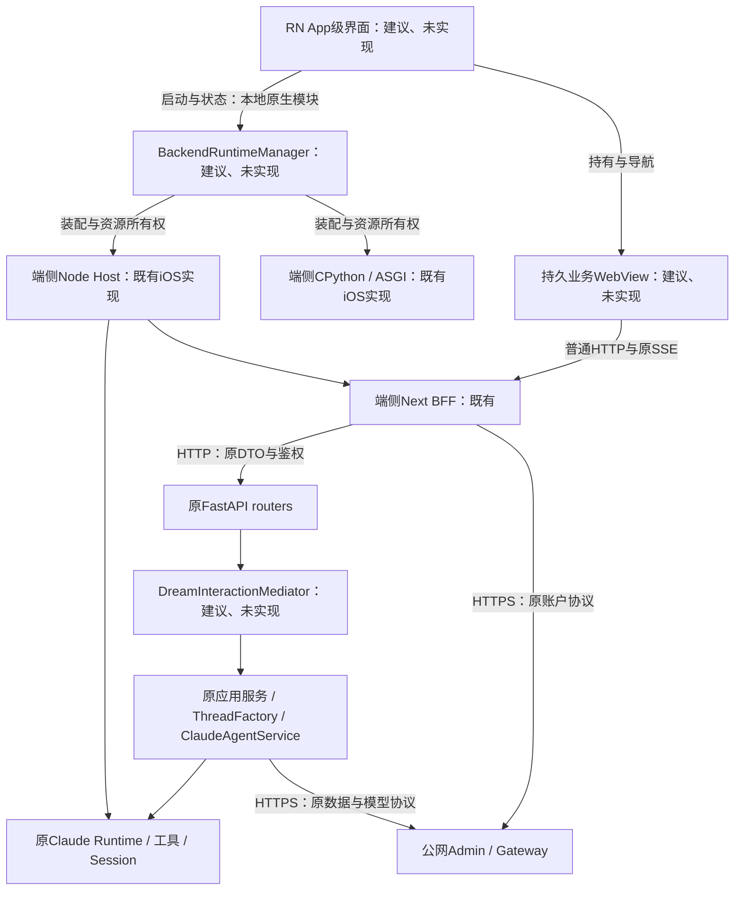

1. App级界面使用RN渲染，业务页面在一个持久WebView运行；Next Web继续当前React DOM树。DTO、parser/reducer和纯业务计算保持原模块，禁止复制第二套业务状态机。
2. 业务继续使用`/api/**`、`/auth/**`与原multipart/SSE协议。持久WebView绑定管理器公开的原本机BFF来源；端侧ASGI HTTP来源供原BFF使用，禁止借中介者绕过鉴权直接调用Factory。
3. 本机HTTP限定loopback绑定；端口、来源与callback按现有env和登记配置确定。端口占用保留启动失败，禁止随机切换来源绕过回调校验。公网通信继续使用HTTPS。
4. RN原生模块仅公开启动、公开运行事实和生命周期订阅，必要的文件/系统操作按实际入口接入。业务DTO、正文、流式结果及停止请求由WebView走HTTP；`runtime.request/read/cancel`保持原用途。
5. WebView传输必须验证Cookie、`x-ink-csrf`、Origin、上传体、下载、增量读取、Abort和错误状态。缺少所需增量能力时只补充现有transport适配，保持原URL、headers、status和SSE字节。
6. 登录沿用原AuthEntry、form、PKCE及BFF；认证与业务使用同一WebView Cookie容器。公开Client ID及原env键保持原配置方式；服务端密钥仍由其原消费者持有，进入RN bundle的配置单独核查，禁止复制Node/Python私有env至界面JavaScript。

### App级后端管理器

`BackendRuntimeManager`为建议、未实现的原生应用模块。iOS由App组合根持有，复用`EmbeddedDreamBackend.shared`及现有Python/Node启动代码。Android主进程的应用级管理器持有原生Service连接，既有私有`:dream_runtime`进程中的Service持有Python/Node；业务仍通过loopback HTTP，Binder仅处理运行时控制。现状依据为[AndroidManifest](../../../frontend/android/app/src/main/AndroidManifest.xml#L28)与[DreamRuntimeService](../../../frontend/android/app/src/main/java/com/inkmemory/mobile/runtime/DreamRuntimeService.kt#L14)，后者当前返回未接入能力。RN Root、页面、Activity或Scene只订阅状态，禁止各自创建运行时；本文不新增独立守护进程。

管理器公开`ensureStarted()`、`getStatus()`及状态订阅；名称为建议、未实现。并发`ensureStarted`共享同一个启动结果；RN热重载、页面重挂载、Android配置变化和重新进入前台均不重复初始化。返回的公开事实只含组件状态、当前本机来源与失败码；凭证和业务正文保留原所有者。

内部职责为：读取原配置与资源 → 初始化一次CPython → 启动一次原Node Host → 绑定原Factory与ASGI → 启动原HTTP及Next → 核对原组件所有权和实际HTTP响应 → 发布Ready。Ready表示本地组件可接收原协议请求，账户、模型、数据库和公网可用性分别通过原业务入口判断。

管理器内部释放以停止接收新请求、结束已许可的订阅、调用现有close和释放自有句柄为顺序。活跃业务仍由原停止/清理协议处理，页面卸载、退出登录与进入后台均不触发全局shutdown。已有库仅支持进程内单次初始化时，失败结果明确要求新App进程，禁止销毁后循环重新初始化Python或Node。

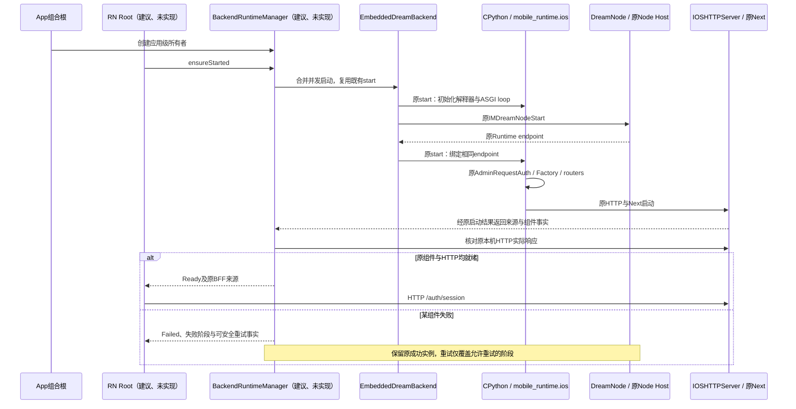

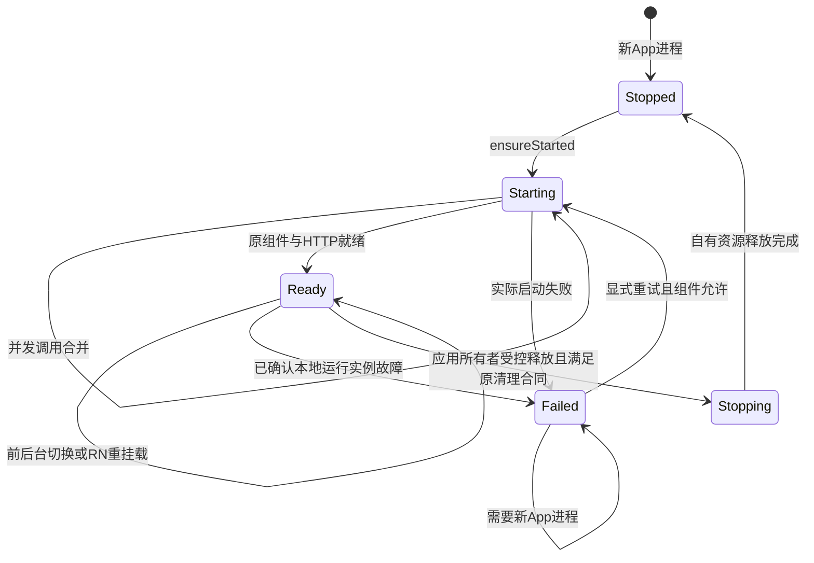

公网超时、401和模型错误沿原HTTP反馈，管理器保留本地实际状态。操作系统挂起属于调度状态；管理器禁止将其改写为Stopped、任务取消或任务成功。系统结束某个进程时，该进程内实例结束，终止回调与最后一次写入均无保证；下一次启动创建或重新关联实际运行实例，通过原HTTP读取持久化事实。Android主进程与runtime Service分别观察进程退出和Binder断开，禁止由Activity销毁推定后端退出，也不通过后台自动拉起维持常驻。

### 后端应用服务中介者

`DreamInteractionMediator`为建议、未实现的Python应用服务对象，按后端组合根注入原服务；Python模块不导入React Native、原生控件或页面对象。它接收已经通过原HTTP边界校验的用例输入和请求上下文，协调原Factory/应用服务并返回原DTO或原异步事件流。

| 用例职责 | 原执行所有者 | 中介者处理 |
| --- | --- | --- |
| Chat发送、继续及工具审批 | 原路由校验、ThreadFactory、ClaudeAgentService、原SDK | 转交原输入和上下文，保持Thread锁、资源策略、权限和持久化顺序 |
| 原停止操作 | 原`stop_thread`及Service清理 | 转交显式停止，返回原回执；HTTP disconnect只结束订阅 |
| 历史、状态和恢复 | 原Admin数据服务、Thread/Session读取 | 委托原查询与恢复合同，不补发未知结果的写请求 |
| 附件与文件 | 原storage/workspace及其应用服务 | 继续原HTTP入口与归属校验；没有跨服务协调需求的路由保持原实现 |
| 工作台创建与审核确认 | 现有Web及原后端 | 端侧入口退出范围，管理器和中介者不新增主动创建、扫描、确认或适配 |

优先复用已有应用协调服务。仅将确有跨服务协调的代码移入中介者；简单查询和直转路由保留原委托，禁止为全部路由增加空包装。中介者使用具体用例方法，禁止引入通用命令总线、动态插件注册、额外队列、数据库表或新的业务HTTP接口。Web与RN继续共用同一路由和用例实现。

建议源码归属：RN App级页面与`BusinessWebSurface`位于`mobile/react-native/`；生命周期组合根位于现有`mobile/ios/`及`mobile/android/`；Python中介者按实际用例放入`backend/services/`并由现有组合根注入。现有业务页面、DTO与parser继续由`frontend/`持有，当前设计不新增共享框架或代码包。

### 实例所有权与生命周期

下表为目标所有权。当前代码仅具备表中注明的原组件；新增管理器、中介者与RN实例尚未接线。

| 实例 | 创建者与作用域 | 创建/就绪条件 | 释放或结束 | 持久化与重开规则 |
| --- | --- | --- | --- | --- |
| App主进程 | iOS/Android系统，单次主进程 | 用户打开或系统创建 | 系统终止或进程退出 | 新进程重新装配/关联实际组件；禁止依赖终止回调落库 |
| Android runtime Service / 进程 | 原私有`:dream_runtime`服务，由应用管理器绑定 | 原Service绑定成功且原运行组件就绪 | 原Service释放或该进程被终止 | 与主进程分别观察；断开后显式重连核对，禁止后台常驻 |
| BackendRuntimeManager | App主进程组合根，一个逻辑所有者 | 原生App初始化后，页面订阅前 | 应用所有者受控释放或主进程终止 | 内存状态不持久化为业务状态 |
| RN Hermes / Root | RN宿主，每个实际RN运行时 | 原生RN装配完成 | RN运行时销毁或进程终止 | Root重挂载可重订阅，后端所有者保持 |
| 持久业务WebView / DreamRoot | RN Root在本机HTTP就绪后创建，每个App进程一个业务页面实例 | WebView加载原Next入口且`DreamRoot`完成原会话检查 | Web内容进程终止、RN运行时销毁或App进程终止 | 栏目切换不重建；Cookie、历史和业务状态继续通过原HTTP与持久化恢复 |
| Web Next文档 | 原Next渲染与浏览器文档 | 当前DOM页面构建及SSR/客户端边界通过 | 原Web文档或渲染范围结束 | 浏览器关闭不停止Web服务；不导入原生后端管理器 |
| CPython解释器 | iOS原EmbeddedDreamBackend；Android由runtime Service持有 | 原资源、扩展与初始化成功 | 所属进程退出；显式finalize须独立资格验证 | 不把解释器对象序列化，不默认支持原地重启 |
| ASGI loop / App / HTTP监听 | 原`mobile_runtime.ios`组合根，App级 | 原配置、Factory与路由绑定 | 原lifespan/监听关闭并等待自有句柄 | 重开装配相同业务路由，不复活旧内存任务 |
| Node Host | 原DreamNode，App级 | 原库与Runtime endpoint已核对 | 原受控清理或进程终止 | Hermes与Node分别持有引擎，不相互替代 |
| Next BFF / 本机HTTP | 原Node启动代码，App级 | 原来源、回调配置和ASGI来源有效 | 原HTTP监听与Worker关闭 | 原Cookie/CSRF及env合同保持 |
| DreamInteractionMediator | Python组合根，App级 | 所需原服务注入完成 | 随组合根释放 | 禁止持有全局“当前用户”；身份来自单个HTTP请求 |
| HTTP请求上下文 | 原BFF与路由依赖，每个请求 | 原Cookie、CSRF、鉴权与DTO通过 | 响应结束、断连或请求取消 | 未知写结果通过原查询确认，禁止通用重放 |
| HTTP/SSE订阅 | 页面HTTP客户端与原服务，每次连接 | 原请求获准并返回响应头 | 正常EOF、断连、取消订阅或页面结束 | 重连读取原status/messages并订阅原stream；断连不等于stop |
| ThreadFactory / policy owner | 原IOSFactoryOwner或Android对应组合根，App级 | 原运行时与资源策略装配 | 原`close`、Factory `aclose`及refresher停止 | 原LKG/default/desired/effective/revision合同保持 |
| Thread执行 / Runner | 原Factory，按原Thread与执行范围 | 原锁、admission与权限允许 | 原终态及原清理完成 | 原持久化和Session恢复；同Thread并发规则保持 |
| SDK client / Claude Worker | 原SDK连接所有者 | 原`IOSClaudeTransport.connect` | 原`close`及Worker退出等待 | 原连接范围继续沿用；禁止强制每页面一个Worker |
| Claude Session文件 | 原Runtime，原身份与工作区归属 | 原执行创建或校验既有Session | 按原用户数据保留合同 | JSONL与Session身份保留，升级路径按原容器校验 |
| MCP连接与guest命令 | 原SDK/MCP/命令所有者 | 原工具、权限、cwd与临时目录有效 | 原关闭、停止、超时与句柄等待 | 工具副作用与结果按原持久化；禁止退出时猜测成功 |
| 网页登录视图与Cookie | 持久业务WebView中的AuthEntry与AuthProvider | 原AuthEntry与本机BFF就绪 | WebView或App进程结束；原logout按合同清理Cookie | 登录与业务共享同一WebView Cookie容器；原页面读取公开会话结果 |
| 文件选择/上传/预览 | 当前用户操作与原文件服务 | 系统选择及原访问校验通过 | 取消、完成或对应视图结束 | 原附件记录保留；只清理该实例自有临时文件 |

### 平台与实施资格

iOS复用现有Swift/Objective-C/C++与嵌入式运行库，RN通过官方原生模块接入生命周期事实。Android复用现有Kotlin工程及明确的运行时service所有者；Activity销毁不承担App后端终止职责。两平台分别核对HTTP来源、文件URI、Cookie、系统返回及构建配置。

官方[AppState](https://reactnative.dev/docs/appstate)仅提供前后台等通知；[Apple生命周期](https://developer.apple.com/documentation/uikit/managing-your-app-s-life-cycle)与[Android Activity生命周期](https://developer.android.com/guide/components/activities/activity-lifecycle)分别约束系统调度与组件重建，查阅日期2026-10-27。本设计保持前台业务路径，不新增后台常驻、推送、自动业务调度或全局确认扫描。

实施顺序：原生工程集成RN并证明原组件共存 → 管理器单实例与失败恢复 → 持久WebView中的原网页登录、Cookie/CSRF与HTTP增量 → RN主导航及范围内Chat/Decks/More和文件桥接 → 双平台真实业务和构建发布资格。工作台创建模块全程退出端侧适配。原业务时序与验收见[RN正式交互稿](mobile-react-native-interaction.md)。

### 主要风险与通过条件

| 风险 | 影响 | 最小控制与通过条件 |
| --- | --- | --- |
| 持久WebView布局与平台差异 | 键盘、安全区、滚动和系统返回可能影响现有页面 | 使用RN App级容器统一安全区和返回入口；按现有窄屏布局逐项验证，不批量改写DOM组件 |
| WebView桥与来源边界 | 文件、外链和MCP内容可能跨越WebView与系统能力边界 | 只保留现有allowlist方法，核对来源、消息ID、参数schema和结果匹配；MCP iframe协议保持 |
| WebView会话与回调 | Google系统浏览器返回后可能缺失原Cookie或停留在错误页面 | 登录与业务共享同一WebView Cookie容器；双平台核对Cookie属性、来源、CSRF、取消、失效、退出和回调返回 |
| HTTP流与取消差异 | 首帧被缓冲、末帧丢失、HTTP取消误作任务停止 | 原SSE字节与parser合同、真实首帧/终态、Stop、重连与持久化一致后再迁移更多页面 |
| Hermes/Node/CPython共存 | 增加包体、峰值内存、启动耗时与链接复杂度 | 先构建真实集成包，测量冷启动、空闲/任务峰值与现有资源策略；沿原配置处理，禁止降低admission或权限绕过失败 |
| 生命周期与部分初始化 | 重挂载重复启动、原生库无法原地重启、残留监听或命令句柄 | App级单所有者；并发启动和逐阶段失败检查；验证close与新进程恢复，不默认支持解释器重启 |
| Android运行库资格 | 当前service仅有未接入响应，iOS回执无法替代Android | 先取得Python、Node/Claude、ABI与HTTP实际回执，按原渠道签名安装测试 |
| 共享中介者改动影响Web | 服务调用顺序、锁、身份或流终态漂移 | 只提取具体协调用例；Web与RN共用同一生产路由，执行原合同与相邻Web回归 |
| 原生制品与渠道资格 | RN构建成功无法覆盖内嵌运行库来源、签名和应用审核要求 | 沿原发布稿逐项核对制品来源、许可证、签名和渠道条件，真实提交前重新查阅官方要求 |

最小实施切片为“原网页登录 → 原Chat真实流式任务 → 原停止 → 普通重开恢复”，先在iOS Simulator独立通过，再取得物理iPhone与Android同项回执。该切片用于验证首发集成，保留范围内其余业务的后续实施与验收责任。

## 执行位置与代码归属

| 位置 | 目标职责 | 当前状态 |
| --- | --- | --- |
| `frontend/` | 原Next Web、登录/BFF及持久WebView内的原业务页面 | 当前已有React DOM与Next实现；首发保留DOM/CSS |
| `mobile/react-native/` | RN App级入口、启动/恢复、一级导航、持久WebView和平台操作适配 | 建议、未实现 |
| `mobile/ios/`、`mobile/android/` | App组合根、运行管理与原生库 | 已有原生工程；RN管理接线待实施 |
| `backend/mobile_runtime/` | 端侧装配、原解释器/运行库接线 | 已有iOS实现；Android独立资格待验证 |
| `backend/routers/`、`backend/services/` | 原HTTP校验、业务服务及按需提取的中介者 | 原路由/服务已有；中介者接线待实施 |

## 端侧部署配置：关闭Claude命令沙箱

沿用原普通env：`INK_AGENT_SANDBOX_ENABLED=false`，由现有配置消费者生成原Claude settings。iOS、Android目标一致；系统应用隔离、原工具审批、资源策略及精确`CLAUDE_CODE_TMPDIR`/0700合同保持。禁止新增逐命令隔离后端、Lua虚拟机或通用插件框架。详见[发布稿](../../deploy/mobile-app-release.md#端侧claude命令沙箱配置)。

## 既有实现与历史引用

### 独立iPhone执行的实施边界

原iOS端侧运行库、真机技术回执及安装历史继续保留各自范围。RN App级界面、持久WebView会话和完整真机业务分别验收；Android结果单独取得。见[迁移前原文](../../exec/history/mobile-design-before-multi-platform-20261027.md)与[执行记录](../../exec/mobile-app-design-review-20261024.md)。

### iOS长路径会话恢复

原[ios_session_storage.py](../../../backend/mobile_runtime/ios_session_storage.py)保持Session身份、应用容器路径、JSONL字节和原归属校验。RN迁移复用该实现，禁止通过界面切换创建替代Session；连续升级/重开列入原生验收。

### 已接受确认消息的进程重开恢复

该能力属于现有工作台业务的已实现接线，原代码及Web使用保持。工作台创建与审核确认退出RN端侧入口、适配和主动恢复清单。原消息/claim/lease/Hook/ACK与历史图示见[iOS既有实现说明](mobile-ios-interaction.md#已保存dream确认的进程重开恢复)及[迁移前原文](../../exec/history/mobile-design-before-multi-platform-20261027.md)。
