<!-- [Sync] 2026-11-03: 诊断浮动按钮复用启动页同源StartupArtwork深浅色SVG资源；原触摸、拖动、层级与诊断返回流程保持。 -->
<!-- [Sync] 2026-11-03: 同场景RCTAlertController窗口采用精确层级适配，原确认与系统窗口所有权保持。 -->
<!-- [Sync] 2026-11-02: 汇入同桥接诊断浮动入口、原生展示生命周期及正常/异常/状态图，原业务与验证暂停状态保持。 -->
<!-- [Sync] 2026-11-02: 展示名称沿应用名称交互稿，业务与视觉规则保持。 -->
<!-- [Sync] 2026-11-02: 登录、注册及Google原失败接入现有错误来源；原始错误限定于返回值，凭据表单和授权查询参数退出采集。 -->
<!-- [Sync] 2026-11-02: 设备构建24已覆盖安装并普通启动，模拟器与物理页面/业务验收分别记录。 -->
<!-- [Sync] 2026-11-01: 原始错误沿Next Worker、私有host状态、Python及既有NSError传递，页面直接展示和复制。 -->
<!-- [Sync] 2026-11-01: 登记普通Hermes模拟器两入口和生命周期回执，完整业务与物理设备单列。 -->
<!-- [Sync] 2026-11-01: 同步RuntimeDiagnostics、getSnapshot/subscribe及原会话观察接线，实施前正文保留历史。 -->
<!-- [Input] 本次最小异步启动需求、原Native启动与JavaScript管理器。 -->
<!-- [Output] 本次功能的页面交互、实现依据、正常/异常时序、状态与生命周期。 -->
<!-- [Pos] 移动端异步启动与开发者页正式设计；产品规则及骨架归独立PRD。 -->
<!-- [Sync] 2026-11-01: 从移动总设计拆出本次正文，迁入原四图和实现依据；新增能力未实现。 -->

<!-- [Sync] 2026-11-02: 补齐图标资源与静态启动、RN准备动画及后台/减少动态效果的生命周期图。 -->

<!-- [Sync] 2026-11-03: 原生加载占位透明铺满，每次进入展示时钟与原准备、会话并行。 -->

<!-- [Sync] 2026-11-03: 增加原控制台的单次CPU采集、线程/原命令映射、活动条带、有限采样及三类业务图。 -->
# 移动端异步启动与开发者页交互设计

当前应用称谓与展示范围见[名称交互设计](app-brand-interaction.md)；默认品牌为Kastention，中文应用称谓为卡片结构。

本次任务的交互正文集中在本文：[页面与操作](#页面与操作)、[实现依据与最小改动](#实现依据与最小改动)、[正常启动](#正常启动与页面加载时序当前源码)、[失败恢复](#失败与恢复时序当前源码)、[状态转换](#运行实例与页面状态转换当前源码)和[生命周期](#实例与监测生命周期)。[独立PRD](../../prd/mobile-app/mobile-startup.md)包含两页骨架。本文对应本轮源码实现；隔离技术验证、打包采用和真实设备验收分别记录。

## 背景与问题

Python已由`EmbeddedDreamBackend`在后台启动。用户需要前端在准备期间可见、开发者页可进入，以及最少的就绪和失败反馈。本文的实现依据说明现有调用链；[独立PRD](../../prd/mobile-app/mobile-startup.md)定义启动页与开发者页骨架。下文新增状态展示和入口已接入源码，程序验证范围见专项评审。

## 目标与边界

复用原后台启动和共享Promise。前端渲染原`ScreenFrame/SessionGate`，开发者页直接读取JS管理器中的启动结果。正常登录、首次业务导航、输入与发送继续原就绪和权限条件。Python内部初始化、业务接口、任务、依赖和运行参数保持原合同。

## 概念与规则

- `SessionGate`的effect发起一次`ensureStarted()`，组件直接返回原准备视图；就绪后读取原`/auth/session`，按原结果显示登录或`Business`。准备期间允许进入开发者页。
- `BackendRuntimeManager`在原Promise上保存启动中、就绪、失败、开始/结束和最后更新时间。重复调用共享原结果；页面通过管理器的`getSnapshot()/subscribe()`读取和观察变化，离页解除观察。总耗时采用单调时钟计算，原更新时间随真实启动结果记录；Native桥方法保持，错误详情沿既有返回对象传递。
- 只读开发者页复用“更多 → 设置 → 关于”入口，准备及错误视图打开同一页。页面保留原底层实例，返回时显示当前结果；输入和附件按原页面规则保留。
- 显示启动结果、总耗时、更新时间和原始错误。Python/Node/Next的单独阶段没有现成结果时显示未观测；不增加分阶段记录。本地就绪与原会话读取结果分行显示；`SessionGate`通过`recordSessionRead()`记录已有读取结果，公网连接显示未单独观测，不新增探测。
- 手动刷新重读管理器状态，原请求记录保留其原时间；刷新不启动运行库或网络探测。复制通过现有`InkRuntime.copyText`输出状态与相同错误原文，成功/失败在原位置反馈。`formatRuntimeError()`保留Error的message、stack、cause及Native返回的code、userInfo、nativeStackIOS；路径和参数按原错误保留。
- 前后台复用AppState：后台暂停页面观察，返回前台读取当前状态；原会话刷新继续合并。暂停仅描述页面观察。进程重开创建新的内存状态，原保存内容由现有业务恢复。
- 启动失败显示原错误及重开应用说明；启动在途继续等待原Promise。会话、配置和历史失败各自沿原读取重试；保留既有成功数据、输入及Thread，自动业务重发为零。Android沿当前`CAPABILITY_UNAVAILABLE`显示能力未就绪。

### 页面与操作

| 页面 | 入口与操作 | 反馈与返回 |
| --- | --- | --- |
| 启动页 | 原`SessionGate`准备视图；effect异步发起启动；可打开开发者页 | 准备中、会话检查或原错误；就绪后继续原登录或业务流程 |
| `RuntimeDiagnostics.native.tsx` | 启动视图与原`AboutView`进入同一只读页；刷新、复制 | 读取原JavaScript启动结果；原位置成功/失败提示；返回保留底层实例 |

两页产品骨架直接位于[独立PRD](../../prd/mobile-app/mobile-startup.md#页面设计)。原登录弹窗由现有`presentLogin`处理，开发者页不改登录提交或关闭次序。

### 2026-11-02 图标与启动插画

本节保留首轮位图实现与三张交互图。现行透明矢量和布局以[透明矢量开屏](#透明矢量开屏现行)为准；第一张AppIcon继续沿本节资源。

`Assets.xcassets/AppIcon.appiconset`使用第一张用户参考图重建的1024×1024 RGB PNG。工程Debug与Release均指定`AppIcon`，Asset Catalog加入应用Resources阶段。第二张1254×1254图片保留原始字节，分别供Asset Catalog和Metro打包；来源及摘要见[实施记录](../../exec/mobile-app-branding-20261102.md)。

`Info.plist`通过`UILaunchStoryboardName=LaunchScreen`选择静态启动画面。`InkMemoryApp.ReactNativeAppView`将同一Storyboard作为`RCTRootView.loadingView`，填充当前主题背景，首个RN内容到达时按原生命周期移除。系统启动背景采用既有浅色/系统深色背景值；应用偏好在宿主加载后按原主题生效。

`SessionGate`仅在未持有会话且`loading`期间挂载`StartupArtwork.native.tsx`。组件使用原图、`Animated.loop`和Native driver在1至1.035倍之间呼吸，每方向1200ms，动画工作项设置`isInteraction=false`。这些参数定义视觉节奏。就绪、失败和会话结果仍由原管理器与会话读取决定。

组件挂载时默认静态展示，读取`AccessibilityInfo.isReduceMotionEnabled`并监听后续变更；偏好读取失败保持静态。只有可见、前台且减少动态效果关闭时播放。打开开发者页传入`visible=false`；后台和减少动态效果变更均停止并复位。组件卸载时停止动画并解除全部监听。插画不接收触控，退出无障碍阅读顺序；状态文本和原按钮保持可用。RN图片尺寸180×180，短视口允许收缩并通过contain完整显示。

当前交付为源码及技术验证；完整包体、设备冷启动和系统桌面图标的实际采用见实施记录。Apple资源合同参考[图标配置](https://developer.apple.com/documentation/xcode/configuring-your-app-icon)与[启动屏幕](https://developer.apple.com/documentation/xcode/specifying-your-apps-launch-screen)，查阅：2026-11-02。

#### 正常展示时序

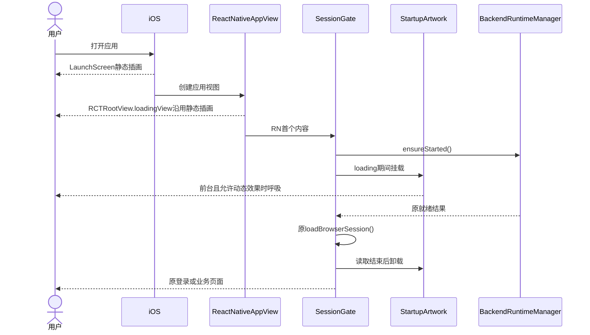

#### 异常与恢复时序

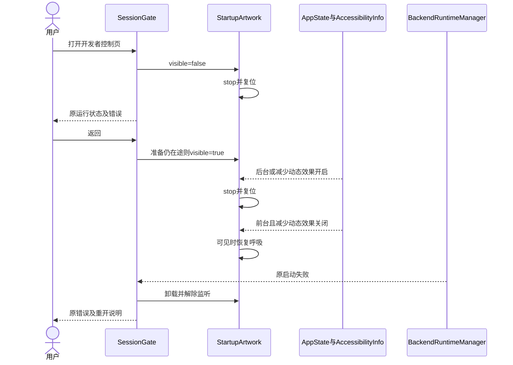

#### 插画状态转换

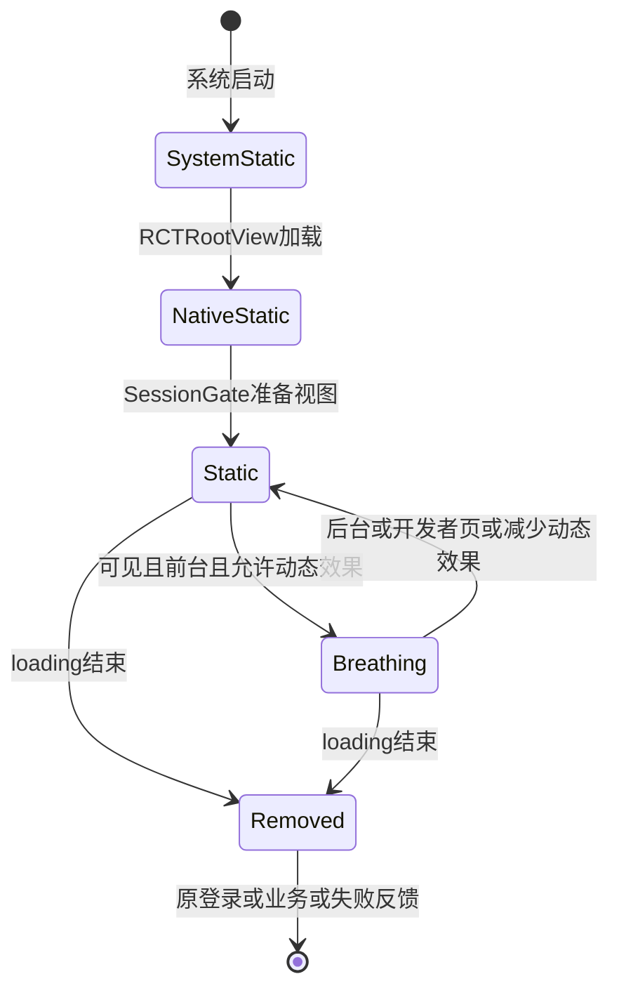

### 透明矢量开屏（现行）

背景与问题：用户要求第二张图转换为透明矢量，并纠正开屏布局。首轮PNG包含米色纸张，图像方框与页面背景分别显示；应用名称、加载指示与开发者操作集中在同一纵向组内。当前选定路径重绘加原主题布局，图形保留轮廓、五官及蓝白帽子。

目标与边界：`StartupScreen.native.tsx`承载原准备反馈及每次打开的最低一秒展示。`BackendRuntimeManager`、会话读取、登录、错误与恢复规则沿原入口；当前计时及覆盖条件见[每次打开的1秒开屏](#每次打开的1秒开屏与透明占位2026-11-03)。

概念与规则：`src/assets/startup-artwork.json`保存七条真实路径；`StartupArtwork.native.tsx`复用现有`react-native-svg`绘制，填充仅用于帽子与五官，角色脸部及画布透明。轮廓和五官使用`currentColor`及当前`color-text-primary`；蓝白色块保留参考图配色。`sync-startup-artwork.mjs`从同一数据生成独立`startup.svg`及iOS深浅色SVG，iOS文字色读取既有`inkColors.ts`。Asset Catalog开启`preserves-vector-representation`，系统启动画面的背景继续由`LaunchBackground`提供。

布局：页面填充现有`color-bg-app`，中部品牌区包含矢量角色及`InkLabel`字标，现有Excalifont和Xiaolai按文字分段。角色尺寸为视口高度26%、宽度44%与176中的最小值，宽高相同；字标24px、行高32，角色与字标间距12。品牌区底部内距36，使角色中心位于可用安全区中点上方40。Storyboard同样以安全区中心减40定位，尺寸采用相同约束。底部反馈区位于安全区底部8，状态13px、辅助入口12px，开发者入口触控高度44；角色、字标与底部区域独立。

准备文案为“正在准备”，会话读取文案沿原“正在检查登录状态”。系统启动与RN加载仅显示静态角色，首个RN内容显示字标及底部状态。动画继续原1至1.035呼吸、后台暂停、诊断隐藏暂停及减少动态效果规则，所有观察在组件卸载时释放。产品骨架见[启动PRD](../../prd/mobile-app/mobile-startup.md#启动页)；资源、取舍和本轮验证见[矢量纠正记录](../../exec/mobile-app-branding-20261102.md#透明矢量与布局纠正)。

#### 透明开屏正常时序

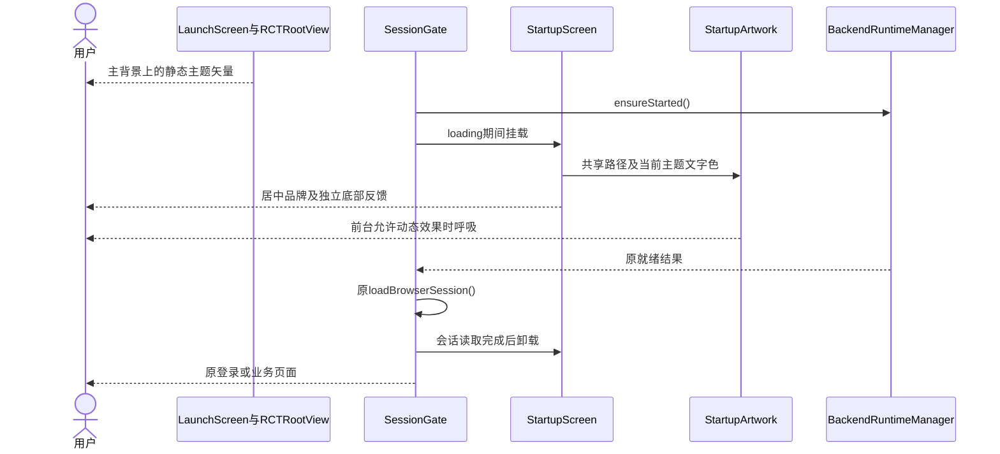

#### 透明开屏异常与恢复

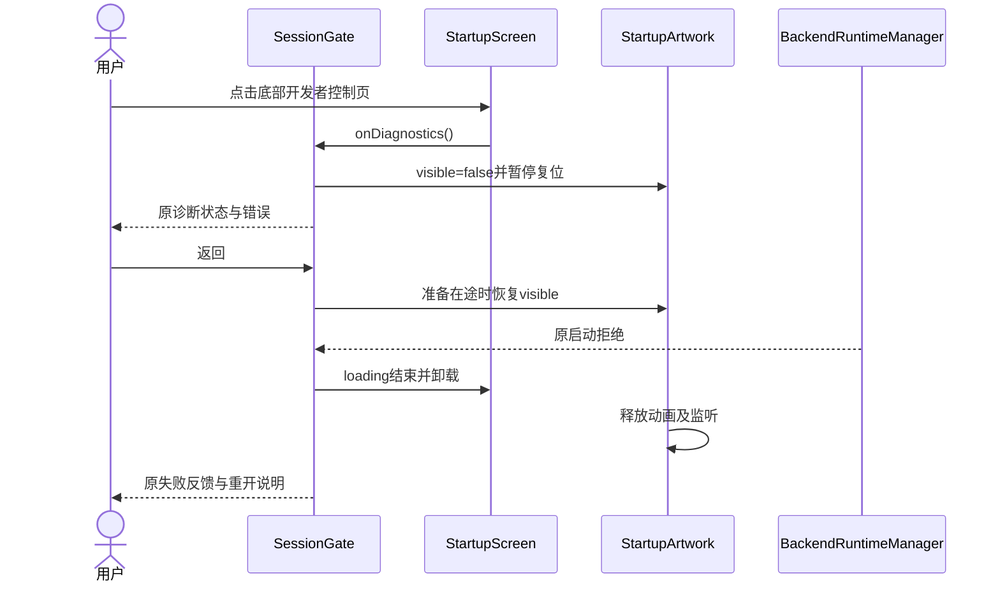

#### 透明开屏状态

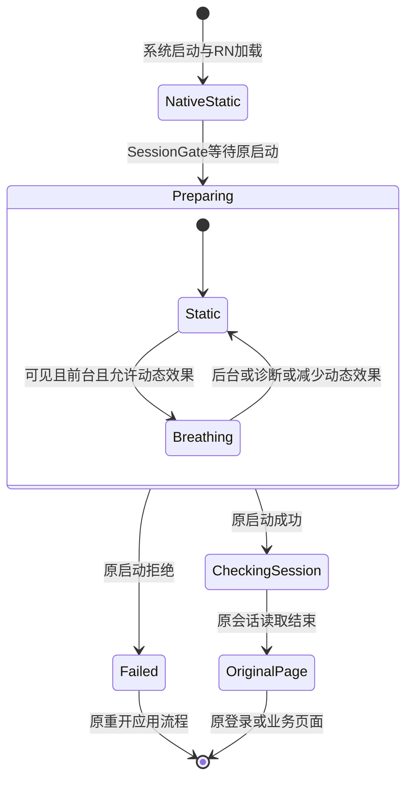

### 每次打开的1秒开屏与透明占位（2026-11-03）

背景与问题：用户确认首次开屏角色四周出现方框，要求每次打开App显示1秒动画。当前安装的Simulator资产包含透明SVG及Vector记录，原`RCTRootView.layoutSubviews`只对loadingView居中；Storyboard固定画布与实际宿主尺寸具有差异。本轮统一占位边界，并增加独立的展示计时。

目标与边界：原后台启动、会话读取和账户状态继续执行；开屏展示与这些请求并行。`SessionGate`保持原账户子树挂载，以绝对定位的`StartupScreen`覆盖当前内容。覆盖期间关闭底层触控和无障碍入口，展示完成恢复当前实例；业务恢复和APP-04暂停范围保持原状态。

概念与规则：`startupPresentation.ts`定义用户指定的1000ms展示及500ms单方向呼吸。`useStartupPresentation.native.ts`通过`performance.now()`累计前台无遮挡时间，只接收`SessionGate`原AppState观察的回调。初次挂载开始一个周期，实际进入background重置下一次1秒；inactive暂停当前剩余时间，active继续。诊断及loggingIn遮挡期间取消自有timer并保存剩余，解除遮挡后继续；卸载取消timer。系统减少动态效果保留相同展示时长，角色静态显示。

`showStartup`满足展示计时在途或原未登录准备在途时为true；最低一秒结束后，原准备仍在途则继续反馈。会话有效时原业务子树可在覆盖下挂载，原请求沿自身条件执行。完成和失败按原结果显示，额外运行库初始化、业务提交或任务重发为零。登录原生窗口内的诊断浮动入口沿原条件可达；业务开屏期间由屏内入口打开原诊断内容。

透明边缘：RN `StartupArtwork`的动画容器及Svg明确设置透明背景、borderWidth=0；原七条路径保持。Storyboard imageView设置opaque=NO。主入口使用同文件内的`StartupReactRootView`，在`super.layoutSubviews()`后将`loadingView.frame`设为`bounds`；loadingView.backgroundColor为clear、isOpaque=false，主背景由宿主所有。当前修订覆盖源码及技术合同，新包首次设备画面单列验收。

#### 每次打开正常时序

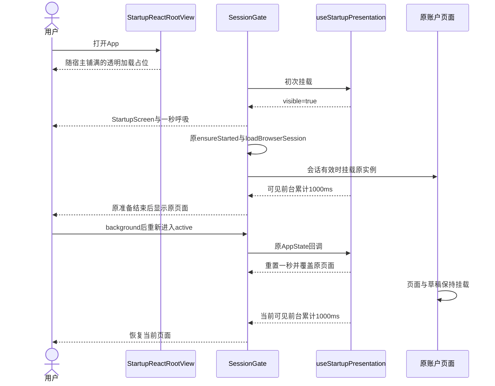

#### 遮挡、失败与恢复时序

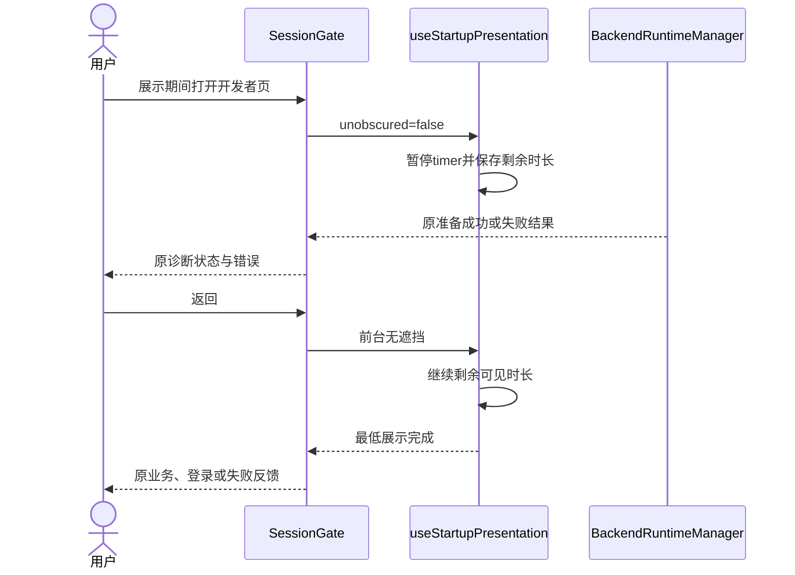

#### 展示状态转换

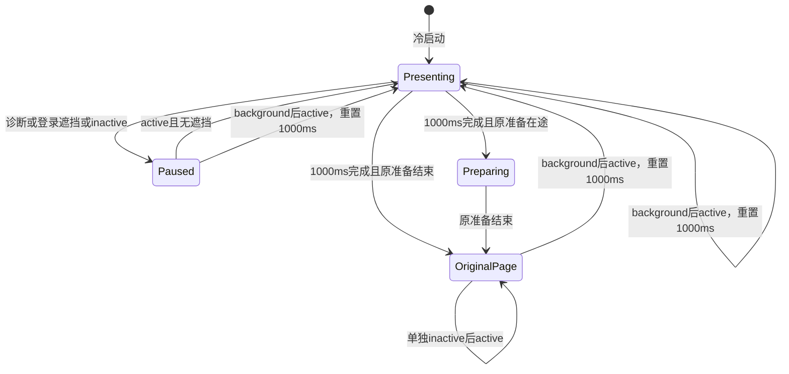

产品骨架和规则归[启动PRD](../../prd/mobile-app/mobile-startup.md)，定位、方案判断及本轮定向回执归[执行记录](../../exec/mobile-startup-entry-20261103.md)。原时序图保留其阶段语义。

### 实现依据与最小改动

| 对象 | 当前实现 | 本轮最小接线 |
| --- | --- | --- |
| Python启动 | [EmbeddedDreamBackend](../../../frontend/ios/InkMemory/EmbeddedDreamBackend.swift)在后台串行队列执行；[DreamPython](../../../frontend/ios/InkMemory/DreamPython.m)初始化进程内解释器 | 复用该后台路径，初始化内部顺序保持 |
| 启动调用 | [BackendRuntimeManager](../../../frontend/src/runtime/BackendRuntimeManager.ts)共享一个Promise，原生合并waiters | 同一模块保存启动中、就绪或失败结果，供页面读取 |
| 前端呈现 | [SessionGate](../../../frontend/src/platform/SessionGate.native.tsx)先渲染准备视图，effect内等待启动结果 | 准备视图与开发者页保持可操作；启动成功继续原会话读取 |
| 本地服务 | [iOS组合根](../../../backend/mobile_runtime/ios.py)依原顺序装配适配、Factory、路由、HTTP与Next | 保留原完整ready条件，业务操作按依赖开放 |
| 运行状态 | Native已有启动完成或拒绝结果 | 在原JavaScript启动管理器记录开始、结束、最后更新时间和原始错误；总耗时由单调时钟计算 |
| 开发者页 | 原设置关于入口位于已登录业务内 | 关于增加同一只读叶页，准备视图提供同名入口；读取原JavaScript结果，无新Native方法 |
| 公网连接 | 原登录和业务请求拥有各自传输结果 | 单独显示原会话读取结果，公网标为未单独观测；刷新不发探测请求 |

启动结果中的ready继续表示原本地装配完成，账户、配置及业务请求继续原校验。JS管理器的状态随原Promise更新；刷新仅重读本地状态，错误按startup、session、config、catalog、login、registration、google来源分别保留最近一次原文与时间。读取成功保留最近错误，当前就绪及会话状态独立更新。页面离开释放观察，原运行实例继续其既有生命周期。

Python初始化失败沿原错误反馈；当前Node一次性初始化及部分绑定保留原恢复边界。开发者页不提供重启；用户重开应用沿原路径恢复。已ready后的登录或数据失败仅重读对应请求。后台切换、进程重开及任务恢复继续原规则。

### 原始错误记录

`BackendRuntimeManager.recordError()`只写当前进程内的固定来源槽位：启动Promise拒绝、`SessionGate`原会话读取失败、`useNativeChatSetup`原配置及目录读取失败，以及原登录展示、注册反馈、Google系统授权和登录文档加载失败。后续同来源失败覆盖上一条；页面离开与请求恢复保留记录，进程重开释放。已取消或离页读取的错误沿原取消规则处理。页面刷新读取该快照，无额外请求、轮询或持久化。

Next启动失败通过现有`worker.mjs`的`parentPort`发送`next_error`原文，原`console.error`继续输出。`host.cjs`保留原监听/失败判定，在原私有认证status帧的`web.error`中返回原文；仅收到错误日志时继续原运行状态。`ios_claude_transport.start_native_web()`沿原失败判定抛出`web.error`，缺少原文时使用原code；控制帧沿已有16MiB读取上限。`EmbeddedDreamBackend`与`InkRuntime`沿原NSError回传，React Native既有`userInfo`携带具体错误，原Native方法与启动线程保持。

启动状态下方直接展示错误日志，日志展示与复制使用完整原文；页面采集范围限定为上述调用返回的错误。请求权限、认证、DTO、输入、任务执行及恢复路径保持原合同。

### 正常启动与页面加载时序（当前源码）

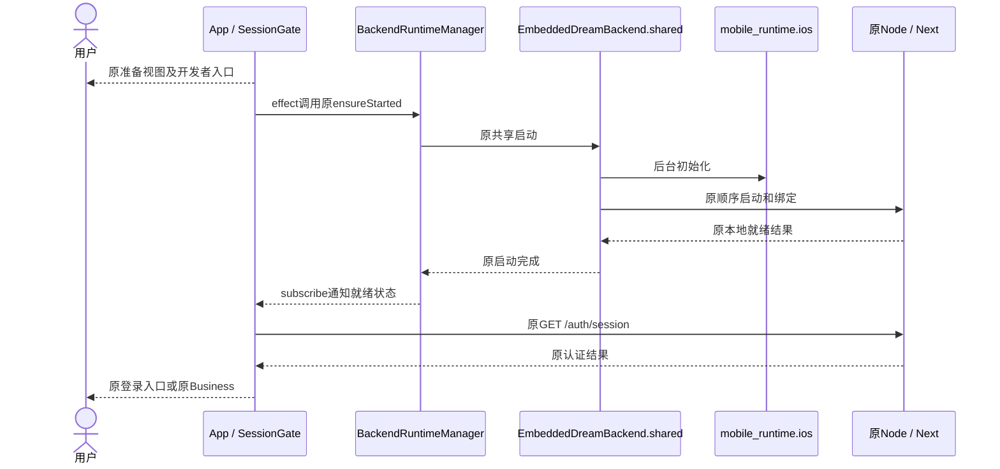

### 失败与恢复时序（当前源码）

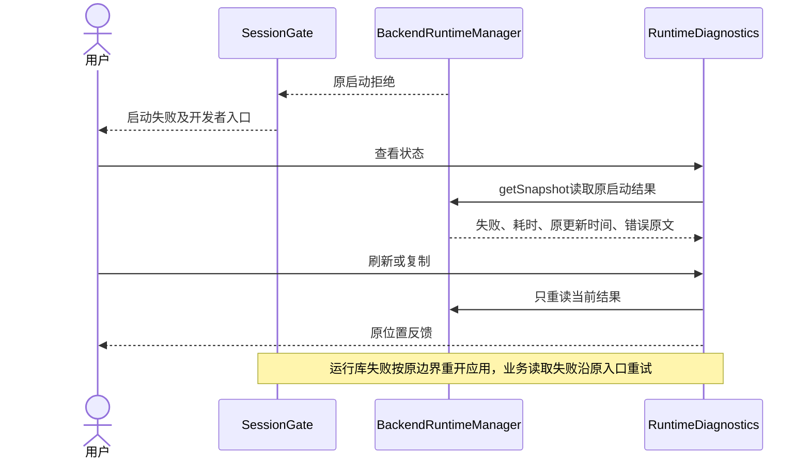

### 运行实例与页面状态转换（当前源码）

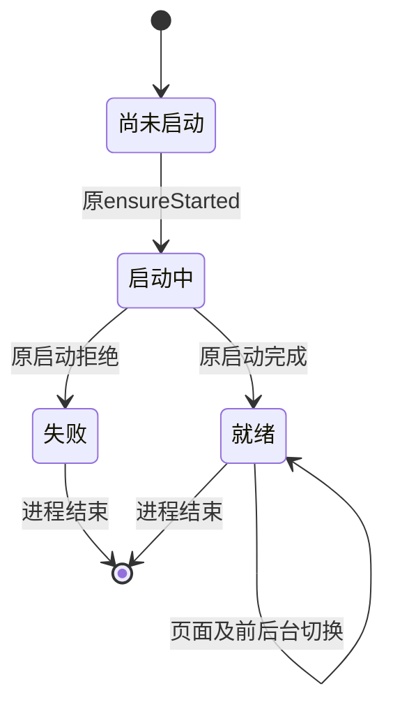

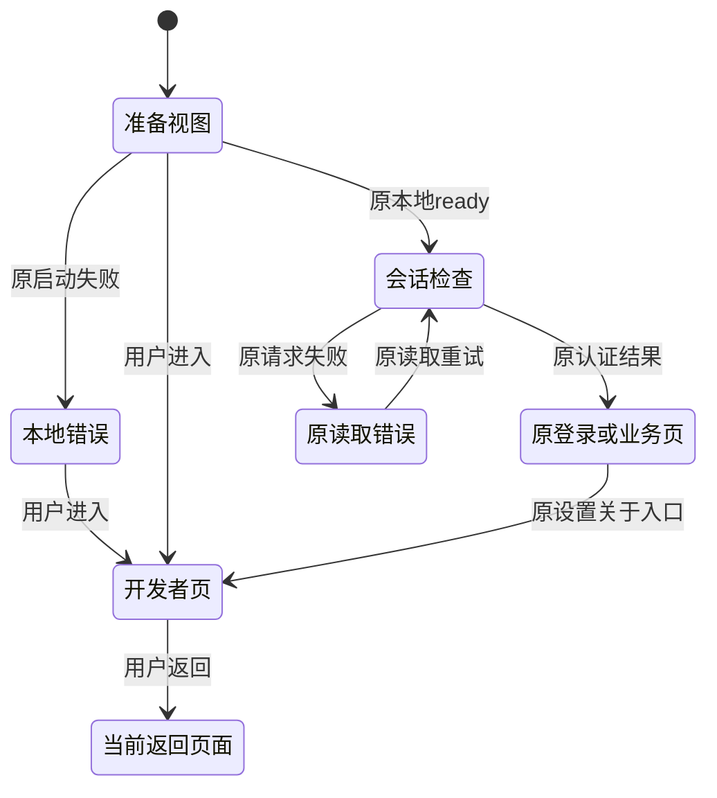

### 实例与监测生命周期

| 对象 | 创建与持有 | 离页、后台和结束 |
| --- | --- | --- |
| App与RN | 原应用进程与Root | 前后台沿原回调，进程结束释放 |
| Python、Node、Next及HTTP | 原Native单例、后台队列及原组合根 | 页面切换保持，进程重开重新初始化 |
| 启动结果 | 原`BackendRuntimeManager`模块，共享Promise | 页面读取相同内存结果，JS重建后沿原Native所有者调用 |
| `RuntimeDiagnostics`观察 | 当前可见页面的JS观察及AppState监听 | 离页解除，后台暂停，前台重读；无常驻轮询 |
| Business与任务 | 原会话、组件、Factory及持久化服务 | 原输入保持、身份释放、Stop及恢复规则继续执行 |

该启动展示方案的设计与验证归[评审记录](../../exec/mobile-startup-design-review-20261101.md)，保留其原阶段范围；后续CPU采样按本文“CPU与任务活动采样”专项定义。[前稿](history/mobile-startup-expanded-draft-20261101.md)保留历史原文。

### 本轮接线与验证边界

`SessionGate`在原业务视图上覆盖`RuntimeDiagnostics`，准备期间、失败或会话完成时保持该页，返回后显示当前原页面。`AboutView.native`显示同一组件，关于页面及底层Business继续原所有权。两处入口均收起键盘。开发者页直接显示并复制原错误，保留Native顶层code和userInfo中的具体原因；`NSLocalizedDescription`置于错误块首行。

启动失败后，`SessionGate`保持失败反馈，前台回调不重新派发部分初始化；原会话读取失败沿原重试执行。完整业务、真实平台生命周期与实际安装采用按[专项记录](../../exec/mobile-startup-design-review-20261101.md)验收。

### 模拟器采用与剩余范围

iPhone16 Plus / iOS18.6已采用本次普通入口Hermes，准备期与关于入口、就绪/失败反馈、只读刷新、系统剪贴板、前后台及返回通过。模拟器Native和运行资源复用原0.1.0/17；物理设备构建24已完成覆盖安装与普通启动，物理页面和业务验收单列。原会话读取经一次原入口重试恢复；配置和Agent目录读取失败保留，完整业务待验收。端口暂停/恢复、源码摘要与实际界面证据归[专项记录](../../exec/mobile-startup-design-review-20261101.md#模拟器验证2026-11-01)。


## 账号错误接入（2026-11-02）

`InkAccountLogin.swift`按configuration、authorization-configuration、system-authorization、callback记录原NSError或HTTP状态；取消系统授权继续原恢复流程。`MobileHostViewController`接收本地主框架的`AuthEntry`公开失败码及options读取失败，文档加载失败保留domain、code与localizedDescription。`InkRuntime`通过`InkAccountError`通知已挂载的`SessionGate`，写入原进程内快照；开发者页读取与复制相同快照。退出页面及成功重试保留最近错误，进程重开释放。Google回调URL仅记录配置中的公开URI，授权code、state、Cookie、密码和表单正文退出采集。

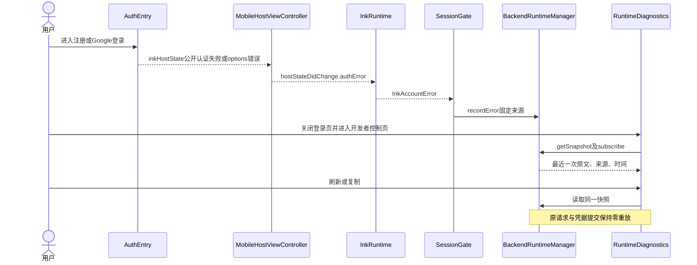

页面、页面状态、刷新行为与既有图保持一致。此修订增加观测来源，启动实例、认证状态机、权限和业务接口保持原所有权；真机接线与完整Google身份验证分别登记。

## 登录后开发者入口与App弹窗（2026-11-02）

### 背景与问题

原SessionGate内联入口随正常业务children显示而退出可见区域，关于页入口需额外导航。App原生Modal拥有独立展示层，业务根View的zIndex无法覆盖全部自有弹窗。发现及范围归[APP-05](../../exec/app-experience-diagnostics-overlay-20261102.md)。

### 目标与边界

使用同一UIWindowScene内的单个非key展示窗口，保持原业务窗口。逐弹窗复制入口会产生多处接线；另建诊断运行库会分离状态来源。当前选择由原InkRuntime持有展示实例，诊断叶子复用原RCTBridge与BackendRuntimeManager。

### 概念与规则

SessionGate只将原已登录或loggingIn状态及主题投影给configureDiagnosticsOverlay，原账户刷新、beforeRelease、children和注销接口保持。折叠窗口只命中按钮；打开时在原bridge按需挂载InkRuntimeDiagnostics叶子，继续使用RuntimeDiagnostics的原快照、日志、刷新、复制与前后台观察。

浮动入口使用启动页的透明角色图形。`StartupArtwork.native.tsx`读取`src/assets/startup-artwork.json`；现有`sync-startup-artwork.mjs`从同一数据生成iOS `StartupArtwork.imageset`深浅色SVG，系统启动页和诊断按钮共用该资源集。按钮通过原生UIImage加载资源并保留原始蓝白填充及主题线稿色，在原44点按钮内等比完整展示。诊断入口保持静态，启动页呼吸动画继续由原StartupArtwork组件所有。原无障碍名称、可见性、点击、拖动、窗口层级、安全区和业务返回流程保持。

诊断展示期间临时隐藏原窗口的无障碍元素，返回恢复原属性、释放诊断根及其订阅。原窗口保持key身份，业务页面及弹窗保持实例。场景断开、桥接失效、登出、会话丢失和SessionGate卸载释放或撤销该展示层；场景恢复只采用最近展示配置。新增展示不初始化第二个后端，不创建日志服务，不新增认证接口。

### 浮动入口正常时序

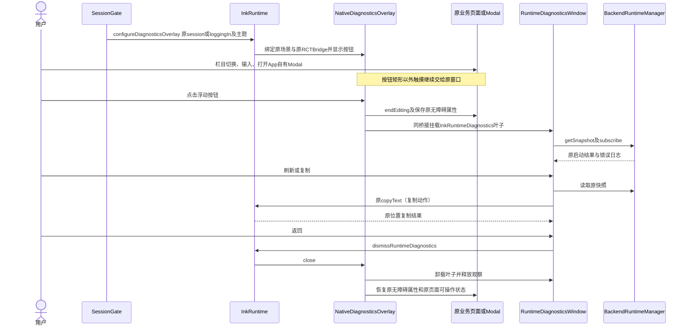

### 展示失败与恢复

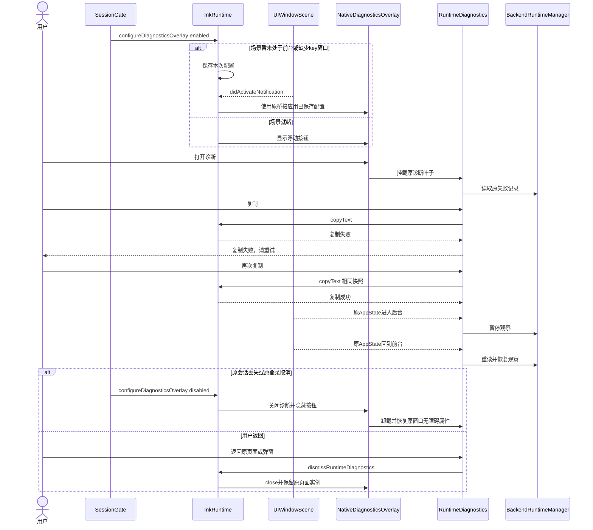

### 展示状态

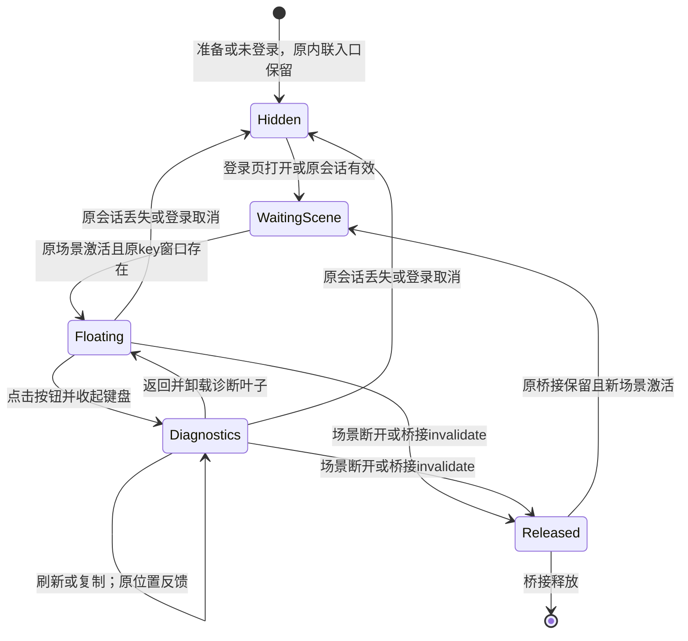

AppState后台暂停与前台重读沿RuntimeDiagnostics原生命周期执行，展示状态与原业务任务状态分别维护。

### 评审与验收状态

新增原生展示只对应App自有Modal与安全区/键盘差异；原诊断内容和业务实例继续复用。页面骨架归[启动PRD](../../prd/mobile-app/mobile-startup.md#登录后开发者入口与app弹窗2026-11-02)。源码及隔离用例为待验证候选，用户已暂停luna-test-stage；原生类型/构建、图示、层级、触摸、无障碍及Simulator完整旅程全部待执行。评审结论为待满足明确测试前提后通过。

### 2026-11-03原生确认窗层级修订

上方暂停状态保留2026-11-02历史含义，当前APP-05验收已恢复。Simulator确认`RCTAlertController`采用独立`UIWindow`、层级为`UIWindowLevelAlert + 1`，原诊断普通窗口层级无法覆盖。`NativeDiagnosticsOverlay`仅观察同场景的窗口visible/key/hidden通知，在主队列后续回合检查根及presented控制器；精确匹配当前RN的`RCTAlertController`后调整至该App窗口层级加一。确认窗关闭后恢复普通层级。

窗口继续保持non-key，折叠仅命中按钮，展开/关闭仍保存和恢复原key窗口的辅助功能属性。其他类、其他场景和系统授权窗口沿原处理；无新增定时扫描、运行库、接口或全局窗口层级重写。场景释放移除本实例观察。

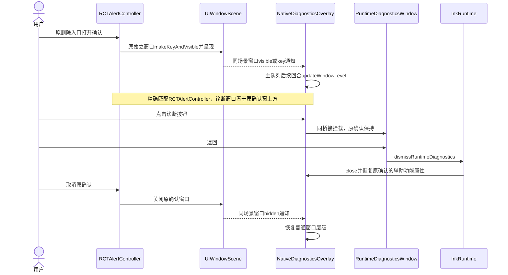

验收包含普通确认中按钮可达、诊断返回仍保留原确认、取消后对象保留，以及键盘聚焦后按钮可达、诊断收起键盘和原表单无修改。实际回执归[总清单](../../exec/app-experience-fixes-20261102.md)和[XCUITest任务](../../../frontend/e2e/ios/tasks/app-experience-20261103.md)。

## CPU与任务活动采样

### 背景与问题

用户在实际使用中观察到手机发热，需要将处理器占用和同时发生的任务活动放入原开发者页。现有DREAM_STARTUP的processCpuMs来自App进程，原总耗时同时包含计算和等待。当前发现范围包括Native初始化、同进程Python、Node/Claude、命令解释执行、RN页面与原请求；各来源的CPU归因按实际线程映射定义。

### 目标与边界

复用RuntimeSnapshot、原生InkRuntime和现有开发者页，新增App CPU趋势、可测OS线程排行/趋势、原运行实例活动和系统热状态。采样只在可见前台控制台运行。任务执行、登录、权限、原线程工厂和资源策略继续原所有权，采样不发起业务请求、不读取正文、不更改任务状态。

### 发现、定义与方案评审

源码依据：DreamNode通过原NSThread在App进程启动Node；DreamASGI由Python线程与共享asyncio loop运行；DreamGuestProcess的原invocations记录代次及虚拟PID，并通过pthread执行命令；RN的固定JS线程名来自已安装RCTJSThreadManager。业务Thread ID与这些OS线程分别具有各自生命周期，当前缺少业务任务到所有执行线程的完整映射。

选定单次原生采集，由JS控制台生命周期统一低频调度。常驻监测会持续增加采样与图表工作；新增服务或数据库会增加权限、通信和持久化职责；按业务并发数拆CPU会改变计量含义。当前方案复用原invocations及requests读取活动，只在原命令入口记录实际host thread ID；额外任务注册表为零。

### 指标与来源

| 指标 | 采集与计算 | 归因范围 |
| --- | --- | --- |
| App CPU | NativeRuntimePerformance调用getrusage(RUSAGE_SELF)，累计ru_utime+ru_stime；两次计数差 / 同进程单调时钟差 ×100 | App进程用户态及内核态CPU；100%=一核，多核可超过100%。WebKit独立进程/GPU未采集。 |
| 设备核数归一 | App CPU / 同区间processorCount；核数变化时该值留空 | 核数容量归一值；退出硬件频率、温度及能耗计量。 |
| OS线程CPU | task_threads取得本进程端口，THREAD_IDENTIFIER_INFO提供稳定OS ID，THREAD_BASIC_INFO提供user_time/system_time | 同OS线程连续计数的CPU。新建、结束、读取失败及截断线程保持未归因。 |
| 组件标签 | 主线程采用主队列取得的实际ID；Node主循环及RN JS使用固定入口线程名 | 标签只覆盖对应实测线程，Node工作线程、Python共享loop及其业务任务独立CPU保持未归因。 |
| 原命令活动 | IMDreamGuestCopyActivity以trylock读取原invocations的虚拟PID、generation、host_thread_id与启动状态 | CPU只对应原命令主执行OS线程；子线程和业务Thread CPU保持未归因。该接口不返回argv、环境、路径或正文。 |
| 原请求活动 | 原NativeHTTPResponse投影已有id、固定路由类别和等待头/读取状态；原启动状态投影为初始化活动 | 用于同一时间观察活动；HTTP等待、SSE读取和业务任务的CPU保持共享或未归因。清单范围限当前本地请求和命令实例。 |
| 系统热状态 | ProcessInfo.thermalState | 原系统枚举nominal/fair/serious/critical/unknown；退出摄氏温度及发热因果判断。 |
| 采样自身开销 | 原生collect墙钟及当前采样线程的CPU计数增量，JS记录桥接往返 | 原生采样CPU/耗时和完整桥接等待分别列出；读不到线程CPU时为空。图表额外CPU仍计入App总量。 |

Apple资料核对日期2026-11-03：[getrusage iOS手册](https://developer.apple.com/library/archive/documentation/System/Conceptual/ManPages_iPhoneOS/man2/getrusage.2.html)、[thread_info](https://developer.apple.com/documentation/kernel/1418630-thread_info)、[thread_basic_info_data_t](https://developer.apple.com/documentation/kernel/thread_basic_info_data_t)、[thread_identifier_info_t](https://developer.apple.com/documentation/kernel/thread_identifier_info_t)、[thermalState](https://developer.apple.com/documentation/foundation/processinfo/thermalstate-swift.property)、[系统热状态说明](https://developer.apple.com/documentation/foundation/processinfo/thermalstate-swift.enum)、[线程与工作队列](https://developer.apple.com/library/archive/documentation/Cocoa/Conceptual/Multithreading/AboutThreads/AboutThreads.html)。Mach声明同时按当前iOS SDK的Darwin头核对。采集仅使用自身进程及其线程端口，不读取其他App或系统进程。

### 采样与展示流程

NativeRuntimePerformance不持有计时器；InkRuntime收到原页面的单次调用后，在主队列复制原请求活动，再用utility队列采集自身CPU/线程和原命令快照。每个取得的Mach线程端口与task_threads返回数组均释放。命令原锁暂忙时立即返回busy，保留业务执行优先。

BackendRuntimeManager通过createPerformanceMonitor将结果放入原RuntimeSnapshot。多个可见控制台叶子共享一次读取与一个间隔定时器；在途读取具有5000ms截止计时器，读取完成或页面离开时解除；原生模块合并在途限制为单次。默认读取完成后间隔2000ms，最多120点并按采样期间最近240000ms过滤；原生明细最多256个线程、64个命令和32个请求，另含原启动活动。上限属于诊断开销和桥接容量预算，范围通过明细截断提示展示。

RuntimeDiagnostics沿原AppState与明确active状态持有采样lease。设置About接收原导航的active投影，隐藏保留页面不持有有效采样。手动暂停、后台、最后可见叶子离开时清理定时器并丢弃基线；迟到回执按epoch丢弃。恢复后的首个样本只建立基线，曲线保留断点。样本只保存在当前进程有界内存，原诊断摘要复制及错误日志继续其原按钮行为。

RuntimePerformanceCharts复用原react-native-svg与主题色。App与可测线程的趋势共用CPU坐标，线程排行只排序真实区间值；命令主执行线程CPU可用时显示其趋势，活动条带只绘制实际观察到的采样点。未测量值显示未计量，读取失败保留原历史与采样时间。产品骨架归[PRD正文](../../prd/mobile-app/mobile-startup.md#cpu与任务活动观察)。

### 正常业务时序

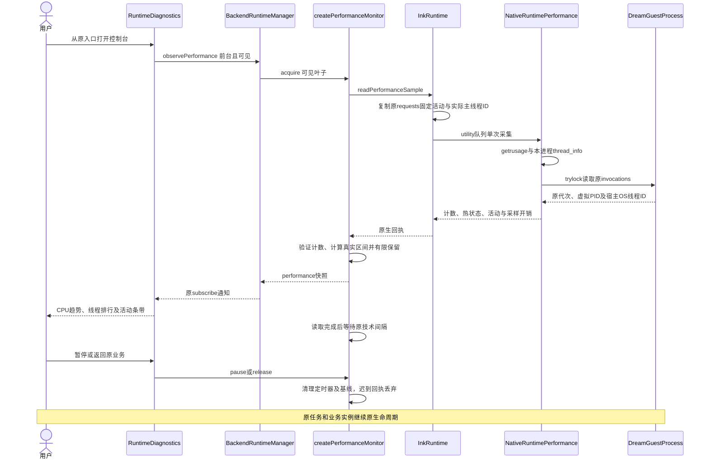

### 异常与恢复时序

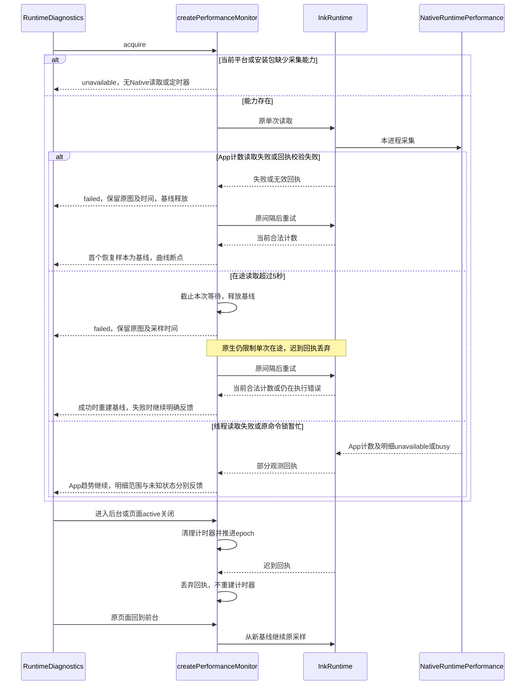

### 状态与实例生命周期

```mermaid
stateDiagram-v2
  [*] --> Closed: 无控制台叶子
  Closed --> Sampling: 可见前台叶子且能力可用
  Closed --> Unavailable: 原平台能力缺失
  Sampling --> Sampling: 合法计数与有限保留
  Sampling --> Failed: 原读取或回执失败
  Failed --> Sampling: 下一次读取成功并建立基线
  Sampling --> Paused: 手动暂停
  Failed --> Paused: 手动暂停
  Paused --> Sampling: 恢复且前台可见
  Sampling --> Background: 原AppState或active关闭
  Failed --> Background: 原AppState或active关闭
  Background --> Sampling: 前台且页面可见
  Sampling --> Closed: 最后叶子释放
  Paused --> Closed: 最后叶子释放
  Failed --> Closed: 最后叶子释放
  Background --> Closed: 最后叶子释放
  Unavailable --> Closed: 叶子释放
```

### 验收与开销测量

合同验证覆盖真实生产计算模块的单位/多核、计数和PID重置、并发共享归因、缺失线程、无样本/失败、有限窗口、多个观察者与迟到回执。隔离UI旅程调用原SessionGate、About和RuntimeDiagnostics，按显式技术样本核对图表、暂停/恢复、前后台和返回原输入；截图标注合成技术样本。

平台验证用实际iOS SDK检查Mach声明、C接口与原Native桥接；Simulator中的实际采样单列其进程、线程和热状态条件。采样开销取每次回执collectionWallMs、collectionCpuMs及JS往返；比较同一实例、相同空闲/既有工作窗口的采样关闭与开启记录，记录次数、分位值及CPU差异。采样线程CPU缺失时标记未计量，Mac进程数据只作为其对应技术环境结果。当前手机不执行新增模型或压测，物理发热/能耗结论依赖后续明确的物理采证。
