<!-- [Sync] 2026-11-02: 登录、注册及Google原失败接入现有错误来源；原始错误限定于返回值，凭据表单和授权查询参数退出采集。 -->
<!-- [Sync] 2026-11-02: 设备构建24已覆盖安装并普通启动，模拟器与物理页面/业务验收分别记录。 -->
<!-- [Sync] 2026-11-01: 原始错误沿Next Worker、私有host状态、Python及既有NSError传递，页面直接展示和复制。 -->
<!-- [Sync] 2026-11-01: 登记普通Hermes模拟器两入口和生命周期回执，完整业务与物理设备单列。 -->
<!-- [Sync] 2026-11-01: 同步RuntimeDiagnostics、getSnapshot/subscribe及原会话观察接线，实施前正文保留历史。 -->
<!-- [Input] 本次最小异步启动需求、原Native启动与JavaScript管理器。 -->
<!-- [Output] 本次功能的页面交互、实现依据、正常/异常时序、状态与生命周期。 -->
<!-- [Pos] 移动端异步启动与开发者页正式设计；产品规则及骨架归独立PRD。 -->
<!-- [Sync] 2026-11-01: 从移动总设计拆出本次正文，迁入原四图和实现依据；新增能力未实现。 -->

<!-- [Sync] 2026-11-02: 补齐图标资源与静态启动、RN准备动画及后台/减少动态效果的生命周期图。 -->

# 移动端异步启动与开发者页交互设计

本次任务的交互正文集中在本文：[页面与操作](#页面与操作)、[实现依据与最小改动](#实现依据与最小改动)、[正常启动](#正常启动与页面加载时序当前源码)、[失败恢复](#失败与恢复时序当前源码)、[状态转换](#运行实例与页面状态转换当前源码)和[生命周期](#实例与监测生命周期)。[独立PRD](../../prd/mobile-app/mobile-startup.md)包含两页骨架。本文对应本轮源码实现；隔离技术验证、打包采用和真实设备验收分别记录。

## 背景与问题

Python已由`EmbeddedDreamBackend`在后台启动。用户需要前端在准备期间可见、开发者页可进入，以及最少的就绪和失败反馈。本文的实现依据说明现有调用链；[独立PRD](../../prd/mobile-app/mobile-startup.md)定义启动页与开发者页骨架。下文新增状态展示和入口已接入源码，程序验证范围见专项评审。

## 目标与边界

复用原后台启动和共享Promise。前端渲染原`ScreenFrame/SessionGate`，开发者页直接读取JS管理器中的启动结果。正常登录、首次业务导航、输入与发送继续原就绪和权限条件。Python内部初始化、业务接口、任务、依赖和运行参数保持原合同。

## 概念与规则

- `SessionGate`的effect发起一次`ensureStarted()`，组件直接返回原准备视图；就绪后读取原`/auth/session`，按原结果显示登录或`Business`。准备期间允许进入开发者页。
- `BackendRuntimeManager`在原Promise上保存启动中、就绪、失败、开始/结束和最后更新时间。重复调用共享原结果；页面通过管理器的`getSnapshot()/subscribe()`读取和观察变化，离页解除观察。总耗时采用单调时钟计算，原更新时间随真实启动结果记录；Native桥方法保持，错误详情沿既有返回对象传递。
- 只读开发者页复用“更多 → 设置 → 关于”入口，准备及错误视图打开同一页。页面保留原底层实例，返回时显示当前结果；输入和附件按原页面规则保留。
- 显示启动结果、总耗时、更新时间和原始错误。Python/Node/Next的单独阶段没有现成结果时显示未观测；不增加分阶段记录。本地就绪与原会话读取结果分行显示；`SessionGate`通过`recordSessionRead()`记录已有读取结果，公网连接显示未单独观测，不新增探测。
- 手动刷新重读管理器状态，原请求记录保留其原时间；刷新不启动运行库或网络探测。复制通过现有`InkRuntime.copyText`输出状态与相同错误原文，成功/失败在原位置反馈。`formatRuntimeError()`保留Error的message、stack、cause及Native返回的code、userInfo、nativeStackIOS；路径和参数按原错误保留。
- 前后台复用AppState：后台暂停页面观察，返回前台读取当前状态；原会话刷新继续合并。暂停仅描述页面观察。进程重开创建新的内存状态，原保存内容由现有业务恢复。
- 启动失败显示原错误及重开应用说明；启动在途继续等待原Promise。会话、配置和历史失败各自沿原读取重试；保留既有成功数据、输入及Thread，自动业务重发为零。Android沿当前`CAPABILITY_UNAVAILABLE`显示能力未就绪。

### 页面与操作

| 页面 | 入口与操作 | 反馈与返回 |
| --- | --- | --- |
| 启动页 | 原`SessionGate`准备视图；effect异步发起启动；可打开开发者页 | 准备中、会话检查或原错误；就绪后继续原登录或业务流程 |
| `RuntimeDiagnostics.native.tsx` | 启动视图与原`AboutView`进入同一只读页；刷新、复制 | 读取原JavaScript启动结果；原位置成功/失败提示；返回保留底层实例 |

两页产品骨架直接位于[独立PRD](../../prd/mobile-app/mobile-startup.md#页面设计)。原登录弹窗由现有`presentLogin`处理，开发者页不改登录提交或关闭次序。

### 2026-11-02 图标与启动插画

本节保留首轮位图实现与三张交互图。现行透明矢量和布局以[透明矢量开屏](#透明矢量开屏现行)为准；第一张AppIcon继续沿本节资源。

`Assets.xcassets/AppIcon.appiconset`使用第一张用户参考图重建的1024×1024 RGB PNG。工程Debug与Release均指定`AppIcon`，Asset Catalog加入应用Resources阶段。第二张1254×1254图片保留原始字节，分别供Asset Catalog和Metro打包；来源及摘要见[实施记录](../../exec/mobile-app-branding-20261102.md)。

`Info.plist`通过`UILaunchStoryboardName=LaunchScreen`选择静态启动画面。`InkMemoryApp.ReactNativeAppView`将同一Storyboard作为`RCTRootView.loadingView`，填充当前主题背景，首个RN内容到达时按原生命周期移除。系统启动背景采用既有浅色/系统深色背景值；应用偏好在宿主加载后按原主题生效。

`SessionGate`仅在未持有会话且`loading`期间挂载`StartupArtwork.native.tsx`。组件使用原图、`Animated.loop`和Native driver在1至1.035倍之间呼吸，每方向1200ms，动画工作项设置`isInteraction=false`。这些参数定义视觉节奏。就绪、失败和会话结果仍由原管理器与会话读取决定。

组件挂载时默认静态展示，读取`AccessibilityInfo.isReduceMotionEnabled`并监听后续变更；偏好读取失败保持静态。只有可见、前台且减少动态效果关闭时播放。打开开发者页传入`visible=false`；后台和减少动态效果变更均停止并复位。组件卸载时停止动画并解除全部监听。插画不接收触控，退出无障碍阅读顺序；状态文本和原按钮保持可用。RN图片尺寸180×180，短视口允许收缩并通过contain完整显示。

当前交付为源码及技术验证；完整包体、设备冷启动和系统桌面图标的实际采用见实施记录。Apple资源合同参考[图标配置](https://developer.apple.com/documentation/xcode/configuring-your-app-icon)与[启动屏幕](https://developer.apple.com/documentation/xcode/specifying-your-apps-launch-screen)，查阅：2026-11-02。

#### 正常展示时序

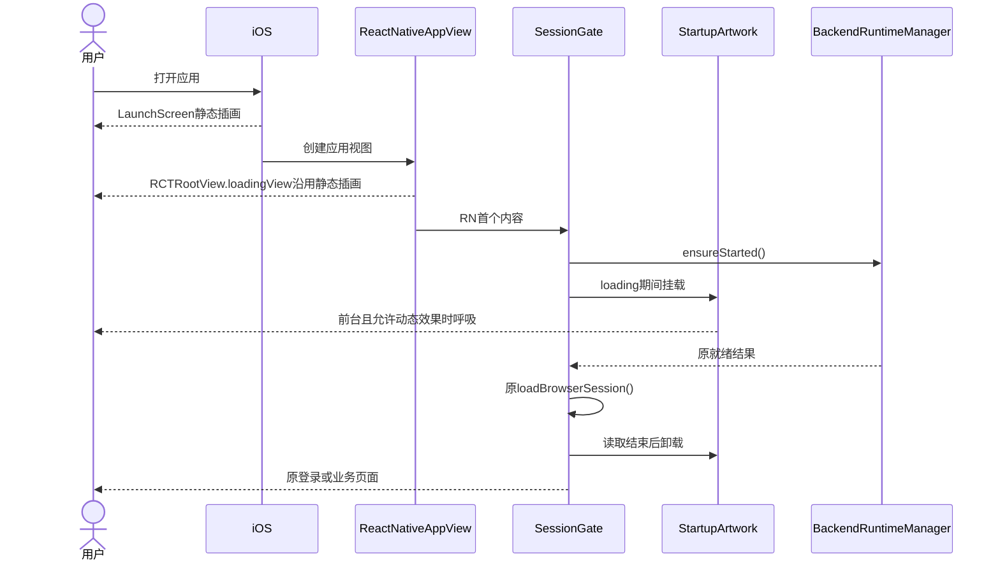

#### 异常与恢复时序

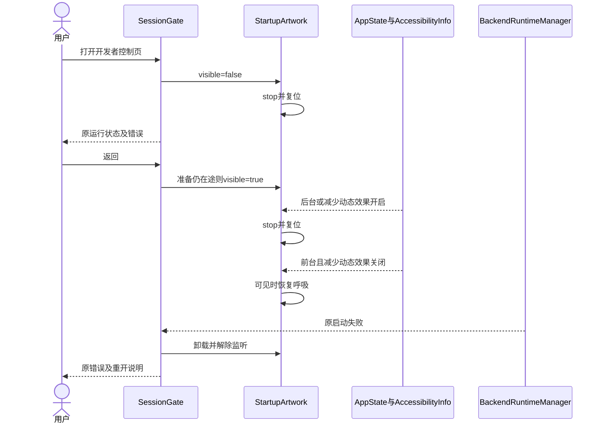

#### 插画状态转换

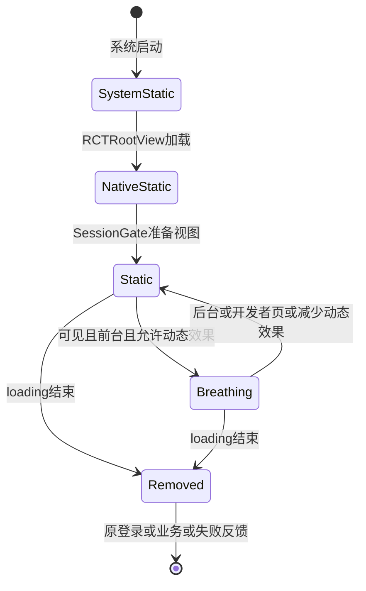

### 透明矢量开屏（现行）

背景与问题：用户要求第二张图转换为透明矢量，并纠正开屏布局。首轮PNG包含米色纸张，图像方框与页面背景分别显示；应用名称、加载指示与开发者操作集中在同一纵向组内。当前选定路径重绘加原主题布局，图形保留轮廓、五官及蓝白帽子。

目标与边界：`StartupScreen.native.tsx`只承载`SessionGate`未登录且loading期间的呈现。`BackendRuntimeManager`、会话读取、登录、错误与恢复规则沿原入口。准备结束即继续原页面，动画无最低播放时长。

概念与规则：`src/assets/startup-artwork.json`保存七条真实路径；`StartupArtwork.native.tsx`复用现有`react-native-svg`绘制，填充仅用于帽子与五官，角色脸部及画布透明。轮廓和五官使用`currentColor`及当前`color-text-primary`；蓝白色块保留参考图配色。`sync-startup-artwork.mjs`从同一数据生成独立`startup.svg`及iOS深浅色SVG，iOS文字色读取既有`inkColors.ts`。Asset Catalog开启`preserves-vector-representation`，系统启动画面的背景继续由`LaunchBackground`提供。

布局：页面填充现有`color-bg-app`，中部品牌区包含矢量角色及`InkLabel`字标，现有Excalifont和Xiaolai按文字分段。角色尺寸为视口高度26%、宽度44%与176中的最小值，宽高相同；字标24px、行高32，角色与字标间距12。品牌区底部内距36，使角色中心位于可用安全区中点上方40。Storyboard同样以安全区中心减40定位，尺寸采用相同约束。底部反馈区位于安全区底部8，状态13px、辅助入口12px，开发者入口触控高度44；角色、字标与底部区域独立。

准备文案为“正在准备”，会话读取文案沿原“正在检查登录状态”。系统启动与RN加载仅显示静态角色，首个RN内容显示字标及底部状态。动画继续原1至1.035呼吸、后台暂停、诊断隐藏暂停及减少动态效果规则，所有观察在组件卸载时释放。产品骨架见[启动PRD](../../prd/mobile-app/mobile-startup.md#启动页)；资源、取舍和本轮验证见[矢量纠正记录](../../exec/mobile-app-branding-20261102.md#透明矢量与布局纠正)。

#### 透明开屏正常时序

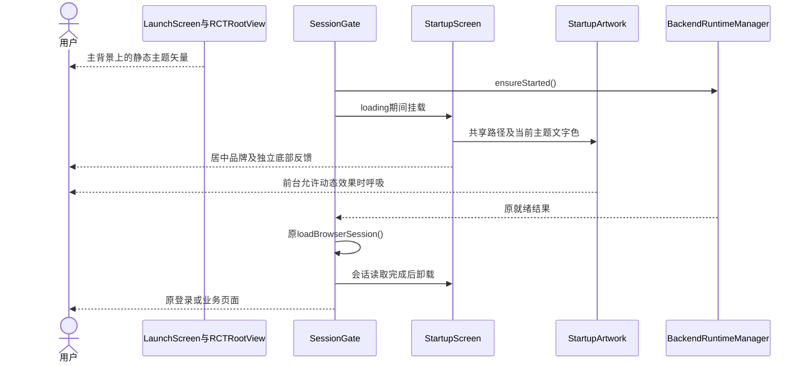

#### 透明开屏异常与恢复

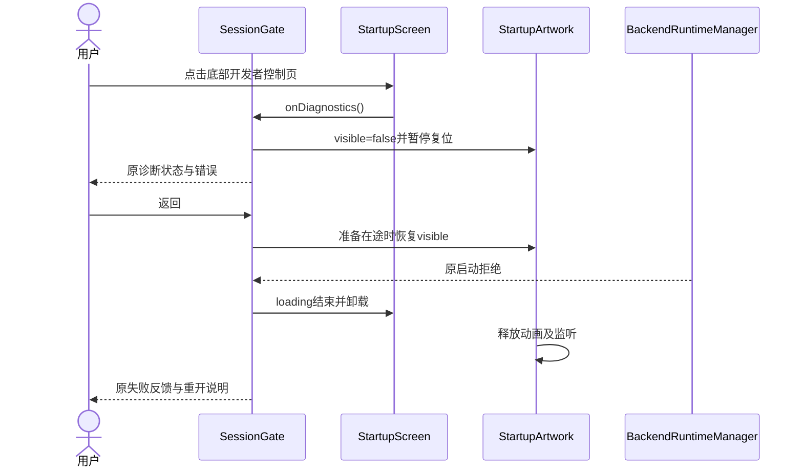

#### 透明开屏状态

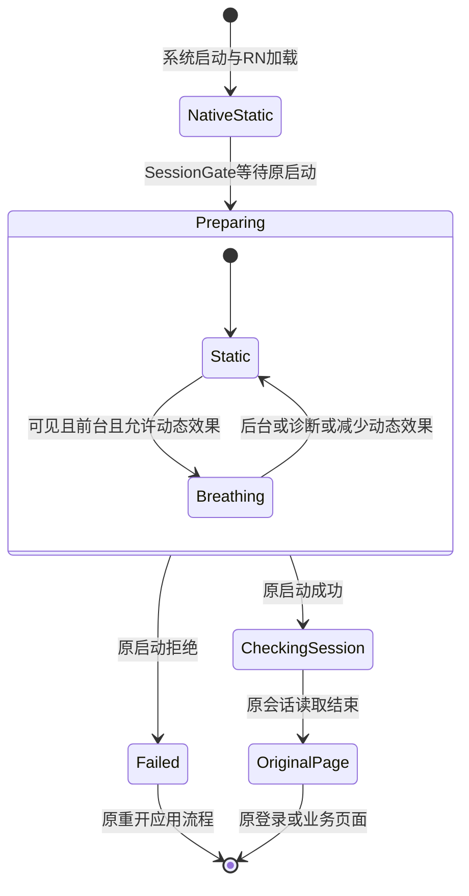

### 实现依据与最小改动

| 对象 | 当前实现 | 本轮最小接线 |
| --- | --- | --- |
| Python启动 | [EmbeddedDreamBackend](../../../frontend/ios/InkMemory/EmbeddedDreamBackend.swift)在后台串行队列执行；[DreamPython](../../../frontend/ios/InkMemory/DreamPython.m)初始化进程内解释器 | 复用该后台路径，初始化内部顺序保持 |
| 启动调用 | [BackendRuntimeManager](../../../frontend/src/runtime/BackendRuntimeManager.ts)共享一个Promise，原生合并waiters | 同一模块保存启动中、就绪或失败结果，供页面读取 |
| 前端呈现 | [SessionGate](../../../frontend/src/platform/SessionGate.native.tsx)先渲染准备视图，effect内等待启动结果 | 准备视图与开发者页保持可操作；启动成功继续原会话读取 |
| 本地服务 | [iOS组合根](../../../backend/mobile_runtime/ios.py)依原顺序装配适配、Factory、路由、HTTP与Next | 保留原完整ready条件，业务操作按依赖开放 |
| 运行状态 | Native已有启动完成或拒绝结果 | 在原JavaScript启动管理器记录开始、结束、最后更新时间和原始错误；总耗时由单调时钟计算 |
| 开发者页 | 原设置关于入口位于已登录业务内 | 关于增加同一只读叶页，准备视图提供同名入口；读取原JavaScript结果，无新Native方法 |
| 公网连接 | 原登录和业务请求拥有各自传输结果 | 单独显示原会话读取结果，公网标为未单独观测；刷新不发探测请求 |

启动结果中的ready继续表示原本地装配完成，账户、配置及业务请求继续原校验。JS管理器的状态随原Promise更新；刷新仅重读本地状态，错误按startup、session、config、catalog、login、registration、google来源分别保留最近一次原文与时间。读取成功保留最近错误，当前就绪及会话状态独立更新。页面离开释放观察，原运行实例继续其既有生命周期。

Python初始化失败沿原错误反馈；当前Node一次性初始化及部分绑定保留原恢复边界。开发者页不提供重启；用户重开应用沿原路径恢复。已ready后的登录或数据失败仅重读对应请求。后台切换、进程重开及任务恢复继续原规则。

### 原始错误记录

`BackendRuntimeManager.recordError()`只写当前进程内的固定来源槽位：启动Promise拒绝、`SessionGate`原会话读取失败、`useNativeChatSetup`原配置及目录读取失败，以及原登录展示、注册反馈、Google系统授权和登录文档加载失败。后续同来源失败覆盖上一条；页面离开与请求恢复保留记录，进程重开释放。已取消或离页读取的错误沿原取消规则处理。页面刷新读取该快照，无额外请求、轮询或持久化。

Next启动失败通过现有`worker.mjs`的`parentPort`发送`next_error`原文，原`console.error`继续输出。`host.cjs`保留原监听/失败判定，在原私有认证status帧的`web.error`中返回原文；仅收到错误日志时继续原运行状态。`ios_claude_transport.start_native_web()`沿原失败判定抛出`web.error`，缺少原文时使用原code；控制帧沿已有16MiB读取上限。`EmbeddedDreamBackend`与`InkRuntime`沿原NSError回传，React Native既有`userInfo`携带具体错误，原Native方法与启动线程保持。

启动状态下方直接展示错误日志，日志展示与复制使用完整原文；页面采集范围限定为上述调用返回的错误。请求权限、认证、DTO、输入、任务执行及恢复路径保持原合同。

### 正常启动与页面加载时序（当前源码）

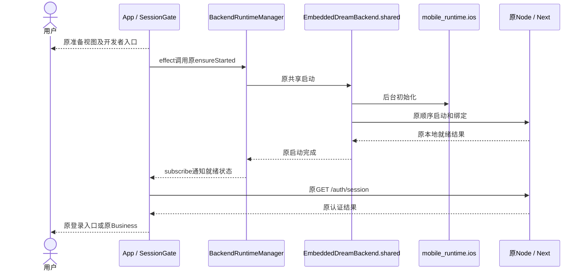

### 失败与恢复时序（当前源码）

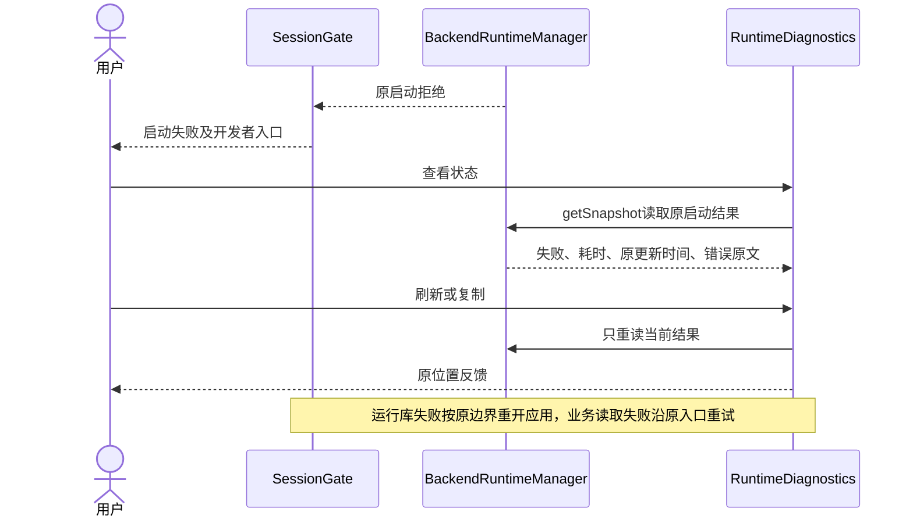

### 运行实例与页面状态转换（当前源码）

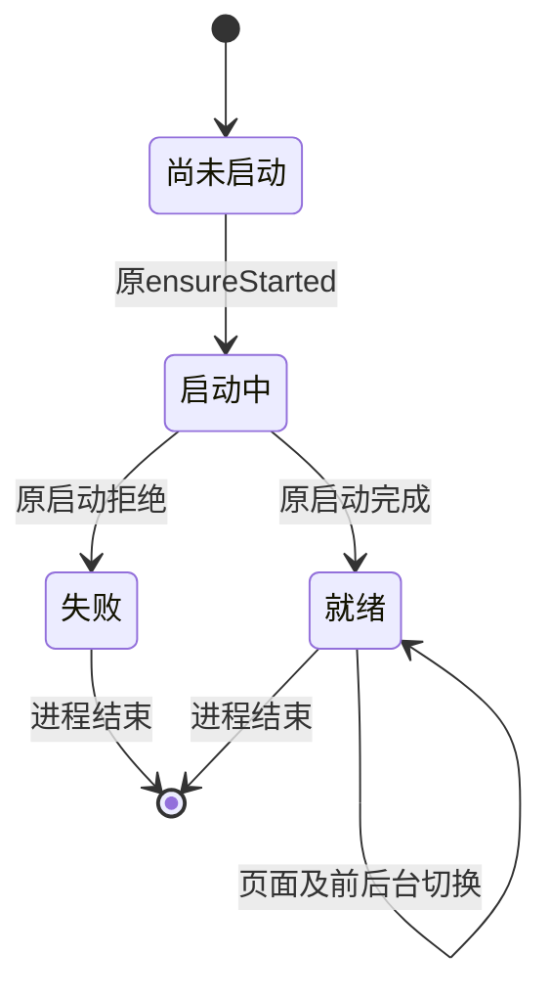

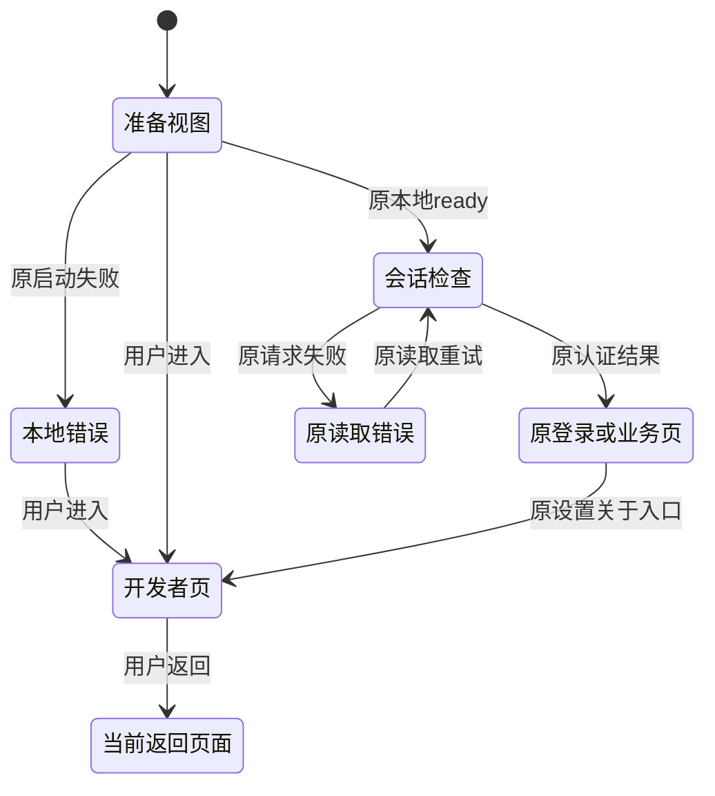

### 实例与监测生命周期

| 对象 | 创建与持有 | 离页、后台和结束 |
| --- | --- | --- |
| App与RN | 原应用进程与Root | 前后台沿原回调，进程结束释放 |
| Python、Node、Next及HTTP | 原Native单例、后台队列及原组合根 | 页面切换保持，进程重开重新初始化 |
| 启动结果 | 原`BackendRuntimeManager`模块，共享Promise | 页面读取相同内存结果，JS重建后沿原Native所有者调用 |
| `RuntimeDiagnostics`观察 | 当前可见页面的JS观察及AppState监听 | 离页解除，后台暂停，前台重读；无常驻轮询 |
| Business与任务 | 原会话、组件、Factory及持久化服务 | 原输入保持、身份释放、Stop及恢复规则继续执行 |

设计与后续最小验证归[评审记录](../../exec/mobile-startup-design-review-20261101.md)。性能分析、新Native接口和分段监控退出本方案；[前稿](history/mobile-startup-expanded-draft-20261101.md)保留历史原文。

### 本轮接线与验证边界

`SessionGate`在原业务视图上覆盖`RuntimeDiagnostics`，准备期间、失败或会话完成时保持该页，返回后显示当前原页面。`AboutView.native`显示同一组件，关于页面及底层Business继续原所有权。两处入口均收起键盘。开发者页直接显示并复制原错误，保留Native顶层code和userInfo中的具体原因；`NSLocalizedDescription`置于错误块首行。

启动失败后，`SessionGate`保持失败反馈，前台回调不重新派发部分初始化；原会话读取失败沿原重试执行。完整业务、真实平台生命周期与实际安装采用按[专项记录](../../exec/mobile-startup-design-review-20261101.md)验收。

### 模拟器采用与剩余范围

iPhone16 Plus / iOS18.6已采用本次普通入口Hermes，准备期与关于入口、就绪/失败反馈、只读刷新、系统剪贴板、前后台及返回通过。模拟器Native和运行资源复用原0.1.0/17；物理设备构建24已完成覆盖安装与普通启动，物理页面和业务验收单列。原会话读取经一次原入口重试恢复；配置和Agent目录读取失败保留，完整业务待验收。端口暂停/恢复、源码摘要与实际界面证据归[专项记录](../../exec/mobile-startup-design-review-20261101.md#模拟器验证2026-11-01)。

## 账号错误接入（2026-11-02）

`InkAccountLogin.swift`按configuration、authorization-configuration、system-authorization、callback记录原NSError或HTTP状态；取消系统授权继续原恢复流程。`MobileHostViewController`接收本地主框架的`AuthEntry`公开失败码及options读取失败，文档加载失败保留domain、code与localizedDescription。`InkRuntime`通过`InkAccountError`通知已挂载的`SessionGate`，写入原进程内快照；开发者页读取与复制相同快照。退出页面及成功重试保留最近错误，进程重开释放。Google回调URL仅记录配置中的公开URI，授权code、state、Cookie、密码和表单正文退出采集。

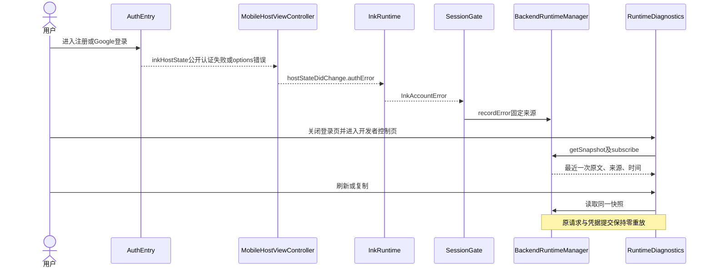

页面、页面状态、刷新行为与既有图保持一致。此修订增加观测来源，启动实例、认证状态机、权限和业务接口保持原所有权；真机接线与完整Google身份验证分别登记。
