<!-- [Sync] 2026-10-30: More原生图标和用途布局沿五项同层导航；主题状态使用原偏好，无新增查询。 -->
<!-- [Sync] 2026-10-29: 追加原生资源页面复用及HTTP等待协议候选，区分组件、Web门禁、目标构建及普通App采用。 -->
<!-- [Sync] 2026-10-29: 原回顾API/状态共享，Native主页/报告/配置与具体存储/流适配已形成源码候选；普通App采用独立验收。 -->
<!-- [Sync] 2026-10-29: 追加Work的Claude Code Plugins共享状态和原生内容；普通更多主入口采用与资源连接继续实施。 -->
<!-- [Sync] 2026-10-29: 补充共享记忆回应、只读订阅和关于的原生适配、实例、恢复及三类业务图，主入口采用继续单列。 -->
<!-- [Sync] 2026-10-29: iOS主题与通用设置复用原三项偏好、内置Settings及原theme配置接口；主菜单采用独立验收。 -->
<!-- [Sync] 2026-10-29: 窄屏Web和原生More同页列出写作/时间线/回顾/主题/设置；桌面导航保持。 -->
<!-- [Sync] 2026-10-29: 原模型设置抽取共享状态并接入More；保留原HTTP、Web界面和App运行库。 -->
<!-- [Sync] 2026-10-29: 补充原生Deck维护、共享原API/Hook、实例生命周期及三类业务图，保持Web与端侧运行库所有权。 -->
<!-- [Sync] 2026-10-29: 原Deck详情通过已安装普通候选的XCTest原生拖动验证，复用现有ScrollView并限定平台范围。 -->
<!-- [Sync] 2026-10-29: 原Deck首页/预览接入原生栏目与Chat草稿，复用发布可见性；补充实例、正常/异常/状态图及管理剩余范围。 -->
<!-- [Sync] 2026-10-29: 原历史Hook通过实际Hermes/AppState及正常Native HTTP定向资格；普通候选已恢复并复核本机3000，会话后首页差异继续独立验收。 -->
<!-- [Sync] 2026-10-29: 补充原会话思维模式/Agent信息、同模式下一轮选择、生命周期、双端骨架及三类业务图。 -->
<!-- [Sync] 2026-10-28: 原生启动配置和Agent目录使用原GET显式重试，保留读取快照、输入与Thread；取消旧读取并沿原会话恢复。 -->
<!-- [Sync] 2026-10-28: Web真实Chat完成、可见正文流、Stop cancelled和重载已验证；Mac Gateway接回同一原Admin转发，手机公网配置保持，iOS交付继续验收。 -->
<!-- [Sync] 2026-10-28: 用户再次确认Web优先，当前类型及103项原页面回归通过，正常账户读取与真实业务闭环分项记录；本轮暂停iOS实施。 -->
<!-- [Sync] 2026-10-28: 普通More/文件/分享接线与原长图复用，补齐三类图及文件/文档/job所有权。 -->
<!-- [Sync] 2026-10-28: 原文件侧栏API提取与DELETE修复，补齐Native目录选择/批量上传、原生命周期及三类业务图；主入口继续接线。 -->
<!-- [Sync] 2026-10-28: 补充Native Workspace引用、私有字节句柄、系统导出及三类业务图；完整侧栏与真实文件验收单列。 -->
<!-- [Sync] 2026-10-28: Web优先复验与活动菜单滚动事件最小修订；技术、正常页面读取与发布状态分别记录。 -->
<!-- [Sync] 2026-10-28: 原生主入口接回原活动/历史及只读任务详情，复用查询协调器与展示模型；补充生命周期和业务图。 -->
<!-- [Sync] 2026-10-28: 排队编辑以selectionEpoch保留前后台回执归属；本地reader和编辑操作生命周期分别校验。 -->
<!-- [Sync] 2026-10-28: 明确Web先行验收门禁、原页面基准与正常服务恢复责任；真实业务和技术fixture分别登记。 -->
<!-- [Sync] 2026-10-28: 补充原生排队卡、编辑恢复、侧实例生命周期与业务图，现行双平台验收矩阵归本文。 -->
<!-- [Sync] 2026-10-28: 规范finish结束Native reader并走原history/status恢复；11项边界、类型及隔离Hermes操作通过，真实Stop继续验收。 -->
<!-- [Sync] 2026-10-28: Web153通过后复验Native消息，视口跟随与表格列对齐合同通过；隔离iOS取得GFM/process/Copy/键盘与长会话定位回执，主包及真实业务继续验收。 -->
<!-- [Sync] 2026-10-28: 当前Web重新构建并通过108项原页面/共享逻辑及45项认证传输合同；Native消息未通过项单列，原生实现/构建/安装暂停。 -->
<!-- [Input] React Native Web多平台要求、现有Next业务、端侧Dream运行库与原网页登录。 -->
<!-- [Output] 统一发布工程、原生页面迁移范围、HTTP交互、实例生命周期及验收前提。 -->
<!-- [Pos] Web/iOS/Android现行工程与交互合同；替代整页业务WebView首发策略。 -->
<!-- [Sync] 2026-10-28: 共享模块迁移先通过现有Web类型、生产构建及原页面交互回归；逐次复验后继续原生接线。 -->
<!-- [Sync] 2026-10-28: Web门禁扩展到70项，修复Deck读取提取后的本地绑定；原生页面交付继续单独验收。 -->
<!-- [Sync] 2026-10-28: 原Tiptap编辑器通过固定局部文档复用；补齐编辑回包、生命周期与输入稿所有权，主界面接线继续实施。 -->
<!-- [Sync] 2026-10-28: iOS系统文件句柄与字节上传复用原useFileUpload，补充附件实例生命周期与失败清理；Web57及隔离Native7通过，真实附件业务继续验收。 -->

<!-- [Sync] 2026-10-28: 恢复Mac原Web服务并重新通过当前153项技术检查；原账户历史读取通过，RN状态缺陷单独保留。 -->

<!-- [Sync] 2026-10-29: 按用户要求将当前Mac及Simulator普通env的Admin/Gateway传输改接本机3000；认证issuer保持本机Admin声明值，历史公网回执独立保留。 -->
<!-- [Sync] 2026-10-29: Simulator真实Chat完成及重开已验证；本机Admin采用既有catalog制品后返回11个模式/22个Agent，完整iOS交付继续单列。 -->
<!-- [Sync] 2026-10-29: 普通候选通过原Tiptap硬件输入、正文增量、真实Stop cancelled及进程重开；同进程首页最新历史刷新缺口继续定位。 -->

# React Native / React Native Web 统一工程设计

### 当前本机 Admin 连接

2026-10-29，用户指定当前测试连接本机Admin 3000。`frontend/.env.local`、`backend/.env`使用现有`INK_ADMIN_DREAM_TRANSPORT_BASE_URL=http://localhost:3000`，Backend的`INK_GATEWAY_BASE_URL`使用同一地址。`INK_ADMIN_DREAM_BASE_URL`、`INK_ADMIN_AUTH_ISSUER`及resource沿用本机Admin声明的公开认证身份；Token、JWKS和数据请求经现有transport字段连接本机。App Client ID、PKCE、Cookie、CSRF和权限合同保持。

当前3000由`ink-admin-memory`的Node进程提供服务；同端口原IPv4 SSH转发已通过现有LaunchAgent标签卸载。两种IP协议连接同一本机Admin。已有`browserAdminOrigin`根据当前loopback浏览器地址和transport选择本机表单；`GET /auth/options`实际返回`http://localhost:3000/auth/dream/password`及`http://localhost:3000/auth/dream/google`。issuer/resource用于原Token身份校验，网络传输由现有transport配置所有。

| 实例 | 当前连接与执行归属 | 验证范围 |
| --- | --- | --- |
| Mac Admin / Gateway | 普通`pnpm run start:embedded`在3000提供现用服务，PostgreSQL使用现有数据目录 | IPv4/IPv6登录页200；当前Admin Build ID `4OycC5xU-7KIhK1F4pZDu` |
| Mac Web / Python | 普通env保留本机Admin/Gateway配置；当前独立验收窗口未运行Mac Next及8765 Backend | 5173当前归Simulator App；本机调试Next启动前需释放同一端口 |
| Simulator候选 | 同一普通env装入既有候选；App拥有Next、Python和Node，Admin运行在Mac | 正常登录会话保留；1轮真实Chat完成及重开恢复；目录返回11个模式、22个Agent |
| 物理iPhone | `localhost:3000`指向手机自身 | 需要可达同一本机Admin的有效HTTPS连接及原授权来源配置，当前Simulator连接回执单独登记 |

当前配置装配沿用`frontend/ios/scripts/bundle-node.py`的两个env归属。首次本机配置采用仅重新装配既有Simulator制品的env、签名及安装；后续普通Native候选沿当前源码独立构建，技术验证与真实业务分别登记。前一轮真实Chat使用原Write or edit入口，1次提交产生3次模型请求，全部completed/settled；该轮2次预算超出后停止新增模型调用。后续两个限定样本使用原Tiptap与硬件键盘，100字符及167字符输入均由持久化原文精确核对；分别取得正文增量至完整列表、进行中Stop保存cancelled及进程重开回执，新增模型请求各1次。软件键盘真实任务、完整主页面和物理设备继续独立验收。原公网执行记录保留原时间和范围。详见[本机Admin连接执行记录](../../exec/mobile-app-design-review-20261024.md#2026-10-29本机admin-3000连接)及其后续真实Chat、版本采用和原生输入/停止记录。

原生Stop使用`useNativeChatThread.native.ts:152`及原`threadStop.ts`，本轮生产源码保持。第二个样本通过原Stop进入Stopping，终态恢复Send；正常Thread messages保存`turnStatus=cancelled`，Gateway保存`cancelled/settled`。原进程返回首页时曾缺少最新记录，正常历史API已返回该记录；进程重开后原入口恢复。`native-chat-history.spec.ts`补充关闭/重新启用读取的回归，9项通过；实际Hermes与原生传输中的该刷新差异继续定位。当前输入/取消/重开结果退出完整页面等价及正式发布依据。

目录失败按现有capability边界返回`ADMIN_CAPABILITY_UNAVAILABLE`。本轮查明旧Admin运行制品缺少源码已注册的`deck.catalog`，经39项provider-free检查和独立构建后，采用已有实现至默认`.next`；Admin源码、认证配置和数据库结构保持。Dream旧capability快照在候选进程重开后刷新，普通目录GET和原生菜单恢复。回退使用保留的旧Admin制品及同一现用env/数据目录，无额外发布服务或业务回退接口。

现行代码依据：`frontend/app/api/_auth/admin-client.ts:87`定义公开认证身份，`:95`读取独立transport；`frontend/app/api/_auth/handlers.ts:20`选择当前浏览器的本机Admin表单；`backend/services/admin_data/jwt_verifier.py:61`通过transport读取JWKS；`backend/services/admin_data/deck_list_data.py:57`固定目录操作hash。Admin现有注册位于`/Users/dmeck/project/ink-admin-memory/app/lib/dream/operationRegistry.ts:321`，该参考只读核对与运行制品采用分别记录。

本机连接回执样本（2026-10-29较早轮次）：普通RN候选恢复原Hermes bundle和现有会话，App进程58033监听5173并连接本机3000；原会话resolve为200，登录选项的密码及Google表单action均指向`http://localhost:3000`。源env、包内env和已有transport消费者保持一致，该次追加模型请求和业务写入均为0。后续Deck/输入修复候选的进程及制品回执归执行记录，本机transport配置保持。

历史生命周期资格：`e2e/native/history-lifecycle.tsx`仅作为独立验证入口，复用原`useNativeChatHistory`、`ChatHistoryList.native`和日期模型。纯合成GET路径在实际Hermes及两次系统前后台切换中通过重新启用、在途取消及旧结果释放；正常只读路径复用原SessionGate与Native HTTP，两次GET均为200，本地初次快照过滤的记录在重新启用后恢复。原生产Hook及列表源码保持。上述定向资格覆盖当前条件，普通业务停止后返回首页的先前差异继续保留原回执，整页组合与真机继续独立验收；执行范围见[当前记录](../../exec/mobile-app-design-review-20261024.md#2026-10-29历史生命周期资格与本机admin连接复核)。

> 页面实施纠偏：当前`src/App.tsx`新增的简化Chat/Decks/More布局偏离原页面，用户已指出该问题。该布局未获验收，停止继续部署。现行界面目标为保留原页面布局、视觉、功能入口与交互，按必要平台差异等价迁移组件。下文工程结构和HTTP接线继续适用；精简页面骨架及原生功能删减退出交付依据。

> 2026-10-28执行顺序：现有Next.js Web生产构建、原页面交互与桌面/窄屏回归先验收。共享模块变更逐次复验Web后继续RN接线；精简主页面停止部署，隔离组件在Web前提通过后构建验证。技术fixture、真实账户业务和移动交付分别报告。

### Web先行验收门禁

前轮Web门禁：17份原页面与共享逻辑测试共103项、类型检查退出0，保留1440与390窄屏原Chat、登录恢复、Deck、输入、队列、确认、历史和文件侧栏。随后完成正常账户公开入口的真实回复、可见正文增量、生成中Stop及重载恢复；正常用量投影包含两条completed/settled及一条cancelled/settled。该轮调整Mac Backend进程的Gateway传输，沿用同一Admin既有SSH转发，原env文件、公网登录、手机配置及权限保持。已保存的生产构建为`8k9ChcYkudHoWG3L966Np`；当前本机通过VS Code运行Next dev，进程配置与前轮业务回执分别记录。完整iOS主页面、端侧独立真实业务与发布保持待验收；精简原生主页面继续停止正式部署。详细范围见[执行记录](../../exec/mobile-app-design-review-20261024.md#2026-10-28web真实chat门禁与gateway传输修复)。

前轮读取恢复记录：原Web类型检查退出0，17份原页面及共享模块测试共104项通过、失败和跳过0。正常账户读取曾出现`BFF_ADMIN_UNAVAILABLE`与长等待；Mac正常服务按现有部署合同恢复既有SSH转发作为服务端传输后，会话、历史、Agent列表及已有对话重复读取恢复，重启后12项回归通过。该调整限Mac服务进程的传输地址，env文件、公网网页登录及手机配置保持原值。完整Web真实发送/停止与iOS公网独立业务继续分别验收。详细回执归执行记录“Web优先复核与真实读取缺口”和“Mac正常Web传输恢复”。

当前源码的Web验收为移动实施的前置交付项。核验同时覆盖原入口的页面、导航、输入、历史、附件、登录与权限；编译成功和局部Native组件通过各自记录验证范围。正常服务使用的制品版本与隔离构建版本分别登记，保留源码摘要、构建回执、桌面及窄屏交互证据。Web回归失败时暂停Native新增功能、构建与安装，先完成失败定位及必要修复。

原Web页面、CSS、导航、网页登录、业务接口及权限作为迁移基准。RN平台入口与`.native`组件按该基准适配；Web页面的结构与业务变更按独立需求评审。共享源码、依赖锁、平台解析或构建配置发生变化时，先执行Web类型检查、Next生产构建、受影响的原组件合同，以及桌面/窄屏页面回归；随后核验正常账户的受保护页面和历史恢复。

自动化fixture、正常账户只读、真实Chat核心链路及完整产品验收分别登记。前轮108项Web/共享fixture、45项认证/SSE合同及14项源码摘要保留各自阶段记录。当前正常Web真实Chat核心链路通过，单个跨宿主Thread的Claude恢复记录缺失单列为限制；iOS新增实施按原页面等价迁移继续，主包与全产品验收分别追踪。设备独立验证需要临时占用共享端口时，结束前恢复正常Web并验证可见页面。

Claude Session及transcript由实际执行宿主持久保存；Admin的Chat消息投影提供历史读取。已绑定Thread继续执行时，[ClaudeAgentService](../../../backend/claude_agent/service.py#L2170)查询同一Session的本地transcript；缺失时返回`CLAUDE_RESUME_TRANSCRIPT_UNAVAILABLE`并保留原上下文绑定。跨宿主续跑的数据迁移和恢复退出当前通过结论。本轮正常Web续跑使用已有Mac端Thread，iOS独立验收使用应用自身的执行与持久目录。

## 背景与问题

用户要求React Native直接生成iOS、Android应用，Web继续通过Next发布。原`mobile/ios`、`mobile/android`及RN套完整业务WebView策略已退役。Dream Python、Claude执行兼容层、Next BFF与Node运行库继续在设备运行，Admin使用现有部署。

源码核查结论：现有业务页面包含DOM、CSS、浏览器编辑器与iframe；React Hooks可复用性由依赖决定。目录移动保留端侧运行库，原生视图按业务逐项迁移。方案比较已收敛为共享RN组件＋平台文件：完整网页容器违反当前目标；全面立即改写编辑器及第三方包增加无关工作。局部Web内容只承载已有网页授权、编辑器和第三方App文档。

官方依据：[React Native Web多平台配置](https://necolas.github.io/react-native-web/docs/multi-platform/)，查阅2026-10-27。Web精确别名`react-native$ → react-native-web`，平台文件处理显著差异，`Platform`处理小差异。官方示例提供构建组织方法；本仓库保留Next服务端职责和现有Swift/Kotlin运行库。

## 目标与边界

- 一个`frontend/package.json`、`pnpm-lock.yaml`与共享组件目录，Metro生成原生bundle，Next生成Web。
- App主导航、列表、对话、输入、普通弹窗使用RN组件；原生通过HTTP访问原业务接口。
- Web现有功能逐页保持；移动Dream工作台创建、初始生成和审核确认入口隐藏。
- 共享模块变更先通过Web类型检查、Next生产构建和受影响的原组件/页面回归，再继续原生接线。桌面及窄屏保留原页面布局、视觉、业务入口与操作；测试期望依据原业务合同维护。
- 保留正常网页登录、权限确认、持久化、计费、Stop及恢复语义。服务凭据继续由原BFF/后端持有。
- 当前本机包按既有脚本装配原backend/frontend env。外部分发前须核对其中服务身份的分发条件与权限范围；App Client ID、PKCE和原业务权限沿用现有合同，凭证正文退出文档与日志。
- 本次工程迁移及代码接线进入实施中。原容器成功记录归原容器验收，新RN界面分别验收。

## 概念与规则

### 统一发布目录

```text
frontend/
  package.json / pnpm-lock.yaml       唯一依赖图
  index.native.js                    iOS/Android AppRegistry入口
  index.web.js                       Web共享入口导出
  src/
    App.tsx                          RN业务界面
    App.web.tsx                      Web迁移期间保留DreamRoot
    components/ScreenFrame[.native].tsx Web基线与原生偏好的背景变体
    platform/SessionGate[.native].tsx 平台会话交互
    platform/transport[.native].ts    HTTP传输差异
    runtime/BackendRuntimeManager.ts App实例启动协调
  app/                               Next页面、原Web视图和BFF
  packages/                          原独立组件与Node MCP Apps运行库
  ios/                               Xcode、Pods及嵌入式Python/Node/Claude
  android/                           RN Gradle、ReactActivity及运行库Service
  shared/bridge/contract.json         原运行库合同
  native-scripts/                     原生合同校验
  legacy/                            旧容器源码与旧资源构建，仅历史参考
```

Web配置归`next.config.js`，原生配置归`metro.config.cjs`、`react-native.config.cjs`和`ios/Podfile`。RN Babel transformer仅供Metro；Next继续使用自身编译链。平台导入省略后缀，由各自resolver选择`.web`、`.native`、`.ios`和`.android`文件。现阶段iOS、Android共用`.native`接口，运行库资格分别判定。

`App.web.tsx`目前仍组合完整`app/_dream/DreamRoot.tsx`与Web版ScreenFrame；Native通过同一路径解析ScreenFrame.native.tsx并消费原生偏好，Web业务逐页迁移。当前共享范围包含原palette、DTO、纯业务模块及对应平台接口，界面采用状态按实际变体记录。整套Web业务转为RNW的状态仍为待实施。

### Web兼容验收顺序

Web可用性包含正常服务、原页面及已有账户读取。独立端侧验证结束后，恢复本任务暂停的Mac正常Web与Backend；原生试验包退出Web验证端口。RN技术通过项、iOS真实业务结果和Web结果分别留存。当前原生精简主页面继续停止正式部署；原生布局迁移须逐项对照原页面验收。

当前Next Web为迁移基线。每次共享模块、平台解析、依赖或锁文件变更按“当前源码类型检查 → Next生产构建 → 使用该构建的原页面交互与桌面/窄屏回归 → 原生接线”执行。任一检查失败时先修复Web问题，原生构建、安装和新界面工作等待该轮复验通过。已有构建和历史测试回执仅覆盖各自源码版本。相同端口存在设备运行库和Mac Next时，校验监听地址、进程及工作目录，浏览器技术回归显式指定Mac Next origin。

`DeckChatSelector.tsx`继续持有原Web弹层、DOM、样式及焦点；`deckAgentSelection.ts`只共享启用Agent分组、本地化标签与前缀匹配。`useComposerSkills.ts`共享原目录读取、`/compact`、选择和关闭状态，Web原listbox保持，选择只填入草稿。`claude-chat-request.ts`保留原Deck/Agent、prompt、editor_state、存储附件及toolChoice字段，发送和待提交数据继续由`ChatPanel.tsx`所有。`voiceApi.ts`通过导入及导出共享Deck读取保留内部Voice加载入口。

2026-10-28本轮当前源码通过Web类型检查、Next生产构建、108项原页面/共享逻辑回归及45项认证/传输合同，失败、跳过和flaky均为0。本轮108项单独选择原页面和共享模块，Native专用消息、会话、历史、编码及文件adapter测试退出该数量。原页面范围包含正常表单失败恢复、Deck维护到Chat及重开、Chat/Dream导航、输入/Skill/Stop、附件草图和历史/批准合同；45项覆盖原PKCE、Cookie、CSRF、session/logout与SSE代理。1440px及390pxChat截图已复核，保留原输入卡、快捷操作、历史/搜索、侧栏及窄屏导航。当前截图缺少迁移前逐像素基准；真实账户重新登录、真实模型及iOS独立业务验收继续分别执行。源码/构建摘要、逐spec数量和命令归执行记录；此前141项混合回执保留原阶段范围。原生精简主页面仍处于停止部署状态。

### 消息呈现候选与当前暂停范围

`ChatMarkdown.native.tsx`复用现有`react-markdown@10.1.0`和`remark-gfm`，通过components映射RN Text、View、ScrollView及Image；第三方源码和原`ChatMarkdown.tsx`/CSS保持。候选包含标题、强调、列表、任务项、引用、表格、代码及普通链接。原HTML只呈现文字，URL沿原转换器处理；workspace链接和hash锚点在缺少原生处理者时禁用。Mermaid图、工作区文件打开、鉴权图片预览及完整文件操作继续迁移。当前隔离arm64 iOS18.6 Simulator已显示上述GFM内容；表格按各列最大实测单元格宽度对齐，表格/行/单元格沿原语义角色呈现。iPhone、鉴权图片和完整页面视觉继续验收。

`ChatMessageList.native.tsx`复用`projectHistoricalAssistantTurn`、`formatChatDuration`及原历史详情接口。`useNativeChatThread.native.ts`记录已水合消息ID，分页后保持该集合；详情请求属于各消息实例，Thread变化或卸载取消读取。详情只有turnKey、最终文本和process投影匹配才采用；失败保持最终答复和原重试入口。工具/文件/MCP Apps、任务卡和完整消息操作仍待实现；当前非文字摘要退出完整消息等价验收范围。原Web的MCP App持久Host和历史预读取保持原实现。

Web `ChatPanel.tsx`只将原120px数值判断提取为`chatScrollPosition.ts`，DOM测量、滚动和历史分页仍由原组件持有。Native滚动分别保存底部跟随和用户阅读位置，显式原Scroll to bottom操作恢复跟随；视口/内容变化退出取消服务端任务的条件。Native布局跟随守卫区分用户拖动与视口/内容布局事件，Markdown映射函数保持稳定，图片单独读取视口。当前5项Native浏览器合同通过，包含视口收缩与表格单元格位置/宽度断言。当前Web108项原页面/共享逻辑及45项认证传输已通过，随后进行隔离iOS组件复验；同一轮新增共享变更仍须先复验Web。原生整页主包继续停止部署。

`useCopy.native.ts`保留原`copied/copy`接口和2000ms反馈重置，通过`InkRuntime.copyText`写入用户选中的消息正文。iOS主队列调用UIPasteboard，Android方法待适配；原Web useCopy保持。当前Xcode两次隔离构建及签名校验/安装通过；原Copy操作在Simulator系统剪贴板写入274字符受控Markdown，与输入样本精确匹配，原Copied反馈可见。Android、物理iPhone及真实业务正文继续单独验收。

当前隔离技术回执覆盖Conversation39的规范详情展开、最终答复保留及Copy，Conversation38的24条消息恢复、辅助功能定位首条和原Scroll to bottom返回最终答复；软件键盘显示后消息区收缩，屏幕A键输入、manual发送、原SSE reducer回复及草稿清空通过。普通触控拖动未取得稳定回执；辅助功能定位退出手势证明范围。内存fixture、Mac Next编辑文档、真实账号/模型与端侧独立运行资格分别记录。

源码依据：[Markdown与表格测量](../../../frontend/app/_dream/components/chat/ChatMarkdown.native.tsx#L41)、[规范过程校验](../../../frontend/app/_dream/components/chat/ChatMessageList.native.tsx#L61)、[滚动更新](../../../frontend/app/_dream/components/chat/ChatMessageList.native.tsx#L95)、[iOS复制](../../../frontend/ios/InkMemory/InkReactNative.swift#L156)、[受控原生样本](../../../frontend/e2e/native/chat-page-parity.tsx#L30)。

以下图示定义候选实现的交互合同，实际验收状态按上述缺口和执行记录判定；图中接口均沿用当前公开接口。

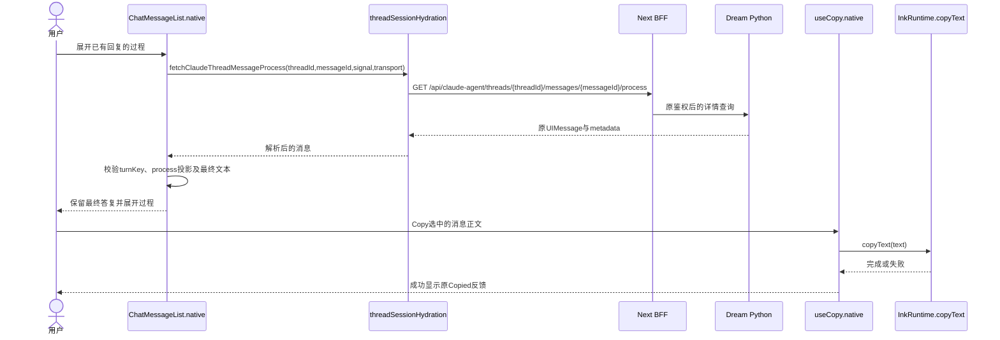

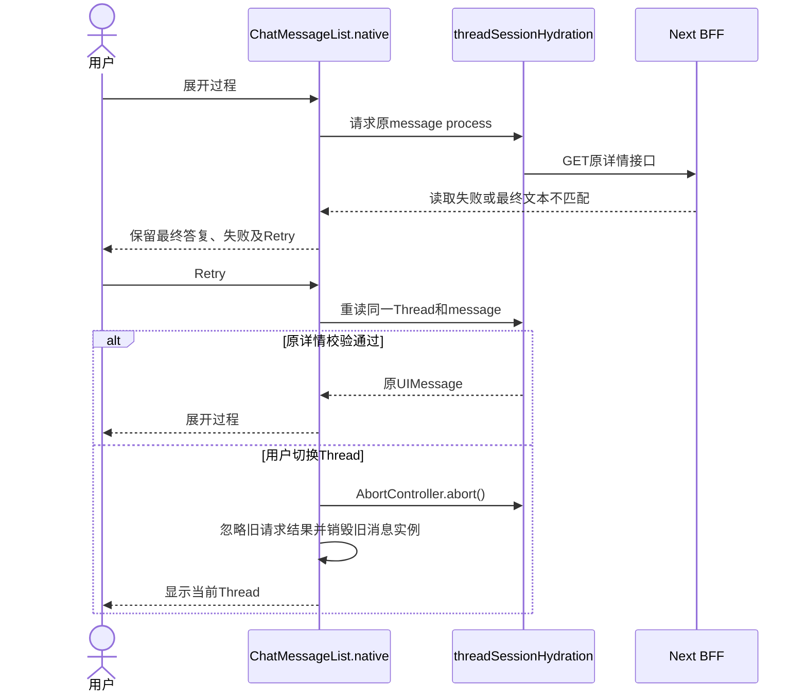

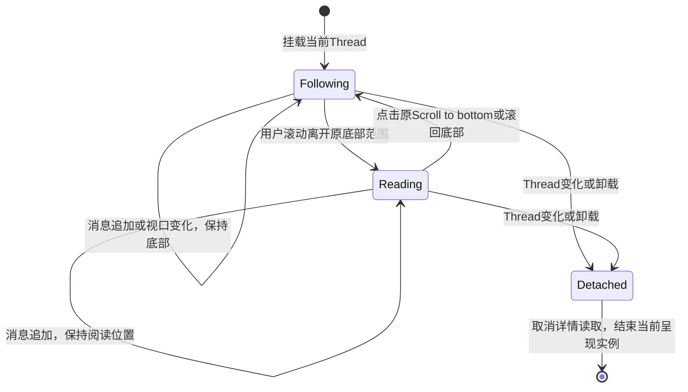

### 按实际模块迁移

原生Agent弹层复用`deckAgentSelection.ts`，`DeckChatSelector.native.tsx`只持有开关、查询词、当前键盘选项和锚点；选择后回调原`{deckId,agentId}`，关闭及搜索取消均保留调用方的当前选择。目录loading禁用触发器，目录error保留原错误提示，无匹配时显示原空结果。系统键盘出现后弹层在可见区域内向上或向下展开；iOS关闭手势与Android返回调用同一关闭入口。Web原弹层及焦点行为保持。

iOS的SwiftUI入口提供容器和系统键盘调整后的区域，RN页面关闭额外键盘避让并在该区域内部滚动；独立Native Modal管理自身安全区与键盘。软件键盘验证同时检查输入区与发送操作，硬件键盘回执单独记录。

原Deck图标经固定路径投影交给`react-native-svg`，按当前12图标和5色token生成；`Icons.tsx`、`deckVisuals.ts`及第三方包保留。Font Awesome 5的SVG/JS图标适用CC BY 4.0并要求署名，生成JSON保留来源/版本/许可；外部分发时须将署名随制品提供。官方依据：[Font Awesome 5许可](https://github.com/FortAwesome/Font-Awesome/blob/5.x/LICENSE.txt)，查阅2026-10-28。

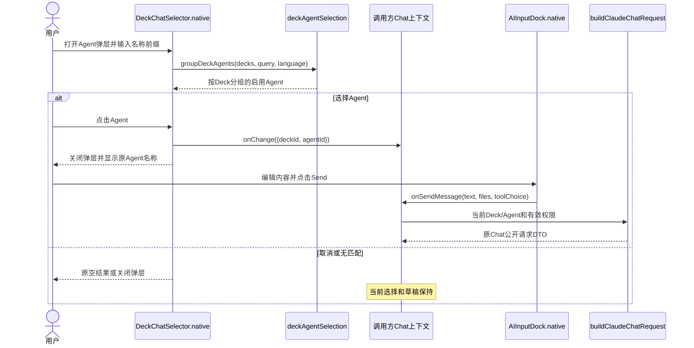

该图定义组件接线合同；当前主App的发送及整页验收仍未完成。`composer-context-parity.tsx`只以内存上下文和回执验证组件，不发起业务HTTP。

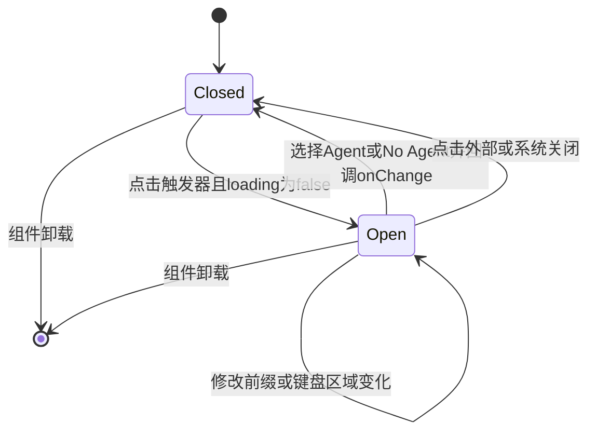

弹层实例随当前选择控件挂载，关闭后清空查询词及键盘锚点；Agent选择由调用方持有。关闭与卸载均不提交消息、不改变现有Thread。原生软件键盘组件验证已确认选择及Send可操作，主App整页和真实HTTP验收继续独立执行。

| 当前模块 | 现行处理 | 最小改动及业务约束 |
| --- | --- | --- |
| `app/client-shell.tsx` | 导入`src/App`，Web resolver选择`App.web.tsx` | 保留Next路由与BFF |
| `app/_dream/router/story-workspace.tsx`与布局 | 原生导航逐项承接 | Web路由保留；Dream创建/审核保持移动排除 |
| `components/chat/ChatView.tsx`、`ChatPanel.tsx` | RN对话列表/输入/发送/停止正在接线 | 复用原DTO、SSE reducer及Stop所有权；工具批准、附件、上下文选项达到原业务等价后验收 |
| `components/chat/threadSessionHydration.ts` | 原样业务逻辑复用，增加可选transport注入 | 原Web默认fetch，原生注入本机HTTP |
| `lib/browserSession.ts`、`claude-agent-sse-utils.ts`、`chat/threadStop.ts` | 复用原会话、parser/reducer和停止实现 | 不复制状态机 |
| `components/chat/Icons.tsx` | Web原样保留，原生按实际使用替换图标叶子 | DOM SVG只在Web/局部网页区域使用；无需全库先改 |
| `components/chat/Modal.tsx`与`Modal.css` | Web原样保留；原生Modal使用RN组件 | CSS由Next加载，原生组件使用StyleSheet |
| `components/DeckManager.tsx`及`components/deck/` | Web原页面保持；Native按原业务组织首页、Work、维护及版本 | 原API/DTO与App目录共享；具体实现和平台验收见后文阶段记录 |
| Tiptap/富文本、草图、复杂文档预览 | 局部Web文档适配 | 原第三方源码与CSS保留；原生负责打开/返回/文件交接 |
| `@modelcontextprotocol/ext-apps`及MCP App HTML | 第三方包保持，局部Web宿主承载 | 不修改包代码；保留原origin、AppBridge与权限合同 |
| `contexts/AuthContext.tsx`和Auth表单 | Web保持，原生复用正常网页登录 | 登录后本机BFF Cookie进入平台HTTP存储；JS只接收公开session/CSRF |
| `app/api/**`、`app/auth/**`及`packages/mcp-apps-runtime` | 端侧Next/Node运行 | 服务端模块保持服务端，不进入Hermes |

### 原生活动与定时任务详情

原`ActivitySidebar.tsx`、`useActivitySidebarData.ts`、`activitySidebarModel.ts`和只读`ScheduledTaskDetailSidebar.tsx`定义活动读取、展示与跳转。当前Native实现复用原协调器和排序模型，通过`useNativeActivitySidebarData.native.ts`注入本机HTTP与AppState；`includeDream=false`排除移动端工作台来源。Web保持原DOM/CSS与默认fetch、可见性、来源和定时读取规则。

| 模块/实例 | 职责及生命周期 |
| --- | --- |
| `Business` | 持有活动开关、显示筛选、只读任务详情；当前Chat与输入实例保持挂载；活动、任务详情互斥，选择另一Thread沿原openThread执行 |
| `useActivitySidebarData` | 原最近Chat扫描、今日任务读取、独立错误/重试、日期变更和定时刷新；可选transport/foreground/includeDream对应实际平台差异 |
| `useNativeActivitySidebarData.native` | 监听AppState，只有活动打开且前台时启用读取；关闭、后台和卸载取消在途读并结束定时器；401沿原会话刷新，不提交业务 |
| `ActivitySidebar.native` | 原优先级、日期历史、来源显示菜单、搜索/刷新/关闭及删除入口；一个主体滚动区；移动端来源为Chat及今日定时任务 |
| `ScheduledTaskDetailSidebar.native` | 原只读任务信息、prompt、规则、执行模型、源/执行对话及下次时间；前台读取原definition/history，关闭或后台取消读取，迟到回执退出更新 |
| `scheduledTaskDetailPresentation` | 从原Web提取同一规则文本、对话过滤/排序/去重；Web及Native共用，调度和任务状态继续由服务器定义 |

活动按钮使用原铃铛与文案，位于原Chat顶部New旁。活动关闭返回原Chat；打开搜索后，搜索控制器独立于底层被隐藏的场景，关闭搜索回到活动。选择任务进入原只读详情，选择源/执行对话打开回执中的精确Thread。详情关闭返回原Chat。列表、面板或读取失败均退出任务创建、重新派发及自动重发条件；自动活动读取和任务详情只发GET。历史删除保持原DELETE，由用户明确点击触发，成功后从历史及最近活动同步移除。

面板在当前安全区内覆盖主场景；底层主场景对无障碍浏览隐藏，Chat输入和附件实例保留。显示菜单具有独立返回/关闭与实测高度夹取；搜索使用原Native搜索弹层。Android硬件返回及iOS无障碍Escape沿当前面板/弹层层级关闭，真实平台操作单独验收。

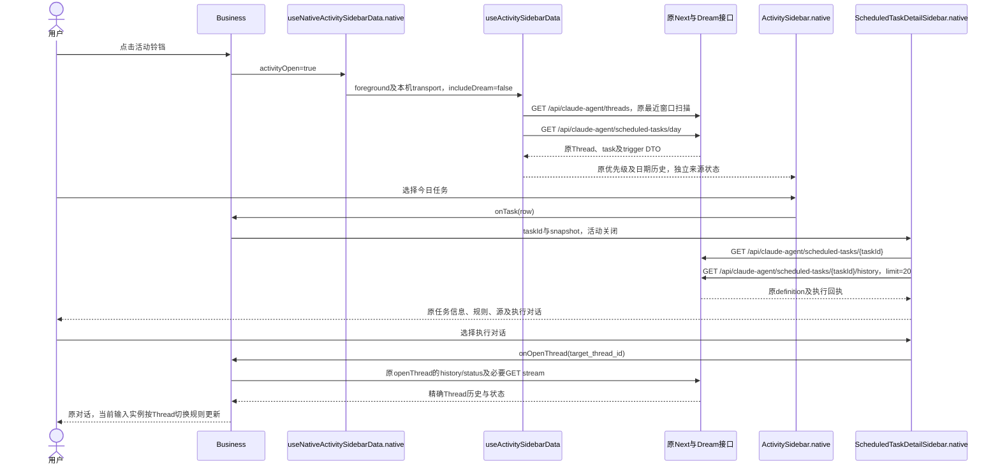

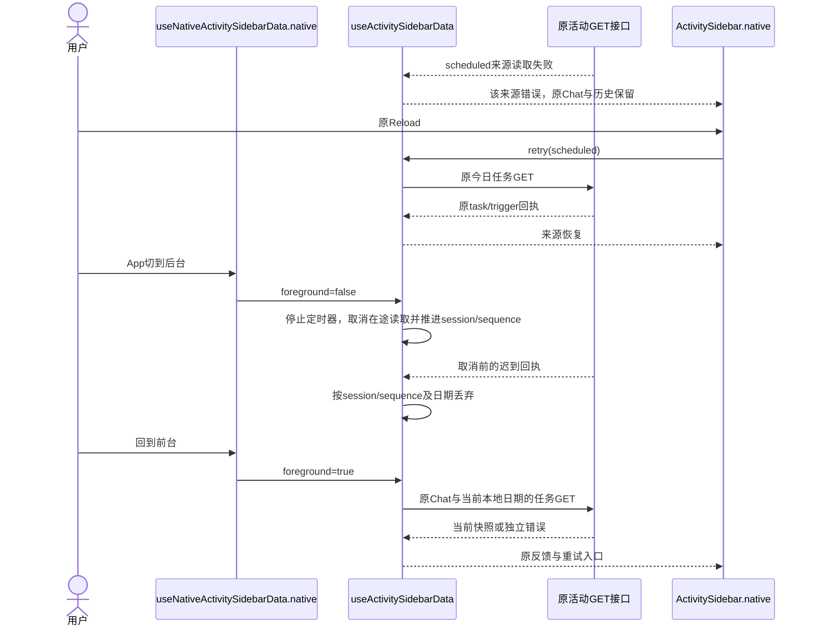

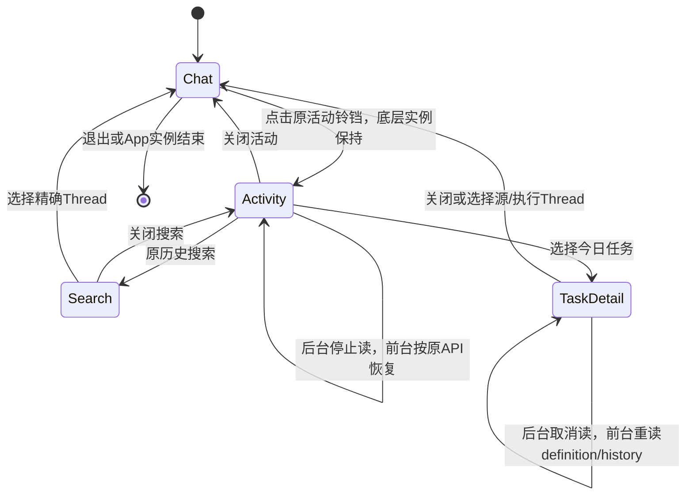

当前活动相关Web类型、13项原组件/模型回归与隔离Next生产构建通过。正常Web继续使用原运行包；共享改动的正常服务采用另行登记。Native类型、组件及系统运行结果归执行记录；完整主导航、Workspace、分享及其他页面继续待实施，当前页面整体未验收。

### 原生排队卡与侧会话

原`ThreadInputQueueCard.tsx`、`ChatPanel.tsx`和队列PRD定义排队操作。Native原型曾只呈现引导和取消；当前`ThreadInputQueueCard.native.tsx`恢复同一条目的状态、引导、删除、编辑及侧会话菜单，复用原i18n与SVG几何。Web组件、CSS、接口和权限保持。

| 对象 | 当前职责与生命周期 |
| --- | --- |
| `ThreadInputQueueCard.native` | 以message_id为实例键；保存菜单、编辑稿与单次操作pending；关闭菜单和取消编辑退出业务提交条件；条目移除或Thread切换后卸载 |
| `useNativeChatThread.native` | 持有当前Thread的队列回执、错误、编辑恢复稿和检查状态；原API负责revision校验及持久化；本地reader epoch负责读取失效，selectionEpoch负责编辑回执的页面归属 |
| 编辑恢复稿 | 原取消成功后重新排队失败时保存新message ID和文本；用户点击原Retry后沿用该ID，成功清除；同一对话前后台切换保留草稿及在途回执；当前Thread关闭或切换按原组件生命周期结束 |
| 源`Business`实例 | 转为侧会话时保持挂载，源Thread、输入稿、附件与读取继续由原实例所有 |
| 侧`Business`实例 | 原side-task回执返回后以thread_id挂载；复用相同组件、配置、鉴权、确认、输入、文件和恢复模块；iOS以pageSheet呈现，关闭只结束侧实例读取，源会话保持 |

排队卡只展示原`isThreadInputQueueCard`允许的queued和selected。queued且本机owner可引导或编辑；queued可删除或转为侧会话；selected保留状态并禁用这些操作。权限条件来源于原卡片及服务端回执。编辑按原expected_revision取消旧条目，再使用当前Deck/Agent及有效toolChoice提交替换条目。取消失败时保留原编辑稿及错误；替换提交失败时显示原恢复文案和Retry。409与权限、owner、网络错误沿原反馈映射；读取状态退出自动重新发送条件。

编辑和重试的页面归属由当前Thread ID与selectionEpoch共同校验；新建、选择Thread和卸载推进selectionEpoch。前后台与reader重连只推进读取epoch，已提交编辑继续等待原HTTP回执。同一选择周期内，失败保存原替换ID和文本，重试的成功/失败均释放pending；离开再打开相同Thread时，前次选择的迟到回执退出当前恢复区更新。后端操作结果继续由原inputs持久化和查询定义。当前实现仅覆盖保持挂载的App实例；进程终止前尚未收到的编辑文本退出本阶段保留证明范围。

侧任务仅由原POST side-task创建和派发。`launch_status`或`error_code`表示首轮未启动时，仍打开已创建的侧Thread并显示原失败反馈。当前主页面复用同一个`Business`函数创建侧实例，未增加后端管理器、运行库或业务接口；`BackendRuntimeManager`启动Promise保持App级共享。关闭侧弹层保持服务端任务状态，源/侧实例各自订阅同一App前后台事件并恢复各自Thread。排队接线阶段18项Native边界技术检查通过；编辑生命周期修订后完整23项技术回归通过，包含5项前后台/重试/旧选择场景。实际iOS队列、AppState、主入口侧弹层和真实派发继续单独验收。

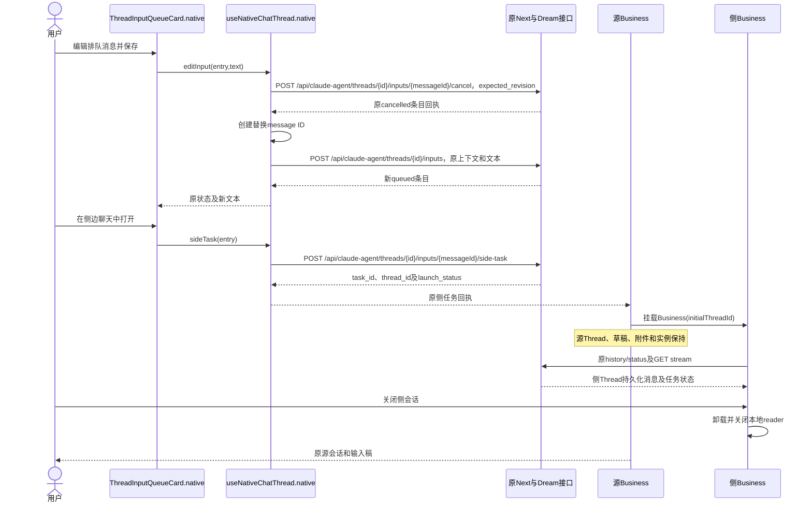

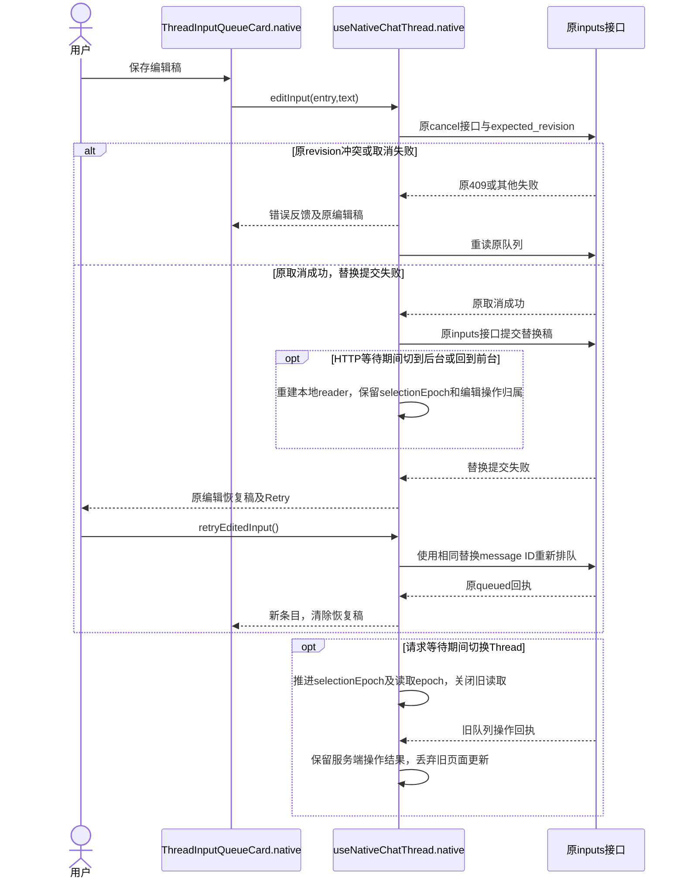

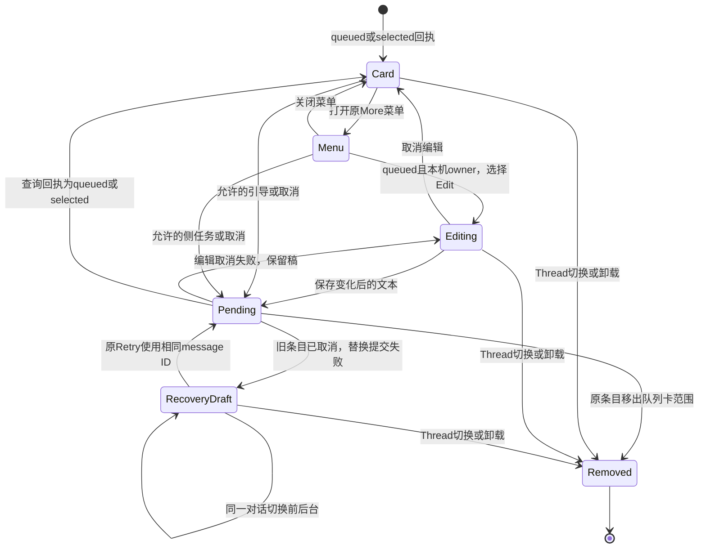

### 原生启动读取与重试

原生普通入口曾在Agent目录首次读取失败后保留错误，原重试按钮仅重读历史或Thread；配置失败的finally曾将配置标为已读。当前由[useNativeChatSetup.native](../../../frontend/app/_dream/components/chat/useNativeChatSetup.native.ts#L1)持有运行库就绪、原配置与目录的读取实例，[App](../../../frontend/src/App.tsx#L1)保留当前Thread、输入卡和附件实例。该修订退出页面重排、业务接口及权限策略变更范围。

`BackendRuntimeManager.ensureStarted()`继续共享App级启动Promise。读取hook在运行库就绪后通过原HTTP查询`/api/system-config`、`listDecks/getDeck`，只在配置快照通过字段校验后令configLoaded为true；布尔字段继续取自服务端。首次配置缺失时，原发送入口及快捷操作显示平台禁用态。目录失败保留上一份目录，原错误区显示重试；单项Deck详情失败沿原列表DTO回退。用户重试增加本地读取revision，重新查询配置/目录及当前绑定Deck，不重新挂载输入、不发起消息或改变服务端任务。

成功读取过配置后，刷新失败保留已有展示快照，错误区域持续提供原重试入口；当前权限仍由每次原业务请求的服务端校验定义。配置和目录读取共享本次AbortController，旧实例结束时触发abort，active标记拒绝迟到响应；当前绑定Deck读取沿原active标记拒绝旧结果。运行库Promise由原生App生命周期所有，组件结束释放页面读取实例。401通知现有SessionGate重读原会话，同一读取轮次只通知一次，原正常网页登录及CSRF合同保持。

`src/platform/transport.native.ts`在调用`openRequest`前分配本次请求id并登记signal取消回调。iOS `InkRuntime.openRequest`沿该id登记URLSession，空值或与当前请求/准备上传冲突时拒绝；既有无id调用继续由宿主分配UUID。AbortSignal调用原`cancelRequest(id)`，覆盖等待响应头和正文读取两个阶段。响应头迟到且signal已结束时取消该响应并拒绝进入正文；EOF及异常结束移除当前监听。仅请求标识、状态进入平台诊断日志。当前代码已接入，技术回归及Simulator资格由本轮执行记录确认，Android宿主按平台单独验收。

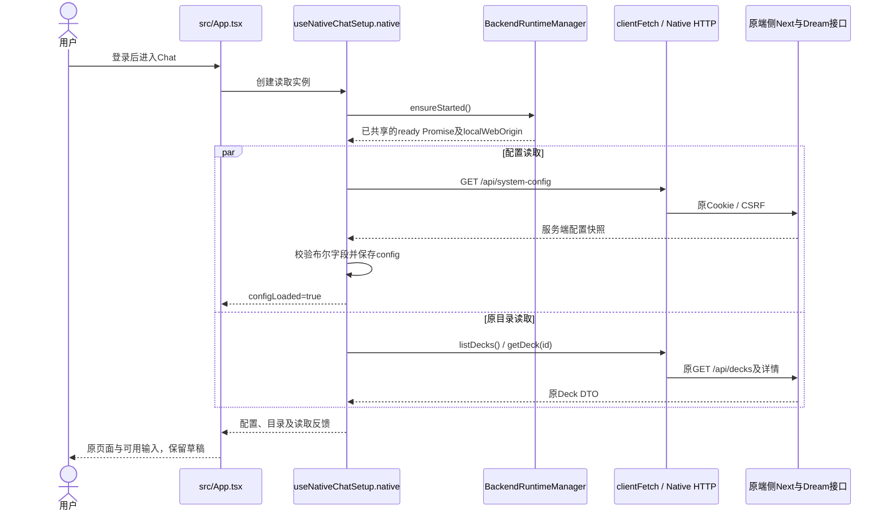

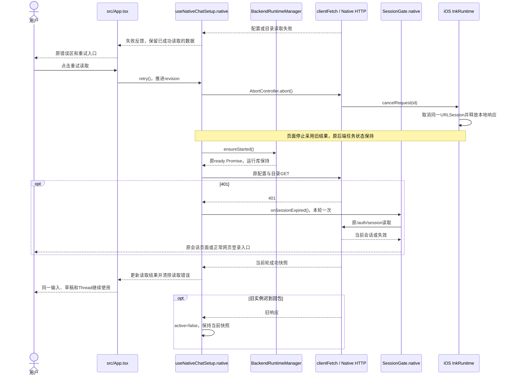

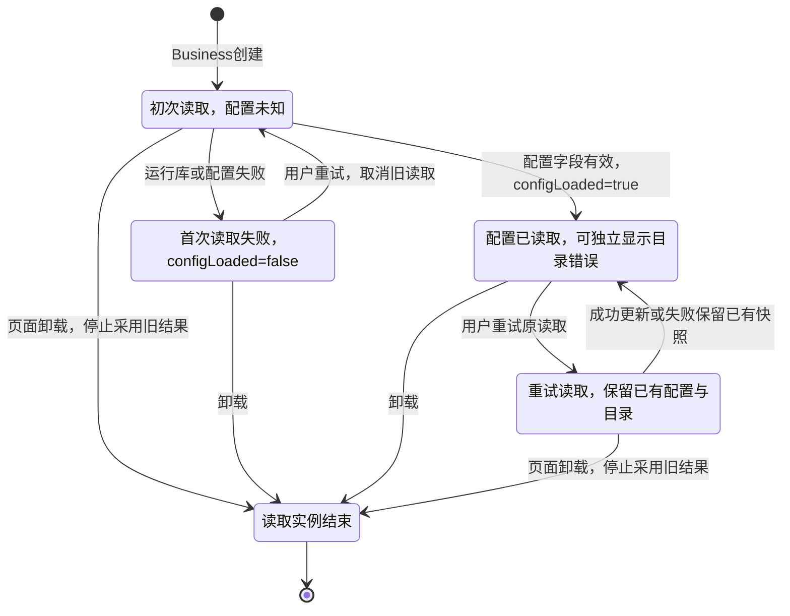

该读取状态与Claude任务状态独立。GET重试只影响本地页面读取，原Thread、任务、队列及Stop继续由原业务模块所有。技术验证直接挂载生产hook与原运行库管理器，fixture仅替换NativeModules/HTTP边界；普通iOS主入口及真实业务分项验收。

### 原生Chat业务接线与恢复

`src/App.tsx`已通过`useNativeChatThread.native.ts`接入App级业务调用。新会话选择继续使用原Deck/Agent字段，历史会话绑定以messages接口的Thread记录及原Deck详情为准；绑定读取未完成时保留输入等待状态。系统prompt与Full access来自原`/api/system-config`，模型和权限继续由原BFF/后端解析。原型页面仍处于停止部署状态；完整输入卡已连接原Tiptap、文件上传及根级草图浮层，消息呈现、整体布局与相邻页面迁移继续实施。

| 模块 | 所有权与复用 | 当前验证范围 |
| --- | --- | --- |
| `useNativeChatThread.native.ts` | 一个当前Thread的本机HTTP读取、AppState和epoch；复用原DTO、SSE reducer、history/status、queue和Stop | 当前23项隔离HTTP/SSE边界、Native类型和Metro通过；前一隔离Hermes的finish-before-EOF及普通真实Chat/Stop有阶段回执；本次编辑修订的iOS系统生命周期、实际队列和侧弹层继续验收 |
| `threadSessionHydration.ts` | 原history → status → idle稳定查询及分页；全序列追加可选transport | 原Web合同回归保持，Native使用同一个DTO解析 |
| `threadInputQueue.ts` | 原inputs读/写、引导、取消和侧任务DTO；追加可选transport | 运行中草稿进入同一队列，首个POST保持；Native原排队卡及编辑恢复、侧Thread接线已实现，实际iOS验收继续 |
| `toolConfirmation.ts` | 原pending-kind判定与tool-confirm回执解析；追加可选transport | 默认Web fetch保持，Native传入本机HTTP；权限分类保持 |
| `askUserQuestionModel.ts`与`ToolConfirmationDock.native.tsx` | 提取原问题规范化及答案键；原生呈现普通、提问、网络和reject-only | 模拟器组件验证通过；特殊编辑器批准及完整工具结果继续迁移 |

每个POST的submission ticket属于该次调用，旧读取的失败回调只更新其原ticket。Thread切换通过epoch丢弃旧消息及查询结果，关闭本地reader；服务端任务继续按原执行生命周期运行。运行中纯文本进入原inputs接口，附件按原规则拒绝排队并保留草稿。读取恢复只调用原查询及GET stream，恢复路径不重复POST消息。

本地reader收到解析后的规范`finish`时结束当前读取，随后通过原history/status查询更新持久化消息和任务状态；HTTP EOF与读取中断沿原恢复入口处理。`finish`结束当前响应流，服务端`status.running`继续定义任务状态。查询返回运行中时订阅原GET stream，查询空闲后恢复原发送状态；当前连接关闭只释放本地读取，服务端Stop仍通过原Stop接口及回执执行。finish修复阶段11项Native边界技术检查覆盖finish早于EOF及finish后服务端仍运行，真实iOS停止验收继续独立进行。

原生HTTP或stream返回401时通知App级`SessionGate.native.tsx`重读原`/auth/session`。同一次会话刷新共享Promise，公开session快照仍由`browserSession.ts`校验；会话失效后进入原网页登录入口。回到前台时重读会话，退出登录保留原`/auth/logout`与CSRF合同。当前401用例验证通知与拒绝重发；完整原生登录界面和账户切换继续单独验收。

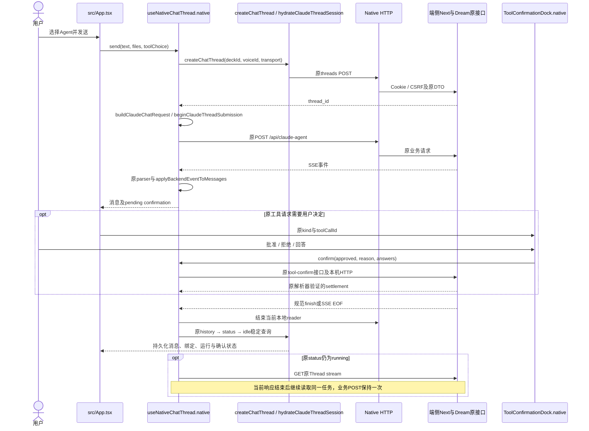

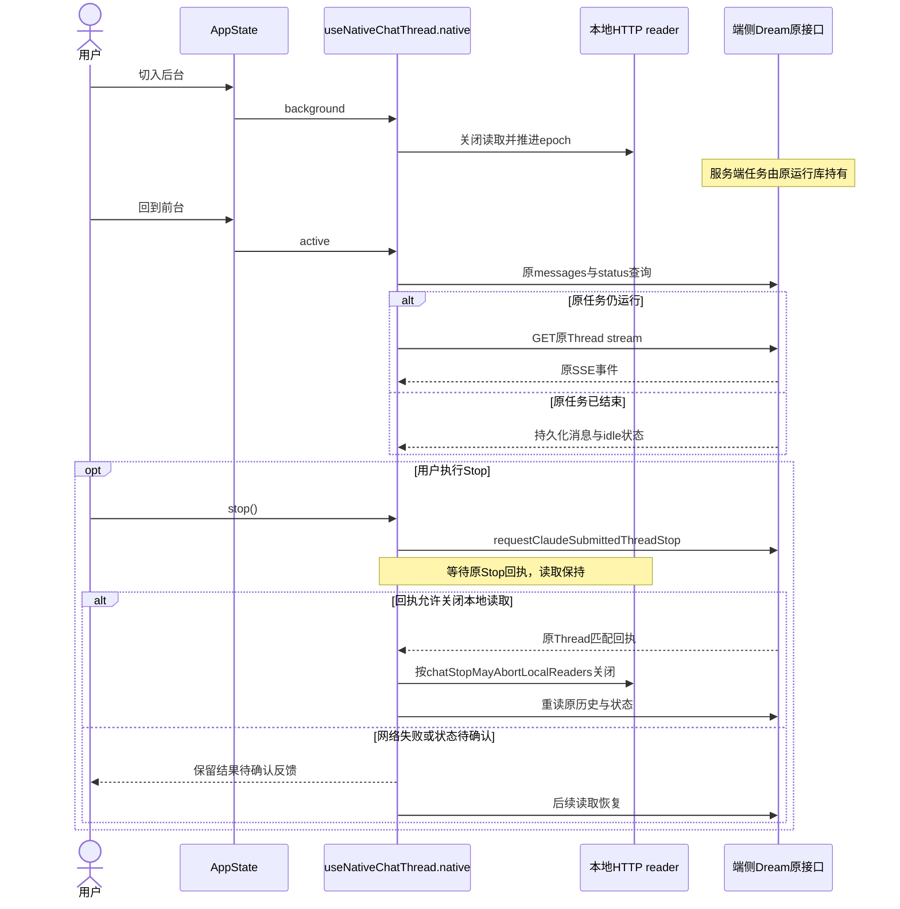

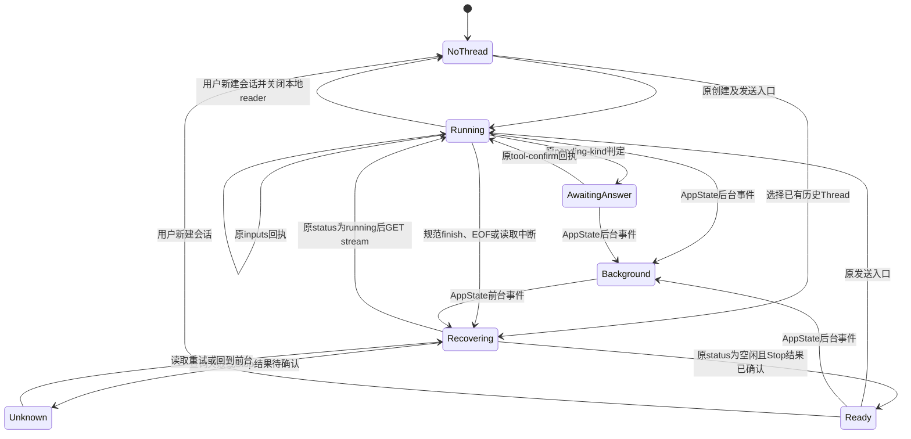

图中状态描述客户端视图和读取阶段，服务端Thread状态仍使用原status DTO。进程重开后先启动原运行库并读取历史，用户选择原Thread后恢复绑定及状态；当前适配器不保存第二份Thread数据库。当前代码、隔离技术用例与真实业务验收分别记录，完整原生主页面仍未通过发布验收。

### 页面骨架与滚动

```text
Web：现有侧栏｜当前完整业务页面（各自滚动）
                 └ 对话列表 / 编辑器 / 底部输入
原生目标沿原ChatView：系统安全区（项目主题）
      右上操作：New / 活动铃铛 / 更多；有任务时保留计划入口
      新对话首页：完整输入卡（附件、Agent选择、权限模式、发送）
                  原三项快捷操作
                  原历史页签 / 搜索 / 日期分组历史（独立滚动）
      已有对话：原消息、工具与批准、分页 / 底部输入卡 / Stop
      原底部导航与More展开关系；Dream工作台创建范围按既定排除项处理
      系统安全区（项目主题）
```

键盘打开时输入区随可用高度移动，消息列表缩短。页面返回关闭当前局部文档或返回列表；请求Stop由显式按钮发出。切换栏目仅影响界面，运行库由App持有。工具批准与附件等未迁移入口必须先完成后续实现，当前精简界面保留为开发中构建。

## 交互时序

### 原页面等价迁移清单

| 原组件与源码 | 等价要求 | 当前实施与验证 |
| --- | --- | --- |
| `ChatView.tsx`顶部操作与首页结构 | 原New、铃铛、更多及计划入口；首页输入卡位于快捷操作与历史上方；已有对话输入位于底部 | 首页输入/快捷操作/历史及搜索已接入ChatPage.native；完整顶部工具栏与整页视觉继续迁移，主包保持停止部署 |
| `AIInputDock.tsx` / `.css` | 原附件/草图、Agent上下文、Full access或Auto/Manual、发送/Stop条件、已有草稿与上传状态 | `AIInputDock.native`已连接原Tiptap、Native控制、文件适配及根级草图PNG回包；Web125通过，完整页面、真实文件字节上传和独立账户业务继续验收 |
| `DeckChatSelector` | 原Deck/Agent关系、错误/加载及下一轮选择，已有对话冻结上下文规则保持 | 原生选择弹层及共用Deck/Agent筛选已接入新对话；已有会话下一轮Agent选择与上下文展示继续验收 |
| `QuickActionStrip.tsx` | 原顺序、原标签/提示词、SVG、胶囊换行布局与onSelect(item) | `.native.tsx`已新增；Web DOM/样式保持，原工厂提取至`chatLandingActions.ts` |
| `Icons.tsx` | Web文件原样保留；原生仅迁移实际用到的图标并保持几何 | `.native.tsx`随原组件补齐图标；新增历史删除和顶部菜单图标待本轮最终源码校验 |
| `App.css`两套字体与`tokens.css` | 原手写字体、Latin/中文unicode范围、三种主题颜色，禁止替换为系统字体或新调色板 | 原字体生成iOS TTF、保留字形及名称；InkLabel适配混合文本，颜色投影逐值核对；完整页面视觉继续验证 |
| 原历史页签、搜索与分组 | 原文案、搜索参数、分页与日期分组、失败/重试及活动列表入口 | 日期模型已从原ChatView提取共享，原Web内联布局保持；原生分组列表、HTTP读取与搜索对话框已接线；活动面板及完整导航继续迁移 |
| `ChatPanel` / `ChatMessageList` | 文本、推理、工具、授权、文件、原SSE、Stop与恢复、页面状态保持 | 已复用parser/reducer/Stop；原生普通Markdown、推理与历史过程折叠已有源码候选；滚动视口回归、Hermes、复杂工具/文件/MCP Apps及完整操作继续验收，主包停止部署 |
| `StoryWorkspaceSidebar` | 原底部导航、图标、选中状态、More展开及既定移动排除范围 | 待等价迁移；原型的More退出单页退出交付依据 |

源图标仅迁移已消费的叶子，使用锁定`react-native-svg@15.15.0`；依据[官方兼容表](https://raw.githubusercontent.com/software-mansion/react-native-svg/v15.15.0/README.md)，2026-10-27查阅。原字体由`prepare-fonts.py`使用固定fontTools/Brotli解压或复制，保留原OFL元数据并记录来源与产物摘要；工具说明见[fontTools官方发行资料](https://pypi.org/project/fonttools/4.60.1/)。

`check-original-ui-contract.mjs`只证明已迁移SVG几何及颜色值一致；`e2e/native/original-ui-parity.tsx`只承载隔离组件渲染和回调验证，运行库、账户和模型均不启动。原生整页、原业务和正式发布分别验收，当前均未完成。

### Chat首页、历史与搜索接线

`ChatPage.native.tsx`按原`ChatView`组织首页：上方输入卡、原三个快捷操作、历史页签/搜索和日期分组列表。快捷操作、历史工具栏及列表共用原生历史滚动区域，键盘收窄视口时保留滚动访问；输入卡独立于该区域。进入Thread后，消息列表在上，原输入卡在下。布局通过父容器flex顺序调整，同一输入卡实例保持挂载；首个Thread ID产生时保留Tiptap文档、当前草稿和文件所有者。用户显式新建或选择其他会话时由App推进composerKey。

历史读取使用`useNativeChatHistory.native.ts`及原`listChatThreads`/`deleteChatThread`。原每页20条并读取额外1条判定更多、48px滚动触发和180ms搜索防抖均沿原页面取值，属于页面读取参数。搜索保留`query`、`search_scope=all`及`retrieval_mode=fuzzy`；查询文字、匹配摘要、日期及空/失败反馈使用原文案和日期模块。搜索弹窗内关闭及选择回到原页面，选择时调用原`openThread`恢复；搜索与快捷操作渲染不预先创建Thread。

| 对象 | 创建/更新与结束 | 当前技术证据 |
| --- | --- | --- |
| Native首页历史协调器 | 首页可见时读取，首次进入Thread或切出Chat时中止自身读取；回到首页/前台重读 | 8项读取合同及当前141项混合技术回归通过 |
| 列表读取 | 单个分页请求，刷新推进sequence并中止旧请求；失败保留原页及offset供重试 | 下一页失败重试相同offset，逐页去重 |
| 搜索读取 | query/open/前后台变化失效旧sequence及AbortSignal，文案沿原模糊搜索 | 新查询与关闭后旧响应均退出当前结果更新 |
| 删除操作 | 原DELETE成功后从列表/搜索移除，记录已删ID并修正已消费offset；写入保持原服务端所有权 | 等待中的旧刷新包含被删行时，回包过滤该行；失败保留并支持原入口重试 |
| 原生搜索弹窗 | 独立Native Modal，按原输入框、匹配摘要和日期显示；关闭退出读取 | 模态控制器独立拥有iOS键盘避让，主场景继续由SwiftUI管理 |
| 输入卡实例 | 首页和Thread布局共用固定React位置，显式导航推进key | RNW实例/草稿保留及实际iOS长稿发送通过；完整页面与多附件/旋转/IME继续验收 |

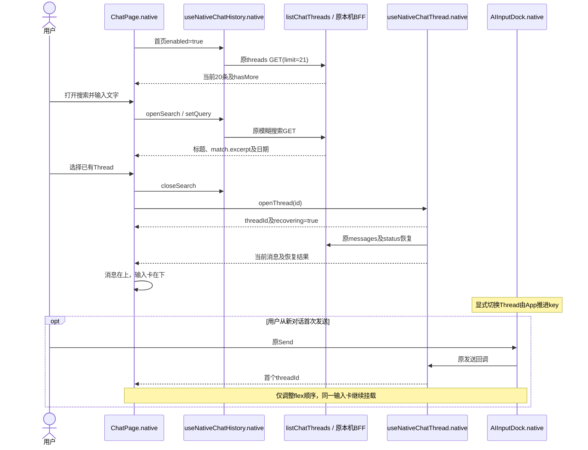

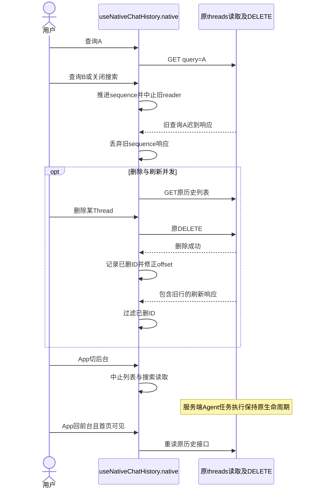

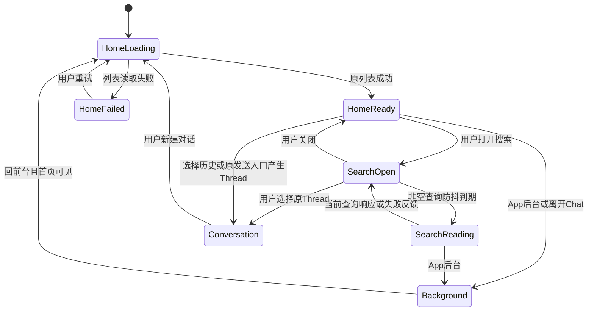

本阶段保留完整应用未验收状态。顶部活动/计划/工作区/分享、底部完整导航、复杂消息、相邻页面及真实独立端侧业务继续实施。当前历史逻辑只协调页面读取与原DELETE结果，Agent任务、Stop、权限、持久化及登录分别复用原模块。

实际iOS隔离入口曾在选择历史后报Hermes `TextDecoder`缺失；补齐启动构造器后，Conversation39历史恢复及首次发送/原SSE回复已通过组件复验。该入口使用内存HTTP/SSE及Mac Next编辑文档，真实账户、模型和端侧独立业务继续验收。`src/platform/sdkWebApis.native.ts`作为Native启动兼容候选，在原SDK导入前仅注册缺失的TextDecoder/TextEncoder和ReadableStream/WritableStream/TransformStream，已有构造器保留。锁定依赖为`text-encoding-utf-8@1.0.2`和`web-streams-polyfill@4.3.0`，Web入口不导入该启动模块，业务HTTP/SSE及第三方SDK源码保持。当前7项启动技术合同通过，包含编码、Stream管线及失败取消；实际Hermes已通过上述历史/发送组件流程，完整Web Streams兼容性及SDK其他入口退出当前验证范围。安装包所附许可分别为Unlicense和MIT；MIT声明须随分发制品保留，完整第三方声明在正式分发前复核。


实际隔离iOS长稿键盘回执：741字符的输入经原发送builder提交，fixture观察原DTO得到`longExact=true`；同进程新建后从历史重新打开恢复消息及回复。该回执覆盖当前组件的英文长稿、manual权限和键盘布局；真实模型、进程重开、中文IME、多附件、旋转、VoiceOver及长消息手势滚动继续验收。主应用继续停止部署。

### iOS宿主的当前视口尺寸

锁定React Native 0.81.5的`React/Base/RCTRootView.m:135-145、278-280`按当前bounds及sizeFlexibility计算尺寸，并保存初始intrinsicContentSize。实际SwiftUI键盘复测出现原生页面保留大尺寸后上移的现象；`InkMemoryApp.swift`的`ReactNativeAppView.sizeThatFits`消费当前有限提议尺寸，背景继续单独延伸安全区，任务和编辑实例保持。官方依据：[UIViewRepresentable.sizeThatFits](https://developer.apple.com/documentation/swiftui/uiviewrepresentable/sizethatfits(_:uiview:context:))，查阅2026-10-28；该API自iOS16提供，当前[工程最低系统配置](../../../frontend/ios/InkMemory.xcodeproj/project.pbxproj#L471)为`IPHONEOS_DEPLOYMENT_TARGET=16.4`。

### 输入区状态复用

`useComposerDraft.ts`承接原`AIInputDock`的query、uploadedFiles、toolChoice及提交回调，不访问HTTP、DOM或运行库。Web原Tiptap、上传、Skill菜单、prefill nonce和配置事件保持。`AIInputDockControls.native.tsx`消费同一状态；原生主入口已接入局部富文本、原文件上传及草图PNG回包；完整页面与真实账户上传继续验收。

局部富文本实现归`MarkdownInputEditor.native.tsx`：App提供当前运行库`localWebOrigin`和草稿，组件只加载该origin的`/native/composer`。该Next路由直接渲染原`MarkdownInputEditor.tsx`，保留原Tiptap扩展、Markdown往返、字体、键盘与编辑器滚动样式。原Web输入入口继续直接挂载原组件。`react-native-webview@14.0.1`以MIT许可原样使用；[官方通信说明](https://github.com/react-native-webview/react-native-webview/blob/v14.0.1/docs/Guide.md#communicating-between-js-and-native)和[固定版本Podspec](https://github.com/react-native-webview/react-native-webview/blob/v14.0.1/react-native-webview.podspec)查阅于2026-10-28，当前工程采用已有Legacy Architecture。构建与实际输入分别核验兼容性。

| 对象 | 所有者与生命周期 | 规则 |
| --- | --- | --- |
| 原Tiptap实例 | 局部文档挂载至文档卸载 | 创建原扩展与Markdown编辑模型；卸载由原组件销毁 |
| RN草稿 | 输入区调用方`useComposerDraft` | 文档重载时使用最近已接收草稿恢复；发送及拒绝恢复沿原共享规则 |
| 文档身份`documentId` | 每次局部文档加载生成 | 旧文档状态和编辑事件退出当前输入更新 |
| 状态`revision` | RN按文档递增 | 文档只消费更高revision的配置；IME组合期间延后应用 |
| 编辑`eventCount` | 文档每次真实Markdown变更递增，RN回传已接收值 | 旧确认的文字退出覆盖条件；已确认的外部预填及清空更新编辑器，程序更新保持`emitUpdate:false` |
| 本机运行库 | App级`BackendRuntimeManager`及原生单例 | 编辑器接收地址，生命周期与重试仅涉及局部文档 |

局部文档只输出ready、change、height、focus、blur及submit意图；实际发送继续由RN调用原业务回调。文档退出认证、文件上传、工具批准和HTTP业务接口职责。字体声明复制原`App.css`两套字体范围，文档透明样式只匹配`data-native-composer`。原72px至320px首选编辑高度范围保持，RN按文档自然内容高度设置首选尺寸，输入槽、输入卡与文档视口允许收缩。局部文档仅对`data-native-composer`内的编辑区应用`max-height:min(20rem,100dvh)`，长文本在原编辑区内滚动；ResizeObserver及内容MutationObserver合并到单个动画帧读取自然高度，视口扩大后恢复首选尺寸。原Web编辑器CSS及输入流程保持。

导航由`onShouldStartLoadWithRequest`逐次匹配完整文档URL；所有scheme交给该检查，避免第三方默认whitelist拒绝后自动调用`Linking.openURL`。消息按当前文档URL、documentId及编辑序号校验；JSON通过序列化传给`MessageEvent`，正文保持代码字符串之外。文档加载或Web内容进程失败显示原重试入口，RN已接收草稿保持。附件粘贴、Skill菜单、原生页面接线和完整iOS真实输入验收仍为实施项。

```mermaid
sequenceDiagram
  participant RN as MarkdownInputEditor.native
  participant Doc as /native/composer
  participant Editor as 原MarkdownInputEditor
  participant Draft as useComposerDraft
  RN->>Doc: 加载App提供的本机文档URL
  Doc-->>RN: ready(documentId)
  RN->>Doc: state(草稿, revision, 已确认eventCount)
  Doc->>Editor: 原Markdown属性
  Editor-->>Doc: 用户编辑后的Markdown
  Doc-->>RN: change(documentId, eventCount, value)
  RN->>Draft: onChange(value)
  Draft-->>RN: 当前草稿
  RN->>Doc: 回传当前草稿与已确认编辑序号
  alt 配置revision更高且确认序号覆盖当前编辑
    Doc->>Editor: 应用外部预填或清空，emitUpdate=false
  else 文档身份或确认序号过旧
    Doc->>Doc: 保留当前用户文字
  end
  opt 宿主键盘改变文档视口
    Doc-->>RN: height(自然内容高度)
    RN->>RN: 保留首选高度，按当前视口收缩
    Note over Doc,Editor: 原编辑区内部滚动，草稿和权限保持
  end
  opt 局部文档重新加载
    Doc-->>RN: ready(新documentId)
    RN->>Doc: 恢复RN最近已接收草稿
  end
```

| 原字段或条件 | 共用规则 |
| --- | --- |
| `showStopAction` | loading且提供onStop且当前无文字/附件草稿 |
| `canSend` | disabled为false、loading为false或提供onStop、无在传附件、存在文字/附件；四项条件同时满足 |
| `fullAccessEnabled` | 原服务配置为true时本次发送auto；原toolChoice选择保持 |
| 提交回调拒绝 | 当前query为空字符串时恢复原trim后文字；当前附件数组长度为0时恢复原附件 |
| 提交回调完成 | 释放该次已提交附件的previewUrl；新草稿及新附件保持 |

### 草图局部文档与原附件上传

iOS宿主在SwiftUI中仅让项目主题背景延伸容器安全区；RN内容遵循容器及键盘边界。`src/App.tsx`持有一个`AIInputDock.native`引用和根级`SketchInputSurface.native`。原生输入卡提供原Tiptap、文件卡、Agent、权限模式及Send/Stop，草图仅使用固定`/native/sketch`文档中的原`SketchInputDialog`。原Web对话继续直接渲染原组件，第三方草图包及CSS保持。

| 实例 | 创建与更新 | 结束与清理 |
| --- | --- | --- |
| `AIInputDock.native` | 按显式新建/选择会话的composerKey创建；首次POST获得Thread ID时保持同一实例 | 用户选择其他会话或离开当前组件时取消自身上传、释放已选副本；原任务生命周期保持 |
| `SketchInputSurface.native` / WebView | 根级创建一个固定本机文档；打开/关闭只调整显示及state.open，文档保持挂载 | Thread导航推进composerKey时销毁；进程结束时由系统回收；内容进程退出提供重载，未导出画布待重新绘制 |
| 原`SketchInputDialog` / SketchDocument | 原组件持有笔画、导入图像和撤销历史；关闭/再次打开保持；成功添加后沿原逻辑清空并关闭 | 跟随本地文档结束；当前设计按原会话内存草稿规则处理，无离线表或跨进程草图恢复 |
| PNG请求 | documentId与requestId匹配；原50MiB附件规则限制字节；同一请求只交给原生一次 | 原生校验PNG签名、解码、大小及文件名，写0600临时副本；文件句柄接入原上传引用计数 |
| 原上传调用 | `useFileAttachments.native.addFiles → useFileUpload`；有Workspace时先同步files，随后沿原storage/direct-upload策略 | 失败释放副本、保留画布；成功保存原附件元数据供原发送入口使用，预览在移除/发送成功/组件结束时释放 |

`SketchInputDocument.protocol.ts`校验文档标识、单调state revision、请求标识、PNG名称、base64与解码大小。局部文档不读取Cookie、CSRF或业务接口；原生上传继续使用当前本机BFF和原鉴权。WebView仅允许精确本机草图URL，外部导航被拒绝。Native导入接口只生成PNG文件句柄，服务端权限及原上传策略继续执行。

```mermaid
sequenceDiagram
  actor User as 用户
  participant App as src/App.tsx
  participant Surface as SketchInputSurface.native
  participant Document as SketchInputDocument / SketchInputDialog
  participant Files as InkRuntime.importSketch / NativePickedFileStore
  participant Dock as AIInputDock.native / useFileAttachments.native
  participant Upload as useFileUpload / 原本机BFF
  User->>App: 输入卡添加草图
  App->>Surface: open=true
  Surface->>Document: state(documentId, revision, open)
  User->>Document: 绘制或导入图像并添加到消息
  Document->>Surface: add(documentId, requestId, PNG)
  Surface->>Files: importSketch(base64, name, maxBytes)
  Files-->>Surface: 校验后的opaque文件句柄
  Surface->>Dock: addFile(handle)
  Dock->>Upload: 原Workspace及存储上传
  Upload-->>Dock: 原存储key与文件元数据
  Dock-->>Surface: accepted=true
  Surface-->>Document: result(documentId, requestId, true)
  Document->>Document: 原组件清空画布
  Document-->>App: close
  Note over Dock: 附件保持在原输入稿，用户仍通过原Send提交
```

```mermaid
sequenceDiagram
  actor User as 用户
  participant Surface as SketchInputSurface.native
  participant Document as SketchInputDocument / SketchInputDialog
  participant Files as NativePickedFileStore
  participant Upload as 原上传器
  User->>Document: 添加草图
  Document->>Surface: 一个待确认PNG请求
  alt PNG校验或上传失败
    Surface->>Files: 释放已生成文件句柄
    Surface-->>Document: 匹配请求的accepted=false
    Document-->>User: 原失败提示，画布与撤销保持
    User->>Document: 再次添加
    Document->>Surface: 新requestId
  else 用户关闭并再次打开
    Document-->>Surface: close
    Surface->>Document: open=false，WebView保持挂载
    User->>Surface: 再次打开
    Surface->>Document: 更高revision的open=true
    Document-->>User: 原画布与撤销历史
  end
  opt 旧文档回包或重复请求到达
    Surface->>Surface: documentId及requestId校验后丢弃
  end
```

```mermaid
stateDiagram-v2
  [*] --> Hidden
  Hidden --> Drawing: 用户打开
  Drawing --> Hidden: 用户返回并保留画布
  Drawing --> AwaitingUpload: 原组件导出PNG
  AwaitingUpload --> Drawing: 校验或上传失败
  AwaitingUpload --> Hidden: 上传成功并由原组件清空
  Drawing --> ReloadRequired: 内容进程退出
  AwaitingUpload --> ReloadRequired: 内容进程退出
  ReloadRequired --> Drawing: 用户重载
  Hidden --> [*]: 会话导航或进程结束
  Drawing --> [*]: 会话导航或进程结束
  AwaitingUpload --> [*]: 会话导航或进程结束
  ReloadRequired --> Hidden: 用户返回
```

输入卡在工具批准显示时保持挂载，原提问/批准呈现与草稿各有所有者。当前主页面布局仍处于停止部署状态；原生草图技术回执、真实PNG上传和独立iOS业务分别验收。Android PNG导入和上传适配仍为待实现事项。

### iOS附件与文件实例

`useFileUpload.ts`继续持有原storage配置、直传选择、回退和错误反馈；新增adapter只替换File校验与字节传输。浏览器默认File/FormData/XHR保持。原`AIInputDock`的文件大小上限和格式化函数归同一helpers导出；原工作区响应读取归`api/workspaceFileUpload.ts`，两端沿用path、savedAt、hash及错误码。`useFileAttachments.native.ts`执行原工作区同步后存储上传，`AIInputDock.native.tsx`组合原富文本、文件卡、权限与发送/Stop控件。

原生方法均归现有`InkRuntime`：`pickFiles`返回系统选中文件的opaque ID与副本元数据；`openFileUpload`只从该ID取得字节，`releaseFiles`只清理已登记副本。服务上传仍为`/api/storage/upload`，工作区上传仍为`/api/workspace/files`，直传URL与method/headers仍来自原`/api/storage/upload-url`。本轮新增后端接口、数据库表和发布服务均为0。

| 实例 | 创建与结束 | 所有权及失败处理 |
| --- | --- | --- |
| 系统文件选择器 | 用户选择Upload files时创建；选择、取消或交互关闭后结束 | 同时保持一个选择器；取消返回空选择，不上传，不改变已有附件 |
| `NativePickedFileStore` | 首次系统文件选择时按App模块创建 | 文件按opaque ID登记；原生上传取得引用，JS退出所有权后等待在途引用结束再删除 |
| 文件副本 | 系统copy导入后复制到App私有临时目录；成功提交、手动删除、失败或组件退出时释放 | 原文件保持；目录0700、文件0600，拒绝目录和符号链接，沿原文件上限预检；预览URI只指向选中副本 |
| multipart文件 | 服务/工作区上传准备时创建；完成、失败或取消时清理 | 边界和header由适配层生成，文件流写入临时body；JS只传句柄和原表单字段 |
| `NativeHTTPResponse`上传 | multipart就绪或直传开始时创建；响应EOF/失败/取消结束 | 复用原响应读取、UTF-8分片与取消；实际已发字节产生服务上传进度，直传25/100阶段值沿原hook |
| 上传准备状态 | body准备开始至请求登记 | 取消在准备阶段登记；body完成后先检查取消，退出网络发送并释放文件引用 |

系统能力使用[UIDocumentPicker copy导入](https://developer.apple.com/documentation/uikit/uidocumentpickerviewcontroller/init%28foropeningcontenttypes%3Aascopy%3A%29)及[URLSession文件上传](https://developer.apple.com/documentation/foundation/urlsession/uploadtask%28with%3Afromfile%3A%29)，查阅2026-10-28。官方Markdown正文分别标注iOS14、iOS7可用；本工程iOS16.4最低版本保持。文档页Markdown由官方入口读取，API由当前SDK构建及隔离Simulator测试核对。

本机BFF上传保持平台Cookie与原CSRF，JS传入Cookie、Authorization、服务凭证和Origin被原生适配层过滤；Origin绑定App当前运行库。直传使用HTTPS发行URL，URLSession关闭Cookie及系统凭证存储，原BFF身份退出存储请求头。外部存储仅支持HTTP的配置属于iOS直传待适配条件，当前明确拒绝该地址，不调整服务端鉴权或回退规则。

文件传输使用当前App的普通URLSession；后台常驻与跨进程上传恢复退出当前能力。网络失败沿原失败反馈处理，已完成业务附件继续依据原存储key及持久化消息读取。当前原生完整输入卡已接主App源码；真实文件上传/图片预览、文件粘贴及草图/Skill/Agent上下文继续验收；Android文件字节适配尚未实现。

```mermaid
sequenceDiagram
  actor U as 用户
  participant Dock as AIInputDock.native
  participant Picker as InkRuntime.pickFiles
  participant Store as NativePickedFileStore
  participant Hook as useFileAttachments与useFileUpload
  participant HTTP as InkRuntime.openFileUpload
  participant BFF as 原Next BFF与Dream接口
  participant Storage as 发行URL指定的存储服务
  U->>Dock: Upload files
  Dock->>Picker: 原文件大小上限
  alt 取消或关闭系统选择器
    Picker-->>Dock: 空files
  else 选择文件
    Picker->>Store: copy导入，登记opaque ID
    Picker-->>Hook: 文件元数据与副本URI
    Hook-->>Dock: 原isUploading和progress
    opt 原工作区启用且有sessionId
      Hook->>HTTP: 文件ID与原workspace表单
      HTTP->>BFF: POST /api/workspace/files
      BFF-->>Hook: workspacePath、savedAt、hash或原错误
    end
    alt 工作区同步失败
      Hook-->>Dock: 移除失败附件并显示原反馈
      Hook->>Store: release当前副本
    else 无工作区或同步成功
      Hook->>Hook: 原storage配置选择直传或服务上传
      Hook->>HTTP: 文件ID与原上传参数
      HTTP->>Store: acquire当前副本
      alt 发行了直传URL
        HTTP->>Storage: 原method、headers及文件字节
        Storage-->>HTTP: HTTP状态
      else 原服务上传路径
        HTTP->>BFF: POST /api/storage/upload
        BFF-->>HTTP: 原key、url及metadata或错误
      end
      HTTP-->>Hook: 原上传结果
      alt 上传成功
        Hook-->>Dock: isUploading=false，原附件元数据
      else 上传失败
        Hook-->>Dock: 移除失败附件并显示原反馈
        Hook->>Store: release当前副本
      end
    end
    HTTP->>Store: finish上传引用
    opt 用户删除、成功提交或组件退出
      Dock->>Store: release副本；在途引用结束后清理
    end
  end
```

```mermaid
stateDiagram-v2
  [*] --> Copied: 系统导入并登记
  Copied --> Uploading: acquire上传引用
  Uploading --> Copied: finish且仍归当前附件
  Uploading --> Closing: 删除或组件退出，release
  Closing --> Released: 最后上传引用finish
  Copied --> Released: 提交完成、删除或失败，release
  Released --> [*]: 清理私有副本
```

以下时序描述已提取的原输入规则。Web调用方仍为原ChatPanel/ChatView；Native操作区已有实现，RN主入口及富文本接线待完成。

```mermaid
sequenceDiagram
  actor U as 用户
  participant Dock as AIInputDock或NativeControls
  participant Draft as useComposerDraft
  participant Caller as 原onSendMessage调用方
  U->>Dock: 输入文字或添加附件
  Dock->>Draft: 更新query与uploadedFiles
  U->>Dock: 发送
  Dock->>Draft: handleSend()
  Draft->>Draft: 校验disabled、loading、上传和草稿
  alt 当前允许发送
    Draft-->>Dock: 清空本次输入与附件
    Draft->>Caller: 原文字、附件及有效toolChoice
    opt 用户继续输入
      U->>Dock: 编辑下一条草稿
      Dock->>Draft: 更新当前草稿
    end
    alt 回调完成
      Caller-->>Draft: 完成
      Draft->>Draft: 释放已提交预览
    else 回调拒绝或同步抛错
      Caller-->>Draft: 拒绝
      Draft-->>Dock: 当前空字符串及空附件数组恢复原草稿
    end
  else 当前禁止发送或草稿为空
    Draft-->>Dock: 保留当前草稿
  else 存在在传附件
    Draft-->>Dock: 保留草稿，显示原上传等待反馈
  end
```

```mermaid
sequenceDiagram
    actor User as 用户
    participant App as src/App.tsx
    participant Gate as SessionGate.native
    participant Runtime as InkRuntime
    participant BFF as Next BFF（设备）
    participant Backend as Dream Python（设备）
    participant Claude as Claude Runtime（设备）
    App->>Runtime: ensureStarted()
    Runtime->>BFF: 启动并验证本机监听
    Runtime-->>Gate: ready
    Gate->>BFF: GET /auth/session
    alt 会话缺失
        User->>Gate: 打开正常网页登录
        Gate->>Runtime: presentLogin()
        Runtime->>BFF: 原网页授权与回调
        Runtime-->>Gate: 完成；本机Cookie留在平台存储
        Gate->>BFF: GET /auth/session
    end
    User->>App: 输入并发送
    App->>BFF: POST /api/claude-agent/threads（按需）
    BFF-->>App: thread_id
    App->>BFF: POST /api/claude-agent（原DTO）
    BFF->>Backend: 原认证代理
    Backend->>Claude: 原Factory与Runner启动
    Claude-->>Backend: 原执行事件
    Backend-->>App: SSE经BFF/InkRuntime增量读取
    App->>App: 原parser/reducer更新RN消息
    App->>BFF: GET messages + status
    BFF-->>App: 持久结果与运行状态
```

```mermaid
sequenceDiagram
    actor User as 用户
    participant App as src/App.tsx
    participant BFF as Next BFF（设备）
    participant Factory as Claude ThreadFactory（设备）
    User->>App: 切后台或连接断开
    Note over App,Factory: HTTP读取关闭与任务停止分别处理
    User->>App: 回到前台或重开后选择对话
    App->>BFF: GET /api/claude-agent/threads/{id}/messages
    App->>BFF: GET /api/claude-agent/threads/{id}/status
    alt running
        App->>BFF: GET /api/claude-agent/threads/{id}/stream
        BFF->>Factory: subscribe_stream(thread_id)
        Factory-->>App: 原缓冲与后续SSE
        User->>App: 停止
        App->>BFF: POST /api/claude-agent/threads/{id}/stop
        BFF->>Factory: 原停止流程
        BFF-->>App: 匹配Thread的严格Stop DTO
    else idle或not_found
        BFF-->>App: 展示已持久消息与当前状态
    end
    opt 状态读取失败
        App-->>User: 状态待确认；重试读取
        Note over App: 保留已有消息；阻止重复提交
    end
```

```mermaid
stateDiagram-v2
    [*] --> Starting
    Starting --> Login: runtime ready，session缺失
    Starting --> Ready: runtime ready，session有效
    Login --> Ready: 原网页登录完成
    Login --> Login: 用户取消
    Ready --> Streaming: 原POST提交
    Streaming --> Recovering: 断开或前台恢复查询
    Streaming --> Stopping: 用户显式停止
    Stopping --> Recovering: 回执后查询
    Streaming --> Ready: history及status确认结束
    Recovering --> Streaming: status.running，GET stream
    Recovering --> Ready: history及status确认空闲
    Recovering --> Recovering: 失败后重试读取
    Ready --> Login: 退出或会话失效
```

状态图为目标合同；自动401登录切换、工具批准、进程重开完整恢复仍需实施及验证。HTTP EOF单独用于结束读取，任务完成由原status/history确认。

### iOS工作区引用、预览与导出

当前代码：原Web继续使用`WorkspaceImage`、`WorkspaceFilePreview`及原DOM/CSS。RN消息通过`ChatMarkdown.native.tsx`、`WorkspaceImage.native.tsx`和`WorkspaceFilePreview.native.tsx`读取同一个`workspace://`协议。`parseWorkspaceUri`沿用原路径校验，Thread来自当前选中会话，Workspace开关来自原system config。新增后端接口、权限规则、数据库表和业务文件服务均为0。文件侧栏的Native组件、目录选择与批量上传能力现已新增并取得独立技术回执，普通RN主入口接线及真实账户文件业务继续待完成。原页面没有移动/重命名控件，本阶段保持原入口范围。

HTTP所有权：`src/platform/workspaceFiles.native.ts`调用现有`InkRuntime.readWorkspaceFile`；Swift仅接受本机同源GET `/api/workspace/files/content`或`/api/workspace/files/download`，sessionId与path各有唯一非空值。Cookie归平台Cookie存储，CSRF来自原browser session；JS传入的Cookie及Authorization沿原NativeUploadRequest规则过滤，重定向拒绝。`backend/routers/workspace.py`的content/download入口继续执行原Thread归属、Workspace Mode及路径校验。401只刷新原会话，403保持文件访问失败，当前业务权限保持。

字节所有权：`InkWorkspaceFiles.swift`的`NativeWorkspaceFileRead`将URLSession字节直接写入私有文件，PNG和ZIP保留原字节，跨JS仅返回opaque ID、file URI、名称、MIME与大小。原`NativePickedFileStore`管理0700目录、0600文件和引用计数。`readWorkspaceText`仅为text/plain或text/markdown执行严格UTF-8读取。`copyWorkspaceFile`为原输入卡生成独立句柄；原`AIInputDock.native`继续按既有大小限制和上传步骤接收。未转交的副本由预览释放，已转交副本归原输入卡所有。

交互：图片显示原预览、下载及“添加到当前消息”；Markdown报告使用现有解析器和相对Workspace引用，HTML按原文字展示。一次文件预览持有一个Native Modal，报告跳转到兄弟报告或图片时替换内容。普通文件和目录沿原download接口读取，目录ZIP交给系统导出。系统导出使用真实文件名的独立临时副本，UIKit回调后回收；取消保持源文件和草稿。每次明确下载意图只打开一次系统导出，回到前台的资源重读保持该意图的完成状态。

| 实例 | 持有者与起点 | 结束与恢复 |
| --- | --- | --- |
| 工作区读取 | useNativeWorkspaceFile的URI/Thread/config/read序号 | 关闭、变更或切后台取消GET并释放句柄；迟到回包仅回收；前台读取当前引用 |
| 图片/文档句柄 | 当前预览或消息图片组件 | 每个显示实例持有自身资源；原Thread和服务端任务保持 |
| Markdown文本读取 | 原生文件store的短期lease | 严格解码完成或失败后finish；关闭仍等待已开始的文件读取安全结束 |
| 添加到消息的副本 | copyWorkspaceFile创建，原输入卡接收 | 按原上传、移除、禁用和大小校验释放；预览关闭保留已转交的附件 |
| 系统导出副本 | exportFile acquire源句柄后创建 | 系统完成、取消或失败均清理副本并finish；未增加后台业务任务 |

正常业务时序：

```mermaid
sequenceDiagram
    actor U as 用户
    participant M as ChatMarkdown.native
    participant H as useNativeWorkspaceFile
    participant R as workspaceFiles.native
    participant N as InkRuntime
    participant F as NativeWorkspaceFileRead
    participant B as Next BFF
    participant W as workspace.py
    participant S as NativePickedFileStore
    U->>M: 打开图片或报告的Workspace引用
    M->>H: URI、当前Thread、Workspace开关
    H->>R: acquire(path, threadId, signal)
    R->>N: readWorkspaceFile(CSRF, GET路径)
    N->>F: 同源请求、平台Cookie
    F->>B: GET content 或 download
    B->>W: 原认证与业务请求
    W->>W: 原归属、Mode与路径校验
    W-->>F: 原文件字节和MIME
    F->>S: importDownloadedFile
    S-->>F: 独立句柄与元数据
    F-->>N: 完成回调
    N-->>R: 文件元数据
    R-->>H: 当前资源
    H-->>M: 当前文件显示状态
    opt Markdown报告
        M->>N: readWorkspaceText(id)
        N->>S: 严格UTF-8读取
        S-->>M: Markdown正文
    end
    M-->>U: 原图片或报告内容
    opt 添加图片到当前消息
        U->>N: 经预览调用copyWorkspaceFile(id)
        N->>S: 创建独立副本
        S-->>M: 附件句柄
        M-->>U: 原输入卡接收，沿原上传流程
    end
```

异常与恢复时序：

```mermaid
sequenceDiagram
    actor U as 用户
    participant P as WorkspaceFilePreview.native
    participant H as useNativeWorkspaceFile
    participant R as workspaceFiles.native
    participant N as InkRuntime
    participant S as NativePickedFileStore
    participant A as App原会话刷新
    U->>P: 打开工作区引用
    P->>H: 开始当前引用读取
    H->>R: acquire
    alt 原接口返回401
        R->>A: onSessionExpired / refreshSession
        R-->>P: 原访问失败反馈
        A-->>U: 原登录状态与正常网页登录入口
    else 原接口返回403或404
        R-->>P: 访问或缺失反馈
        P-->>U: 保持当前会话及原权限
    else 读取中切后台、换引用或关闭
        H->>N: cancelWorkspaceFile
        H->>S: releaseFiles(已取得句柄)
        opt 迟到回包
            R-->>H: 旧句柄
            H->>S: 释放旧句柄
        end
        U->>P: 回到前台且当前引用保留
        H->>R: 读取当前URI与Thread
        R-->>P: 新句柄与内容
    end
    U->>N: 下载，exportFile(id)
    N->>S: acquire源文件并创建导出副本
    N-->>U: 系统导出面板
    U->>N: 取消
    N->>S: 回收导出副本，finish源lease
    N-->>P: completed=false
    P-->>U: 保留内容和草稿
```

读取状态图，服务端Thread/Agent任务状态保持原协议：

```mermaid
stateDiagram-v2
    [*] --> Validate: 打开当前引用
    Validate --> Error: URI无效、禁用或缺少Thread
    Validate --> Reading: 原会话与配置可用
    Reading --> Loaded: 当前身份的回包完成
    Reading --> Error: 原接口失败或解码失败
    Reading --> Suspended: 应用切后台
    Loaded --> Suspended: 应用切后台并释放显示句柄
    Suspended --> Reading: 前台仍保留当前引用
    Error --> Reading: 用户重试或原会话恢复后重新打开
    Loaded --> Exporting: 明确下载操作
    Exporting --> Loaded: 系统完成或取消
    Exporting --> Loaded: 导出失败反馈，文件保持
    Reading --> Released: 关闭或引用变更
    Loaded --> Released: 关闭或引用变更
    Suspended --> Released: 关闭或引用变更
    Released --> [*]
```

当前验证：Swift URLProtocol与真实文件store的7项资源测试及原上传9项通过，覆盖非UTF-8 ZIP、Unicode Markdown、取消、HTTP失败、独立副本及清理。Native浏览器8项合同通过；该harness将RNW图片事件投影为已安装RN ImageProps的source尺寸事件，真实iOS图片与系统导出另行验证。Hermes组件资格、当前主App真实文件权限和附件上传、完整侧栏及物理设备仍按执行回执分别验收。文件链新增第三方依赖0。系统导出采用[UIActivityViewController](https://developer.apple.com/documentation/uikit/uiactivityviewcontroller)，文件字节回调采用[URLSessionDataDelegate](https://developer.apple.com/documentation/foundation/urlsessiondatadelegate)，查阅2026-10-28；Apple官方Markdown已读取，当前SDK18.5构建与iOS18.6 Simulator操作分别验证。

### 原文件侧栏、目录选择与批量上传

判断依据：原`FileSidebar.tsx`已有文件树、目录导航、文件/文件夹上传、文件/目录ZIP下载、删除及上传队列。原删除请求缺少DELETE方法和CSRF，当前以共享API修复。文件树、路径规范化、大小显示与默认Web请求从原文件提取到`api/workspaceFilesApi.ts`，原DOM/CSS、单次批量上传和原失败文案保持。原生复用该模块，未新增后端接口、数据库或第三方依赖。只迁移系统选择和原生字节处理差异，统一文件平台与新的业务状态机退出设计。

当前实现：`components/dashboard/FileSidebar.native.tsx`沿原文件操作呈现一个滚动区；当前目录、notice和队列绑定当前Thread与配置身份。打开且前台、已选会话、Workspace启用时读取原recursive目录；按原60秒刷新，关闭/后台取消读取，迟到旧Thread回执退出更新。原父组件保持FileSidebar挂载并传open，关闭时保留当前目录与在途上传。目录选择或读取失败显示原错误及明确重试；写入从用户点击发起，读取恢复退出写入重放条件。

| 层与实例 | 当前规则 | 结束条件 |
| --- | --- | --- |
| 原Web FileSidebar | 原HTML与CSS保持；删除发送DELETE及原browserRequestHeaders；成功后刷新 | 沿原会话/页面结束 |
| Native目录reader | readWorkspaceFileTree注入本机HTTP，AbortSignal与当前身份绑定 | 关闭、后台、配置或Thread变化取消；前台重新读取 |
| 原生目录选择器 | 原pickFiles增加directory意图；folder类型以原位打开获得系统作用域，NSFileCoordinator枚举并复制常规文件 | 枚举结束释放系统作用域；取消返回空选择；符号链接/读取失败释放本次已复制文件 |
| NativePickedFile | 原私有副本与元数据增加可选relativePath；原附件选择默认规则保持 | 上传调用结束、失败或过期选择释放，lease保护已开始的读取 |
| Workspace batch | 原openFileUpload接受fileIds及relativePaths，一次POST包含原file/relativePath重复字段和sessionId/path | 每个源文件独立acquire/finish；原response和multipart临时文件结束清理 |
| 上传UI队列 | 原pending/uploading/success/error任务含义；当前目录和Thread在选择时捕获 | 关闭面板保持；切换Thread的回执不修改新场景；卸载清理本地资源 |
| 下载 | 原download接口，目录沿原ZIP规则，Native资源取得私有句柄后系统导出 | 系统完成/取消后release；取消保持目录与草稿 |

系统目录访问依据[Apple目录访问文档](https://developer.apple.com/documentation/uikit/providing-access-to-directories?language=objc)，查阅2026-10-28。选择期间使用系统授予的目录作用域和NSFileCoordinator，复制结束释放，未增加书签或外部目录常驻权限。当前SDK18.5、iOS18.6 Simulator编译和取消流程均已核对。

文件侧栏沿原规则没有新增50MiB附件限制；调用原生选择器时Number.MAX_SAFE_INTEGER表达JS/Swift共同可表示的整数边界，退出产品配额定义。原Chat附件输入继续原MAX_UPLOAD_FILE_SIZE_BYTES。文件夹relativePath包含所选顶层目录和子路径，沿原normalizePath处理；服务端继续执行原路径规则。空选择不发起请求，批量保留为一次multipart，原单文件storage/direct上传继续原入口。

服务端边界保持：content/download使用现行Thread归属与Mode检查；list/upload/delete/PATCH继续现行认证和配置路径，未在本阶段改写。原`AppLayout`保留`shared-workspace`入口，Thread与旧默认工作区的归属合同继续作为后续审核项。原list GET沿现有初始化行为执行，退出无副作用读接口声明；Native输入来自当前选中Thread。当前主入口和完整真实文件验收仍需核对这些现行合同。

正常业务时序：

```mermaid
sequenceDiagram
    actor U as 用户
    participant V as FileSidebar.native
    participant A as workspaceFilesApi
    participant P as InkRuntime原pickFiles
    participant S as NativePickedFileStore
    participant H as InkRuntime原openFileUpload
    participant M as NativeMultipartFile
    participant B as Next BFF / workspace.py
    U->>V: 原工作区文件入口
    V->>A: readWorkspaceFileTree(当前Thread, signal)
    A->>B: 原GET files，recursive=1
    B-->>V: 原tree/files DTO
    U->>V: 进入目录并选择上传文件夹
    V->>P: pickFiles(directory=true)
    P-->>U: 系统目录选择器
    U->>P: 选择文件夹
    P->>S: 系统作用域与NSFileCoordinator复制常规文件
    S-->>V: opaque IDs与原相对路径
    V->>H: uploadWorkspaceBatch对应fileIds与relativePaths
    H->>S: acquire每个文件
    H->>M: 原multipart，重复file/relativePath字段
    M->>B: 一次POST，原Cookie/CSRF与sessionId/path
    B-->>V: 原上传回执
    H->>S: finish每个lease，回收multipart
    V->>S: release选中文件副本
    V->>A: 刷新当前目录
    A-->>U: 原文件列表与上传队列结果
```

异常与恢复时序：

```mermaid
sequenceDiagram
    actor U as 用户
    participant V as FileSidebar.native
    participant A as workspaceFilesApi / 原批量上传
    participant P as InkRuntime原pickFiles
    participant S as NativePickedFileStore
    U->>V: 打开Thread A文件
    V->>A: 可取消目录读取
    alt 选择器取消
        U->>P: 取消
        P-->>V: files=[]
        V-->>U: 目录及草稿保持，无上传请求
    else 读取中切换Thread B
        V->>A: abort Thread A读取
        V->>A: 读取Thread B
        A-->>V: Thread A迟到回包
        V->>V: 丢弃旧身份结果
        A-->>U: Thread B目录
    else 上传中关闭面板
        U->>V: 关闭
        V->>A: 只结束目录reader，保持原写入Promise
        A-->>V: 原上传成功或失败
        V->>S: finish/release本次文件
        U->>V: 重开
        V-->>U: 保留当前目录与队列，重新读取
    else 删除失败
        U->>A: 原DELETE与CSRF
        A-->>V: 原失败响应
        V-->>U: 文件保持、显示失败
        U->>V: 明确重试原操作
        V->>A: 新的原请求
    end
```

读取与写入生命周期分别持有：

```mermaid
stateDiagram-v2
    state FilePanel {
        [*] --> ClosedRead
        ClosedRead --> Reading: 打开且当前身份可用
        Reading --> Loaded: 当前回包
        Reading --> ReadError: 读取失败
        Loaded --> Reading: 原刷新或重开
        ReadError --> Reading: 明确重试或重新打开
        Reading --> ClosedRead: 关闭或后台取消
        Loaded --> ClosedRead: 关闭或后台
        ReadError --> ClosedRead: 关闭或后台
        --
        [*] --> IdleWrite
        IdleWrite --> Selecting: 用户选择文件或目录
        Selecting --> IdleWrite: 取消或选择过期
        Selecting --> Uploading: 当前选择与目录已确认
        Uploading --> Success: 原成功回执
        Uploading --> WriteError: 原失败或中断
        Success --> IdleWrite: 用户发起下一次操作
        WriteError --> Selecting: 用户重新选择
    }
```

当前验证：Web类型、原预览与文件侧栏6项、隔离构建及正常Web采纳12项通过；Native23项加关闭连续性14项及路径规范化单项分别通过；Swift19项通过。实际Simulator已验证目录导航、系统目录选择取消、合成删除失败及最终组件父布局关闭重开保留目录和草稿。HTTP与数据写入均为明确技术fixture，退出真实文件业务验收。普通RN主入口的工作区/更多/分享接线、Web真实响应稳定性与完整主包仍未完成，当前组件保持隔离资格用途。

## 原更多菜单与长图分享

### 背景与范围

原Web分享已有完整历史合并、工具与待确认内容、DOM长图捕获、二进制PNG合并及编号分图回退。普通RN入口此前仅接入New和活动，原更多、文件与分享入口继续缺少接线。本次沿原交互接入`ChatTopActions.native`、持久`FileSidebar.native`和`ChatShareSurface.native`，原Web页面与CSS保留。

已比较两种局部实现：原生截图需要重新实现原长图排版、分块及字体；局部DOM捕获可复用原渲染器。当前采用局部DOM捕获，RN持有分享卡片、HTTP、文件及系统面板。界面仍为原纸张卡片、原标题与强调线、长图内部滚动和原操作文案；44点触控区域属于平台适配。

### 代码与接口归属

| 模块 | 当前职责 | 最小改动与边界 |
| --- | --- | --- |
| `src/App.tsx` | 普通Chat更多/活动/文件入口及互斥覆盖层 | 原底层输入保持；完整导航、上下文/Plan、工具App及相邻页面继续验收 |
| `ChatShareSurface.native.tsx` | RN卡片、冻结导出快照、完整历史、私有PNG与系统导出 | 新实现；原`fetchFullClaudeThreadMessages`接受可选Native transport，Web默认fetch保持 |
| `chatImageProjection.ts` | 原消息、工具、确认卡DTO和投影 | 从原exportThreadImage/ThreadImageCard提取，旧导入路径保留re-export |
| `ChatImageDocument.tsx`、`/native/chat-export` | 原`renderThreadImage`、局部/最终预览和PNG准备 | 新固定文档；只接收原投影DTO，不启动业务应用或调用模型 |
| `ChatImageDocument.protocol.ts` | documentId/requestId/deliveryId匹配、严格DTO/PNG校验、固定loopback URL | 明确render/prepare/clear/图片读取结果，退出通用命令或任意URL调用 |
| `threadImageDownload.ts` | 原单PNG、二进制拼接及编号分片回退 | Web下载和局部文档共用，创建的对象URL分别回收 |
| `readWorkspaceImage` | 原私有store内image句柄到MIME/base64 | 新iOS方法，拒绝文本与已释放句柄；只服务DOM图片捕获 |
| `exportFiles`、原`exportFile` | 有序多PNG系统导出与旧单文件兼容 | 同一UIActivityViewController，逐文件临时副本和lease收尾；Android适配另验 |

已有HTTP入口保持：`GET /api/claude-agent/threads/{thread_id}/messages`显式完整历史，`GET /api/workspace/files/content?sessionId=...&path=...`读取原Thread所属图片。服务端认证、权限和路径校验继续生效。局部文档的Workspace图片需求由RN绑定冻结Thread，经原`WorkspaceResources.acquire`读取，再以image-only句柄提供字节。Node/Next、Python及Claude的实例归属保持原端侧运行库合同。

### 正常业务时序

```mermaid
sequenceDiagram
    actor User as 用户
    participant App as App.tsx / ChatTopActions.native
    participant Share as ChatShareSurface.native
    participant API as clientFetch / 原Next BFF
    participant Python as 原Dream Python接口
    participant DOM as ChatImageDocument / renderThreadImage
    participant Files as InkRuntime / NativePickedFileStore
    participant System as UIActivityViewController
    User->>App: 更多 / 分享对话
    App->>Share: open 当前Thread
    Share->>Share: 冻结当前消息、权限展示和待确认内容
    Share->>API: fetchFullClaudeThreadMessages 完整历史
    API->>Python: GET threads/{thread_id}/messages
    Python-->>Share: 原Thread所属历史
    Share->>Share: mergeCompleteHistoryWithLive / 原导出投影
    Share->>DOM: documentId + requestId + render DTO
    opt 长图包含Workspace图片
        DOM->>Share: 匹配job的Workspace URI
        Share->>Files: WorkspaceResources.acquire 原content GET
        Files->>API: 原Cookie/CSRF及Thread/path
        API->>Python: 原认证/权限/文件归属校验
        Python-->>Files: 图片字节
        Files-->>Share: 私有句柄 / image-only字节
        Share-->>DOM: 匹配imageId的MIME/base64
        Share->>Files: 释放图片读取句柄
    end
    DOM-->>Share: 进度 / 局部预览 / 完整PNG
    Share->>Files: importSketch PNG-only私有文件
    Share-->>User: 原生长图预览 / 内部滚动
    User->>Share: 下载图片
    Share->>DOM: prepare 匹配deliveryId
    DOM->>DOM: 原PNG二进制合并 / 分片回退
    DOM-->>Share: 有序PNG文件与原命名
    Share->>Files: 导入交付文件 / exportFiles
    Files->>System: 独立临时副本
    System-->>Share: completed
    Share->>Files: 释放交付文件和预览
    Share-->>User: 关闭分享卡片
```

### 异常与恢复时序

```mermaid
sequenceDiagram
    actor User as 用户
    participant Share as ChatShareSurface.native
    participant DOM as ChatImageDocument
    participant API as 原完整历史与Workspace接口
    participant Files as 原生文件store / 系统面板
    User->>Share: 打开分享
    Share->>API: 读取完整历史
    alt 读取失败或登录失效
        API-->>Share: 原HTTP错误
        Share-->>User: 原导出失败反馈 / 401刷新原会话
        User->>Share: 导出图片重试
        Share->>API: 当前Thread显式重读
    else 生成中关闭卡片
        Share->>DOM: 同一job继续捕获
        User->>Share: 关闭
        Share->>Share: 隐藏卡片并保留当前job
        DOM-->>Share: 完整PNG
        Share-->>User: 同一Thread回显预览
    else 切换Thread或文档进程结束
        Share->>API: 取消旧读取
        Share->>DOM: clear / 废弃旧documentId
        DOM-->>Share: 旧job迟到结果
        Share->>Files: 释放旧结果文件
        Share-->>User: 当前对话保持 / 文档失败可显式重试
    end
    opt 系统导出取消
        User->>Share: 下载图片
        Share->>Files: 原PNG准备和系统导出
        Files-->>Share: completed false
        Share->>Files: 回收交付副本
        Share-->>User: 保留预览供再次下载
    end
```

### 状态与实例生命周期

```mermaid
stateDiagram-v2
    [*] --> Closed
    Closed --> Reading: 已有Thread打开分享
    Closed --> Options: 无Thread打开分享
    Options --> Reading: 用户显式导出且Thread可用
    Options --> Closed: 用户关闭
    Reading --> Capturing: 完整历史与文档就绪
    Reading --> Failed: HTTP失败
    Capturing --> Partial: 原首段预览
    Partial --> Preview: 原完整PNG
    Capturing --> Preview: 无局部预览时完成
    Capturing --> Failed: 捕获失败
    Partial --> Failed: 后续捕获失败
    Hidden --> Failed: 同一Thread生成失败并回显
    Partial --> Capturing: 返回并等待完整图
    Preview --> Options: 返回并释放预览
    Preview --> Failed: 文档进程失效
    Capturing --> Hidden: 用户关闭卡片
    Partial --> Hidden: 用户关闭卡片
    Reading --> Hidden: 用户关闭卡片
    Hidden --> Preview: 同一Thread完成
    Preview --> Preparing: 用户下载图片
    Preparing --> SystemSheet: PNG准备与文件导入完成
    SystemSheet --> Preview: 用户取消 / 副本回收
    SystemSheet --> Closed: 导出完成 / 全部临时文件回收
    Preparing --> Preview: 准备或导入失败 / 保留预览及失败反馈
    SystemSheet --> Preview: 系统导出失败 / 保留预览及失败反馈
    Failed --> Reading: 用户显式重试
    Preview --> Closed: 空闲时关闭
    Reading --> Closed: 切换Thread / 卸载
    Capturing --> Closed: 切换Thread / 卸载
    Partial --> Closed: 切换Thread / 卸载
    Hidden --> Closed: 切换Thread / 卸载
    Preview --> Closed: 切换Thread / 卸载
```

- 分享job仅持有一次点击时的快照与Thread；读取失败保留原错误，退出空历史成功状态。documentId约束文档，requestId约束job，deliveryId约束一次系统导出。
- 局部DOM文档常驻，原渲染按串行顺序执行；新job废弃旧回包，原Blob对象URL在替换/clear/卸载时释放。关闭卡片保留进度，iOS挂起遵循系统调度；原生后台常驻执行退出本次实现范围。
- 原生预览PNG与系统交付PNG分别持有句柄。系统导出期间Swift持有lease与独立副本；取消、完成、失败均回收副本，取消保留原预览。App进程终止后预览退出临时状态，由用户重新打开原对话分享。
- FileSidebar在主入口持续挂载，open只控制显示与reader；关闭保留原已发起的上传。活动、任务详情、文件和图片预览入口互斥，源输入区保持。
- 分享不发起新Chat、停止或权限批准；对应业务继续由原输入、Stop和确认入口处理。

### 当前评审与剩余验收

| 评审项 | 发现 | 处理方式 | 修订结果 | 剩余依赖 |
| --- | --- | --- | --- | --- |
| 原业务复用 | 长图已有成熟DOM路径 | 提取纯投影，复用原捕获和PNG准备 | 保留完整历史、工具/确认与分图规则 | 真机长对话与内存验证 |
| 原界面 | 普通RN缺更多/文件/分享 | 接回原菜单和居中纸张卡片 | 原入口、文案与滚动范围保持 | 完整主页面及相邻入口 |
| 最小平台适配 | DOM与Native存储分离 | image-only读取、PNG-only导入及分组系统导出 | 复用原私有store及Cookie HTTP | iOS系统面板完成/取消验证 |
| 生命周期 | 关闭、切Thread、文档重建和系统取消不同 | 明确job与文件所有权及关联ID | 旧回包退出当前源稿，取消可重试 | App挂起/进程重开实际验证 |
| 验证边界 | 浏览器iframe及文件HTTP fixture有独立范围 | 技术、UIKit、真实账户与整页分别记录 | Web先行门禁保持 | 独立iOS业务、升级及发布前提 |

结论为待满足明确前提后通过：代码接线及原规则复用已实现，完整界面、iOS设备独立业务和正式分发继续验收。

## 实例生命周期

| 实例 | 创建/持有者 | 结束与恢复 |
| --- | --- | --- |
| RN Root / Hermes | iOS Scene / Android Application | 进程退出销毁；页面切换保留 |
| BackendRuntimeManager | RN模块单例，共享启动Promise | 启动失败清除Promise并允许重试 |
| EmbeddedDreamBackend / Python / Node / Next | 原生App运行库单例 | 栏目和认证文档结束均保留；系统终止后由原存储恢复 |
| useNativeChatSetup | 当前Business读取实例 | 原GET读取随实例或重试取消；配置/目录成功快照保留，运行库单例保持 |
| openResponse / NativeHTTPResponse | 一次本机HTTP请求；JS先登记id和AbortSignal，iOS按同一id创建URLSession | 响应头前及正文中取消沿原cancelRequest；EOF/异常移除监听并释放响应；UTF-8跨块保留，拉取控制缓冲 |
| 登录网页 | 用户打开登录时创建 | 完成复制本机BFF Cookie并关闭；取消回到登录入口 |
| Thread / Agent任务 | 原Python Factory、原持久服务 | Stop调用原业务入口；切后台无常驻承诺，进程终止按原持久记录恢复 |
| MCP App局部文档 | 用户打开具体App时创建（待接线） | 保留原AppBridge和资源作用域，关闭清理文档会话 |

禁止引入按RN组件对应的后端包装层。现有Factory/服务拥有业务实例；App管理器只协调运行库生命周期；HTTP适配层只转换传输数据。

## 实施状态与验收

### 当前源码证据

- [原生排队卡](../../../frontend/app/_dream/components/chat/ThreadInputQueueCard.native.tsx#L1)、[Native队列和生命周期接线](../../../frontend/app/_dream/components/chat/useNativeChatThread.native.ts#L1)。

- [Next平台别名](../../../frontend/next.config.js#L26)、[Web入口](../../../frontend/app/client-shell.tsx#L11)、[Web平台组件](../../../frontend/src/App.web.tsx#L1)。
- [RN应用](../../../frontend/src/App.tsx#L1)、[原生HTTP适配](../../../frontend/src/platform/transport.native.ts#L1)、[iOS原生模块](../../../frontend/ios/InkMemory/InkReactNative.swift#L1)。
- [原history/status复用模块](../../../frontend/app/_dream/components/chat/threadSessionHydration.ts#L149)、[原SSE reducer](../../../frontend/app/_dream/lib/claude-agent-sse-utils.ts#L66)、[原Stop](../../../frontend/app/_dream/components/chat/threadStop.ts#L1)。
- [原生入口](../../../frontend/index.native.js#L1)、[Metro](../../../frontend/metro.config.cjs#L1)、[Android构建](../../../frontend/android/app/build.gradle.kts#L1)、[原生App启动](../../../frontend/ios/InkMemory/InkMemoryApp.swift#L19)。

| 项目 | 当前状态 | 验收条件 |
| --- | --- | --- |
| 根mobile工程退役 | 已迁移至frontend；旧源码归legacy | 活跃脚本无旧工程路径；依赖锁唯一 |
| RN/RNW入口与Web别名 | 已接线 | Web生产构建、Metro、平台解析分别通过 |
| iOS HTTP和网页登录 | 已接线，待新界面验收 | 登录/取消/退出/失效、Cookie/CSRF、UTF-8流及释放通过 |
| 原生启动配置与目录重试 | 38项前轮技术回归通过；Simulator普通入口读取配置、目录、历史及原session重试已观察 | 新hook错误按钮与401故障为注入fixture；响应头前取消取得普通App活动操作回执，真机及当前制品独立真实Chat待验收 |
| RN Chat发送/历史/停止/恢复 | 开发中 | 真实账户一次提交完成、原Stop回执、重开恢复可复核 |
| 工具权限、附件、Deck上下文、编辑器/MCP局部文档 | 待迁移 | 与原业务逐项等价，禁止静默关闭权限 |
| Android RN构建 | 已改入口，工具链与运行库未验收 | APK/AAB与设备端Python/Claude独立验收；当前能力fail closed |
| iOS签名/真机/升级 | 新架构待验收 | build/install/launch/升级数据保留分别记录 |
| 正式发布 | 未执行 | 渠道账号、发行签名、隐私与商店审核前提满足 |

### 双平台验收计划

下表为当前完整交付计划。已执行的技术检查、组件操作和真实业务范围以执行记录逐项判定；安装、模型、升级及商店操作均需各自回执。

| 平台与场景 | 预期结果 | 验证方式 | 执行前提 |
| --- | --- | --- | --- |
| iOS/Android首次安装与启动 | 进入原生页面，App内运行库就绪，原正常网页登录可用 | 安装制品、核对App所有的Python/Node/Next与原界面 | 对应ABI、完整运行库、原业务配置与可用设备 |
| iOS/Android升级 | 原账户、Thread、草稿和已保存文件按原存储规则恢复 | 同一应用标识从旧版本覆盖升级，读取已有业务 | 可复查旧包、版本兼容及签名身份 |
| iOS/Android正常网页登录 | 原表单、Cookie、CSRF、账户与权限保持 | 可见登录后读取受保护账户与历史 | 原App Client ID、callback及正常Admin配置 |
| iOS/Android授权取消和返回 | 返回原登录/业务入口，已有会话按原规则保持 | 取消原授权流程并回到App | 真实可用的第三方登录及回调配置 |
| iOS/Android会话失效与退出 | 进入正常网页登录；业务内容保留，禁止重复提交 | 原session失效、401、logout及重新登录旅程 | 原真实账户和可控的会话失效窗口 |
| iOS/Android核心Chat与流式 | 一次公开提交产生增量回复及原持久化结果 | 原UI发起后核对Thread、Gateway、结算与最终页面 | 可调用模型、正常数据与费用授权 |
| iOS/AndroidStop | 原Stop受理、取消结果可复核，输入恢复 | 运行中点击原Stop，核对回执、cancelled持久化和原页面 | 可停止的真实任务，原权限与模型 |
| iOS/Android排队编辑与恢复 | revision一致；失败保留稿，重试使用相同替换ID | 原卡片编辑、409、替换提交失败及可见Retry | 可排队任务；故障注入限定具名技术fixture |
| iOS/Android排队侧会话 | 原接口返回独立Thread；源稿/附件保持；关闭回源 | 原菜单转为侧会话、读取新Thread、关闭及重开 | 原side-task能力、当前账户和合法排队条目 |
| iOS/Android断网和网络恢复 | 未知结果保留，恢复读取，不自动重复POST | 断网/恢复后核对相同Thread和请求数量 | 正常会话、具名网络控制窗口 |
| iOS/Android前后台和进程重开 | 重新读取已保存消息与任务状态，保持原业务语义 | 切后台、回前台、结束进程后从历史重开 | App持久化、服务端可查询记录及实际平台生命周期 |
| iOS/Android附件与文件 | 原选择、上传、workspace与消息附件可用，失败可恢复 | 选择、取消、上传、打开、下载及系统分享 | 已实现的系统文件适配和原存储权限 |
| iOS/Android窄屏与键盘 | 原入口可操作，输入/Send/Stop可见，列表按原区域滚动 | 软键盘、中文IME、长稿、菜单和横竖屏实际操作 | 当前原生页面及可用软件键盘；逐平台执行 |
| Web相邻回归 | 原页面、路由、认证、权限、DOM/CSS和业务保持 | 当前类型、生产构建及桌面/窄屏原页面检查 | 当前构建与正常Web服务，明确技术/真实业务范围 |
| iOS构建/签名/安装/测试分发 | 当前源版本生成可校验归档，指定设备可安装使用 | Xcode归档、codesign校验、安装及选定测试渠道回执 | Team、Bundle ID、证书/profile与对应渠道账号 |
| Android构建/签名/安装/测试分发 | APK测试安装及AAB商店制品可追溯 | Gradle构建、签名校验和选定渠道安装 | 工具链、应用标识、keystore及对应渠道账号 |
| iOS/Android商店发布 | 满足选定地区/渠道要求，发布和回退版本可追溯 | 隐私/权限/登录及适用支付要求核对，渠道测试后提交 | 已确定地区、账号、签名、隐私资料与发行授权；本轮未执行 |

2026-10-27工程验证：原生及Web类型检查、Metro、隔离Next生产构建通过；Xcode Debug真机与arm64 Simulator构建通过，真机签名校验、Wi-Fi覆盖安装及系统启动命令通过。Simulator显示RN启动页和项目底色安全区，启动回调与会话读取继续定位。原生主界面操作、完整任务、Stop及恢复仍按新包单独验收；Android尚未构建。

验证通过仅声明对应范围。原容器真机登录与真实Chat成功回执保留于执行记录，完整RN业务、发布和商店审核分别验收。

## 设计评审

| 评审项 | 发现 | 处理方式 | 修订结果 | 剩余依赖 |
| --- | --- | --- | --- | --- |
| 跨端框架目标 | 原首发策略依赖完整业务WebView | 退役主界面视图注册、迁移原生工程 | RN主界面＋RNW平台解析 | 各业务子树迁移 |
| 最小改动 | 自有图标/CSS与第三方网页包混合 | 叶子适配及局部文档 | Web原样保留，原生逐项承接 | 编辑器/App文档适配 |
| 业务权限 | 精简RN界面缺工具批准、附件及上下文 | 标记开发中，原权限保持 | 禁止视为完整首发 | 功能等价验收 |
| 端侧执行 | 已有运行库可复用 | 保留Python/Node/Claude所有权 | HTTP原业务接口接入 | 新界面真实任务验收 |
| 生命周期 | 页面与任务结束容易混淆 | 原status/history恢复 | 断流不触发隐式Stop或新POST | 系统挂起/杀进程验证 |
| 发布工程 | 两套Node依赖与mobile资源构建 | 统一frontend锁与原生目录 | 旧资源脚本归legacy | 构建与版本追溯检查 |

结论：**待满足明确前提后通过**。统一工程与主界面方向符合目标；完整业务迁移、两平台运行库与新架构安装包验收完成后具备交付条件。


## 原会话思维模式信息与下一轮Agent

### 背景与问题

原`ChatView.tsx`顶部包含当前Agent徽标、`PluginReceiptBadge`和原操作栏。已有关联会话通过元信息中的Agent按钮选择下一轮Agent；思维模式及已打包插件保持原关联。当前RN主入口此前仅连接New、活动与More，已有关联会话缺少上述信息和选择入口。

### 目标与边界

补齐原顶部信息及元信息弹层，复用原插件读取、字段、文案和同模式选择行为。Web保留原DOM、CSS及交互；Native复用`ChatTopActions.native`现有`contextBadge`、`pluginReceipt`槽。新增HTTP接口、数据库、依赖、配置、发布页面和自动提交均为0。完整导航、Plan/工具App及Writing/Timeline/Analysis/Deck/设置继续按原范围实施。

### 概念与规则

- 会话关联思维模式来自原Thread记录；元信息Agent按钮只列该模式已启用Agent。选择操作更新本地下一轮`voiceId`，下一次原发送请求携带该选择及原系统说明。当前执行任务继续消费提交时的上下文。
- 原当前Agent徽标及元信息中的当前标记跟随本地选择。模式身份和插件来源保持Thread原关联。新会话继续使用原输入卡中的全目录Agent选择；顶部元信息在首次提交前提供只读Agent列表。
- 原历史`voice.thread_id`关联继续用于显示及说明回退，原持久化`deck_id`、`voice_id`保持服务端所有。显式重新进入会话沿原Thread读取恢复已保存关联。
- 元信息复用原`getThreadPluginLoadReceipt`及`listClaudePluginInstallations`。已有receipt或launch manifest显示版本、摘要及原冻结标记；打包前显示该模式引用的ready插件。关闭弹层只改变本地展示状态。
- 目录重试继续读取原配置和绑定模式，本地待发送Agent选择保留；输入、队列和任务保持。Thread变化及会话失效释放旧元信息读取。Native进入后台关闭弹层、取消当前GET并停止观察计时，返回前台重新读取；后端任务所有权保持。
- 原receipt观察参数沿用现有3秒/40次技术值。Web保留原忽略迟到响应与清理计时器的行为，Native显式启用HTTP取消。原安装列表错误归空展示、receipt读取有限重试的呈现保留；读取失败与真实无插件的区分登记为原组件可用性缺口。

### 当前代码依据

| 事实 | 来源 |
| --- | --- |
| 原Web元信息及下一轮选择 | [frontend/app/_dream/components/chat/ChatView.tsx:1215](../../../frontend/app/_dream/components/chat/ChatView.tsx#L1215) |
| 共享原插件读取与平台清理 | [frontend/app/_dream/components/chat/usePluginReceiptBadgeData.ts:13](../../../frontend/app/_dream/components/chat/usePluginReceiptBadgeData.ts#L13) |
| Native元信息与生命周期 | [frontend/app/_dream/components/chat/PluginReceiptBadge.native.tsx:38](../../../frontend/app/_dream/components/chat/PluginReceiptBadge.native.tsx#L38) |
| App固定关联及本地下一轮选择 | [frontend/src/App.tsx:118](../../../frontend/src/App.tsx#L118) |
| 原发送DTO | [frontend/app/_dream/lib/claude-chat-request.ts:12](../../../frontend/app/_dream/lib/claude-chat-request.ts#L12) |

### 模块与实例生命周期

| 实例 | 创建与就绪 | 变化与结束 | 执行职责 |
| --- | --- | --- | --- |
| `Business`绑定上下文 | 原Thread读取后采用`deck_id`、`voice_id` | 选择同模式Agent只改本地voice；显式重开采用原记录，目录重试保留选择 | 原`buildClaudeChatRequest`组装下一轮请求 |
| 绑定模式GET | 原Thread的模式关联变化或目录重试 | 原active标志拒绝迟到结果 | 读取原Deck，权限由原API校验 |
| `usePluginReceiptBadgeData` | Web/Native元信息组件挂载 | Thread变化清理旧计时；Native取消GET；卸载结束订阅 | 原receipt与ready引用过滤共享，无业务提交 |
| Native元信息弹层 | 点击原模式信息入口，按原300宽/380最大高呈现 | 外部点击、系统返回、辅助功能Escape、Thread变化和后台关闭 | 原字段、Agent按钮、插件版本及摘要 |
| 摘要复制反馈 | 用户点击原Copy动作 | 采用既有Native clipboard，反馈计时结束或卸载清理 | 复制完整摘要，原生剪贴板保留用户选择 |

窄屏保持New/活动/More原操作的44点触控区域；上下文槽可收缩，名称单行省略，完整名称由元信息读取。滚动范围限定元信息内容，底层会话与输入保持挂载。产品骨架归[移动PRD](../../prd/dream-workspace/mobile-app.md#会话思维模式信息骨架)。

### 正常业务时序

```mermaid
sequenceDiagram
  actor User as 用户
  participant App as App.tsx / Business
  participant Badge as PluginReceiptBadge.native
  participant Reads as usePluginReceiptBadgeData
  participant API as 原Next BFF / Dream API
  participant Session as useNativeChatThread.native
  App->>Badge: Thread、固定Deck、当前voice和选择回调
  Badge->>Reads: 订阅原元信息GET
  Reads->>API: GET /api/claude-agent/threads/{id}/plugin-load-receipt
  opt receipt打包前的模式引用
    Reads->>API: GET /api/claude-plugins/installations
  end
  API-->>Reads: 原receipt / launch_manifest及installations
  Reads-->>Badge: 原版本、摘要、冻结状态及ready引用
  User->>Badge: 打开思维模式信息
  Badge-->>User: 原Deck、同Deck已启用Agent、插件清单
  User->>Badge: 选择下一轮Agent
  Badge->>App: onSelectAgent(voiceId)
  App->>App: 保留固定Deck，更新本地下一轮voice
  User->>Session: 原输入卡发送
  Session->>Session: buildClaudeChatRequest(原Deck、所选voice、原权限)
  Session->>API: POST /api/claude-agent
  API-->>Session: 原SSE及持久化结果
  Session-->>User: 原消息及任务反馈
```

### 异常与恢复时序

```mermaid
sequenceDiagram
  actor User as 用户
  participant App as Business / 原会话边界
  participant Badge as PluginReceiptBadge.native
  participant Reads as usePluginReceiptBadgeData
  participant HTTP as clientFetch / cancelRequest
  participant API as 原Dream API
  Reads->>HTTP: 原元信息GET
  HTTP->>API: 同源Cookie与原CSRF
  alt 返回401
    API-->>HTTP: 401
    HTTP-->>Badge: 原会话失效
    Badge->>App: refreshSession()
    App-->>User: 原网页登录恢复
  else Native切后台或Thread变化
    App->>Badge: 原生命周期 / 新Thread
    Badge->>Reads: 结束旧读取；后台关闭弹层
    Reads->>HTTP: AbortSignal取消原GET，清理观察计时
    API-->>Reads: 迟到结果
    Reads->>Reads: 旧订阅结果退出当前状态
    User->>App: 回到前台或进入当前会话
    App->>Badge: 当前Thread与保留的本地选择
    Badge->>Reads: 重新订阅原GET
    Reads->>API: 原receipt / installations查询
    API-->>Badge: 当前模式与插件信息
  else 原插件查询失败
    API-->>Reads: 原失败结果
    Reads->>Reads: 原receipt观察窗口 / 原安装列表空展示
    Badge-->>User: 原插件清单及打包提示
  end
  Note over App,API: 读取取消与弹层关闭均保留后端任务及原权限
```

### 状态转换

```mermaid
stateDiagram-v2
  [*] --> 上下文就绪: 原Thread与Deck读取
  上下文就绪 --> 信息展开: 点击原模式信息入口
  信息展开 --> 下一轮选择已更新: 选择同模式已启用Agent
  下一轮选择已更新 --> 上下文就绪: 弹层关闭，保留本地voice
  信息展开 --> 上下文就绪: 外部点击或系统返回
  上下文就绪 --> 后台读取暂停: App进入后台
  信息展开 --> 后台读取暂停: 关闭弹层并取消原GET
  后台读取暂停 --> 上下文就绪: 前台重读，保留待发送选择
  上下文就绪 --> 上下文就绪: 目录重试保留本地选择
  上下文就绪 --> 重新进入会话: 显式选择或重开会话
  重新进入会话 --> 上下文就绪: 原持久化关联恢复
  上下文就绪 --> 原登录恢复: 原会话401
  原登录恢复 --> 上下文就绪: 正常网页登录成功
  上下文就绪 --> [*]: 退出当前页面实例
```

### 评审与验收范围

| 评审项 | 发现 | 处理方式 | 修订结果 | 剩余依赖 |
| --- | --- | --- | --- | --- |
| Web页面保持 | 原组件混合读取与DOM | 提取原读取Hook，保留原JSX/CSS | 原渲染正文逐字一致；原业务接口保持 | 最终Web回归与构建 |
| 原生上下文缺口 | 原顶部槽存在，主入口未提供节点 | 复用原槽与原插件API | 当前Agent、模式元信息及原下一轮选择已接线 | Native组件及目标运行验证 |
| 固定模式与权限 | 会话已有固定模式及原服务端校验 | Agent按钮限定传入模式，发送沿原DTO | 新业务接口和权限分支0 | 真实同模式切换业务 |
| 本地读取生命周期 | Web迟到响应与Native前后台处理不同 | 共用读取，Native显式取消 | 取消与任务所有权独立，Web读取行为保留 | iOS实际前后台与Android资格 |
| 架构复杂度 | 可复用读取、图标、剪贴板和顶部槽 | 采用原元信息弹层、既有读取与下一轮选择 | 新增共享Hook及单个原生呈现文件，无依赖/配置/表 | 完整主页面和真实Chat/Stop/恢复 |

当前源码完成该接线；类型、组件技术验证、真实账户业务和完整iOS交付分别登记于[执行记录](../../exec/mobile-app-design-review-20261024.md)。

## 原Deck首页预览与Chat草稿交互

### 背景与问题

原`DeckManagerPanels.tsx`已定义正式发布且无待发布更改的用户模式、默认系统模式、搜索、预览字段及Agent试用回调。当前Native栏目曾仅显示全部非Dream名称，缺少原可见性规则、预览和Chat入口。目录GET已包含相关字段；新增详情服务与整页WebView均退出该缺口的处理。采用原计算提取与原生呈现，Web JSX结构和CSS保持，原业务接口、权限及持久化所有权保持。

### 目标与边界

`DeckLaunchScreen.native.tsx`接入首页快捷图标、正式可用/系统分组、原名称/说明搜索、预览、Agent示例、Try now及返回；移动Dream类型继续隐藏。`deckPresentation.ts`为原计算的共同所有者，直接消费原DTO。App复用`useNativeChatSetup.native`已有快照及重试，新增接口、依赖、配置与后端服务均为0。创建、编辑、Work管理、版本操作及相邻页面继续属于完整交付范围，本节首页/预览结果分别验收。

### 概念与规则

- 系统模式显示依据原`is_system`或`publish_block_reason=default_initialized`；用户模式依原enabled、version capability、正版本号、dirty=false及published状态共同判定。筛选规则只控制原首页展示，权限继续由原API执行。
- 搜索复用原中英文名称、说明及包含匹配；快捷数复用`DECK_ENABLED_LAUNCH_LIMIT`。Native只展示All/Chat；Web原Dream筛选及流程保持。
- 预览使用同一目录快照，Try now沿原首个启用Agent及原无启用项回退规则；示例沿原前三项和启用状态，文本为原system_prompt首个非空行、说明及原缺省文案。
- Try now和示例调用App的原newChat，分别设置空稿或示例稿及Deck/Agent。原`AIInputDock.native`的prefill/prefillNonce接收意图，原Send独立触发生产提交。目录/预览/选择均无模型请求、自动提交或业务写入。
- 原MarkdownInputEditor在placeholder变化时由useEditor重建Tiptap。value、editable及ARIA属性同步effect只操作存活实例；已销毁实例退出当前effect，新实例接收原value及属性。该检查覆盖首次ready同时提供非空稿与placeholder的时序，Markdown解析、输入、IME、权限和提交合同保持。Native局部文档在RN Debug构建开放标准WebKit检查入口，Release关闭；业务页面与远程网页范围保持。
- 普通Chat/Decks/More切换只隐藏场景，保留Chat输入及上传资源；关闭键盘与局部浮层。显式New/试用重置本地选择，原Thread reader停止读取，服务端任务继续原生命周期。停止任务继续由原Stop负责。
- 返回列表恢复查询和滚动位置；Android硬件返回在Deck预览激活时消费，离开栏目或组件卸载移除监听。iOS沿可见返回入口及辅助功能Escape。进程重开重新读取原目录，页面查询和预览选择按本地初始状态建立。

### 实例生命周期

| 实例 | 创建与更新 | 保留与结束 | 职责 |
| --- | --- | --- | --- |
| App及BackendRuntimeManager | 原登录后启动共享运行库 | 栏目切换保持；进程结束释放 | 端侧Python/Node/Next/Claude所有权保持 |
| useNativeChatSetup | 初次读取原system-config及decks/catalog；原retry推进revision | 重试取消旧读取；失败保留成功快照；401通知原会话边界 | 配置及完整Agent目录读取，服务端权限保持 |
| DeckLaunchScreen | Business创建，消费同一目录 | 栏目隐藏保留query、筛选和previewId；进程结束重置 | 原生首页与预览；无新增网络生命周期 |
| 列表滚动位置 | 首页onScroll记录本地offset | 打开预览保留；返回后恢复 | 页面内阅读位置 |
| Chat输入及Thread reader | 原Chat组件和Hook | 普通栏目切换保持；显式New/试用释放旧reader、建立新稿 | 既有prefill、附件及生产发送 |
| Android返回监听 | 激活Deck预览时登记 | 离开栏目/预览/卸载清理 | 返回原首页，后台任务保持 |

### 正常业务时序

```mermaid
sequenceDiagram
  actor User as 用户
  participant App as App.tsx / Business
  participant Setup as useNativeChatSetup.native
  participant API as 原Next BFF / Dream API
  participant Deck as DeckLaunchScreen.native
  participant Input as AIInputDock.native
  participant Doc as MarkdownInputDocument / MarkdownInputEditor
  participant Chat as useNativeChatThread.native
  Setup->>API: GET /api/decks/catalog
  API-->>Setup: 原Deck和voices快照
  User->>App: 选择Decks栏目
  App->>Deck: 原目录、loading/error和回调
  Deck-->>User: 原可见模式、快捷入口与搜索
  User->>Deck: 选择模式卡片
  Deck-->>User: 原说明、Agent示例及版本信息
  User->>Deck: Try now或选择示例
  Deck->>App: onTryDeck(deck,voice,input?)
  App->>Chat: 原newChat释放旧reader，保留原任务
  App->>Input: Deck/Agent选择及prefill/prefillNonce
  Doc-->>Input: ready(documentId)
  Input->>Doc: state(documentId,revision,eventCount,value,placeholder)
  Doc->>Doc: Tiptap重建；已销毁实例退出同步effect
  Input-->>User: 空稿或原示例稿，等待发送
  opt 用户显式发送
    User->>Input: 原Send
    Input->>Chat: 原send(text,files,choice)
    Chat->>API: POST /api/claude-agent
    API-->>Chat: 原SSE与持久化结果
    Chat-->>User: 原消息及任务反馈
  end
```

### 异常与恢复时序

```mermaid
sequenceDiagram
  actor User as 用户
  participant App as Business / SessionGate.native
  participant Setup as useNativeChatSetup.native
  participant Deck as DeckLaunchScreen.native
  participant API as 原Next BFF / Dream API
  Setup->>API: 原目录GET
  alt 读取失败
    API-->>Setup: 原HTTP失败
    Setup-->>Deck: 原error及上次成功目录
    Deck-->>User: 失败反馈、原模式和Retry
    User->>Deck: 刷新或Retry
    Deck->>Setup: 原retry推进revision
    Setup->>Setup: 取消旧读取，保留当前Chat和运行库
    Setup->>API: 原system-config及decks/catalog GET
    API-->>Deck: 当前目录经原快照更新
  else 返回401
    API-->>Setup: 401
    Setup->>App: 原refreshSession()
    App-->>User: 原网页登录恢复
  end
  User->>App: Chat与Decks栏目切换
  App->>App: 关闭键盘/局部浮层，隐藏场景并保留输入实例
  User->>Deck: 返回Decks列表
  Deck->>Deck: 恢复query、筛选及列表offset
  Deck-->>User: 原列表与阅读位置
  Note over App,API: 普通栏目切换与目录重试均保留服务端任务和原权限
```

### 状态转换

```mermaid
stateDiagram-v2
  [*] --> 目录读取中: 原配置与目录启动
  目录读取中 --> 首页就绪: 原GET成功
  目录读取中 --> 读取失败: 原GET失败
  读取失败 --> 目录读取中: 原Retry
  首页就绪 --> 预览就绪: 选择可见模式
  预览就绪 --> 首页就绪: 返回并恢复查询/滚动
  预览就绪 --> Chat草稿就绪: 原Try now或Agent示例
  Chat草稿就绪 --> 原Chat执行: 用户显式Send
  首页就绪 --> 栏目隐藏: 选择其他栏目
  预览就绪 --> 栏目隐藏: 选择其他栏目
  栏目隐藏 --> 首页就绪: 返回列表场景
  栏目隐藏 --> 预览就绪: 返回已有预览场景
  首页就绪 --> 目录读取中: 原刷新
  预览就绪 --> 原登录恢复: 原会话失效
  原登录恢复 --> 目录读取中: 原网页登录成功
```

### 评审与验收范围

| 评审项 | 发现 | 处理方式 | 修订结果 | 剩余依赖 |
| --- | --- | --- | --- | --- |
| 原业务保持 | 旧原生列表遗漏原发布可见性和预览 | 共享原计算，原生消费相同目录 | 预览及草稿意图接线，原Web结构和接口保持 | 原页面技术回归与iOS实际操作 |
| 实例成本 | 原栏目条件渲染会卸载输入 | 隐藏场景并保留组件 | 草稿/附件所有权与Thread reader延续，无新管理层 | 实际栏目/键盘/附件组合验收 |
| 试用行为 | 原Web回调预填Chat | 沿原newChat及prefill接线 | 预览操作无自动发送 | 实际iOS空稿/示例稿与原Send验收 |
| 读取复杂度 | 原catalog已包含预览字段 | 复用useNativeChatSetup | 无新详情GET、Hook、后端接口或缓存 | 目录失败/401和真机资格 |
| 完整Deck范围 | 创建/编辑/Work管理仍待迁移 | 保留原完整工作项和验收 | 首页/预览阶段与完整交付分别记录 | 管理、版本、相邻页面及完整iOS交付 |

产品骨架归[移动PRD](../../prd/dream-workspace/mobile-app.md#deck首页与预览骨架)，实际命令、制品和验收边界归[执行记录](../../exec/mobile-app-design-review-20261024.md)。

当前验收状态：Web类型/生产构建、25项相关技术回归及图标修订后的4项定向复跑通过；普通Simulator候选取得真实目录、返回、试用空稿、示例预填及跨栏目草稿保持回执。旧包首次ready非空稿的TypeError已由原Tiptap存活实例检查修复。后续XCTest对同一普通候选执行原生拖动，Information从y=743移动至y=414，Updated行可点击，底部Decks导航持续可点击；1项通过，原ScrollView继续复用。此前CUA滚轮/拖动未取得位移的观察保留于执行稿，该控制方式退出滚动故障依据。当前滚动回执覆盖393×852的iOS Simulator详情页；完整Deck管理、其他页面和移动交付继续按原矩阵验收。测试源与具体命令见[执行记录](../../exec/mobile-app-design-review-20261024.md#2026-10-29再次核对本机3000与原生详情滚动)。


## 原生Deck维护与内容版本

### 问题判断与取舍

当前原Web通过DeckManager组织创建后维护、完整Work列表、相关对话、系统项保护和显式内容提交。原生首页已具备预览与草稿意图，后续接线复用这些原业务规则。普通表单、列表和弹窗使用RN组件；新整页网页容器、后端维护服务、数据库、通用表单框架及新的版本状态机退出本次方案。原网页DOM/CSS保持，客户端仅增加既有HTTP适配注入与平台呈现。

| 当前代码事实 | 本次处理 | 所有权 |
| --- | --- | --- |
| voiceApi包含原Deck/Voice CRUD及错误 | 原函数归deckMutationApi，voiceApi继续重导出；默认fetch保持，可选参数注入Native HTTP | 原业务URL、DTO、CSRF及权限由既有接口所有 |
| useDeckContentVersions包含草稿状态、预览、提交和冲突读取 | 增加可选transport；Native等待已开始的字段保存并读取新状态后预览 | 服务端拥有revision、diff、vN及CAS结果 |
| DeckClaudePluginSelector拥有ready安装和引用选择 | 原生命周期提取useDeckClaudePluginRefs，Web/native各自呈现 | 插件安装及可用状态由原服务端所有 |
| 原App持有目录和运行库 | useNativeChatSetup公开同一目录刷新，维护后消费原catalog | 无第二目录缓存、后端实例或认证流程 |
| deckVisuals持有原颜色标签 | 纯颜色元数据归原constants/deck，Web原COLORS入口重导出 | 原值、图标及生成资源保持 |

代码证据：[Native协调器](../../../frontend/app/_dream/components/DeckManager.native.tsx#L27)、[原生维护](../../../frontend/app/_dream/components/DeckEditorModal.native.tsx#L25)、[原CRUD](../../../frontend/app/_dream/api/deckMutationApi.ts#L18)、[版本预览/提交](../../../frontend/app/_dream/hooks/useDeckContentVersions.ts#L65)、[共享插件选择](../../../frontend/app/_dream/hooks/useDeckClaudePluginRefs.ts#L8)及[App目录刷新](../../../frontend/app/_dream/components/chat/useNativeChatSetup.native.ts#L25)。

Native新增模块为`DeckManager.native.tsx`、`DeckEditorModal.native.tsx`和`DeckClaudePluginSelector.native.tsx`，均位于原业务目录；`DeckLaunchScreen.native.tsx`恢复原创建、设置及用户编辑回调。内容历史展示原vN，运行插件版本作为独立事实。当前移动目录继续排除Dream类型，Dream工作台与该类型的配置选择沿既有移动边界处理。

### 实例与界面规则

| 实例 | 创建与存续 | 释放与恢复 |
| --- | --- | --- |
| App / useNativeChatSetup | 正常会话成立后启动，持有目录快照、配置和端侧运行库 | 登出/卸载取消本实例读取；目录刷新保持Chat和后端实例 |
| DeckManager.native | Deck栏目常驻，首页与Work状态由组件持有 | 栏目隐藏保留维护导航状态；App卸载结束读取 |
| DeckEditorModal.native | 用户创建成功或选择可维护记录时按Deck ID创建 | 关闭释放本地表单；已持久化草稿由原目录/版本接口恢复 |
| DraftField | 根据Deck/Agent字段建立输入，失焦执行原PUT；维护实例的本地Map保留栏目/Agent切换中的字段稿 | 失败稿及重试状态在同一维护实例内保留；成功后释放对应字段稿，显式关闭释放全部本地稿 |
| useDeckContentVersions | 每个维护实例持有原状态、历史与预览 | Deck变化/卸载递增原请求标识；预览和提交沿原CAS |
| useDeckClaudePluginRefs | 进入插件配置后读取原安装及引用，选择保持在本地 | 保存成功调用原引用PUT并刷新版本；关闭释放本地选择 |
| 相关对话读取 | 用户打开某Deck的相关对话，原GET带deck_id、limit与offset | 关闭/切换取消旧请求并推进本地读取标识；旧回包退出当前列表更新 |

原生预览按完整目录中的当前ID读取，与首页eligible分别计算；保存草稿或启停改变首页资格后，已打开预览保持，返回首页后沿原可见性过滤。

Work使用原10条分页和六字段搜索，类型筛选只呈现all/chat；系统/default_initialized记录沿原保护。相关对话沿原20条分页。数字来源为原组件分页常量，本次集中至既有constants/deck。普通字段由RN TextInput呈现；维护Modal使用独立键盘避让，原App底部导航与Chat实例保持。删除及来源同步复用原确认语义。服务端仍执行所有权限、引用保护和版本校验。版本冲突后保留原错误反馈；commit使用用户已查看的preview revision，409刷新状态并关闭旧预览，用户重新预览后确认。

### 正常业务时序

```mermaid
sequenceDiagram
  actor User as 用户
  participant Manager as DeckManager.native
  participant API as deckMutationApi
  participant BFF as Next原API代理
  participant Dream as routers.voices
  participant Setup as useNativeChatSetup
  participant Editor as DeckEditorModal.native
  participant Versions as useDeckContentVersions
  User->>Manager: 创建思维模式
  Manager->>API: createDeck(原默认值, native transport)
  API->>BFF: POST /api/decks + Cookie/CSRF
  BFF->>Dream: 原创建请求
  Dream-->>Manager: deck_id
  Manager->>Setup: refreshDecks()
  Setup->>BFF: GET /api/decks/catalog
  BFF-->>Setup: 原Deck/Voice目录
  Manager->>Editor: 打开返回ID的维护弹窗
  User->>Editor: 修改名称/说明/Agent，字段失焦
  Editor->>API: updateDeck / updateVoice
  API->>BFF: 原PUT与原DTO
  BFF-->>Editor: 持久化结果
  Editor->>Setup: 刷新同一目录
  Editor->>Versions: refresh()
  Versions->>BFF: GET /api/decks/{id}/version-state
  BFF-->>Versions: 原draft_revision/latest_version/dirty
  User->>Editor: 提交内容版本
  Editor->>Versions: 等待字段保存，读取新状态并prepare
  Versions->>BFF: POST /api/decks/{id}/versions/preview
  BFF-->>Editor: 原差异与target_version
  User->>Editor: 查看差异并确认
  Editor->>Versions: commit(可选说明)
  Versions->>BFF: POST /api/decks/{id}/versions + 原CAS字段
  BFF-->>Editor: 原vN与state
  Editor->>Setup: 更新目录
  Note over Manager,Setup: 现有Chat、原任务和端侧运行库保持
```

插件引用的分支使用`listClaudePluginInstallations`、`listDeckClaudePluginRefs`及`putDeckClaudePluginRefs`原函数和`/api/decks/{id}/claude-plugins`原接口；保存ready安装引用后刷新同一草稿/目录，不执行安装或路径配置。

### 异常与恢复时序

```mermaid
sequenceDiagram
  actor User as 用户
  participant Field as Native字段
  participant Editor as DeckEditorModal.native
  participant API as 原Deck/版本接口
  participant Hook as useDeckContentVersions
  participant Session as 原SessionGate
  User->>Field: 修改字段并失焦
  Field->>Editor: 原PUT草稿
  Editor->>API: 原认证请求
  alt 保存失败
    API-->>Field: 原错误
    Field-->>User: 当前输入及重试保存
    User->>Field: 重试
    Field->>API: 同一字段原PUT
    API-->>Editor: 保存成功
    Editor->>Hook: refresh()
  else 会话失效401
    API-->>Editor: 401
    Editor->>Session: refreshSession()
    Session-->>User: 原正常网页登录
  end
  User->>Editor: 预览内容版本
  Editor->>Hook: prepare(新读取状态)
  Hook->>API: 原versions/preview及CAS
  alt 原revision冲突409
    API-->>Hook: 原结构化冲突
    Hook->>API: GET version-state
    API-->>Editor: 当前状态
    Editor-->>User: 原冲突反馈，继续核对及预览
  else 版本能力缺失
    API-->>Hook: DECK_VERSION_CAPABILITY_MISSING
    Hook-->>User: 原不可用反馈，提交禁用
  end
  Note over Field,Session: 无替代登录、自动提交、模型调用或后端重启
```

### 页面状态转换

```mermaid
stateDiagram-v2
  [*] --> 首页
  首页 --> Work管理: 设置入口
  Work管理 --> 首页: 返回
  首页 --> 创建中: 原创建操作
  Work管理 --> 创建中: 原创建操作
  创建中 --> 维护概览: 创建与目录读取成功
  创建中 --> 失败反馈: 原请求失败
  Work管理 --> 维护概览: 选择用户记录
  维护概览 --> Agents: 切换原配置栏目
  Agents --> 插件引用: 切换原配置栏目
  插件引用 --> 维护概览: 返回原配置栏目
  维护概览 --> 草稿保存中: 字段失焦
  Agents --> 草稿保存中: 原Agent修改
  插件引用 --> 草稿保存中: 保存引用
  草稿保存中 --> 可维护草稿: 原写入与状态读取成功
  草稿保存中 --> 字段重试: 原写入失败并保留当前输入
  字段重试 --> 草稿保存中: 用户重试
  可维护草稿 --> 差异预览: 原prepare成功
  差异预览 --> 可维护草稿: 用户取消或原冲突恢复
  差异预览 --> 内容提交中: 用户显式确认
  内容提交中 --> 可维护草稿: 原vN及目录读取完成
  可维护草稿 --> 版本记录: 展开原历史
  版本记录 --> 可维护草稿: 关闭历史
  Work管理 --> 相关对话: 原更多入口
  相关对话 --> Work管理: 关闭并取消旧读取
  维护概览 --> 原页面: 关闭维护弹窗
  可维护草稿 --> 原页面: 关闭维护弹窗
  失败反馈 --> Work管理: 原刷新重试
```

原页面表示打开维护前的首页或Work管理；业务任务状态由原服务端持久化与原Chat查询所有。当前新增接线属于源码候选，Web、技术HTTP fixture、实际iOS维护和真实业务写入按[执行回执](../../exec/mobile-app-design-review-20261024.md)分别判定。


本阶段实际回执：最终Web/共享25项、Native维护/启动17项技术检查通过；普通Simulator候选已安装，原账户可打开Work管理与已有维护表单，原内容历史和插件读取、Agents字段及软件键盘取得回执。最终XCTest维护导航与预览滚动分别1项通过、6.911秒和5.582秒；预览按完整目录保持当前记录，首页沿原发布过滤。正常账户创建/编辑/提交/删除、真实冲突、完整触控输入及平台发行继续分项验收；本轮真实业务写入与模型调用均为0。具体失败、修复、命令和制品归[维护阶段回执](../../exec/mobile-app-design-review-20261024.md#2026-10-29原生deck维护与内容版本交付阶段)。


## 原生模型设置与App配置快照

### 背景与问题

原Web的`ModelConfigSection.tsx`包含模型目录、AI/Image独立选择、提示词、工作区、沙箱策略字段、审批和用户工具环境变量。RN的More此前只显示退出登录。直接复制该组件的读取和保存逻辑会产生第二份配置处理。当前方案将原状态和处理函数归于[useModelConfig](../../../frontend/app/_dream/hooks/useModelConfig.ts#L105)，两端按平台呈现原字段；[Web组件](../../../frontend/app/_dream/components/dashboard/ModelConfigSection.tsx#L48)继续原DOM/CSS，[Native组件](../../../frontend/app/_dream/components/dashboard/ModelConfigSection.native.tsx#L15)使用原生滚动、文本框和选择操作。

### 目标与边界

本阶段接回More中的设置/模型入口及原字段。原账户、模型权限、Cookie/CSRF、正常网页登录和端侧运行库保持；后台服务仍通过本机Admin3000的既有传输。新增后端接口、依赖、schema和业务WebView均为0。通用、订阅、记忆回应、资源、插件、关于，以及Writing/Timeline/Analysis按原目标继续实施；原模型页额度/订阅跳转依赖原生订阅页面接线，当前退出完整设置交付声明。Dream工作台创建保持排除。

### 概念与规则

- `default`为Admin目录中可调用的`defaultModelAlias`及原提示词默认值；`desired`为当前选择和未保存字段稿；`effective`为原服务端保存值，Chat继续使用App上次成功读取的权限/提示词快照。当前`/api/system-config`没有公开revision，模型保存以响应字段匹配核实，禁止增加客户端revision或新配置表。
- 共享[fetchGatewayModels](../../../frontend/app/_dream/api/gatewayModelsApi.ts#L128)继续原目录parser、AI与Image资格过滤和默认选择。AI只提交`model`，Image只提交`image_model`，禁用项由原目录字段决定。目录/配置失败时保留已读取选择并提供原重新读取。
- 模型保存断开、响应缺字段或不匹配时恢复此前显示，标记结果未确认并锁定模型选择；只在用户点击原重新加载后核对。403与409沿原反馈和重读规则，自动重发PUT为0。
- 其他字段沿原partial PUT、响应合并及失败回退规则。提示词与工具环境变量显式保存；域和可写路径沿原归一化与独立patch。Native补充原失败/结果未确认反馈；用户工具变量值采用`secureTextEntry`，无env文件复制、日志正文或新增凭证存储。
- Workspace和完全访问仍由原服务端配置及权限校验执行。Native的原浏览器事件位置使用平台空回调，成功保存后由[App](../../../frontend/src/App.tsx#L172)调用[refreshConfig](../../../frontend/app/_dream/components/chat/useNativeChatSetup.native.ts#L47)读取同一`/api/system-config`。回读失败保留上次快照并显示原重试入口；较早读取的序号退出新快照更新。当前Thread、草稿、完整目录及后端实例保持。
- 配置中的沙箱策略字段继续属于原设置数据。端侧部署沿普通env关闭Claude命令沙箱，配置界面退出沙箱已启用或隔离等价的证明。线程临时目录继续原服务端绑定协议，新增通配路径放行为0。

| 实例 | 创建与存活 | 释放与恢复 |
| --- | --- | --- |
| Native模型设置/useModelConfig | 首次打开模型入口创建；More返回、Chat/Deck切换通过隐藏保留 | 登出或Business卸载释放；原GET恢复已保存值，未保存稿只在当前实例存在 |
| Web模型设置/useModelConfig | 原路由挂载和读取生命周期 | 原路由卸载取消读取；默认fetch及浏览器事件保持 |
| App配置快照/useNativeChatSetup | App Business挂载时建立；保存后只重读配置 | 读取失败保留成功快照；卸载取消，较早回包按序号退出更新 |
| 端侧Python/Node/Next/Claude | 既有App运行库单例 | 设置打开、返回和保存均不拥有restart/stop；进程结束按原恢复规则 |

### 正常业务时序

```mermaid
sequenceDiagram
  actor User as 用户
  participant App as src/App.tsx
  participant Form as ModelConfigSection.native
  participant State as useModelConfig
  participant HTTP as clientFetch
  participant BFF as Next /api
  participant Config as 原system-config与Gateway目录
  User->>App: More / 设置 / 模型
  App->>Form: 首次创建，后续显示同一实例
  Form->>State: 挂载原配置状态
  State->>HTTP: GET /api/system-config 与 /api/gateway/models
  HTTP->>BFF: 原Cookie与CSRF
  BFF->>Config: 原读取
  Config-->>State: 已保存字段与模型资格
  State-->>Form: 显示当前选择、字段及可用操作
  User->>Form: 选择可调用AI或Image模型
  Form->>State: 原handleModelChange或handleImageModelChange
  State->>HTTP: PUT /api/system-config 单一model或image_model字段
  HTTP->>BFF: 原部分更新请求
  BFF->>Config: 原权限校验与保存
  Config-->>State: 原响应及匹配字段
  State-->>Form: 原已保存反馈
  State->>App: onConfigSaved
  App->>HTTP: refreshConfig / GET /api/system-config
  HTTP-->>App: 当前权限与提示词快照
  User->>Form: 返回或切换Chat
  Form-->>App: 隐藏表单，保留未保存稿及Chat实例
```

### 异常与恢复

```mermaid
sequenceDiagram
  actor User as 用户
  participant Form as ModelConfigSection.native
  participant State as useModelConfig
  participant HTTP as clientFetch与原Next接口
  participant App as src/App.tsx
  User->>Form: 选择模型
  Form->>State: 原模型保存
  State->>HTTP: PUT /api/system-config
  alt 连接中断或响应无法确认
    HTTP-->>State: 失败或缺少匹配模型字段
    State-->>Form: 恢复先前显示，结果未确认，模型选择禁用
    User->>Form: 重新加载设置
    Form->>State: 原重新读取
    State->>HTTP: GET 配置与模型目录
    HTTP-->>Form: 已保存值与当前资格
  else 401
    HTTP-->>State: 原未认证响应
    State->>App: onSessionExpired
    App->>HTTP: 原会话刷新
    HTTP-->>App: 原会话状态或正常登录入口
  else 普通字段保存失败
    HTTP-->>State: 原失败状态
    State-->>Form: 保留提示词或环境变量稿，开关按原规则回退
    User->>Form: 核对并重试或重新读取
  end
  opt 保存后App配置回读失败
    HTTP-->>App: GET失败
    App-->>User: 保留成功快照，原重试读取反馈
    User->>App: 重试读取
    App->>HTTP: 原读取接口
  end
```

### 状态转换

```mermaid
stateDiagram-v2
  [*] --> 更多菜单
  更多菜单 --> 配置读取: 首次打开模型
  配置读取 --> 已读取: 配置及目录可用
  配置读取 --> 读取失败: 原错误反馈
  读取失败 --> 配置读取: 重新加载
  已读取 --> 字段稿: 编辑提示词或工具变量
  字段稿 --> 保存中: 显式保存
  已读取 --> 保存中: 模型选择或原开关操作
  保存中 --> 已读取: 原成功响应
  保存中 --> 字段稿: 普通字段失败并保留稿
  保存中 --> 模型结果未确认: 中断或模型响应不匹配
  模型结果未确认 --> 配置读取: 用户重新加载
  已读取 --> 隐藏保留: 返回或切换栏目
  字段稿 --> 隐藏保留: 返回或切换栏目
  隐藏保留 --> 已读取: 显示原无草稿实例
  隐藏保留 --> 字段稿: 显示原有草稿实例
  隐藏保留 --> [*]: 登出或Business卸载
```

配置读取状态与Agent任务状态独立。打开、隐藏、失败及配置回读均不取消服务端任务。技术HTTP fixture、Simulator只读检查、正常账户真实设置保存与最终发布分别登记于[本阶段执行记录](../../exec/mobile-app-design-review-20261024.md#2026-10-29原生模型设置交付阶段)。


## 窄屏更多导航页

### 背景与问题

用户明确要求窄屏Web与原生的更多按钮打开一页导航，五项依次为写作、时间线、回顾、主题、设置。本阶段开始时，Web窄屏将三项业务放在浮层，将主题/设置另放底部浮层；RN候选将模型入口直接放在More正文。两处层级均按本节纠正。桌面现有折叠导航继续原行为。

### 目标与边界

窄屏只改变导航呈现与入口归属。写作、时间线、回顾和设置继续原路径，主题调用原切换动作；打开/关闭不创建业务实体、提交模型任务、修改认证或重启后端。模型设置归设置页内，More正文只列五项导航。保留原账户退出入口，账户区域与五项导航分别呈现。

### 概念与规则

| 同级项 | 原目标或动作 | 当前代码归属 |
| --- | --- | --- |
| 写作 | `/story-workspace/writing` | 原Writing业务及路由；Native框架与局部原编辑文档已接线，实际目标验收继续执行 |
| 时间线 | `/story-workspace/timeline` | 原CollectionsView及路由；Native共享原数据状态并已接线，实际目标验收继续执行 |
| 回顾 | `/story-workspace/analysis` | 原AnalysisView及路由；Native组件已接入App源码，安装制品与业务资格继续验收 |
| 主题 | 原toggleTheme | Web沿theme.ts；iOS沿theme.native.ts本地偏好及系统外观，普通App接线继续验收 |
| 设置 | `/story-workspace/settings` | 原设置分类入口；模型字段位于其子页 |

`moreNavigation.ts`复用原STORY_WORKSPACE_PATHS并提供同一五项顺序。窄屏Web的StoryWorkspaceSidebar复用原Modal的Escape、焦点、滚动锁和关闭恢复；Layout CSS沿原767px断点形成完整视口页面，页头与列表同行归属，列表独立纵滚，原底部多浮层退出窄屏显示。桌面保留原disclosure、主题/设置和账户区域。关闭恢复原More按钮焦点，底层输入/当前路由保持；选中业务项沿原handleNavigate关闭菜单后导航。主题切换留在当前菜单。浏览器历史返回或前进时关闭菜单并沿原路由处理导航；视口放大至桌面时只关闭窄屏菜单。

Native `MoreNavigationPage.native`已定义相同列表与受控回调。原生Writing/Timeline/Analysis已形成App源码接线；完整设置目标与实际安装验收仍为交付依赖；iOS主题及常规设置的组件实现按下节单独验证；菜单组件测试退出普通App导航成功的证据。前阶段模型设置候选的More正文按历史制品记录。当前Simulator导航候选已采用五项菜单和写作/时间线/回顾接线；完整Settings及正式完整iOS交付仍有依赖。

```mermaid
sequenceDiagram
  actor User as 用户
  participant Nav as 窄屏StoryWorkspaceSidebar
  participant Menu as 原Modal内的更多导航页
  participant Route as 原handleNavigate
  participant Page as 原Writing或Timeline或Analysis或Settings
  User->>Nav: 点击更多
  Nav->>Menu: 显示同页五项，底层页面保持
  Menu-->>User: 写作 / 时间线 / 回顾 / 主题 / 设置
  alt 选择业务入口
    User->>Menu: 点击原目标项
    Menu->>Route: 原STORY_WORKSPACE_PATHS路径
    Route->>Menu: 关闭并恢复滚动锁
    Route->>Page: 原路由渲染
    Page-->>User: 对应原业务页面
  else 选择主题
    User->>Menu: 点击主题
    Menu->>Nav: 原toggleTheme
    Nav-->>Menu: 当前配色更新，菜单保持
  else 关闭
    User->>Menu: 关闭按钮或Escape
    Menu-->>Nav: 关闭并恢复原按钮焦点
  end
```

```mermaid
sequenceDiagram
  actor User as 用户
  participant Menu as 窄屏更多导航页
  participant Nav as 原导航与页面
  participant API as 原业务接口
  User->>Menu: 打开后关闭
  Menu-->>Nav: 保留未发送稿与原滚动实例
  User->>Menu: 打开并选择业务页
  Menu->>Nav: 原路径
  Nav->>API: 目标页原读取
  API-->>Nav: 原失败响应
  Nav-->>User: 目标页原失败和重试反馈
  User->>Nav: 原重试操作
  Nav->>API: 原读取
  opt 窄屏放大为桌面
    Nav->>Menu: 关闭窄屏菜单
    Nav-->>User: 原桌面导航与当前业务页面
  end
```

```mermaid
stateDiagram-v2
  [*] --> 原页面
  原页面 --> 更多页: 窄屏更多
  更多页 --> 原页面: 关闭或Escape
  更多页 --> 原业务页: 浏览器历史导航并关闭菜单
  更多页 --> 更多页: 原主题切换
  更多页 --> 原业务页: 写作或时间线或回顾或设置
  更多页 --> 桌面原页面: 视口放大
  原业务页 --> 更多页: 再次点击更多
```

原生目标接线需沿同一正常/失败/关闭行为逐项验证，禁止用空白页、无效按钮或整页业务WebView补足目标。完整交付继续按原目标执行。


### 端侧更多的图标与用途布局

背景与问题：原五行文字直接提供名称，用途和当前外观需要补充提示。目标与边界：本次调整`MoreNavigationPage.native.tsx`及现有双语资源；五项定义、目标页、原主题切换、会话和运行库保持。设计比较采用用途分区和原生图标卡片；统计仪表盘所需的新查询、卡片配置系统及多级导航退出范围。

| 区域 | 页面呈现 | 数据与操作归属 |
| --- | --- | --- |
| 页头 | 更多、关闭及一句记录/回看说明 | 原onClose；固定双语说明 |
| 记录与回顾 | 写作横卡，时间线和回顾双卡；每项图标、名称和一句用途 | 原MORE_NAVIGATION_ITEMS、onNavigate；现有笔/时钟图标，局部图表SVG |
| 应用偏好 | 主题和设置两行 | 原onToggleTheme或onNavigate(settings)；局部明暗/调节SVG |
| 当前外观 | 浅色、深色或跟随系统及实际配色 | 原useNativeThemeMode、getTheme；订阅由原Hook释放 |
| 原页面实例 | 返回、底栏栏目切换后保留原稿 | 原MoreNavigator和App；无新的生命周期对象 |

概念与规则：分区标题只组织同页视觉；五项仍为同级入口。用途说明属于固定文案，主题状态为已有本地偏好的当前值。主题写入失败时原mode和effective保持，当前页显示原localSaveFailed；再次点按执行原切换。导航目标读取失败继续由目标页提供原错误和重试。既有正常时序、异常时序及状态图覆盖上述交互；[原生更多接线](#原生更多入口与目标页接线)负责真实App实例关系。

布局使用原Excalifont/Xiaolai与`color-bg-app`、`color-bg-paper`、`color-text-primary`、`color-text-secondary`和`color-border-paper`，深浅色沿原token投影。页头固定，正文ScrollView纵滚；320px下双卡按可用宽度分配，名称和用途可换行，整张卡片为点击区域，底部导航和安全区由原App所有。无障碍名称保持原五项名称，hint提供用途或当前主题及下一次切换结果。

| 评审项 | 发现 | 处理方式 | 修订结果 | 剩余依赖 |
| --- | --- | --- | --- | --- |
| 五项同级 | 需要按用途改善可辨识度 | 视觉分区，沿同一五项定义 | 每项仍可从更多直接操作 | 当前源码技术复验 |
| 现况指引 | 当前已有外观偏好可直接读取 | 仅显示原主题当前值 | 新API、业务写入与统计查询为0 | 系统外观目标验证 |
| 复杂度 | 图标依赖和字体已存在 | 复用笔/时钟；三个局部SVG | 新依赖、通用插件、页面与服务为0 | 当前安装候选采用分项登记 |

设计评审：**通过**。组件技术检查、普通App安装与完整iOS业务验收分别登记于[执行记录](../../exec/mobile-app-design-review-20261024.md#2026-10-30端侧更多图标布局)。

### iOS主题与常规设置的最小适配

背景与问题：原Native组件只读取系统外观，原Web提供浅色、深色和跟随系统三种模式。更多主题动作需要本地偏好，设置外观同时保留原账户配置写入。

目标与边界：复用已安装的React Native 0.81.5内置Settings和Appearance，新增依赖、后端接口、数据库及业务WebView均为0。Web的theme.ts、ScreenFrame.tsx及原设置动作保持。iOS模块只保存ink-theme、ink-language和show-energy-bar三项显示偏好；认证、会话与服务端凭证继续原所有权。Android持久化适配尚待实现，缺少适配时写入明确失败。

| 对象 | 原规则与当前代码 | 生命周期及结果 |
| --- | --- | --- |
| 主题偏好 | [theme.native.ts](../../../frontend/app/_dream/utils/theme.native.ts#L14)、[interfaceSettings.ios.ts](../../../frontend/src/platform/interfaceSettings.ios.ts#L7) | App启动调用initTheme一次订阅系统/外部偏好变化；默认system；退出登录保留显示偏好 |
| 原生配色 | [useInkColors.native.ts](../../../frontend/src/components/useInkColors.native.ts#L9)与原inkColors.ts | 组件订阅和卸载配对；explicit-dark与system-dark沿原tokens.css分别取值，后台任务独立 |
| 系统安全区 | [InkMemoryApp.swift](../../../frontend/ios/InkMemory/InkMemoryApp.swift#L20) | SwiftUI观察同一ink-theme；背景延伸容器安全区，原键盘尺寸和内容安全区保持 |
| 更多主题 | 原受控onToggleTheme接入toggleTheme | 只更新本地偏好；菜单保持，新增HTTP写入为0；主App菜单采用继续验收 |
| 常规设置 | [GeneralSettings.native.tsx](../../../frontend/app/_dream/views/story-workspace/GeneralSettings.native.tsx#L20) | 原语言/能量条采用本地键；原外观选择先应用本地，再PUT原/api/system-config的theme单字段及原CSRF |
| 文档型叶子 | 原MarkdownInputEditor、SketchInputSurface和ChatShareSurface的theme字段 | 编辑器和草图通过原state消息更新外观，实例与未保存内容保持；导出工作项固定发起时的主题 |

GeneralSettings.native当前为已实现组件，普通App的分类入口和完整子页接线继续实施。Writing能量条消费者需采用同一原偏好，当前组件开关回执退出Writing完整呈现证明。

主题的default为system，desired为本地保存的三值之一，effective由该模式和当前系统外观解析。原偏好及theme配置接口未提供revision字段，当前实现不新增版本字段。常规页的账户写入状态与本地生效状态分别记录；HTTP失败保留本地外观并显示账户保存结果待确认，401通知原会话刷新。存储失败显示本地保存失败，并停止该次账户写入。语言和能量条默认沿原en及true，UI操作继续原两种语言与开关语义。原WKWebView历史localStorage与NSUserDefaults的跨存储迁移、Android持久化及完整原生设置接线单列后续验收，当前代码退出历史偏好迁移完成的声明。

```mermaid
sequenceDiagram
  actor User as 用户
  participant More as MoreNavigationPage.native
  participant Theme as theme.native
  participant Store as interfaceSettings.ios
  participant UI as RN与InkMemoryApp
  participant General as GeneralSettings.native
  participant API as 原PUT /api/system-config
  User->>More: 点击主题
  More->>Theme: toggleTheme
  Theme->>Store: 写入ink-theme
  Theme-->>UI: Appearance与偏好订阅更新
  UI-->>User: 原页面与安全区配色，菜单保持
  User->>General: 选择外观
  General->>Theme: setThemeMode
  Theme->>Store: 写入ink-theme
  Theme-->>UI: 更新当前配色
  General->>API: 原CSRF与theme单字段
  API-->>General: 原HTTP结果
```

```mermaid
sequenceDiagram
  actor User as 用户
  participant General as GeneralSettings.native
  participant More as MoreNavigationPage.native
  participant Store as interfaceSettings.ios
  participant API as 原PUT /api/system-config
  participant Session as 原refreshSession
  opt 更多本地主题保存失败
    User->>More: 点击主题
    More->>Store: toggleTheme内的偏好写入
    Store-->>More: 同步存储错误
    More-->>User: 当前菜单显示保存失败，原模式保持
  end
  User->>General: 选择外观
  General->>Store: 保存本地偏好
  alt 存储失败
    Store-->>General: 错误
    General-->>User: 本地保存失败，保留原选择
  else 本地保存成功
    Store-->>General: 本地已应用
    General->>API: theme单字段
    API-->>General: 网络错误或失败响应
    opt HTTP 401
      General->>Session: onSessionExpired
    end
    General-->>User: 当前设备已应用，账户保存结果待确认
    User->>General: 再次选择
    General->>API: 用户显式发起的原写入
  end
```

```mermaid
stateDiagram-v2
  [*] --> 跟随系统: 默认system
  跟随系统 --> 跟随系统: 系统外观变化
  跟随系统 --> 显式浅色: 保存light
  跟随系统 --> 显式深色: 保存dark
  显式浅色 --> 显式深色: 更多主题切换
  显式深色 --> 显式浅色: 更多主题切换
  显式浅色 --> 跟随系统: 设置选择system
  显式深色 --> 跟随系统: 设置选择system
  跟随系统 --> 跟随系统: 本地保存失败并反馈
  显式浅色 --> 显式浅色: 本地保存失败并反馈
  显式深色 --> 显式深色: 本地保存失败并反馈
```

官方核对日期2026-10-29：[React Native Appearance](https://reactnative.dev/docs/0.81/appearance)定义应用外观覆盖及系统订阅；[React Native Settings](https://reactnative.dev/docs/0.81/settings)定义iOS UserDefaults包装和外部变更监听。实际已安装源码与Podfile.lock包含React-RCTSettings 0.81.5。本节为实现与验收合同，组件fixture、原生构建、普通账户业务及正式发布分别记录。


## 原生设置分类的共享业务状态

### 背景与问题

窄屏更多的设置项需要进入原设置分类。源码中的常规、模型及Deck管理已有Native内容；记忆回应、订阅、关于继续采用原业务和原文案。当前普通App的More入口及写作、时间线、回顾、完整Work资源与插件目标仍处于实施阶段。本节登记三个设置内容组件和共享状态，主入口采用与真实账户操作分别验收。

### 目标与边界

复用现有HTTP、Cookie/CSRF、权限、保存回执及订阅schema。记忆回应保留原配置项；订阅只显示原页面已经提供的套餐、额度、方案；关于保留原项目、团队、历史版本与仓库链接。新增依赖、后端接口、数据库表、购买入口及业务WebView为0。新增原生方法只有现有InkRuntime的randomUUID，供同次保存标识使用。

### 判断依据与最小修改

| 对象 | 当前代码事实与证据 | 选定处理 | 验证边界 |
| --- | --- | --- | --- |
| 记忆回应状态 | 原Web的GET/PUT、expected_revision、X-Request-ID及receipt已收敛到[useMemoryBehaviorSettings](../../../frontend/app/_dream/hooks/useMemoryBehaviorSettings.ts#L36) | Web和Native共用一个Hook；Web原DOM/CSS保留，Native以Switch和同一catalog选项显示 | fixture、Hermes、主入口和真实保存分别登记 |
| 本地未确认保存记录 | [memoryBehavior.native](../../../frontend/src/platform/memoryBehavior.native.ts#L7)沿原ink-memory-behavior-pending-v1，JSON带owner、requestId、expected_revision和desired | iOS复用内置Settings；读取匹配当前owner；清除前匹配同一requestId；Web保留sessionStorage | 原生持久化跨进程资格独立验收；显示偏好三项键集合保持 |
| 请求ID | [InkReactNative.swift](../../../frontend/ios/InkMemory/InkReactNative.swift#L37)、[ObjC导出](../../../frontend/ios/InkMemory/InkRuntimeModule.m#L13) | 原模块调用Foundation UUID；Web沿原crypto.randomUUID；重试复用原ID和请求体 | 新方法需目标编译和实际桥接检查 |
| 订阅读取 | [原订阅Hook](../../../frontend/app/_dream/hooks/story-workspace/useStoryWorkspaceSubscription.ts#L116)、[Native页面](../../../frontend/app/_dream/views/story-workspace/StoryWorkspaceSubscriptionPage.native.tsx#L24) | 沿原Product API注入clientFetch；三栏信息/额度/方案、失败保留快照与显式重读保持 | 未新增开通、支付、续费按钮；真实账本写入退出本阶段范围 |
| 关于展示 | [aboutPresentation](../../../frontend/app/_dream/components/aboutPresentation.ts#L5)、[Native About](../../../frontend/app/_dream/components/AboutView.native.tsx#L11) | 共用原静态文字和链接，标题Georgia、正文系统字体，用户点击时调用Linking.openURL | 历史版本文字按原静态内容展示；链接打开失败反馈重试 |
| 平台兼容 | 原订阅Hook使用DOMException；Native Hook采用显式字段复制 | DOMException构造器先检查存在；配置复制保留字段和值，无Hermes structuredClone依赖 | Web分支与原HTTP行为保持 |

取舍：保留原业务状态并仅替换呈现控件；独立重写保存状态机会增加revision和receipt分歧；整页设置WebView会扩大DOM承载范围；新增离线库、通用存储层或支付流程缺少本阶段用户任务。采用现有Hook、内置Settings和原InkRuntime的单方法扩展。

### 配置与实例生命周期

| 实例或字段 | 创建与生效 | 隐藏、退出与恢复 |
| --- | --- | --- |
| Settings内容实例 | 目标分类首次进入时创建；完整分类导航接线继续实施 | 设计要求隐藏保留草稿；组件卸载取消自有GET/PUT读取并忽略迟到结果；服务端写入可能已提交，缓存原命令供重开核实 |
| Memory default | 原GET的default，来源和默认开关沿服务端 | 恢复默认只改变草稿，用户保存才提交 |
| Memory desired | 原GET/成功保存回执的desired；当前可编辑草稿独立持有 | 正在生成的回应沿其原快照；保存结果用于下一次回应 |
| Memory effective | 原Snapshot DTO未提供独立effective字段；端侧显示原已保存值与回执 | 正在生成的回应保持其原配置；端侧不增加applied字段或后台应用完成判断 |
| Memory revision | 服务端返回revision；PUT携带expected_revision | 409读取当前已保存值并保留草稿，下次显式保存使用新revision；taxonomy_revision按原返回保留 |
| 未确认保存命令 | UUID生成并完成本地记录后，原PUT发送一次 | 断线/5xx/outcome_unknown保留；用户核实或同次重试；owner切换只恢复当前owner，迟到返回退出新实例状态 |
| 订阅Hook | 打开时并发读取原context和plans | 刷新失败保留已读快照；卸载取消自有读取；401沿原会话刷新；三个面板仅改变当前展示 |
| About | 打开内容组件时显示原静态数据 | 退出释放局部链接错误；App后端运行库及Chat实例保持 |
| App/BackendRuntimeManager | 仍由App级运行库启动Promise所有 | 设置读取、保存、失败及返回均不重启后端或取消Agent任务 |

原生恢复记录只保存该配置命令；clear沿原键写入空字符串，read将空字符串作为空记录。账户Cookie、Token和服务端凭证继续原所有权。写入本地记录失败时请求尚未发出，页面保留草稿并提供重试。保存已提交且清除本地记录失败时，显示已保存及清除失败反馈，保留核实入口。iOS Settings采用UserDefaults，操作系统异步落盘的断电窗口需目标验证；本阶段未引入额外持久层。

### 正常业务时序

```mermaid
sequenceDiagram
  actor User as 用户
  participant Page as MemoryBehaviorSettings.native
  participant State as useMemoryBehaviorSettings
  participant Store as nativeMemoryBehaviorPendingStore
  participant UUID as InkRuntime.randomUUID
  participant API as 原api/memory/behavior
  User->>Page: 进入记忆回应内容（普通App分类入口待接线）
  Page->>State: 创建原配置状态
  State->>API: GET 当前owner和revision
  API-->>State: default、desired、catalog
  State->>Store: 读取当前owner的原待核实命令
  State-->>Page: 原开关与回应方式
  User->>Page: 修改后保存
  Page->>State: save
  State->>UUID: 请求保存标识
  UUID-->>State: Foundation UUID
  State->>Store: 保存原命令
  State->>API: PUT expected_revision和desired、原CSRF、X-Request-ID
  API-->>State: 原成功配置
  State->>Store: 清除匹配owner及requestId的命令
  State-->>Page: 已保存，下一次回应使用此设置
```

### 异常与恢复时序

```mermaid
sequenceDiagram
  actor User as 用户
  participant Page as 原Web或Native记忆回应
  participant State as useMemoryBehaviorSettings
  participant Store as 平台待核实命令
  participant API as 原Memory行为和receipt接口
  User->>Page: 保存
  Page->>State: 原desired与revision
  alt 本地记录失败
    State->>Store: 写入失败
    State-->>Page: 保存请求未发出，保留草稿
  else 原PUT结果未确认
    State->>API: 原PUT与X-Request-ID
    API-->>State: 断线、5xx或outcome_unknown
    State-->>Page: 保留原命令，显示核实与同次重试
    User->>Page: 关闭后重新进入并核实
    Page->>State: 原GET并读取匹配owner的命令
    State->>API: GET api/memory/behavior/receipt/requestId
    alt committed且result属于当前命令owner
      API-->>State: 原result
      State->>Store: 清除同一命令
      State-->>Page: 已保存
    else 回执缺失或读取失败
      API-->>State: 原失败或未提交状态
      State-->>Page: 保留原命令与重试入口
    end
  else revision冲突
    State->>API: 原PUT
    API-->>State: 409
    State->>API: 原GET当前已保存配置
    API-->>State: 当前revision和desired
    State-->>Page: 草稿保留，显示已保存值
    User->>Page: 核对后显式保存或读取最新设置
  end
```

### 状态转换

```mermaid
stateDiagram-v2
  [*] --> 配置读取
  配置读取 --> 可编辑: 原GET成功
  配置读取 --> 读取失败: 原GET失败
  读取失败 --> 配置读取: 重新读取
  可编辑 --> 字段稿: 用户修改或恢复默认
  字段稿 --> 保存中: 本地命令记录完成
  字段稿 --> 字段稿: 记录失败，PUT未发出
  保存中 --> 可编辑: 成功结果，下一次回应采用
  保存中 --> 结果未确认: 断线或5xx或outcome_unknown
  保存中 --> 冲突稿: 409，读取当前revision，保留草稿
  冲突稿 --> 保存中: 核对后显式保存
  冲突稿 --> 配置读取: 读取最新设置
  结果未确认 --> 核实中: 原receipt GET
  核实中 --> 可编辑: committed结果匹配owner
  核实中 --> 结果未确认: 回执缺失或读取失败
  结果未确认 --> 保存中: 原requestId及原请求体重试
  结果未确认 --> 配置读取: 显式读取最新设置
  可编辑 --> [*]: 组件卸载，取消自有读取
  结果未确认 --> [*]: 卸载保留平台命令
```

### 评审与验收依赖

| 评审项 | 发现 | 处理方式 | 修订结果 | 剩余依赖 |
| --- | --- | --- | --- | --- |
| 原业务保持 | 保存、订阅、关于有现成业务所有权 | 抽取原状态和静态数据；原Web呈现保留 | 新后端业务、表、支付入口为0 | Web回归与真实保存分开记录 |
| 平台差异 | 原浏览器存储与UUID无法直接作为Native依赖 | 内置Settings、原模块Foundation方法 | 新依赖/新原生模块为0 | iOS桥接及持久化目标资格 |
| 恢复 | PUT取消不能证明服务器撤销 | 发出前保留原命令；重开沿receipt | 不自动重复写入；同次重试保持原ID/请求体 | 真实账户故障恢复独立验收 |
| 复杂度 | 完整设置仍包含资源与插件 | 已有常规/模型/Deck复用，按原目标完成剩余内容 | 无占位目标、无整页业务WebView | Work资源与插件、主入口采用 |
| 更多导航 | Native五项组件已定义，普通App仍为旧入口 | 保留待采用状态及明确后续工作项 | 组件通过退出普通App完成声明 | 写作/时间线/回顾和完整设置接线 |

本节方案结论为“待满足明确前提后通过”。组件实现、技术验证、普通账户验收及发布四项状态独立。执行回执见[设置分类阶段](../../exec/mobile-app-design-review-20261024.md#2026-10-29原生设置分类交付阶段)。

官方资料查阅日期为2026-10-29：[React Native 0.81 Settings](https://reactnative.dev/docs/0.81/settings)说明iOS内置UserDefaults封装及get/set；[Apple UUID init](https://developer.apple.com/documentation/foundation/uuid/init())页面入口可访问，正文抓取受JavaScript渲染限制，方法资格以本机Foundation编译及桥接验证记录为准。未据该页面推断最低系统或商店资格变更。


本阶段目标资格：独立模拟器包实际显示五项More、主题及安全区同步、记忆回应上方开关/选择列表、订阅合成额度和关于首屏。共享生产Hook在真实Hermes中通过Foundation UUID、一次未确认保存、进程重开恢复命令、原receipt核实且重开进程PUT为0，以及显式正常保存后再次重开的清除状态检查。业务HTTP全部由明确fixture提供，结果退出真实账户、普通App采用及完整设置页面验收。CUA未暴露该测试包控件子树，滚动/拖动操作未形成滚动回执；正式触控滚动和VoiceOver继续目标验证，测试工具问题与页面问题按后续证据判断。


## 更多目标中的Work插件内容

### 背景与问题

窄屏Web与Native更多固定为写作、时间线、回顾、主题、设置一页五项。完整原生设置包含原Work内容，原普通App当前只接模型页。现行Work的两种插件管理各有业务归属：`PluginAdminPage.tsx`管理Dream工作台工作流插件，`ClaudePluginAdminPage.tsx`管理Chat及普通Deck选择的Claude Code Plugins。

### 目标与边界

移动端按用户原排除范围隐藏Dream工作台专用工作流插件管理，Web现有页面及服务端保留。Claude Code Plugins保留原共享安装清单、详情、权限、手工安装、全局目录、批准版本确认、最近操作和卸载。原生控件消费同一个业务状态，当前组件实现与普通App采用分别登记。Work资源连接及其OAuth尚待原生迁移，当前内容退出完整设置交付的证据。

### 概念与规则

| 对象 | 当前代码事实 | 所有权与生命周期 |
| --- | --- | --- |
| 插件状态 | [useClaudePluginAdmin.ts](../../../frontend/app/_dream/hooks/useClaudePluginAdmin.ts#L34)抽取原Web清单、权限、spec、目录与operation状态 | 每个已打开插件内容实例所有；初次读取沿原两个GET。原Web默认fetch由ref固定引用，Native注入clientFetch |
| Web呈现 | [ClaudePluginAdminPage.tsx](../../../frontend/app/_dream/components/claude-plugin-admin/ClaudePluginAdminPage.tsx#L287)及原CSS | 保留DOM、创建菜单键盘顺序、弹窗焦点及关闭恢复；复用原共享状态 |
| Native呈现 | [ClaudePluginAdminPage.native.tsx](../../../frontend/app/_dream/components/claude-plugin-admin/ClaudePluginAdminPage.native.tsx#L55) | RN清单、输入、选择及Modal；键盘显示时弹窗内容纵滚；原生主入口采用、触控和平台辅助功能继续验收 |
| 显式HTTP | [claudePluginAdminApi.ts](../../../frontend/app/_dream/api/claudePluginAdminApi.ts#L208)增加可选transport参数 | 原路径、body、Cookie、内存CSRF和错误对象保持；原生401通知原会话刷新 |
| 目录与版本 | 原`marketplace_entry_id`、revision.commit_sha和plugin_digest | 客户端展示已批准版本；服务端沿原批准状态/CLI校验执行，客户端无新增版本或权限规则 |
| 原安装operation | `queued/running/ready/error`，原operation ID与2秒读取间隔 | 关闭弹窗保留当前实例观察；卸载组件清理定时器并拒绝已停止观察的回包；服务端安装继续原生命周期；再次进入通过原最近操作读取结果 |

安装手输格式、原8条最近操作上限及原2秒轮询均从现有实现迁入共享状态。安装仍由原服务端`POST /api/claude-plugins/install`受管入口处理，权限来自安装清单的`can_manage_shared_plugins`。客户端无新增安装执行器、后台常驻、推送或原生插件平台。卸载保留原直接提交及原服务端拒绝反馈，新增确认弹窗为0。default为原清单与原权限，desired为当前spec或选择的目录条目，effective为原operation终态与回读清单；批准revision归原目录DTO，当前页面无新增配置revision。

```mermaid
sequenceDiagram
  actor User as 用户
  participant Page as ClaudePluginAdminPage或其native变体
  participant State as useClaudePluginAdmin
  participant API as claudePluginAdminApi
  participant Server as 原Claude插件服务
  User->>Page: 设置Work中打开Claude Code Plugins
  Page->>State: 创建插件内容实例
  State->>API: listClaudePluginInstallations及listClaudePluginOperations
  API->>Server: 原GET installations与operations
  Server-->>Page: 清单和管理权限
  User->>Page: 从Marketplace添加并选择条目
  Page->>State: 进入confirm
  State-->>Page: 原批准commit与内容摘要
  User->>Page: 确认安装
  State->>API: installClaudePlugin(marketplaceEntryId)
  API->>Server: POST /api/claude-plugins/install
  Server-->>State: 原operation_id
  loop 原operation未到终态且组件存活
    State->>API: getClaudePluginOperation
    Server-->>State: 原status、phase及progress
  end
  State->>API: 原清单及操作回读
  State-->>Page: 安装结果与当前清单
```

```mermaid
sequenceDiagram
  actor User as 用户
  participant Page as ClaudePluginAdminPage.native
  participant State as useClaudePluginAdmin
  participant API as 原Claude插件接口
  participant Session as 原会话刷新
  User->>Page: 打开目录
  API-->>State: 目录不可用
  State-->>Page: 原失败反馈与重新加载
  User->>Page: 重新加载并确认安装
  API-->>State: 原operation为error
  State-->>Page: 安装未完成与返回并重试
  User->>Page: 返回并显式重试同一条目
  State->>API: 原marketplace_entry_id
  opt HTTP401
    API-->>State: 原认证失败
    State->>Session: onSessionExpired
    State-->>Page: 原错误及当前输入保留
  end
  User->>Page: 关闭弹窗
  Page-->>State: 当前组件继续观察operation
  User->>Page: 离开并卸载插件内容
  State->>State: 清理原定时器并停止迟到回包采用
  Note over State,API: 服务端operation生命周期保持
```

```mermaid
stateDiagram-v2
  [*] --> 读取清单
  读取清单 --> 清单: 原两个GET完成
  读取清单 --> 读取失败: 原HTTP错误
  读取失败 --> 读取清单: 显式重试
  清单 --> 目录选择: 从Marketplace添加
  目录选择 --> 版本确认: 选择原批准条目
  版本确认 --> 安装观察: 原POST接受
  安装观察 --> 原成功结果: ready并回读
  安装观察 --> 原失败结果: error并回读
  原失败结果 --> 版本确认: 显式返回并重试
  安装观察 --> 清单继续观察: 关闭弹窗
  清单继续观察 --> 清单: 原operation终态
  清单 --> 手输安装: 原权限允许
  手输安装 --> 安装观察: 原spec校验及POST接受
  清单 --> 清单: 原卸载成功后回读
  清单 --> 清单: 原卸载失败反馈
  清单 --> [*]: 内容组件卸载
  安装观察 --> [*]: 卸载组件并清理观察
```

评审：共享状态、原生HTTP及具体原生控件对应现有Work需求；Dream工作流插件原生迁移移出移动范围。当前无新增业务接口、数据库、权限或后台服务。更多菜单组件、完整目标页、普通App采用、真实账户插件安装与商店发布分项验收，完整原生更多导航继续实施。


| 验收项 | 预期结果 | 验证方式 | 执行前提与当前范围 |
| --- | --- | --- | --- |
| Web窄屏与桌面 | 更多五项、桌面原导航；插件DOM/焦点与业务保持 | 原生产Next与隔离HTTP浏览器检查 | 当前源码生产构建；fixture退出真实安装验收 |
| Native权限与失败恢复 | 原权限控制安装/卸载，读取/操作失败保留输入并可重试 | 实际生产组件、原API和显式平台fixture | 当前为技术验证，iOS/Android控件实际运行分别验收 |
| iOS及Android触控、键盘、辅助功能 | 输入/提交可达、弹窗内容独立滚动、关闭顺序明确 | 每个平台可安装候选上的可见操作 | 原生主入口采用；Android HTTP/运行库适配仍为依赖 |
| 更多到设置Work | 更多仅五项，设置Work中的原插件入口可用；返回保留Chat草稿与任务 | 普通App的公开页面旅程 | 完整设置/相邻页面及App接线；当前组件fixture无法证明 |
| 进程重开与真实插件安装 | 沿原最近操作和清单恢复真实服务端结果；权限及Deck引用保持 | 指定正常账户、原公开入口及服务端operation回执 | 本机正常Admin、端侧运行库与已批准目录；本阶段真实安装为0 |


## 原生回顾与报告阅读

### 背景与问题

更多的回顾入口需要保留原生成、分析内容、重复分析、报告阅读及配置操作。当前[AnalysisView.native](../../../frontend/app/_dream/components/AnalysisView.native.tsx#L21)采用原可达页面。原Web的`viewMode=report`堆叠分支没有当前进入动作；Web原分支保留，原生实现覆盖主页与blog报告阅读，额外三维展示迁移为0。

### 目标与边界

Web DOM、CSS、导航、任务协议及服务端权限保持。原[voiceApi](../../../frontend/app/_dream/api/voiceApi.ts)通过重导出保留19项公开函数和14项类型，原实现迁入[reflectionsApi](../../../frontend/app/_dream/api/reflectionsApi.ts#L127)。[useReflections](../../../frontend/app/_dream/hooks/useReflections.ts#L87)复用同一任务、选择、配置及恢复状态；内容和报告选择分别复用原提取的Hook。新增业务接口、数据库、依赖、后台服务和整页业务WebView均为0。本节组件形成时，普通App的更多/回顾接线尚待采用；后续App接线与实际Simulator回执见文末当前阶段，组件技术验证独立保留。

### 概念与规则

| 对象 | 当前实现 | 规则与归属 |
| --- | --- | --- |
| 主页 | 原统计、最近三项独立报告、时间线入口、生成及三章配置 | 历史按原真实分析创建时间与精确游标排序，页面不合并同日记录 |
| 分析内容 | 原Notion候选、snapshot_version、Deck/Agent选择与显式重新加载 | 保留ready/stale和不可用反馈；打开只读候选，不触发同步或模型 |
| 重复分析 | 原同日判断、日记多选和同一内容草稿 | 明确选择后创建新分析，Notion-only沿原规则允许；双击锁继续由共享状态执行 |
| 创建未确认 | 原request_key及body | 原四键的端侧存储继续保留未确认提交；重试使用原请求键与冻结body |
| prepared任务 | 原CREATED及原task_id | 页面加载保持待开始，显式继续沿原ID与原内容启动 |
| active任务 | 原SSE、Last-Event-ID及原查询 | 原生增量流通过已有openResponse进入同一parser；订阅后启动和原轮询恢复规则保持 |
| 报告 | 原冻结来源、失败章节、内容、confidence及保存回执 | [ReflectionBlogPage.native](../../../frontend/app/_dream/components/ReflectionBlogPage.native.tsx#L14)供回顾/时间线复用；Notion显示实际已读页数，相关笔记保留原coming soon展示 |
| 配置 | 原五个prompt_files字段及GET/PUT/DELETE | default为服务端默认；desired为当前files草稿；effective沿保存或重置回读；原接口无revision，本阶段无新增版本字段 |
| 平台资源 | [createNativeReflections](../../../frontend/src/platform/reflections.native.ts#L11) | 仅原HTTP/流、Foundation UUID、NSUserDefaults和401通知；后端及CLI生命周期由原App运行库持有 |

端侧存储仅接受`analysisReports`、`reflections-active-task`、`reflections-pending-submission`、`reflections-analysis-clicked-date`原四键。NSUserDefaults字符串包含公开owner_id与原值，其他账户读取返回空；存储无Cookie、CSRF或服务凭据。Web沿原localStorage内容与清理合同。Android缺少该存储适配时明确失败，当前退出Android运行成功结论。

API的SSE解析、Task DTO及history schema沿原代码提取。Web响应正文继续用原TextDecoder读取，Native使用现有HTTP模块的UTF-8增量迭代器；帧解析与onConnected路径共用。原启动宽限定时器与SSE共用同一个连接Promise并在退出时清理；失败通过等待者反馈，重复启动请求为0。dispose只取消本地观察，服务端任务继续原生命周期。

| 实例 | 创建/保留 | 释放/恢复 |
| --- | --- | --- |
| 原App运行库 | 继续由SessionGate与BackendRuntimeManager协调，页面无启动职责 | 原进程/运行库合同保持 |
| 回顾API与存储 | 建议由普通App按登录账户创建一份并提供给已打开场景；普通App接线未实现 | 账户实例退出调用dispose取消本地HTTP；后端任务不接收页面控制命令 |
| 回顾场景 | 首次进入创建共享状态；栏目隐藏保持当前场景 | active=false关闭局部弹窗，稿和任务观察保持；组件卸载停止当前历史/恢复回包采用 |
| 分析内容控件 | 用户展开或重复分析弹窗显示时读取 | 隐藏关闭浮层、停止读取结果采用；受控选择由回顾状态保留 |
| 报告阅读 | 按已选择报告创建呈现状态 | 返回只释放阅读选择；原报告及任务保持 |
| 创建恢复记录 | 发POST前写原请求键和body | 明确失败或成功沿原清除；未确认保留，进程重开恢复同次请求 |

```mermaid
sequenceDiagram
  actor User as 用户
  participant Page as AnalysisView.native组件
  participant State as useReflections
  participant API as createReflectionsApi
  participant Store as 原四键的owner存储
  participant HTTP as InkRuntime增量HTTP
  participant Server as 原Reflections接口
  Note over Page: 普通App导航采用待实施
  User->>Page: 选择分析内容并生成
  Page->>State: 原生成操作与提交锁
  State->>API: runReflectionsTask
  API->>Store: 保存原request_key与body
  API->>Server: POST /api/reflections/tasks auto_start=false
  Server-->>API: 原task_id
  API->>HTTP: 原GET tasks/task_id/events
  HTTP-->>API: reflection.stream.connected
  API->>Server: 原POST tasks/task_id/start
  Server-->>API: 原任务状态和事件
  API-->>State: 原三章结果
  State->>Server: 原任务时间读取及report保存
  Server-->>State: 原报告历史
  State-->>Page: 原报告阅读与冻结来源
```

```mermaid
sequenceDiagram
  actor User as 用户
  participant Page as AnalysisView.native组件
  participant State as useReflections
  participant API as 原Reflections API
  participant Store as owner存储
  User->>Page: 生成分析
  State->>Store: 原请求键和body
  State->>API: 原创建请求
  API-->>State: 网络断开或outcome_unknown
  State-->>Page: 原未确认反馈
  User->>Page: 进程重开后显式重试
  State->>Store: 读取同一owner原提交
  State->>API: 同一request_key与body
  API-->>State: 原task_id及原结果
  opt 报告暂未保存
    State-->>Page: 原重试保存
    User->>Page: 显式重试保存
    State->>API: 原POST tasks/task_id/report
  end
  opt 只发现CREATED任务
    State-->>Page: 原待开始提示
    User->>Page: 显式继续
    State->>API: 原SSE及同一task_id的start
  end
  User->>Page: 返回更多
  Page->>State: 保留稿与任务，关闭局部浮层
  Note over State,API: 页面隐藏不发送任务cancel或stop
```

```mermaid
stateDiagram-v2
  [*] --> 回顾主页
  回顾主页 --> 内容选择: 展开原分析内容
  内容选择 --> 回顾主页: 关闭并保留选择
  回顾主页 --> 日记选择: 同日再次分析
  日记选择 --> 回顾主页: 取消
  回顾主页 --> 创建中: 显式生成并锁提交
  日记选择 --> 创建中: 原范围确认
  创建中 --> 未确认创建: 网络错误或未知结果
  未确认创建 --> 创建中: 原键与body重试
  创建中 --> 任务观察: 原任务接受与SSE启动
  回顾主页 --> 待开始任务: GET返回CREATED
  待开始任务 --> 任务观察: 显式继续同一task_id
  回顾主页 --> 任务观察: 原active任务恢复
  任务观察 --> 报告阅读: 原完成或部分完成
  任务观察 --> 回顾主页: 原失败反馈
  报告阅读 --> 报告阅读: 切章节或条目
  报告阅读 --> 回顾主页: 返回
  回顾主页 --> 章节配置: 原配置入口
  章节配置 --> 回顾主页: 原保存或关闭
  章节配置 --> 章节配置: 原重置或失败保留稿
```

评审处理：原不可达堆叠展示免于Native迁移，原Web分支保留；任务/API状态共用，相关笔记沿原占位展示，新增读写业务为0。本节组件形成时，普通App回顾、时间线和更多接线尚未完成；文末记录后续采用。实际iOS键盘/辅助功能、正常账户模型及发布继续独立验收。


## 原生更多入口与目标页接线

### 背景与问题

前阶段五项菜单只存在于MoreNavigationPage.native组件，普通App的More正文仍直接列出模型及退出。本阶段由App采用MoreNavigator.native，更多主页与目标内容分层。桌面Web导航继续原实现，窄屏Web沿已有单页五项菜单。

### 目标与边界

More主页固定写作、时间线、回顾、主题、设置五项。主题直接调用原本地切换并停留菜单；四个页面入口进入对应内容。原生底部More再次点击回到菜单，关闭回到先前Chat或Decks。模型设置归Settings内，现有模型表单和退出行为保持。完整Settings分类、Work资源及写作Calendar的资源配置子旅程仍有采用缺口；当前接线继续使用既有设置根页，退出完整目标页交付声明。

### 概念与规则

- `src/App.tsx`保持Chat、Deck及已访问More实例；`SessionGate.native`提供原校验的公开user，Business按user.id区分实例。账户切换释放旧实例，正常session、Cookie、CSRF及权限沿原所有者处理。
- `MoreNavigator.native`持有当前目标、已访问目标集合和一份账户回顾API。隐藏仅改变可见性；局部弹窗随active关闭，原服务端任务与运行库保持。实例销毁取消本地观察，退出操作仍调用原logout。
- `useTimeline`从CollectionsView提取原日期范围、报告游标、历史图片和评论状态。原Web画布、DOM、虚拟列表及焦点恢复保持。Native使用原几何及数据顺序，保留报告阅读与返回位置。读取接口接受原生transport，DTO、会话和只读历史图片规则保持。
- `WritingView.native`提供原生标题与返回，限定加载本机`/native/writing`。该文档采用原App的Writing画布组合，应用路由与完整Chat退出文档呈现范围。原EditorEngine、会话、自动保存、Calendar、行内建议和权限继续执行同一实现。文档只向RN发送打开已有Thread、预填Chat和资源配置导航意图；打开已有Thread采用独立侧会话，预填由原New/Send规则处理。
- 写作文档按documentId及递增revision应用主题、语言、能量条和active。主题更新保留编辑实例；隐藏关闭局部浮层并移除焦点，自动保存和任务处理沿原规则。WebKit进程终止提供重新加载；持久化内容由原会话恢复，尚未保存的编辑需要实际故障验收。

| 实例 | 创建 | 隐藏 | 销毁 |
| --- | --- | --- | --- |
| Business | 正常认证公开user确认后 | Chat/Deck/More栏目切换保留 | logout或账户ID改变 |
| MoreNavigator | 首次进入More | 当前目标及已访问页面保留 | Business销毁 |
| 回顾API | MoreNavigator创建时 | 保留本地任务观察和原恢复键 | dispose取消本地读取，服务端任务保持 |
| 时间线列表/报告 | 首次进入时间线 | 保留游标、报告和滚动位置 | MoreNavigator销毁 |
| Writing原编辑文档 | 首次进入写作且本机origin可用 | 保留Editor实例，发送active=false | MoreNavigator或文档进程销毁 |
| 模型表单 | 用户从Settings选择模型 | 保留编辑稿 | Business销毁 |

```mermaid
sequenceDiagram
  actor User as 用户
  participant App as src/App.tsx
  participant More as MoreNavigator.native
  participant Menu as MoreNavigationPage.native
  participant Timeline as CollectionsView.native
  participant API as useTimeline与原读取API
  participant Report as ReflectionBlogPage.native
  User->>App: 窄屏More
  App->>More: active=true及resetNonce
  More->>Menu: 显示五个同级入口
  User->>Menu: 时间线
  Menu->>More: onNavigate(timeline)
  More->>Timeline: 首次挂载，后续保留
  Timeline->>API: 原sessions、pictures、reports/history读取
  API-->>Timeline: 日期行与原报告游标
  User->>Timeline: 打开报告
  Timeline->>Report: 原持久化report
  User->>Report: 返回时间线
  Report-->>Timeline: 关闭阅读，保留原列表位置
  User->>App: 再次点击More
  App->>More: 推进resetNonce
  More-->>User: 显示原五项菜单，Chat稿和Thread保持
```

```mermaid
sequenceDiagram
  actor User as 用户
  participant More as MoreNavigator.native
  participant Timeline as CollectionsView.native
  participant API as getAnalysisHistory
  participant Writing as WritingView.native
  participant Doc as WritingDocument
  User->>More: 时间线
  More->>Timeline: active=true
  Timeline->>API: 原GET reports/history
  API-->>Timeline: 读取失败
  Timeline-->>User: 原失败与Retry
  User->>Timeline: Retry
  Timeline->>API: 原相同读取或游标
  API-->>Timeline: 原报告页
  User->>More: 写作
  More->>Writing: 激活已访问编辑实例
  Writing->>Doc: 原documentId与递增revision
  Doc-->>Writing: session-expired
  Writing->>More: 原onSessionExpired
  More-->>User: 原正常网页登录/会话反馈
  opt WebKit内容进程终止
    Writing-->>User: 重新加载入口
    User->>Writing: 重试
    Writing->>Doc: 重新加载固定本机文档
    Doc->>Doc: 原认证与编辑会话恢复
  end
```

```mermaid
stateDiagram-v2
  [*] --> Chat或Deck
  Chat或Deck --> 更多菜单: More
  更多菜单 --> 更多菜单: 原主题切换
  更多菜单 --> 写作: 写作入口
  更多菜单 --> 时间线: 时间线入口
  更多菜单 --> 回顾: 回顾入口
  更多菜单 --> 设置根页: 设置入口
  设置根页 --> 模型表单: 原模型入口
  模型表单 --> 设置根页: 返回
  时间线 --> 报告阅读: 选择报告
  报告阅读 --> 时间线: 返回
  写作 --> 更多菜单: 返回或More
  时间线 --> 更多菜单: 返回或More
  回顾 --> 更多菜单: 返回或More
  设置根页 --> 更多菜单: 返回或More
  更多菜单 --> Chat或Deck: 关闭
  Chat或Deck --> [*]: 原退出登录
```

评审：复用已有菜单、原时间线状态、原报告及原编辑画布；新增框架、依赖、表、后端接口和后台任务为0。当前源码采用、RNW平台技术fixture、实际UIKit/WKWebView、正常账户业务、安装升级与发布分别验收。完整Settings/Work资源与Calendar资源配置仍需接线；该缺口保留在持续目标内。历史普通App制品保持其原BUILD_ID，安装前核对新资源与Hermes摘要。


## 原生资源页面与共享状态

### 背景与问题

普通App的设置仍只接模型及退出。资源目录、MCP详情和Notion详情原为Web组件；其业务状态包含认证操作、范围保存、同步结果、revision和后台状态观察。复制这些状态会增加双端维护工作。本阶段将原状态提取为共享Hook，Web保持原render tree，原生分别提供控件。新增普通业务WebView、后端接口、数据库与依赖为0。

方案比较：整页资源WebView增加普通设置页面的网页宿主；原生页面复制状态增加双份恢复与写入代码。选定共享原状态与领域API、平台独立呈现。当前交付为源码与技术资格候选，完整Settings导航、平台OAuth和普通App采用继续实施。

### 目标与边界

Notion保留原七节、Skill/只读文件/资源范围/来源子页。MCP保留原列表、HTTP/SSE/stdio配置、认证操作、自动inventory和使用策略。原生HTTP通过既有本机BFF访问业务接口；凭证加密、PKCE、权限、配置revision、同步执行继续归现有服务端。

| 当前模块 | 代码事实 | 平台职责 |
| --- | --- | --- |
| `useClaudeMcpResources` | 原目录读取、创建、操作恢复、认证/取消/退出/移除 | Native列表渲染；创建表单关闭时释放呈现，字段继续归Hook |
| `useClaudeMcpServer` | 原详情、自动inventory、配置revision、usage-policy CAS队列 | Native字段、只读能力清单及原移除确认 |
| `useNotionConnector` | 原账户代次、选择元数据、保存与同步、Skill包revision及失败恢复 | Native七节、四个子页、滚动与系统链接 |
| `createClaudeMcpApi` / `createResourceConnectorApi` | 具体HTTP工厂；默认Web导出保留原请求及错误类 | 原生调用方注入现有clientFetch与资源变更通知 |
| `useConnectorStatusRefresh` | 原串行读取、服务端cadence、取消及可见性观察 | 浏览器默认事件保持；原生调用方提供具体可见性订阅 |
| `NativeHTTPResponse` / `transport.native` | 响应候选保留Content-Type与Retry-After | URLSession持有Cookie；JS接收状态、两项响应头及原UTF-8内容 |

### 概念与规则

1. Native组件的`api`、认证操作ID存储和授权动作由调用方提供。当前普通App尚未采用这些组件，原生系统授权回跳保持待实现状态。新增callback只传原operation对象，UI不生成或交换PKCE/code/token。
2. Notion范围发现只在用户进入资源范围时发生。分页使用原10项规则；搜索和已选择项继续归原Hook。保存携带原资源标题、类型及元数据。`selection_saved=true`确认范围已保存；首次索引同步失败继续显示服务端结果，并重新读取范围。
3. `Retry-After`仅控制原操作可用时间。等待期间保留选择；倒计时结束恢复操作，自动重发写入为0。来源页手动同步继续原接口和权限。
4. MCP列表读取数据库状态，详情页按原revision自动读取cache-first inventory。工具、资源、提示模板仅展示。使用策略保留原default、desired、server、revision；三项desired控件继续原队列及CAS重基，Runtime effective独立。
5. MCP回调页等待原AuthProvider完成会话读取后提交；`/auth/callback`继续正常账号登录，`/oauth/callback`继续MCP回调。操作ID关联、私有URL不展示、不落盘及服务端SDK校验保持。
6. 原生HTTP响应头只传Content-Type和Retry-After；Set-Cookie、Authorization及其他凭证头留在原生。响应体、请求ID、响应头前取消、增量读取、EOF与文件上传沿原路径。

| 实例 | 创建 | 隐藏及恢复 | 销毁 |
| --- | --- | --- | --- |
| Native Notion详情 / useNotionConnector | Settings调用方首次进入详情 | `active=false`暂停观察；五个视图保留选择、搜索及各自滚动位置 | 调用方账户或页面实例释放，原请求代次规则继续适用 |
| Native MCP目录 / useClaudeMcpResources | 调用方首次进入资源目录 | 暂停轮询及capability重读；关闭创建呈现，字段保留 | 页面及Hook释放，服务端操作保持其原生命周期 |
| Native MCP详情 / useClaudeMcpServer | 以serverName创建详情实例 | 保留配置与策略草稿，停止隐藏页认证轮询 | 原定时器和局部状态释放，已提交写入由服务端裁定 |
| NativeHTTPResponse | 原openRequest或文件上传调用 | 原请求标识与URLSession读取保持 | EOF/取消释放原reader及文件租约 |
| 原生资源平台所有者（建议，未实现） | 账户确认后首次进入Settings | AppState与当前页面共同决定可见性；保留原operation ID | 账户退出取消本地观察及系统授权会话 |

```mermaid
sequenceDiagram
  actor User as 用户
  participant List as ClaudeMcpResourceSection.native
  participant State as useClaudeMcpResources
  participant API as createClaudeMcpApi
  participant Server as 原claude_mcp接口
  participant Detail as ClaudeMcpServerDetailPage.native
  participant Policy as useClaudeMcpServer
  Note over List,Detail: 源码候选，普通App采用待完成
  User->>List: 添加MCP服务并填写原字段
  List->>State: configure
  State->>API: configureClaudeMcpServer
  API->>Server: POST /api/claude-mcp/servers
  Server-->>State: 原server及认证分类
  State-->>List: 新连接卡，关闭创建表单
  User->>List: 管理与工具
  List->>Detail: onOpenServerDetail
  Detail->>Policy: 原详情及cache-first inventory
  User->>Detail: 修改使用策略
  Detail->>Policy: updateAppUsagePolicyDraft
  Policy->>API: updateClaudeMcpAppSettings
  API->>Server: 原app-settings PATCH及expected_revision
  alt revision冲突
    Server-->>Policy: 原409冲突
    Policy->>API: getClaudeMcpAppSettings
    API-->>Policy: 当前revision与desired
    Policy->>API: 保留当前字段意图并重基提交
  end
  Server-->>Policy: 新revision与desired
  Policy-->>Detail: 原控件与保存结果
```

```mermaid
sequenceDiagram
  actor User as 用户
  participant Page as ConnectorNotionDetailPage.native
  participant State as useNotionConnector
  participant API as createResourceConnectorApi
  participant HTTP as 原NativeHTTPResponse与clientFetch
  participant Server as 原Notion接口
  Note over Page,HTTP: 源码候选，目标包与真实资源验收待完成
  User->>Page: 选择资源并保存
  Page->>State: handleSaveResources
  State->>API: selectConnectorResources及原元数据
  API->>Server: 原POST resources/select
  Server-->>HTTP: 409、selection_saved=true、Retry-After
  HTTP-->>API: 原状态/响应体及安全响应头
  API-->>State: ResourceConnectorApiError
  State->>API: listConnectors重新读取已保存范围
  API-->>State: 服务端当前范围
  State-->>Page: 范围已保存，索引更新未完成，保留选择
  Note over State: 等待期内及到期后均无自动写入
  User->>Page: 等待结束后打开来源并立即同步
  Page->>State: handleSyncSources
  State->>Server: 原POST sync
  Server-->>State: 原同步结果
  State-->>Page: 更新来源与反馈
```

```mermaid
stateDiagram-v2
  [*] --> NotionOverview
  NotionOverview --> Skill: 打开Skill
  Skill --> File: 打开原包revision文件
  File --> Skill: 返回文件清单
  Skill --> NotionOverview: 返回
  NotionOverview --> Resources: 管理资源范围
  Resources --> Resources: 搜索和原分页
  Resources --> Saving: 保存并首次同步
  Saving --> Resources: 原保存成功
  Saving --> SavedScopePendingSync: selection_saved为true且同步失败
  SavedScopePendingSync --> Resources: 等待结束并保留选择
  Resources --> NotionOverview: 返回
  NotionOverview --> Sources: 管理已挂载来源
  Sources --> Sources: 显式同步及原反馈
  Sources --> NotionOverview: 返回
```

### 平台授权采用前提

原生MCP授权选用系统认证会话。复用账号`presentLogin`会由已有`/auth/session`探测提前结束，资源授权需独立关联原operation。Apple的[ASWebAuthenticationSession](https://developer.apple.com/documentation/authenticationservices/aswebauthenticationsession/)提供系统授权与callback机制；[RFC 8252](https://www.rfc-editor.org/rfc/rfc8252)定义原生应用的外部浏览器与自定义scheme回调。查阅日期2026-10-29。

待实施：具体iOS授权会话、已注册callback URI及原operation回调提交。现有后端`_parse_callback`接受HTTPS或HTTP loopback；自定义scheme方案需要按已配置的精确URI补充兼容校验，PKCE/state和加密凭证仍归原SDK。继续比较实际配置和SDK能力后执行最小适配，当前页面候选退出真实OAuth完成的声明。正常Dream网页登录流程保持。

本阶段评审为“待满足明确前提后通过”：共享状态及Web门禁、原生内容技术资格成立；完整Settings分类/资源导航、平台所有者和系统授权、Xcode目标验证及普通候选采用继续实施。新增发布管理页、通用插件框架、离线数据库和后台常驻服务为0。

源码依据：[MCP API工厂](../../../frontend/app/_dream/api/claudeMcpApi.ts#L208)、[资源连接器API工厂](../../../frontend/app/_dream/api/resourceConnectorApi.ts#L742)、[原MCP会话等待](../../../frontend/app/_dream/App.tsx#L154)、[Notion原生内容](../../../frontend/app/_dream/components/dashboard/ConnectorNotionDetailPage.native.tsx#L19)、[MCP原生列表](../../../frontend/app/_dream/components/claude-mcp/ClaudeMcpResourceSection.native.tsx#L14)、[MCP原生详情](../../../frontend/app/_dream/components/claude-mcp/ClaudeMcpServerDetailPage.native.tsx#L16)、[安全响应头投影](../../../frontend/ios/InkMemory/InkReactNative.swift#L426)。
