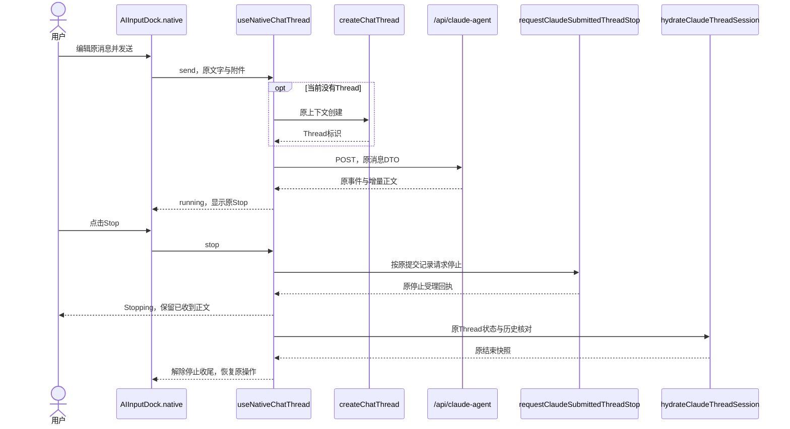
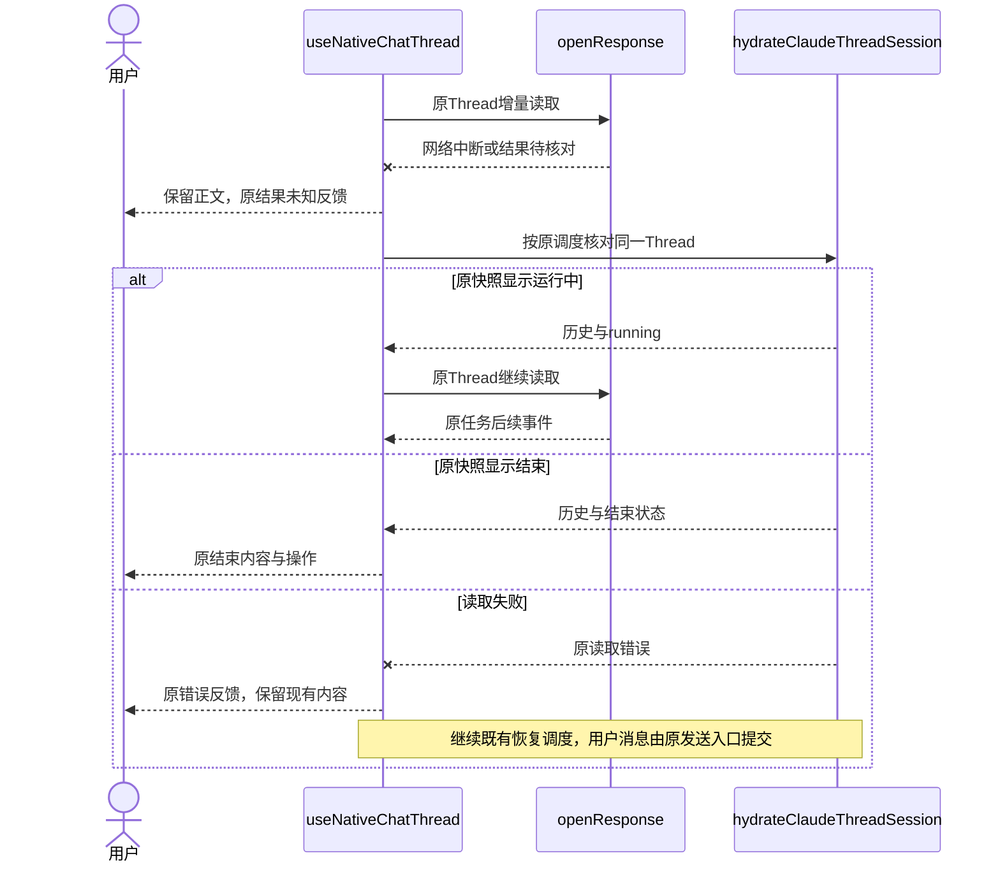
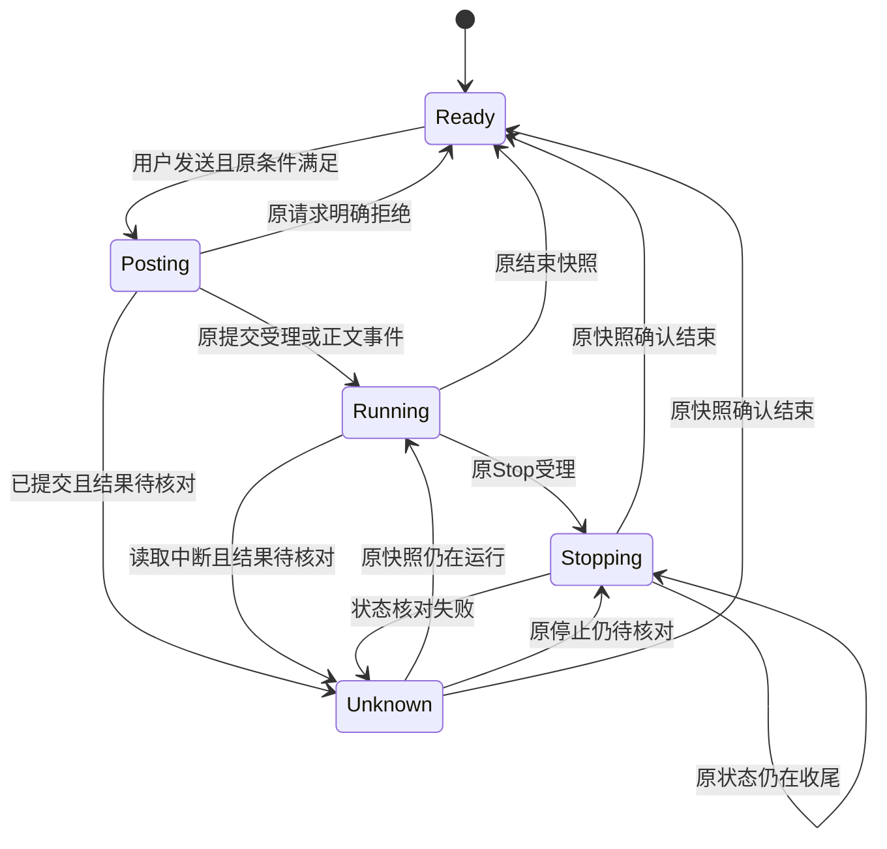
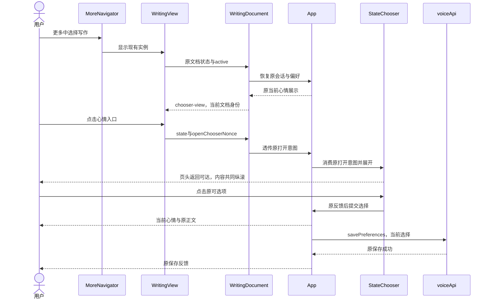
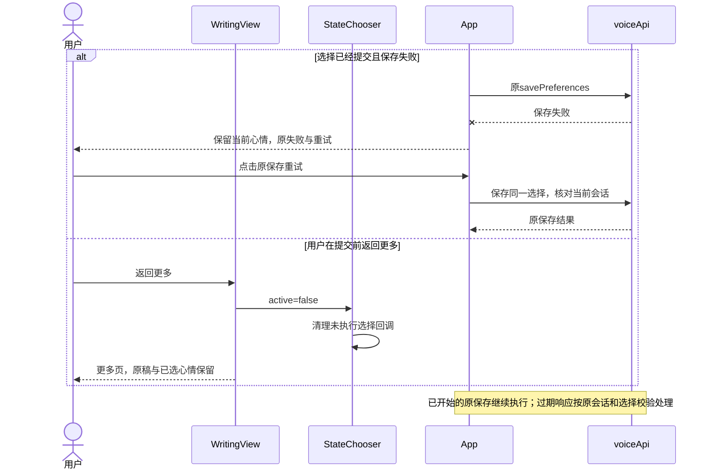
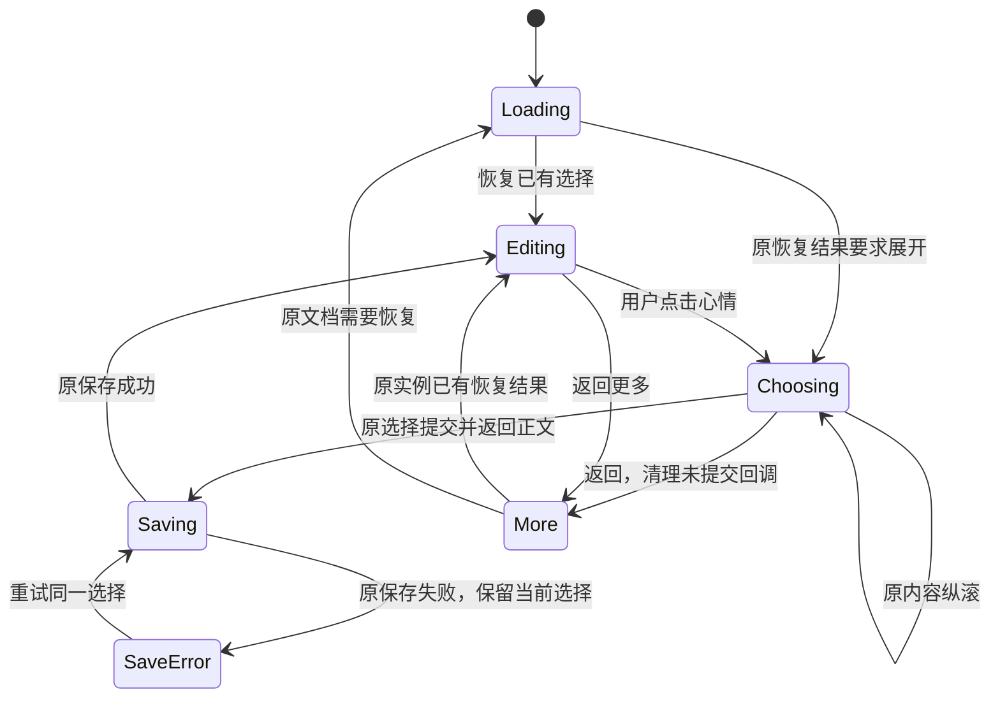

<!-- [Sync] 2026-11-02: 展示名称沿应用名称交互稿，业务与视觉规则保持。 -->
<!-- [Input] 现行移动PRD、Chat和写作组件、原恢复合同及UI规范重整目标。 -->
<!-- [Output] 本轮规范中的代表交互、正常/异常时序、状态转换与验收条件。 -->
<!-- [Pos] 应用UI规范正式交互稿；产品规则和双端骨架归mobile-app/ui-guidelines。 -->
<!-- [Sync] 2026-11-02: 整理已有交互；应用代码和业务流程新增数量为零。 -->

# 应用UI规范交互方案

当前应用称谓与展示范围见[名称交互设计](app-brand-interaction.md)；默认品牌为Kastention，中文应用称谓为卡片结构。

## 背景与问题

历史规范以品牌官网首屏和角色概念为主体。应用页面需要明确的操作入口、反馈位置、滚动区域和失败恢复说明。本次通过代表流程建立组件、页面和状态之间的查阅关系。

## 目标与边界

覆盖Chat发送与停止收尾、写作心情选择与保存、更多页和主题返回关系。四类代表页面的桌面与窄屏骨架直接归[规范正文](../../prd/mobile-app/ui-guidelines/README.md)。本稿引用[移动PRD](../../prd/mobile-app/mobile-app.md)、[写作现行设计](writing-mobile-layout.md)和[跨平台工程合同](react-native-web-project-structure.md)。

当前源码交互作为依据，图示为本轮文档整理。应用代码、接口、权限、导航、确认步骤、任务调度及持久化行为保持原所有权。设备和真实业务资格沿原执行记录；本轮验收范围为文档。

## 概念与规则

### 所有者与输入输出

| 对象 | 输入与操作 | 输出与反馈 | 来源 |
| --- | --- | --- | --- |
| `AIInputDock.native` | 原草稿、附件、Send/Stop | 原发送、停止与禁用反馈 | [组件](../../../frontend/app/_dream/components/chat/AIInputDock.native.tsx) |
| `useNativeChatThread` | 原消息DTO、Thread、原transport | 正文、running/stopping/unknown及恢复 | [Hook](../../../frontend/app/_dream/components/chat/useNativeChatThread.native.ts) |
| `threadSessionHydration` | 同一Thread读取 | 原历史和任务快照 | [读取模块](../../../frontend/app/_dream/components/chat/threadSessionHydration.ts) |
| `WritingView` / `WritingDocument` | 页头操作和当前文档身份 | 心情展开、原文档反馈 | [宿主](../../../frontend/app/_dream/components/WritingView.native.tsx)、[文档](../../../frontend/app/_dream/components/Editor/WritingDocument.tsx) |
| `StateChooser` / `App` | 原选择、会话和偏好 | 选择展示、原保存和重试 | [选择器](../../../frontend/app/_dream/components/StateChooser.tsx)、[App](../../../frontend/app/_dream/App.tsx) |
| `MoreNavigationContent` | 五项入口、当前主题 | 现行卡片、用途和局部主题错误 | [共享内容](../../../frontend/app/_dream/components/story-workspace/layout/MoreNavigationContent.tsx) |

### 页面关系

| 当前页 | 操作 | 目标或结果 | 返回与内容 |
| --- | --- | --- | --- |
| Native主栏目 | Chat / Decks / More | 原栏目 | 原实例规则 |
| 更多页 | 写作 / 时间线 / 回顾 / 设置 | 原页面 | 返回更多 |
| 更多页 | 主题 | 切换到另一显式主题 | 保持更多页 |
| 写作 | 当前心情 | 原编辑区内选择器 | 选择回正文；返回更多取消未提交回调 |
| 写作 | 已有关联Chat | 原侧会话 | 关闭回写作，稿件按原组件生命周期 |
| 回顾 | 历史报告 | 原阅读页 | 返回原来源 |
| 原详情弹层 | 手柄拖动 | 当前详情高度变化 | 正文继续独立滚动 |

Web桌面与Native主栏目配置分别沿原实现。图示标注具体平台，移动入口按当前原生范围展示。

### Chat正常业务时序

图中展示停止已受理且原快照确认结束的路径。运行中队列、工具确认和权限动作继续沿原合同。

### Chat异常与恢复时序

### Chat显示状态转换

Ready、Posting、Running、Stopping与Unknown为本文的显示摘要；业务字段及服务端状态继续沿原定义。结果未知期间的提交限制以原Hook为准。

### 写作正常业务时序

### 写作异常与恢复时序

### 写作显示状态转换

### 主题与可访问性规则

| 对象 | 当前规则 | 本轮状态 |
| --- | --- | --- |
| 默认主题 | 无有效存储时为system | 源码核对 |
| 用户选择 | light、dark、system | 原入口保持 |
| 有效主题 | 显式值或系统外观计算 | Web/Native按各来源投影 |
| 本地版本 | 原外观模块未定义业务revision字段 | 本轮新增字段数量为零 |
| 采用action-primary/text-on-action的按钮 | 当前白字与显式暗色操作底取样1.21:1 | 存在缺口，后续单独评估 |
| 弱文本与链接 | 当前亮色画布取样2.93:1与2.88:1 | 普通文本阈值存在缺口 |
| 点击、读屏与文字缩放 | 各平台实际组件检查 | 待验证 |

建议、未实现：在原色彩合同中评估暗色主按钮前景及弱文本/链接配色。应用代码和现有Token数值在本轮保持。页面用语保持用户任务与结果，技术字段只在本设计与来源表中使用。

## 验收条件

| 编号 | 条件 | 文档检查 | 设备或业务验收 |
| --- | --- | --- | --- |
| I-01 | 四类页面直接具有桌面与窄屏骨架 | 检查正文内SVG、图注与区域说明 | 本轮范围外 |
| I-02 | Chat停止收尾与结果未知分别表达 | 核对正常/异常时序和状态图 | 沿原专项资格 |
| I-03 | 心情选项即确认、取消和失败重试保持 | 核对写作三图与现行设计 | 触摸和软键盘待设备验证 |
| I-04 | 更多保持五项同层入口 | 核对原元数据与页面图 | 沿原专项资格 |
| I-05 | 当前值、建议与待验证分别标记 | 检查正文、图注、表格 | 配色建议尚未实现 |
| I-06 | 全部Mermaid图可以解析与渲染 | 记录实际工具结果 | 文档验证 |

范围取舍与具体命令归[本轮评审](../../exec/ui-guidelines-review-20261102.md)。
