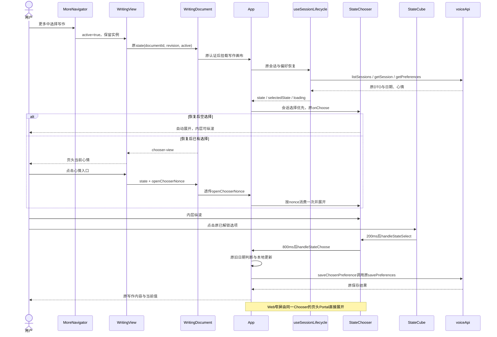
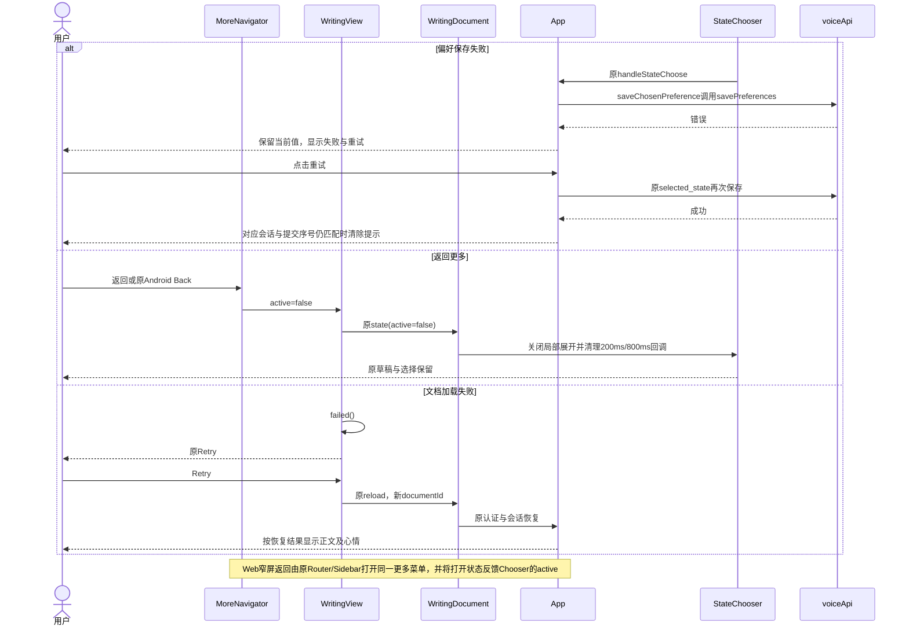
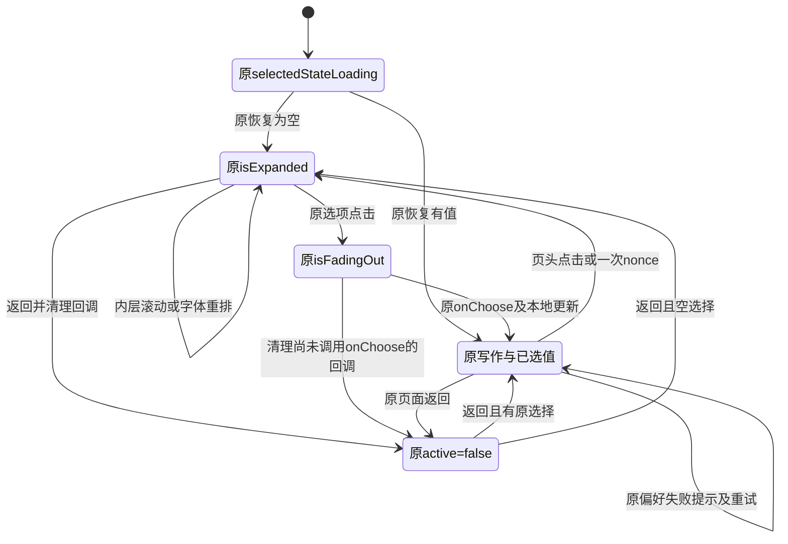
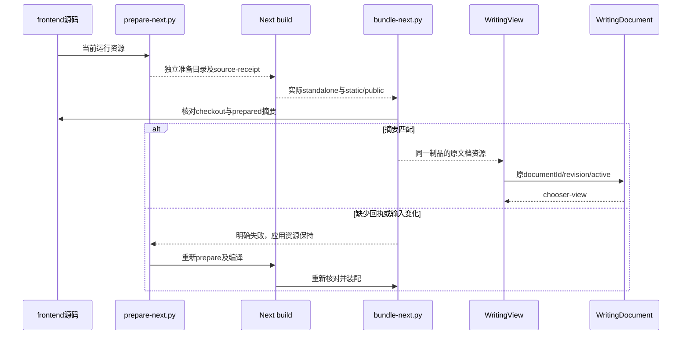
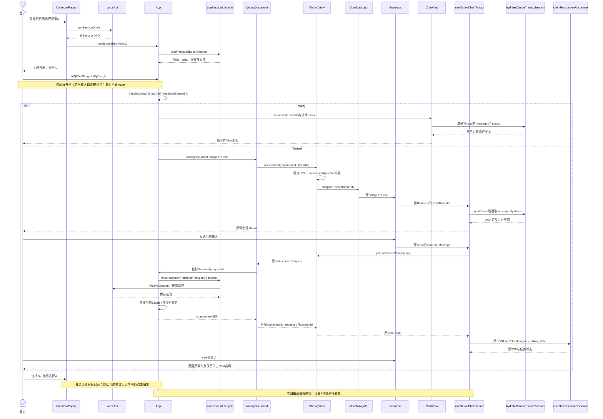
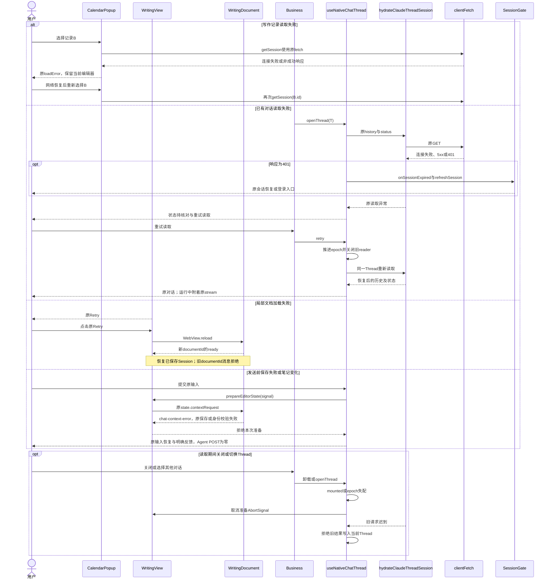
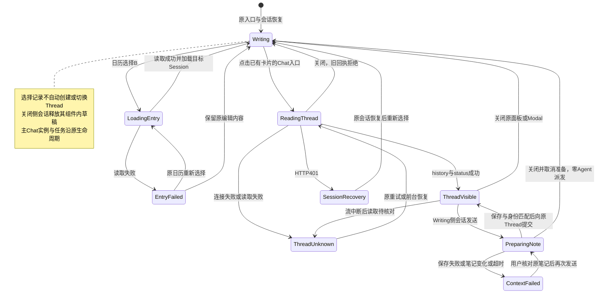

<!-- [Sync] 2026-11-01: 移动应用PRD迁至docs/prd/mobile-app/mobile-app.md，更新现行引用，保留历史回执。 -->
<!-- [Input] 原App写作画布、StateChooser/StateCube、WritingView.native、会话生命周期与已通过设计。 -->
<!-- [Sync] 2026-11-01: 写作关联对话修复已接入移动入口及按请求保存上下文；实施前原文归历史快照，源码与设备采用分别验收。 -->
<!-- [Sync] 2026-11-01: 补充写作记录关联对话的只读诊断设计；保留原入口、三类关联及草稿生命周期，修正建议与设备验收分别登记。 -->
<!-- [Output] 写作移动排版、心情内层滚动、所属页头接线、关联对话与触屏入口诊断设计。 -->
<!-- [Pos] 现行跨平台写作交互；产品规则及骨架归mobile-app PRD，执行与验证归专项评审记录。 -->
<!-- [Sync] 2026-11-01: 最小实现已接入源码；技术、浏览器与真机资格按执行记录分别判定。 -->

# 写作排版、心情滚动与导航入口

## 背景与问题

用户反馈手机写作段落留白、启动心情内容无法触摸滚动，以及心情入口占用正文首行。实现前的18px×1.8与全页横线32.4px周期一致；固定偏移、非整行卡片混排和字体/宽度变化后的高度更新构成布局风险。当前源码将移动正文行框、内层滚动与所属页头分别交给原所有者处理。

产品规则、桌面及窄屏骨架归[移动PRD](../../prd/mobile-app/mobile-app.md#写作排版与心情入口)，[定位与评审记录](../../exec/writing-mobile-layout-review-20261101.md)保留判断与分项回执。[实施前设计原文](history/writing-mobile-layout-before-implementation-20261101.md)完整保存原建议及业务图。

## 目标与边界

- iOS/Android沿原`WritingView.native`和局部`WritingDocument`；Web窄屏沿原App、Router和Sidebar。原生横屏继续移动排版，桌面保持18px/1.8、原全页线、正文心情入口、工具和Writing/Chat分栏。
- 复用原EditorEngine、`useSessionLifecycle`、`useTextCells`、`StateChooser`与`StateCube`。会话恢复优先级、时区和跨日规则、前3项与锁定面、选择即提交、原保存及认证权限保持。
- 当前源码实现布局与消息接线。原生手指触摸、系统文字缩放、安全区及软键盘仍需设备验收；浏览器模拟指针和原生组件边界分别记录资格。
- 新依赖、全局导航入口、字号设置、全局状态服务、后端接口和数据库变更退出范围。

## 概念与规则

### 排版与高度

| 对象 | 当前实现 |
| --- | --- |
| 移动范围 | `App`以`mobileWriting`覆盖原移动识别和原生局部文档，根节点`data-mobile-layout`限定全部新增样式；桌面保留原样式分支 |
| 字体与行框 | 原18px字体栈与字体资源保留，`--writing-font-size`和`--writing-line-height: 1.6em`供textarea及高亮层共同消费，默认行高28.8px；缩放后的实际字号同步改变行框 |
| 稿纸线 | 全页保留纸色和竖向页边线；移动横线绘制在原textarea背景内，从每个单元的首个行框下沿起线，周期等于相同行高。建议/Chat卡片高度与后续正文相位独立 |
| 盒模型 | 移动textarea采用block、border-box、零padding和零margin，空输入采用rows=1且最小高度一行；高亮层采用相同字体、行高、换行和零内外边距。用户换行与单元间原文保持 |
| 元信息 | 日期与标签在原Chooser位置自然换行；移动移除正文心情按钮、32px槽、10.8px段距及首段0.4px补偿。桌面原值保持 |
| 重排 | `useTextCells`在React提交文字后、引用就绪、字体ready/loadingdone、实际宽度或有效字体尺寸变化时，复用auto→scrollHeight更新。ResizeObserver只用宽度和字体签名调度一帧，避免高度观察循环 |
| 阅读位置 | 高度变化保留当前输入选择和焦点，以当前textarea可见位置修正原滚动容器scrollTop；没有聚焦输入时保留原scrollTop。重排不调用保存或生成函数 |

源码范围：[App](../../../frontend/app/_dream/App.tsx)、[App.css](../../../frontend/app/_dream/App.css)、[useTextCells](../../../frontend/app/_dream/hooks/useTextCells.ts)。移动评论仍采用原移动评论面板；桌面评论中的原Chooser几何计算保持原分支。

### 页头、滚动与键盘

1. Web窄屏新增本页页头，左侧返回更多，中间写作，右侧由同一`StateChooser`通过Portal呈现当前心情。`StoryWorkspaceRouter`只将返回请求与更多打开状态传给原Sidebar；原五项更多菜单、路由和账户操作保持。
2. 原生由`WritingView.native`既有页头右侧Pressable显示当前图标与名称。原日历、新建及Agent三个工具继续原动作，在文档中形成独立操作区；编辑滚动区域与原反馈栏位于其下。
3. Chooser把展开内容Portal到原编辑内容的滚动区域边界内；导航和原反馈栏保持可达。问候、完整立方体、选项及说明共同纵滚；短内容居中，长内容自然增高。背景正文与写作工具使用inert暂停触摸和焦点。
4. 保留原300px立方体最大尺寸和1200px透视，根据可用宽度计算尺寸，六面和半边长使用相同值。中排按文字自动增高，空装饰格让位；原可选项提供44px最小触摸区域、换行及键盘操作。
5. 纵向手势交给DOM内层滚动；触摸移动或pointercancel后拒绝同次合成点击。鼠标旋转沿原实现。`WritingView`外层`scrollEnabled=false`保持，实际WebView手势传递列为设备验收。
6. 点击心情入口先移除输入焦点；原生页头同时调用原生Keyboard.dismiss。移动分支关闭原通用空白单元自动聚焦，返回写作、心情确认和字体重排均不主动聚焦；用户点击正文后恢复键盘。原生宿主提供安全区与实际视口，局部文档不重复保留网页底部栏目占位。
7. 读取中入口禁用；已选展示图标与完整辅助功能名称，可见长名称单行省略；未选显示选择心情。选择后沿原200ms反馈、800ms淡出调用`handleStateChoose`，返回同一编辑内容。
8. 取消通过原页面返回更多或Android原系统返回。`active=false`和卸载清理两个延迟回调，并在回调执行前核对当前active。已经提交的原保存继续执行。再次进入由原恢复结果和loading决定展开。

源码范围：[StateChooser](../../../frontend/app/_dream/components/StateChooser.tsx)、[StateCube](../../../frontend/app/_dream/components/StateCube.tsx)、[WritingView](../../../frontend/app/_dream/components/WritingView.native.tsx)、[Router](../../../frontend/app/_dream/router/story-workspace.tsx)、[Sidebar](../../../frontend/app/_dream/components/story-workspace/layout/StoryWorkspaceSidebar.tsx)。

### 原生文档消息与所有权

| 消息 | 字段与校验 | 执行模块 |
| --- | --- | --- |
| 原`state` | 原documentId/revision/active/显示偏好；可选正安全整数`openChooserNonce` | WritingView仅在ready、active且loading结束时发送；WritingDocument校验身份及递增revision后透传，StateChooser按nonce消费一次 |
| `chooser-view` | documentId、正安全整数revision、loading、nullable selectedStateId、name及expanded；所有字段均检查类型 | 文档内展示revision独立递增；WritingView校验来源URL、documentId及更高展示revision后更新页头 |
| 原事件 | ready、session-expired、resources、open-thread、prepare-chat及editor-jump-dispatched保持原合同 | 继续原导航与会话所有者 |

文档重载清空宿主页头值及打开nonce，禁用入口，ready后等待新展示消息。旧文档或乱序快照保持当前页头；nonce不会因主题更新、切页或返回而重放。`WritingView`中的`ChooserIcon`沿原`getMiniStateIcon`几何，使用已安装`react-native-svg`；宿主不保存心情，不传全文、标签或StateConfig。

源码范围：[WritingDocument](../../../frontend/app/_dream/components/Editor/WritingDocument.tsx)、[协议](../../../frontend/app/_dream/components/Editor/WritingDocument.protocol.ts)。

### 保存与恢复反馈

| 条件 | 执行与反馈 |
| --- | --- |
| 自动触发 | 原`useSessionLifecycle`按会话、偏好及日期恢复；Chooser继续依最终选择与loading展开。账户首次使用标记和严格每日一次计数保持范围外 |
| 字体加载/失败 | 后备字体可继续编辑，成功后重排；失败保留后备，无阻塞弹窗 |
| 偏好失败 | 原`handleStateChoose`更新原EditorState和当前值，再调用`saveChosenPreference`执行原savePreferences；移动反馈区显示失败及重试 |
| 手动重试 | 只重发同一selected_state，核对会话ID、选择和提交序号；不再调用完整handleStateChoose或建立会话。旧响应无法更新后来选择的提示 |
| 会话保存 | 继续原会话持久化，偏好与EditorState分别处理；本地值不等于全部服务端保存完成 |
| 文档失败 | 原failed/Retry/reload重建当前documentId并恢复已保存会话；未保存正文的进程故障恢复需独立验证 |
| 登录过期 | 原session-expired关闭页头操作并继续原会话刷新/登录；认证权限保持 |

### 正常业务时序

### 异常与恢复时序

### 页面状态转换

## 验收与当前资格

技术检查、隔离浏览器交互、iOS与Android真机资格分别见[实现阶段记录](../../exec/writing-mobile-layout-review-20261101.md#最小代码实现阶段)。浏览器源码组件及DTO夹具只验证其覆盖的公开入口和消息边界；原生系统字体放大、触摸滚动、键盘与安全区保留物理设备前提。实施前的方案比较及完整V01—V12验收矩阵继续归同一评审记录。

## 原生与包内网页资源一致性

### 背景与问题

构建22重新编译Hermes，并沿用构建21的Next资源。其`main.jsbundle`包含chooser-view，包内JS/CSS缺少移动写作和心情展示消息，用户页面出现原生页头读取中、正文仍有旧心情入口、工具覆盖元信息及旧稿纸线。前阶段独立源码副本与fake WebView分开验证，未覆盖实际安装资源组合。

### 目标与边界

写作交互规则保持本文定义。打包必须让原生页头加载包含对应协议与布局的实际文档。验证使用独立Simulator、原WritingView/Hermes、真实WKWebView与已打包Next资源；公开HTTP DTO使用明确内存fixture，真实账号、数据库和模型保持范围外。用户最新要求采用模拟器，物理设备与手机镜像退出本轮操作。

### 概念与规则

- `scripts/prepare-next.py`沿用`frontend/ios/Next`默认位置，显式`INK_IOS_NEXT_ROOT`可选择ios目录内的具名输出，保护其他构建和正常Web `.next`。该参数仅定义构建输出位置。
- source-receipt增加`sourceInputs`，记录原checkout运行资源摘要；原`sourceFiles`继续记录准备目录的实际文件摘要。生成类型声明、文档及测试退出运行资源输入清单。
- `scripts/bundle-next.py`在修改App资源前核对checkout与prepared来源。缺少sourceInputs时报告`IOS_NEXT_SOURCE_RECEIPT_MISSING`；输入或准备源码变化时报告`IOS_NEXT_SOURCES_STALE`。恢复顺序为重新prepare、独立Next编译、重新bundle。
- `bundle-next.py --verify-sources`只核对来源，保留应用资源；正常打包同时将source-receipt及其摘要写入Next制品，原static/public复制、依赖重定位、桌面原生模块排除及凭据分离继续保持。
- 实际输出为`TARGET_BUILD_DIR/UNLOCALIZED_RESOURCES_FOLDER_PATH/next`。验证从该根manifest的serverEntry启动，并核对该根source-receipt与本轮准备回执；准备目录通过检查后，实际服务根继续单独核对。
- 涉及Writing文档协议、布局或字体时，Hermes替换与Next资源采用必须逐项登记；复用旧原生库不包含复用旧网页的隐式授权。用户页面只显示原心情与编辑信息，构建技术信息留在制品回执。
- `writing-webview-entry.tsx`仅组合原WritingView与active回调。真实WKWebView加载实际Next原页面，服务端fixture只替代公开HTTP边界；禁止预置或伪造chooser-view回执。iOS UI测试必须等待包内文档实际通知原生页头，检查正文入口移除及可触摸滚动。

当前原因、脚本命令、预期失败、模拟器截图及分项结果见[资源纠偏记录](../../exec/writing-mobile-layout-review-20261101.md#安装资源纠偏与模拟器验证)。

## 写作记录与关联对话

### 背景与问题

用户确认本次“笔记”指“更多 → 写作”或时间线中的写作记录。现行写作编辑对象为`EditorState`，持久化对象为Writing Session。打开指定记录的生产入口位于写作页的`CalendarPopup`日记列表，依次执行`handleOpenEntry → getSession → App.handleLoadEntry → loadPersistedEditorSession`。`CollectionsView`时间线展示日期、历史图片、评论和报告；Web与Native当前均未提供从普通日期卡直接打开写作对话的动作。

原诊断确认移动Chat按钮依赖鼠标悬停，端侧发送缺少写作上下文与保存屏障。当前源码通过原mobileWriting呈现已有按钮，使用原文档通信按次取得已保存快照，并拒绝切换后的旧回执。[实施前设计原文](history/writing-linked-chat-before-fix-20261101.md)与[只读诊断](../../exec/writing-linked-chat-review-20261101.md)保留原证据及当时状态；[修复执行记录](../../exec/writing-linked-chat-fix-20261101.md)保存当前实现和验证。产品规则及骨架归[移动PRD](../../prd/mobile-app/mobile-app.md#写作记录与关联对话)。

实施前的原组件隔离触摸样本在390宽度下两次点击均未打开Chat，底层标题分别折叠和展开；桌面hover后成功一次。原构建22本地Next静态chunk含相同显示条件。当前源码的真实DOM技术旅程已通过移动首触与A/B/A保存快照，连续5次结果一致；新候选WKWebView设备采用与真实账户请求继续独立验收。

### 目标与边界

- 采用Web当前入口和关系：选择写作记录后，由用户点击该记录现有对话卡片的“Chat →”。单纯切换记录只加载编辑内容。
- 保留原编辑、保存、手动建议、Voice关联、主Chat稿、侧会话、任务、Cookie会话、CSRF与服务端资源归属校验。
- 优先使用现有重新读取和重新进入；局部修改以实际故障回执为实施前提。禁止通过换服务地址、重建账户、自动新建Thread、发送模型探测消息解决未知失败。
- 设备构建22已读回；当前RN入口的两项源码摘要与原构建回执匹配。包内Next的逐文件源码来源仍有缺口，完整安装采用资格单列。Android当前设备与包体均未取证。

### 概念与规则

| 对象 | 当前规则与交互 |
| --- | --- |
| 当前记录 | `EditorState.id`标识Writing Session；日历选择后替换编辑器状态、文本、标签和心情，关闭日历 |
| 对话卡片 | 每个`ChatWidgetData.threadId`打开其指向的Thread；一份记录可以含多个卡片。mobileWriting下原Chat按钮直接可见且可点；桌面保持hover，折叠和缺少threadId仍隐藏 |
| Voice关联 | `ensureVoiceThread(voiceId, existingThreadId)`优先复用已有Voice Thread；不同记录的卡片允许指向同一Thread |
| 手动写作建议 | `EditorState.writingThreadId`由`WritingSuggestionController`懒创建、保存并复用；该引用与对话卡片分别消费，当前建议卡无直接Chat跳转入口 |
| Web展示 | `handleOpenWritingChatThread`传入准确Thread与递增nonce，`WritingWorkspaceSplitPane`显示原`ChatView`；桌面分栏，Web窄屏采用原覆盖面板 |
| 端侧展示 | `WritingDocument`发送带可选editorSessionId的`open-thread`；`WritingView.receive`核对固定URL、documentId和active；`MoreNavigator`透传；Writing侧Business按Session与Thread区分身份，原Modal呈现 |
| 主Chat稿 | 端侧切换到更多及打开侧会话保留底层`Business`与输入组件；覆盖期间暂停焦点，返回后恢复原实例 |
| 侧会话稿 | `useComposerDraft`持有组件内未发送稿；关闭Modal会卸载该侧`Business`。Web关闭写作Chat面板或切换Thread会卸载原ChatPanel。跨关闭/跨Thread恢复未发送稿未形成当前合同 |
| 写作正文 | 继续`useSessionLifecycle`的保存与恢复；切换后恢复已保存状态，保存失败沿原反馈处理。即时未保存稿的切换边界列入验证 |
| 已有任务 | 打开、关闭或切换对话只替换观察者并读取原history/status；停止任务继续使用原Stop动作。服务端任务状态与本地流读取状态分别维护 |

#### 请求与反馈

1. 记录读取继续使用`GET /api/sessions/{sessionId}`。读取失败沿`CalendarPopup.handleOpenEntry`的原失败反馈，原编辑器保持；网络恢复后在原日历重新选择同一记录。
2. 打开已有对话继续调用`hydrateClaudeThreadSession`读取原`messages`与`status`。运行中才附着原`GET /api/claude-agent/threads/{id}/stream`；打开和重试均不提交新用户消息。
3. 端侧未知状态使用现有“重试读取”；`retry`替换读取epoch，自动恢复沿原退避策略。`AppState`回前台重新读取。旧epoch或已卸载实例的结果不得更新当前Thread。
4. 原生文档加载失败显示原Retry，点击执行WebView重载。此操作可能影响尚未保存的编辑内容，应优先处理已有对话中的读取失败；记录读取和模型发送均未形成回执时，不连续重发。
5. 401经原`onSessionExpired → refreshSession → SessionGate`恢复；Web局部文档沿原`AuthProvider`。账户退出或切换释放原业务实例。恢复后重新选择原记录及其卡片，跨账户草稿恢复保持关闭。
6. 没有对话卡片、卡片已折叠或卡片缺少threadId时，Chat按钮不渲染；移动端已有threadId的展开卡片直接显示原按钮，首次触摸执行原onOpenChat。读取失败使用原读取反馈；缺少关联入口的产品扩展单列需求。历史503回执只支持其记录时段和接口的失败判断。
7. Web继续原`editor_state`与`ensureSessionPersistedForAgent`。端侧Writing侧会话每次普通或MCP App用户消息提交前，通过原state/event通信请求当前目标Session快照，等待原保存完成，调用原`buildClaudeChatRequest`投影为editor_state。原队列入口继续其既有协议。
8. 保存失败、笔记变化、文档替换、超时或取消均拒绝本次提交，原`useComposerDraft`恢复输入，不创建新Thread、不提交Agent POST。页面显示“当前笔记暂时无法用于对话”及输入保留反馈。用户返回写作核对原记录后可再次发送；原重新读取只读取历史和配置。
9. 普通主Chat、任务侧会话及Calendar打开的任务Thread保持原上下文规则。Writing侧会话内部选择其他Thread或新建Chat后不携带原笔记快照；账户切换继续释放原Business。

#### 当前修正与后续条件

| 观察结果 | 处理方式 | 状态 |
| --- | --- | --- |
| 原重试或网络恢复后，同一卡片打开原Thread | 保留现有实现并记录恢复回执 | 待设备复验 |
| 有关联的展开卡片在触屏上缺少可见Chat入口 | App将mobileWriting透传原ChatWidgetUI，原Chat按钮常显并接收点击 | 源码已实现；当前候选设备采用独立验收 |
| 安装资源缺少现有接线 | 按现有构建流程更新对应RN或Next资源，安装前后核对同一bundle ID与资源摘要 | 条件化后续工作，本轮未构建或安装 |
| 点击有open-thread且history/status成功，Modal未显示 | 在`Business`原`sideChat/Modal`呈现处修正具体条件 | 待该故障证据，建议、未实现 |
| 点击未形成open-thread | 在原`WritingDocument/receive`的实际阻断位置修正字段或active接线 | 待该故障证据，建议、未实现 |
| 打开正确Thread，发送时缺少写作上下文 | 原文档协议按请求取得快照，等待原保存，由原request builder发送 | 源码已实现，故障及A/B回归归修复记录 |
| 创建Thread迟到 | handleAgentSelect在await后核对原Session及原Chat卡片仍存在，再更新卡片与导航 | 局部身份守卫已实现；原Voice关联和已创建Thread保留 |
| 日历读取乱序 | 继续按原入口验收；后续依据实际乱序回执选择对应局部守卫 | 当前未调整，独立依赖 |

#### 按需保存与快照协议

| 对象 | 校验与生命周期 |
| --- | --- |
| 原open-thread扩展 | Writing卡片附带editorSessionId；Calendar任务可省略。宿主创建的准备回调绑定当时documentId与Session |
| 原state.contextRequest | 非空requestId和sessionId；固定URL、documentId与递增revision校验继续执行。每个WritingView只持有一个在途准备，重复并发请求直接拒绝 |
| App保存屏障 | `ensureSessionPersistedForAgent(expectedSessionId)`保存当前engine快照，校验等待期间的Session与内容；无参Web调用保持原行为 |
| chat-context | 带documentId/requestId/sessionId及editorState；id必须等于sessionId，cells必须为数组。App在保存完成后复核快照签名才回传 |
| chat-context-error | 仅session-changed或save-failed；拒绝本次发送，不包含原始异常、凭证或正文日志 |
| WritingContextRequests | 拒绝旧document/Session/request回执；重载、隐藏、会话失效及卸载取消等待。技术期限来自sessionSync的WRITING_CHAT_CONTEXT_TIMEOUT_MS，当前30秒，只结束本地等待 |
| Native提交 | `submitMessage`在createChatThread、beginClaudeThreadSubmission和stream POST前等待快照；读取epoch更换和卸载取消AbortSignal，迟到结果不派发 |

该通信仅传递当前用户明确发送所需的原EditorState；正文不写入诊断日志或全局缓存。原保存HTTP、认证、权限、Thread关系、builder及SSE保持原所有者。关闭侧会话释放组件内草稿；主Chat实例、已保存正文与服务端任务继续原生命周期。

### 关联对话正常业务时序

### 关联对话异常与恢复时序

### 关联对话状态转换

图中状态用于描述页面反馈，生产代码沿原state与epoch执行。当前改动、回退及技术回执归[修复记录](../../exec/writing-linked-chat-fix-20261101.md)；初次诊断中的条件化后续项按原历史状态保留。图示不提高设备与真实模型验收状态。
