<!-- [Sync] 2026-09-17: close Deck detail empty/raw legacy Memory projection parity. -->
<!-- [Sync] 2026-09-15: route current-user picture history reads through Admin Registry103. -->
<!-- [Sync] 2026-09-15: record Admin-owned Deck detail and unchanged legacy Memory projection. -->
<!-- [Sync] 2026-09-15: index five Admin Deck writes, shared schema gate and closed deletion feedback. -->
<!-- [Sync] 2026-09-15: index current Voice mutation design separately from retained Deck/Voice legacy flows. -->
<!-- [Sync] 2026-09-15: replace social flows with Admin while preserving the original in history. -->
<!-- [Input] Module business flows, current Admin consumers and byte-preserved pre-migration sequence source. -->
<!-- [Output] Module flow reference with explicit current ownership and retained migration dependencies. -->
<!-- [Pos] Sequence index; focused current designs own authentication, Session, Deck, preferences and social rules. -->
<!-- [Sync] 2026-10-23: 6.1 展开后台 Engine、栏目 Runner、统一 Agent 执行、转录校验和持久化优先的任务 SSE；原图保留于既有历史稿。 -->
<!-- [Sync] 2026-09-15: public user preferences use Admin; retain original whole source in history. -->

认证/Session/Deck的现行程序行为以[Admin交互](../architecture/admin-auth-data-interaction.md)和各功能稿为准；本稿其余尚未更新的旧issuer/直接SQL说明仅是迁移依赖，不作为现行规范。[原十模块时序原文](history/pre-admin-user-preferences-20260915/sequence-diagrams.md)字节保持；用户偏好正常、状态、失败和验收见[现行稿](user-preferences-current.md)。

Voice四公开mutation的现行正常、状态、失败与验收见[Voice CRUD现行稿](voice-crud-current.md)；下方模块8尚未更新的直接SQL只保留迁移依赖与历史流程。

<!-- [Input] Current Next.js Dream Web modules and Python business routes/services. -->
<!-- [Output] Current cross-module business sequence diagrams. -->
<!-- [Pos] Design-level sequence index; domain details remain in their focused documents. -->
<!-- [Sync] 2026-09-06: replace the retired Vite frontend label with the sole Next.js app/_dream source boundary. -->
<!-- [Sync] 2026-09-01: replace debounced random-Voice inspiration with manual persistent Suggestion Cells on one Session-owned Claude Thread. -->
<!-- [Sync] 2026-08-31: replace daily-picture generation with historical read-only Timeline access and remove its scheduler/runtime. -->

五公开Deck写操作的正常流程、状态、原错误/删除反馈与验收以[现行稿](deck-mutations-current.md)为准；尚未迁移的list/detail/create/default/安装metadata保留依赖。

# Ink & Memory — 业务功能模块时序图

> 本文档梳理了 Ink & Memory 项目的核心业务功能模块，并以 Mermaid 时序图形式呈现各模块的交互流程。

---

## 目录

1. [用户认证模块（注册 / 登录）](#1-用户认证模块)
2. [编辑器会话管理模块](#2-编辑器会话管理模块)
3. [历史语音评论兼容](#3-历史语音评论兼容)
4. [Writing 手动建议模块](#4-writing-手动建议模块)
5. [语音对话模块（Chat with Voice）](#5-语音对话模块)
6. [深度分析模块（回响 / 特质 / 模式）](#6-深度分析模块)
7. [历史图片读取模块](#7-历史图片读取模块)
8. [卡组与声音管理模块](#8-卡组与声音管理模块)
9. [好友系统模块](#9-好友系统模块)
10. [语音输入模块（WebSocket 语音识别）](#10-语音输入模块)

---

## 1. 用户认证模块

### 1.1 用户注册

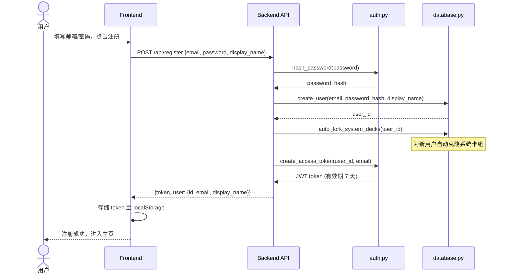

### 1.2 用户登录

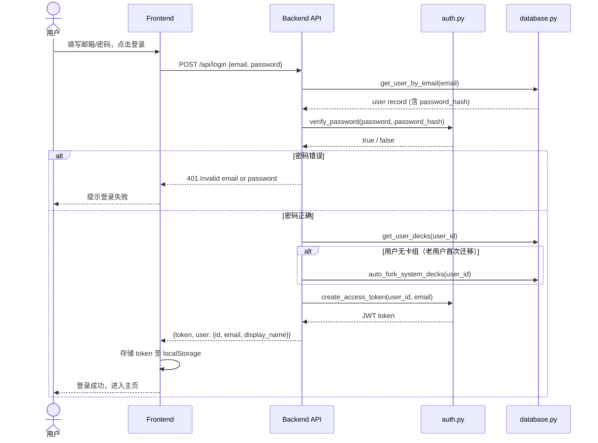

### 1.3 JWT 鉴权（通用依赖）

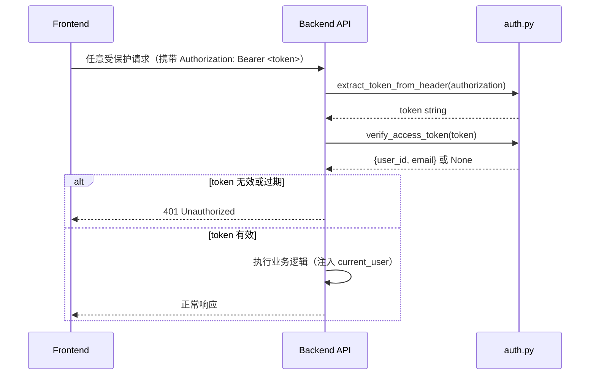

---

## 2. 编辑器会话管理模块

### 2.1 应用启动 — 加载会话

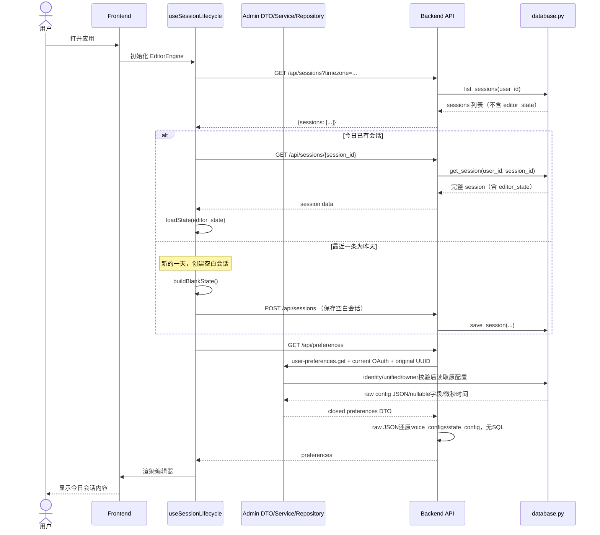

### 2.2 自动保存

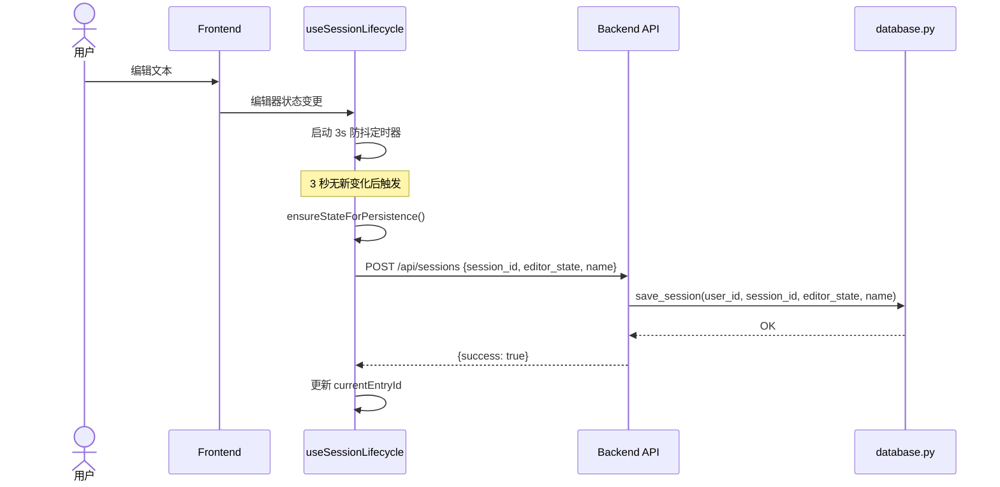

### 2.3 手动保存 / 新建会话

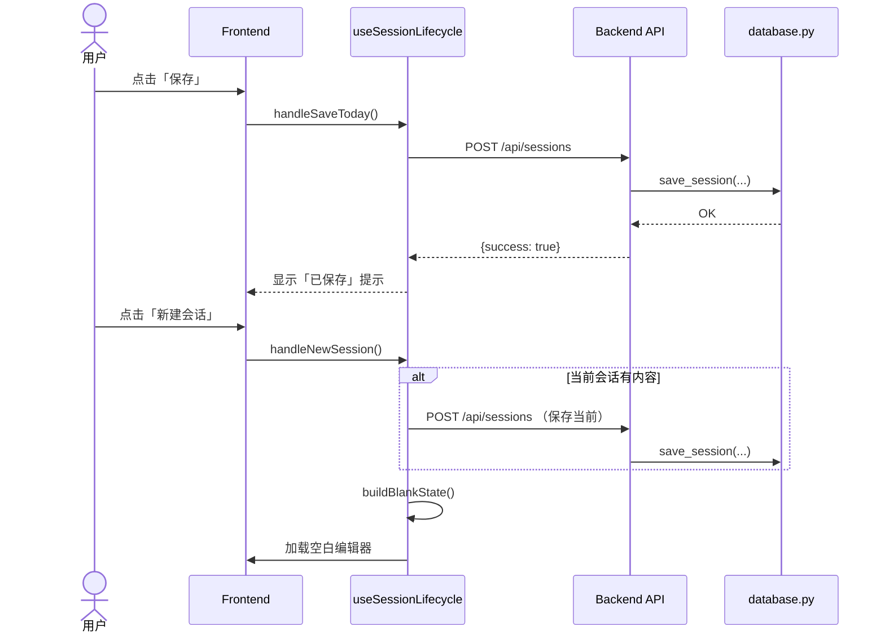

---

## 3. 历史语音评论兼容

普通 Writing 编辑只更新本地 `cells` 与 `weightPath`，不再自动调用模型，也不再注册 `analyze_text` PolyCLI session。已保存 Edit Session 中的 `commentors` 继续按原位置只读显示；用户显式发起历史评论对话时，前端复用对应 Voice 的 Claude Thread SSE。

---

## 4. Writing 手动建议模块

普通输入、粘贴、IME、回车、标点和停顿都不触发请求。用户点击 `Go deeper` 后，编辑器立即插入独立 Suggestion Cell；该 Writing Session 首次点击时懒创建产品级 Claude Agent Thread，后续建议与 Refresh 复用同一 Thread。

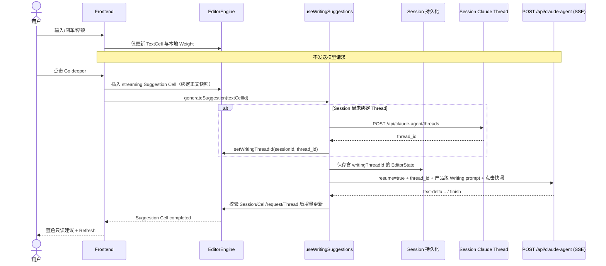

---

## 5. 语音对话模块

用户与某个语音角色就当前文本进行多轮对话。

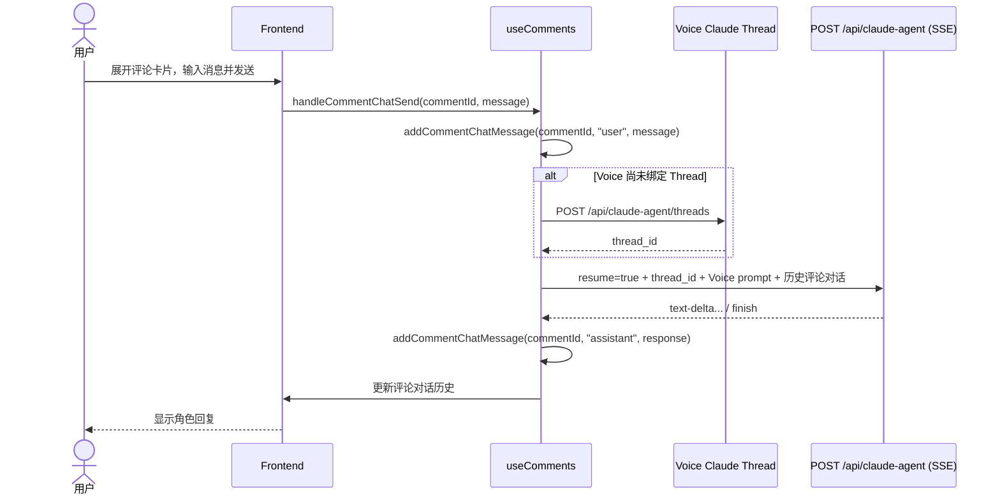

---

## 6. 深度分析模块

分析任务处理本次选中的日记与按需读取的 Notion 正文，按 echoes、traits、patterns 保存结构化结果。来源选择、页面入口与骨架见[分析内容交互稿](memory/reflections-analysis-content-design.md)；后台执行、Agent 内部流及任务 SSE 的完整说明见[Reflections Agent 执行设计](memory/reflections-agent-interaction-design.md)。

### 6.1 回响分析（Analyze Echoes）

下图以 `sections=["echoes"]` 展示单栏目执行。当前页面统一入口可提交多个栏目；Deck 提供 Agent 分组，执行选择使用成对的 `deck_id`、`agent_id`。Task API 通过 `start_reflections_task()` 创建后台 Engine，Runner 经 ThreadFactory 执行该栏目 Agent，Engine 按已保存结果发布任务事件。

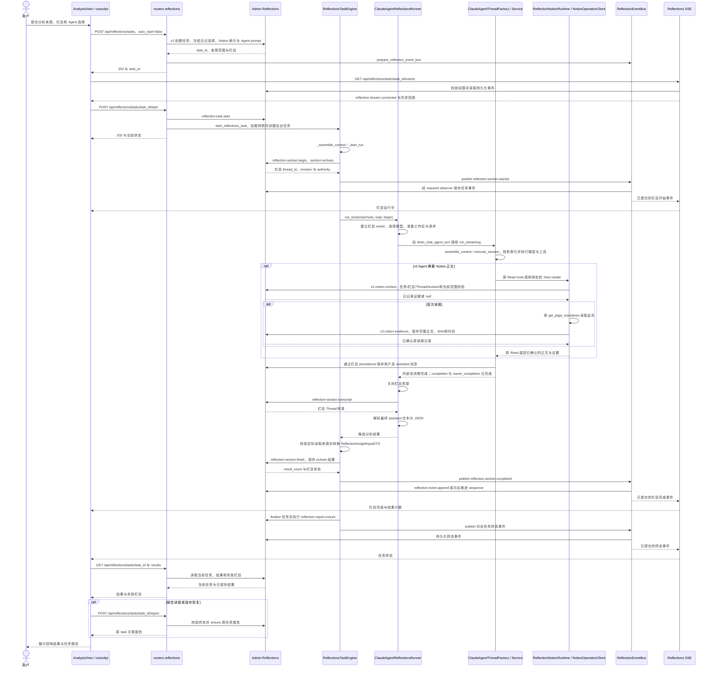

#### 执行与事件合同

| 阶段 | 执行模块与输出 |
| --- | --- |
| 启动分析 | Task API 校验启动权限并创建后台 Engine；响应包含 task_id 和当前状态 |
| 执行 Agent | `ClaudeAgentReflectionsRunner.run_section()` 经统一 ThreadFactory/Service 执行；`drain_chat_agent_turn()` 消费内部流并等待轮次和 Factory owner 完成 |
| 取得结果 | Runner 从 Admin 栏目转录提取最后一段 assistant 文本，解析 JSON；Engine 校验冻结来源后保存结构化结果 |
| 发布进度 | Engine 调用 `ReflectionEventBus.publish()`；`TaskPersistenceObserver` 保存事件成功后，SSE 输出 `reflection.*` 状态、计数与错误摘要 |
| 打开报告 | Engine finalize 后执行 `reflection-report.ensure`；前端按原 task_id 查询或恢复关联报告 |

Agent 内部流供 Runner 等待执行完成，栏目消息通过 persistence 保存。Reflections SSE 的事件生产方为 Engine/EventBus；栏目生成期间，页面在任务事件到达时更新状态。单栏目执行、事件持久化、异常恢复和状态转换的正文图见[执行设计](memory/reflections-agent-interaction-design.md)。

[修订前 6.1 原图](history/pre-admin-user-preferences-20260915/sequence-diagrams.md#61-回响分析analyze-echoes)完整保留。

### 6.2 特质分析 / 模式分析

`traits`、`patterns` 使用同一 Task API、Engine、Runner、ThreadFactory 和任务事件链。Engine 按任务 sections 顺序串行执行，分别保存各栏目的结果与错误。持久化结果采用统一 DTO 字段 `title`、`description`、`related_session_ids`、`evidence`、`confidence`，栏目归属由 `section` 标识。

---

v2 按需读取前稿完整保留于[模块六历史原文](memory/reflections-sequence-pre-notion-on-demand-20261023-history.md)。

## 7. 历史图片读取模块

Timeline 只读取并展示Admin中已保留的当前用户历史图片，不提供生成、重绘或保存入口。普通列表与范围列表共享`picture-history.list`；全尺寸读取使用`picture-history.full`。Dream验证日期与limit，Admin从OAuth principal确定owner并执行排序、范围过滤和图片选择。完整规则见[当前用户图片历史](picture-history-current.md)。

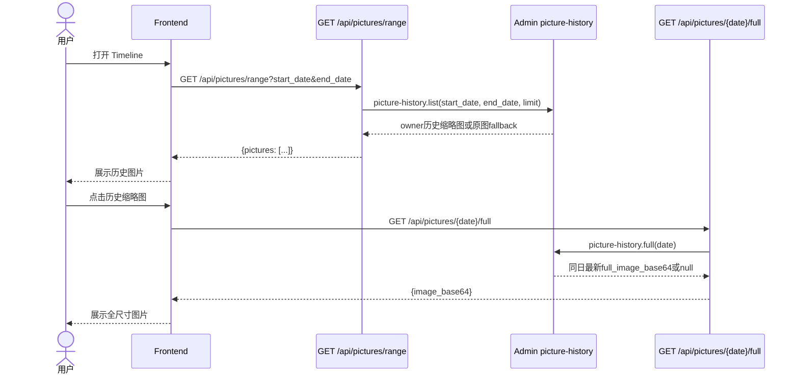

日期非法由Dream返回固定400；full结果为null或空字符串时保持`404 Picture not found for this date`。OAuth、权限、capability、Admin传输与DTO错误保持失败，不回退Dream数据库。普通列表把null prompt映射为空字符串，范围列表保留nullable prompt。

---

## 8. 卡组与声音管理模块

用户可管理「卡组（Deck）」及其下属「声音（Voice）」角色。

### 8.1 查看/创建卡组

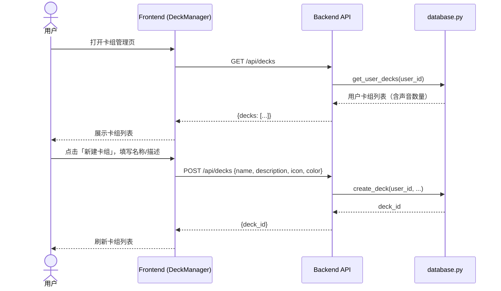

### 8.2 Fork 社区卡组

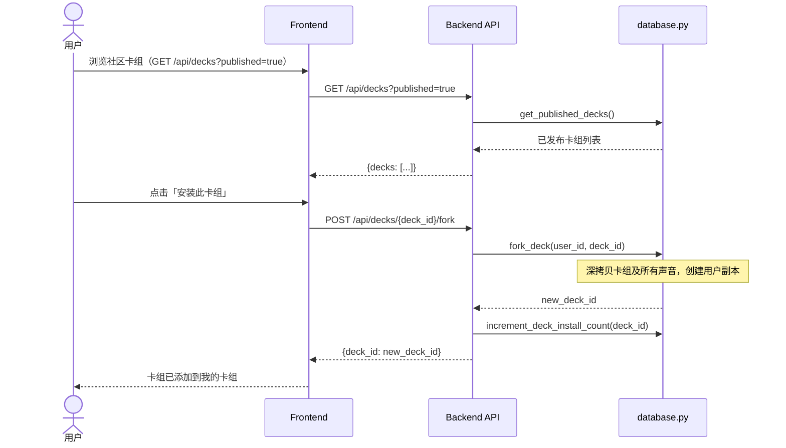

### 8.3 发布卡组到社区

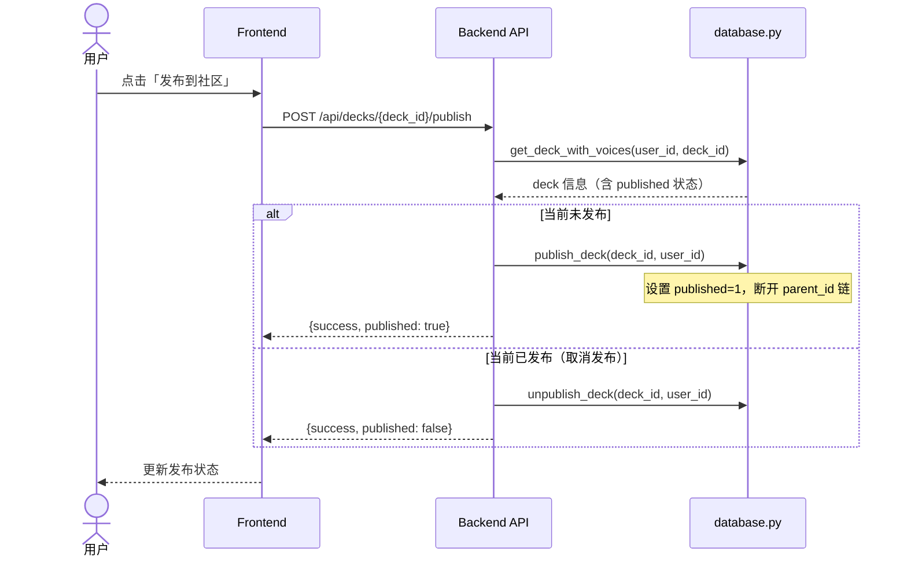

---

## 9. 好友系统模块

正常流程、状态、失败及验收以[现行稿](social-friendship-current.md)为准；旧SQL/锁缺口说明见已保留的[原文](history/pre-admin-user-preferences-20260915/sequence-diagrams.md)。

### 9.1 生成邀请码与处理申请

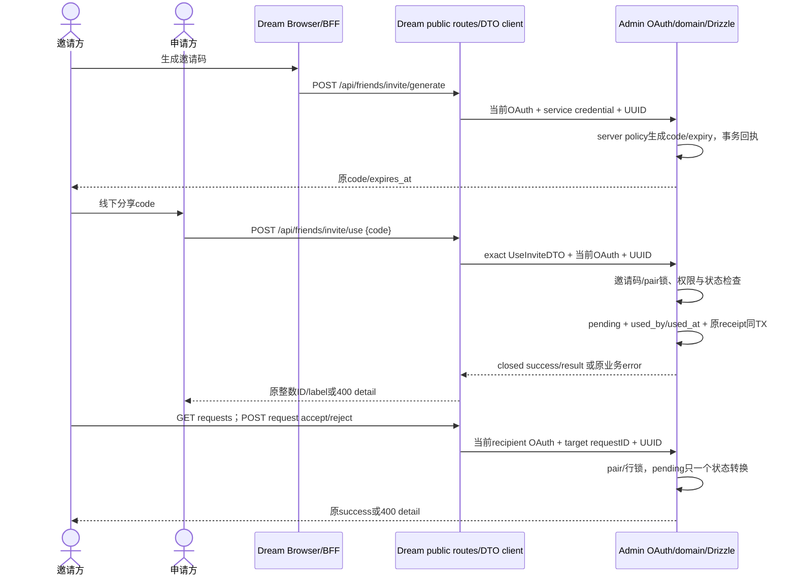

### 9.2 查看历史图片

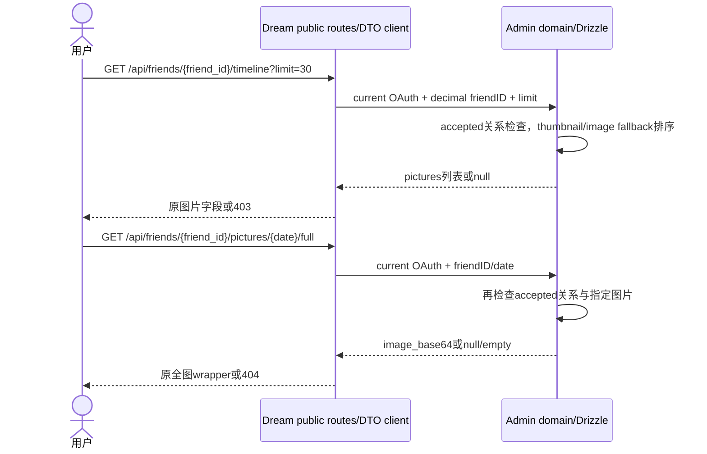

写unknown只查同operation原UUID的receipt，absent不证明rollback或触发新写；其它模块旧流程仍是明确迁移依赖。

---

## 10. 语音输入模块

基于 WebSocket 的实时语音识别（Dashscope ASR）。

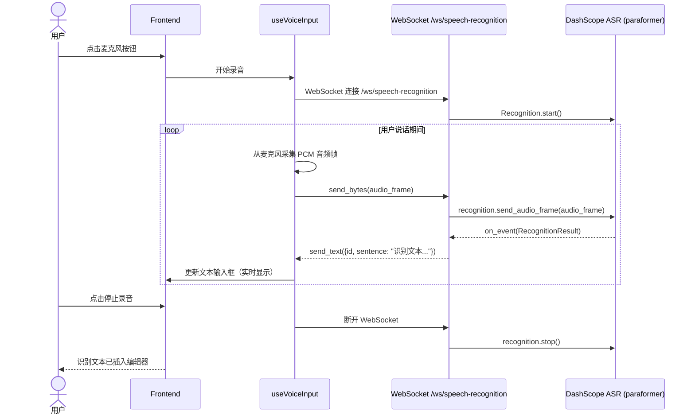

---

## 附录：系统架构概览

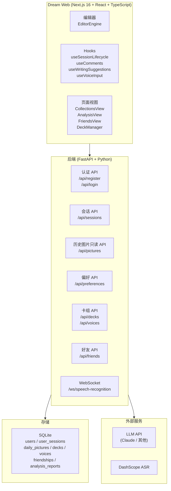

公开GET /api/decks/{deck_id}消费deck.detail/current OAuth，four exact schemas/hash，outer与每个Voice deck_id必须匹配。原null404/owner int/时间/Memory值保持；Admin Repository按原字节投影nullable/raw Memory文本，Dream pure projector保留empty text、解析合法JSON并把非法非空JSON映射为null，读取不heal或写库。无read retry或DB fallback。详见[Deck详情现行规则](deck/deck-detail-version-history.md)。
