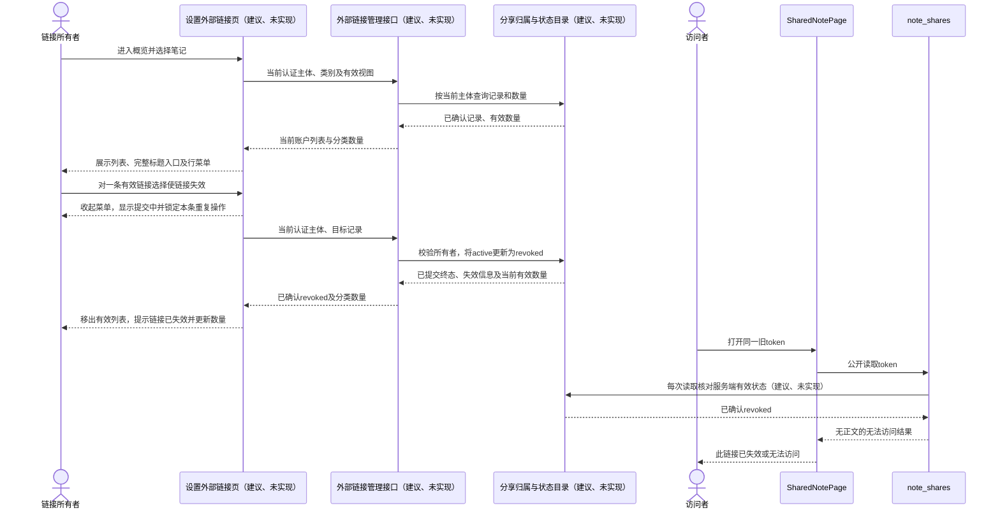
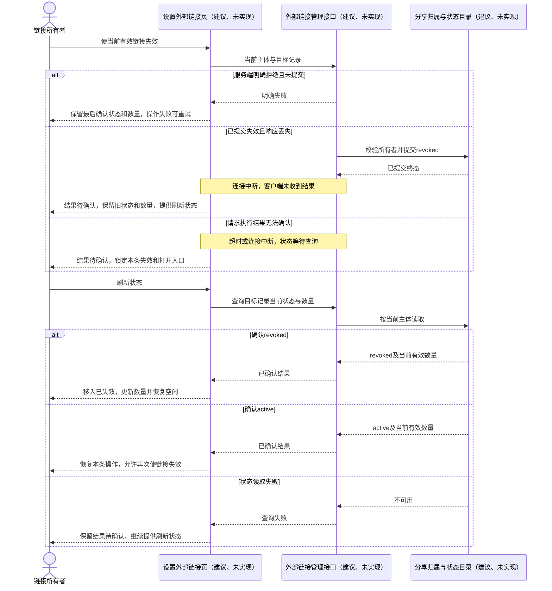
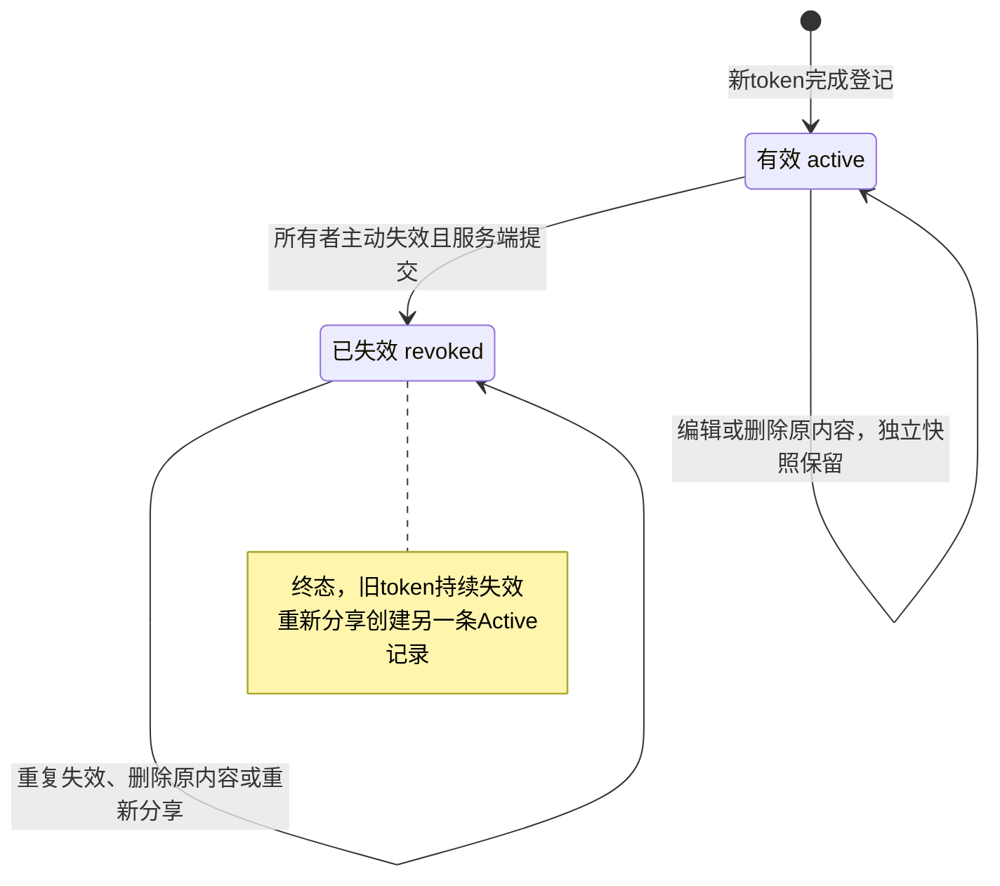
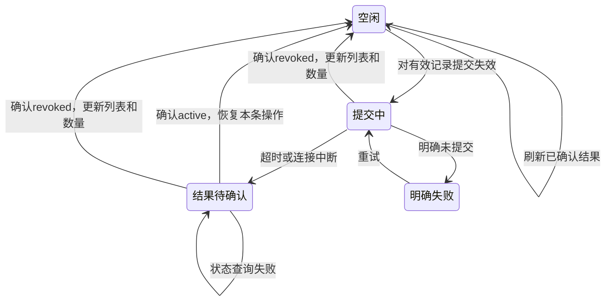

> 历史版本：统一数据库分享改造前的完整原文。现行稿见[external-links](external-links.md)。

<!-- [Input] 外部链接管理PRD、参考截图、阶段结构稿及当前笔记分享设计。 -->
<!-- [Output] 单条主动失效、归属校验、公开读取、异常恢复与状态转换设计。 -->
<!-- [Pos] 分享业务正式交互稿；新增管理接口和状态目录均为建议、未实现。 -->
<!-- [Sync] 2026-11-12: 完成管理设计整合，补齐完整地址展开和文字呈现规范，保留独立快照及单条失效规则。 -->
# 外部链接管理交互设计

## 背景与问题

[产品需求与页面骨架](../../prd/sharing/external-links.md)定义“设置 → 外部链接概览 → AI对话或笔记 → 单条管理”。参考图提供类别卡片、平铺列表与行更多入口；当前设置外壳提供桌面侧栏、窄屏Web横向栏目及原生分类导航。

当前笔记分享的`App`、`NoteShareDialog`、`note_shares`、`AdminSessionData`和`FileStorage`已形成独立快照原型，详见[笔记分享设计](../edit-session/note-sharing.md)。其文件读取路径尚无管理归属目录及有效状态校验。AI对话的链接入口仍为占位，图片分享沿现有流程。

用户要求为集中管理已生成链接和主动使单条链接失效。第一阶段初稿增加了原内容删除联动；本次收敛为独立快照保留，由所有者主动失效。初稿保存在[阶段一过程稿](external-links-workflow-20261112/workspace/1_prd_draft.md)。

## 目标与边界

- 采用设置内两类概览及分类列表，复用现有设置风格与响应式外壳。
- 管理读取与操作按当前登录用户校验所有权；持久链接状态仅含`active`和`revoked`。
- 单条失效直接提交，服务端确认后更新记录与有效数量，行内反馈承接失败及结果待确认。
- 原内容修改或删除后保留独立快照与链接记录；原内容可用性单独展示，删除流程沿原业务执行。
- AI对话链接创建与阅读为接入依赖；本稿仅定义登记和管理要求，内容选择及分享协议留待AI分享设计。
- 交付范围为设计文档；管理接口、共享目录、Schema、migration、页面与发布迁移均待实现。本轮自动测试按用户要求暂停。

选用“分类概览 → 分类列表”承接跨业务查看；单条菜单承接操作，行内展开区承接信息与恢复。原内容删除时自动关闭全部关联链接会扩展原业务删除流程，本次采用当前独立快照语义。

## 概念与规则

### 业务状态与操作状态

| 维度 | 值 | 规则 |
| --- | --- | --- |
| 链接持久状态 | `active`／有效 | 服务端允许该token读取指定快照；按链接条数计入对应类别有效数量。 |
| 链接持久状态 | `revoked`／已失效 | 单向终态，保留标题、原地址、创建时间、失效时间及“用户主动使链接失效”原因；旧token持续拒绝正文读取。 |
| 当前操作状态 | 空闲、提交中、结果待确认、明确失败 | 仅为当前客户端反馈；请求超时与连接中断均无法确认持久状态。 |
| 原内容可用性 | 存在、已确认删除、读取待确认 | 与链接状态分别处理；仅明确删除结果展示“原内容已删除”，读取异常提供恢复反馈。 |

重新分享沿原业务创建新token及新记录。失效操作保留原内容、快照及同源其他链接；重复失效返回同一`revoked`结果。原内容删除后，有效链接继续读取独立快照，仍计入有效数量；管理列表保留完整分享标题和原地址，“查看原内容”不可用。已失效链接保持终态。

提交中锁定当前行重复失效；结果待确认期间暂时禁用该行“使链接失效”和“打开公开页面”，保留最后确认状态与数量，并提供“刷新状态”。服务器已提交失效而响应丢失时，公开读取立即依服务端状态关闭，管理页面等待查询确认。页面只在确认`revoked`后移动记录、提示“链接已失效”并更新已确认数量，避免重复回执造成重复减计。

### 页面与交互归属

| 模块编号 | 交互职责 |
| --- | --- |
| M1 设置外壳 | 进入外部链接；账户切换或登录失效时清除原账户记录并关闭菜单。 |
| M2 页面头部 | 展示用途、当前类别与返回概览入口。 |
| M3 两类概览 | 展示服务端已确认的有效条数和最近有效分享；整卡进入分类，零条时仍可进入。 |
| M4 状态与刷新 | 默认有效，可切换已失效；分类内保留选中视图，刷新核对当前结果。 |
| M5 分类记录 | 展示分享时标题、地址、时间和链接状态；已删除原内容展示独立提示。 |
| M6 行更多菜单 | 展示完整标题；有效记录提供复制、打开、查看原内容及失效；已失效记录提供链接信息及可用的原内容入口。 |
| M7 行内展开区 | 点击有效记录的缩略地址或选择已失效记录的链接信息后展开完整标题和地址；承接手动复制、提交进度及恢复操作。 |
| M8 整区反馈 | 首次读取失败占用列表区，重试后恢复；已有数据刷新失败保留记录并标注更新失败。 |

桌面表格和窄屏信息行使用同一规则；内容区单一纵向滚动。菜单锚定当前行，靠近边界自动调整展开方向；关闭后焦点回原入口。复制失败将焦点移入可选中地址区域，读屏提示结果。失效使用直接提交及行内反馈，无额外确认弹窗。批量、期限、密码和访客权限退出本次范围。
有效记录的缩略地址提供行内链接信息入口，复制前即可阅读完整标题、地址和发布时间。链接信息、手动复制与操作反馈共用当前行的一个展开区，按当前动作展示；收起后焦点回触发入口。

### 当前模块与目标接入

| 模块 | 当前职责 | 目标接入要求 |
| --- | --- | --- |
| `App`、`NoteShareDialog` | 冻结当前笔记、发起分享及复制地址。 | 获得已登记的有效链接后交付；已失效的旧地址提示沿原业务重新分享。 |
| `note_shares` | 认证创建正文快照；公开token读取指定分享文件。 | 创建接入归属与状态登记；每次公开读取先核对服务端状态，再读取快照。新增接入步骤为建议、未实现。 |
| `AdminSessionData` | 原Admin `session.get`能力按当前主体读取原笔记。 | 沿现有归属校验取得创建依据；已删除原内容的管理操作使用已登记所有权。 |
| `FileStorage` | 保存与读取独立公开DTO。 | 继续保存快照；失效通过状态关闭读取，文件路径及快照正文均无法证明用户归属。 |
| 外部链接管理接口（建议、未实现） | 待新增。 | 认证列表、分类数量、单条状态查询和单条失效；每次按服务端当前主体校验所有权。 |
| 分享归属与状态目录（建议、未实现） | 待新增。 | 登记所有者、类别、原内容引用、分享时完整标题、token与文件引用、创建时间、`active/revoked`及失效信息。 |

管理接口的具体路径、DTO及持久化表结构留待实现设计；本稿中的职责名称统一标注为“建议、未实现”。客户端传入的记录ID仅用于定位，所有权由服务端核对。管理接口对跨账户记录拒绝读取与写入；公开token仅提供快照访问，无管理权限。

## 正常业务时序

以下为目标交互；新增管理接口、目录及`note_shares`状态校验步骤当前均待实现。前提为链接创建已完成所有权与初始`active`登记。笔记复用当前创建链路；AI对话的创建接入按独立依赖交付。

笔记公开读取沿现有`SharedNotePage → note_shares → FileStorage`接入状态校验；AI公开阅读模块名称及内容协议由其后续设计定义。复制失败展示完整地址供手动复制；“查看原内容”沿当前业务入口及归属校验执行。

## 异常与恢复时序

列表首次读取失败使用M8重试；已有数据刷新失败保留已确认内容。账户切换清除旧记录并重新认证读取。另一端已失效时重复提交返回同一终态。原内容读取失败展示恢复反馈；原内容确认删除后保留该链接与标题，菜单关闭原内容入口。

公开读取遇到目录缺失、状态缺失或目录不可用时，停止正文输出并按错误类型返回无法访问或暂时不可用反馈，等待服务恢复；沿旧文件路径直接读取的旁路必须关闭。该fail closed能力属于待实现接入要求。

## 状态转换

操作状态独立于持久状态。页面离开或账户切换终止当前页面反馈，后续进入重新读取服务端结果。有效数量采用已确认结果更新，原内容删除提示仅更新原内容可用性。

## 实现依赖与发布边界

1. **共享Schema**：Admin仓库`/drizzle`唯一管理。分享归属与状态目录为建议、未实现；先交付前向migration和capability，Dream仅消费已发布capability。缺少能力时fail closed，禁止Dream临时建表或运行时DDL。具体Schema及API实现退出本轮。
2. **创建接入**：新链接交付用户前须具备服务端可核对的所有者和`active`记录。笔记继续使用`AdminSessionData`现有归属读取及`FileStorage`独立快照；管理登记失败时保留失败反馈，恢复方案由实现设计定义。AI链接创建为待实现依赖。
3. **读取接入**：每次公开内容读取核对目录中的有效状态；目录缺失、状态缺失或不可用时停止公开正文输出。公开Page、API及其缓存配置须共同保证后续读取取得当前状态；已完成读取与访问者已保存副本保留其结果。
4. **存量迁移**：现有纯文件快照缺少管理归属。需以认证创建回执、已持久化的创建主体关联或可核对日志等证据建立映射；禁止依据快照正文、文件路径或猜测用户身份分配所有者。缺少证据或状态的存量链接按fail closed要求纳入待实现发布方案，迁移前完成明确处置和恢复安排。
5. **阶段边界**：原内容删除流程及自动联动退出本次新增范围。当前文档完成产品与交互设计，页面实现、迁移、文档语法复核、真实账户验收与发布均留存后续独立证据；本轮仅核对保存文件存在性。

验收场景由[PRD验收条件](../../prd/sharing/external-links.md#验收条件)所有。逻辑分区、模块父子关系与范围收敛依据保存在[第三阶段过程稿](external-links-workflow-20261112/workspace/3_hierarchy_logic.md)，文字呈现规范保存在[第四阶段过程稿](external-links-workflow-20261112/workspace/4_ui_design.md)。
