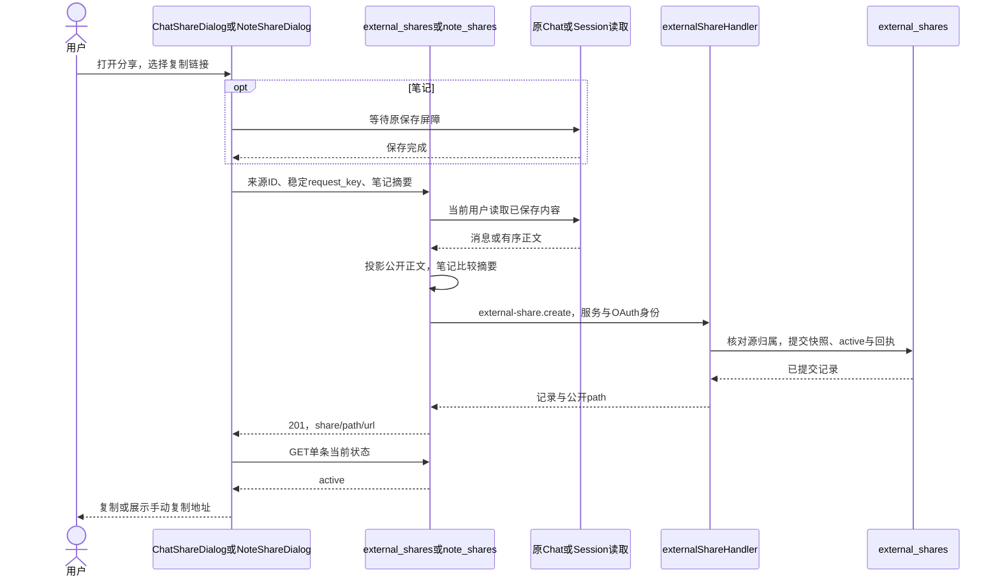
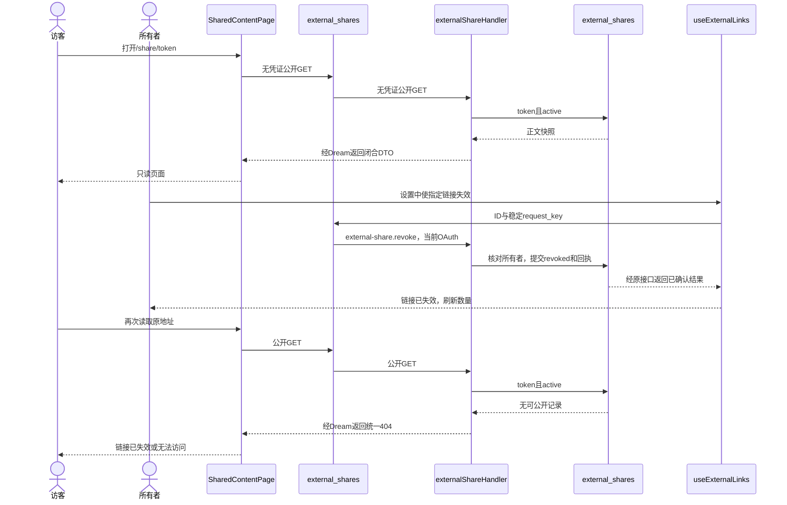
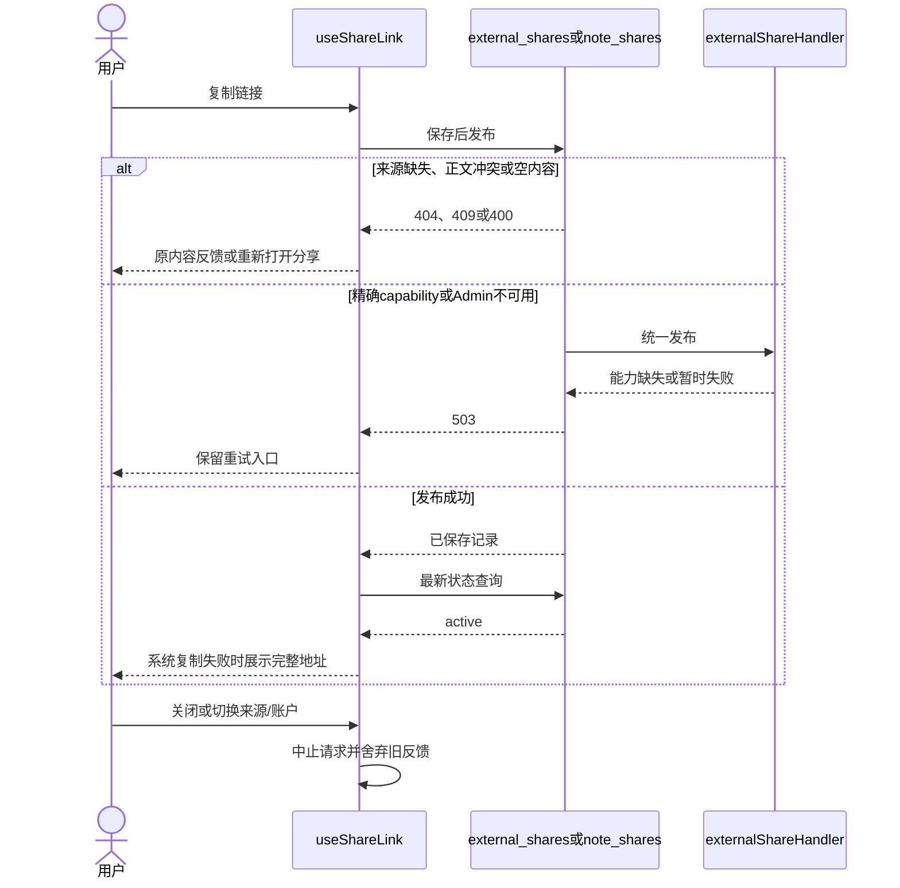
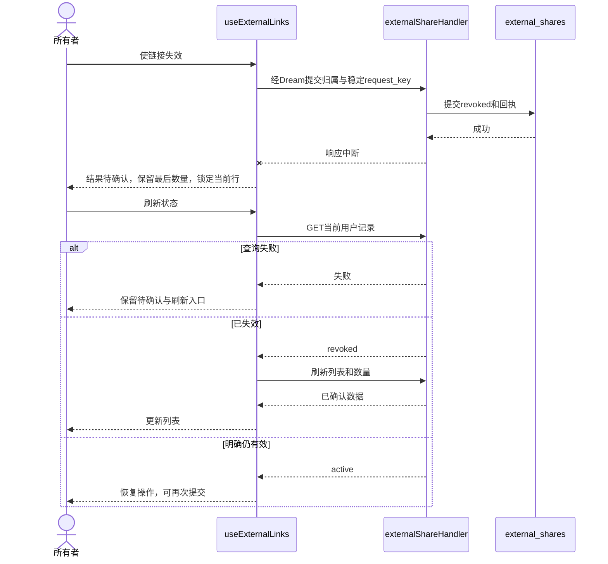
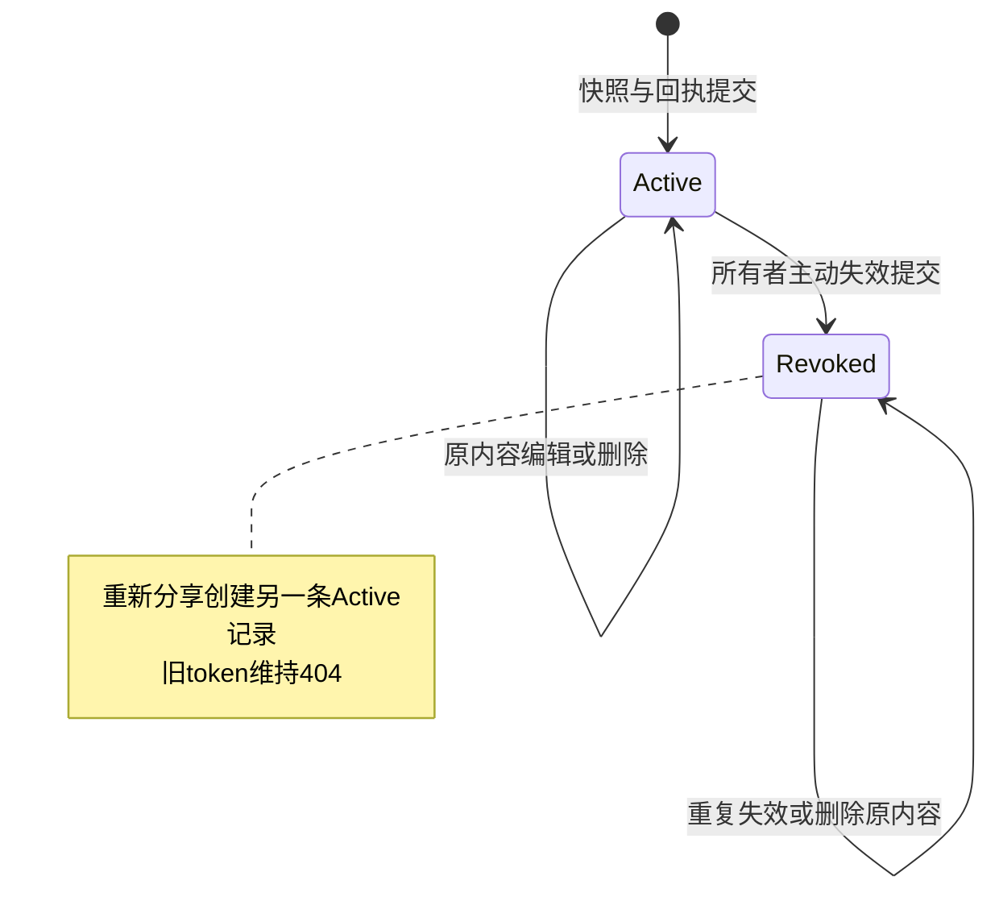
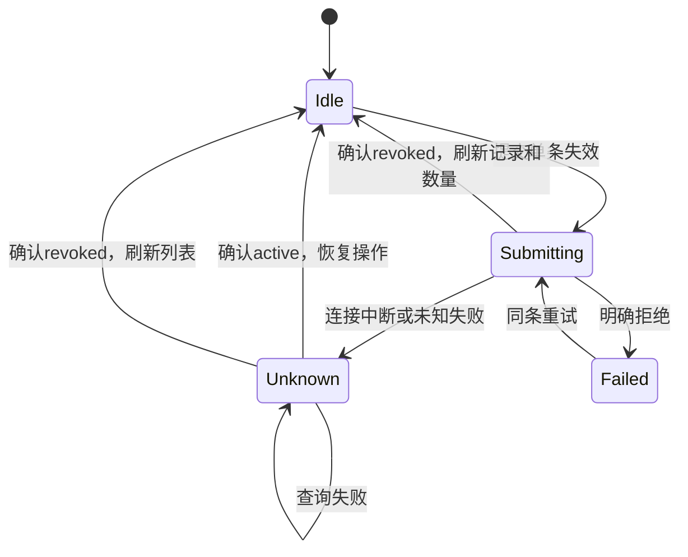

<!-- [Input] AI与笔记分享需求、设置PRD、现行Chat/Session实现和better-chatbot代码。 -->
<!-- [Output] 统一快照与状态合同、公开阅读、正常/异常业务时序和状态转换。 -->
<!-- [Pos] 分享业务现行正式设计；Admin数据库已采用，服务发布与各层验证由执行记录登记。 -->
<!-- [Sync] 2026-11-12: 统一Admin持久化、公开页面、Web/Native分享及设置管理。 -->
# 外部链接分享与管理设计

## 背景与问题

[产品需求与页面骨架](../../prd/sharing/external-links.md)定义AI对话、笔记公开分享和单条失效。原AI链接入口为占位，笔记原型使用独立文件，缺少归属目录和失效状态。

参考[better-chatbot公开页面](https://github.com/keinsaasforever/better-chatbot/tree/6f4183566bc48616303cb84055f11f79578c82fe/apps/web/src/app/%28public%29)，固定读取版本为`6f4183566bc48616303cb84055f11f79578c82fe`。读取范围为`export/[id]/page.tsx`、`api/chat/export/route.ts`、`api/export/[id]/route.ts`、`chat-export-repository.pg.ts`和`p/[slug]/page.tsx`。采用独立快照记录、认证发布、独立公开页、归属管理和逐次状态检查。评论、到期和HTML站点输出保持参考项目原有范围。

发现依据包括用户截图、Settings导航、`ChatShareDialog`、`PublicChatMessageDto`、`AdminSessionData`和原生分享协议。核心任务为分享当前内容、识别公开地址和主动收回单条地址。原设计完整保存在[历史稿](external-links-before-unified-sharing-20261112.md)。

## 目标与边界

| 方案 | 判断 |
| --- | --- |
| 文件加独立状态目录 | 正文和状态分属两个位置，端侧local目录与公开服务需要额外共享文件约束。 |
| 实时公开原内容 | 后续编辑改变公开内容，原内容删除影响已有分享。 |
| Admin保存快照与状态 | 复用共享PostgreSQL、OAuth和操作回执，Web与Native读取同一记录。采用此方案。 |

源码范围包含创建、匿名阅读、用户列表/数量/状态、单条失效和原内容跳转。图片沿原模块交付。Schema由Admin Drizzle唯一管理。数据库采用、自动验证、真实账户验收和发布分别登记。

## 概念与规则

### 内容与记录

| 对象 | 合同 |
| --- | --- |
| `external_shares` | Admin拥有UUID、canonical用户、类别、原内容ID、随机token、标题、JSON快照、状态、创建/失效时间。 |
| 笔记快照 | `{kind:'note',title,created_at,paragraphs}`，仅有序`TextCell.content`。保存屏障后比较正文SHA-256，变化返回409。 |
| AI快照 | `{kind:'chat',title,created_at,messages:[{role,content}]}`，仅可见用户正文和最终回复。 |
| AI最终回复 | 沿现行公开投影，优先已保存`history_final_text`，其次有效completed/finalPartIndex；旧单一正文消息兼容。损坏、取消和过程内容结束于投影边界。 |
| 公开范围 | 正文、标题、原内容创建日期和品牌。工具、执行过程、附件内容、工作区访问、账户与管理元数据退出公开DTO。用户自行写入正文的信息随正文分享。 |
| token | Admin使用32随机字节生成43字符Base64url，只提供公开读取；管理使用UUID和当前用户身份。 |
| 不可变快照 | 创建后正文保持原值。原内容编辑或删除后快照保留，`source_available`独立表示原内容存在性。 |
| 失效 | `active → revoked`单向状态，保留地址与快照；旧地址持续404。重新分享创建新token。 |

Admin事务内重新检查原Thread/Session归属、持有源行共享锁后插入。请求体无法提供所有者。已登记链接的管理按记录所有权执行，原内容删除后仍可失效。

### 模块与接口

| 模块或入口 | 职责 |
| --- | --- |
| `note_shares.py` | 读取已保存Session、筛选正文、比较摘要，调用统一发布。 |
| `external_shares.py` | AI最终正文投影、统一发布、管理适配和匿名Admin读取代理。 |
| Admin `externalShareHandler/Repository` | OAuth归属、严格DTO、事务、回执/审计、快照和状态。 |
| `POST /api/sessions/{id}/share` | `content_sha256 + request_key`，成功201及`share/path/url`。 |
| `POST /api/claude-agent/threads/{id}/share` | `request_key`，读取已保存对话，成功201。空内容400，缺失404。 |
| `GET /api/shares` | kind/status分类、limit、时间/UUID成对游标，返回当前用户记录、两类有效数量和`public_origin`。 |
| `GET /api/shares/{id}` | 当前用户单条状态，跨账户或缺失404。 |
| `POST /api/shares/{id}/revoke` | 稳定`request_key`，返回已确认revoked记录；重复失效保持终态。 |
| Admin内部`external-share.create/list/get/revoke` | 原服务身份与用户OAuth，读`dream:read`、写`dream:write`。 |
| Admin/Dream `GET /api/public/shares/{token}` | 每次读取active快照，缺失/已失效404，能力或服务不可用503。 |
| Next `/share/[token]` | 独立动态公开页，无登录即可阅读。 |

写操作沿原`ReceiptRepository`，同一key及相同输入返回原结果，相同key异值409。回执状态可能早于后续失效，每次复制再查询最新状态。来源变化时进入摘要或回执冲突反馈，用户重新打开分享取得新快照。

### 公开读取与平台

1. Admin每次按token与active查库。Dream仅从配置的Admin transport origin读取，Next仅请求配置的Python origin。代理禁止重定向和浏览器凭证转发；Dream沿原配置限制超时及响应字节。
2. API与页面使用`no-store`、`noindex, nofollow`、`no-referrer`。Next使用`force-dynamic`，每次页面读取核对当前状态。已完成读取与访客已保存副本保留既有结果。
3. 笔记沿`NoteContent`文字节点呈现。AI沿`ChatMarkdown publicView`呈现Markdown、数学和Mermaid；工作区引用与图片仅显示文字，HTTP(S)链接由访客主动打开。
4. `INK_PUBLIC_SITE_URL`或`INK_PUBLIC_BASE_URL`提供公开origin。Web可回退当前页面origin；Native拒绝loopback分享地址。公开服务须能访问同一Admin记录。
5. `useShareLink`持有本次稳定key、回执和复制恢复。关闭或切换来源时中止读取；复制失败保留可选中URL。
6. `useExternalLinks`统一Web/Native列表、翻页、数量、操作和账户代次。两端`ExternalLinksSettings`承接呈现，系统复制、打开和图片文件沿原平台接口。
7. 旧`/api/public/note-shares/{token}`统一404；旧`/share/notes/{token}`仅将新格式token导航到规范页。原无归属文件token结束公开读取，原文件保留。归属推断和正文回填未纳入改造。

### 管理交互

设置路径为`/story-workspace/settings/external-links`。概览提供两类有效数量、最近标题和剩余条数。进入分类默认有效，支持已失效视图，按时间与ID倒序翻页。桌面为表格行，窄屏为纵向信息行；行内菜单和详情共用设置滚动区域。

有效行提供复制、公开打开、可用的原内容入口和失效。已失效行保留详情和原内容入口。失效直接提交，提交中锁定当前行；未知失败保留最后状态和数量，提供刷新状态。服务端确认后移出有效列表并更新数量。账户切换中止旧操作与反馈。

## 正常业务时序

## 异常与恢复时序

## 状态转换

## Schema与交付状态

Admin `packages/db/src/schema/dream.ts`为唯一表定义。前向`0087_external_shares.sql`由Drizzle生成SQL/journal/snapshot后追加DATA授权与capability；历史0086及更早文件保留。精确能力为`dream.external-share.v1`版本1，hash由Admin `drizzle/contracts/dream-external-share-v1.json`所有。

四个内部操作追加Registry尾部。Dream操作摘要由Admin `generate-external-share-contracts.ts`生成至`backend/services/admin_data/external_share_contract.json`，独立于全局migration head。能力缺失时fail closed，原普通业务继续消费其原能力集合。

统一分享源码与前向迁移已交付。Admin正常数据库已完成0087与精确能力登记；完整隔离迁移、权限、回执和匿名HTTP技术检查通过。用户要求部署并验证后，本次技术检查由主Agent执行，luna-test-stage保持暂停。Admin制品已采用并完成线上只读接口检查；Dream制品、公开应用origin及真实账户/设备验收由执行记录继续登记。回退应用代码须保留新增表、快照、终态、回执和逐次状态校验；旧文件token直接读取继续关闭。

执行状态见[统一分享改造记录](../../exec/external-share-refactor-20261112.md)。
