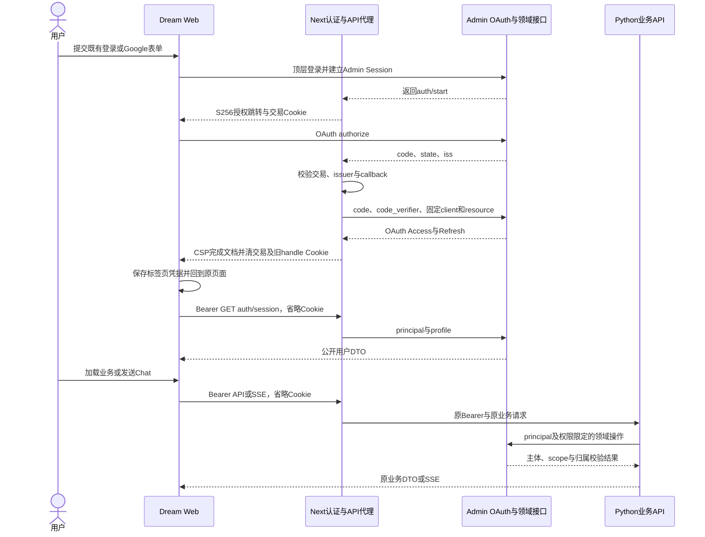
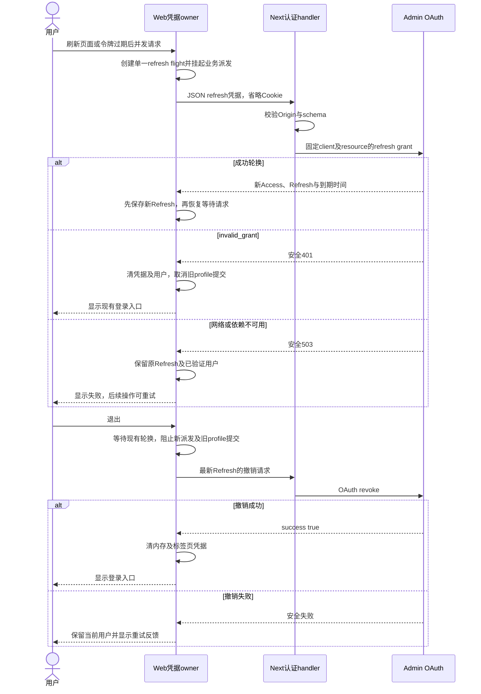
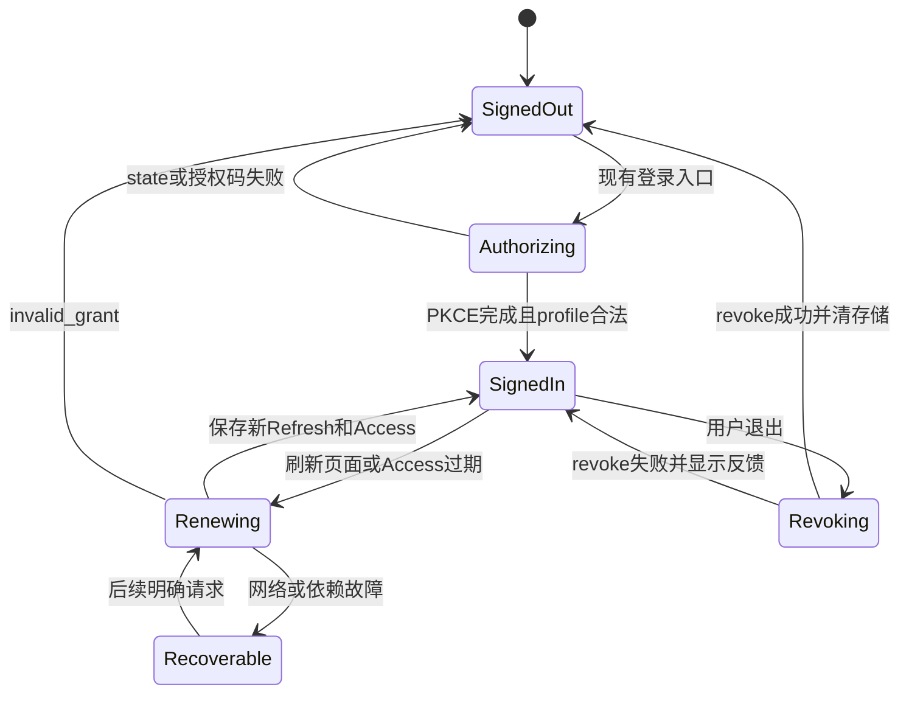

<!-- [Input] Web认证迁移需求、当前Admin公开OAuth客户端与Dream生产认证入口。 -->
<!-- [Output] Web凭据、续期、退出、媒体访问及原生兼容的现行交互合同。 -->
<!-- [Pos] Dream Web认证设计；Admin保持身份、签名、scope和资源归属所有权。 -->

# Web Bearer 认证

## 背景与问题

迁移前Web业务请求携带Dream handle Cookie；Next每次调用Admin `browser-sessions/resolve`取得Access Token。需求提供的Trace显示一次解析往返耗时2.46秒。目标是让同一页面的受保护业务请求直接使用Bearer，并使本轮Web流程的handle解析次数为零。

现行Admin Browser Client已经支持public client、authorization code、S256 PKCE、`offline_access`、refresh与revoke。Python继续校验JWT并解析`/principal`；Admin领域事务继续校验scope和资源归属。

## 目标与边界

Web覆盖密码/Google登录后的OAuth callback、当前用户、刷新页面、并发续期、退出、普通fetch、Chat SSE/Stop、Node MCP Apps、上传及私有图片/附件。原生私有协议callback、平台Cookie、Device OAuth、Admin管理Session和第三方OAuth拥有原生命周期。业务DTO、Agent上下文、日志与URL均排除Access Token和刷新凭据。

方案判断：逐请求handle解析会继续增加网络往返；为handle增加Token读取接口会引入Admin新合同；采用已发布OAuth公开接口可以复用当前client、PKCE、resource、scope及撤销。Web选用内存Access Token和当前标签页的sessionStorage刷新凭据，原生保留现有平台适配器。

## 概念与规则

| 对象 | 所有者与生命周期 | 校验与结果 |
| --- | --- | --- |
| 登录交易 | Next `BffLoginBoundary`；短期加密HttpOnly交易Cookie | 精确callback/issuer/state、PKCE；成功后清除交易与旧handle Cookie |
| Web Access Token | `browserSession.web.ts`内存；callback完成文档仅用于当前标签页首次交付 | Bearer仅发送到同源`/api/`、`/auth/session`、`/auth/me`；禁止跟随认证请求重定向 |
| Web刷新凭据 | `sessionStorage[STORAGE_KEYS.WEB_OAUTH]` | 正常存储仅含`refresh_token`；刷新页面执行OAuth refresh；关闭标签页结束该存储生命周期 |
| 公开用户 | AuthProvider不可变snapshot | canonical ID保留十进制字符串；凭据排除React公开context |
| 请求scope | Web内存随机值；由历史`getBrowserCsrfToken()`接口提供给现有调用者 | 隔离账户与迟到结果；刷新Token保持同账户scope；Web HTTP排除该值 |
| 续期 | 当前标签页单一flight；Next `/auth/refresh`调用Admin `/api/auth/oauth2/token` | 精确Origin、JSON schema、固定client/resource；轮换后先保存新refresh，再派发等待请求 |
| 退出 | Next `/auth/logout`调用Admin OAuth revoke | 等待轮换、撤销最新refresh；严格成功后清理，失败保留状态并可重试 |
| Python与Admin授权 | 既有JWT/JWKS、`/principal`、领域事务 | issuer、audience、scope、active subject与资源归属保持原校验 |
| 原生兼容 | `browserSession.native.ts`与`cookieSession.ts`；callback scheme确定原handler | Cookie mutation继续使用Origin和CSRF；Device token端点保持原状态 |

sessionStorage可被同源脚本读取。该取舍支持当前标签页刷新恢复，并要求同源脚本安全；内存Access Token在初始化后立即从持久存储投影中移除。浏览器恢复已关闭标签页或复制标签页时，存储恢复行为由浏览器决定；复制产生的旧刷新凭据可能被Admin轮换拒绝，用户通过现有登录入口恢复。Access Token和refresh均不放入localStorage、URL、文件路径或业务请求正文。

Admin保持既有短寿命Access Token校验与refresh撤销语义。退出结束当前client的refresh grant；已经发出的Access Token受Admin验证规则和有效期约束。每次Web续期保持Admin返回的轮换凭据；网络响应丢失后，旧凭据可能失效，下一次`invalid_grant`清当前标签页并重新登录。Google密码表单、Admin自身登录Session及其他client的授权各自独立。

### 请求与媒体

`client-shell.tsx`在加载业务模块前安装同源Bearer fetch。Next现有`.web.ts`解析选择Web owner，Metro选择native owner。显式Bearer优先于遗留Cookie；Python处理最终身份校验。Web业务fetch统一`credentials: omit`并剥除旧CSRF和Cookie头。原生Cookie-only请求继续由Admin handle解析。

受保护请求缺少Access Token时在Web认证边界停止派发。Access Token未到期时直接派发；到期时等待共享续期。GET/HEAD收到401后最多续期并重发一次。一般写请求保持一次派发，返回原响应；既有Reflections Notion创建只有明确`ACCESS_TOKEN_REQUIRED`、`outcome_unknown=false`、未提交、无task ID及原`request_key`/`include_notion=true`时重发同一正文一次。未知提交、已提交及其他错误按既有业务恢复规则处理。

Chat沿用`ClaudeAgentChatTransport`、SSE parser和Stop DTO。等待续期的请求可单独取消；共享续期继续服务其他调用者。发出请求后AbortSignal继续传递给原HTTP/SSE owner。

普通DOM图片无法注入Authorization；`AuthenticatedImage`先通过Bearer fetch读取Blob，挂载object URL并在卸载、源变化或退出时释放。`AuthenticatedLink`在点击后fetch附件并触发Blob下载。Workspace原有Blob读取继续复用统一fetch。上传使用fetch与FormData；Web上传进度报告开始与完成，原生上传进度保持平台owner。外部图片、公开静态资源和对象存储签名URL保留原请求，Web owner只向同源业务入口添加Bearer。

### 正常业务时序

### 异常与恢复时序

## 验收与证据

| 场景 | 通过条件 |
| --- | --- |
| 登录与刷新页面 | 原PKCE生效；callback清登录Cookie；刷新通过refresh-only标签页存储恢复 |
| 普通读取、并发及过期 | 每个业务请求Bearer、Cookie缺失；并发只发生一次续期；handle resolve为零 |
| 401、撤销及故障 | 读取最多重发一次；invalid grant清状态；依赖故障保留凭据；一般写请求只派发一次 |
| 退出与竞态 | 撤销最新Refresh；失败保留用户；旧profile与迟到响应无法恢复已退出用户 |
| Chat SSE与Stop | 原transport显示文本，原Stop DTO生效；网络只有Bearer |
| 上传、图片、下载 | FormData保持；DOM媒体使用Blob；URL与业务DTO无凭据 |
| 原生及Device | 原类型与Cookie合同通过；真实设备与账户采用单独留存 |

技术验证见[迁移执行记录](../exec/web-bearer-auth-20261119.md)。隔离Admin/Python transport验证生产handler、OAuth边界和浏览器网络；真实Admin、账户、Google、模型及部署采用需要各自证据。协议参考[RFC 9700](https://www.rfc-editor.org/rfc/rfc9700.html)的PKCE与public client刷新凭据轮换要求。
