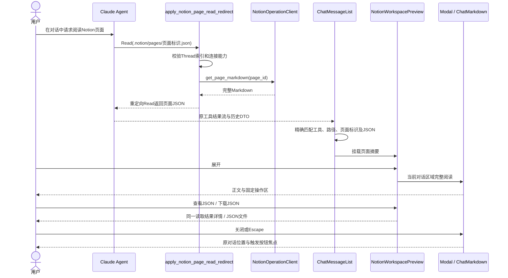
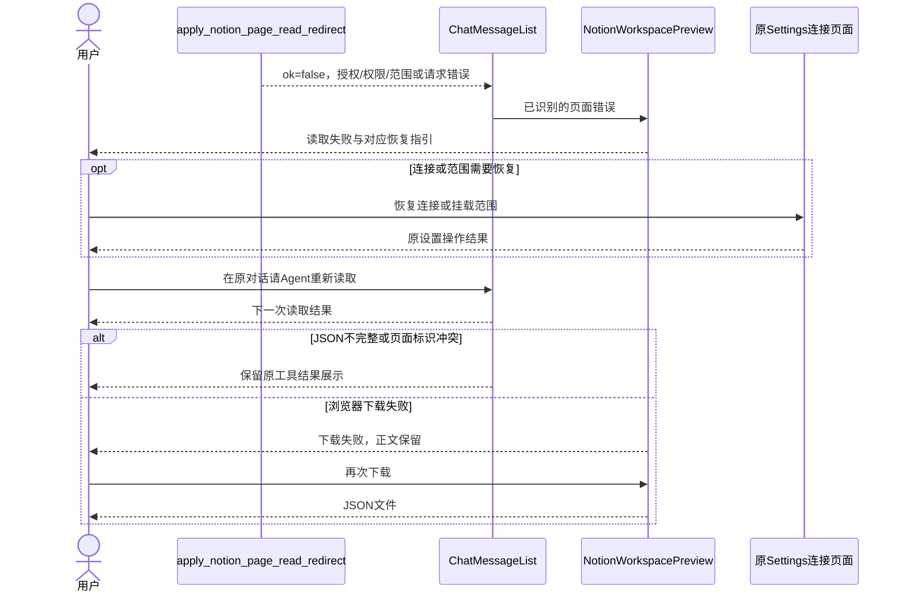
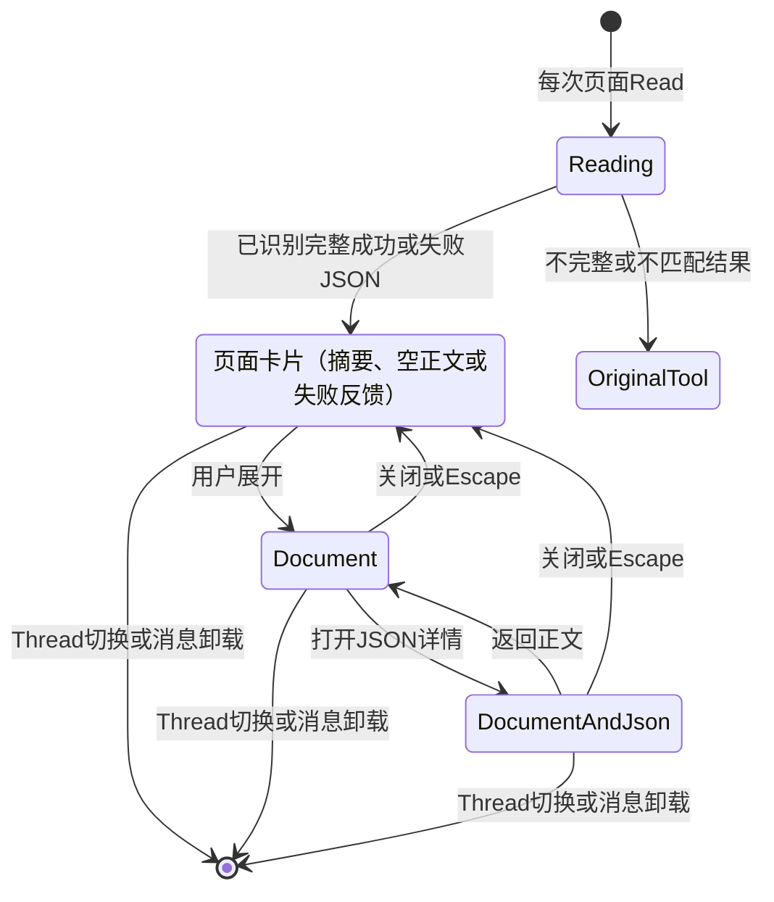

<!-- [Sync] 2026-11-18: 明确正常Runtime的制表符编号及0/1连续行合同，既有结果页面复核归执行记录。 -->
<!-- [Input] Notion问题原文、notion_read_hook.py、ChatMessageList及现行Markdown/Modal。 -->
<!-- [Output] 已读取Notion页面的展示合同、业务图、方案选择与实施前评审。 -->
<!-- [Pos] 工作空间内容在Chat中的交互设计；产品骨架归../../prd/chat/notion-workspace-preview.md。 -->
<!-- [Sync] 2026-11-18: 完成发现、定义、方案比较与交付收敛，评审通过进入实现。 -->
# Notion 工作空间预览交互设计

> 2026-11-18 用户追加要求：正文采用react-notion-x，参考Next.js starter kit，并按Kastention UI规范v3.1调整。本文正文记录已实现的Markdown基线；替换方案处于调研阶段，见[react-notion-x与Next.js调研](notion-workspace-preview-react-notion-x-research.md)。新的渲染组件和样式尚未实施。

## 背景与问题

[Notion来源](https://app.notion.com/p/40b30b7547c380cd9930c384ab35023c#41b30b7547c3803a9079e5c84adc127d)与三张原图已读取。目标锚点为标题区块，单独fetch返回空标题区块；需求正文和图片来自其所属页面，读取内容完整。原文定义在Chat中阅读Agent已经读取的页面及其JSON。

已核实事实：

- `backend/libs/claude_agent_kit/server/notion_read_hook.py` 的 `apply_notion_page_read_redirect` 匹配 `Read(.notion/pages/<id>.json)`，校验线程索引，经 `NotionOperationClient.get_page_markdown` 或绑定的 `page_reader` 返回JSON，实际Read重定向至 `.claude-tmp/notion-read-*.json`。本次复用全部身份与权限校验。
- 成功结果含 `ok`、`page_id`、标题、URL与 `markdown`；普通Chat包含 `snapshot`，Reflections包含读取证据和 `snapshot_version`。失败结果含稳定错误码及恢复提示。
- 调整前，`ChatMessageList.tsx` 把已完成Read输出作为终端文本；已有MCP App结果可提升至过程折叠区外，已有 `Modal` 支持焦点/Escape，`ChatMarkdown` 支持Markdown、表格、公式和Mermaid。
- 历史消息采用最终文字摘要和受限过程读取；`useHistoricalChatProcess`自动加载尚缺的过程，失败后沿原展开/重试入口恢复。完整工具结果在过程加载后可用。
- [react-notion-x官方用法](https://github.com/NotionX/react-notion-x#usage)接收 `recordMap`。当前服务器返回Markdown JSON，直接传入该组件无法满足其输入合同。

代码入口：[Notion Read hook](../../../backend/libs/claude_agent_kit/server/notion_read_hook.py)、[页面Markdown读取](../../../backend/notion/operations.py)、[Chat消息列表](../../../frontend/app/_dream/components/chat/ChatMessageList.tsx)、[历史过程读取](../../../frontend/app/_dream/components/chat/useHistoricalChatProcess.ts)。

判断：本需求属于已授权工具结果的阅读呈现。本轮已新增展示投影及阅读卡片，后端读取和Schema已有所需能力。

## 目标与边界

网页桌面与窄屏使用同一展示合同。消费当前Thread的既有工具结果，提供摘要、完整阅读、JSON详情和下载。原生客户端继续使用既有工具呈现；端侧布局和文件导出由独立平台能力负责。本次交付不修改SDK、提示词、工具说明、权限分类、数据库、连接器设置和服务器配置。

## 概念与规则

`notionPreviewProjection.ts`负责精确识别内置Read和页面路径，接受对象JSON、字符串JSON及Claude Read逐行编号的JSON。编号分隔符支持箭头和实际Runtime使用的制表符，行号从0或1开始且逐行连续；同一结果的分隔符必须一致。普通页面路径必须与返回的页面标识相同；临时重定向路径须匹配现行hook的目录和文件名。未完成Read、完整JSON解析失败、页面标识冲突、普通文件和其他工具返回null，继续原工具展示。此匹配用于展示选择，执行权限由服务器所有。

`NotionWorkspacePreview`只消费已返回的数据。摘要使用短文字片段，完整Markdown只在展开时挂载。JSON只在用户打开详情后序列化，下载序列化同一payload。空白Markdown保持成功状态。错误码映射为应用双语文案，原返回结果可在详情中检查。失败恢复通过原Chat继续读取，不增加HTTP和自动工具调用。每次读取按原toolCallId分别展示，同页重新读取后保留先前卡片。

`Modal`增加可选portal容器。`ChatPanel`声明当前对话区域并建立定位上下文；预览portal进入该区域，覆盖输入及消息、保留外围导航。独立组件使用时回退到原全屏容器。共享Modal调用默认行为保持。

## 方案比较与选择

| 方案 | 任务覆盖 | 改动与维护 | 决策 |
| --- | --- | --- | --- |
| 既有Markdown结果＋专用阅读卡片 | 摘要、完整正文、JSON详情与下载 | 复用既有Read、ChatMarkdown、Modal；增加纯展示匹配 | 选择，覆盖本次用户任务 |
| 引入react-notion-x及recordMap采集 | 支持更多Notion专属布局 | 需新增数据获取/转换、依赖、附件和授权维护 | 当前返回合同缺少recordMap；独立能力待需求定义 |
| 点击后重新请求Notion页面 | 展示点击时最新内容 | 新接口及当前授权、历史快照差异和失败恢复 | 当前任务要求查看已读取结果，采用既有内容 |

## 正常业务时序

下图的 `NotionWorkspacePreview`、`notionPreviewProjection` 和Modal容器参数已在本轮实现。两类业务时序及状态图的语法已通过浏览器解析；源码技术回执见执行记录。

## 异常与恢复时序

## 状态转换

## 交互和验收映射

页面骨架、栏目和状态表由[PRD](../../prd/chat/notion-workspace-preview.md)所有。桌面正文和右侧JSON分别滚动；窄屏JSON栏目替换正文，顶部保留返回正文和下载入口。JSON与长代码在自身区域横向滚动，文档横向宽度受当前对话约束。展开与关闭不触发Notion读取。

技术验证通过公开生产组件和真实工具DTO构造隔离结果，覆盖成功对象、字符串/编号结果、空白、权限/请求错误、无关文件/工具、标识冲突、部分JSON、历史折叠、Thread切换、焦点、窄屏及下载内容。普通账户真实Notion读取、端侧、部署另行留存证据。

## 实施前评审

实施前评审结论：通过。当前源码和技术验证已完成，真实业务与部署状态见执行记录。核心任务和操作均追溯到来源正文及三张图。页面骨架和三类业务图已纳入正文；新增展示投影职责单一。复用原读取/授权、消息、Markdown、Modal和主题；无新增确认、配置项或管理入口。

评审修订：完整阅读范围绑定当前ChatPanel；摘要只渲染文字片段；JSON按需挂载；历史受限过程读取保持；明确当前payload与recordMap的格式差异。原生客户端和Notion专属区块排版独立标明范围。功能和部署状态由[执行记录](../../exec/notion-workspace-preview-20261118.md)逐项确认。
