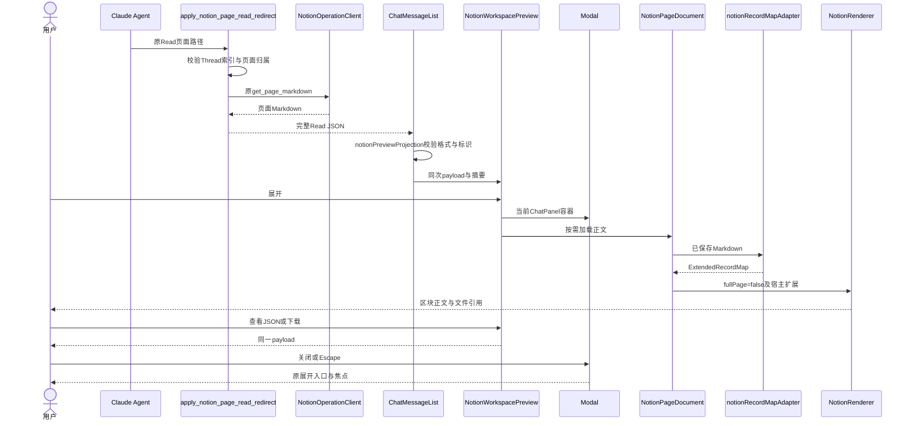
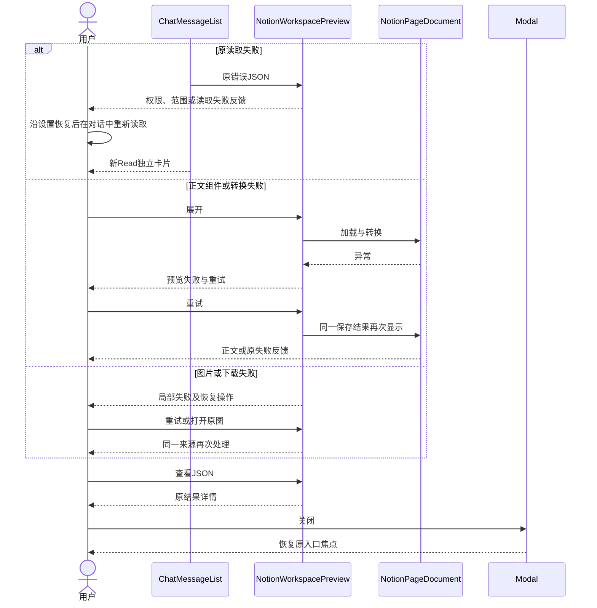
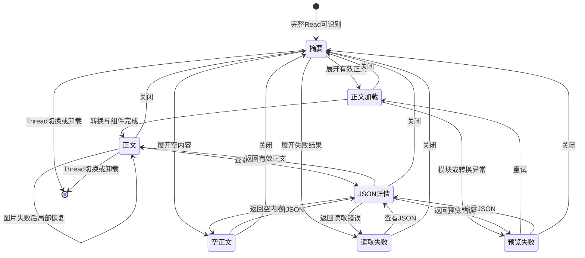

<!-- [Input] Notion问题原文、现行Read合同、用户确认的react-notion-x方案A与UI规范v3.1。 -->
<!-- [Output] 已读取页面的交互合同、数据映射、业务图、评审及验收矩阵。 -->
<!-- [Pos] Chat内Notion阅读设计；页面骨架归../../prd/chat/notion-workspace-preview.md。 -->
<!-- [Sync] 2026-11-18: 用户确认后采用真实NotionRenderer，保留原读取、历史和JSON来源。 -->
# Notion 工作空间预览交互设计

## 背景与问题

[Notion来源](https://app.notion.com/p/40b30b7547c380cd9930c384ab35023c#41b30b7547c3803a9079e5c84adc127d)与三张关联图片已经读取。目标锚点为标题区块，单独读取返回空标题区块；需求正文和图片来自所属页面。用户任务为在Chat中阅读Agent已经读取的页面，并检查、下载同一次结果的JSON。

当前问题有两项：实际Read采用制表符行号，早期识别仅覆盖箭头行号；已保存的增强Markdown包含file、mention-page等Notion标签，普通Markdown阅读器将其显示为原文。用户指定react-notion-x，参考Next.js starter kit，并要求UI遵循Kastention规范v3.1。

事实与依据：

- [apply_notion_page_read_redirect](../../../backend/libs/claude_agent_kit/server/notion_read_hook.py)校验当前Thread资源索引并执行原Notion读取，结果重定向至线程的临时JSON。成功结果含ok、page_id、title、url、markdown和来源信息；失败含稳定错误码。
- [NotionOperationClient](../../../backend/notion/operations.py)提供页面Markdown；历史记录已经保存该次读取内容。
- [ChatMessageList](../../../frontend/app/_dream/components/chat/ChatMessageList.tsx)负责工具结果和过程外内容；[useHistoricalChatProcess](../../../frontend/app/_dream/components/chat/useHistoricalChatProcess.ts)负责受限历史过程读取与恢复。
- [NotionRenderer](https://github.com/NotionX/react-notion-x)要求ExtendedRecordMap。当前Markdown字符串需要数据适配。来源、Next集成和可行方案详见[调研](notion-workspace-preview-react-notion-x-research.md)。

判断：本次改动属于既有工具结果的阅读呈现。当前后端读取、身份权限和Schema具备所需能力。历史[Markdown基线](notion-workspace-preview-markdown-baseline-20261118.md)完整保留，现行行为以本文及执行记录为准。

## 目标与边界

支持网页Chat桌面与窄屏：摘要卡片、对话区域内完整阅读、文件与引用展示、JSON详情和原结果下载。内容来自该次读取，展示不会请求Notion当前页面。

范围外项目包括Notion编辑、页面树管理、工作空间切换、新的Notion登录、签名刷新、后台区块采集、原生客户端接入与部署。缺失的原区块ID、文件大小、封面、数据库视图、目标页面正文和私有权限信息保持缺失。PDF作为文件条目打开；内嵌PDF阅读器和额外worker属于后续独立需求。

## 概念与规则

“工作空间”指当前Thread已有的Agent工作区；“内置”指服务器现行Notion挂载与Read链路；“预览对象”指已完成Read中的页面JSON。页面选择和访问权限由原连接器、资源索引、历史消息授权所有。

`notionPreviewProjection`只识别Read和现行页面/重定向路径。普通页面路径与返回page_id必须一致。完整对象JSON、字符串JSON、箭头或制表符编号JSON可识别；行号从0或1开始且连续，同一结果分隔符一致。部分结果、标识冲突和其他文件继续原通用工具展示。匹配仅决定展示方式。

`NotionWorkspacePreview`持有展开、JSON和下载状态。同一次payload用于正文、详情与下载；JSON按需序列化，下载保留原字段。每次Read独立呈现，重新读取保留先前结果。历史卡片在原过程读取完成后出现在折叠区外，展开过程保持单张卡片。

`notionRecordMapAdapter`将已保存内容转换为ExtendedRecordMap，`NotionPageDocument`通过真实NotionRenderer生成区块布局。转换仅产生本地显示节点，节点按页标识与顺序生成，不存储为Notion资源。普通代码和转义内容在标记解析前保护，原始HTML不进入DOM。

### 内容映射

| 输入 | 展示与规则 |
| --- | --- |
| Markdown标题、段落、强调、列表、待办、引用、分隔 | 对应Notion区块和富文本，顺序保持；待办展示读取时状态 |
| file、pdf | 原生Notion文件条目；显示说明或解码后的URL文件名；点击打开已保存地址 |
| audio、video、图片 | Notion媒体区块；图片显示说明；图片失败提供重试与打开原图 |
| mention-page、mention-database、page、database、link-preview及其他已命名引用 | 原标题链接到原URL；缺少标题时显示来源名称、URL末段或链接域名，不补取目标正文 |
| mention-date | 日期或日期范围文字 |
| empty-block、br | 空白区块、文字换行 |
| callout、details | 提示内容、折叠标题与子项；展开状态由阅读组件所有 |
| columns、column | 桌面分栏，窄屏纵向排列 |
| 增强表格、Markdown表格 | 保留单元格、表头、文字格式与顺序；表格局部横滚 |
| 代码与公式 | Code扩展；Mermaid复用原组件；Equation复用原ChatMath与KaTeX；未闭合公式保留源码 |
| 未支持标签 | 可读源码和原JSON入口；无脚本、事件属性或任意HTML插入 |

来源URL仅接受明确http/https且无用户名密码的地址；不符合条件时保留名称。引用和文件点击打开新页，隔离opener并关闭referrer。Notion标题锚点属于当前阅读页。签名过期时，用户可沿原地址核查，或在对话中请Agent重新读取；预览不会修改连接或自动调用工具。

### 页面与视觉

[PRD](../../prd/chat/notion-workspace-preview.md)正文包含桌面、窄屏骨架。紧凑预览显示小文档图标、页面标题和两行摘要；标题右侧提供下载和展开图标。容器无外框和阴影。摘要移除完整资源标记和URL后截取，避免签名链接挤占正文。

展开使用现有Modal的conversation-preview变体，portal定位到当前ChatPanel；外围导航保留。顶部提供标题、JSON/正文切换、下载和关闭，正文单独纵滚。桌面JSON并排，窄屏JSON替换正文。关闭、Escape与Thread切换释放预览，关闭后恢复原展开按钮焦点；保留原Modal焦点约束。

库基础样式由Next layout先加载，预览覆盖限定于NotionWorkspacePreview.css。UI规范v3.1第3—7、9—11页映射为现有纸面/文字/边框Token、可辨读功能字体、留白、文件条目、固定操作和局部滚动。Chat正文沿自身字号，代码与JSON使用等宽字体。明暗与系统主题沿getTheme/onThemeChange；引用使用主文字及下划线，避免已登记的浅色链接对比度缺口。触摸操作使用现有44px最小区域，长文件名换行。

## 历史：首轮文档卡片（2026-11-18）

> 本节保留首轮视觉决策；现行呈现归下方紧凑预览。

用户指出当前卡片美观度不足。正常页面核查显示卡片随宽屏消息拉伸至约1161px，标题和正文层级接近，摘要继承整段手写字体，图标展开入口缺少文字说明。

本轮目标为在连续工具结果中识别页面、扫读内容并进入阅读。比较三类呈现：全宽工具面板沿用当前密度；单行资源条目压缩正文线索；限定宽度的文档摘要卡片保留标题、短摘要与两类操作。采用文档摘要卡片，复用现有组件和数据。封面、标签、文件统计和读取日期缺少当前任务依据，保留原内容范围。

视觉决策与评审：

- 容器宽度上限40rem，沿消息起始位置对齐；宽度上限属于阅读排版值。纸面、细边框、12px圆角和轻微阴影使用现行Token，减少横向空白。
- 图标复用IconFile；来源使用原展示字体，标题和摘要使用现有功能字体。标题18px、600字重、最多两行；来源11px；摘要14px、1.75倍行高、最多三行；优先段落文字，去除重复的页面标题、整块代码和Markdown表格；纯代码或表格页面沿可读文字回退。完整内容由阅读入口查看。
- 浅色取现行纸面#fffaf2、主文字#3f3429、正文#4b3f33、辅助文字#7a6a59、边框#d8c7b3；暗色沿对应Token。主操作使用action-primary背景与paper前景，保持明暗对比。
- 操作收敛至底部一行：下载JSON为文字加图标的次要动作，阅读页面为带方向图标的主动作。原右上角展开图标由底部文字入口替换，仍打开同一阅读区域；辅助功能名称保持“展开＋完整标题”，并声明dialog弹层。
- 窄屏使用16px内边距，标题和摘要自然换行，底部操作保持44px高度；悬停局部反馈，键盘显示焦点，减少动态效果沿系统偏好。
- 失败和空正文复用原反馈；读取失败卡片的阅读入口显示查看详情。Thread、原payload、NotionRenderer和JSON操作继续原合同。

评审通过：层级服务识别、扫读和阅读；全部动作复用；无新增元数据、配置、确认或数据请求。页面骨架同步PRD，验证覆盖两主题、桌面与360px、长标题、空正文及错误。

## 紧凑预览视觉修订（2026-11-18，现行）

用户要求缩小临时记事本等预览、去除大边框并接近Notion设计稿截图。重新读取来源页面及其首张设计图，图中标题行右侧提供下载和展开；内容在标题下方呈现。当前修订采用该操作结构，按用户要求压缩摘要区域。

比较缩小原卡片与无外框轻量条目后，选择轻量条目：删除纸面大外框、阴影、图标底座、底部操作栏和填色主按钮；保留同次内容、图标动作与原阅读区域。评审通过，功能、权限和数据合同保持。

现行视觉规则：宽度上限36rem，沿消息起始位置对齐；垂直留白使用小间距。标题14px、500字重，单行省略并保留完整辅助功能名称；文档图标16px。标题右侧常显下载与展开图标，触摸区域保持44px，悬停显示原操作名称。摘要13px、1.6倍行高、最多两行，左侧与标题文字对齐。明暗沿现有文字和悬停Token，背景透明，容器边框与阴影为空。窄屏保持同一结构，长标题省略、操作保持可达。空内容及读取失败沿原反馈。

PRD骨架与截图验证同步紧凑条目；下方正常/异常业务图及状态转换继续适用。

## 方案比较与实施前评审

| 方案 | 用户任务覆盖 | 范围及维护成本 | 结论 |
| --- | --- | --- | --- |
| A：已保存内容转RecordMap＋NotionRenderer | 旧对话、标签阅读、原JSON | 新增格式适配和依赖；复用连接、历史、Modal、主题和数学组件 | 用户确认采用；满足本次任务 |
| B：新增官方区块采集＋notion-compat | 后续读取可保留更多区块属性 | 扩展后端递归、分页、结果合同与历史兼容 | 后续完整来源需求单独评审 |
| C：starter kit的notion-client直接取页 | 点击时当前页面 | 新增私有页面认证、资源范围和历史差异处理 | 当前使用原读取内容 |

评审结论：通过，进入A实现。修订项已纳入合同：保留历史来源，库负责区块DOM；PDF收敛为文件入口；公式复用原依赖；摘要先移除资源URL；未知标记保留可读原文；图片与组件失败有恢复入口。新增工作区管理、额外授权、确认弹窗和配置页面均无本轮任务依据。核心任务、已有模块复用、桌面/窄屏、关闭焦点、失败恢复、现行与历史状态逐项核对完成。技术验证与正常账户复核分别归执行记录。

## 正常业务时序

图中模块为本轮实现名称，验证完成情况归执行记录。工具执行发生在原业务流程，用户展开阶段仅消费保存内容。

## 状态与恢复

| 状态 | 触发 | 可见反馈 | 恢复操作 |
| --- | --- | --- | --- |
| 摘要 | 可识别的完整Read | 标题与短正文 | 展开、下载 |
| 正文加载 | 首次展开，组件尚未就绪 | 正在显示页面 | 保留关闭和JSON入口 |
| 正文 | 转换与组件完成 | Notion正文 | JSON、文件链接、关闭 |
| 空正文 | 成功结果含空白Markdown | 此页面暂无正文 | 查看JSON或关闭 |
| 读取失败 | 原结果权限、范围或读取错误 | 对应原错误类别的双语反馈 | 设置恢复连接/范围后请Agent重新读取 |
| 预览失败 | 组件或转换异常 | 预览暂时无法显示 | 重试、JSON、关闭 |
| 图片失败 | 原图片加载失败 | 图片暂时无法加载 | 重试原地址或打开原图 |
| 下载失败 | 浏览器无法准备JSON文件 | JSON下载失败 | 再次下载；原卡片保留 |

## 验收对应关系

| 用户目标 | 交互行为 | 实现位置 | 验证方式 |
| --- | --- | --- | --- |
| 近期与历史对话直接阅读 | 制表符Read卡片，历史过程外单张展示 | notionPreviewProjection、ChatMessageList | 格式合同与历史浏览器规格；正常账户已有对话只读复核 |
| 文件与引用可读 | 文件名、页面标题和原地址；标签代码保持字面量 | notionRecordMapAdapter、NotionPageDocument | 转换合同与真实NotionRenderer浏览器断言 |
| 阅读结构完整 | 提示、折叠、分栏、表格、代码、公式 | 同上及宿主扩展 | 合成内容隔离浏览器；实际已有标签对照 |
| 与Kastention一致 | 纸面Token、主题、顶部操作和局部滚动 | NotionWorkspacePreview.css、layout | 桌面/360px截图、几何、主题与对比度测量 |
| 可关闭并返回 | Escape、焦点恢复、Thread切换 | Modal、ChatPanel | 原入口焦点及滚动释放断言 |
| 内容可核查 | 同一JSON查看与下载 | NotionWorkspacePreview | 原payload等值、文件名与下载失败恢复 |
| 失败可恢复 | 原读取错误、组件重试、图片重试 | 原权限文案、阅读边界、图片扩展 | 错误夹具、局部失败后恢复及关闭 |

验证回执、实际命令、退出码、截图和未验证项见[执行记录](../../exec/notion-workspace-preview-20261118.md)。文档语法核查、隔离技术验证、正常账户只读复核与部署分别记录。
