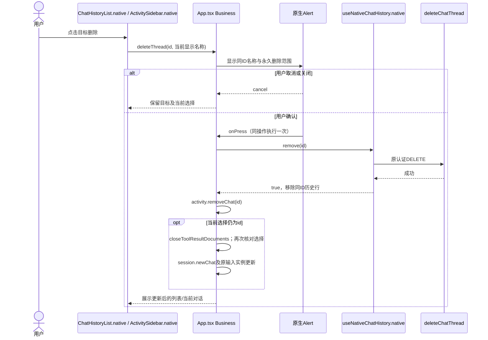
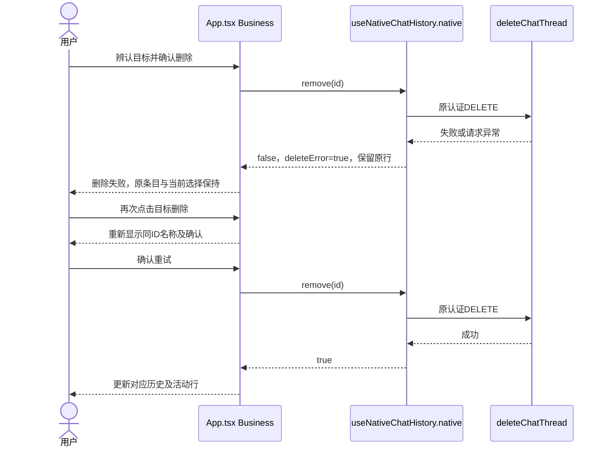
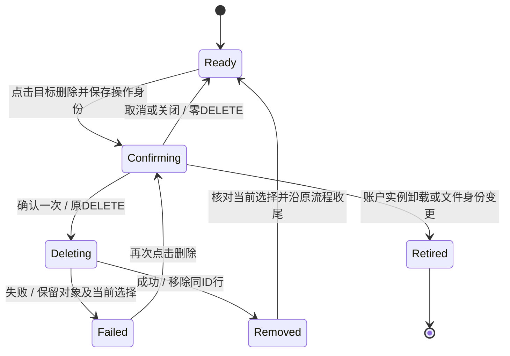

<!-- [Input] Notion App删除反馈、APP-01授权、当前原生入口与现行移动设计。 -->
<!-- [Output] 删除确认修复的范围、设计判断、交接、验证计划和分项证据。 -->
<!-- [Pos] APP-01独立执行记录；共享PRD、iOS设计、目录合同及索引由总控汇总。 -->
<!-- [Sync] 2026-11-03: 最终Simulator原目标/诊断/返回/取消XCUITest 1/1通过，结合完整fixture旅程完成APP-01目标；真实历史删除0。 -->
<!-- [Sync] 2026-11-03: 登记Native删除6项及Calendar49项通过；Simulator普通账户仅确认目标和取消，保留原历史。 -->
<!-- [Sync] 2026-11-02: 完成原生与Writing删除提示修订及待执行旅程用例；luna-test-stage暂停，Simulator验收待执行。 -->

# APP-01 删除确认与目标辨认

2026-11-03当前状态：Native删除6/6、Calendar49/49及最终Simulator普通账号XCUITest 1/1均通过，命令退出码均为0。最终UI已验证原目标摘要、开发者入口覆盖、返回后原确认保留及取消后目标历史保留；真实历史删除执行数为0。确认一次、失败保留、重试、选择变化和重开由原生产DTO/Hook的隔离fixture覆盖。按用户指定的Simulator与保护原历史范围，本任务修复、技术旅程及设计证据已交付。下面首轮失败和暂停记录保留历史范围；APP-04继续暂停，总控其他任务独立继续。

## 2026-11-02 目标与初轮状态

来源：[Notion问题页](https://app.notion.com/p/40b30b7547c380f7ac22f85fdd2dbdd0)。2026-11-02通过Notion fetch读取原文：“路上用app，发现交互上删除需要有弹窗提升”“删除了之后忘记了内容是什么了”。[总任务清单](app-experience-fixes-20261102.md)定义文件归属与集成顺序。

已调用`create_goal`，目标为“修复App删除前缺少确认及目标内容提示的问题，保留原删除业务与权限，完成完整取消、确认、失败、重开及相邻Web技术旅程验证并交付设计和证据。”返回状态`active`，未设置token预算。

首轮Optimized Prompt已在聊天展示一次，执行范围为现有App删除入口的最小确认、目标名称与现有摘要展示、原业务保持及隔离旅程验证。2026-11-02用户随后要求暂停luna-test-stage；暂停到达时runner尚未启动，机械检查执行数为0，中止进程数为0。代码修复与用例编写继续，自动化、文档验证和Simulator验收均待执行。业务目标保持`active`。

本轮集成目标为iOS Simulator。原生构建、签名、安装、设备控制、真实账户及模型步骤由总控串行执行。真机验收退出本轮完成前提，Simulator回执的适用范围须独立登记。

## 问题判断与影响范围

首次`git status --short`退出码0，输出为空；后续保留同工作区其他任务修订。已读取根AGENTS、相关目录合同、移动PRD及当前代码。

| 入口 | 当前源码与判断 | 本轮处理 |
| --- | --- | --- |
| Chat首页历史列表 | `ChatHistoryList.native.tsx`把目标ID传给`App.tsx`，后者直接调用`history.remove` | 共用入口增加原生Alert；点击行同时传入当前显示的名称或已有摘要，展示永久删除范围、取消与删除 |
| 当前对话→活动→近期Chat/日期历史 | `ActivitySidebar.native.tsx`与首页共用`deleteThread`；活动近期数据独立于分页历史 | 从分页历史或活动快照取同ID目标；确认和失败反馈共用原业务 |
| Chat搜索 | `ChatHistorySearch.native.tsx`仅提供选择/关闭，当前无删除按钮 | 保留现有入口；搜索结果与已删除ID抑制沿原Hook |
| 工作区文件与文件夹 | `FileSidebar.native.tsx`直接执行原DELETE；含文件夹递归删除 | 增加确认，展示相对路径；文件夹提示包含其中内容；取消和旧Thread身份保持零写入 |
| Deck/Agent管理 | `DeckManager.native.tsx`已有原生确认，原文仅描述对象类型 | 保留原确认模式，在提示中补所选Deck/Agent名称 |
| Deck相关Chat | 已有带标题及永久删除提示的原生确认 | 保留代码，纳入相邻回归 |
| Writing日历记录 | `CalendarPopup.tsx::handleDeleteEntry`已有`window.confirm(calendar.deleteConfirm)`，文案只说明记录类型；当前属于局部网页入口 | 总控追加授权后，在同一次原确认中展示已有`entry.firstLine`和日期；原DELETE、保存及权限保持 |
| 回顾报告与历史 | 当前`AnalysisView.native.tsx`、`ReflectionBlogPage.native.tsx`未发现独立报告删除按钮 | APP-02复核完整页面可达入口；若出现独立删除控件，交接对象摘要及失败保留规则 |
| MCP服务移除 | 原详情页已使用`confirmNative`；共享Hook传入服务名并串行移除 | 保留既有确认、权限与服务范围 |
| 排队消息、附件/草稿移除、停止 | 属于原队列取消、输入编辑或任务停止操作 | 保留原交互与停止语义 |

Project、Episode、canonical Artifact、Run私有`.dream`发布及after-turn Hook退出本轮修改范围。Chat删除继续调用既有用户归属校验的公开DELETE，持久化、消息级联及运行状态由原后端负责；本轮只改变删除前交互和成功后的当前选择核对。

## 设计判断与交付规则

### 背景与问题

触屏删除按钮可直接触发持久化删除。用户需要在执行前识别目标并决定是否保留。现有Deck相关Chat确认已提供原生Alert、取消和破坏性按钮模式，可供同类交互复用。

### 目标与边界

选择现有原生Alert及现有文案，保持原页面、数据来源、公开接口、权限和任务语义。自定义弹窗会增加布局与焦点所有权；回收站、后台撤销及新增存储会扩大本问题范围。本轮采用原生确认及现有对象信息。

### 概念与规则

- 点击删除时由原行传入当前显示的名称或已有摘要，按同一ID读取历史或活动快照，保存目标名称及操作身份；无标题时采用原无标题标签及已有创建时间。当前详情名称可沿原Thread快照读取。
- 确认窗口展示永久删除范围，取消与关闭保持零DELETE。一次已确认操作至多提交一次原DELETE；重复点击确认回调保持原请求。
- 请求失败保留条目、当前Thread与草稿，展示删除失败；用户再次点击同一条目的删除按钮，重新辨认并确认后重试。
- 删除成功后只移除对应历史和活动行。当前Thread仍为被删目标时，沿原文档关闭及`session.newChat`流程清空当前选择；异步期间已打开其他Thread时保留新选择。
- 账户实例卸载后，旧确认回调失效。文件确认返回后再次核对Thread/Workspace身份、组件存活和文件面板显示周期；面板关闭后重开、离开原Thread后返回时，旧确认持续失效。
- 文件提示包含已有相对路径，文件夹提示明确包含其中内容；原文件DELETE、刷新、认证及错误文本保持。

### 需总控合入PRD的页面骨架

桌面Web保持原页面及删除流程，纳入相邻回归：

```text
┌ 顶部操作：新对话 / 活动 / 文件 ──────────────┐
│ 历史列表（独立滚动） │ 当前对话及输入区       │
│ 标题 … [删除]       │ 消息区独立滚动         │
└─────────────────────┴───────────────────────┘
App原生确认：标题 / 目标名称与永久删除范围 / 取消 / 删除
```

窄屏App：

```text
┌ 顶部：新对话 / 活动 / 文件 ┐
│ 首页历史或活动面板         │
│ 标题/已有摘要     [删除]   │  列表独立滚动
│ 当前对话和输入区保留       │
├ Chat / Decks / More ───────┤
└───────────────────────────┘
           ↓ 原生Alert覆盖当前面板
┌ 删除对话/文件 ────────────┐
│ 目标名称或路径            │
│ 永久删除范围              │
│ [取消]           [删除]   │
└───────────────────────────┘
```

### 需总控合入正式设计的正常时序



### 异常与恢复时序



### 状态转换



文件分支沿`FileSidebar.native::remove`执行相同确认、取消、原DELETE和失败保留路径，确认内容采用`file.path`；成功沿原目录刷新。Deck与Agent保留原确认及mutation路径，提示新增所选名称。

## 修改与交接

- `frontend/src/App.tsx`：共用删除入口接入原生Alert及操作身份保护，异步结束时核对`visibleThread.current`。
- `frontend/app/_dream/components/chat/ChatHistoryList.native.tsx`、`ChatPage.native.tsx`、`ActivitySidebar.native.tsx`：传递目标当前显示名称，删除失败使用现有对话删除失败文案。
- `frontend/app/_dream/components/dashboard/FileSidebar.native.tsx`：文件/目录确认及确认后的身份、显示周期核对；关闭重开或Thread往返时替换操作作用域，旧确认保持零写入。
- `frontend/app/_dream/components/DeckManager.native.tsx`：沿原确认补Deck/Agent名称。
- `frontend/app/_dream/i18n.ts`：新增中英文文件/目录永久删除提示。
- `frontend/app/_dream/components/CalendarPopup.tsx`：按追加授权，在原确认中加入当前日历记录首行及日期。
- `frontend/e2e/native-app-delete.spec.ts`、`frontend/e2e/native/app-delete-fixture.tsx`：新编写的App组合旅程调用实际App、原历史/Thread/活动Hook、公开DTO及认证Header构造；HTTP、Alert平台及输入/消息视觉叶子使用明确fixture。浏览器重开读取sessionStorage内的合成行；PostgreSQL持久化由Simulator后续验收。
- `frontend/e2e/native-workspace-files.spec.ts`：原失败重试/CSRF用例接入Alert边界；新增文件与目录名称、取消零写入、Thread变化、面板关闭及原位置重开后旧确认零写入用例。
- `frontend/e2e/native-deck-management.spec.ts`：原取消删除用例补Deck/Agent名称断言。
- `frontend/e2e/calendar-right-panel-tabs.spec.ts`：原日历完整重开/删除旅程补目标首行和取消保留断言。

App.tsx删除段已完成，可交接APP-04。该文件仅修改Alert导入、删除操作ref及生命周期清理、`deleteThread`段落；APP-04可在独立hook和输入卡调用处传owner/scope，保留本段。runtime恢复adapter与hook保持只读。

总控已确认该交接，后续App.tsx归APP-04继续接线；本任务保持该文件只读。新增Writing授权已完成，回顾入口待APP-02整体验收反馈。

总控需同步的目录合同：`frontend/src/.folder.md`、`frontend/app/_dream/.folder.md`、`frontend/app/_dream/components/.folder.md`、`frontend/app/_dream/components/chat/.folder.md`、`frontend/app/_dream/components/dashboard/.folder.md`、受影响E2E目录及`docs/exec/.folder.md`。共享移动PRD和iOS设计应接入本记录的规则、骨架、时序及状态图。

## 2026-11-02 验证计划与当时证据

暂停范围包含机械自动化、定向类型检查、文档路径/Mermaid验证与浏览器规格执行；未改由主Agent或其他模型执行。未启动原生构建或设备操作，未触碰真实账户、数据库、历史记录及模型。

| 旅程 | 断言及上下游 | 当前状态 |
| --- | --- | --- |
| 首页列表目标辨认→取消→确认 | 名称正确；取消零DELETE；确认一次；其余行保留 | 待执行 |
| 详情→活动近期/日期历史→删除 | 名称来自同ID；失败保留当前详情；重试一次成功；当前选择沿原流程更新 | 待执行 |
| 迟到回执与重开 | 删除期间切换Thread或账户后保留新选择；重开后读取原接口结果，无复活及重发 | 待执行 |
| 无标题与摘要 | 已有摘要或已有创建时间辅助辨认；确认文本保持目标ID绑定 | 待执行 |
| 文件/目录 | 路径和目录范围正确；取消零写入；失败保留及重试；切Thread/关闭后旧确认零写入 | 待执行 |
| Deck/Agent/相关Chat | 已有确认显示名称；取消零写入；原权限及相关Chat保护保持 | 待执行 |
| Writing日历 | 记录首行及日期正确；取消保留；原日历重开与确认删除旅程 | 已补用例，待执行 |
| 相邻Web | 原Chat历史、活动、Deck相关Chat、文件和Writing确认流程保持 | 待执行 |
| 文档 | Markdown清单、引用路径、Mermaid可渲染 | 待执行 |
| iOS Simulator | 总控串行集成后沿普通App完成列表、详情、文件及重开旅程；仅使用明确可删除fixture | 待执行 |

已取得的命令证据限只读定位：`pwd && git status --short && rg ...`退出码0；根合同和luna技能读取退出码0；首次盘点使用缺失目录`components/writing`、`components/reflections`的`rg`退出码2，随后按实际`CalendarPopup.tsx`、`AnalysisView.native.tsx`及`ReflectionBlogPage.native.tsx`重新定位。该盘点错误属于路径定位，未执行功能测试。应用源码尚未经过本轮自动化与Simulator验证，未声明修复验收完成。

恢复验证阶段后，定向浏览器命令候选为在`frontend`运行`pnpm exec playwright test e2e/native-app-delete.spec.ts e2e/native-chat-history.spec.ts e2e/native-workspace-files.spec.ts e2e/native-deck-management.spec.ts e2e/calendar-right-panel-tabs.spec.ts --workers=1 --reporter=line`。新App用例指定已安装Chrome；其余规格沿总控选定的本机Chrome配置执行。执行前仍须完成一次轻量浏览器前置检查。当前命令未执行，退出码及通过数均无回执。

App技术用例覆盖6项：列表目标/取消/关闭/草稿、确认一次及浏览器重开、详情失败及重试、迟到DELETE保留新Thread、无标题创建时间及账户卸载后旧操作失效、403/401拒绝及原会话刷新回调。新App规格隔离Vite缓存并只清理本轮缓存目录，记录console、pageerror及同源requestfailed附件；迟到删除用例等待活动面板更新后再断言保留新Thread。文件新增3项取消/范围、旧身份及关闭重开/Thread往返检查；Deck与日历在原完整规格中补断言。类型检查、相邻Web完整入口、文档路径/Mermaid和普通Simulator旅程继续待执行。

## 2026-11-02 后续源码评审

自动目标续行先核对当前工作区及APP-04已接入的恢复参数，保留App.tsx只读。上一轮具有代码与用例交付进展，本轮继续补确认窗口边界：文件确认原先只比较最终Thread身份和可见性，关闭后重开或Thread往返会重新满足该条件；现改为比较本次面板显示周期的对象身份。源码评审确认该条件覆盖原先遗漏的路径，实际运行结果待验证阶段恢复后取得。测试执行数继续为0，未派发runner，未启动Simulator构建。

## 2026-11-02 完成条件复核与阻塞审计

再次只读检查总清单、独立记录及当前工作区，命令退出码0。`wait_threads(timeoutMs=0)`对总控聊天的最新快照显示其仍在执行，最新说明明确保留Simulator验收和luna-test-stage暂停。本任务没有已启动的验证进程或可继续等待的测试句柄。

| 完成条件 | 已有交付 | 缺少的完成证据 |
| --- | --- | --- |
| 删除确认及目标辨认 | Chat、文件/目录确认，Deck/Agent及Writing目标提示的源码与用例 | 普通App与Web实际交互回执 |
| 取消零删除、确认一次 | App及文件/日历用例断言、操作身份保护源码 | 浏览器/Simulator断言执行结果 |
| 失败保留及原权限 | 原API/权限保持，503/403/401及重试用例 | 原服务及技术旅程执行结果 |
| 当前选择、历史重开及相邻回归 | 原生产Hook接线、迟到回执用例、合成重开用例及总控Simulator计划 | 真实持久化重开、相邻Web完整旅程回执 |
| 设计与文档 | 独立规则、桌面/窄屏骨架、正常/异常时序、状态图及目录同步清单 | 总控共享稿汇总与文档门禁回执 |

暂停指令在原执行轮和两次自动目标续行中持续有效；前两轮已交付代码与用例修订，本轮可独立推进的已识别实现工作已交付。全部剩余必需证据依赖用户恢复验证阶段及总控串行集成。按三轮阻塞审计进入`blocked`，保留完整目标，恢复条件为验证阶段获得用户恢复指令后继续执行上述完整旅程；未标记完成。

## 2026-11-03 首轮验收前置失败修复

总控报告：[browser-r1/results.json](../../frontend/ios/build/app-experience-acceptance-20261103/browser-r1/results.json)。`native-app-delete.spec.ts`6项均在原第91行等待首页历史按钮时失败；浏览器诊断包含`Cannot convert fixture-delete-user to a BigInt`。本任务只读解析该报告的命令退出码0，读取生产`browserSession.ts:8`确认公开用户ID要求正十进制字符串并满足有符号64位整数范围。

最小修订仅涉及两个测试文件和本记录：`native/app-delete-fixture.tsx`的会话用户ID改为合成值`910000001`；`native-app-delete.spec.ts`的Gate初始/切换用户ID与断言分别同步为`910000001`、`910000002`。两个ID仅位于隔离fixture；全部HTTP继续由原合成边界处理。生产会话DTO、ID/权限校验、APP-04恢复逻辑、品牌和其他任务修订保持原工作区内容。

源码文件头已同步。本轮未启动测试、构建、原生进程或Simulator操作；候选修订交由总控Luna统一复测，实际UI与持久化重开仍待Simulator回执。首轮失败记录保留，目标继续保留未完成状态。共享E2E清单中的“待执行”需由总控结合本轮回执更新为“首轮前置失败，候选已修复，待复测”。

## 2026-11-03 Web日历首次心情前置处理

总控[Web首轮结果](../../frontend/ios/build/app-experience-acceptance-20261103/browser-web-r1/results.json)记录49项中45项通过、4项失败。失败集中在`calendar-right-panel-tabs.spec.ts`的430/390px同日切栏滚动及浮动工作区规格；调用`openCalendar`后未出现“日历”弹窗。四份`error-context.md`均保留“How are you feeling today?”弹窗、Happy/OK/Unhappy按钮及Calendar按钮。只读报告解析命令退出码0，未执行浏览器操作。

源码判断：`calendarHarness.ts`的`/api/preferences`合成响应包含`first_login_completed`和时区，未提供`selected_state`，当前合成笔记的`editor_state`同样未选心情。生产`StateChooser`在偏好读取完成后沿首日业务显示心情弹窗；窄屏存在覆盖面板与焦点处理。原`openCalendar`只等待Calendar按钮可见，随即聚焦并按Enter，遗漏首次心情任务的完成步骤。当前证据支持修复测试前置顺序，后续日历打开及滚动结果仍须运行验证。

最小修订为`frontend/e2e/fixtures/calendarHarness.ts::openCalendar`新增四行：等待原心情弹窗、通过原“OK”按钮选择心情、等待该弹窗移除，再执行原`beforeOpen`、Calendar键盘激活、弹窗可见及初始焦点断言。原偏好HTTP边界继续接收实际选择流程；未预设心情、隐藏覆盖面板或强制点击，未修改生产代码、首日心情逻辑、删除断言及滚动/几何断言。源码文件头已同步；共享fixtures目录合同由总控补充该前置步骤。

父任务最小复测命令：在原`frontend`目录及同一`E2E_WEB_BASE`下运行`pnpm exec playwright test e2e/calendar-right-panel-tabs.spec.ts --grep '(same-day tab changes preserve the owning scroll position|floating workspace naturally follows short empty long and hidden contexts) at (430|390)px' --workers=1 --reporter=line`。定向4项通过后，沿原Calendar49项命令回归共享helper使用方。当前仅交付候选修订和只读证据，未自行测试/构建，APP-04实现与验证保持暂停，目标保留未完成状态。

## 2026-11-03 组件与首轮Simulator验收回执

本轮按总控通知只读核对现有`results.json`和总清单，解析命令退出码0，未新增生产修改、测试执行或构建。两个结果文件均记录0失败、0跳过、0 flaky；测试退出码由总控登记的命令回执提供。

| 执行范围 | 命令主干与退出码 | 已证明的结果 | 证据及适用范围 |
| --- | --- | --- | --- |
| Native删除组件技术旅程 | 在`frontend`运行`./node_modules/.bin/playwright test --config=ios/build/app-experience-acceptance-20261103/browser-r2/config.mjs --workers=1`；0 | 本任务6/6通过；同批总计28/28包含回顾规格 | [browser-r2/results.json](../../frontend/ios/build/app-experience-acceptance-20261103/browser-r2/results.json)；实际App删除回调、原Hook、合成HTTP/Alert边界 |
| 相邻Web Calendar完整规格 | 同一fixture服务下`E2E_WEB_BASE=http://127.0.0.1:55173 ./node_modules/.bin/playwright test --config=ios/build/app-experience-acceptance-20261103/browser-web-r2/config.mjs --workers=1`；0 | 49/49通过；首次心情选择、日历打开、滚动/几何、日记取消和确认删除原断言保留 | [browser-web-r2/results.json](../../frontend/ios/build/app-experience-acceptance-20261103/browser-web-r2/results.json)；隔离Web业务fixture |
| 普通账号Simulator目标辨认与取消 | 总控当前候选的普通App操作回执 | 原生确认显示完整原目标；取消后原历史可见；真实历史删除执行数0 | 总控2026-11-03回执及[总清单](app-experience-fixes-20261102.md)；当前Simulator及既有账号数据 |
| Alert内开发者诊断及返回 | APP-05独立层级适配后，由总控串行执行XCUITest | 待取得Alert→诊断→返回Alert→取消的回执；全流程以deletions=0作为执行约束 | 待总控补充具体运行结果；本任务未执行该流程 |

Native6项逐项通过：列表名称与取消/关闭零DELETE；fixture确认一次及浏览器重开读取；详情删除失败保留与确认重试；迟到DELETE保留随后打开的Thread；403/401保留目标及原会话刷新；无标题创建时间与账户切换后的旧确认失效。确认删除一次的证据来自合成fixture，只处理该浏览器内明确命名的可删除行。

普通账号Simulator回执仅覆盖原目标辨认、取消及取消后原历史保留。原有真实历史未执行确认删除，真机未执行；本轮未声明真实历史删除或真机验收通过。原失败报告继续保留。APP-01的已验证技术范围和普通账号取消范围分别记录，集成Alert诊断回执继续由总控跟进，当前未标记目标完成。

## 2026-11-03 最终Simulator回执与完成审计

总控最终候选的[xcuitest-ui-alert-r3/receipt.json](../../frontend/ios/build/app-experience-acceptance-20261103/xcuitest-ui-alert-r3/receipt.json)记录`exitCode=0`、`actualTestsExecuted=1`、`actualFailures=0`、`normalExistingAccount=true`、`deletions=0`、`modelCalls=0`、`APP04BehaviorTest=false`。完整原命令保存在该回执：`xcodebuild test-without-building -xctestrun <AppExperience-alert-r3.xctestrun> -destination <显式Simulator> -parallel-testing-enabled NO -resultBundlePath <results.xcresult>`。

实际执行方法为`AppExperienceUITests/testDiagnosticsAboveDeleteAlertAndCancel`。[test.log](../../frontend/ios/build/app-experience-acceptance-20261103/xcuitest-ui-alert-r3/test.log)记录该方法通过，实际1项/0失败，业务标记为`targetNamed=true diagnosticsAboveAlert=true cancelled=true historyRetained=true deletions=0 modelCalls=0`。源码方法从当前历史删除按钮读取完整名称并断言原Alert包含该名称，打开诊断、返回原确认并取消，最终核对同一历史目标保留。回执同时记录默认中断处理器未代为取消原Alert，确认路径由测试显式执行。

| 原目标要求 | 对应完成证据 | 结论与范围 |
| --- | --- | --- |
| 删除前确认及可辨认目标 | Native删除6/6；最终Simulator真实原目标名称断言；PRD与iOS交互设计的骨架/时序/状态图 | 已完成；当前用户指定Simulator范围 |
| 取消零删除、确认一次 | Native6项及Calendar49项的取消/一次DELETE断言；最终Simulator取消及`deletions=0` | 已完成；确认删除仅操作明确可删除fixture |
| 失败保留、重试及原权限 | Native6项覆盖503/403/401及原刷新回调；文件/Deck原规格保持 | 已完成隔离技术验证；生产ID及权限校验保持 |
| 当前Thread选择与历史重开 | Native6项的当前目标清空、迟到DELETE保留新Thread、合成持久化重开；原历史9项通过 | 已完成技术旅程；普通账号保留原历史 |
| 文件/文件夹、Deck/Agent、相邻Web | 首轮指定历史9项、文件17项、Deck11项均passed；Calendar完整49/49复测通过 | 已完成相邻技术回归；首轮组合退出1及其他失败原样保留，修复批次分别登记 |
| 设计、源码文件头与目录交接 | 本记录、共享移动PRD/iOS设计、总控目录汇总；`contracts-r1`文档16份、Mermaid64/64及原生完整类型检查退出0 | 已交付；最终本轮仅补证据文字，图示及源码保持 |
| 普通Simulator集成 | 最终候选`xcuitest-ui-alert-r3`实际1/1、退出0 | 已完成目标摘要→诊断覆盖→返回原确认→取消→原历史保留 |

上述技术计数分别来自现存结果JSON，完整浏览器批次和退出码归总控日志。首轮组合进程包含其他前置失败，所列原历史/文件/Deck子项的通过状态已逐项读取；Native删除与Calendar的最终独立复测均为0失败、0跳过。最终Simulator回执及原方法执行日志已核对，读取命令退出码0。本任务未额外启动测试、构建、模型或设备操作，未修改新生产代码。

真实账户永久删除保持未执行，真机验收保持未执行；本轮交付不包含这两项通过声明。原有用户历史保留。APP-01修复与完整技术旅程符合当次目标，完成状态独立于APP-04暂停及其他任务的交付状态。

`update_goal(status="complete")`已返回`status=complete`。目标工具记录累计执行时间1,053秒，未设置token预算；该计时按目标工具的active阶段统计。
