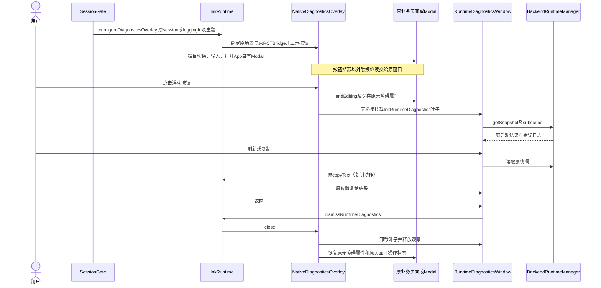
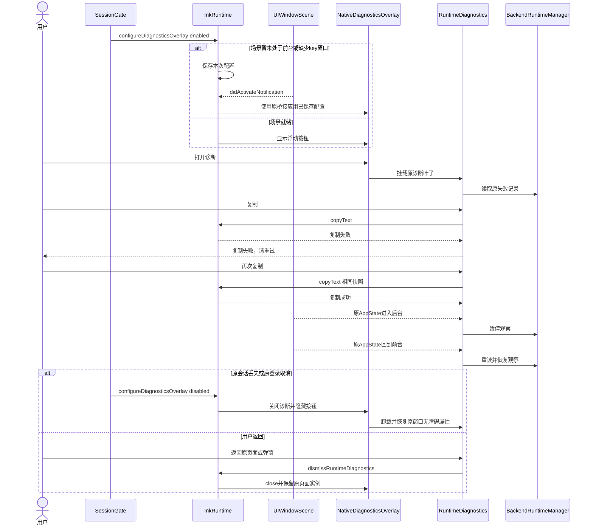
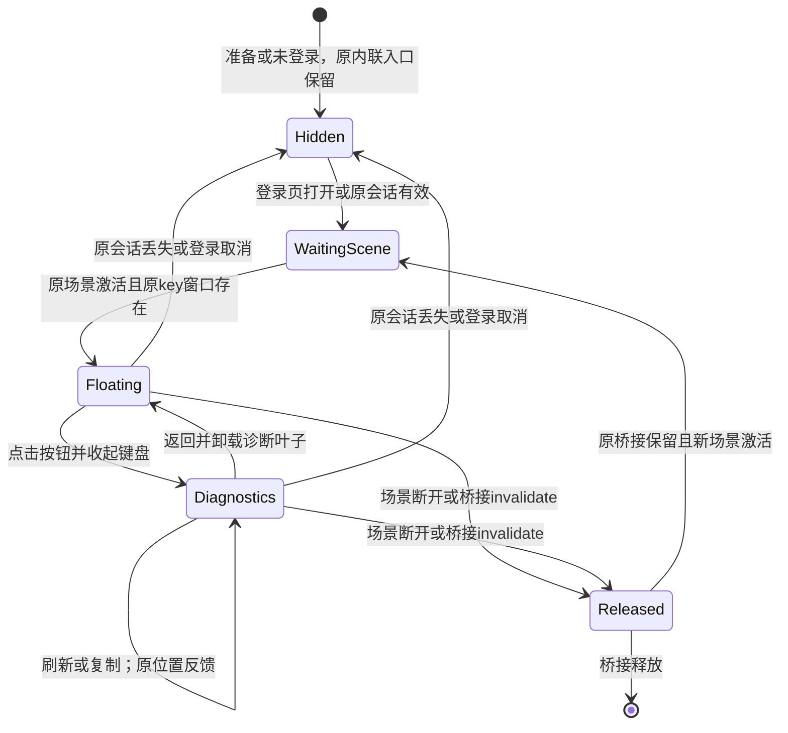
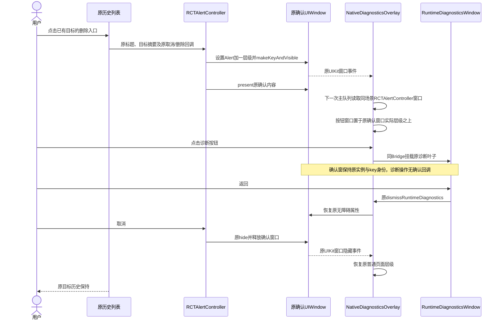

<!-- [Input] Notion App入口反馈、移动启动现行稿、原生展示层及任务归属。 -->
<!-- [Sync] 2026-11-03: 新增原控制台CPU与运行活动观察目标，登记原生实际Simulator计数、技术合同、界面验证和物理验收边界。 -->
<!-- [Sync] 2026-11-03: 新增诊断入口图标替换目标，复用启动页同源SVG资源；当前iPhone28和公共Admin保持，验证限定本机技术检查。 -->
<!-- [Output] APP-05问题判断、选定交互、受控实现、待执行回归与Simulator交接。 -->
<!-- [Pos] APP-05独立执行记录；共享PRD、设计、目录合同和索引由总控汇总。 -->
<!-- [Sync] 2026-11-02: 完成入口层级源码修订和两项隔离用例编写；luna-test-stage按用户要求暂停，全部检查与Simulator验收待执行。 -->
<!-- [Sync] 2026-11-03: 按父任务Simulator反馈修正React Native独立Alert窗口层级；本轮只改源码及本文，重编译与XCUITest由父任务执行。 -->
<!-- [Sync] 2026-11-03: 登记父任务候选构建/安装、真实触摸取消流程和XCTest r1自动interruption行为；产品源码定稿，坐标触摸复测及键盘验收待父任务回报。 -->
<!-- [Sync] 2026-11-03: 核实最终报告3项、Alert1项、键盘1项实际执行通过，单列15项隔离回归、r1失败及r2零执行；完整矩阵按现有证据逐项审计。 -->
<!-- [Sync] 2026-11-03: 核实写作按钮拖动/打开/返回1项自动化及三主题安全区截图，原浅色偏好已恢复；当前Simulator范围完成审计通过。 -->

# APP-05 登录后开发者诊断入口

## 背景与问题

用户反馈：“开发者控制页面的按钮登陆后需要悬浮在所有窗体上”。来源为[Notion问题页](https://app.notion.com/p/40b30b7547c380f7ac22f85fdd2dbdd0)，本任务按[总清单](app-experience-fixes-20261102.md)负责SessionGate入口、RuntimeDiagnostics及必要的原生展示层。源页已读取，Notion写入由总控统一执行。

现行依据为[移动启动PRD](../prd/mobile-app/mobile-startup.md)、[移动启动交互](../design/multi-platform/mobile-startup-interaction.md)及[iOS交互](../design/multi-platform/mobile-ios-interaction.md)。原SessionGate在准备、未登录和错误视图显示入口；登录后的入口位于“更多 → 设置 → 关于”。原开发者页通过根视图内绝对定位覆盖业务，覆盖范围由该根视图决定；React Native Modal和原生登录展示使用UIKit展示层。

## 目标与边界

登录后在App自有页面和弹窗提供同一开发者入口，原生登录页面打开期间保持入口可达。诊断继续读取原RuntimeSnapshot、原始错误和复制方法。原账户、会话刷新、文档释放、Thread、草稿、保存、停止和后端实例各自保持原所有权。

范围包含主页、更多、写作、回顾、React Native Modal及App自有登录展示。系统权限窗、系统文件选择、系统分享和第三方系统认证窗口的展示顺序由iOS管理。普通Web与Android入口沿现有平台实现；本轮新增浮动展示层属于iOS。

本任务目标已通过create_goal建立，未设置Token预算。目标内容为“使登录后的开发者入口在App自有页面与弹窗可达并复用现有诊断页，保持业务触摸、键盘、安全区、账户和实例生命周期，完成完整自动化旅程”。自动化与Simulator验收属于剩余交付，目标当前状态见文末审计。

## 问题判断与方案收敛

| 工作项 | 判断依据与结果 |
| --- | --- |
| 发现 | 已读取用户原文、总清单、现行启动PRD/交互、iOS交互、相关目录合同和原源码；初始git status为空，执行期间其他任务陆续产生改动。 |
| 定义 | 登录后入口需要脱离页面导航；App自有弹窗需要独立于业务根视图的展示层。认证与运行库保持原接口。 |
| 方案比较 | 根视图浮动按钮覆盖普通页面；UIKit Modal具有独立展示层。逐弹窗插入入口会增加多处页面接线。选定同场景、非key的UIWindow承载单个按钮，按需挂载诊断叶子。 |
| 交付收敛 | 原InkRuntime持有展示层；诊断RCTRootView复用该模块原RCTBridge；AppRegistry新增诊断叶子注册。运行库初始化、HTTP和登录方法保持。源码人工评审完成，程序验证待执行。 |

## 概念与规则

1. SessionGate使用原session存在状态和原loggingIn状态向展示层投影入口可见性。原children参数、BrowserUser来源、refresh及beforeRelease接口保持。准备、未登录及错误页继续原内联入口。
2. 登录完成后显示44点浮动按钮，原生登录展示期间显示同一按钮。按钮默认位于安全区右侧上部，可拖动；无障碍自定操作支持向四个方向调整位置。位置只保留在当前展示实例内。
3. 折叠窗口仅在按钮矩形内接收触摸，窗口保持非key。原页面、滚动、键盘焦点及弹窗由原窗口接收。按钮位置限制在当前安全区和键盘上方的可用范围。
4. 点击按钮时结束原输入焦点，并在同一桥接中挂载RuntimeDiagnosticsWindow。诊断内容、刷新、复制和前后台观察继续由原RuntimeDiagnostics执行；诊断内容位于新窗口安全区，状态区滚动，操作区固定。
5. 原业务根和原弹窗保留。诊断打开期间临时隐藏原窗口的无障碍元素；返回时恢复其原属性并释放诊断根，诊断订阅随卸载解除。原窗口继续保持key身份。
6. 退出登录、会话丢失或SessionGate卸载时撤销浮动入口并关闭该展示层。场景断开和桥接invalidate释放展示；场景激活时应用最近一次入口配置。配置接收与场景激活只负责展示。
7. 深浅色及系统主题由现有useInkColors投影到按钮、边框和窗口背景。诊断叶子继续订阅同一主题与同一RuntimeSnapshot。新增recovery来源显示“输入恢复”，来源与记录由APP-04负责。
8. 启动、账户错误和About原入口继续原行为。新增诊断窗口只挂载叶子组件，BackendRuntimeManager.ensureStarted调用次数、原会话请求和业务提交由原入口决定。

## 页面骨架（供总控同步PRD正文）

```text
窄屏：App自有页面或Modal / 自有登录页面
┌──────────────────────────────┐
│ 系统安全区                    │
│ 原标题 / 返回 / 页面操作       │
│                       [诊断图标] ← 可拖动44点按钮
│ 原页面内容（原纵向滚动）       │
│ 原页面输入与操作               │
│ 键盘打开时按钮进入键盘上方区域 │
└──────────────────────────────┘
按钮外的触摸由原窗口接收；栏目沿原主页 / 更多 / 写作 / 回顾导航。

点击按钮 → 同场景诊断窗口
┌ [返回] 开发者控制页 ──────────┐
│ 启动状态与错误日志            │
│ 原会话结果 / 时间 / 错误码     │ ← 独立纵向滚动
├──────────────────────────────┤
│ [刷新] [复制诊断摘要]         │ ← 安全区内固定操作
│ 原位置成功或失败反馈          │
└──────────────────────────────┘
返回 → 原页面或原弹窗，原输入与选择保持。

桌面宽屏参照：iOS宽视口；普通Web沿原入口
┌ 原栏目 ┬ 原页面或App自有弹窗 ──────────┐
│ 原导航 │                     [诊断图标]│
│        │ 原内容与原滚动范围            │
│        │ 原操作与输入                  │
└────────┴───────────────────────────────┘
浮动入口打开同一诊断页；返回保持当前栏目与原弹窗。
```

## 正常业务时序（供总控同步正式设计正文）



## 异常与恢复时序（供总控同步正式设计正文）



## 展示状态（供总控同步正式设计正文）



AppState后台暂停与前台重读沿RuntimeDiagnostics原生命周期执行，展示状态与原业务任务状态分别维护。

## 文件归属与实现交接

| 文件 | 本任务修订 |
| --- | --- |
| [SessionGate.native.tsx](../../frontend/src/platform/SessionGate.native.tsx) | 追加入口可见性与主题投影及卸载撤销；账户、refresh和children接口保持。 |
| [RuntimeDiagnostics.native.tsx](../../frontend/src/components/RuntimeDiagnostics.native.tsx) | 导出诊断窗口叶子、复用原返回及展示；增加“输入恢复”来源文案和诊断无障碍模态属性。 |
| [index.native.js](../../frontend/index.native.js) | AppRegistry注册InkRuntimeDiagnostics，复用原初始化和原Bridge。 |
| [InkMemoryApp.swift](../../frontend/ios/InkMemory/InkMemoryApp.swift) | 场景浮动窗口、按钮命中区域、拖动、安全区/键盘布局及同Bridge诊断展示；SwiftUI业务根保持。 |
| [InkReactNative.swift](../../frontend/ios/InkMemory/InkReactNative.swift) | 原InkRuntime增加展示配置与关闭方法，保存待应用配置，持有场景观察并在invalidate释放。 |
| [InkRuntimeModule.m](../../frontend/ios/InkMemory/InkRuntimeModule.m) | 注册上述两个展示方法。 |
| [native-session-gate.spec.ts](../../frontend/e2e/native-session-gate.spec.ts) | 追加入口授权状态及同管理器诊断叶子两个回归用例；当前未执行。 |
| [session-platform-web-boundary.ts](../../frontend/e2e/native/session-platform-web-boundary.ts) | 记录展示配置与关闭调用，使用原合成平台边界；UIKit几何与层级退出该fixture的证明范围。 |

APP-04负责BackendRuntimeManager及owner-scoped恢复，本任务只读取其recovery来源。APP-01负责App.tsx删除段落；APP-03负责EmbeddedDreamBackend等启动测量。本任务保持上述文件中的并行修订。

## 完整旅程与待执行验收矩阵

执行前评估：入口上游为原session及loggingIn；下游为同Bridge诊断叶子、RuntimeSnapshot和原copyText。无新增持久化。账户、草稿、Thread和原Modal需要在诊断返回后继续原状态。失败恢复包含登录取消、会话失效、复制失败重试、场景断开、前后台及进程重开。测试目标为iOS Simulator；真机性能和系统jetsam退出本轮结论。

| 旅程或回归 | 检查与证据要求 | 当前状态 |
| --- | --- | --- |
| 登录前与准备 | 原内联入口可打开/返回，准备中完成启动后仍保持诊断可见，原初始化一次。 | 原回归保留；本轮未执行。 |
| 自有登录展示 | 打开正常登录页，按钮位于页面之上；诊断刷新/复制/返回后保留原登录页，取消后按钮消失，成功后主页继续显示入口。系统认证窗按系统规则展示。 | Simulator待执行。 |
| 登录后的主页/更多/写作/回顾 | 每个原入口切换后浮动按钮可达，打开诊断并返回原栏目，原输入、选中项、滚动、Thread和观察对象保持。 | Simulator完整旅程待执行。 |
| 原生Modal | 从真实App入口打开侧聊或其他App自有Modal，诊断展示于其上，返回后原Modal保留；关闭Modal后主页继续可操作。 | Simulator待执行。 |
| 诊断读取与复制 | 原始错误与恢复来源可见，刷新无额外HTTP或启动，复制失败原位置反馈，重试成功且内容一致，关闭后观察释放。 | 两项JS边界回归已编写，未执行；系统剪贴板待Simulator。 |
| 触摸与拖动 | 按钮外点击、滚动、Send/Stop及页面返回继续原操作；拖动后原被遮挡位置可操作，拖动结束不误开诊断。 | Simulator待执行。 |
| 键盘与安全区 | 写作和原输入卡打开软件键盘；按钮留在安全区及键盘上方，诊断打开收起键盘，返回保留原稿；横竖屏和短视口检查顶部及底部操作。 | Simulator待执行。 |
| 主题与无障碍 | 浅色、深色、系统主题变化后按钮和诊断一致；诊断打开后无障碍聚焦该页，返回恢复原窗口；四向移动操作可用。 | JS主题投影用例已编写，未执行；Simulator待执行。 |
| 账户及实例生命周期 | 登录取消、登出、会话失效、前后台、场景重连及进程重开；核对原session请求、原后端实例和既有Thread，保存/停止/模型任务按原旅程回归。 | JS授权状态回归已编写，未执行；与APP-04集成后Simulator待执行。 |

合成JS用例只验证实际SessionGate和RuntimeDiagnostics叶子对平台方法的调用及原状态保持。UIKit窗口顺序、触摸穿透、键盘、安全区、系统剪贴板和普通App真实账户流程需要Simulator独立证据。

## 检查状态与实际命令

用户通过总控明确要求“暂时关闭luna-test-stage任务”，并要求保留业务修复。本任务收到暂停时，luna_test_runner尚未启动，已启动runner数量为0，机械检查中止数量为0。暂停后保持代码定位、设计、源码人工评审和用例编写；全部自动化、类型检查、构建、Markdown清单/引用及Mermaid语法检查保持待执行。全局技能和默认测试配置保持。

| 实际动作 | 命令或工具 | 退出码与关键结果 |
| --- | --- | --- |
| 建立目标 | create_goal，目标见上文 | 成功，status=active，未设置预算。 |
| 初始工作区与合同读取 | `pwd && git status --short && cat AGENTS.md` | exit 0；工作区为原项目，初始git status为空。 |
| 输入和源码定位 | `cat`、`sed -n`及`rg`读取总清单、相关.folder.md、现行PRD/设计和自有源码 | exit 0；已定位原内联入口、根视图覆盖、UIKit登录和原Bridge合同。 |
| 路径探查原始回执 | `cat frontend/playwright.config.ts` | exit 1，文件不存在；未启动Playwright。复验将使用总控具名Chrome配置。 |
| 路径探查原始回执 | `rg ... frontend/ios/InkMemoryUITests/*` | zsh报告该glob无匹配；现有工程测试位于InkMemoryTests，未启动XCTest。 |
| 源码人工评审 | `git diff --`限定本任务六个生产文件 | exit 0；核对新增展示方法和原接口保持。该动作属于源码审阅。 |
| 本轮机械验证 | Playwright、typecheck、Swift检查、Markdown/Mermaid检查 | 尚未执行，无退出码及通过结论。 |
| 原生/Simulator/真实账户/模型/发布 | 构建、签名、安装、设备控制及真实业务操作 | 尚未执行，无对应验收证据。 |

暂停解除后，总控为具名本机Chrome配置执行`pnpm exec playwright test e2e/native-session-gate.spec.ts --workers=1 --reporter=line --config=<总控隔离配置路径>`；配置路径在派发时确定。本任务无测试服务、数据库或端口创建，无进程清理。

## 总控Simulator执行顺序

1. 在其他任务代码交接后统一核对构建入口、锁文件、容量和可恢复制品，按现有原生流程串行构建并安装Simulator包；本任务涉及Swift和桥接导出，需要重新编译原生目标。
2. 先记录采用包、源码与运行资源标识，执行完整登录前/登录取消/登录成功及主页→更多→写作→回顾旅程。原生按钮标识为`ink-runtime-diagnostics-button`，内容标识为`ink-runtime-diagnostics-content`，窗口标识为`ink-runtime-diagnostics-window`。
3. 在每个页面和App自有Modal中点击按钮，核对诊断原日志、刷新、复制及返回；对比进入前后的原稿、栏目、选中项和Thread。复制错误注入只使用具名隔离技术fixture，普通账户保留正常记录。
4. 使用Simulator软件键盘验证原输入和写作，检查按钮拖动、按钮外触摸、短视口、旋转、安全区和三种主题；系统认证与系统权限覆盖边界单独记录。
5. 与APP-04串行核对前后台、场景恢复、会话丢失和正常进程重开，记录原Backend实例、请求计数和既有业务状态。Simulator条件写入证据，真机性能和jetsam保持未验证。
6. 自动化恢复执行后保存命令、退出码、原始失败及复验；共享文档同步和Notion同步完成后，按实际验收范围推进目标状态。

## 共享文档同步清单与剩余依赖

总控在[移动启动PRD](../prd/mobile-app/mobile-startup.md)正文同步浮动入口、适用窗口、登录前后规则及上述桌面/窄屏骨架；在[移动启动交互](../design/multi-platform/mobile-startup-interaction.md)和[iOS交互](../design/multi-platform/mobile-ios-interaction.md)正文同步正常、异常与状态图、原Bridge/非key窗口及系统窗口边界。

总控在`frontend/.folder.md`登记index.native.js新增诊断叶子注册；在`frontend/src/.folder.md`登记SessionGate展示投影、RuntimeDiagnosticsWindow和原始错误/输入恢复来源；在`frontend/ios/.folder.md`登记三个原生文件的场景展示职责；在`frontend/e2e/.folder.md`及`frontend/e2e/native/.folder.md`登记两项用例和平台边界；在`docs/exec/.folder.md`加入本文索引。全部源码文件头已由本任务同步。

剩余依赖：用户恢复验证阶段；总控完成共享文档和索引；APP-04恢复代码交接；统一原生构建及Simulator完整旅程；按证据统一同步Notion。实现状态为“受控实现与用例编写完成，全部验证待执行”，目标当前状态见文末审计。

## 续轮源码审阅与外观修正

上一目标轮完成受控实现、两项用例编写和独立记录，归类为进展。本轮重新读取工作区、总清单与自有源码；总清单继续明确暂停全部机械验证和Simulator集成，当前未启动检查或构建。

本轮读取已安装React Native的`RCTAppearance.mm`：`setColorScheme`对调用时已存在的scene.windows逐个设置overrideUserInterfaceStyle。首次会话完成后创建的诊断窗口需要继承原key窗口已应用的外观设置。现已在NativeDiagnosticsOverlay初始化时复制原窗口overrideUserInterfaceStyle，再挂载诊断根。后续主题变化继续由原Appearance.setColorScheme更新现有窗口，原主题存储和订阅保持。

同时读取本机`RCTRootView.m`及`RCTRootContentView.m`：同桥接构造器通过原bridge启动叶子；根释放时由内容视图invalidate派发原AppRegistry卸载。该证据用于确认源码生命周期调用路径；实际卸载、观察释放与普通App界面仍需Simulator回执。

本轮`git status --short`及上述`sed -n`、`rg`源码读取命令exit 0。修订限定InkMemoryApp.swift和本文，其他任务的未提交改动保持。全部自动化、Markdown/Mermaid检查和Simulator验收继续待执行，当前无通过结论。

## 第三个目标轮的完成与受阻审计

上一轮通过原生外观继承修正改变源码，归类为进展。本轮重新读取总清单“并行执行与交接”和“Codex任务与最新执行安排”，用户暂停luna-test-stage、自动化、构建及Simulator集成的要求继续有效。本轮源码及安排读取exit 0；无本任务在途runner或构建句柄，当前属于待外部条件恢复。

| 目标要求 | 当前权威证据 | 完成判定 |
| --- | --- | --- |
| 登录后的自有页面与Modal可达 | SessionGate展示投影、NativeDiagnosticsOverlay及AppRegistry叶子注册已写入 | 缺少Simulator采用、层级与完整旅程证据。 |
| 原诊断、错误、刷新、复制与返回 | 原RuntimeDiagnostics与RuntimeSnapshot复用；两项回归用例已编写 | 用例及系统剪贴板未执行，完整行为未验证。 |
| 触摸、键盘、安全区及主题 | 按钮命中范围、安全区/键盘布局及原外观继承已写入 | 缺少Simulator触控、软件键盘、短视口及主题回执。 |
| 账户和实例生命周期 | 原session、children、refresh和beforeRelease接口保持；展示层复用原Bridge | 与APP-04集成后的前后台、账户变化与原实例证据待执行。 |
| 文档、原生与完整自动化交付 | 本文包含骨架、时序、状态图、用例和交接矩阵 | 共享正文/目录合同/索引由总控汇总；文档检查、构建及自动化待执行。 |

同一阻塞条件已贯穿原目标轮及两次自动继续：验证阶段由用户明确暂停。授权范围内的实现、源码审阅、外观修正和测试规格已交付；剩余必需证据依赖用户恢复验证阶段及总控串行集成。本任务目标按blocked登记，目标原文和全部验收范围保持。解除阻塞后恢复目标，沿本文矩阵完成验证并保留原始回执；当前验收结论为未完成。

## React Native独立确认窗口层级修正（2026-11-03）

### 背景与问题

父任务回报：最新Simulator正常账户包在普通历史删除入口显示正确目标标题、取消和删除；诊断按钮受到确认窗口的dimming覆盖，AX树仅包含确认内容和两个操作。此前“诊断覆盖行内报告”的两项检查通过，覆盖范围为行内报告，该结果无法证明独立UIAlert窗口的可达性。上述运行结果来自父任务，本任务本轮未控制Simulator。

本轮读取已安装`frontend/node_modules/react-native/React/CoreModules/RCTAlertController.mm`。该实现创建同场景独立UIWindow，设置`UIWindowLevelAlert + 1`，通过`makeKeyAndVisible`后由窗口根控制器present确认内容。此前诊断窗口固定为`normal + 1`，该值低于框架确认窗口，造成视觉和无障碍可达性缺口。

### 目标与边界

在React Native自有确认窗上打开同一诊断页，返回后保留原确认标题、目标、取消与删除操作。原确认窗继续持有key身份，确认结果继续由原UIAlertAction回调决定。诊断打开和返回保持业务删除调用为零。

本轮授权仅包含源码及独立记录，构建、测试和设备控制由父任务执行。共享设计、目录合同及索引由总控汇总；APP-04恢复模块保持暂停和原责任边界。

### 选定实现与规则

方案比较：全程固定提高诊断窗口层级会扩大高层级的生效时间；遍历所有窗口取最高层级会纳入键盘及系统展示；逐业务确认窗插入诊断入口会增加多处接线。当前选定在原NativeDiagnosticsOverlay中读取同场景、可见且控制器展示链包含`RCTAlertController`的App自有窗口，按其实测windowLevel设置诊断窗口层级。

1. 原44点按钮、non-key窗口、按钮外触摸穿透、原Bridge及诊断叶子保持。默认层级继续`normal + 1`。
2. 原展示实例局部观察UIKit窗口可见、隐藏、获得key及失去key事件；处理对象限定原UIWindowScene，并排除诊断窗口自身。使用UIKit原通知，新增框架和独立通知服务为零。
3. RCTAlertController先显示其窗口，再present确认内容。事件回调在下一次主队列处理中读取展示链，覆盖该创建顺序。
4. 仅当展示链包含已安装框架的`RCTAlertController`时，采用该窗口实际windowLevel；诊断窗口置于其上方一个层级单位。未知控制器和系统展示退出层级提升条件。系统权限和ASWebAuthenticationSession继续由系统管理。
5. 当诊断窗口层级实际改变时发送原UIKit无障碍layoutChanged通知；折叠时原确认窗的无障碍元素保持。打开诊断后继续原有“隐藏原窗口无障碍元素、关闭后恢复原属性”的流程。
6. 确认窗口隐藏后，下一次窗口事件重读可见App确认窗并恢复对应层级；场景断开或桥接失效时移除本实例的窗口观察者。原确认窗和UIAlertAction始终保持原实例。

本轮改动文件为[InkMemoryApp.swift](../../frontend/ios/InkMemory/InkMemoryApp.swift)及本文；源码文件头已同步。未修改React Native依赖、原确认业务、账户、APP-04模块、桥接注册或诊断正文。

### 补充正常时序（供总控同步正式设计正文）



### 父任务待执行验收

XCUITest覆盖普通历史入口：打开删除确认→核对目标标题/取消/删除→确认诊断按钮出现在AX树且可点→打开诊断→原状态可读/刷新可用→返回原确认→同一标题和目标仍显示→点击取消→原历史目标保持。全程删除写入与模型调用保持零；普通页面、行内报告和按钮外触摸按原范围回归。系统授权窗口边界继续独立记录。

本轮执行`git status --short`、`cat`、`sed -n`及`rg`源码/记录读取，exit 0；取得已安装RCTAlertController的独立窗口层级和展示顺序证据。`git diff -- frontend/ios/InkMemory/InkMemoryApp.swift`源码人工审阅exit 0，核对窗口事件、App确认类限定和原确认业务保持。未启动构建、测试或设备操作。新的层级及AX行为属于待父任务重编译和XCUITest证明的候选，当前目标未完成。

## 父任务安装及独立确认窗操作回执（2026-11-03）

产品源码已定稿。本轮仅登记父任务回报并读取原始日志，新增产品修订、设计、构建及测试为零。

| 交付或检查 | 当前事实与证据范围 |
| --- | --- |
| App候选构建与安装 | 父任务回报Swift构建exit 0，安装包六项资源SHA匹配。具体构建命令及制品证据由父任务持有。 |
| 行内报告 | 父任务此前回报报告XCUITest 3/3通过；该结果用于报告旅程，独立UIAlert另行验证。 |
| 独立确认窗真实触摸 | 父任务通过CUA操作Simulator正常账户：Chat确认窗上诊断按钮位于AX树且可达→真实点击打开诊断→返回后原Alert及同一目标保持→Cancel→原历史保留。父任务记录deletions=0。 |
| XCTest r1 | `XCUIElement.tap()`在触摸诊断按钮前由框架默认interruption handler点击原Alert取消，原确认窗随后消失。本任务已直接读取[test.log](../../frontend/ios/build/app-experience-acceptance-20261103/xcuitest-ui-alert-r1/test.log)第38至64行，日志明确包含默认处理器点击cancel-button和确认弹窗消失。该失败由测试交互引入，产品缺陷判断按真实触摸与修正后的测试证据进行。 |
| 后续自动化 | 父任务将触摸方式改为已观测按钮中心坐标，保留原Alert与目标保持断言；runner-r6编译及r2复测由父任务负责。当前未收到r2或键盘结果，均登记待回报。 |
| 共享正式设计 | 父任务回报已加入当前RCTAlert流程，Mermaid检查66/66通过；本任务未重跑文档检查。 |

原始r1证据目录：[xcuitest-ui-alert-r1](../../frontend/ios/build/app-experience-acceptance-20261103/xcuitest-ui-alert-r1/)。本轮实际命令为`sed -n '38,64p' frontend/ios/build/app-experience-acceptance-20261103/xcuitest-ui-alert-r1/test.log`，exit 0。此读取属于原始日志审阅，执行中测试数量为0。

当前完成范围为源码定稿、父任务候选采用及独立确认窗真实触摸取消旅程通过；完整自动化目标继续等待父任务r2与键盘及其余旅程证据，当前不声明目标完成。

## 最终UI回执登记与完成审计（2026-11-03）

本轮保持产品源码定稿，只读取父任务既有产物并同步本文。无新增构建、测试、图示或设备操作。父任务正在独立定位Reflections新生成BFF 502，该问题归APP-02；APP-04继续暂停，物理iPhone和正式发布退出本轮Simulator完成范围。

### 已核实的原始回执

| 原始回执 | 实际执行与退出码 | 可证明的范围 |
| --- | --- | --- |
| [browser-r1/results.json](../../frontend/ios/build/app-experience-acceptance-20261103/browser-r1/results.json) | `native-session-gate.spec.ts`中15项逐条status=passed、errors=0；完整初轮批次为71通过、87失败，批次失败原样保留 | 登录前/成功/取消/重试、原账户释放、准备期诊断、原始错误、复制失败恢复、后台观察及重新读取、入口主题投影、同快照关闭后保留原稿。属于隔离平台边界技术验证。 |
| [xcuitest-ui-report-final-r1/receipt.json](../../frontend/ios/build/app-experience-acceptance-20261103/xcuitest-ui-report-final-r1/receipt.json)及同目录test.log | exitCode=0，actualTestsExecuted=3，actualFailures=0；日志明确3项/0失败及TEST EXECUTE SUCCEEDED | 最终Swift候选的正文独立滚动、手柄拖动与诊断打开/刷新/返回原详情。其中2项属于APP-02报告相邻回归，1项直接覆盖APP-05诊断。 |
| [xcuitest-ui-alert-r3/receipt.json](../../frontend/ios/build/app-experience-acceptance-20261103/xcuitest-ui-alert-r3/receipt.json)及同目录test.log | exitCode=0，actualTestsExecuted=1，actualFailures=0；日志包含confirmationProofObserved对应操作及deletions=0 | 原历史目标确认、诊断按钮AX可达、打开诊断、返回确认、取消后原历史保留。原确认窗业务保持；模型调用0。 |
| [xcuitest-ui-keyboard-r2/receipt.json](../../frontend/ios/build/app-experience-acceptance-20261103/xcuitest-ui-keyboard-r2/receipt.json)及同目录test.log | exitCode=0，actualTestsExecuted=1，actualFailures=0 | 原配置读取成功后仅聚焦Prompt；软件键盘显示时诊断入口可点，打开诊断后键盘收起，返回后保存按钮禁用，原表单未修改；业务写入0、模型调用0。 |
| [修复总清单的最终候选UI记录](app-experience-fixes-20261102.md#最终候选ui与真实分析取证)及父任务实际触摸回报 | 原生层级候选构建0、安装资源SHA匹配；来源pageSheet的诊断打开/返回通过 | 正常账户主页、更多、回顾的入口、刷新与返回；分析内容自有pageSheet覆盖与返回，原Notion开关保持关闭。 |

三份最终XCUITest的实际命令均为各receipt.json中保存的`xcodebuild test-without-building -xctestrun <该批具名xctestrun> -destination <既有Simulator> -parallel-testing-enabled NO -resultBundlePath <该批results.xcresult>`。OnlyTestIdentifiers保存于各具名配置与receipt，报告3项、Alert1项、键盘1项分别选择其真实前置页面。实际目标为iPhone16 Plus、iOS18.6、arm64 Simulator，原普通账户，显式删除0、配置保存0、模型调用0。

历史失败独立保留：[Alert r1](../../frontend/ios/build/app-experience-acceptance-20261103/xcuitest-ui-alert-r1/test.log)由默认interruption handler取消原确认；[Alert r2](../../frontend/ios/build/app-experience-acceptance-20261103/xcuitest-ui-alert-r2/receipt.json)记录exitCode=0且actualTestsExecuted=0、testMethodsExecuted=false，判定为未执行。r3采用官方OnlyTestIdentifiers后实际执行1项通过。Keyboard r1的元素类型前置失败保留，r2通过沿原精确label与配置成功前提执行。上述失败或未执行回执均单独留存。

### 完整目标核对

| 原要求 | 当前证据与结论 |
| --- | --- |
| 原登录前后、错误、刷新、复制、关闭及原实例 | 15项隔离回归已通过，原账户和管理器边界具备技术证据；当前普通账户Simulator通过原会话进入业务。 |
| 主页、更多、回顾和自有Modal可达 | 总控普通页面触摸、报告详情XCUITest、独立UIAlert XCUITest及来源pageSheet触摸通过。 |
| 键盘、原输入及触摸穿透 | 原模型设置的软件键盘进入诊断/返回及表单保持已自动化通过；报告正文、原控件与确认窗取消保持可操作。 |
| 写作场景、浮动按钮自身拖动、安全区和三种主题 | 已有源码及隔离主题/宽窄视口证据；当前已读取的最终Simulator回执未包含写作场景、按钮自身拖动、三种主题及安全区的逐项运行证明。报告手柄拖动属于APP-02控件，证明范围按该控件记录。 |
| 生命周期 | 原诊断观察及账户边界由隔离回归覆盖；APP-04前后台/进程恢复在本轮授权中明确暂停，相关业务任务与模型验收退出本任务完成条件。 |
| 文档与源码交付 | 原方案、规则、骨架、正式业务图、目录合同已由总控同步，父任务回报Mermaid66/66通过；本任务源码及本记录已交接。Notion统一同步继续由总控负责。 |

当前关键UIKit缺口、键盘和已执行的诊断旅程已通过。原完整矩阵仍有上述Simulator运行证据缺项，本轮仅同步既有记录，未调用update_goal complete，保留原目标范围。待父任务提供相应已有回执或完成剩余授权旅程后再维护完成状态；Reflections BFF 502、物理设备和正式发布分别记账。

## 写作、按钮拖动与主题补证及最终完成审计（2026-11-03）

本轮继续只读取父任务既有回执、XCUITest源码和四张本地截图，产品源码保持定稿。当前安装r4；父任务确认原生和业务UI沿r3，worker增量仅包含Reflections错误诊断。APP-04保持暂停，本任务未执行构建、测试或设备控制。

### 补齐的证据

| 项目 | 原始证据与结果 |
| --- | --- |
| 写作及按钮自身拖动 | [xcuitest-ui-writing-r2/receipt.json](../../frontend/ios/build/app-experience-acceptance-20261103/xcuitest-ui-writing-r2/receipt.json)保存完整`xcodebuild test-without-building`命令，exitCode=0；[xcodebuild.log](../../frontend/ios/build/app-experience-acceptance-20261103/xcuitest-ui-writing-r2/xcodebuild.log)明确实际执行`testWritingDiagnosticsEntryDragAndReturn`，1项/0失败、TEST EXECUTE SUCCEEDED。 |
| 写作旅程断言 | 已读取[AppExperienceUITests.swift](../../frontend/e2e/ios/AppExperienceUITests.swift)：原写作页可见→真实触摸拖动诊断按钮→按钮显著移动且可点、边界位于App内→打开原ready诊断→返回后原写作页保持→按钮中心与拖动后坐标误差小于等于2点。原稿提交、模型和业务写入为0。 |
| 写作真实操作 | 父任务CUA通过原Writing打开诊断并返回；[writing-diagnostics.png](../../frontend/ios/build/app-experience-acceptance-20261103/simulator-ui-overlay-final-r1/writing-diagnostics.png)已由本任务实际查看。 |
| 三种主题与安全区 | 已实际查看[light-diagnostics.png](../../frontend/ios/build/app-experience-acceptance-20261103/simulator-ui-overlay-final-r1/light-diagnostics.png)、[dark-diagnostics.png](../../frontend/ios/build/app-experience-acceptance-20261103/simulator-ui-overlay-final-r1/dark-diagnostics.png)和[system-diagnostics.png](../../frontend/ios/build/app-experience-acceptance-20261103/simulator-ui-overlay-final-r1/system-diagnostics.png)：诊断正文及操作均可读，顶部状态区与底部Home Indicator区域保持页面主色，无白条。四张截图的状态为同一ready事实，启动/更新时间保持一致；同一PID由父任务现场观察记录。 |
| 主题偏好恢复与副作用 | [simulator-ui-overlay-final-r1/receipt.json](../../frontend/ios/build/app-experience-acceptance-20261103/simulator-ui-overlay-final-r1/receipt.json)记录三主题、写作返回及安全区观察全部为true，原light已恢复；通用设置主题共2次正常UI写入，分别为system/light。不可逆删除0、模型调用0，账户、权限及正文保持。 |

写作r1失败单独保留：[receipt.json](../../frontend/ios/build/app-experience-acceptance-20261103/xcuitest-ui-writing-r1/receipt.json)为exitCode=65、1项/1失败；[xcodebuild.log](../../frontend/ios/build/app-experience-acceptance-20261103/xcuitest-ui-writing-r1/xcodebuild.log)表明失败发生于测试收尾将按钮拖回原坐标的4点精度检查，实际中心相差10点。r2保留“诊断返回后保持用户拖动位置”的2点断言，收尾只核对按钮仍可点及位于App内。业务断言按用户调整位置、打开与返回的目标维护，原生源码保持。

本轮读取原始日志时先尝试同目录`test.log`，返回文件不存在；随后定位实际文件名为`xcodebuild.log`并读取成功，exit 0。此项属于日志路径探查，构建和测试启动数量为0。

### 完成审计

| 明确要求 | 对应完成证据 |
| --- | --- |
| 登录前/成功/取消、错误日志、刷新与复制、关闭及原账户边界 | 上文15项`native-session-gate.spec.ts`隔离回归逐项通过；原会话、原错误和同快照叶子保持。 |
| 登录后主页、更多、写作、回顾可达 | 父任务普通页面CUA回执；写作r2自动化1项，报告详情诊断自动化1项，原页面返回保持。 |
| App自有Modal与独立确认窗 | 来源pageSheet真实触摸通过；Alert r3实际1项通过，原目标/确认操作保持，取消后历史保留。 |
| 原输入、键盘及触摸 | Keyboard r2实际1项通过，软件键盘下入口可达、打开后收键盘、返回未修改原表单；报告正文和原控件操作通过。 |
| 浮动按钮拖动与安全区 | 写作r2真实触摸与边界断言通过，诊断返回后用户拖动位置2点保持；四张实际截图显示系统上下安全区与主色一致。 |
| 浅色、深色及系统主题 | 三张主题截图已直接查看，操作可读；父任务CUA与receipt证明三主题切换完成并恢复原light。 |
| 原运行库、账户和业务实例 | 原Bridge和RuntimeSnapshot继续复用，技术回归保持启动及请求计数；普通账户诊断ready及返回原页面、原确认和原表单均有Simulator证据。APP-04后台/进程业务恢复继续独立暂停。 |
| 受控实现、设计与交接 | 源码定稿，原PRD规则/双端骨架与正式业务图/目录合同已由总控汇总，Mermaid66/66回执已登记；本文保留原始失败、零执行、源码交接及全部验收证据。 |

当前实际通过结果为15项诊断/会话隔离回归及6项Simulator XCUITest：报告3项、Alert1项、Keyboard1项、Writing1项。其中4项直接覆盖APP-05入口/返回，2项为报告相邻回归；额外CUA覆盖来源pageSheet与三种主题。Alert r1失败、r2零执行、Keyboard r1前置失败及Writing r1收尾失败均按原回执保留。

本任务在用户指定的iOS Simulator范围已满足目标，原目标文字和功能范围保持。物理iPhone、正式发布、系统权限与第三方系统认证资格、APP-04暂停范围及APP-02真实Reflections新生成BFF 502分别记录；本任务完成结论限定本次诊断入口实现和Simulator验收。Notion发布由总控按全组证据统一同步。

目标状态回执：`update_goal(status="complete")`成功，返回`goal.status="complete"`，目标所属thread为`01a19cd8-fb3b-7ac2-b7ab-732810e3ebfd`，未设置Token预算。

## 诊断入口复用启动SVG图标（2026-11-03）

### 本轮目标与授权

用户要求将开发者控制台的甲壳虫入口图标改为App启动页SVG图标，并在本任务处理。新目标已通过create_goal建立，范围为图标替换、必要的最小技术验证和可审查源码交付，未设置Token预算。当前分支已核对为`ios-store`；工作区存在用户和其他任务的未提交修订，按当前文件内容局部编辑。

用户正在手动测试iPhone上的Kastention 0.1.0/28。本轮仅修改仓库及具名本机验证产物，设备操作、安装、重启、公共Admin写入和APP-04实现/行为验收均保持零。

### 任务一：处理方式判断

已核对[StartupArtwork.native.tsx](../../frontend/src/components/StartupArtwork.native.tsx)、[共享路径](../../frontend/src/assets/startup-artwork.json)、[现有生成器](../../frontend/ios/scripts/sync-startup-artwork.mjs)、[资源集元数据](../../frontend/ios/InkMemory/Assets.xcassets/StartupArtwork.imageset/Contents.json)、[LaunchScreen.storyboard](../../frontend/ios/InkMemory/LaunchScreen.storyboard)和原生入口。

源图形为共享JSON中的七条矢量路径；RN准备页直接绘制该数据。现有生成器从同一JSON及原主题文字色输出独立SVG、iOS浅色`startup.svg`和深色`startup-dark.svg`。资源集名为`StartupArtwork`，配置保留矢量表达，系统启动页已通过该名称加载。修订前诊断按钮通过UIImage(systemName:)显示甲壳虫，替换点限定该按钮的图片呈现。

### 任务二：同步现有交互设计

[启动交互设计](../design/multi-platform/mobile-startup-interaction.md#登录后开发者入口与app弹窗2026-11-02)已补同源角色图形、资源所有权、静态呈现及原44点按钮内完整等比展示规则。原业务时序和状态图继续适用。iOS、共享图片资源及正式设计目录合同同步现有资源的新增消费位置。

### 任务三：过度设计评审

选定直接使用已编译的StartupArtwork资源集。该路径使用UIKit原UIImage和按钮图像视图，沿用原深浅色资源选择。React SVG跨入按钮需要额外视图桥接；独立路径重绘和新生成器会增加图形维护点。当前方案新增依赖、图形数据、页面、业务接口、权限和运行库实例均为零。启动页呼吸动画继续原所有权，入口图标采用静态资源。

### 任务四：最小实施与验证

实施已将原生按钮图片改为`UIImage(named: "StartupArtwork")?.withRenderingMode(.alwaysOriginal)`；原按钮图像视图使用scaleAspectFit，内容水平/垂直填充原区域。原按钮标识、44点触摸范围、拖动、可见性、窗口层级、同RCTBridge诊断、键盘、安全区、主题配置和认证行为保持。

本轮定向验证按luna-test-stage交给luna_test_runner：现有SVG生成器一致性、Swift语法、原生资源引用与轻量文档路径检查。原6项Simulator旅程继续保留原候选的通过范围；当前图标候选待后续新包交付。新包构建、当前iPhone替换及重复完整业务验收退出本轮范围。

### 本轮定向验证结果与可审查交付

luna_test_runner已执行有界确定性检查，主Agent已读取原始[回执](../../frontend/ios/build/diagnostics-icon-20261103/validation-receipt.json)、[日志](../../frontend/ios/build/diagnostics-icon-20261103/validation.log)及[局部Swift差异](../../frontend/ios/build/diagnostics-icon-20261103/InkMemoryApp.diff)。

| 实际命令 | 退出码与关键输出 |
| --- | --- |
| `node frontend/ios/scripts/sync-startup-artwork.mjs --check` | 0；Startup vectors match: 3；独立SVG与iOS两份SVG均匹配原共享路径。 |
| `xcrun swiftc -frontend -parse frontend/ios/InkMemory/InkMemoryApp.swift` | 0；Swift语法解析通过。 |
| `python3 frontend/ios/build/diagnostics-icon-20261103/validate_metadata.py` | 0；七条路径在共享JSON和SVG变体中一致，原固定色及深浅色线稿色、vector representation和LaunchScreen引用均通过；五份文档本地引用路径无缺失。 |
| `diff -u frontend/ios/build/diagnostics-icon-20261103/InkMemoryApp.before.swift frontend/ios/InkMemory/InkMemoryApp.swift` | 1，表示存在预期差异；仅增加图标资源加载、原色模式、等比/填充属性和文件头，原44点按钮及其交互代码保持。 |

本轮修改文件为`frontend/ios/InkMemory/InkMemoryApp.swift`、`docs/design/multi-platform/mobile-startup-interaction.md`、`frontend/ios/.folder.md`、`frontend/src/assets/.folder.md`、`docs/design/multi-platform/.folder.md`及本文。现有SVG、共享路径JSON、生成器、依赖锁和工程资源成员保持原字节及原归属。

适用范围为iOS原生诊断浮动入口，使用Asset Catalog的深浅色资源并沿原窗口外观选择。Web、Android和RN准备页保持现有显示。验证结果属于资源、语法和文档技术检查；新图标的原生运行显示、设备触摸和实际包采用待总控后续新包交付。当前iPhone上的Kastention 0.1.0/28仍为用户手动测试包，本轮设备、服务、Admin、真实账户和模型操作均为0，常驻进程及端口创建为0，无清理动作。

本轮目标的处理方式判断、现有设计说明、过度设计评审、最小代码和技术验证均已完成。当前产物可供总控审查并纳入后续新包；前一轮完整业务验收及其目标状态按历史范围保留。

图标替换目标回执：`update_goal(status="complete")`返回`goal.status="complete"`，未设置Token预算；完成范围为源码、设计/目录同步和上述最小技术验证。

## CPU与任务活动观察（2026-11-03）

### 目标、依赖与交付边界

用户反馈手机发热，要求在现有开发者控制台观察真实CPU趋势、可测线程或组件占用及运行活动。本轮已建立独立create_goal，未设置Token预算。范围为当前源码、现行设计、有界技术验证及可审查回执；当前iPhone上的Kastention 0.1.0/28继续用户手动测试，设备、公共Admin、真实账户、模型和业务数据操作均为0。

APP-04后端执行适配器继续暂停，APP-06会话渲染归其原任务。当前修订只读原运行状态与计数，未修改后台恢复、Thread、提交、SSE解析、取消、保存及权限判断。新采集器和图标需要后续新包采用；当前手机包的采样能力、物理发热原因与改善幅度均待设备证据。

### 发现、方案比较与收敛

核对原BackendRuntimeManager、RuntimeDiagnostics、DreamNode、Python的DreamASGI线程、DreamGuestProcess的invocations及NativeHTTPResponse的requests后，确认App进程、OS线程、命令虚拟PID/代次、业务Thread和网络请求具有独立身份与生命周期。现有请求和命令所有者能够提供活动快照，当前实现缺少所有共享业务任务到OS线程的完整映射。

选定getrusage(RUSAGE_SELF)的累计用户态与内核态CPU增量作为App趋势，Mach线程计数作为OS线程趋势与排行。主线程、原Node主循环和RN JS仅在真实ID或固定入口名称匹配时标注；Python共享loop和子线程保持未归因。原命令仅记录其真实宿主主执行线程ID，CPU只对应该线程连续计数。请求、SSE和启动状态提供活动条带，CPU保持未计量。

常驻采样、新服务/数据库、额外业务任务注册表和按并发数分CPU会增加职责或改变指标含义。当前实现复用原RuntimeSnapshot、原生模块、原锁和react-native-svg，不增加依赖、持久化、业务请求或业务控制入口。[PRD](../prd/mobile-app/mobile-startup.md#cpu与任务活动观察)持有产品规则和宽窄骨架；[正式交互](../design/multi-platform/mobile-startup-interaction.md#cpu与任务活动采样)持有指标口径、Apple原始资料及正常/异常/状态图。

### 最小实现与生命周期

| 工作项 | 源码与行为 |
| --- | --- |
| 原生单次采集 | NativeRuntimePerformance.swift读取自身进程和线程CPU、系统thermalState及采样自身耗时；释放Mach端口与数组，utility队列单次在途。热状态沿系统枚举，摄氏温度保持未测量。 |
| 原活动投影 | DreamGuestProcess通过trylock读取原invocations，返回虚拟PID、generation、实际host_thread_id及状态；InkReactNative从原requests投影固定类别及等待头/读取状态。argv、正文、路径、请求头与凭据均退出该投影。 |
| 有界状态 | runtimePerformance.ts校验原生回执，按同PID/单调时钟/非回退CPU计算；100%为一核，可超过100%。核数归一独立显示；首样本、失败、暂停、线程缺失及进程变化保留未计量或断点。 |
| 调度与释放 | 多个可见页面共用采样，完成后间隔2秒；在途5秒截止，最多120点及最近4分钟。后台、隐藏、手动暂停和最后叶子释放时停止计时并清除基线，迟到结果按epoch丢弃。 |
| 原页面图表 | RuntimePerformanceCharts展示App与可测线程趋势、线程排行、命令主线程CPU及同时间活动条带，标注实际观察时间、截断、busy、失败和共享范围；原刷新/复制/返回继续原行为。 |
| 设置可见性 | 原Settings向About传递栏目active，隐藏保留场景释放有效采样。原AppState订阅复用，无额外业务实例。 |

线程/命令/请求的单次明细预算为256/64/32，另包含原启动活动。线程显示前6项，活动显示前8项，截断反馈明确；这些值属于诊断内存与桥接预算。WebKit独立进程、GPU、共享业务任务CPU、物理能耗和发热因果退出当前计量范围。

### 原生实际计数与采样自身开销

主Agent已读取[contracts-r2原始回执](../../frontend/ios/build/diagnostics-cpu-20261103/contracts-r2/receipt.json)及[6组原始JSONL](../../frontend/ios/build/diagnostics-cpu-20261103/contracts-r2/logs/08-probe-simctl-spawn.jsonl)。Luna使用iPhoneSimulator18.5 SDK将生产NativeRuntimePerformance.collect与独立probe编译链接，在既有Booted Simulator中只spawn短时测试进程；原App未安装、启动、激活或终止。命令活动stub仅返回空清单，CPU、线程及热状态均读取实际系统API。

实际测试进程PID为67920，6次采样间隔约2秒，10核、simulator=true、thermal=nominal，主线程ID与真实线程条目匹配。采集开销按原始回执计算：

| 观测值 | 样本数与结果 |
| --- | --- |
| 单次原生墙钟 | 6；最小0.056ms、中位0.155ms、最大15.539ms；首样本为最大值。 |
| 单次采样线程CPU增量 | 6；最小0.047ms、中位0.134ms、最大0.336ms。 |
| 相邻采样实际区间 | 5；2000.681–2064.144ms。 |
| 独立probe进程CPU区间 | 5；0.01002%–0.15033%，100%为一核。 |

上述结果限定独立Simulator测试进程的原生采集成本。当前未测量Kastention整页采样关闭/开启对照、完整RN图表渲染增量、物理设备热量或能耗；当前数字不能据此推算手机收益。App运行时展示原生采集耗时、采样线程CPU及桥接往返，图表工作仍计入App总量。

### 定向技术验证与失败留存

有界检查按luna-test-stage交给luna_test_runner，主Agent负责源码、失败修正和结果审查。全部测试采用公开生产计算模块或原SessionGate/About/RuntimeDiagnostics入口，无真实模型调用、业务账本写入或破坏性数据库操作。

| 实际命令或检查 | 回执与状态 |
| --- | --- |
| `node --test --experimental-strip-types frontend/e2e/native/runtime-performance.test.mjs` | contracts-r2 exit0；12/12，覆盖多核单位、真实线程映射、共享未归因、时钟/计数/PID变化、上限、多个观察者、前后台/隐藏/手动暂停、迟到结果、失败及在途截止。 |
| `corepack pnpm native:typecheck`，cwd frontend | contracts-r2 exit0；首轮InkLabel字符串子节点类型错误已由主Agent修复；原失败contracts-r1保留。最终界面端点修订后的检查归ui-r2。 |
| iOS Simulator SDK clang语法检查 | contracts-r2 exit0；实际DreamGuestProcess.c，沿原项目头文件、arm64及Guest宏。完整命令保存在receipt。 |
| `xcrun swiftc -frontend -parse .../InkReactNative.swift`及`plutil -lint .../project.pbxproj` | contracts-r1 exit0；桥接语法及新源文件工程引用通过。 |
| 生产采集器独立Swift编译链接与`xcrun simctl spawn .../native-runtime-performance-probe` | contracts-r2 exit0；6组实际计数，原App及物理设备操作0；probe自然退出，Simulator保持。 |
| Playwright原生页面隔离旅程 | ui-r1 exit1；21项中20通过、1项既有冻结时钟用例前置等待失败，CPU新增2项通过。原始results、trace及截图保留。主Agent修正测试对会话读取的等待，原一秒和原草稿断言保持，ui-r2复验结果续记。 |

首轮probe顶层执行语句的编译错误、日志采集相对路径错误及JSON校验字段错误分别归harness，修正仅发生于具名产物，原始失败保留。ui-r1单个有效区间的曲线缺少可见端点，主Agent已补端点并让截图覆盖两个有效区间；活动行补实际观察时间与原状态。最终UI、类型及文档回执归下一节。

### 最终界面与交付证据

主Agent已读取[ui-r2回执](../../frontend/ios/build/diagnostics-cpu-20261103/ui-r2/receipt.json)、[原始测试结果](../../frontend/ios/build/diagnostics-cpu-20261103/ui-r2/results.json)和[工具输出摘录](../../frontend/ios/build/diagnostics-cpu-20261103/ui-r2/validation.log)。实际命令为`APP05_PERFORMANCE_ARTIFACTS=<ui-r2绝对路径> ./node_modules/.bin/playwright test --config=<ui-r2绝对路径>/playwright.cpu.config.mjs --workers=1`，cwd为frontend；完整绝对路径保存在receipt。退出码0，21/21通过，0跳过、0失败、0flaky，耗时41.4秒。随后`corepack pnpm native:typecheck`退出0，无类型诊断。

主Agent已直接查看[浅色截图](../../frontend/ios/build/diagnostics-cpu-20261103/ui-r2/cpu-fixture-light.png)和[深色截图](../../frontend/ios/build/diagnostics-cpu-20261103/ui-r2/cpu-fixture-dark.png)。两张均为390×1500，显式标注“CPU合成样本 · 隔离技术验证”，包含4秒区间的真实绘图逻辑、单有效点端点、线程排行、原命令/请求条带、实际观察时间和原页尾控件。两项CPU旅程覆盖暂停/恢复、后台、关闭释放、读取失败与新基线恢复；相邻19项回归保持原入口、计时、原会话与草稿。fixture的25%等数值来自显式合成计数；原生实际计数及开销独立归contracts-r2。

采样开销的[算术汇总](../../frontend/ios/build/diagnostics-cpu-20261103/native-probe-summary.json)保留原始JSONL SHA-256、每次值及区间计算。ui-r2的validation.log为当次工具输出摘录，完整stdout独立文件和fixture随机端口未保存；receipt明确标记这些字段。Playwright结果JSON保留每项执行明细，全部console/pageerror断言通过；runner自然退出，fixture沿原afterAll关闭，现有服务保持。原ui-r1的失败results与两张截图SHA-256保持。

当前完成范围为现行设计、最小源码、12项生产模型合同、21项原页面隔离旅程、Native类型、iOS SDK定向编译和独立Simulator真实采集。新候选包的完整原生集成、实际App关闭/开启采样对照、当前iPhone可见UI、物理热量与能耗分别待后续验证。旧版浮动入口的6项XCUITest继续保留其原候选范围，未沿用为本次CPU新包验收。

最终文档回执为`frontend/ios/build/diagnostics-cpu-20261103/docs-r1/receipt.json`，主Agent已读取原始JSON及日志。`node .../local-doc-inventory-check.mjs`退出0：3份文档、9份目录合同，104条本地引用缺失0，14项inventory缺失0，10条远程URL跳过；`node .../mermaid-cpu-parse.mjs`退出0：CPU正常/异常/状态3图全部parse通过，异常图包含5秒截止分支。定向`git diff --check -- <回执scoped_paths>`退出0；4个新增未跟踪文件退出该命令的覆盖范围，其Node合同、Native类型及iOS SDK验证分别归上述对应回执。文档检查属于文档验证。

`frontend/ios/build/diagnostics-cpu-20261103/source-receipt.json`保存16份当前源码/测试的SHA-256，docs-r1另保存同一组文件哈希。当前保留所有具名回执、原始失败和截图供审查，工作区既有变更保持；本轮创建的短时probe、Playwright与文档验证进程均已退出，现有App、Simulator与服务保持。

CPU观察目标状态回执：`update_goal(status="complete")`返回`goal.status="complete"`，所属thread为`01a19cd8-fb3b-7ac2-b7ab-732810e3ebfd`，未设置Token预算，工具记录本轮约30分钟。完成资格限定本节源码与定向技术验证；新包、当前iPhone和物理发热/能耗继续各自验收范围。
