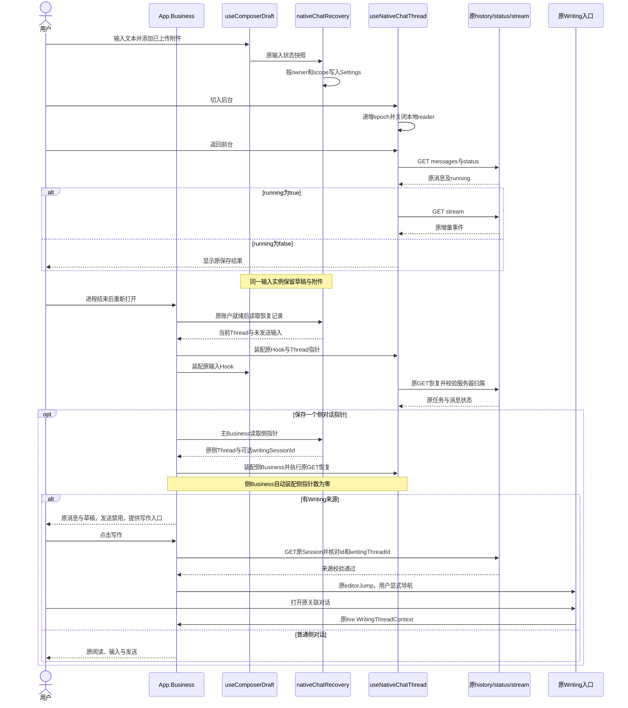
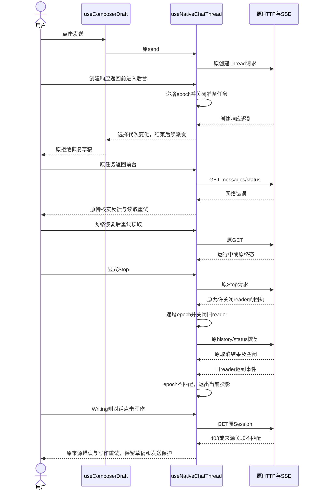
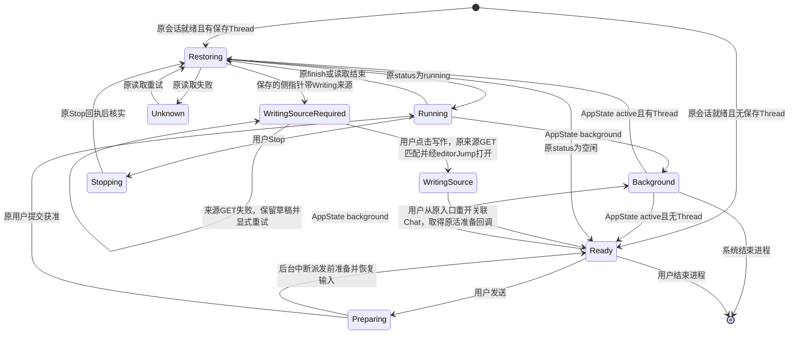

<!-- [Sync] 2026-11-04: 追加v3.1无框屏保视觉修订及限定验证，其他任务范围保持。 -->
<!-- [Sync] 2026-11-04: v4.2三项核心Simulator旅程、发丝限定帧采样与最终安装资源回执分项登记。 -->
<!-- [Sync] 2026-11-03: 用户单独授权屏保与共享Thread二值组件实施及Simulator验证；后台计算与音频任务保持暂停。 -->
<!-- [Sync] 2026-11-03: 补Notion双入口需求，应用内屏保动画与iOS系统组件共享活跃Thread有／无；本轮仅设计与文档检查。 -->
<!-- [Sync] 2026-11-03: 按用户要求拆分产品交互与开发文档，扩展iOS/Android适配，Web沿原路径；本轮仅文档。 -->
<!-- [Sync] 2026-11-03: 新增仅文档的后台适配设计，原实现目标继续暂停；文档检查获单独授权。 -->
<!-- [Input] APP-04反馈、当前iOS与Chat源码、Apple生命周期文档及2026-11-02验证暂停指令。 -->
<!-- [Output] 历史恢复候选、隔离旅程规格、暂停状态与现行专项方案入口。 -->
<!-- [Pos] APP-04独立执行记录；现行PRD、正式设计和目录合同由总控统一汇总。 -->
<!-- [Sync] 2026-11-02: 补主界面持有的侧对话指针及Writing来源显式重建；全部机械验证暂停。 -->

<!-- [Sync] 2026-11-03: 按用户要求整理现行专项方案，保留历史候选；代码及行为验收继续暂停。 -->

# APP-04 前后台与进程重开恢复

## 2026-11-04 屏保无框视觉修订

需求：按`docs/prd/Kastention-App-UI-Guidelines-v3.1.pdf`重新整理屏保，移除外框。优化执行提示词限定原屏保样式、主题与留白，统一时钟和原交互继续复用。

判断与收敛：PDF第3页要求标题、正文、说明与留白建立层级，第4页给出现行主题色，第5–7页定义原字体、安全区域、容器用途与轻纸面。原屏保在角色外叠加圆角纸片及边线；本轮选择整页虚化加主题色罩层、透明内容组，直接移除纸片容器。用户要求与规范均具备明确对应，新增页面、组件、依赖及业务规则为零。

实施：只修改`IdleScreenSaver.native.tsx`的布局和视觉样式。内容组无边框、圆角底板和阴影；保留原角色轮廓，字标复用开屏24／32，状态使用次级文字色，底部提示独立布局。角色尺寸同时受视口宽高约束。25秒计时、原关闭手势、Thread观察、草稿和任务生命周期沿原实现。

验证回执归`frontend/output/idle-borderless-20261104/`。已核对PDF第3、4、5–7页及两页实际渲染；Simulator构建34截图显示整页主题背景、透明无框内容组和独立底部提示。原包构建33以APFS克隆保留，依赖锁与package摘要保持。串行预算为Next单worker／2048MiB堆、Xcode单job／Metro单worker，构建前物理内存44%可用、磁盘19GiB可用；macOS宿主无Linux cgroup额度。

| 实际命令／入口 | 退出码与结果 | 回执 |
| --- | --- | --- |
| `pdftotext -layout docs/prd/Kastention-App-UI-Guidelines-v3.1.pdf ...`与`pdftoppm -f 3 ...`、`-f 7 ...` | 0；读取19页规范，目视核对第3／7页 | `ui-guidelines.txt`、`guidelines-p3.png`、`guidelines-p7.png` |
| `INK_IOS_NEXT_ROOT=.../Next python3 frontend/ios/scripts/prepare-next.py`；`NODE_OPTIONS=--max-old-space-size=2048 corepack pnpm --dir .../Next/build-source build` | 0；原Next构建和完整Web类型检查通过，无依赖安装 | `next-build.log` |
| `corepack pnpm exec tsc --noEmit --pretty false -p tsconfig.native.json` | 0；Native类型通过，首次调用未收集退出码，最终调用独立留存0 | `native-types-final.log`、`native-types-final.exit` |
| `corepack pnpm exec eslint src/components/IdleScreenSaver.native.tsx` | 0；无错误／警告 | `eslint.log`、`eslint.exit` |
| `xcodebuild -workspace frontend/ios/InkMemory.xcworkspace -scheme InkMemory -configuration Debug -sdk iphonesimulator -destination 'platform=iOS Simulator,id=120A4231-E08B-422F-A45E-08BDB72937D7' -derivedDataPath frontend/ios/build/RNWSimulator -jobs 1 CURRENT_PROJECT_VERSION=34 CODE_SIGNING_ALLOWED=NO build`；原Next根及Metro单worker环境沿前述预算 | 0；BUILD SUCCEEDED | `xcode-build.log` |
| `bundle-next.py --verify-sources`、`simctl install`／`launch`及实际安装目录SHA核对 | 0；573项源码、当前IdleScreenSaver摘要、JS／Native资源匹配；普通App构建34 | `installed-proof.json` |
| 独立runner执行`IdleScreenSaverUITests/testIdleDismissalRetainsPageAndDoesNotTapThrough`，原`prepare-ui-runner.rb`、Xcode单job／关闭并发测试 | 0；实际1项通过、0失败、0跳过，100.471秒；25秒、关闭不穿透、保留More、触摸重计时及前后台返回通过 | `ui.log`、`ui.xcresult`、4张原始附件 |
| `xcresulttool export attachments`及原图副本 | 0；目视确认无卡片边线／底板／阴影，画布、状态及底部提示符合本轮取舍 | `borderless-screen-saver.png`、`selected-frames.json` |
| 定向Markdown清单／本地路径／fence／空白检查及`git diff --check` | 0；7份现有文档及目录合同、112条路径有效；图示未修改，保留前轮38图回执 | `docs-check.json` |

评审结论：本轮无框视觉修订通过。统一时钟、原关闭交互与已认证普通App保持，新增运行服务、业务接口、依赖、数据库或权限规则为零。本轮没有模型调用、账户修改、真机安装或发布；暗色与横屏实际画面保持后续设备验证范围。仅卸载本轮明确命名的UI runner，普通App、账户及证据保留。


## 2026-11-03 屏保与系统组件实施增量

本轮授权为“按设计实现App内25秒无操作的屏保动画和系统组件，两处共用活跃Thread有／无，保留现有页面、草稿和任务，在模拟器上验证”。该授权覆盖两处显示及Factory内部只读观察；后台执行适配器、长期执行、音频、进程自动续跑保持暂停。

- 源码候选：一个Factory账户观察绑定、原生Session核对与generation隔离、RN无操作覆盖、原生系统材质虚化、独立Widget目标。业务DTO、权限、发送、停止、队列及持久化保持原入口。
- 构建：已有锁定依赖及Pods直接复用，Next单worker、Xcode单job、Metro单worker；无依赖安装。原Simulator安装App已保存可恢复副本。空间不足时已停止失败缓存副本操作；随后系统可用空间22GiB，内存75%可用，继续串行构建。透明压缩只作用已知编译缓存，每份SHA、模式和mtime核对回执保留。
- 机械验证与实际安装回执：`frontend/output/app04-idle-implementation-20261103/`（Git忽略、私有）。结果按后续验收表登记，历史暂停及失败回执保留。

## v4.2角色时钟交付与验证

用户补充提供`docs/prd/Kastention-一体化时间时钟-v4.2-离散跳针与发丝.html`与对应Markdown规范，要求启动图与时钟统一渲染。当前候选使用唯一`StartupArtwork`入口，iOS Core Animation视图持有原脸型、十二时位、三根离散指针、三条发丝和嘴部关键帧；原SVG数据及用户原型保持原文。App内显示与ActivityKit二值继续同源，持续后台计算和音频保持暂停。

| 验证项 | 实际命令／入口 | 退出码与关键结果 | 证据 |
| --- | --- | --- | --- |
| Web类型 | `corepack pnpm exec tsc --noEmit --pretty false` | 0 | `checks-clock-r1/web-tsc.log` |
| Native类型 | `corepack pnpm exec tsc --noEmit --pretty false -p tsconfig.native.json` | 0 | `checks-clock-r1/native-tsc.log` |
| 新角色／屏保ESLint | `corepack pnpm exec eslint src/components/StartupArtwork.native.tsx src/components/IdleScreenSaver.native.tsx` | 0，0错误／0警告 | `checks-clock-r1/eslint-clock.log` |
| 资产同步 | `sync-clock-artwork.py --check`，复用已安装fontTools 4.60.1 | 0；7条原路径、3组各6帧发丝、12原刻度及跳针值一致 | `checks-clock-r1/sync-clock-artwork.log`及资源合同 |
| 时间边界 | `swiftc InkClockTime.swift InkClockTimeChecks.swift -o clock-time-checks`及执行 | 编译0、执行0；8组边界通过 | `checks-clock-r1/clock-time-checks.log` |
| 前端相邻隔离旅程 | `playwright test --config=.../checks-r2/e2e-selfheld.config.mjs` | 0；73通过 | `checks-r3/playwright-selfheld.log` |
| Factory原入口合同 | `PYTHONPATH=backend backend/.venv/bin/python -m pytest backend/tests/test_claude_agent_thread_factory.py -q` | 0；72通过 | `checks-r4/thread-factory-pytest.log` |
| 原屏保完整UI | `xcodebuild ... ui-runner-final ... test` | 0；2个方法实际通过，165.663秒方法耗时 | `ui-r7.xcresult`、`ui-r7.log` |
| v4.2最终原生构建 | `xcodebuild -workspace frontend/ios/InkMemory.xcworkspace -scheme InkMemory -configuration Debug -sdk iphonesimulator ... -jobs 1 CURRENT_PROJECT_VERSION=33 CODE_SIGNING_ALLOWED=NO build` | 0；共享图形、资源与Widget扩展通过 | `xcode-build-final.log` |
| v4.2 UI首轮 | `xcodebuild ... ui-runner-clock ... test` | 65；25秒、关闭、导航和前后台方法通过；编辑器只读导致键盘前提及清理失败 | `ui-clock-r1.xcresult` |
| v4.2 UI复验 | `xcodebuild ... ui-runner-clock-r2 ... test` | 65；三个核心方法通过：100.193秒、60.905秒、5.612秒；额外模型探针选择器失败 | `ui-clock-r2.xcresult`、`ui-clock-r2.log` |
| 原生发丝实际采样 | `xcodebuild ... ui-runner-clock-observation ... test` | 0；图形方法通过30.831秒；模型探针跳过1项45.752秒 | `ui-clock-observation.xcresult` |
| 发丝像素核对 | 现有Pillow读取三张真实截图，限定发丝ROI | 0；运动帧蓝色掩码差965像素，前后基线差0；采样间隔约448ms，仅证明形变及恢复 | `checks-clock-frames/pixel-comparison.json` |
| 实际安装资源 | `INK_IOS_NEXT_ROOT=.../Next python3 frontend/ios/scripts/bundle-next.py --verify-sources`及安装目录SHA核对 | 0；573项源码匹配，最终Native、JS、Python及Widget匹配安装包，构建33 | `installed-unified-clock-final-proof.json` |
| 最终限定合同 | Native `tsc`、ESLint、idle纯合同、文档检查 | 0；5项idle通过，Native类型通过；17图解析及SVG渲染、203条引用通过；1条已有lint警告 | `checks-final-r1/` |

所有相对证据位于Git忽略的`frontend/output/app04-idle-implementation-20261103/`。该输出根沿任务起始日期命名，跨日继续使用同一回执根。源码SHA、Next实际安装目录、Python、原生dylib和Widget按独立proof文件核对。未将准备目录的资源替代实际安装包检查。

### 当前范围与剩余验收

前端最初合并包含写作旅程的runner在`E2E_WEB_BASE_REQUIRED`前置检查结束，实际测试0项，原日志未保留退出码数值。后续73项仅覆盖自持fixture的相邻Chat／屏保合同。完整Web写作验收保持未执行。

- v4.2已取得实际Startup与屏保截图，脸型直接作为表盘。初始图与屏保由同一Native图形组件呈现，发丝三帧对比覆盖运动与恢复；当前宿主沿原整层关闭规则；原型说明页及演示按钮退出本次页面实施范围。
- 公网Admin配置读取失败时，原编辑器进入只读并保留输入，发送权限保持原校验。测试仅沿原“重试读取”GET重试；只读期间的点击缺少编辑焦点，相关断言按前置条件记录。自有标记`idle-preservation-check`在确认整份草稿仅含该标记后，沿原New Chat清理；用户原稿保持。
- 系统组件扩展已构建与嵌入；真实活跃任务下的锁屏／灵动岛截图、系统授权关闭和用户移除行为仍需独立回执。Factory完整活跃集合和RN同源二值已有技术合同；该合同覆盖范围与平台可见性分别登记。
- 普通Simulator账户已执行一条GPT-6.1-Sol任务：请求一次Bash等待75秒并输出`IDLE_PRESENCE_OK`，最终原页面显示相同回复；未改模型、配置或权限，未自动重发。运行期间屏保为有，结束后屏保为无。XCUITest与后续UI观察分别记录，当前安装范围为Simulator构建33。真实iPhone、商店签名／提交及发布均未执行。

### 同一真实任务的限定观察（2026-11-04）

正常设置页首次显示配置读取失败，沿原“重新加载设置”恢复；已保存模型GPT-6.1-Sol的AX值为checked且可用。此次只读确认与[前提回执](../../frontend/output/app04-idle-implementation-20261103/real-presence-ui-preconditions.json)一致，配置、权限及账户均保持。

`testPresenceDuringOneRealTask`只发送一条限时命令请求，任务在Simulator内嵌Dream运行。本文据最终正文与原停止状态核对Thread完成，Bash子命令的独立成功资格退出该显示专项。该方法确认运行中的屏保为“有”，保留原线程；返回Chat后由于屏保再次按25秒显示，主任务通过正常UI关闭一次覆盖以读取原任务结果。105秒时正文已到达，停止按钮仍在原收尾阶段，立即断言失败；后续原页面恢复发送，显示最终`IDLE_PRESENCE_OK`，屏保转为“无”。完整任务方法退出65，保留该失败，后续观察按独立回执记录。没有第二次发送、业务重放或历史删除。

测试源码的后续等待条件已改为同时等待原正文与停止结束，并处理其间正常出现的屏保；修改后的方法未重新发送真实任务。首轮runner的Swift self显式捕获编译错误在任何UI操作前结束，退出65；修复后才运行上述单次任务。模型探针此前错误匹配radio值，exit0且跳过1项，实际Simulator值为checked／unchecked；跳过不计通过。

| 操作／命令 | 退出码与结果 | 证据 |
| --- | --- | --- |
| `xcodebuild ... ui-runner-presence-real ... test`首轮 | 65；Swift测试编译前提失败，真实调用0次 | `ui-presence-real.log` |
| 同runner的`testPresenceDuringOneRealTask`复验 | 65；一次真实任务，屏保有通过；正文到达后立即核对停止失败 | `ui-presence-real-r2.log`、`ui-presence-real-r2.xcresult`；执行源码独立保留 |
| 正常UI关闭屏保、读取原最终状态、More等待25秒 | 原任务最终回复可见、停止结束，屏保无；脚本操作与截图，无额外发送 | `unified-clock-active.png`、`unified-clock-idle-after-real-task.png` |
| 同runner的`testReadCompletedPresenceTask` | 0；32.025秒，仅重读同一任务，最终正文、停止结束与25秒后屏保无均通过；发送0次 | `ui-presence-final-read.log`、`ui-presence-final-read.xcresult`及`real-presence-final-read-frames/` |
| `xcodebuild ... build-for-testing` | 0；修订等待条件的runner编译通过；此项无真实任务重跑 | `ui-presence-harness-final-build.log` |
| `xcresulttool export attachments`与`simctl io ... screenshot` | 0；原始系统Home截图未显示可辨认活动卡，锁屏截图为黑屏 | `real-presence-frames/`及`system-lock-awake-after-real-task.png` |
| `simctl spawn ... log show --last 6m --predicate ...` | 0；应用“system display unavailable”匹配0条；该结果无法证明系统卡创建或显示 | `activity-request.log` |
| `simctl spawn ... log show --last 10m --predicate '(process == "liveactivitiesd" OR subsystem CONTAINS "ActivityKit") AND eventMessage CONTAINS "com.inkmemory.mobile"'` | 0；系统记录00:35:57创建、00:36:25更新、00:37:30结束同一Activity；此项仅为系统协议回执 | `activity-system-bundle.log`；安装包NSSupportsLiveActivities=true，Widget扩展类型正确 |

同一任务最终回读方法执行1项、失败0项，无跳过。仅清理本轮明确命名的三个独立runner安装包，普通App、业务记录、账户和证据保留。

系统Activity创建、更新与结束已有同一标识的协议回执，正文未将其记为系统可见性通过。系统组件的实际有／无可见性、系统授权关闭与用户移除继续保留验收缺口。当前轮次没有修改后台执行能力或以通知卡存在授予后台运行资格。

### 最终文档检查

`checks-final-r2/`记录14份现行文档及合同、236条本地引用、88个片段、4份目录合同9条清单，错误0；原17图加启动稿保留的21图，共38幅Mermaid解析及SVG渲染通过。结构、清单、Mermaid与定向`git diff --check`均exit0。追加上述执行结果后`checks-final-r3/`重查14份文档、237条本地引用、88个片段及目录清单，错误0，结构／清单／定向diff均exit0；测试方法、32.025秒回执及发送0次一致。图示保持r2的38图结果。最后补充系统协议回执后再定向检查空白与证据路径。

### 最小设计评审

| 评审项 | 发现 | 处理方式 | 修订结果 | 剩余依赖 |
| --- | --- | --- | --- | --- |
| 角色与时钟 | 原候选独立圆盘叠加小脸，偏离v4.2 | 统一StartupArtwork及原始路径 | 一个脸型承载指针、发丝和表情 | 真机显示单独验证 |
| 动画开销 | 原型SMIL需要Native执行适配 | 使用系统图层关键帧与一个整秒Timer | 无JS逐帧循环、WebView及新增应用依赖 | 真机性能独立验证 |
| 页面和任务 | 关闭、输入、账户及运行归属须保持 | 覆盖显示和内部Factory只读观察 | 原页面、草稿、权限与任务控制保持 | 系统活跃卡完整可见性验收 |
| 网络占用 | 已登录后台会话刷新无需阻止屏保 | 原首次开屏／登录继续阻止，普通读取沿原生命周期 | 读取回执与25秒操作计时独立 | 完整Web写作旅程单列 |

评审结论：源码与已取得的限定Simulator范围通过；系统活跃卡实际可见性保持待验收；普通账户配置已通过原重试入口恢复。完整后台计算与音频适配保持原暂停状态。

## 当前交付状态（2026-11-03）

用户本轮要求先将最新代码安装到iPhone供手动测试，再整理APP-04方案。现行[独立恢复方案](../design/multi-platform/mobile-recovery-interaction.md)已集中定义问题判断、代码事实、实例生命周期、三类业务图、最小工作项及验收矩阵。下方2026-11-02记录保留历史状态；当前APP-04代码修订及行为验收继续暂停。最新构建28包含工作树既有恢复候选，安装与普通启动回执归[总清单](app-experience-fixes-20261102.md)，恢复功能的通过资格保持待验证。本轮未恢复该任务目标，未新增业务实现或模型调用。

## 背景与问题

用户反馈：“看起来退出后台后进程会被杀死”。来源为[Notion问题页](https://app.notion.com/p/40b30b7547c380f7ac22f85fdd2dbdd0)，任务归属见[总清单](app-experience-fixes-20261102.md)。该反馈提供可见现象，进程退出原因需要对应时间的系统记录。

2026-11-02已创建目标：“APP-04：定位 App 切后台后的暂停、终止及恢复行为，沿原持久化和任务查询修复前台/进程重开恢复，保持草稿、会话、Thread、停止与无重复提交，完成完整自动化旅程。”目标未设置token预算；目标保持进行中。

首轮执行提示词已输出一次，范围包含现行合同、当前源码、iOS官方规则、原持久化/GET恢复、输入与停止语义、最小实现及分层验收。后续按已确认范围继续执行。

### 当前代码依据

| 对象 | 读取结果 | 本次处理 |
| --- | --- | --- |
| `BackendRuntimeManager` | 共享启动Promise，启动失败保留原错误 | 保留启动行为，仅增加输入恢复错误来源 |
| `SessionGate.native` | AppState active重新读取原会话；有会话时保留原业务组件 | APP-05所有，本任务只读 |
| `useNativeChatThread.native` | background关闭本地reader，active调用原history/status并按running接续GET stream；epoch拒绝旧读取 | 保留原恢复、Stop与队列协议，补进程重开选择恢复及创建前后台中断 |
| `useComposerDraft` | 统一持有Web/Native文本、附件和发送失败恢复；当前实例结束后状态释放 | 追加初始附件与原状态快照回调，继续复用同一Hook |
| `AIInputDock.native` | 原Tiptap与附件组件在栏目切换时保持；已上传文件有storageKey | 复用原状态，恢复文本及已上传引用，提示重新选择未完成上传 |
| `App.Business` | 主/侧Thread分别组合；当前Thread选择保存在React状态 | APP-01交接后接入owner/scope与初始Thread，移除重复初始读取effect |
| Writing | 原Writing会话及保存由原编辑器所有；Chat准备上下文后才派发 | 保留原保存与准备；background中断未完成准备后沿原拒绝恢复输入 |
| `EmbeddedDreamBackend`、`DreamPython`、`DreamNode` | App级实例与进程共存；启动结果缓存 | APP-03所有，本任务只读；日志与设备采证由总控集成 |

初始`git status --short`为空；执行过程中其他任务持续写入共享工作区。本任务按具体片段修订，保留其他修改，未切换分支、reset、stash、格式化或覆盖共享文件。

### iOS官方规则核对

2026-11-02读取Apple官方Markdown正文：

- [Managing your app’s life cycle](https://developer.apple.com/documentation/uikit/managing-your-app-s-life-cycle)：场景进入后台后可进入挂起，系统可回收后台场景资源；inactive包含暂时中断。
- [Extending your app’s background execution time](https://developer.apple.com/documentation/uikit/extending-your-app-s-background-execution-time)：进入后台的收尾时间有限，扩展后台时间须按对应API结束；本任务采用现有生命周期恢复。
- [Identifying high-memory use with jetsam event reports](https://developer.apple.com/documentation/xcode/identifying-high-memory-use-with-jetsam-event-reports)：内存压力终止由jetsam报告定位；报告与崩溃回溯有独立格式和用途。

`AppState`只提供应用可见性回调。HTTP断开、页面遮挡和一次`background`事件均缺少进程退出原因。当前源码与反馈支持恢复缺口修订；当前证据未确认本次用户遇到jetsam、崩溃或实际进程结束。

### 进程结束与本地任务边界

App进程终止时，嵌入式Python、Node及其本地执行同时结束。当前选择和输入恢复只重建客户端读取位置。模型任务的可恢复结果由原Thread/history/status及其运行实例返回；读取成功和客户端Ready分别代表读取结果与当前输入可用，任务完成证据归原保存消息及metadata。

本轮只读核对的原服务行为：

- `backend/routers/claude_agent.py`的`claude_agent_thread_status`先经`_admin_thread`校验账户归属。Thread存在且内存session缺失时返回`running=false,lifecycle=not_found`；现存session按原lifecycle返回运行状态。
- 同文件`claude_agent_thread_stream`只为当前running的实例订阅原EventBus；session缺失或当前非running返回409。
- `hydrateClaudeThreadSession`按history→status→空闲稳定读取顺序取数，仅将原status的`running===true`投影为运行中。原读取失败保留unknown和读取重试。
- `useNativeChatThread`在原查询非running且无未结束的Stop意图时结束本地恢复，保留已保存消息。user-only尾部保持原用户消息，代码不合成助手内容或completed/cancelled标记。

`native-chat-recovery.spec.ts`的页面reload规格重建JavaScript与Settings适配器，合成服务可显式返回running、已完成或not_found。running分支验证原查询回执存在运行实例时的GET接续；该fixture保留合成服务状态，实际iOS进程终止后的本地执行结果须经Simulator端侧后端复验。新增not_found规格验证user-only尾部、独立草稿和零自动重发；真实中断时最后一次消息写入、Gateway结算及原任务记录状态等待串行集成采证。本任务未更改后端任务所有权或新增终态写入。

## 目标与边界

本次交付范围为Chat的前台恢复与进程重开读取，保留原账户认证、Thread服务器归属校验、消息持久化、队列、工具确认、Stop和迟到事件处理。后台恢复事件只触发原GET；发送、队列写入与Stop继续由原用户操作发起。

采用现有iOS Settings保存当前账户的Thread选择、未发送输入和现有可恢复附件引用。读取原消息与状态后展示运行中、已完成或已取消结果。附件的临时文件句柄属于原上传实例，进程重开后尚未完成的上传提供重新选择提示。

验证范围按用户最新指令调整：luna-test-stage及其他机械验证全部暂停；本任务未启动runner，无中断进程。后续由总控在iOS Simulator串行构建、安装与XCUITest；本轮完成前提采用Simulator，真机性能与真实jetsam保留独立资格。

## 概念与规则

1. **账户边界**：恢复记录绑定已验证会话提供的公开ownerId。主Chat使用main作用域，侧Chat使用显式initialThreadId作用域。原session失效、账户切换和退出流程继续由SessionGate负责；其他账户读取不到原恢复内容。
   当前候选启动时恢复main的Thread及一个侧对话指针。侧指针只保存threadId和原writingSessionId；主Business装配原侧弹层，initialThreadId侧Business读取侧指针返回空，自动装配的层数保持一层。主/侧输入记录独立，Thread归属与状态仍由原Hook读取。
2. **状态来源**：Settings只保存Thread指针、草稿、工具选择和已上传附件元信息。任务running、终态、消息正文和工具确认均来自原HTTP/SSE。
3. **恢复读取**：首次挂载有Thread指针时调用`hydrateClaudeThreadSession`；running时接续原GET stream；空闲时展示原保存结果。失败沿现有unknown与读取重试处理，草稿及附件保留。
4. **后台处理**：background递增reader代次并关闭本地reader/准备任务；有Thread时进入原待核实状态。尚未取得Thread ID的准备或创建返回后退出派发，原输入卡按既有拒绝处理恢复草稿。
5. **轮询与迟到队列回执**：后台期间暂停原队列轮询；返回前台继续原读取。队列提交结果绑定原selectionEpoch，前后台替换reader保留同一选择的回执；切换Thread后旧回执退出当前输入队列与错误更新。已经发出的写入由原服务处理，客户端恢复期间持续核实结果。
6. **输入恢复**：原`useComposerDraft`拥有文本与文件状态，Settings适配器接收其快照。已上传文件保留id、名称、类型、大小、storageKey及已有workspace元信息；临时URI、文件字节、预览、控制器、Cookie、CSRF、Token和消息历史退出保存范围。
7. **显式导航**：New及选择另一Thread沿原输入实例重建，清除该作用域旧输入；旧输入写回回调在选择代次变化后失效。正常后台/前台保持同一输入实例。
8. **Stop**：原submission-owned Stop及回执判定保持。旧reader在允许关闭后退出当前投影；恢复状态由原history/status确认。进程重开后读取已取消结果，恢复操作不发送Stop。
9. **存储失败**：原启动诊断保留recovery来源的最近错误。JSON解析、schema校验、读取及写入失败仅登记固定错误类别，原JSON、输入正文和原始存储异常退出日志。存储异常退出恢复记录写入，原业务请求及鉴权继续由既有模块处理。Settings持久化落盘时机须由Simulator进程重开验收核实。
10. **侧对话来源**：普通侧对话恢复原阅读、输入与发送能力。Writing关联侧对话重开后恢复阅读与草稿，活编辑器准备回调通过原写作入口重新建立；此前草稿可编辑、发送禁用，原Stop条件保持，原`writingContextUnavailable`反馈提供“写作”入口。点击后只用原`GET /api/sessions/{id}`读取来源，核对返回id、editor_state.id及writingThreadId与原指针；成功后关闭所属侧弹层并发出已有editorJump，由原写作模块打开来源。用户从原写作入口重开关联Chat后，原活上下文负责保存与发送准备。来源失败保留同一受保护侧对话，用户可再次点击“写作”重试；替换来源或普通Chat降级退出恢复路径。
11. **侧指针退休**：关闭先完成原文档清理，当前侧实例和保存指针同时匹配时清除。主导航、主Thread选择、新Chat及侧内选择变化清除该指针；迟到关闭、来源GET或文档清理无法清除后续新指针或跳转到旧来源。侧内切换至其他Thread的输入记录在原Writing Thread重开时退出恢复，草稿保持对应Thread归属。

### 方案评审

复核现行[移动PRD](../prd/mobile-app/mobile-app.md)、[iOS交互设计](../design/multi-platform/mobile-ios-interaction.md)、[RN工程与恢复设计](../design/multi-platform/react-native-web-project-structure.md)及Writing/Chat实现后，核心缺口收敛为进程重开缺少当前选择与未发送输入记录，以及尚未取得Thread ID时后台回调提前返回。

| 方案 | 对应问题与依赖 | 结论 |
| --- | --- | --- |
| 仅追加AppState重读 | 已有恢复覆盖前台读取；进程结束后React状态释放 | 保留既有实现并补恢复记录 |
| 复用Settings、原输入Hook及原GET | 当前仓库已有同类iOS存储适配；任务与身份校验仍由原服务所有 | 采用 |
| 侧对话指针与Writing显式返回 | 原活准备回调依赖存活文档；已存来源可经原GET校验并用原editorJump打开 | 总控新增授权并接受；恢复阅读/草稿后由用户重建原来源上下文 |
| 扩展后台执行、增设持久任务或同步系统 | 引入新的执行和数据责任，需要额外产品需求 | 退出本次范围 |

修订保留现有页面结构、操作入口和状态反馈。新增提示只用于未完成上传后的重新选择操作。技术候选仍需机械验证与Simulator完整旅程。

### 待总控同步的页面骨架

桌面Web沿现行布局，本次原生修订的影响范围如下：

```text
桌面Web
┌───────────────────────────────────────────────────┐
│ 原顶部操作 / 当前Agent / 活动 / 文件 / 新对话         │
├───────────────────────────────────────────────────┤
│ 原历史入口     原消息阅读区（内部滚动）               │
│               原任务状态、工具反馈、停止入口          │
├───────────────────────────────────────────────────┤
│ 原输入卡：草稿 / 附件 / 工具选择 / 发送               │
└───────────────────────────────────────────────────┘
Web继续使用原输入状态；恢复持久化仅由Native适配器装配。

窄屏App
┌───────────────────────────────────┐
│ 当前Agent / 原顶部操作 / 新对话     │
├───────────────────────────────────┤
│ 原消息阅读区（内部滚动）            │
│ 原恢复中 / 读取失败及重试           │
│ 原保存结果 / 运行状态 / Stop        │
├───────────────────────────────────┤
│ 未完成上传：重新选择提示（按需）     │
│ 原附件卡片 / 草稿输入 / 发送        │
├───────────────────────────────────┤
│ Chat | Deck | 更多                │
└───────────────────────────────────┘
侧Chat沿原Modal呈现；恢复记录按其显式Thread区分。
Writing关联侧Chat重开：原失败反馈 / 写作入口 / 原消息阅读与可编辑草稿；发送禁用，原Stop条件保持。
点击写作后，原GET核实来源，再沿已有editorJump进入原Writing页面。
原登录弹窗与开发者窗口维持原展示关系。
```

### 正常业务时序



### 异常与恢复时序



### 状态转换



图中Background描述页面生命周期，WritingSourceRequired描述来源准备及发送可用性；任务running和Stop继续由原服务回执与原Hook处理。进程结束后的运行实例重新装配，继续读取既有Thread；记录中保留原消息及其终态。

## 实现交付物

| 文件 | 修订 |
| --- | --- |
| `frontend/app/_dream/components/chat/nativeChatRecovery.native.ts` | Settings小型适配器，owner/scope校验、原输入元信息投影、旧输入写回失效、单侧指针退休与原Writing来源GET校验 |
| `frontend/app/_dream/components/chat/useComposerDraft.ts` | 原Hook接收初始附件并向所属恢复适配器发出快照 |
| `frontend/app/_dream/components/chat/AIInputDock.native.tsx` | 原输入卡采用恢复记录；未完成上传提示重新选择；sendBlocked仅约束发送，草稿编辑和原Stop保持 |
| `frontend/app/_dream/components/chat/useNativeChatThread.native.ts` | 初次GET恢复、选择指针更新、后台派发前中断、队列轮询暂停及迟到提交回执选择校验 |
| `frontend/src/runtime/BackendRuntimeManager.ts` | 原诊断增加recovery错误来源 |
| `frontend/app/_dream/i18n.ts` | 两种语言的未完成上传提示，保留其他任务文案 |
| `frontend/src/App.tsx` | APP-01交接后接入owner/scope与显式初始Thread；新增授权后主Business装配侧指针、保持Writing发送保护及显式原来源返回，移除重复初始读取effect；原Alert/deleteRequest/deleteThread保持 |
| `frontend/e2e/native-chat-recovery.spec.ts` | 新增完整隔离旅程规格，尚未执行 |
| `frontend/e2e/native-app-side-recovery.spec.ts` | 使用实际App、Chat Hook及原输入卡，补普通侧恢复、Writing保护/显式返回与来源失败重试的组合规格，尚未执行 |
| `frontend/e2e/native-chat-session.spec.ts` | 补充迟到队列成功/失败回执的选择归属、前后台reader替换后保留回执及零重发规格，尚未执行 |
| `frontend/e2e/native/chat-recovery-platform-web-boundary.ts` | 复用现有Settings/AppState测试适配器，显式iOS能力 |

## 验证状态与证据

| 类型 | 实际状态 | 证据或退出码 |
| --- | --- | --- |
| 源码与合同读取 | 已完成 | 初始`git status --short`退出0、输出为空；`rg`、`sed`与文件读取获得上表代码依据 |
| Apple官方正文读取 | 已完成 | 三个官方`.md`入口的`curl -fsSL`读取退出0，取得生命周期、后台时间与jetsam正文 |
| 代码与规格生成 | 已写入候选 | 使用定向patch；候选执行资格待验证 |
| luna_test_runner | 尚未启动，用户已暂停 | 无运行cell、runner或需中止的检查 |
| 类型、规格、lint、构建及文档验证 | 待执行 | 用户暂停后未运行，退出码不适用；主Agent未替代执行 |
| Simulator构建/安装/XCUITest | 待总控串行执行 | 本任务未构建、签名、安装或控制设备 |
| 正常账户/真实模型 | 待总控安排 | 本任务未调用真实账户或模型 |
| 真机性能及jetsam | 未验证 | 本轮Simulator条件覆盖功能恢复，真机因果证据单列 |
| 发布 | 未执行 | 本任务退出发布范围 |

### 待恢复后的隔离检查

执行时复用已安装Chrome与依赖，由获准的验证阶段串行安排；以下命令为计划，当前无执行回执。

```sh
cd /Users/dmeck/project/ink-dream-memory/frontend
pnpm exec playwright test e2e/native-chat-recovery.spec.ts e2e/native-app-side-recovery.spec.ts e2e/native-chat-session.spec.ts e2e/native-session-gate.spec.ts --workers=1 --reporter=line
pnpm native:typecheck
```

Playwright实际执行入口须设置本机Chrome channel，保留单次启动前置结果。测试使用随机端口、`/tmp/ink-app04-recovery-20261102/vite`缓存、浏览器独立上下文及公开合成DTO；不连接正常服务、数据库、账户或模型。server归本轮afterAll关闭，清理范围限具名缓存与本轮产物。Web类型、Markdown清单/引用路径及Mermaid语法由总控汇总执行，当前均待检查。

### 完整旅程与相邻回归矩阵

| 旅程 | 自动化规格与断言 | Simulator采证 | 状态 |
| --- | --- | --- | --- |
| 运行中切后台/前台 | 原reader释放、原GET恢复、用户POST一次、Stop零次 | 原输出、AppState、请求数量、同Thread | 规格已写，待执行 |
| 网络断开/恢复 | 原unknown、稿/附件保持、重试只读、恢复原终态 | 原失败反馈、恢复入口与持久结果 | 规格已写，待执行 |
| 进程重开：已完成/运行实例缺失 | 保留Thread、草稿/引用；按原status显示保存结果或user-only尾部；业务POST一次 | 实际终止/重开PID、原端侧后端及Thread/消息；核实原结算与任务记录 | 规格已写，待执行 |
| 页面重开：原查询仍有运行实例 | fixture返回running后仅接续GET stream；业务POST一次 | 同进程页面重建与原运行实例归属 | 规格已写，待执行；退出跨进程续跑声明 |
| 创建响应/上下文准备期间后台 | 原拒绝恢复草稿、后续Agent POST零次、准备取消 | 点击发送后后台与返回，原稿、原Writing保存 | 规格已写，待执行 |
| Stop及迟到事件 | 原Stop一次、独立核实空闲、旧reader无法改终态、重开取消消息 | 实际Stop、原结算/保存、Send恢复 | 规格已写，待执行 |
| 账户失效/切换 | 复用原SessionGate用例；owner隔离、旧写回失效 | 401后正常登录、原页面/草稿归属 | 现有及新规格待执行 |
| 已上传/未完成上传附件 | 引用恢复、临时URI退出记录、未完成上传显式重新选择 | 原附件卡、手动发送原元信息、失败恢复 | 规格已写，待执行 |
| 队列/工具确认/新对话 | 原native-chat-session相邻回归，main/侧scope分离 | 原队列、侧对话、manual/auto与取消 | 新scope补充及原规格待执行 |
| 普通侧Chat进程重开 | 实际App主/侧组合、原Hook与输入卡恢复，发送仍绑定原侧Thread，关闭后重开不再出现旧侧弹层 | 普通侧Chat结束App后重开，核对原Thread、输入和用户显式发送 | 组合规格已写，待执行 |
| Writing侧Chat进程重开 | 恢复原阅读和草稿；发送保护；显式点击写作后GET核对原来源并发出原editorJump；用户从原入口重开后取得活准备回调 | Writing侧Chat结束App后重开，核对草稿、禁发、原来源打开、原关联发送一次 | 最小替代已获总控接受并实现，组合规格待执行 |
| Writing来源失效/迟到 | id、editor_state.id、writingThreadId和权限核对；失败保留同一侧指针/输入及重试；旧关闭不清除替代指针 | 来源失败/恢复、关闭/替换期间迟到GET和文档清理 | 适配器及组合规格已写，待执行 |
| Writing与Reflections | 原准备与保存、当前任务读回、返回Chat输入保持 | 与APP-02合并完成原导航和报告回读 | 跨任务验收待执行 |

### Simulator采证方案

1. 总控按构建内存与恢复手册核对目标、入口、容量和可恢复制品后单次构建，保存原制品及日志；本任务不启动Mac Dream替代端侧后端。
2. 记录Simulator型号、系统版本、App构建号、PID、启动时间及已安装制品路径。沿原账户进入已有Thread，保存原history/status与页面起点。
3. 发起限定的普通用户任务，运行中切后台、等待、返回前台。记录同PID、AppState和原请求序列；返回后的原状态与输入保留分别取证。
4. 使用明确隔离的传输故障核对失败与恢复；正常账户流程只执行普通用户操作。恢复前后对比原用户消息ID及请求次数，确认未新增业务POST。
5. 分别在运行中、已完成和Stop后终止本轮Simulator App进程，再正常重开。记录新PID、原会话、当前Thread、原结果与草稿/已上传附件；原Thread必须经服务器归属检查。
6. 保留Stop完成前后的原回执、消息终态、输入操作及迟到事件证据；原运行记录和日志保留供用户复核。
7. 页面被登录弹窗或系统窗口遮挡时记录inactive/active及相同PID；系统挂起恢复记录相同PID和停顿区间。实际进程结束记录PID变化；崩溃关联同时间诊断回溯；jetsam关联同时间的jetsam报告及进程条目。Simulator结果按模拟器条件汇报。

## 待总控汇总与剩余依赖

- 共享App接线在APP-01交接及总控授权后完成；后续人工审阅发现侧Chat重开缺口，总控追加授权原sideChat片段和adapter并接受Writing显式来源重建方案。当前源码包含单侧指针恢复与原来源返回，原Alert/deleteRequest/deleteThread及其他任务品牌修订保留。
- APP-05已在原诊断错误标签加入recovery来源“输入恢复”。
- PRD同步概念规则与两端骨架；正式交互稿同步正常/恢复时序、状态与验收矩阵。
- `.folder.md`清单登记新增adapter、规格、测试适配器及本执行记录；功能源码头已由本任务维护。Markdown清单、引用与Mermaid语法等待验证恢复后检查。
- 暂停的机械验证与Simulator集成完成前，保留“实现候选、尚未验收”状态，目标继续进行中。
- Notion共享页面由总控统一同步，本任务未写入Notion或向其他用户发送消息。

## 2026-11-03 后台执行适配器设计

### 范围与目标状态

本轮用户授权仅推进“如何解决当前后台执行问题”的方案设计，并授权luna-test-stage执行文档清单、引用/行号、图示一致性、Mermaid和定向`git diff --check`。原APP-04完整实现目标保持`paused`；代码修订、构建、手机/Simulator操作、产品服务、数据库与真实模型验收继续暂停。

本轮工作区为`ios-store`，开始时已有大量用户与其他任务改动。实际写入范围为以下六份文档：

1. `docs/design/multi-platform/mobile-recovery-interaction.md`
2. `docs/design/multi-platform/.folder.md`
3. `docs/design/multi-platform/README.md`
4. `docs/prd/mobile-app/mobile-app.md`的APP-04段落及文件头
5. `docs/prd/mobile-app/.folder.md`
6. 本执行记录

### 设计交付与评审

现行正文归[后台执行与恢复方案](../design/multi-platform/mobile-recovery-interaction.md)。原三幅恢复图保留，新增正常/异常后台执行时序与许可状态图。正文只定义当前问题的解决步骤、契约、所有权及验收条件；执行记录和阶段状态归本节。

选择原宿主内的小型`BackgroundWorkAdapter`，两个实现均为建议、未实现：有限实现对接`beginBackgroundTask/endBackgroundTask`；持续实现对接iOS26的`BGContinuedProcessingTask`。工作开始前申请，原业务入口执行一次，系统handler附着原生产者。采用API availability和真实工作能力选择，保持原最低系统兼容及原Python/Node/Claude路径。

当前Chat事件缺少可直接对应全程任务的真实进度；持续实现还需要精确生产者观察、真实终态/保存回执和有界收尾。方案保留普通Chat及旧版iOS的有限时间路径，适用的可测工作经验证后才能采用持续实现。原Factory已将接受后的生产者保存为独立bg_task，subscriber退出只unsubscribe；生产者建立前的懒启动POST读取与原生取消链仍需单项验收。

expiration无原因参数，用户系统界面取消与系统收回时间均可进入该回调。设计只先登记许可失效，再核对原进程、turn与生产者请求原执行者受控收尾；原用户Stop及真实业务终态保持原来源。原`stop_thread(thread_id)`需要一处预期turn/生产者核对的内部窄适配；方案未创建新HTTP、队列、数据库或任务状态机。进程终止后原本地执行结束，重开恢复只读与草稿，业务自动重发为零。

### 官方资料与代码核对证据

2026-11-03经Apple官方Markdown与JSON再次读取。`python3`读取脚本退出0，原始资料保存在`/tmp/app04-background-design-20261103/`。`bgcontinuedprocessingtask.json`的platforms实际返回iOS/iPadOS/Mac Catalyst均`introducedAt=26.0`。官方长期任务、expiration、completion、queue、有限后台时间和playback正文均读取成功；App Review 2.5.4由官方网页核对。资料链接直接保留在现行方案。

代码核对使用只读`rg`/`sed`，定位原公开POST的懒启动、Factory的独立生产者及subscriber释放、原生ASGI HTTP取消、原Stop和进度事件处理。上述读取提供设计依据，退出码0的读取记录均不计为功能测试。当前工作源文件保持原用户及其他任务归属；本轮没有实现后台适配。

### 文档检查

文档检查由具名luna_test_runner执行，范围限本轮六份文档及现行方案的六幅Mermaid图，使用本机Chrome离线解析。该检查未启动产品服务、原生构建、Simulator、数据库或模型，未修改产品源码，结果只用于文档资格。

| 阶段与实际命令 | 退出码 | 关键结果 |
| --- | --- | --- |
| r1结构脚本 | 1 | 首次为检查脚本语法前置错误；修复后43项中41通过，2个失败来自导航中HEAD已存在的历史锚点 |
| r1 `node --input-type=module`离线解析，完整heredoc保留于下述command-receipt | 0 | 本机Chrome仅启动一次，6/6 Mermaid通过：4幅sequenceDiagram及2幅stateDiagram-v2；自有Chrome关闭 |
| r2 `python3 /tmp/app04-background-design-20261103/doc-checks-r2/check-docs.py` | 0 | 自有脚本定位字符串前置错误修复后重跑，43/43断言通过；111个链接中88个本地引用、5处行号、31处标题锚点均有效 |
| r2定向`git diff --check`，完整命令如下 | 0 | 本轮六份文档的Git差异无空白错误；未跟踪文件由独立检查覆盖 |
| r2脚本内的独立空白检查 | 0 | 六份文件含未跟踪文档，尾随空白及CRLF为0 |

定向Git命令的工作目录为仓库根：

```sh
git diff --check -- docs/design/multi-platform/mobile-recovery-interaction.md docs/design/multi-platform/.folder.md docs/design/multi-platform/README.md docs/prd/mobile-app/mobile-app.md docs/prd/mobile-app/.folder.md docs/exec/app-experience-foreground-recovery-20261102.md
```

两个历史失败已通过原归档的对应标题核对，只把`README.md`中的旧手册锚点改指向`docs/exec/history/ios-release-documents-before-reader-revision-20261102.md`，历史正文保留。r1失败产物未覆盖；r2原断言保留，图源码未改，未重复启动Chrome或解析Mermaid。

原始回执目录：`/tmp/app04-background-design-20261103/doc-checks-r1/`和`doc-checks-r2/`。`doc-checks-r2/command-receipt.txt`保留实际完整结构、Git及Mermaid命令；`doc-structure-report.json`与`independent-whitespace-report.json`为r2通过回执，r1的`mermaid-parse-report.json`为六图通过回执。最终追加此执行结果后仅复查文档结构和空白，图示沿上述已取得结果。

本轮交付为方案设计与文档验证。后台适配接口、真实进度接入、受控收尾、两类系统行为及完整业务验收均未执行；原APP-04完整目标保持`paused`。


## 2026-11-03 产品交互与开发文档拆分

### 修订目标与授权范围

用户明确Agent在手机本机执行，计算优先，音频按需启动；要求修改原文并另建开发文档，直接包含适配器拓扑或对象关系，平台覆盖iOS和Android，Web沿原路径。用户选择先查看产品交互。

本轮修订目标为：产品稿直接定义用户操作、后台计算、按需播放、失败反馈与恢复；开发稿直接定义平台装配、适配器职责、原生产者绑定、接口输入输出、系统回调和开发验收。业务源码、配置、运行服务、数据库、构建、Simulator/模拟器、真机和模型调用均退出本轮范围。原APP-04完整实现目标保持暂停。

### 发现、定义与方案选择

- 发现：原稿混合了产品规则、系统API和交付状态，缺少拓扑、类型关系、句柄归属及计算转播放时序；原稿对普通Chat采用有限时间，持续计算目标缺口未在结论中充分体现。
- 定义：两份现行文档分别服务产品交互评审和开发实现；Agent保持手机执行位置，iOS与Android分别适配，Web不增加实现。
- 方案比较：继续在单文档增加章节会保留职责混合；增加全新任务平台会扩大运行责任。选用原文产品化、独立开发合同、现有宿主内平台适配和原业务恢复。
- 收敛：开发稿给出拓扑、类图、内存对象关系、正常/异常时序及句柄状态。原混合稿逐字归档，原六幅图保留；新增开发接口均标建议、未实现。

### 交付物与现状核对

| 交付物 | 本轮职责 |
| --- | --- |
| [产品交互](../design/multi-platform/mobile-recovery-interaction.md) | 本机计算优先、两端用户反馈、按需播放、原停止、失败与读取恢复；正文三幅业务图 |
| [开发文档](../design/multi-platform/mobile-background-execution-technical.md) | 两平台拓扑、适配器类图、运行期对象关系、精确任务关联、平台操作及接口；正文六幅图 |
| [拆分前原文](../design/multi-platform/history/mobile-recovery-mixed-draft-20261103.md) | 保留原正文及六幅图，相对路径按原目录解释 |
| [移动PRD](../prd/mobile-app/mobile-app.md#前后台与进程重开恢复2026-11-02) | 用户规则、桌面/窄屏骨架、iOS任务卡及Android通知；分别链接两份现行正文 |
| 跨平台README及受影响.folder.md | 同步文档归属、前稿和本记录导航；保留其他任务改动 |

只读核对确认：iOS原宿主已有CPython/Node启动；Android InkRuntime继续返回CAPABILITY_UNAVAILABLE，私有DreamRuntimeService尚无合格Runtime和前台执行接线。两端后台执行与原生音频接线均为待实现项。普通Chat准确进度、宿主观察及精确收尾仍为持续路径依赖；Android服务类型和音频后台启动资格按实际工作核对。有限时间、静态结构或通知存在均不构成持续计算通过证据。

2026-11-03读取Apple后台处理与播放文档、Android前台服务启动/类型及Media3后台播放官方资料。开发稿直接链接原文；Android specialUse只列待核对用途，未宣称已获得类型或渠道资格。

### 本轮文档验证

验证范围为本轮十份文档、当前九幅图、前稿六幅图的保留、引用与目录一致性、Markdown格式及十二个相关源码文件的前后SHA对比。命令与结果在本节追加；检查结果只描述文档结构。


| 验证命令 | 退出码 | 结果与边界 |
| --- | --- | --- |
| `python3 /tmp/app04-doc-split-20261103/check-docs.py` | 0 | 61/61；十份文档、169处引用、前稿字节一致、目录/职责/状态及十二个相关源码SHA保持。原PRD中并行APP-07文案更新保留 |
| `node /tmp/app04-doc-split-20261103/check-mermaid.mjs` | 0 | 当前九图解析并渲染9/9，离线Chrome单轮启动一次并关闭；检查实际SVG几何属性与可见尺寸，拓扑和关系图另作目视核对 |
| 定向 `git diff --check` | 0 | 下方列明十份文档；新增文件由独立结构/空白检查覆盖 |

定向命令：

```bash
git diff --check -- docs/design/multi-platform/mobile-recovery-interaction.md docs/design/multi-platform/mobile-background-execution-technical.md docs/design/multi-platform/history/mobile-recovery-mixed-draft-20261103.md docs/design/multi-platform/.folder.md docs/design/multi-platform/README.md docs/design/multi-platform/history/.folder.md docs/prd/mobile-app/mobile-app.md docs/prd/mobile-app/.folder.md docs/exec/app-experience-foreground-recovery-20261102.md docs/exec/.folder.md
```

首轮结构检查59/61：README两处原归档链接指向四反引号快照内的标题，已修为可渲染的归档章节；另外识别到其他任务并行修改APP-07正文，保留该修改并单独记录。复验61/61。

首轮图示检查八图通过，ER图输出被脚本对整份SVG的undefined匹配拒绝。单图诊断确认字符串位于Mermaid输出的无效CSS样式片段，图的实体、连接及尺寸均实际渲染；检查脚本改为校验数值几何属性和可见边界，九图复验通过。原始首轮结果保留于`/tmp/app04-doc-split-20261103/mermaid-r1-report.json`，单图诊断及最终结果分别保留为`er-debug-report.json`和`mermaid-report.json`。

本轮实际写入范围为两份现行正文、前稿副本、PRD、README、本执行记录及四份受影响目录合同，共十份文档。业务源码与平台配置保持，原任务实现和功能验收继续暂停；文档拆分与图示检查已完成。

## 2026-11-03 应用内屏保与系统组件补充需求

### Optimized Prompt

依据当前APP-04设计、现有React Native／iOS宿主和用户新增Notion需求，为App前台无操作屏保静态动画与iOS通知区域组件补充一份最小交互增量。两处共用当前已认证账户在本机的活跃Thread汇总状态，值只有有／无。应用内25秒无操作显示时钟／心情画面、虚化原页面，任意触摸关闭且不穿透；保留页面、输入、业务执行和原认证。系统锁屏／灵动岛组件展示最近确认值并提供原App返回入口。明确用户操作、两种显示生命周期、系统挂起及进程结束、观察失败、多个Thread、账户切换和旧代次回执，补正常／异常时序、状态图、页面骨架和验收条件。复用原生产者宿主观察、现有素材及主题，禁止通过页面reader或CPU推断全部任务。只修改本任务文档并检查引用、图示、源码保护和Mermaid；原APP-04实现与行为验收保持暂停。

### 来源与范围修订

[Notion需求](https://app.notion.com/p/40b30b7547c380cd9930c384ab35023c#40d30b7547c3805aa2e4c01e7f7a492f)于2026-11-03通过Notion连接读取，页面最近编辑时间为2026-11-03T13:23:01.921Z。相关正文包括Kastention时钟、开心／悲伤表情、iOS系统入口，以及25秒无操作出现、底层虚化、任意位置点击关闭的应用内屏保。用户进一步明确：软件无操作时的静态动画属于本次需求。首次将范围限为系统卡片的判断已修订，当前文档直接包含双入口。

本轮工作为补充设计，原APP-04完整实现目标继续暂停。未修改业务源码、原生工程、依赖、配置、服务、数据库、设备或安装包；未调用真实模型。原混合历史稿保持字节一致，先前文档和验收回执保留。

### 问题判断与方案收敛

- 现状：已有StartupArtwork路径、主题与可见时动效，缺少本需求时钟／心情、屏保及Live Activity接线。原status具备Thread归属校验；Factory运行身份位于私有state，公共运行列表缺少账户字段。Native页面只持有局部Thread，无法独立证明当前账户的全部任务均已空闲。
- 核心问题：前台无操作显示、系统后台显示和本机任务执行具有独立生命周期，二值状态需要完整账户范围的原任务观察。
- 比较：仅锁屏方案遗漏应用内屏保；独立运行监测进程／新任务接口增加维护与执行责任。采用原Business内单层屏保、原宿主只读聚合和单张系统活动，新增任务控制及自动重发为零。
- 收敛：PRD维护两处骨架与规则，产品稿增加两类时序和两幅显示状态图，技术稿补只读聚合、计时、交互、素材／虚化及ActivityKit最小接线。iOS官方资料于本日复核，JavaScript页面及Markdown内容分别查阅；web读取Markdown内容类型受限后，通过同源官方.md读取，文件未复制到业务目录。

### 设计评审

| 评审项 | 发现 | 处理方式与修订结果 | 剩余依赖 |
| --- | --- | --- | --- |
| 双入口需求 | 原判只覆盖系统卡片，遗漏无操作动画 | 加入前台25秒屏保、关闭、虚化和心情；两处共享有／无 | 动画素材与平台呈现实现 |
| 二值与数据完整性 | 关闭reader、挂起或读取失败无法证明无活跃Thread | 原running口径；false要求完整账户范围快照，失败保持最近值；首次缺失不新增状态 | 原生产者宿主观察、运行代次和顺序校验 |
| 原业务与权限 | 屏保点击可能触发底层按钮；工具确认可能被遮挡 | 整次关闭手势消费；键盘／模态延后；新确认关闭屏保交原UI；原停止／批准保持 | RN与局部Web文档的焦点和交互资格 |
| 生命周期及成本 | 常驻时钟或逐token发布会增加刷新 | 单timeout，屏保可见前台时才更新时钟；系统卡只发布二值变化／必要核对 | 前后台定时器清理及性能验证 |
| 视觉复用 | 当前启动插画只有准备动效，现有依赖缺少虚化组件 | 复用路径及SVG；时钟／心情和最小平台虚化列明确缺口，原启动流程保持 | stateId到表情映射、iOS虚化、Android能力核对 |
| 系统约束 | Live Activity展示依赖系统可用性，挂起后无法本地持续刷新 | 最近确认和陈旧呈现；移除保持原任务；重开核对旧活动，默认打开App沿原登录 | Widget扩展签名、设备授权及系统行为实测 |
| 实施范围 | 用户当前补需求，原实现暂停 | 8份现有文档增量，保留历史；程序、账户、模型、构建和发布操作为零 | 后续明确恢复实施与业务验收 |

评审结论：**待满足明确前提后通过**。产品规则与业务图已覆盖两处显示、二值状态及失败恢复；原宿主完整聚合、素材映射与虚化、Widget扩展与设备系统资格为实施验收前提。此结论不授予后台执行资格或代表真实任务已验收。

### 本轮文档验证

文档清单为产品交互、开发文档、移动PRD、跨平台README、执行记录及三个相关.folder.md，共8份。验证输出归`frontend/output/app04-thread-presence-20261103/`；11份相关源码／配置／历史原稿在修改前登记SHA256。仅文档清单、引用、源码行号、图示一致性、Mermaid及空白检查，结果于本节追加。

| 命令及工作目录 | 退出码 | 关键结果 |
| --- | --- | --- |
| `corepack pnpm exec node output/app04-thread-presence-20261103/app04-doc-validation.mjs`，frontend目录，首次含图示解析 | 0 | 本机Chrome及本地Mermaid11.17.2解析现行13图成功；产品7图、技术6图，历史稿仅核对SHA。 |
| `APP04_SKIP_MERMAID=1 corepack pnpm exec node output/app04-thread-presence-20261103/app04-doc-validation.mjs`，frontend目录 | 0 | 8份文档、192条本地引用、37组表格、7处源码行号和11份SHA通过；断链0。13图沿原解析回执，结构重查未重复启动Chrome。 |
| 定向`git diff --check --`加上本文八份文档路径，仓库根目录 | 0 | 无空白错误；完整命令见原始回执。 |
| `git diff --no-index --check /dev/null docs/design/multi-platform/mobile-background-execution-technical.md`，仓库根目录 | 1 | Git报告文件有差异，stdout/stderr空，无空白诊断；未跟踪文件同时经独立检查。 |
| 独立awk尾随空白与CRLF检查，仓库根目录 | 0 | 未跟踪技术稿无尾随空白或CRLF，完整命令见原始回执。 |

首轮引用解析将URL编码空格及源码`#L`误记为3个历史链接问题，修正验证器后本地引用全部通过；正文保持。行号检查首次覆盖0处，随后补充5处范围及2处单行，最终7处全部检查。现存r1／r2／r3回执分别保留中间覆盖和最终结果，首次完整JSON未单独留存，首次覆盖缺口由主任务读取记录确认。原13段Mermaid结果沿用，不将结构重查记为再次解析。

原始[命令回执](../../frontend/output/app04-thread-presence-20261103/final-docs.log)与[最终结构结果](../../frontend/output/app04-thread-presence-20261103/app04-doc-report-r3.json)可复核；追加本结果后的文档结构和空白单独再检查。设计文档已更新，源码／配置／原历史稿保持，屏保、系统组件、APP-04后台适配及真实业务验收均未执行。
