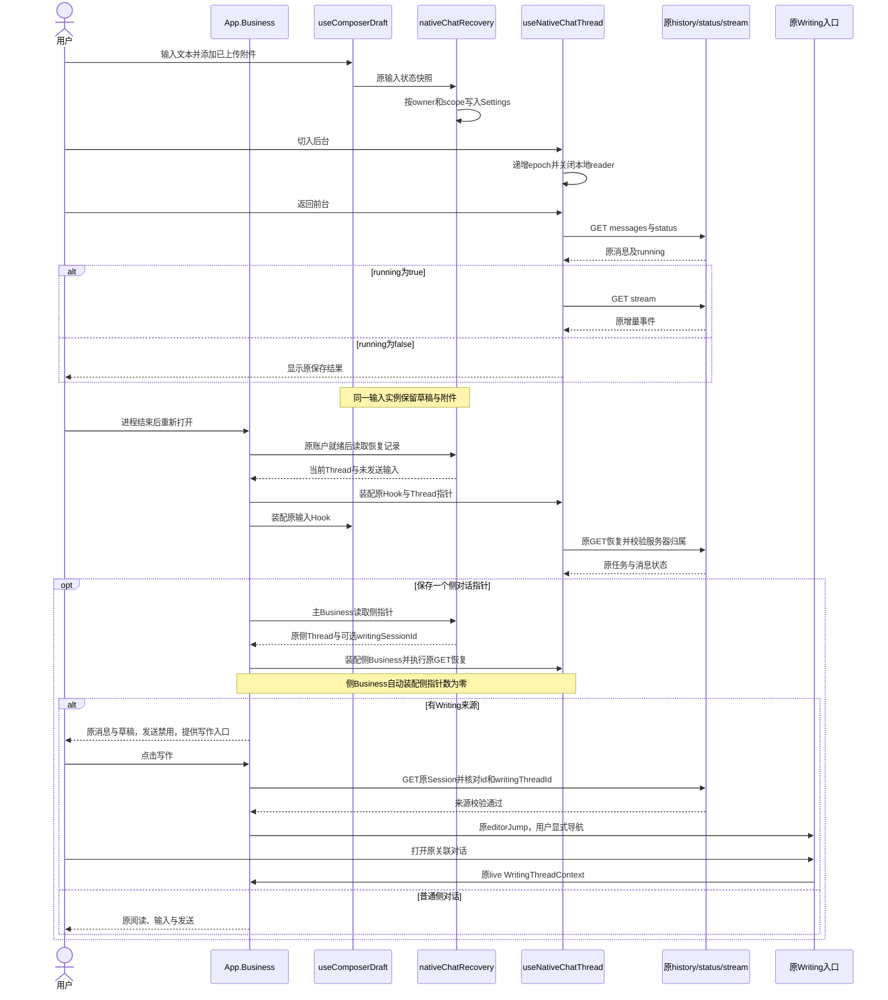
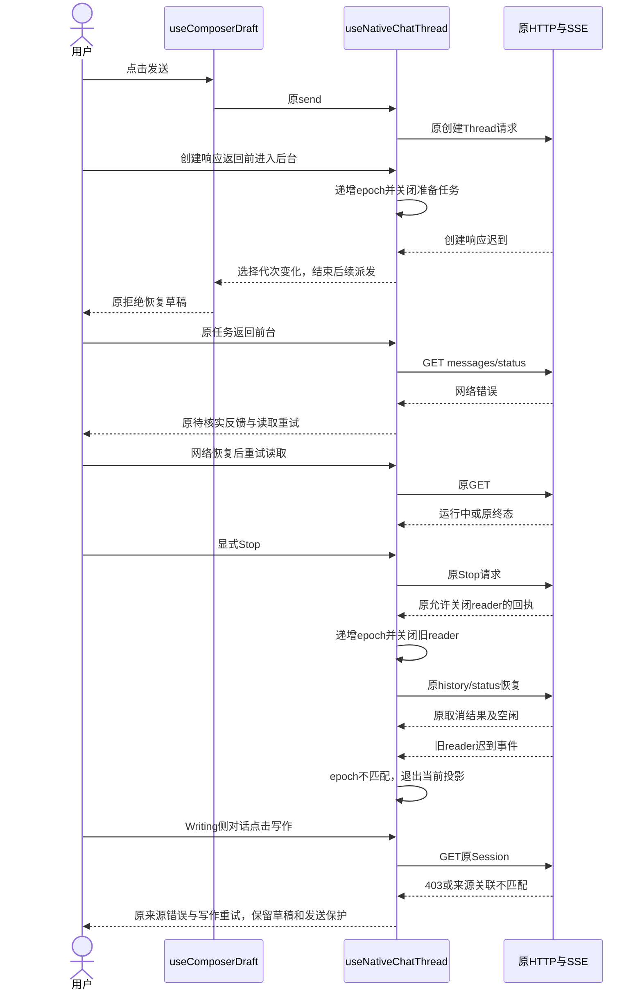
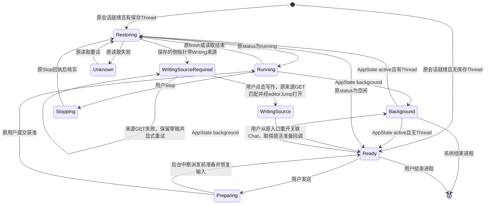

<!-- [Sync] 2026-11-03: 新增仅文档的后台适配设计，原实现目标继续暂停；文档检查获单独授权。 -->
<!-- [Input] APP-04反馈、当前iOS与Chat源码、Apple生命周期文档及2026-11-02验证暂停指令。 -->
<!-- [Output] 历史恢复候选、隔离旅程规格、暂停状态与现行专项方案入口。 -->
<!-- [Pos] APP-04独立执行记录；现行PRD、正式设计和目录合同由总控统一汇总。 -->
<!-- [Sync] 2026-11-02: 补主界面持有的侧对话指针及Writing来源显式重建；全部机械验证暂停。 -->

<!-- [Sync] 2026-11-03: 按用户要求整理现行专项方案，保留历史候选；代码及行为验收继续暂停。 -->

# APP-04 前后台与进程重开恢复

## 当前交付状态（2026-11-03）

用户本轮要求先将最新代码安装到iPhone供手动测试，再整理APP-04方案。现行[独立恢复方案](../design/multi-platform/mobile-recovery-interaction.md)已集中定义问题判断、代码事实、实例生命周期、三类业务图、最小工作项及验收矩阵。下方2026-11-02记录保留历史状态；当前APP-04代码修订及行为验收继续暂停。最新构建28包含工作树既有恢复候选，安装与普通启动回执归[总清单](app-experience-fixes-20261102.md)，恢复功能的通过资格保持待验证。本轮未恢复该任务目标，未新增业务实现或模型调用。

## 背景与问题

用户反馈：“看起来退出后台后进程会被杀死”。来源为[Notion问题页](https://app.notion.com/p/40b30b7547c380f7ac22f85fdd2dbdd0)，任务归属见[总清单](app-experience-fixes-20261102.md)。该反馈提供可见现象，进程退出原因需要对应时间的系统记录。

2026-11-02已创建目标：“APP-04：定位 App 切后台后的暂停、终止及恢复行为，沿原持久化和任务查询修复前台/进程重开恢复，保持草稿、会话、Thread、停止与无重复提交，完成完整自动化旅程。”目标未设置token预算；目标保持进行中。

首轮执行提示词已输出一次，范围包含现行合同、当前源码、iOS官方规则、原持久化/GET恢复、输入与停止语义、最小实现及分层验收。后续按已确认范围继续执行。

### 当前代码依据

| 对象 | 读取结果 | 本次处理 |
| --- | --- | --- |
| `BackendRuntimeManager` | 共享启动Promise，启动失败保留原错误 | 保留启动行为，仅增加输入恢复错误来源 |
| `SessionGate.native` | AppState active重新读取原会话；有会话时保留原业务组件 | APP-05所有，本任务只读 |
| `useNativeChatThread.native` | background关闭本地reader，active调用原history/status并按running接续GET stream；epoch拒绝旧读取 | 保留原恢复、Stop与队列协议，补进程重开选择恢复及创建前后台中断 |
| `useComposerDraft` | 统一持有Web/Native文本、附件和发送失败恢复；当前实例结束后状态释放 | 追加初始附件与原状态快照回调，继续复用同一Hook |
| `AIInputDock.native` | 原Tiptap与附件组件在栏目切换时保持；已上传文件有storageKey | 复用原状态，恢复文本及已上传引用，提示重新选择未完成上传 |
| `App.Business` | 主/侧Thread分别组合；当前Thread选择保存在React状态 | APP-01交接后接入owner/scope与初始Thread，移除重复初始读取effect |
| Writing | 原Writing会话及保存由原编辑器所有；Chat准备上下文后才派发 | 保留原保存与准备；background中断未完成准备后沿原拒绝恢复输入 |
| `EmbeddedDreamBackend`、`DreamPython`、`DreamNode` | App级实例与进程共存；启动结果缓存 | APP-03所有，本任务只读；日志与设备采证由总控集成 |

初始`git status --short`为空；执行过程中其他任务持续写入共享工作区。本任务按具体片段修订，保留其他修改，未切换分支、reset、stash、格式化或覆盖共享文件。

### iOS官方规则核对

2026-11-02读取Apple官方Markdown正文：

- [Managing your app’s life cycle](https://developer.apple.com/documentation/uikit/managing-your-app-s-life-cycle)：场景进入后台后可进入挂起，系统可回收后台场景资源；inactive包含暂时中断。
- [Extending your app’s background execution time](https://developer.apple.com/documentation/uikit/extending-your-app-s-background-execution-time)：进入后台的收尾时间有限，扩展后台时间须按对应API结束；本任务采用现有生命周期恢复。
- [Identifying high-memory use with jetsam event reports](https://developer.apple.com/documentation/xcode/identifying-high-memory-use-with-jetsam-event-reports)：内存压力终止由jetsam报告定位；报告与崩溃回溯有独立格式和用途。

`AppState`只提供应用可见性回调。HTTP断开、页面遮挡和一次`background`事件均缺少进程退出原因。当前源码与反馈支持恢复缺口修订；当前证据未确认本次用户遇到jetsam、崩溃或实际进程结束。

### 进程结束与本地任务边界

App进程终止时，嵌入式Python、Node及其本地执行同时结束。当前选择和输入恢复只重建客户端读取位置。模型任务的可恢复结果由原Thread/history/status及其运行实例返回；读取成功和客户端Ready分别代表读取结果与当前输入可用，任务完成证据归原保存消息及metadata。

本轮只读核对的原服务行为：

- `backend/routers/claude_agent.py`的`claude_agent_thread_status`先经`_admin_thread`校验账户归属。Thread存在且内存session缺失时返回`running=false,lifecycle=not_found`；现存session按原lifecycle返回运行状态。
- 同文件`claude_agent_thread_stream`只为当前running的实例订阅原EventBus；session缺失或当前非running返回409。
- `hydrateClaudeThreadSession`按history→status→空闲稳定读取顺序取数，仅将原status的`running===true`投影为运行中。原读取失败保留unknown和读取重试。
- `useNativeChatThread`在原查询非running且无未结束的Stop意图时结束本地恢复，保留已保存消息。user-only尾部保持原用户消息，代码不合成助手内容或completed/cancelled标记。

`native-chat-recovery.spec.ts`的页面reload规格重建JavaScript与Settings适配器，合成服务可显式返回running、已完成或not_found。running分支验证原查询回执存在运行实例时的GET接续；该fixture保留合成服务状态，实际iOS进程终止后的本地执行结果须经Simulator端侧后端复验。新增not_found规格验证user-only尾部、独立草稿和零自动重发；真实中断时最后一次消息写入、Gateway结算及原任务记录状态等待串行集成采证。本任务未更改后端任务所有权或新增终态写入。

## 目标与边界

本次交付范围为Chat的前台恢复与进程重开读取，保留原账户认证、Thread服务器归属校验、消息持久化、队列、工具确认、Stop和迟到事件处理。后台恢复事件只触发原GET；发送、队列写入与Stop继续由原用户操作发起。

采用现有iOS Settings保存当前账户的Thread选择、未发送输入和现有可恢复附件引用。读取原消息与状态后展示运行中、已完成或已取消结果。附件的临时文件句柄属于原上传实例，进程重开后尚未完成的上传提供重新选择提示。

验证范围按用户最新指令调整：luna-test-stage及其他机械验证全部暂停；本任务未启动runner，无中断进程。后续由总控在iOS Simulator串行构建、安装与XCUITest；本轮完成前提采用Simulator，真机性能与真实jetsam保留独立资格。

## 概念与规则

1. **账户边界**：恢复记录绑定已验证会话提供的公开ownerId。主Chat使用main作用域，侧Chat使用显式initialThreadId作用域。原session失效、账户切换和退出流程继续由SessionGate负责；其他账户读取不到原恢复内容。
   当前候选启动时恢复main的Thread及一个侧对话指针。侧指针只保存threadId和原writingSessionId；主Business装配原侧弹层，initialThreadId侧Business读取侧指针返回空，自动装配的层数保持一层。主/侧输入记录独立，Thread归属与状态仍由原Hook读取。
2. **状态来源**：Settings只保存Thread指针、草稿、工具选择和已上传附件元信息。任务running、终态、消息正文和工具确认均来自原HTTP/SSE。
3. **恢复读取**：首次挂载有Thread指针时调用`hydrateClaudeThreadSession`；running时接续原GET stream；空闲时展示原保存结果。失败沿现有unknown与读取重试处理，草稿及附件保留。
4. **后台处理**：background递增reader代次并关闭本地reader/准备任务；有Thread时进入原待核实状态。尚未取得Thread ID的准备或创建返回后退出派发，原输入卡按既有拒绝处理恢复草稿。
5. **轮询与迟到队列回执**：后台期间暂停原队列轮询；返回前台继续原读取。队列提交结果绑定原selectionEpoch，前后台替换reader保留同一选择的回执；切换Thread后旧回执退出当前输入队列与错误更新。已经发出的写入由原服务处理，客户端恢复期间持续核实结果。
6. **输入恢复**：原`useComposerDraft`拥有文本与文件状态，Settings适配器接收其快照。已上传文件保留id、名称、类型、大小、storageKey及已有workspace元信息；临时URI、文件字节、预览、控制器、Cookie、CSRF、Token和消息历史退出保存范围。
7. **显式导航**：New及选择另一Thread沿原输入实例重建，清除该作用域旧输入；旧输入写回回调在选择代次变化后失效。正常后台/前台保持同一输入实例。
8. **Stop**：原submission-owned Stop及回执判定保持。旧reader在允许关闭后退出当前投影；恢复状态由原history/status确认。进程重开后读取已取消结果，恢复操作不发送Stop。
9. **存储失败**：原启动诊断保留recovery来源的最近错误。JSON解析、schema校验、读取及写入失败仅登记固定错误类别，原JSON、输入正文和原始存储异常退出日志。存储异常退出恢复记录写入，原业务请求及鉴权继续由既有模块处理。Settings持久化落盘时机须由Simulator进程重开验收核实。
10. **侧对话来源**：普通侧对话恢复原阅读、输入与发送能力。Writing关联侧对话重开后恢复阅读与草稿，活编辑器准备回调通过原写作入口重新建立；此前草稿可编辑、发送禁用，原Stop条件保持，原`writingContextUnavailable`反馈提供“写作”入口。点击后只用原`GET /api/sessions/{id}`读取来源，核对返回id、editor_state.id及writingThreadId与原指针；成功后关闭所属侧弹层并发出已有editorJump，由原写作模块打开来源。用户从原写作入口重开关联Chat后，原活上下文负责保存与发送准备。来源失败保留同一受保护侧对话，用户可再次点击“写作”重试；替换来源或普通Chat降级退出恢复路径。
11. **侧指针退休**：关闭先完成原文档清理，当前侧实例和保存指针同时匹配时清除。主导航、主Thread选择、新Chat及侧内选择变化清除该指针；迟到关闭、来源GET或文档清理无法清除后续新指针或跳转到旧来源。侧内切换至其他Thread的输入记录在原Writing Thread重开时退出恢复，草稿保持对应Thread归属。

### 方案评审

复核现行[移动PRD](../prd/mobile-app/mobile-app.md)、[iOS交互设计](../design/multi-platform/mobile-ios-interaction.md)、[RN工程与恢复设计](../design/multi-platform/react-native-web-project-structure.md)及Writing/Chat实现后，核心缺口收敛为进程重开缺少当前选择与未发送输入记录，以及尚未取得Thread ID时后台回调提前返回。

| 方案 | 对应问题与依赖 | 结论 |
| --- | --- | --- |
| 仅追加AppState重读 | 已有恢复覆盖前台读取；进程结束后React状态释放 | 保留既有实现并补恢复记录 |
| 复用Settings、原输入Hook及原GET | 当前仓库已有同类iOS存储适配；任务与身份校验仍由原服务所有 | 采用 |
| 侧对话指针与Writing显式返回 | 原活准备回调依赖存活文档；已存来源可经原GET校验并用原editorJump打开 | 总控新增授权并接受；恢复阅读/草稿后由用户重建原来源上下文 |
| 扩展后台执行、增设持久任务或同步系统 | 引入新的执行和数据责任，需要额外产品需求 | 退出本次范围 |

修订保留现有页面结构、操作入口和状态反馈。新增提示只用于未完成上传后的重新选择操作。技术候选仍需机械验证与Simulator完整旅程。

### 待总控同步的页面骨架

桌面Web沿现行布局，本次原生修订的影响范围如下：

```text
桌面Web
┌───────────────────────────────────────────────────┐
│ 原顶部操作 / 当前Agent / 活动 / 文件 / 新对话         │
├───────────────────────────────────────────────────┤
│ 原历史入口     原消息阅读区（内部滚动）               │
│               原任务状态、工具反馈、停止入口          │
├───────────────────────────────────────────────────┤
│ 原输入卡：草稿 / 附件 / 工具选择 / 发送               │
└───────────────────────────────────────────────────┘
Web继续使用原输入状态；恢复持久化仅由Native适配器装配。

窄屏App
┌───────────────────────────────────┐
│ 当前Agent / 原顶部操作 / 新对话     │
├───────────────────────────────────┤
│ 原消息阅读区（内部滚动）            │
│ 原恢复中 / 读取失败及重试           │
│ 原保存结果 / 运行状态 / Stop        │
├───────────────────────────────────┤
│ 未完成上传：重新选择提示（按需）     │
│ 原附件卡片 / 草稿输入 / 发送        │
├───────────────────────────────────┤
│ Chat | Deck | 更多                │
└───────────────────────────────────┘
侧Chat沿原Modal呈现；恢复记录按其显式Thread区分。
Writing关联侧Chat重开：原失败反馈 / 写作入口 / 原消息阅读与可编辑草稿；发送禁用，原Stop条件保持。
点击写作后，原GET核实来源，再沿已有editorJump进入原Writing页面。
原登录弹窗与开发者窗口维持原展示关系。
```

### 正常业务时序



### 异常与恢复时序



### 状态转换



图中Background描述页面生命周期，WritingSourceRequired描述来源准备及发送可用性；任务running和Stop继续由原服务回执与原Hook处理。进程结束后的运行实例重新装配，继续读取既有Thread；记录中保留原消息及其终态。

## 实现交付物

| 文件 | 修订 |
| --- | --- |
| `frontend/app/_dream/components/chat/nativeChatRecovery.native.ts` | Settings小型适配器，owner/scope校验、原输入元信息投影、旧输入写回失效、单侧指针退休与原Writing来源GET校验 |
| `frontend/app/_dream/components/chat/useComposerDraft.ts` | 原Hook接收初始附件并向所属恢复适配器发出快照 |
| `frontend/app/_dream/components/chat/AIInputDock.native.tsx` | 原输入卡采用恢复记录；未完成上传提示重新选择；sendBlocked仅约束发送，草稿编辑和原Stop保持 |
| `frontend/app/_dream/components/chat/useNativeChatThread.native.ts` | 初次GET恢复、选择指针更新、后台派发前中断、队列轮询暂停及迟到提交回执选择校验 |
| `frontend/src/runtime/BackendRuntimeManager.ts` | 原诊断增加recovery错误来源 |
| `frontend/app/_dream/i18n.ts` | 两种语言的未完成上传提示，保留其他任务文案 |
| `frontend/src/App.tsx` | APP-01交接后接入owner/scope与显式初始Thread；新增授权后主Business装配侧指针、保持Writing发送保护及显式原来源返回，移除重复初始读取effect；原Alert/deleteRequest/deleteThread保持 |
| `frontend/e2e/native-chat-recovery.spec.ts` | 新增完整隔离旅程规格，尚未执行 |
| `frontend/e2e/native-app-side-recovery.spec.ts` | 使用实际App、Chat Hook及原输入卡，补普通侧恢复、Writing保护/显式返回与来源失败重试的组合规格，尚未执行 |
| `frontend/e2e/native-chat-session.spec.ts` | 补充迟到队列成功/失败回执的选择归属、前后台reader替换后保留回执及零重发规格，尚未执行 |
| `frontend/e2e/native/chat-recovery-platform-web-boundary.ts` | 复用现有Settings/AppState测试适配器，显式iOS能力 |

## 验证状态与证据

| 类型 | 实际状态 | 证据或退出码 |
| --- | --- | --- |
| 源码与合同读取 | 已完成 | 初始`git status --short`退出0、输出为空；`rg`、`sed`与文件读取获得上表代码依据 |
| Apple官方正文读取 | 已完成 | 三个官方`.md`入口的`curl -fsSL`读取退出0，取得生命周期、后台时间与jetsam正文 |
| 代码与规格生成 | 已写入候选 | 使用定向patch；候选执行资格待验证 |
| luna_test_runner | 尚未启动，用户已暂停 | 无运行cell、runner或需中止的检查 |
| 类型、规格、lint、构建及文档验证 | 待执行 | 用户暂停后未运行，退出码不适用；主Agent未替代执行 |
| Simulator构建/安装/XCUITest | 待总控串行执行 | 本任务未构建、签名、安装或控制设备 |
| 正常账户/真实模型 | 待总控安排 | 本任务未调用真实账户或模型 |
| 真机性能及jetsam | 未验证 | 本轮Simulator条件覆盖功能恢复，真机因果证据单列 |
| 发布 | 未执行 | 本任务退出发布范围 |

### 待恢复后的隔离检查

执行时复用已安装Chrome与依赖，由获准的验证阶段串行安排；以下命令为计划，当前无执行回执。

```sh
cd /Users/dmeck/project/ink-dream-memory/frontend
pnpm exec playwright test e2e/native-chat-recovery.spec.ts e2e/native-app-side-recovery.spec.ts e2e/native-chat-session.spec.ts e2e/native-session-gate.spec.ts --workers=1 --reporter=line
pnpm native:typecheck
```

Playwright实际执行入口须设置本机Chrome channel，保留单次启动前置结果。测试使用随机端口、`/tmp/ink-app04-recovery-20261102/vite`缓存、浏览器独立上下文及公开合成DTO；不连接正常服务、数据库、账户或模型。server归本轮afterAll关闭，清理范围限具名缓存与本轮产物。Web类型、Markdown清单/引用路径及Mermaid语法由总控汇总执行，当前均待检查。

### 完整旅程与相邻回归矩阵

| 旅程 | 自动化规格与断言 | Simulator采证 | 状态 |
| --- | --- | --- | --- |
| 运行中切后台/前台 | 原reader释放、原GET恢复、用户POST一次、Stop零次 | 原输出、AppState、请求数量、同Thread | 规格已写，待执行 |
| 网络断开/恢复 | 原unknown、稿/附件保持、重试只读、恢复原终态 | 原失败反馈、恢复入口与持久结果 | 规格已写，待执行 |
| 进程重开：已完成/运行实例缺失 | 保留Thread、草稿/引用；按原status显示保存结果或user-only尾部；业务POST一次 | 实际终止/重开PID、原端侧后端及Thread/消息；核实原结算与任务记录 | 规格已写，待执行 |
| 页面重开：原查询仍有运行实例 | fixture返回running后仅接续GET stream；业务POST一次 | 同进程页面重建与原运行实例归属 | 规格已写，待执行；退出跨进程续跑声明 |
| 创建响应/上下文准备期间后台 | 原拒绝恢复草稿、后续Agent POST零次、准备取消 | 点击发送后后台与返回，原稿、原Writing保存 | 规格已写，待执行 |
| Stop及迟到事件 | 原Stop一次、独立核实空闲、旧reader无法改终态、重开取消消息 | 实际Stop、原结算/保存、Send恢复 | 规格已写，待执行 |
| 账户失效/切换 | 复用原SessionGate用例；owner隔离、旧写回失效 | 401后正常登录、原页面/草稿归属 | 现有及新规格待执行 |
| 已上传/未完成上传附件 | 引用恢复、临时URI退出记录、未完成上传显式重新选择 | 原附件卡、手动发送原元信息、失败恢复 | 规格已写，待执行 |
| 队列/工具确认/新对话 | 原native-chat-session相邻回归，main/侧scope分离 | 原队列、侧对话、manual/auto与取消 | 新scope补充及原规格待执行 |
| 普通侧Chat进程重开 | 实际App主/侧组合、原Hook与输入卡恢复，发送仍绑定原侧Thread，关闭后重开不再出现旧侧弹层 | 普通侧Chat结束App后重开，核对原Thread、输入和用户显式发送 | 组合规格已写，待执行 |
| Writing侧Chat进程重开 | 恢复原阅读和草稿；发送保护；显式点击写作后GET核对原来源并发出原editorJump；用户从原入口重开后取得活准备回调 | Writing侧Chat结束App后重开，核对草稿、禁发、原来源打开、原关联发送一次 | 最小替代已获总控接受并实现，组合规格待执行 |
| Writing来源失效/迟到 | id、editor_state.id、writingThreadId和权限核对；失败保留同一侧指针/输入及重试；旧关闭不清除替代指针 | 来源失败/恢复、关闭/替换期间迟到GET和文档清理 | 适配器及组合规格已写，待执行 |
| Writing与Reflections | 原准备与保存、当前任务读回、返回Chat输入保持 | 与APP-02合并完成原导航和报告回读 | 跨任务验收待执行 |

### Simulator采证方案

1. 总控按构建内存与恢复手册核对目标、入口、容量和可恢复制品后单次构建，保存原制品及日志；本任务不启动Mac Dream替代端侧后端。
2. 记录Simulator型号、系统版本、App构建号、PID、启动时间及已安装制品路径。沿原账户进入已有Thread，保存原history/status与页面起点。
3. 发起限定的普通用户任务，运行中切后台、等待、返回前台。记录同PID、AppState和原请求序列；返回后的原状态与输入保留分别取证。
4. 使用明确隔离的传输故障核对失败与恢复；正常账户流程只执行普通用户操作。恢复前后对比原用户消息ID及请求次数，确认未新增业务POST。
5. 分别在运行中、已完成和Stop后终止本轮Simulator App进程，再正常重开。记录新PID、原会话、当前Thread、原结果与草稿/已上传附件；原Thread必须经服务器归属检查。
6. 保留Stop完成前后的原回执、消息终态、输入操作及迟到事件证据；原运行记录和日志保留供用户复核。
7. 页面被登录弹窗或系统窗口遮挡时记录inactive/active及相同PID；系统挂起恢复记录相同PID和停顿区间。实际进程结束记录PID变化；崩溃关联同时间诊断回溯；jetsam关联同时间的jetsam报告及进程条目。Simulator结果按模拟器条件汇报。

## 待总控汇总与剩余依赖

- 共享App接线在APP-01交接及总控授权后完成；后续人工审阅发现侧Chat重开缺口，总控追加授权原sideChat片段和adapter并接受Writing显式来源重建方案。当前源码包含单侧指针恢复与原来源返回，原Alert/deleteRequest/deleteThread及其他任务品牌修订保留。
- APP-05已在原诊断错误标签加入recovery来源“输入恢复”。
- PRD同步概念规则与两端骨架；正式交互稿同步正常/恢复时序、状态与验收矩阵。
- `.folder.md`清单登记新增adapter、规格、测试适配器及本执行记录；功能源码头已由本任务维护。Markdown清单、引用与Mermaid语法等待验证恢复后检查。
- 暂停的机械验证与Simulator集成完成前，保留“实现候选、尚未验收”状态，目标继续进行中。
- Notion共享页面由总控统一同步，本任务未写入Notion或向其他用户发送消息。

## 2026-11-03 后台执行适配器设计

### 范围与目标状态

本轮用户授权仅推进“如何解决当前后台执行问题”的方案设计，并授权luna-test-stage执行文档清单、引用/行号、图示一致性、Mermaid和定向`git diff --check`。原APP-04完整实现目标保持`paused`；代码修订、构建、手机/Simulator操作、产品服务、数据库与真实模型验收继续暂停。

本轮工作区为`ios-store`，开始时已有大量用户与其他任务改动。实际写入范围为以下六份文档：

1. `docs/design/multi-platform/mobile-recovery-interaction.md`
2. `docs/design/multi-platform/.folder.md`
3. `docs/design/multi-platform/README.md`
4. `docs/prd/mobile-app/mobile-app.md`的APP-04段落及文件头
5. `docs/prd/mobile-app/.folder.md`
6. 本执行记录

### 设计交付与评审

现行正文归[后台执行与恢复方案](../design/multi-platform/mobile-recovery-interaction.md)。原三幅恢复图保留，新增正常/异常后台执行时序与许可状态图。正文只定义当前问题的解决步骤、契约、所有权及验收条件；执行记录和阶段状态归本节。

选择原宿主内的小型`BackgroundWorkAdapter`，两个实现均为建议、未实现：有限实现对接`beginBackgroundTask/endBackgroundTask`；持续实现对接iOS26的`BGContinuedProcessingTask`。工作开始前申请，原业务入口执行一次，系统handler附着原生产者。采用API availability和真实工作能力选择，保持原最低系统兼容及原Python/Node/Claude路径。

当前Chat事件缺少可直接对应全程任务的真实进度；持续实现还需要精确生产者观察、真实终态/保存回执和有界收尾。方案保留普通Chat及旧版iOS的有限时间路径，适用的可测工作经验证后才能采用持续实现。原Factory已将接受后的生产者保存为独立bg_task，subscriber退出只unsubscribe；生产者建立前的懒启动POST读取与原生取消链仍需单项验收。

expiration无原因参数，用户系统界面取消与系统收回时间均可进入该回调。设计只先登记许可失效，再核对原进程、turn与生产者请求原执行者受控收尾；原用户Stop及真实业务终态保持原来源。原`stop_thread(thread_id)`需要一处预期turn/生产者核对的内部窄适配；方案未创建新HTTP、队列、数据库或任务状态机。进程终止后原本地执行结束，重开恢复只读与草稿，业务自动重发为零。

### 官方资料与代码核对证据

2026-11-03经Apple官方Markdown与JSON再次读取。`python3`读取脚本退出0，原始资料保存在`/tmp/app04-background-design-20261103/`。`bgcontinuedprocessingtask.json`的platforms实际返回iOS/iPadOS/Mac Catalyst均`introducedAt=26.0`。官方长期任务、expiration、completion、queue、有限后台时间和playback正文均读取成功；App Review 2.5.4由官方网页核对。资料链接直接保留在现行方案。

代码核对使用只读`rg`/`sed`，定位原公开POST的懒启动、Factory的独立生产者及subscriber释放、原生ASGI HTTP取消、原Stop和进度事件处理。上述读取提供设计依据，退出码0的读取记录均不计为功能测试。当前工作源文件保持原用户及其他任务归属；本轮没有实现后台适配。

### 文档检查

文档检查由具名luna_test_runner执行，范围限本轮六份文档及现行方案的六幅Mermaid图，使用本机Chrome离线解析。该检查未启动产品服务、原生构建、Simulator、数据库或模型，未修改产品源码，结果只用于文档资格。

| 阶段与实际命令 | 退出码 | 关键结果 |
| --- | --- | --- |
| r1结构脚本 | 1 | 首次为检查脚本语法前置错误；修复后43项中41通过，2个失败来自导航中HEAD已存在的历史锚点 |
| r1 `node --input-type=module`离线解析，完整heredoc保留于下述command-receipt | 0 | 本机Chrome仅启动一次，6/6 Mermaid通过：4幅sequenceDiagram及2幅stateDiagram-v2；自有Chrome关闭 |
| r2 `python3 /tmp/app04-background-design-20261103/doc-checks-r2/check-docs.py` | 0 | 自有脚本定位字符串前置错误修复后重跑，43/43断言通过；111个链接中88个本地引用、5处行号、31处标题锚点均有效 |
| r2定向`git diff --check`，完整命令如下 | 0 | 本轮六份文档的Git差异无空白错误；未跟踪文件由独立检查覆盖 |
| r2脚本内的独立空白检查 | 0 | 六份文件含未跟踪文档，尾随空白及CRLF为0 |

定向Git命令的工作目录为仓库根：

```sh
git diff --check -- docs/design/multi-platform/mobile-recovery-interaction.md docs/design/multi-platform/.folder.md docs/design/multi-platform/README.md docs/prd/mobile-app/mobile-app.md docs/prd/mobile-app/.folder.md docs/exec/app-experience-foreground-recovery-20261102.md
```

两个历史失败已通过原归档的对应标题核对，只把`README.md`中的旧手册锚点改指向`docs/exec/history/ios-release-documents-before-reader-revision-20261102.md`，历史正文保留。r1失败产物未覆盖；r2原断言保留，图源码未改，未重复启动Chrome或解析Mermaid。

原始回执目录：`/tmp/app04-background-design-20261103/doc-checks-r1/`和`doc-checks-r2/`。`doc-checks-r2/command-receipt.txt`保留实际完整结构、Git及Mermaid命令；`doc-structure-report.json`与`independent-whitespace-report.json`为r2通过回执，r1的`mermaid-parse-report.json`为六图通过回执。最终追加此执行结果后仅复查文档结构和空白，图示沿上述已取得结果。

本轮交付为方案设计与文档验证。后台适配接口、真实进度接入、受控收尾、两类系统行为及完整业务验收均未执行；原APP-04完整目标保持`paused`。
