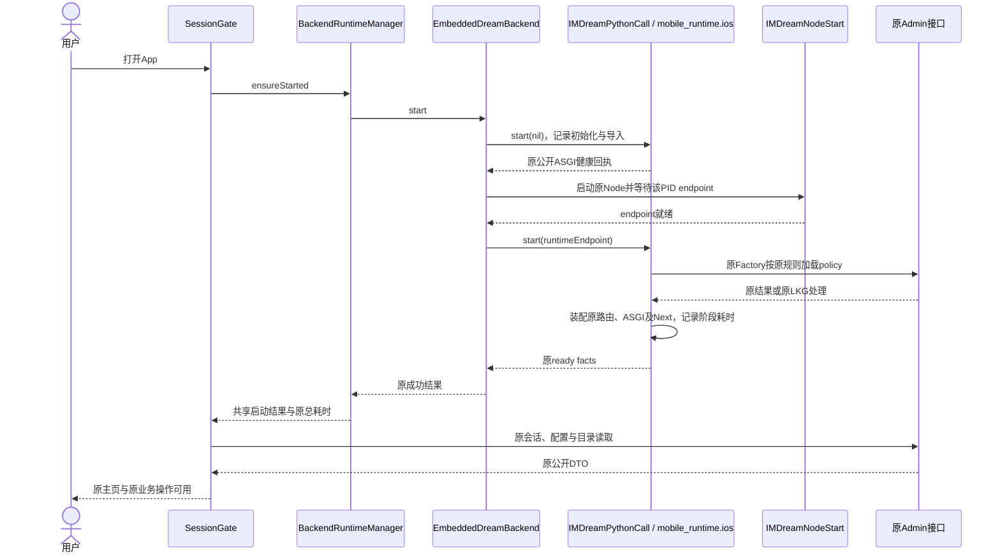
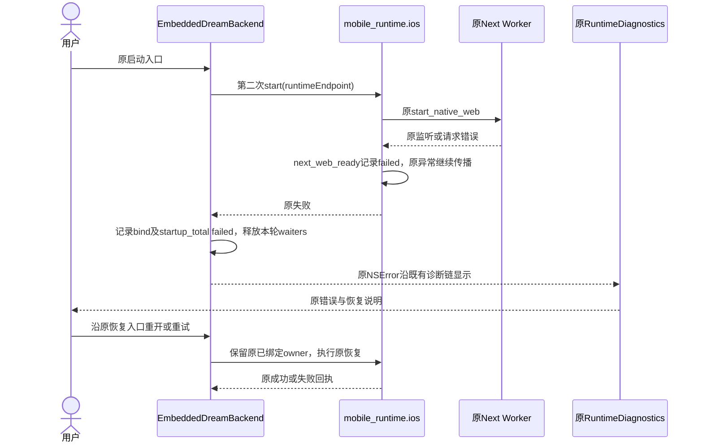
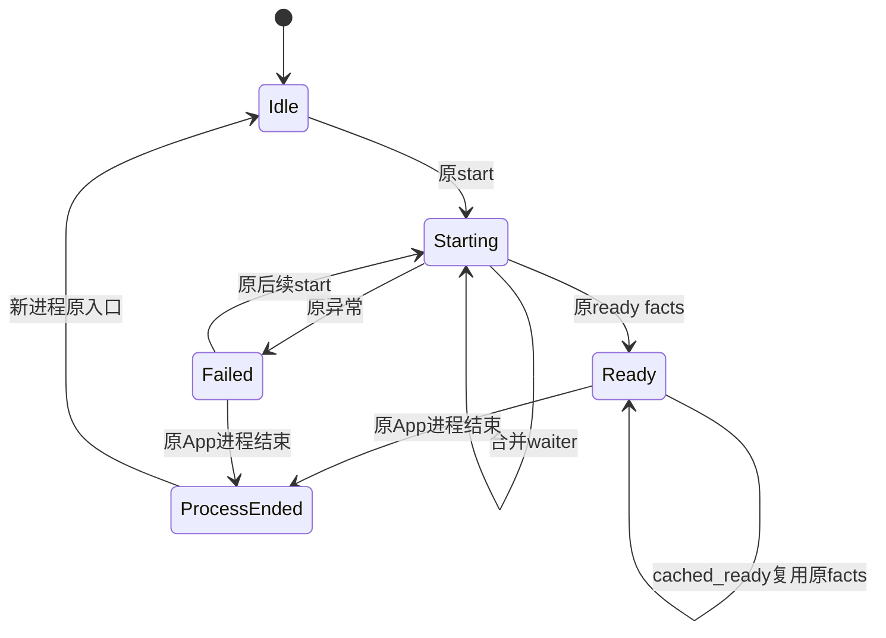

<!-- [Input] APP-03授权、现行启动合同、已有Simulator及iPhone请求回执、当前端侧源码。 -->
<!-- [Output] 性能问题判断、分段测量修订、文件交接、分项验收与完成审计。 -->
<!-- [Pos] APP-03独立执行记录；共享PRD、正式iOS设计、目录合同与Notion由总控同步。 -->
<!-- [Sync] 2026-11-02: 源码计时与离线采证工具已修订；按用户要求暂停luna-test-stage，Simulator集成待执行。 -->
<!-- [Sync] 2026-11-02: 总控确认无本轮集成数据；补齐逐阶段未测矩阵与源码评审收束，候选交接后等待串行集成。 -->
<!-- [Sync] 2026-11-02: 验证暂停与总控集成依赖连续多轮保持，目标标记blocked；源码候选与原完成条件保留。 -->
<!-- [Sync] 2026-11-03: 分析总控交付的单次Simulator启动样本；Factory及原生Admin等待占主要区间，保留单样本和请求归属边界，无性能代码修订。 -->
<!-- [Sync] 2026-11-03: 复核三候选启动、23项公开合同与5项真实账户UI回执；当前Simulator定位目标通过完成审计，严格同制品基准与物理设备资格单列。 -->
<!-- [Sync] 2026-11-03: update_goal已返回complete，Simulator性能定位目标完成；原业务请求故障与其他任务状态分别保留。 -->

# APP-03 Python启动性能定位

## 当前状态与授权

任务聊天：`01a19cd8-ece6-7d13-9906-452c714a4f37`。总控聊天：`01a169a7-d50c-7621-abae-73d8692f2bde`。任务归属见[总清单](app-experience-fixes-20261102.md)。原反馈：“为什么iphone的cpyhon会损失性能这么多”。

已调用`create_goal`，目标为“量化iPhone Dream Python相关阶段耗时，定位计算、初始化或Admin网络等待的具体瓶颈，实施有测量依据的最小修复并验证原业务与启动兼容”，无token预算。2026-11-02因验证暂停及总控集成依赖，`update_goal(status="blocked")`返回blocked。2026-11-03总控交付三候选启动、合同及真实账户UI证据，明确当前完成范围为Simulator性能定位与有证据才优化；物理iPhone和严格同制品基准列为后续资格。文末完成审计通过后，`update_goal(status="complete")`已返回complete，目标记账活动用时763秒。

用户后续将本轮集成验收目标调整为iOS Simulator，并要求暂时关闭luna-test-stage。收到调整时尚未派发runner，本轮已启动检查0、已中止检查0、已执行自动化0；后续未由主Agent或其他模型代跑。该暂停限制验证阶段，源码定位、设计和授权修订继续。物理iPhone、真实jetsam、真实模型及发布均未执行。

最新执行范围：仅分析总控已交付的APP-03三候选启动和验收工件，更新本记录及目标状态；本任务本次无App启动/停止、构建、测试、测量脚本重跑或性能业务代码修改。APP-04前后台验证继续暂停。总控回顾真实模型旅程由对应任务记录。

## 背景与问题

现行依据为[启动PRD](../prd/mobile-app/mobile-startup.md)、[iOS交互设计](../design/multi-platform/mobile-ios-interaction.md)、[既有启动评审](mobile-startup-design-review-20261101.md)及端侧运行库源码。启动PRD的性能专项范围由本次APP-03单独承接，开发者页面继续既有状态与总耗时展示。

| 已有证据 | 数值与条件 | 可支持的判断 | 缺口 |
| --- | --- | --- | --- |
| `/tmp/ink-startup-simulator-20261101/ui-receipt.json`的`successful_start_elapsed_ms` | Simulator一次启动11,115ms，原Native/运行资源与当轮普通Hermes | 存在原运行库端到端启动样本 | 无解释器、模块、Node和网络分项 |
| `/tmp/ink-startup-error-log-20261101/ui-receipt.json`的`elapsed_ms` | Simulator失败35,854ms，原错误为`EADDRINUSE ::1:5173` | 该样本包含监听冲突及失败等待 | 无CPU计算耗时；退出计算性能比较 |
| `frontend/ios/build/iphone-503-20261031/background-b20-completed.json`的`reads` | 历史iPhone构建20：options4,032ms、session5,384ms、system-config4,054ms、models6,663ms、threads8,962ms，均HTTP200 | 单次公开业务读取存在数秒延迟 | 每项包含原BFF、认证、Admin和本地处理，网络与计算贡献待分解 |

这些历史样本来自不同制品、目标和操作；本轮仅作为发现证据。测量结果未形成CPython相对桌面计算性能损失比例，未形成当前Simulator基线或优化前后对照。

源码调用链：`EmbeddedDreamBackend.start`合并进程级启动；第一次`IMDreamPythonCall(start, nil)`初始化隔离解释器、导入`mobile_runtime.ios`并建立公开ASGI；`IMDreamNodeStart`启动同进程Node；等待该PID endpoint后再次调用Python `start(payload)`绑定原Factory、Admin认证、业务路由和Next。`IOSFactoryOwner`的构造包含原resource policy读取，耗时可能包含Admin请求。用户可操作时点还依赖原SessionGate会话、配置和目录读取。

## 目标与边界

本轮交付可重复的端侧分段采证能力、已有证据的准确边界、待执行检查和Simulator完整旅程。只有实际采样证实具体瓶颈后才选择性能处理；当前性能优化值未宣称。

Python/Node顺序、解释器配置、GIL释放、启动Promise、原成功/失败回执、业务认证、Cookie、权限、Thread/保存/停止、资源策略和依赖保持原合同。无页面变更、无新增数据库、无Mac业务后端、无解释器替换或批量lazy-import。`BackendRuntimeManager.ts`、`SessionGate.native.tsx`和`App.tsx`在本任务中只读。

## 方案比较与评审

| 方案 | 依据与影响 | 决定 |
| --- | --- | --- |
| 沿用现有总耗时 | 可复用现行控制页，阶段归因信息缺失 | 保留作为端到端参照 |
| 在原启动边界补固定阶段计时 | 可区分初始化、导入、装配和监听等待，复用原调用入口 | 采用；只写现有console |
| 提前并行启动Node、移动Factory或批量延迟导入 | 改变已有启动顺序与所有权，当前缺少瓶颈贡献测量 | 等待证据后逐项判断 |

源码评审结论：测量范围对应现有启动阶段，无新页面、确认、业务状态或跨服务控制。异常继续原样传播；Python日志写入失败被局部隔离。`processCpuMs`记录整个App进程的CPU增量，包含其他并发线程；阶段的低CPU占比仍可能包含锁、调度或磁盘等待，Admin归因须结合原请求记录。阶段互相包含，禁止相加得到启动总耗时。

## 概念与规则

固定前缀`DREAM_STARTUP`后的JSON仅含`layer`、`phase`、`outcome`、`elapsedMs`、可选`processCpuMs`、`timestampMs`、`pid`及Native `attempt`。时间间隔使用原生systemUptime或Python单调clock，时间戳用于关联同一进程日志。记录退出时间为`timestampMs`，区间起点可按`timestampMs - elapsedMs`估算，跨层关联以同一PID、阶段顺序和Native attempt共同核对。

| 层与阶段 | 覆盖范围 | 解释 |
| --- | --- | --- |
| native `queue_wait` | 首个启动请求进入串行队列前的等待 | 独立于后续`startup_total` |
| native `python_public_bootstrap` | 第一次Python start整体 | 包含解释器、模块及公开ASGI |
| cpython `interpreter_initialize` | `IMInitialize` | 隔离CPython配置与初始化，仅实际初始化时出现 |
| cpython `gil_acquire`、`entry_module_import` | 两次start各自的GIL获取和入口模块导入 | 第二次导入通常命中原Python模块缓存，实际数值待采样 |
| cpython `public_bootstrap_entry`、`runtime_bind_entry` | Python函数查找、调用、JSON回包转换与引用释放 | 包含内部Python阶段 |
| cpython `admin_http_wait` | 任一Python start调用活动期间，原`_dream_native.admin_http`进入原生HTTP至回到Python的区间 | 包含原生队列、网络、回调和重新获得GIL；`ok`只表示收到原生JSON回执，HTTP成功、失败和状态继续由原HTTPX适配器处理 |
| python `public_app_initialize`、`public_health_read` | 原公开ASGI初始化与原健康读取 | 第一次和第二次start均执行原health读取 |
| native `node_host_launch`、`node_endpoint_wait` | Node线程派发、该进程endpoint文件就绪等待 | Node内部准备归此区间，下一步可按测量继续细分 |
| python `node_status_read` | 私有endpoint原状态读取 | 保留PID及原协议校验 |
| python `plugin_prepare`、`notion_prepare` | 原固定制品准备及模块导入 | 保留原摘要、路径和权限校验 |
| python `admin_auth_prepare` | 原AdminRequestAuth/MCP装配 | 保留原认证及异常清理 |
| python `factory_prepare` | 原Factory导入、构造与绑定 | 包含原policy加载，须关联实际Admin请求 |
| python `business_routes_prepare` | 原业务模块加载、路由挂载、confirmation worker绑定及Factory start | 原路由和后台worker规则保持 |
| python `asgi_listener_start`、`next_web_ready` | 原ASGI监听及Next Worker/page200校验 | 同一原平台流程，原错误保留 |
| native `python_runtime_bind`、`startup_total` | 第二次Python调用与本次完整运行库启动 | 包含回调与队列调度，主页可操作时间另采 |
| native `coalesced_waiter`、`cached_ready` | 合并调用或已有ready事实复用 | 缓存复用和新进程启动分别记账 |

日志在阶段退出时写出；中途进程终止可能产生部分样本。`startup_total outcome=ok`仅表示原运行库返回成功，原会话、配置、目录及主页可操作需独立检查。原会话/配置读取继续通过现有请求阶段与公开DTO采证。`IOS_ADMIN_HTTP`现行实现对部分失败才输出缓存的阶段日志；成功请求缺少该日志时，归因保留“未单独观测”，不得补算网络耗时。

2026-11-02续核发现：Python `ios_admin_http.py`向原生发送的payload未包含traceId，原Native observe在缺少该字段时直接返回；上述Factory区间因此缺少Python原生传输等待证据。已在`DreamPython.m`原`IMAdminHTTP`边界增加`admin_http_wait`，使用原子计数跨启动调用线程与ASGI线程识别启动活动区间。计时不修改payload、HTTP状态、超时、重试或响应解析。并发后台Python请求若与start区间重叠，其原生等待也会记录；本轮仅将该记录与同PID的启动阶段按时间区间关联，精确请求归属保留待采证。新记录定位原生传输边界等待，DNS、连接、服务端处理及主队列调度贡献仍需原请求阶段证据。

应用进程重开记为新进程启动；同进程共享ready或前后台往返记为暖路径。首次安装、重装后首开和普通重开分别标注。Simulator记录主机CPU与调度条件，后续数据禁止直接投影为iPhone计算性能或jetsam行为。

## 正常业务与状态图（供总控汇入正式设计）

图中为原启动状态与本次观测边界；图示、源码评审和文档修订均未替代运行验收。本次无页面或弹窗修订，桌面和窄屏继续[现行启动PRD骨架](../prd/mobile-app/mobile-startup.md#页面设计)。

## 修改范围与交接

| 文件 | 本任务修订 | 交接状态 |
| --- | --- | --- |
| `frontend/ios/InkMemory/EmbeddedDreamBackend.swift` | 原队列内计时、attempt、合并/缓存记录，沿同一finishStartup返回 | 源码计时修订已完成，APP-04可在此基线上继续生命周期修订；本任务后续改动须重新协调 |
| `frontend/ios/InkMemory/DreamPython.m` | 启动调用的解释器/GIL/import/entry墙钟与进程CPU计时，以及启动活动期间原生Admin传输等待 | 源码修订已完成，原生编译待总控 |
| `backend/mobile_runtime/ios.py` | 原启动操作包裹固定阶段测量 | 源码修订已完成，原异常和DTO保持，自动化待执行 |
| `frontend/e2e/ios/summarize_startup.py` | 读取显式console文件并输出带目标条件的阶段数据 | 工具已编写，执行待恢复验证阶段 |
| `frontend/e2e/ios/test_startup_measurement.py` | 生产函数体注入clock/owner的定向合同及离线读取合同 | 已编写，未执行；无真实配置导入、服务启动或账户操作 |

`DreamNode.m`已评审，Node启动顺序和参数保持；当前Native两段足以先界定Node准备区间，无新增Node源码修订。其他任务的App、回顾、删除等未提交改动保留，未进行reset、stash、切换分支或整体格式化。

总控待同步目录：`frontend/ios/.folder.md`补充两处原生启动计时；`backend/mobile_runtime/.folder.md`补充`ios.py`固定阶段日志；`frontend/e2e/ios/.folder.md`登记两份APP-03采证/合同脚本；`docs/exec/.folder.md`登记本执行记录。共享PRD无需新增性能页；正式iOS设计可引用上述阶段规则与两张时序图，保留既有历史图。Notion写入由总控统一执行。

## 检查计划与暂停回执

已执行的只读定位命令包括`git status --short`、指定三份启动源码及现行文档的`cat/sed/rg`、`git diff -- frontend/ios/InkMemory/EmbeddedDreamBackend.swift frontend/ios/InkMemory/DreamPython.m backend/mobile_runtime/ios.py`，相应成功命令退出0。早期路径探索含不存在的Swift管理器路径与zsh空glob，退出1/2；后续已定位实际`frontend/src/runtime/BackendRuntimeManager.ts`，相关只读核对完成。以上回执仅支持源码定位与人工差异评审。

下列命令和检查全部待执行，无退出码；必须在用户恢复验证阶段后按有效路由执行。当前未派发`luna_test_runner`，本任务自有运行进程、端口、数据库、模拟器和待清理资源均为0。

| 待执行项 | 具体入口与断言 | 证据范围 |
| --- | --- | --- |
| 分段计时合同 | 根目录`python3 -m unittest discover -s frontend/e2e/ios -p test_startup_measurement.py -v` | 分离wall/CPU、成功/原异常、关闭stderr、两次start单loop、失败后重试、health守卫、原binding异常、部分/坏日志；执行生产函数体并注入测试owner |
| 相邻公开合同 | backend目录`.venv/bin/python -m pytest -q tests/test_mobile_web_startup_errors.py tests/test_mobile_runtime.py` | 原Next长错误、code回退、移动能力及协议拒绝 |
| 原生编译 | 总控既有Simulator构建入口，串行集成 | Swift、Objective-C及包内Python采用；追加核对原子计数在初始化失败/成功退出均释放，start期间Admin等待记录、普通请求无新增记录；本任务不启动原生构建 |
| 文档合同 | 总控既有Markdown清单、路径、Mermaid入口及本轮范围`git diff --check` | 新文件清单、引用路径、两张时序图与状态图；未执行 |
| 启动/失败恢复 | 下节Simulator步骤 | 主页可操作、正常会话/配置、失败与原恢复 |

## Simulator采证操作与完整旅程

以下步骤由总控串行执行；本记录不启动、安装或控制Simulator。

1. 核对当前源码、模拟器型号/iOS、App版本及制品receipt，确认计时源码和包内`mobile_runtime/ios.py`均已采用。记录Mac机型、宿主负载、Simulator状态及采样条件；本轮安装与重新构建分开登记。
2. 核对原Next配置端口的实际监听归属。若Simulator与现用Mac Web会使用同一端口，沿总控当次授权安排互斥与恢复，避免将`EADDRINUSE`纳入成功性能样本。保留原登录与API配置，禁止改用Mac Dream业务后端。
3. 普通新进程启动前开启该App的console采集，完整保留`DREAM_STARTUP`。沿原页面等待准备、会话、配置与目录完成，记录首次主页原输入/导航可操作时点。至少重复三个完整新进程样本，每次保留同一正常账户与已有数据，分别标注首次安装、普通重开和缓存条件。
4. 同一进程重复现有`ensureStarted`调用时核对ready缓存。JavaScript共享Promise命中时可以没有新增Native日志；直接Native消费者命中时应出现`cached_ready`，无第二条解释器初始化。通过原栏目切换与一次前后台往返核对已有Thread、草稿和会话，期间不自动发消息。
5. 通过原主页入口检查`/auth/session`、`/api/system-config`、原目录和已有Thread读取的状态及时间。请求日志仅保留路径类别、状态、traceId和阶段时间，账户ID、token、正文与Cookie退出本次性能报告。将运行库ready到首次可操作的差值单独记录，禁止计入解释器初始化。
6. 按现有异常入口核对启动失败原文与原恢复；受控网络延迟、监听冲突等故障注入只在总控明确隔离目标执行。记录failed阶段、原重试后结果和业务写入0。缺少失败采样条件时保留待验收，禁止篡改普通服务或权限。
7. 样本离线汇总入口：`python3 frontend/e2e/ios/summarize_startup.py <本轮console.log> --condition simulator --output <本轮startup-summary.json>`。退出0只表示日志可解析；另核对每个目标样本具有成功`startup_total`、原页面可操作和对应请求回执。该命令当前待执行。
8. 对同一条件下三个样本分别比较解释器初始化、入口导入、Node准备、Factory/路由装配、Next就绪和运行库ready后的会话/配置读取，登记中位数及范围。使用进程CPU与墙钟识别计算贡献和等待贡献，再按同一请求trace判断网络部分。异步嵌套阶段及重叠请求逐项展示，无累加。
9. 若测量确定具体瓶颈，按已授权范围补最小处理并使用同一制品条件复测。当前只交付测量源码；原业务恢复、已存历史、停止语义的集成回归由总控统一登记。真实模型新增写入和发布均需按其独立验收范围执行。

## 2026-11-02结论与剩余依赖（历史）

已有样本证明端到端启动和公开读取存在可见等待。当前证据缺少CPython计算、模块导入和上游等待的贡献分解，具体瓶颈保持待采样。固定分段计时、离线读数工具及定向合同源码已编写；无性能提升数值，无已通过自动化或Simulator验收声明。

后续依赖：用户恢复验证阶段、总控串行Simulator集成及原账户完整启动旅程、同条件可重复样本、已证实瓶颈的处理判断、共享目录/设计同步及最终文档检查。目标已标记blocked，完成状态等待这些必需交付。

## 2026-11-02候选交接收束（历史）

总控已确认本轮无集成测量数据。当前源码候选、测量方案、图示、检查入口和文件归属已交付；后续测量由恢复验证阶段后的总控串行集成执行。本任务本轮到此收束源码修订，后续源码变更按交接范围协调。未扫描其他任务寻找测量结果，未执行额外优化。

### 2026-11-02逐阶段实测状态

下表为本轮候选的全部测量空项；背景中的历史数值仅支持问题发现，禁止填入本轮样本、中位数、前后对照或性能提升。

| 阶段或旅程 | 本轮墙钟耗时 | 本轮进程CPU耗时 | 采证与剩余依赖 |
| --- | --- | --- | --- |
| CPython初始化、GIL与入口模块加载 | 缺失，未测 | 缺失，未测 | 采用当前Native候选后采集对应`cpython`阶段 |
| 公开ASGI初始化与健康读取 | 缺失，未测 | 缺失，未测 | 同制品冷启动console与原health回执 |
| Node派发及endpoint就绪 | 缺失，未测 | 未设置单独CPU字段 | Native两阶段日志；全进程计算归属需结合相邻记录 |
| 插件、Notion、Admin认证、Factory和业务路由装配 | 缺失，未测 | 缺失，未测 | 采用当前包内Python并采集分项阶段 |
| 启动期间Python原生Admin传输等待 | 缺失，未测 | 缺失，未测 | `admin_http_wait`；请求与调度细分继续依赖原请求证据 |
| ASGI监听及Next页面就绪 | 缺失，未测 | 缺失，未测 | 原私有状态、原页面HTTP结果及两个Python阶段 |
| 运行库整体冷启动与同进程暖路径 | 缺失，未测 | 整体未设置单独CPU字段 | `startup_total`、共享Promise与缓存记录；冷/暖分别采样 |
| 原会话、配置、目录、已有Thread与主页可操作时点 | 缺失，未测 | 未设置单独CPU字段 | 原公开入口的完整Simulator旅程和实际请求记录 |
| 失败反馈、原恢复及相邻保存/停止兼容 | 缺失，未测 | 未设置单独CPU字段 | 原异常样本、原状态/持久化及Simulator回归 |
| 同条件重复样本与最小修复前后对照 | 缺失，未测 | 缺失，未测 | 完整基线、证实瓶颈、处理选择与相同条件复测 |

### 已完成的源码评审

- `EmbeddedDreamBackend`沿原单例、startupQueue、waiters和readyFacts处理启动，计时未增加业务返回字段；原完成回调仍派发主队列。缓存与合并调用保持原结果。
- `IMDreamPythonCall`保留原解释器配置、GIL处理、模块/函数调用、引用释放、JSON回包和NSError转换。启动活动原子计数在解释器初始化失败的提前返回及正常函数退出均释放；原生编译与执行证据缺失。
- `IMAdminHTTP`保留原payload、`IMDreamHTTPPerform`调用、GIL释放/重获、内存释放及原Python回执。新增时间区间包括重新获得GIL的等待，当前无上游HTTP成功判断变更。
- `ios.py`在原语句外包裹固定阶段计时，原顺序、返回DTO、owner绑定、初始化失败清理及异常传播保持。Python日志输出失败由计时块局部处理；其运行断言待恢复检查。
- 离线汇总保留嵌套阶段与目标条件，部分样本持续标记未完成。合同脚本使用生产函数体和测试所有的依赖，未导入真实后端配置或执行业务；脚本尚未运行。

以上结论属于源码人工评审。构建、语法/类型、合同脚本、文档/图示、Simulator和真实业务均无本轮通过回执，未提供通过退出码。待执行命令与完整测量步骤沿前文保留，目标完成条件维持原范围。

## 2026-11-03首份Simulator启动样本分析（阶段记录）

### 样本与来源

总控交付的样本目录为`frontend/ios/build/app-experience-acceptance-20261103/simulator-ui-r1/`。本任务已读取以下现存工件，未运行其中的采样命令：

| 工件 | 观察结果与证据范围 |
| --- | --- |
| `launch-receipt.json` | 原`simctl launch`回执exitCode为0，Simulator为`120A4231-E08B-422F-A45E-08BDB72937D7`，App为`com.inkmemory.mobile`，PID为33968；`processTerminationRequested=false`、`APP04BehaviorTest=false` |
| `startup-metadata.log` | 28条JSON测量记录，全部为同一PID33968，Native启动attempt为1；当前仅一个新进程启动样本 |
| `startup-summary.json` | 同一PID的28条记录，`condition=simulator`、`durationsOverlap=true`、`cpuScope=application-process`，成功`startup_total`与解释器初始化均已记录 |
| `startup-unified.log` | Python阶段通过Apple unified log采集后并入上述metadata；`sys.stderr`与`simctl --stderr`的采集通道分别保留，现有日志实现保持 |
| `diagnostics-ready.png` | 原控制页显示本地服务就绪、原会话有效，JS总耗时6892ms；开始时间为2026-11-03 01:20:25，会话观测时间为01:20:35；该截图缺少首次主页可操作的精确时点 |

总控报告原`python3 frontend/e2e/ios/summarize_startup.py ... --condition simulator --output ...`执行退出0，摘要工件已由本任务读取。该回执证明离线汇总执行成功，原生编译、完整自动化和业务验收仍分别采用其对应证据。本任务的只读JSON解析与区间算术命令退出0，读取metadata与summary均为28条；本任务未执行测试或重跑汇总工具。

当前工件未给出完整的设备型号/iOS、App版本、构建摘要与宿主负载对照；采样条件限定为该Simulator、本次原进程与现有配置。样本退出时间戳来自阶段完成时刻，部分层采用整数毫秒，跨层区间边界允许取整差异。

### 阶段耗时

单位为毫秒。进程CPU列表示整个App进程在区间内的累计CPU增量，包含其他并发线程，允许高于对应墙钟区间。父阶段与子阶段分别展示，禁止将各行累加为总启动。

| 层与阶段 | 墙钟耗时 | 进程CPU耗时 | 观察范围 |
| --- | ---: | ---: | --- |
| Native `startup_total` | 6887.400 | 未单列 | 本次运行库启动返回成功 |
| Native `queue_wait` | 0.240 | 未单列 | 原串行启动队列等待 |
| Native `python_public_bootstrap` | 875.518 | 未单列 | 第一次Python启动整体 |
| CPython `interpreter_initialize` | 23.071 | 32.361 | 解释器初始化 |
| CPython首次`entry_module_import` | 829.677 | 733.779 | Python入口模块加载 |
| CPython首次/第二次`gil_acquire` | 0.001 / 0.004 | 0.001 / 0.007 | 两次start获取GIL |
| Python `public_app_initialize` | 1.132 | 0.793 | 公开ASGI初始化 |
| Python首次/第二次`public_health_read` | 20.797 / 0.754 | 19.915 / 0.684 | 原公开健康读取 |
| CPython `public_bootstrap_entry` | 22.578 | 21.215 | 第一次Python函数调用区间 |
| Native `node_host_launch` | 0.176 | 未单列 | Node派发 |
| Native `node_endpoint_wait` | 216.159 | 未单列 | 同PID endpoint等待 |
| Native `python_runtime_bind` | 5795.272 | 未单列 | 第二次Python调用及原回调 |
| CPython第二次`entry_module_import` | 0.017 | 0.018 | 同进程模块复用 |
| CPython `runtime_bind_entry` | 5794.414 | 2782.970 | 第二次Python函数调用区间 |
| Python `node_status_read` | 1.992 | 4.328 | 原私有Node状态读取 |
| Python `plugin_prepare` | 402.557 | 572.653 | 原插件准备 |
| Python `notion_prepare` | 197.383 | 190.308 | 原Notion准备 |
| Python `admin_auth_prepare` | 392.739 | 382.820 | 原Admin认证装配 |
| Python `factory_prepare` | 3564.987 | 437.842 | 原Factory及policy装配 |
| Python `business_routes_prepare` | 392.773 | 382.256 | 原业务路由与worker绑定 |
| Python `asgi_listener_start` | 12.192 | 6.672 | 原ASGI监听 |
| Python `next_web_ready` | 419.249 | 410.718 | 原Next就绪 |

### 可支持的瓶颈判断

在本样本的Python业务装配分项中，`factory_prepare`墙钟耗时最长：3564.987ms，约占运行库启动6887.400ms的51.8%。其内部有三条按时间先后排列、互不重叠的`admin_http_wait`记录：

| 次序 | 墙钟耗时 | 进程CPU耗时 | 与Factory阶段的关系 |
| --- | ---: | ---: | --- |
| 1 | 979.778 | 52.891 | 完整位于Factory时间区间 |
| 2 | 2064.609 | 118.042 | 完整位于Factory时间区间 |
| 3 | 246.886 | 15.704 | 完整位于Factory时间区间 |

三段等待墙钟合计3291.273ms，约占Factory区间92.3%、运行库启动47.8%。该合计仅累加互不重叠的三段传输等待；Factory及总启动均包含它们，父子区间保留独立展示。Factory的进程CPU增量为437.842ms，结合原生等待记录，可支持“本样本Factory装配的主要墙钟占用位于Python原生Admin传输等待边界”的结论。

原生等待边界包含Native主队列调度、URLSession网络、响应回调和重新获取GIL；当前日志缺少对应请求trace、状态及网络分项。该数据未证明DNS、TLS、Admin服务端或某个具体接口耗时异常。源码中的原Factory通过`provider.load`读取资源策略，当前只将该源码调用链作为定位线索，三段等待的接口名称及精确请求归属保持未确认。

另有一条`admin_http_wait=229.237ms/processCPU=195.597ms`与ASGI/Next准备时间重叠。当前启动活动计数允许记录并发Python请求，该条单列保留，请求归属保持未确认；Factory三段合计沿上表计算。

解释器初始化为23.071ms，入口首次模块加载为829.677ms。首次导入具有可见本地计算贡献，同进程第二次导入为0.017ms；当前缺少相同制品的重复样本和计算参照，CPU瓶颈及导入异常程度保持未证实。第二次Python入口约有0.41秒未被现有内部阶段覆盖，覆盖范围包括阶段外导入、编码、锁和调度；该残余保留为未细分时间，当前不增加计时或改变导入路径。

### 启动后业务与异常恢复

控制页截图直接支持原会话有效和运行库就绪。主页与已有真实Chat历史可读、首次`/api/system-config`在本地BFF路径遇URLSession timeout、随后配置和时区通过原UI重试恢复，来源为总控本次现场回报；本目录未包含该失败请求的完整关联记录，精确超时时长、上下游贡献与首次可操作时点保留缺失。

该配置请求属于运行库ready后的原读取旅程，计入解释器初始化或Factory启动耗时的依据缺失。现有回报支持原重试恢复，完整保存、停止、冷/暖稳定性与模型任务兼容仍需对应验收。APP-04前后台行为在本次样本中未执行；本任务不接管总控后续真实回顾模型旅程。

### 处理决定与必要的最小补测

本次保持性能业务代码、线程、启动顺序、认证、权限、资源策略和依赖现状。已有证据足以确定本样本的主要已测等待区间，具体请求故障和CPU缺陷均缺少支持其修复的证据。无相同制品的性能前后对照，本记录不声明性能改善，不从Simulator推导iPhone性能损失或真实jetsam结论。

剩余最小测量由总控在授权范围内串行安排，本任务当前只分析已有数据：

1. 保留同一候选的构建摘要、Simulator型号/iOS及宿主负载，补两个相同条件的新进程启动样本，使冷启动基线具备可重复性；在其中一次保留运行库ready、原会话/配置完成与主页首次可操作的时间，以覆盖用户实际等待。
2. 在同一正常进程核对一次共享ready/模块缓存复用，记录原会话、配置和核心只读请求。该项限定APP-03暖路径，APP-04切后台、恢复及进程终止行为继续暂停。
3. 若Factory等待或`system-config`超时复现，仅对相应原请求关联Native排队、URLSession网络、回调和原BFF/Admin处理时间。优先复用原请求标识、已有日志与系统采样；准确定位后再决定必要修复，当前不要求增加计时代码或重构认证。未复现的超时保留单次失败及原重试恢复回执。

本轮对独立记录的修订属于证据分析与交付状态更新。性能数值取自现存原始测量，派生比例取自同一PID的区间算术；本任务没有新增设备操作、业务写入或自动化验收。目标完成仍缺少可重复冷/暖基线、具体请求归因及原业务兼容证据，完成状态保持未声明。

## 2026-11-03三候选复核与完成审计（现行）

### 当前范围与制品条件

总控最新授权继续采用Simulator范围，允许当前性能定位与有证据才优化目标完成后写回complete；物理iPhone和严格同制品基准作为后续资格保留。首份样本阶段提出的严格重复基准与进一步请求细分在本节分别登记，阶段记录保持原文。

已读取`simulator-ui-r1/r2/r3/startup-summary.json`、对应`startup-metadata.log`、launch与安装回执。三个进程分别为33968、44394、50175，均位于同一Simulator；每份28条测量记录、一次`interpreter_initialize`、一次成功`startup_total`，Native attempt均为1。

三个候选包含不同UI修订。三份安装回执中的`app/mobile_runtime/ios.py`均为SHA-256 `9be9db13df8276f4b9347c158bb4994b375574504c43e31029f02ffff2f93e34`，`installedMatch=true`。总控确认端侧后端与CPython测量源码保持同SHA；UI、原生展示二进制与候选整体仍有差异。数据支持跨候选的阶段观察，严格同制品优化前后对照未建立，无性能改善结论。

### 三份启动观察

单位为毫秒。Factory内部原生等待只合计完整位于该区间、按时间先后互不重叠的三条`admin_http_wait`；其他启动期间并发Admin等待单列保留。进程CPU仍包含App内其他线程。

| 候选 / PID | `startup_total` | 解释器初始化 | 首次入口导入 | Factory准备 | Factory内原生Admin等待合计 | Factory进程CPU |
| --- | ---: | ---: | ---: | ---: | ---: | ---: |
| r1 / 33968 | 6887.400 | 23.071 | 829.677 | 3564.987 | 3291.273 | 437.842 |
| r2 / 44394 | 6784.073 | 16.419 | 881.504 | 3270.638 | 2980.441 | 447.777 |
| r3 / 50175 | 7428.015 | 14.614 | 852.766 | 3924.306 | 3629.962 | 435.586 |

三次启动均成功，运行库启动观察范围为6.784至7.428秒。解释器初始化为14.614至23.071毫秒，首次入口导入为829.677至881.504毫秒。Factory内部原生Admin等待约占该阶段91.1%至92.5%，Factory进程CPU增量为435.586至447.777毫秒。三份记录一致指向Factory内原生Admin传输边界占据主要等待区间；当前无已证实的CPython计算性能缺陷。

三份同进程第二次入口导入依次为0.017、0.014、0.018毫秒。总控在原会话有效的主页、已有Chat历史、设置和多次诊断导航中观察到ready/PID保持，未发生第二次解释器初始化。该证据覆盖同进程就绪复用和原只读业务兼容；APP-04前后台及进程终止行为继续暂停，当前无相关验收声明。

### 原业务与启动兼容证据

证据根为`frontend/ios/build/app-experience-acceptance-20261103/`。以下命令均由总控或其指定验证执行方先前执行，本任务本次只读取原日志和回执。

| 范围与原命令 | 退出码及实际结果 | 原始证据 |
| --- | --- | --- |
| 根目录`python3 -m unittest discover -s frontend/e2e/ios -p test_startup_measurement.py -v` | 测试进程0，10项通过；原zsh包装在写只读变量时退出1，失败保持单列 | `contracts-r1/startup-measurement.log`、`validation-receipt.txt` |
| backend目录`.venv/bin/python -m pytest -q tests/test_mobile_web_startup_errors.py tests/test_mobile_runtime.py` | 0，13项通过，0.41秒 | `contracts-r1/backend-contracts.log` |
| 原`xcodebuild test-without-building`，`AppExperience-report-final-r1.xctestrun` | 0，实际3项通过、0失败 | `xcuitest-ui-report-final-r1/receipt.json`、`test.log` |
| 原`xcodebuild test-without-building`，`AppExperience-alert-r3.xctestrun` | 0，实际1项通过、0失败 | `xcuitest-ui-alert-r3/receipt.json`、`test.log` |
| 原`xcodebuild test-without-building`，`AppExperience-keyboard-r2.xctestrun` | 0，实际1项通过、0失败 | `xcuitest-ui-keyboard-r2/receipt.json`、`test.log` |

10项合同执行当前生产函数体，覆盖wall/CPU分离、原异常身份、日志失败隔离、两段start单loop、初始化失败后重试、health守卫及binding失败；13项合同覆盖原Next错误与移动协议边界。五项Simulator测试的实际方法为详情正文滚动、详情拖动吸附、诊断覆盖及返回、原删除确认中的诊断/取消、原设置键盘及诊断。测试源采用已打开的普通App和现有账户；最终回执均为`normalExistingAccount=true`、`APP04BehaviorTest=false`，模型调用和删除均为0。该结果限定原只读和页面兼容，真实模型创建和执行按相应任务验收。

总控原文档检查覆盖当时16份文档、64个Mermaid块；引用清单与Mermaid解析退出0，回执见`contracts-r1/validation-receipt.txt`。该记录保留检查时点，本节新增分析由本任务人工核对工件路径、单位、嵌套边界及引用，未重跑检查。

### 当前失败归属与处理决定

总控最新真实Reflections新提交取得本地BFF HTTP502，Native本地请求约327毫秒；Node HTTP错误边界两次分别1毫秒和10毫秒。该实际失败发生在原提交请求链路，当前无证据将其归因于CPython计算。总控仅在既有Node错误日志补充固定创建路径栈位置，业务提交、认证、重试及本任务启动逻辑保持；该故障继续由原业务任务取证。

本任务的最小处理为保留定向计时及原始错误链，复用既有启动结果、异常和状态。现有样本无支持改变启动线程、顺序、解释器、依赖或资源策略的CPU缺陷证据，本轮无额外性能业务代码修订。当前结论为主要已测等待集中在Factory内原生Admin传输边界；网络、主队列、回调和具体上游请求的分项归因继续保持证据边界。

### 完成审计

| 当前目标要求 | 权威证据与结论 |
| --- | --- |
| 量化Python相关启动阶段 | 三候选各28条同进程测量，解释器、模块、公开ASGI、Node、原装配、监听、Next与总启动均有原始数值 |
| 区分计算、初始化与Admin等待 | 三份Factory墙钟/进程CPU及内部原生等待一致，初始化仅14.614至23.071毫秒；具体网络子阶段仍保留未确认，不作更窄归因 |
| 采用有测量依据的最小处理 | 已补必要阶段计时；CPU缺陷缺少证据，原业务线程/顺序/依赖保持，符合源码已满足目标时保留行为的评审规则 |
| 验证原启动和业务兼容 | 10+13项公开合同通过；三次原会话及主页/历史/设置读取有效；最终5项真实账户Simulator UI方法实际通过；同进程导航保持ready |
| 报告边界与来源 | 原始summary、安装/launch回执、原测试命令/退出码和失败包装均登记；无优化前后对照或iPhone性能损失声明 |
| 当前任务交付及后续归属 | 独立记录及源码候选已交接；共享设计/目录/Notion归总控，当前Reflections请求故障归原业务任务；APP-04继续暂停 |

审计结论：当前授权的Simulator性能定位与有证据才优化目标已满足，`update_goal(status="complete")`已返回complete。物理iPhone/真实jetsam、严格同制品冷/暖统计基准及具体请求网络分项作为后续资格；它们分别服务设备性能结论、优化对照和已复现请求故障定位，当前无新增测量或优化动作。
