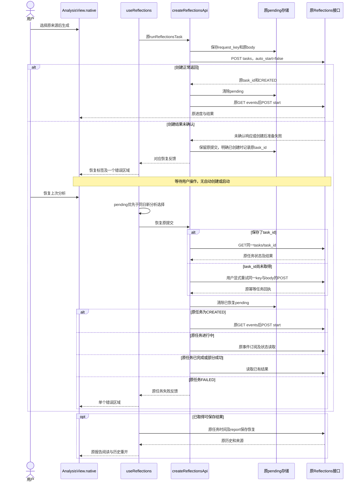
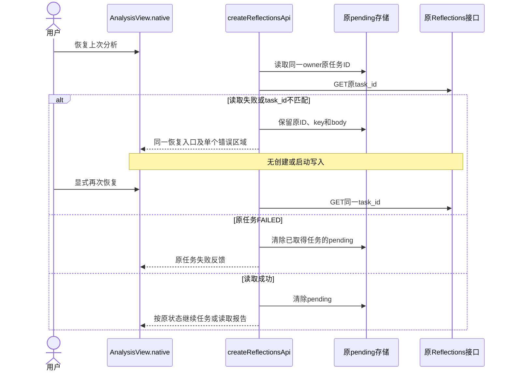
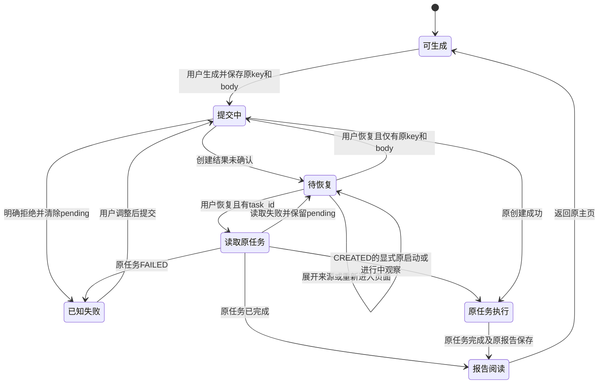
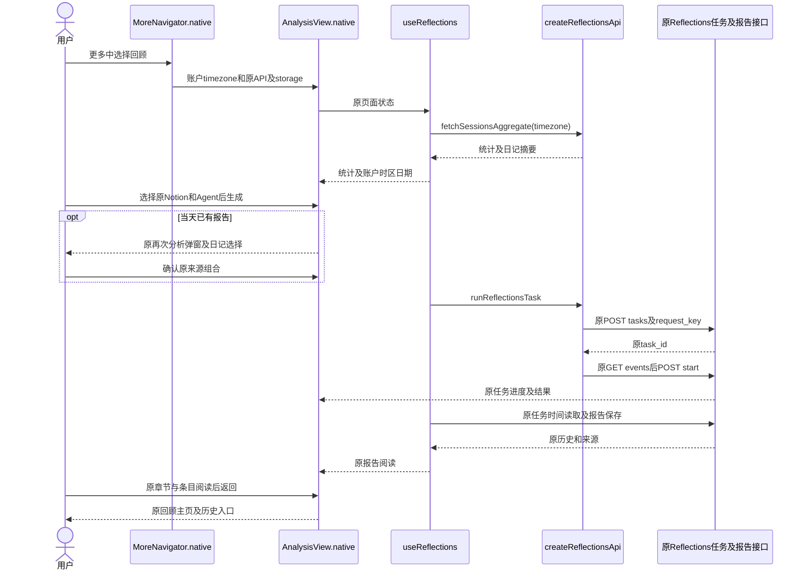
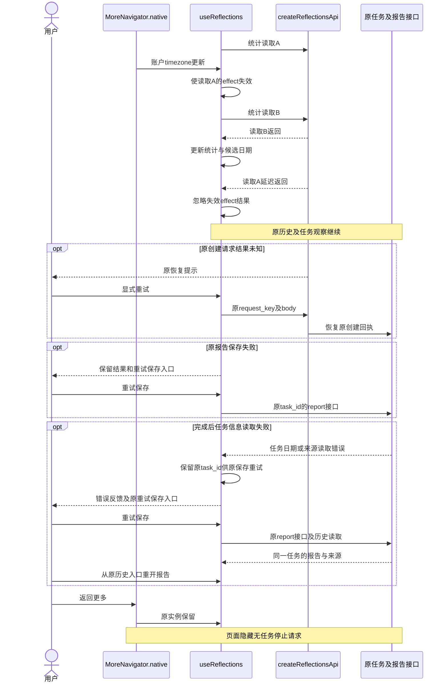
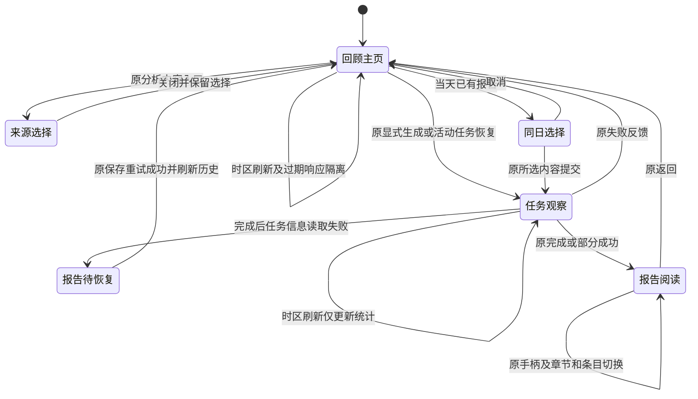
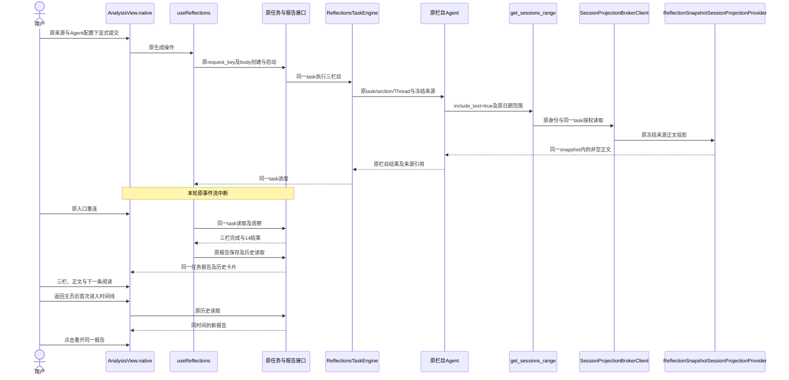

<!-- [Input] APP-02授权、原回顾需求与实现、技术验证及r7真实模型与Simulator业务回执。 -->
<!-- [Output] 问题判断、最小修复、完整旅程验收、历史阶段、共享文档交接与真机资格。 -->
<!-- [Pos] APP-02独立执行记录；总清单、现行PRD、设计和目录合同由总控汇总。 -->
<!-- [Sync] 2026-11-02: 按用户截图收敛提交结果未知、已创建任务读取恢复和重复错误展示；时区作为相邻修订保留，修订后验证继续暂停。 -->
<!-- [Sync] 2026-11-03: 用户恢复APP-02验收；首轮原生19/22通过，修复三项失败对应的源码模块路由和拒绝状态fixture，待总控focused复测。 -->
<!-- [Sync] 2026-11-03: 按Simulator报告正文不可见证据修订Native实测高度分配，保留原停靠点与手势；未执行测试或构建。 -->
<!-- [Sync] 2026-11-03: 核对总控新源Native22/Web29通过及Simulator阅读XCUITest3/3、安装资源匹配回执；真实新分析模型旅程待执行。 -->
<!-- [Sync] 2026-11-03: 核对r7三栏目14结果、8次显式正文读取、同任务断流恢复、报告保存及时间线重开；完成最终需求覆盖审计，保留真机与APP-04边界。 -->

# APP-02 App回顾流程

## 目标与当前进度

用户反馈：“回顾功能 看起来app上有些问题”。来源为[Notion问题页](https://app.notion.com/p/40b30b7547c380f7ac22f85fdd2dbdd0)，任务范围以[总执行记录](app-experience-fixes-20261102.md)为准。

本任务目标已通过`create_goal`创建：定位并修复App回顾流程的实际缺陷，保持原来源、Agent、任务、报告与权限，完成完整业务旅程的设计、最小实现及自动化验证并记录真实业务依赖。2026-11-03最终审计已核对技术回归、Simulator阅读、r7真实模型执行、同任务断流恢复及时间线报告重开，已满足本轮APP-02交付条件。目标工具状态在文末登记。2026-11-02的`blocked`与各阶段待执行项按历史记录保留，当前判定以文末最终审计为准。

当前交付：截图映射、源码核对、最小设计与范围评审、原生提交恢复入口、共享API/Hook及正文布局修订；总控集成同版本Undici scalar解析器、iOS任务工作区定位与原MCP显式正文读取。总控新源focused Native22项、Web29项通过；正文合同70项及14项subtests通过；Simulator阅读XCUITest3/3通过。r7沿原UI提交一次，3次真实`gpt-6.1-sol` Agent执行生成echoes 5、traits 4、patterns 5，共14条结果；原报告已保存、阅读并从时间线重开。完整命令、退出码、来源及恢复证据见文末。

Simulator报告详情正文不可见问题已采用同一阅读区实测高度分配修订，当前候选通过总控构建、安装及阅读复验；历史源码判断和最新验收范围见文末对应阶段。

用户后续指定本轮采用iOS Simulator。总控统一串行构建、安装和XCUITest。本任务未启动原生构建、未操作iPhone或Simulator、未启动Mac Dream替代端侧后端，未操作真实账户、模型或数据库，未直接同步Notion。

2026-11-02用户暂停`luna-test-stage`后，本任务已中断验证代理并保留其既有回执。2026-11-03用户恢复验收，仅APP-04继续暂停；APP-02由总控统一安排focused复测、构建和Simulator，本任务负责失败诊断与最小修订。

## 用户截图与主修复

### 已知证据与待定位信息

用户后续补充的截图保存在私有生成物路径`frontend/ios/build/app-experience-20261102/reflections-reported-error.png`。截图显示21:23；截图日期、App构建版本、请求ID、HTTP状态、响应体和原任务ID均未知。历史报告仍可见，其中一条日期为Oct 23, 2026，统计为120 days、439 entries、118,601 words。生成与内容入口可见。同一错误在Recurring Themes下方和页面底部各显示一次。

截图原文为：`The analysis could not start. Check the selected content and retry. Retry to recover the previous analysis submission.`

本轮已直接查看私有截图，并按原文核对当前源代码。截图未提供能够关联当前构建、服务日志或具体任务的标识。本轮保留未知项；Admin网络、所选来源及账户时区的原因均待原始请求证据确认。时区修订登记为相邻修订。

### 文案与分支映射

| 截图现象 | 原实现来源 | 可得结论 |
| --- | --- | --- |
| `The analysis could not start…` | `reflectionCreateError`对未映射且非401的创建失败返回通用文案 | 提示未包含具体服务端原因 |
| `Retry to recover the previous analysis submission.` | `createReflectionTask`将失败响应分类为`outcomeUnknown`后追加提示并保留pending提交 | 原创建响应分类为结果未确认；任务可能已经保存 |
| 原错误路径 | 原`POST /api/reflections/tasks`响应处理；独立`POST tasks/task_id/start`失败采用另一文案 | 优先定位创建及创建后准备阶段的回执 |
| 未确认判定 | `creation_committed=true`、`outcome_unknown=true`，或状态至少500且未声明`outcome_unknown=false` | 截图无法区分这些条件 |
| 两份相同错误 | `runAnalyzeAll`将异常写入`errors.echoes`；Native栏目和底部汇总同时渲染 | 重复展示由当前两个呈现位置确认 |
| 原恢复入口 | 原生成按钮仍显示新分析标签；API暗中优先采用pending原body及request_key | 页面标签需要明确恢复原提交 |
| 同日历史干扰 | `handleAnalyzeAll`原先先判断当天报告，再进入API恢复 | 已有当天报告时可能出现新日记选择，API实际恢复原输入 |
| 已创建任务编号被丢弃 | 后端创建后准备失败会返回`creation_committed=true`及`task_id`；原客户端仅保存原key/body | 原任务编号可以供原公开GET读取恢复 |

后端相关分支为`create_reflections_task_endpoint`：创建已提交后，准备事件或投影任务来源失败时，返回带原`task_id`的失败响应。该源码分支说明既有协议，截图是否来自此分支仍待实际响应确认。

### 本次优化执行依据与方案评审

收到截图后，已按用户规则完成一次任务优化提示词，再调整执行范围。优化后的目标为：依据精确文案追踪原创建响应、pending保存、原任务读取与显式重试；修复重复反馈和错误恢复入口，保留原来源、任务及权限；已确认任务编号时采用读取恢复，编号缺失时仅在用户操作后重用原幂等提交；继续暂停所有机械验证和设备操作。该优化未递归执行。

| 方案 | 判断 | 结论 |
| --- | --- | --- |
| 仅隐藏重复文本 | 未覆盖新分析标签和原输入恢复关系 | 扩充为反馈与原提交恢复修订 |
| 失败后自动重复POST或更换request_key | 增加重复提交及模型执行风险 | 排除 |
| 读取已返回的task_id，显式恢复原任务 | 复用原GET、SSE、start及报告接口 | 采用 |
| 缺少task_id时由客户端增加回执查询服务 | 引入新接口与权限范围 | 排除；保留原request_key/body的显式幂等恢复 |

### 概念与规则

1. pending提交沿用原存储键和归属隔离，保存原request_key与body；仅在原响应明确`creation_committed=true`且task_id通过UUID校验时增加该原任务ID。旧记录继续按原key/body读取。
2. 页面存在pending时，原生主入口显示“恢复上次分析”，说明使用上次提交的分析内容。再次分析弹窗让位于该恢复操作。仅CREATED且没有pending的原显式继续入口保持。
3. 页面进入、内容展开或重新挂载均不发起新的创建或启动请求。用户点击恢复后，存在task_id时先GET同一任务；编号缺失时显式重用同一request_key和原body。
4. 原任务读取失败或返回其他task_id时保留pending；用户可继续从同一入口重试。读取成功后解除pending，并按任务权威状态继续：CREATED先SSE后启动；进行中仅订阅和读取；COMPLETED或PARTIAL_FAILED读取原结果；FAILED保留原失败反馈。
5. 创建结果未确认时反馈“上次分析提交结果尚未确认，请重试以恢复该次提交。”。已保存原task_id时反馈“上次分析已创建，请重试读取其状态。”。明确拒绝沿原业务错误展示并清除本次pending。
6. Native统一alert按完整文案去重，保留不同错误的原顺序。当前Hook各异常分支均将任务错误放入echoes；多栏相同和不同错误采用受控呈现规格覆盖。原进度与栏目配置保持。
7. 报告与历史继续来自原任务及报告接口；无新数据库、HTTP端点、后台任务或模型执行路径。时区和完成后任务信息读取失败的保存恢复按下文相邻修订保留。

### 页面骨架

```text
桌面Web：原回顾布局、历史与生成入口保持
          原页面错误显示提交结果未确认；用户显式重试复用原提交
窄屏App：原历史报告保持可读
          [恢复上次分析]（原生成按钮位置）
          恢复使用上次提交的分析内容
          [分析内容] → 原来源与Agent弹窗
          栏目配置与进度保持
          单个错误区域：相同文案一次，不同文案保留
恢复中：原按钮禁用并显示原进度
恢复成功：原报告、历史与返回；新生成入口恢复
```

### 正常提交与恢复时序







本节图示为修订后的源码交互规格，自动化及Simulator执行状态保持待验收。服务端原请求失败原因需要关联原构建、请求时间、状态、error_code、request_id及task_id；本轮未采集真实账户请求。

## 首轮发现与相邻修订

已读取根`AGENTS.md`、相关目录合同、[分析内容PRD](../prd/memory/reflections-analysis-content-prd.md)、[历史PRD](../prd/memory/reflections-history-prd.md)、[阅读PRD](../prd/reflection-blog.md)、[分析内容设计](../design/memory/reflections-analysis-content-design.md)、[历史设计](../design/memory/reflections-history-design.md)、[移动详情手柄设计](../design/multi-platform/react-native-web-project-structure.md#回顾详情顶部拖动与吸附2026-11-01)及原Web/Native用例。开始时`git status --short`为空；执行期间其他任务并行修改的文件全部保留。

| 核对项 | 源码证据 | 判断与处理 |
| --- | --- | --- |
| 统计时区 | `MoreNavigator.native`读取账户偏好并传入`AnalysisView.native.timezone`；`useReflections.loadStats`原先重新取得设备时区 | 统计请求与页面日期采用不同输入；统一采用传入的账户时区 |
| 偏好异步读取 | More先以设备时区初始化，随后读取账户偏好；原统计effect依赖未包含`timezone` | 账户时区到达后统计保留旧值；按时区更新重新读取统计 |
| 日记日期 | Hook原先固定`date_key: undefined`，两端再次分析列表使用设备日期回退 | 日期标签改由同一账户时区计算，复用`getLocalDayKey` |
| 响应顺序 | 原统计读取在请求返回后直接提交React状态 | 旧时区读取延迟返回时可能覆盖当前值；effect失效后忽略结果和错误 |
| 任务与历史 | 原统计和历史读取合并在同一个effect；历史读取还负责恢复活动任务 | 独立统计effect，时区刷新仅更新统计与候选摘要；原历史和任务恢复依赖保持 |
| 完成后的任务信息读取失败 | `openTaskReport`在读取任务日期及来源失败后仅设置`reportSaveError`并返回；原生页面的重试按钮依赖`reportRetryTaskId` | 保留已知task_id，显示原重试保存入口；沿原report.ensure及历史读取恢复相同任务，保留原日期和来源 |
| 原生阅读 | 现有来源、章节、上一条/下一条、返回与手柄已有实现，修订前12项原生隔离用例通过 | 保留三个原生呈现文件；短视口、放大字体和Simulator触摸继续列入待验收 |
| 报告关联对话 | Web `ChatMessageList`采用`parseReflectionAnalysisPreview`及`onOpenReflectionSection`；Native消息组件尚无该回调 | 原生关联对话跳转属于待集成缺口；涉及Chat及App导航文件，交由总控安排归属，禁止猜测报告与Thread关联 |
| 停止语义 | Reflections任务DTO及公开API无任务cancel入口；页面隐藏或释放只涉及本地观察，原Chat Stop另有所有者 | 保留现行语义；返回更多和取消来源弹窗不提交任务停止；验证原Chat Stop时由总控串行执行 |

首轮尚未取得截图。12项基线未复现独立的原生生成、报告或手柄失败。账户时区偏差由当前输入链路和后端`get_sessions_aggregate`按时区累计日期的实现确认。任务信息读取失败的恢复缺口由`openTaskReport`错误分支和原生重试按钮条件确认。本轮无这些失败分支的动态复现或修订后验收回执。后续截图的主修复与未知项见前节。

## 相邻修订的最小设计与评审

### 背景与问题

用户在更多中进入回顾，统计、日记选择日期、报告日期和当天再次分析判断需要采用同一账户时区。账户偏好异步到达时，原页面应更新只读摘要，并保持当前任务、来源选择和报告。

分析已取得结果后，读取任务日期或来源的请求可能失败。原页面需要保留该任务的恢复入口，让用户取得已有报告。报告日期和来源继续来自原任务及历史接口。

### 目标与边界

复用原Hook、统计API和日期工具。改动限`useReflections.ts`及原生隔离用例。任务创建、request_key、来源冻结、SSE订阅、启动、保存、权限、报告正文、历史布局及手柄协议继续由原模块执行。后端、Admin、schema和原生运行库无本任务修改。

### 概念与规则

1. 回顾统计请求的`timezone`等于页面传入的账户时区。
2. 日记候选日期通过原`getLocalDayKey`按同一时区生成，时间戳和候选ID保持服务端值。
3. 时区变化产生新的统计读取；前一次effect失效后停止提交结果与错误。
4. 统计读取拥有独立effect；时区变化不触发历史重读、活动任务重连、创建、启动或保存。
5. 时区变化不修改已创建任务的effective输入、历史报告统计或冻结来源。本轮无新增default、desired、effective或revision配置实体。
6. 首次生成维持原全范围，同日再次分析维持原日记选择、Notion和Agent组合。
7. 分析完成后任务信息读取失败时，将原task_id保留到现有`reportRetryTaskId`。用户通过原重试保存入口执行`ensureReflectionTaskReport`与`reloadSavedReports`，随后从历史打开同一报告；任务创建、启动和模型调用次数保持。

| 方案 | 范围与判断 | 评审结果 |
| --- | --- | --- |
| 保留设备时区请求 | 无法统一账户日期与统计 | 排除 |
| 在原组合effect增加timezone依赖 | 同时触发历史及活动任务恢复 | 排除 |
| 独立统计effect并复用账户时区和日期工具 | 修改一个现有Hook，增加过期响应隔离 | 采用；动态验证待恢复 |
| 新增原生专用回顾状态或接口 | 增加双份任务及数据协议 | 排除 |
| 任务信息失败后复用原报告保存重试 | 原状态增加已知task_id，沿既有接口恢复原报告 | 采用；新增故障回归待执行 |

源码范围评审完成。功能验收保持待执行。

### 页面骨架交接

本轮页面结构保持。以下骨架供总控同步现行PRD，交互图供总控同步现行设计。

```text
桌面：原导航 | 回顾主页（原页面纵向滚动）
             统计：账户时区下的天数 / 日记 / 字数
             历史标题 → 原时间轴；最新三份报告 → 原阅读页
             [生成分析] [分析内容] → Notion / Agent选择
             原进度 / 错误 / 保存重试 / 栏目配置
同日再次分析：标题固定 | 内容及日记列表滚动 | 取消与提交固定
报告：原来源 / 章节 / 列表 / 详情 / 播放器 / 返回
```

```text
窄屏App：更多 → 回顾
┌ 返回更多 ─────────────┐
│ 原统计 / 原历史预览   │
│ 生成 / 分析内容入口   │
│ 进度与错误（纵向滚动）│
└──────────────────────┘
分析内容 → 原pageSheet：Notion / Agent / 重新加载 / 关闭
同日再次分析 → 原pageSheet：分析内容及日记共同滚动，底部取消/提交固定
日记日期采用账户时区
报告 → 原来源 / 章节 / 标题列表
       顶部手柄 / 正文独立滚动 / 上一条与下一条
       返回回顾；历史标题仍进入原时间轴
```

### 正常业务时序



### 异常与恢复时序



### 状态图



## 修改与文件归属

| 文件 | 本轮修改 |
| --- | --- |
| `frontend/app/_dream/api/reflectionsApi.ts` | 原pending记录兼容增加已确认创建的task_id；恢复优先GET；原输入和key保持；已运行或终止任务采用原状态读取；反馈区分未确认和已创建；同步文件头 |
| `frontend/app/_dream/hooks/useReflections.ts` | pending恢复先于同日新分析选择；账户时区及过期统计隔离；完成后任务信息失败保留原报告重试任务ID；同步文件头 |
| `frontend/app/_dream/components/AnalysisView.native.tsx` | 主按钮明确恢复原提交，pending期间提供唯一恢复动作；合并原错误区域并按完整文案去重；同步文件头 |
| `frontend/e2e/native-reflections.spec.ts` | 原12项规格调整未知提交用例并新增10项：三项时区、一项完成后读取失败、两项错误呈现、一项已提交读取失败重试、两项进行中/已完成恢复、一项明确拒绝；同步文件头 |
| `frontend/e2e/fixtures/reflectionsHarness.ts` | 增加显式选项，复用原服务端已创建task_id错误DTO |
| `frontend/e2e/reflections-analysis-content.spec.ts` | 原Web未知提交用例同步准确反馈，原同key恢复断言保持 |
| `docs/exec/app-experience-reflections-20261102.md` | 本记录 |

共享PRD、iOS设计、目录合同和索引由总控统一修改。`frontend/app/_dream/api/.folder.md`需登记原pending读取、已创建task_id与显式读取恢复。`frontend/app/_dream/hooks/.folder.md`需登记pending恢复先于同日新选择、账户时区统计、过期响应隔离和完成后原报告恢复。`frontend/app/_dream/components/.folder.md`需登记原生恢复标签和唯一错误区域。`frontend/e2e/.folder.md`及`frontend/e2e/fixtures/.folder.md`需登记22项原生规格、原Web反馈回归及待执行状态。`docs/exec/.folder.md`需登记本记录。现行需求和设计采用本记录规则与图示，并保留历史原文。

APP-01边界：`AnalysisView.native`和`ReflectionBlogPage.native`当前无报告删除动作；本轮保持这些文件。`ReflectionsApi`当前无报告删除方法。删除入口由APP-01负责；若删除影响回顾预览，继续复用现有`reloadSavedReports`，需由总控确认共享Hook交接。禁止通过报告ID推导日记或Thread删除目标。

## 2026-11-02验证回执（历史阶段）

| 阶段 | 命令或动作 | 退出码与关键输出 | 状态 |
| --- | --- | --- | --- |
| 开始核对 | `pwd && git status --short && cat AGENTS.md && cat docs/exec/app-experience-fixes-20261102.md` | 0；工作区为本仓库，起始短状态为空 | 完成 |
| 修订前前置检查 | `python3 .agents/skills/ink-dream-playwright-qa/scripts/preflight.py` | 0；Playwright声明及安装版本1.62.1，Node v24.13.0，5173/8765空闲 | 完成 |
| 修订前原生基线 | `cd frontend`后执行`corepack pnpm exec playwright test e2e/native-reflections.spec.ts --reporter=line --workers=1` | 0；`Running 12 tests using 1 worker`，`12 passed (33.9s)`；工具session 7647 | 通过；范围限修订前fixture技术检查 |
| 修订前Web相邻检查 | `cd frontend`后执行`corepack pnpm exec playwright test e2e/reflections-analysis-content.spec.ts --reporter=line --workers=1` | 用户暂停后中止，退出码不可得，未形成结果；工具session 50336 | 中止，不计通过 |
| 暂停清理 | 中断`reflections_validation`并要求仅清理本轮进程 | 代理报告Playwright及其子进程已终止，无匹配Playwright/Vite进程；未追加测试 | 已暂停 |
| 修订后技术检查 | 原生22项规格、原Web相邻回归、定向类型与文档检查 | 未执行 | 随验证阶段暂停 |
| Simulator | 总控串行原生构建、安装、XCUITest | 未执行 | 待集成 |
| 真实业务及模型 | 原账户、来源、模型、正常Admin可见任务与结算链路 | 未执行 | 待总控核对条件 |
| 发布 | 无 | 未执行 | 本轮任务无发布操作 |

修订前截图由原用例生成：`/tmp/ink-native-reflections-20261029/native-dashboard.png`、`native-report.png`、`native-config.png`。报告截图展示原来源、列表、详情和播放器；该截图提供基线阅读参考，修订后验收需重新获取证据。

验证代理曾启动Web相邻检查，用户暂停后仅保留中止状态。不得用中止前的用例进度推断整轮通过。后续恢复验证须由用户或总控解除暂停后按既有规则执行，不增加全量并行构建。

原生基线仅报告Vite的`transformWithEsbuild is deprecated`提示。代理回执来自`luna_test_runner`的已有命令记录，暂停后补充回执未执行新的检查。

## 2026-11-02完整旅程与剩余依赖（历史阶段）

| 旅程 | 修订前证据或当前实现 | 后续执行范围 |
| --- | --- | --- |
| 更多进入回顾 | MoreNavigator接入原页面，原生fixture直接挂载AnalysisView | Simulator从真实更多入口进入并返回原页面 |
| 来源、日期与Agent | 原生基线覆盖Notion、Agent和同日所选日记 | 新三项验证账户时区、旧响应隔离及任务连续；Simulator核对日期及原来源 |
| 创建、进度、报告、保存 | 基线覆盖UUID、CSRF、SSE先于start、报告重试 | 修订后全套重跑；真实模型链路需正常Admin持久化证据 |
| 历史重开与时间线 | 基线覆盖报告阅读及时间线回调，Web原用例覆盖完整时间线 | 修订后Web相邻检查；Simulator覆盖时间线重开和返回位置 |
| 报告关联对话 | Web已具备最新匹配栏目跳转；Native缺少回调 | 总控确认Chat/More/App归属后补齐或记录该业务缺口 |
| prepared和恢复 | 基线覆盖CREATED显式继续、active任务、同一请求键恢复 | Simulator重开和前后台按原任务身份恢复；与APP-04串行集成 |
| 网络失败重试 | 基线覆盖原未知创建、保存失败及启动失败；截图证实创建未确认与重复展示；Web检查中止 | 同key/body恢复、已创建任务GET失败保留、进行中/完成任务恢复不重启、明确拒绝、多栏错误去重及来源/历史失败用例待执行 |
| 停止与取消 | 基线覆盖隐藏保留任务、释放只取消本地观察 | Simulator确认返回和取消来源弹窗不重放或停止任务；原Chat Stop由总控验收 |
| 窄屏手势 | 基线覆盖拖动、吸附、取消、正文独立滚动 | Simulator覆盖短视口、放大字体、来源展开和详情三档；不能据此声明物理触摸或真机性能 |
| Web相邻 | 原Web共享Hook继续采用同一代码路径 | 恢复后执行原桌面与窄屏完整Reflections用例 |

Simulator性能、后台恢复和系统终止观察须注明Simulator条件。真机性能及真实jetsam无本轮证据。目标完成需等待修订后验证、必要集成缺口和总控验收；当前为`blocked`，完整目标保持。

本次继续执行已核对总控当前状态：总控任务仍在执行，最新安排继续暂停隔离自动化、构建和Simulator验收。截图主修复及相邻修订规格已编写，未执行机械检查；验证暂停条件保持。

## 2026-11-02完成审计与阻塞状态

本次目标续行已重新读取当前源码、目标状态和总执行记录。总执行记录继续明确暂停隔离自动化、构建和Simulator验收；总控任务仍在执行。复核范围为已授权的提交恢复与任务状态分支，未增加源码修订，未运行任何检查。

| 目标要求 | 当前依据 | 完成判定 |
| --- | --- | --- |
| 解释截图重复错误及未知提交 | 已查看私有截图，已映射原创建响应、Hook错误状态和两个呈现位置 | 源码判断已记录；实际HTTP失败原因待关联请求证据 |
| 最小设计及完整状态 | 本记录包含桌面/窄屏骨架、提交、未知结果、读取恢复、重试及状态图 | 规格已交付；文档语法与路径检查暂停 |
| 原来源、Agent、任务、报告及权限保持 | 当前恢复保存原key/body；明确已创建时读取同一task_id；服务端认证及数据库实现保持 | 源码候选存在；动态回归尚未证明 |
| 同一错误一次、不同错误保留 | `ReflectionTaskError`对三栏完整文案去重；两项受控呈现规格已编写 | 实现及规格已交付；未执行 |
| 无自动重复创建或启动 | 显式恢复优先；已创建任务采用GET，进行中及终止任务跳过start；同日新选择让位于pending恢复 | 源码已复核；修订后用例未执行 |
| 完整原生与Web技术旅程 | 原生22项规格及原Web用例；已有12项通过属于修订前基线 | 尚未完成 |
| Simulator完整业务旅程与失败取证 | 总控串行集成的责任及入口已登记 | 尚未执行；验证阶段持续暂停 |
| 共享文档、关联对话接线及Notion结果同步 | 总控持有共享PRD、设计、目录合同、跨文件接线与共享页面同步 | 待总控集成；本任务无直接共享页面写入 |

暂停条件在首轮交付、截图修订续行和本次续行连续保留。当前受控实现范围已形成候选，剩余必需证据需要恢复验证及总控集成。`update_goal(status="blocked")`已返回`blocked`；未标记完成，未将验证阶段的暂停扩展为目标暂停。后续取得新的请求证据或恢复验证授权后，沿本记录的完整目标继续。

## 2026-11-03首轮失败诊断与修订交接

### 验收恢复与回执

用户恢复APP-02验收，授权继续自动修复；本任务只读取既有结果并修改本任务源文件，测试与原生资源由总控统一安排。2026-11-02的暂停、阻塞和基线回执作为历史阶段保留。

已读取`frontend/ios/build/app-experience-acceptance-20261103/browser-r1/results.json`及三项失败的`error-context.md`、原有trace。本轮原生22项中19项状态为expected，3项failed。原结果JSON为总控多模块组合执行，本文仅摘取`e2e/native-reflections.spec.ts`；组合命令与退出码由总控保存，JSON未提供命令退出码。原Web29项的55173 fixture未启动由总控修runner，本任务无Web服务操作。

| 原生失败项 | 原始证据 | 原因 |
| --- | --- | --- |
| `native task error retains one failure across all sections in one alert`，原第62行 | trace记录`/app/_dream/api/reflectionsApi.ts`模块以`application/json`响应，浏览器拒绝加载 | 受控错误呈现用例直接`page.goto`，未复用正常入口对`/app/_dream/**`源码模块的路由放行；共享`**/api/**`模拟路由匹配了源码路径 |
| `native task error retains different section failures in one alert`，原第62行 | 同类无alert错误；原用例采用相同导航分支 | 同一源码模块路由前置缺口 |
| `native definite creation failure clears pending recovery and displays its error once`，原第213行 | 错误截图与快照显示正常报告、三个栏目及结果条目 | `installReflectionFixtures`接收`options.createError`，初始化`FixtureState`时遗漏该字段；POST进入正常成功分支，指定422拒绝未发生 |

原始证据目录分别为`browser-r1/test-results/e2e-native-reflections-nat-0678a-s-all-sections-in-one-alert/`、`e2e-native-reflections-nat-41dfb-ction-failures-in-one-alert/`、`e2e-native-reflections-nat-3cc94-and-displays-its-error-once/`。原截图和trace保持原位。

### 最小修订与合同核对

| 文件 | 本轮修改 | 保持项 |
| --- | --- | --- |
| `frontend/e2e/native-reflections.spec.ts` | 将原源码路由放行、视口及页面导航提取为`navigate`；正常`open`和两个受控错误用例共同调用；明确拒绝用例增加一次创建且零次启动的前置断言；更新文件头 | alert角色、完整错误文本、唯一性、原request_key、清除pending和成功重试断言保持 |
| `frontend/e2e/fixtures/reflectionsHarness.ts` | 初始化`createError: options.createError`，使已有422分支按指定条件执行；更新文件头 | 原POST DTO、错误码、task_id及默认成功分支保持 |
| 本执行记录 | 记录原始失败、原因、修改和待复测项 | 历史失败与暂停回执保留 |

本轮未修改生产代码。已核对当前`TASK_ID = 6f6f5df3-0d11-4d63-8f4d-9e8a0f20c901`与`makeTask`、已创建错误响应的`task_id`来自同一fixture状态。该ID符合生产UUID格式，原生已创建任务GET恢复及进行中/完成任务恢复用例在首轮通过。生产pending的`task_id: z.string().uuid().optional()`及原响应DTO保持严格校验，权限、幂等与品牌改动保持。

共享目录合同仍由总控汇总：`frontend/e2e/.folder.md`登记正常和受控错误入口共用源码模块放行；`frontend/e2e/fixtures/.folder.md`登记配置的`createError`传入模拟状态，明确拒绝用例执行已有422分支。无产品行为变化，无需新增页面或业务状态设计。

### 总控复测范围

1. 定向执行两个`native task error retains`用例和`native definite creation failure`用例，保留原角色、完整文案、次数及幂等断言。
2. 三项通过后，总控回归完整原生22项，并在修复55173 fixture前置后执行原Web29项。
3. 继续串行Simulator完整回顾旅程，采集原始创建/读取/启动请求状态、error_code、request_id及task_id，确认用户截图对应失败原因。

本轮无新测试命令、退出码或通过回执。修订状态为“已修改，待总控复测”，完整目标保持未完成。

## 2026-11-03 Simulator详情布局修订

### 实际证据与源码判断

总控在已安装候选和原有效会话中，通过既有历史报告打开第一条详情。来源和历史可读；详情手柄、标题栏与播放器占满详情区域，正文不可见，辅助功能树仍有正文元素。总控报告Cua上拖未观察到高度变化，真实手势与overlay核对交由XCUITest补证。私有截图为`frontend/ios/build/app-experience-acceptance-20261103/simulator-ui-r1/reflection-detail-before.png`，本任务已查看；未记录正文内容。

源码原先将列表ScrollView设置为`flex: 1-fraction`，详情View设置为`flex: fraction`。已安装React Native的`ScrollView.js`基础纵向样式显式包含`flexGrow:1`及`flexShrink:1`，列表和详情采用不同伸缩基础。原`onLayout`仅写ref，可用高度变化未直接触发尺寸重算。详情正文ScrollView缺少明确填充剩余空间的布局样式。

该差异能够解释详情实际高度未按标注的70%分配。当前证据确认正文不可见；手势是否正确进入PanResponder及覆盖层是否截获触摸，继续采用总控XCUITest证据判断。

总控后续提供旧安装包baseline r2回执：XCUITest 2/2通过，实际手柄向上/向下拖动可改变高度并吸附，开发者overlay覆盖及返回原详情通过。Cua拖动无变化归属工具手势差异，原PanResponder已符合该目标。本轮保留PanResponder代码，修复范围限定初始70%时的正文空间。该旧包回执未证明正文可见性。

### 最小方案与源码交接

本次按用户规则完成一次优化执行依据后调整：复用同一阅读区的实测高度，直接计算列表和详情尺寸；保留原三档停靠、PanResponder、正文滚动、来源及报告操作；本任务不执行测试、构建和设备操作。

本次仅修改`frontend/app/_dream/components/ReflectionBlogPage.native.tsx`及本记录：

- `onLayout`同时更新原手势ref及本地测量state，可用高度变化触发重算。
- 测得正高度`H`且有选中条目时，列表采用`H*(1-fraction)`，详情采用`H*fraction`；两者显式设置相同尺寸依据的`height`和`flexBasis`，关闭各自的额外grow/shrink。未选条目时原列表继续填满阅读区。
- 正文ScrollView明确使用`flex:1`及`minHeight:0`，填充手柄、标题栏和播放器之外的空间。手柄、标题栏及播放器保留原内容并设置不收缩。
- 原正文ScrollView增加`testID="reflection-detail-body"`作为XCUITest观察点；正文、无障碍名称与业务行为保持。
- `useReflectionDetailSheet`的45%/70%/90%停靠点、begin/move/finish、手势取消恢复和读屏增减动作保持。PanResponder处理函数及依赖保持，继续从原ref取得同一阅读区高度。

原Web、任务创建/恢复、报告保存、来源、权限、生产协议及APP-04模块均无本次修改。Config/时区超时经原重试恢复，本次无对应额外代码修订。

共享目录合同和正式设计由总控更新：`frontend/app/_dream/components/.folder.md`登记实测高度分配；移动手柄设计补充两区同一测量基础及正文剩余空间归属。页面骨架、业务状态和三档规则保持。

### 总控验收项

1. 同一既有报告初始70%打开详情后，以`reflection-detail-body`检查`frame.height > 0`，同时断言正文实际可达及可滚动。仅手柄变化或辅助功能元素存在不能证明正文验收通过。
2. XCUITest从实际手柄拖动后比较详情frame变化与原停靠状态；松手吸附、取消恢复、向上/向下均按原规则执行。
3. 正文滑动仅改变正文位置，详情高度保持；上一条/下一条、关闭、重新选择和返回历史继续执行原操作。
4. 核对开发者overlay的触摸范围与报告手柄关系；实际触摸证据用于区分布局和事件问题。
5. 执行这处布局变更所需的原生阅读回归和相邻Web回归，保留实际命令、退出码及截图。

本次源码交接时未运行测试、构建、设备控制或模型操作，阶段状态为“待总控构建与真实Simulator复验”。后续总控回执见下一节，目标继续保留。

## 2026-11-03新候选验收回执与范围

### 已核对证据

总控执行了新源focused回归、原生构建与Simulator安装验收。本任务仅读取现有JSON、日志和安装回执，没有运行额外测试或修改生产源。

| 阶段 | 证据与命令 | 实际结果 |
| --- | --- | --- |
| 原生隔离回归 | `source-update-browser-r1/native-results.json`及`native-config.mjs`，原`native-reflections.spec.ts` | 22项expected，unexpected/skipped/flaky均为0；约28.17秒 |
| Web相邻回归 | `source-update-browser-r1/web-results.json`及`web-config.mjs`，原`reflections-analysis-content.spec.ts` | 29项expected，unexpected/skipped/flaky均为0；约32.83秒 |
| 原生类型检查 | `source-update-r1/native-typecheck.receipt.json`，原`native:typecheck` | exitCode 0 |
| Next资源 | `source-update-r1/next-r2.receipt.json` | prepareExitCode、buildExitCode、verifyExitCode均为0 |
| Xcode App构建 | `source-update-r1/xcode-app-r2/receipt.json` | exitCode 0 |
| Simulator安装及资源 | `simulator-install-r2-receipt.json`，原`simctl terminate`和`simctl install` | 两条命令exitCode均为0；6项资源installedMatch均为true，reflectionSourceMatches为true；数据容器保留 |
| Simulator阅读及覆盖层 | `xcuitest-ui-layout-r1/receipt.json`、`test.log`、`results.xcresult`，`xcodebuild test-without-building`；完整argv保存在receipt | exitCode 0；3项通过、0项失败；receipt记录原既有账户、modelCalls 0、businessWrites 0、APP04BehaviorTest false |

上述路径均位于私有生成物根`frontend/ios/build/app-experience-acceptance-20261103/`。浏览器结果JSON未包含进程退出码，本记录按JSON真实统计登记，通过回执及启动命令由总控统一汇总。原首轮失败与旧包baseline证据保持原位。

Simulator日志显示三个实际方法均通过：

- `testDetailBodyScrollKeepsControls`：总控确认原默认70%正文可见，正文末尾独立滚动可达，固定关闭和下一条入口可用。
- `testDetailHandleDragAndSnap`：原手柄实际拖动与吸附通过。
- `testDiagnosticsAboveDetailAndReturn`：开发者overlay位于详情上方，关闭后返回原详情通过。

手柄及overlay的旧包baseline r2先前已通过，本候选继续保留原PanResponder；新增修复的有效范围为默认70%的正文空间及阅读连续性。安装回执确认原执行文件、debug dylib、main.jsbundle、端侧Python模块、Next source receipt与manifest和构建制品匹配。

### r6终态取得前的候选验收范围（历史阶段）

| 业务范围 | 当前状态 |
| --- | --- |
| 提交错误去重、原key/body恢复、已创建任务GET恢复、明确拒绝、来源/Agent、报告保存重试与历史 | Native22和Web29隔离技术回归通过 |
| 原有效账户与既有报告阅读 | Simulator默认70%正文显示、末尾滚动、控件、手柄及overlay通过；本轮测试无模型调用及业务写入 |
| 正常新分析：原UI选择来源与Agent→创建→真实模型→进度→报告持久化→历史重开 | **执行中**；总控在r6候选沿原UI发起修复后一次新分析，任务`113304b4-b865-4b53-aaf7-674b4d962985`已进入section.started；模型终态、报告持久化及历史重开回执待取得 |
| 最初截图的HTTP失败原因 | 仍需新分析旅程的创建/读取/启动请求、状态、error_code、request_id与task_id证据；通用提示和只读报告检查无法确定该原因 |
| APP-04前后台行为 | 继续暂停；本轮receipt明确APP04BehaviorTest false |
| 发布与真机资格 | 本轮未进行发布或真机性能、系统终止验收 |

当前候选的技术回归及Simulator既有报告阅读范围已验收；完整目标保留到真实新分析旅程及原始HTTP取证完成。本次仅更新自有执行记录，未新增测试、构建或生产源码修订。

### 总控r6新分析进度回报（历史阶段）

总控回报`workspace-binding-native-r1`构建退出码0；r6安装9项资源SHA匹配，3项既有偏好digest保留，启动PID67477；同包既有报告/overlay的XCUITest 1/1通过、退出码0。原Notion关闭、现有账户、模型及权限保持，原失败任务记录保留。本任务未重新执行或探索这些检查。

修复后沿原UI仅发起一次新分析，任务ID为`113304b4-b865-4b53-aaf7-674b4d962985`。总控当前观察为`section · started`，active存储事件序号`000004`，pending已清除。该进度证明任务已进入栏目执行阶段；模型成功结束、报告保存、历史重开及正常Admin回执仍待后续证据。

本阶段仅登记总控回报，目标保持未完成，等待完整回执后再审阅。未操作模型、App或APP-04。

## 2026-11-03最终需求覆盖与完成审计

### 最终范围与证据归属

本轮最终候选为r7。用户指定采用iOS Simulator，设备、构建、真实账户及模型操作由总控串行执行；本任务完成失败诊断、授权源文件修订及最终回执审阅。本次收尾仅修改本执行记录，执行文档清单、引用及Mermaid检查；未新增功能测试、构建、安装、设备控制、模型调用、数据库操作或Notion写入。APP-04继续暂停。

下列相对生成物路径统一位于`frontend/ios/build/app-experience-acceptance-20261103/`。业务正文及凭证继续留在原业务系统；本文仅记录任务、栏目、Thread、数量、状态和证据位置。当前任务的报告与历史持久化由原UI公开入口回执证明；本地任务目录仅用于定位和权限证据。Token结算明细及正常Admin后台的逐项核验由总控统一归档，本记录未独立取得对应后台截图或结算清单。

### 集成阶段实际问题与最小方案

总控在同一原生业务路径取得两项后续故障及一项正文读取缺口，分别完成定位、方案收敛和定向修订。

| 发现与定义 | 方案评审及采用实现 | 保留的合同与失败反馈 |
| --- | --- | --- |
| iOS打包Next的Undici SIMD解析器在端侧解释器失败，创建请求出现502 | `frontend/ios/scripts/prepare-next.py`仅在iOS服务端bundle将原llhttp SIMD导入解析至同版本既有scalar模块；保留依赖锁定及原HTTP dispatcher | 原认证、任务DTO和幂等接口保持；恢复继续使用原pending身份。历史截图缺少原请求标识，其具体HTTP根因仍无法回溯 |
| 原任务`004ef80e-10ab-4451-ab76-173e19732c3c`以`REFLECTION_WORKSPACE_BINDING_CONFLICT`结束 | 原统一trace定位至Dream `canonical_reflection_workspace`。`backend/services/admin_data/reflection_task_runtime.py`将iOS规范绝对路径中匹配同一合法UUID的`task_id/memory`定位到本机既有任务根；Linux继续校验相同根 | 路径规范化、同任务后缀、符号链接拒绝、0700及原O_NOFOLLOW写入保持；Admin保存路径、权限及临时目录协议保持。原FAILED任务保留终态 |
| r6三栏均完成且返回`[]`，结果数0；工具结果只含摘要，显式正文读取入口缺失 | 在原`get_sessions_range`增加可选`include_text:boolean`，默认false，严格布尔校验；仅显式true时在原响应投影`text`。`backend/reflections_agent.py`指导需要正文时传`include_text=true` | 原日期/检索/预算、query内部匹配、snapshot与actor授权继续由原broker执行。默认摘要响应保持；无新增工具、HTTP接口、全文提示词注入或本地业务副本 |

r6任务`113304b4-b865-4b53-aaf7-674b4d962985`的三栏完成、零结果终态见`simulator-ui-workspace-r1/task-result-metadata.json`；原工具响应的`nonemptyTextRecords=0`及响应字段见同目录`tool-result-metadata.json`。原零结果任务继续按既有规则保留，未生成空报告，未修改终态或重复执行。r7为总控在正文合同修订后授权发起的一次新分析；恢复r7期间未创建新任务。

正文读取沿原`SessionProjectionBrokerClient`及冻结来源provider执行。`AdminReflectionSectionPersistence`继续绑定task、section、thread、purpose和scopes；`ReflectionSnapshotSessionProjectionProvider`继续提供原冻结来源。`include_text`只选择同一授权响应中的正文投影，不扩大来源集合或权限。工具定义与workflow规则由总控同步原归属文档；本记录未修改工具权限分类。

### 最终源码与验证文件交付

| 文件或文件组 | 交付与归属 |
| --- | --- |
| `frontend/app/_dream/api/reflectionsApi.ts` | 本任务：原request_key/body及已创建task_id恢复、状态读取、错误反馈 |
| `frontend/app/_dream/hooks/useReflections.ts` | 本任务：恢复入口优先、账户时区、失效统计响应隔离、原任务报告保存重试 |
| `frontend/app/_dream/components/AnalysisView.native.tsx` | 本任务：原生恢复标签及完整错误文案去重 |
| `frontend/app/_dream/components/ReflectionBlogPage.native.tsx` | 本任务：同一测量高度分配、正文剩余空间及原控件布局；PanResponder和三档规则保持 |
| `frontend/e2e/native-reflections.spec.ts`、`frontend/e2e/reflections-analysis-content.spec.ts`、`frontend/e2e/fixtures/reflectionsHarness.ts` | 本任务：原Native22/Web29规格、显式错误fixture及原源码模块路由放行；由总控执行 |
| `frontend/ios/scripts/prepare-next.py` | 总控：同版本Undici scalar打包兼容 |
| `backend/services/admin_data/reflection_task_runtime.py` | 总控：iOS同任务工作区定位及原路径保护 |
| `backend/libs/claude_agent_kit/server/sessions_tool.py`、`backend/reflections_agent.py` | 总控：原工具显式正文参数、严格校验、响应投影及对应调用说明 |
| `backend/tests/test_sessions_tool.py`、`backend/tests/test_session_projection_broker.py`、`backend/tests/test_admin_reflection_task_data.py`、`backend/tests/test_reflections_agent.py`、`backend/tests/test_reflection_authority_keeper.py`、`backend/tests/test_mobile_runtime.py` | 总控：原工具、授权、路径与端侧运行合同的定向技术验证；实际执行组合见下一表 |
| `docs/exec/app-experience-reflections-20261102.md` | 本任务：需求覆盖、方案判断、命令和分层验收；本次唯一修改文件 |

共享PRD、正式交互设计、目录合同、索引与Notion结果页继续由总控统一维护。本次只向总控交付本记录及既有证据位置；未直接写入这些共享文件或外部页面。部分目录合同保留2026-11-02的历史暂停文字，总控汇总时需对齐本节最终状态。最终收尾时，总控回报Notion已按四项Simulator范围同步，本任务未独立执行页面写入或远程复核。

### 命令、退出码及验收层次

本表为既有命令回执审阅；本次未重跑。前端22/29属于fixture技术回归，provider-free合同检查无真实模型调用；Simulator阅读与r7真实模型旅程分别提供原生交互及真实业务证据。各层结论按其实际范围使用。

| 层次 | 命令或既有回执 | 退出码与关键输出 |
| --- | --- | --- |
| 前端技术回归 | `source-update-browser-r1/native-config.mjs`及`native-results.json`；原`native-reflections.spec.ts` | 22项expected、unexpected/skipped/flaky均为0；结果JSON无进程退出码，未补造退出码 |
| Web相邻技术回归 | 同目录`web-config.mjs`及`web-results.json`；原`reflections-analysis-content.spec.ts` | 29项expected、unexpected/skipped/flaky均为0；结果JSON无进程退出码 |
| 原生类型检查 | `corepack pnpm native:typecheck`，cwd `frontend`；`source-update-r1/native-typecheck.receipt.json` | 0 |
| 工作区合同 | cwd `backend`：`PYTHONDONTWRITEBYTECODE=1 TMPDIR=/Users/dmeck/project/ink-dream-memory/frontend/ios/build/app-experience-acceptance-20261103/workspace-binding-contracts-r1/tmp .venv/bin/python -m pytest -q tests/test_admin_reflection_task_data.py tests/test_reflections_agent.py tests/test_mobile_runtime.py` | 0；36 passed、6 subtests passed，1.50秒；`workspace-binding-contracts-r1/receipt.json` |
| 正文与权限合同 | cwd `backend`：`PYTHONDONTWRITEBYTECODE=1 TMPDIR=/Users/dmeck/project/ink-dream-memory/frontend/ios/build/app-experience-acceptance-20261103/diary-body-contracts-r1/tmp .venv/bin/python -m pytest -q tests/test_sessions_tool.py tests/test_session_projection_broker.py tests/test_admin_reflection_task_data.py tests/test_reflections_agent.py tests/test_reflection_authority_keeper.py` | 0；70 passed、14 subtests passed，20.11秒；`diary-body-contracts-r1/receipt.json` |
| Simulator阅读 | `xcodebuild test-without-building`；完整argv见`xcuitest-ui-layout-r1/receipt.json` | 0；3 passed、0 failures，正文、滚动、原控件、手柄及overlay覆盖通过；modelCalls/businessWrites均为0 |
| r7 Xcode构建 | `env INK_IOS_NEXT_ROOT=/Users/dmeck/project/ink-dream-memory/frontend/ios/build/app-experience-acceptance-20261103/Next-r3-scalar NODE_OPTIONS=--max-old-space-size=2048 EXTRA_PACKAGER_ARGS='--max-workers 1' /usr/bin/time -l xcodebuild -workspace frontend/ios/InkMemory.xcworkspace -scheme InkMemory -configuration Debug -sdk iphonesimulator -destination 'id=120A4231-E08B-422F-A45E-08BDB72937D7' -derivedDataPath frontend/ios/build/RNWSimulator -jobs 1 COMPILER_INDEX_STORE_ENABLE=NO CODE_SIGNING_ALLOWED=NO ENTRY_FILE=index.native.js build` | 0；BUILD SUCCEEDED；`diary-body-native-r1/receipt.json`。三项Python及Node worker均matchesSource true，scalar模块48615字节，SIMD module id缺席 |
| r7覆盖安装与启动 | 原`xcrun simctl get_app_container/terminate/install/launch`六步；完整argv见`simulator-install-r7-diary-body-receipt.json` | 六步均0；11项installedMatch true，ownedPreferenceDigestsPreserved true，dataDeletedByAgent false |
| r7真实业务 | 原UI提交、原任务恢复、原报告及时间线；`simulator-ui-diary-body-r1/business-acceptance-receipt.json` | UI操作无统一进程退出码；截图命令0。3次真实Agent执行、14结果、报告保存与时间线重开均有对应回执 |

构建回执记录物理内存16GiB、预检磁盘可用12GiB、单worker及单job。本表堆参数仅记录该次命令；后续构建继续依据容量手册按当次目标检查。构建、安装、业务验收与发布分开登记；本轮未发布。

### r7真实业务链路与来源绑定

最终任务为`aa2aaa87-a8ef-4775-b642-f6c336478790`。`business-acceptance-receipt.json`记录r7在正常账户和配置下通过原UI提交一次，模型为`gpt-6.1-sol`，三个栏目完成且`taskFailedSections=[]`。总控使用App端侧Python、原Admin和Gateway，未使用Mac业务backend。当前任务沿原Notion关闭及既有Agent配置执行；真实Notion授权与额外Agent组合继续按各自既有验收范围登记。

`completed-model-metadata.json`记录同一任务的710条冻结来源，以及以下栏目与原Thread绑定。来源引用数按各栏目记录，跨栏目及单栏目内可能重复；表内数量未按独立日记累计。

| 栏目 | 原Thread | 结果数 | 来源引用数 | 显式正文读取 |
| --- | --- | --- | --- | --- |
| echoes | `5f6a5728-c98b-4d91-a62c-857f9a1968a3` | 5 | 21 | 3次，记录数5/3/1 |
| traits | `fef1ddfa-fd87-4b6e-b5c7-3d61bcce3156` | 4 | 11 | 3次，记录数5/3/1 |
| patterns | `7ab6e799-a732-4468-8ae2-fa7c496aad2a` | 5 | 19 | 2次，记录数5/4 |

共8次原MCP调用均记录`explicitIncludeText=true`、成功返回及每条正文非空；所有读取和结果引用均位于同一冻结snapshot。`rawBodyOrCredentialsLogged=false`，三栏目任务目录及任务根均为0700。710为本任务冻结来源数，页面其他统计按原统计口径展示。

正常业务及已发生恢复路径如下，模块名沿用现行实现：



`active-task-running.json`与`stream-interruption-metadata.json`记录同一task及事件序号`000004`。流中断时echoes/traits已完成、结果数9；原入口重连后继续同一任务，未为恢复创建新task或额外Agent turn。`completed-task-metadata.json`记录最终三栏目完成、失败栏为空、结果数14。该恢复发生于事件流观察，APP-04前后台与系统终止状态仍未执行。

新报告在原主页显示`2026/11/3 03:42:18`。总控打开全部三栏、正文及下一条后返回主页，再首次进入当前包时间线，通过原历史读取出现同时间报告并点击重开。`history-reopened-report.png`显示相同日期、710来源及5/4/5栏目计数，echoes保留5条结果。本任务直接查看该截图并核对上述metadata及业务回执；未转录报告标题或正文。`new-report.png`、`new-report-detail.png`及原任务/模型metadata保持私有生成物原位供复核。

`http-phase-metadata.json`的`phases=[]`，未形成逐请求HTTP状态或request_id清单。当前业务成功结论来自同一任务终态、8次工具结果、原报告保存与时间线重开；历史截图的具体HTTP失败原因继续保持未确认。集成时实际观察到的502及workspace错误已分别保留独立回执，未将其反推为历史截图的唯一原因。

### 最终需求覆盖矩阵

| 需求项 | 当前证据与完成结论 |
| --- | --- |
| 截图重复错误、未知提交与已创建恢复 | 源码映射、原key/body/task_id规则及Native22技术回归通过；明确拒绝只创建一次且零启动，已运行/完成恢复沿原状态读取 |
| 更多入口、来源、Agent与账户日期 | 原Simulator业务路径及既有配置通过；Native/Web技术回归覆盖Notion/Agent、账户时区及过期统计响应隔离。真实r7沿原Notion关闭配置执行 |
| 新分析、三栏进度与原Agent执行 | r7一次提交、3次真实Agent执行、三栏5/4/5，共14结果；所有来源引用均在冻结snapshot |
| 原报告保存、阅读及时间线重开 | 新报告保存，三栏/正文/下一条阅读，主页历史卡片、时间线首次读取与同报告重开有实际回执及截图 |
| 报告与关联对话数据关系 | 三栏目各自原Thread、task和section绑定已由真实执行metadata确认；Web预览跳转属于29项技术回归范围。Native Chat消息预览缺少栏目跳转回调的现行差异已交总控，本文未声明新增该入口或取得对应原生UI验收 |
| 中断与错误恢复 | 创建未知、已创建GET失败及保存失败由技术回归覆盖；真实r7事件流中断后恢复同一task，未产生恢复用的新task或额外turn |
| 窄屏正文与手势 | 默认70%正文可见、独立滚动、固定控件、三档手柄及overlay的Simulator XCUITest3/3通过；r7真实结果继续完成正文与下一条阅读 |
| 原权限、任务和历史保持 | 严格正文参数、原broker授权、同snapshot引用、0700、原路径保护及合同检查通过；旧FAILED和零结果终态保留，trueDeletionCount=0，未修改账户权限 |
| 停止、前后台与进程恢复边界 | Reflections无新增cancel语义；本轮事件流重连不涉及APP-04生命周期验收。APP-04继续暂停，原Chat Stop由总控另行验收 |
| 设计、实现与交付追踪 | 本文保留方案判断、桌面/窄屏骨架、正常/异常时序及状态图、文件归属、命令和实际结果；共享现行文档与Notion由总控汇总 |

### 本执行记录文档检查

本次文档检查与功能、真实业务验收分别登记。

| 命令 | 退出码与关键输出 |
| --- | --- |
| 根目录`python3` stdin脚本：检查本记录、Markdown相对链接、最终文件与证据清单、围栏及目录索引 | 0；7条本地链接、17个源码路径、13项最终生成物均存在；围栏闭合；`docs/exec/.folder.md`已登记本记录；禁用文档话术匹配为空 |
| `git diff --check -- docs/exec/app-experience-reflections-20261102.md` | 0；文件当前为未追踪交付物，正文空白及末尾LF另由Python检查 |
| cwd `frontend`，`node --input-type=module` stdin脚本：已有Chrome单次启动、空白页加载本地`mermaid/dist/mermaid.min.js`，对本记录逐块调用`mermaid.parse` | 0；7/7图语法通过。网络请求阻断，未打开应用或账户页面，无设备及模型操作；`finally`关闭本轮浏览器 |

直接Node导入Mermaid的首轮检查返回1，原因为缺少DOM环境导致`DOMPurify.addHook is not a function`。后续空白页语法检查使用现有本机Chrome与已有依赖完成，未安装依赖或下载浏览器。该前置失败未用于判断业务缺陷，文档语法检查未计为功能验收。

### 完成判定与剩余资格

APP-02当前授权目标的主修复、相邻修订、最小设计、技术回归和Simulator真实模型完整旅程已形成对应证据。正常创建到真实正文读取、三栏结果、同任务恢复、原报告保存及时间线重开已完成；旧任务与权限保持。总控最终明确原生Chat预览入口属于相邻未验证范围，当前APP-02完成条件按上述完整回顾旅程判定。

`update_goal(status="complete")`已返回`complete`，目标线程为`01a19cd8-e682-7882-a864-8e72421f263c`。工具记录`tokensUsed=328699`、`timeUsedSeconds=1512`，无token预算。2026-11-02的`blocked`保留为历史阶段，当前目标状态为完成。

本轮未执行物理iPhone、真实jetsam、真机性能、App Store发布、真实Notion授权及APP-04生命周期验收。Native Chat预览跳转入口由总控持有跨模块集成记录，现有task/section/Thread关系已保留并有真实执行证据。上述边界不扩展本轮Simulator验收结论；后续对应工作仍需独立执行和留存回执。
