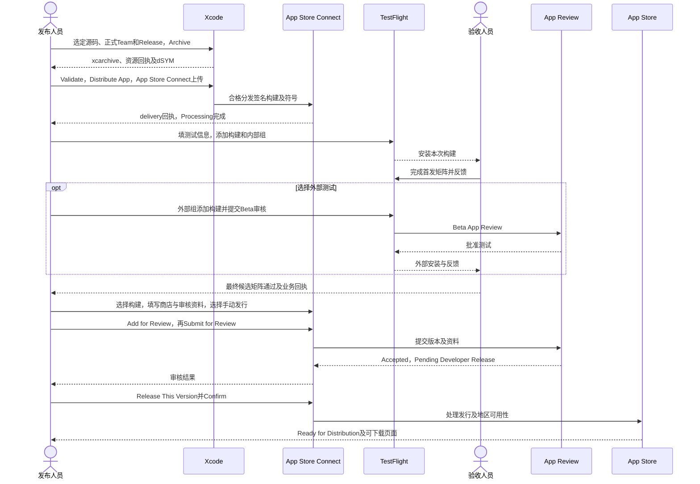
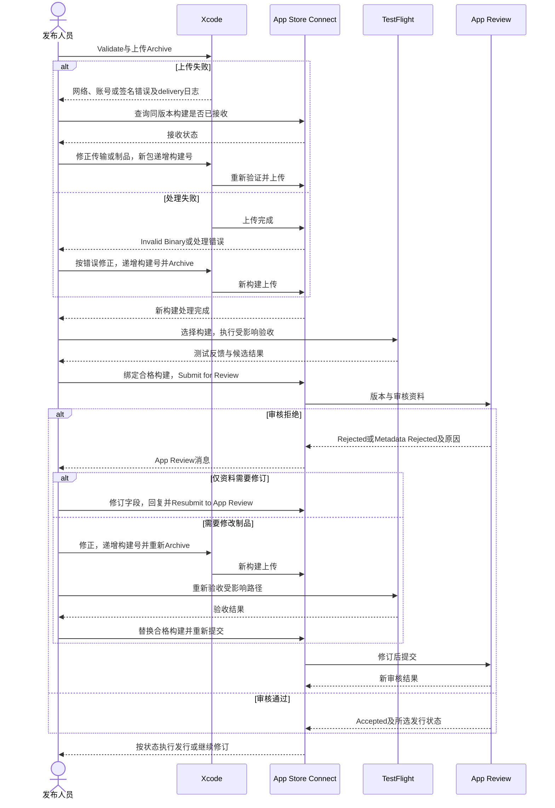
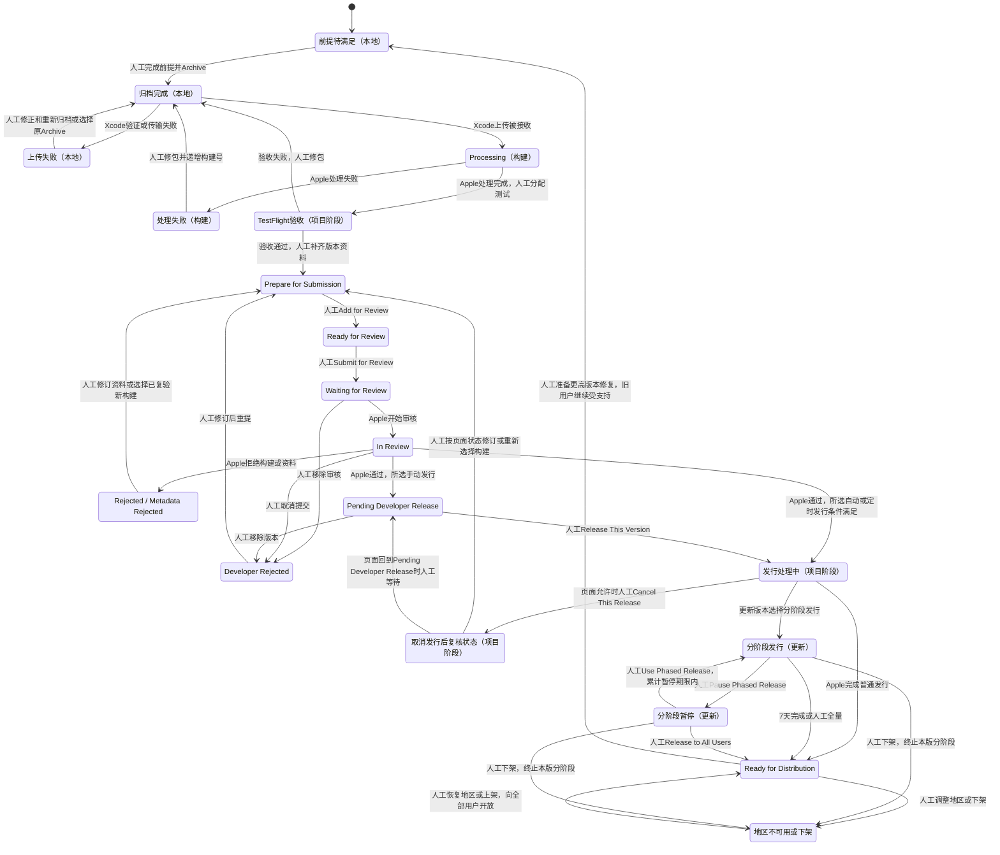

<!-- [Input] 面向使用方修订前的五份iOS发布与政策文档。 -->
<!-- [Output] 原文、原路径与SHA-256；供历史核查和来源追踪。 -->
<!-- [Pos] 历史快照；现行操作由docs/deploy对应手册维护。 -->
<!-- [Sync] 2026-11-02: 完整保存操作手册、现场状态、源码证据、评审和文档验证原文。 -->

# iOS发布文档面向使用方修订前原文

本文件保留修订前原文。代码块内的链接按各节所列原路径解释；发布操作使用原路径的现行文档。

## ios-app-store-release.md

原路径：`docs/deploy/ios-app-store-release.md`。SHA-256：`7295c8ce2e57e6f164d38d49560297effde6f4422eb627103cc7a37019b7c2e3`。

````markdown
<!-- [Sync] 2026-11-02: P8接入Admin商业与人工智能材料，补支付现状、接收方路由、内容措施及审核说明依据。 -->
<!-- [Sync] 2026-11-02: P5分列图标已完成与隐私权限待采用；接入suoxya政策准备稿、公开位置和App Privacy填报材料。 -->
<!-- [Input] 当前 iOS 工程、资源装配脚本、分项交付回执及 Apple 官方发布要求。 -->
<!-- [Output] 从发布前提到 Archive、TestFlight、App Review、发行及故障恢复的独立操作手册。 -->
<!-- [Pos] iOS App Store 发布操作与发布人员流程评审；端侧实现归现有架构和认证文档。 -->
<!-- [Sync] 2026-11-02: 补充会员申请、中文实际入口及注册费用；记录现有组织销售角色、协议待办和签名资源访问限制。 -->
<!-- [Sync] 2026-11-02: 首次建立商店发布手册；只读核查及文档交付，实际上传、提审和发行留待后续执行。 -->

<!-- [Sync] 2026-11-02: 用户参考图已接入AppIcon与启动展示，最终Archive及设备采用继续单独核对。 -->

# Ink & Memory iOS App Store 上架操作手册

## 背景与问题

Ink & Memory 已具备 React Native 界面、包内 Next、Python、Node 和 Claude 运行资源。现有回执覆盖开发签名、模拟器分项验证、部分真机业务及构建24的覆盖安装。商店分发需要独立完成账号、工具链、分发签名、资源授权、隐私、功能验收及 App Review 条件。

**推荐路径：Apple Developer Program 正式团队 → 当前 `InkMemory` 工程的 Release Archive → Xcode Organizer 上传 App Store Connect → TestFlight 验证 → App Review → 手动发布至 App Store。** 使用当前 `com.inkmemory.mobile` 的前提为正式团队具有该标识的使用权，且应用记录、签名和能力一致。现有开发 IPA 仅作为开发回执留存。

本机 Xcode 16.4（16F6）、iOS 18.5 SDK 低于当前上传最低要求。Apple 自2026-04-28起要求 iOS 26 SDK 或更新 SDK；当前上传文档列明 iOS 构建使用 Xcode 26 或更新版本。后续选择 Apple 支持的正式 Xcode，核对其 macOS 要求并重新归档。最低运行系统与构建 SDK 分别管理，当前部署目标 iOS 16.4 保留至兼容性验证得出调整依据。[SDK最低要求](https://developer.apple.com/news/?id=ueeok6yw)、[上传支持](https://developer.apple.com/help/app-store-connect/manage-builds/upload-builds)、[Xcode系统要求](https://developer.apple.com/xcode/system-requirements)，查阅：2026-11-02。

## 目标与边界

- 发布人员可按本文顺序准备材料、构建、上传、测试、提审、发行和恢复问题；每步均定义操作位置、输入、操作、预期结果和失败处理。
- 本轮仅进行仓库只读核查、官方资料查询、文档编写和文档验证。代码、依赖、实际构建、签名材料、账号协议、上传、提审、发布及真实业务测试均未执行。
- 正常网页登录、退出、Client、PKCE、Cookie、CSRF、权限和现有公网 Admin 配置继续由原模块管理。发布前置工作须维持这些合同；每项功能或认证变更另行实施与验收。
- 端侧兼容完成作为工作基线。开发安装、模拟器、真实业务和商店资格各自记录证据；历史版本通过项须在最终 TestFlight 候选上复验。
- 复用[真机安装手册](ios-iphone-install-release.md)、[移动发布技术设计](mobile-app-release.md)、[认证排障指南](mobile-auth-troubleshooting.md)和[端侧架构](../design/multi-platform/mobile-runtime-architecture.md)。本文直接维护发布操作、业务验收入口及发布流程图。

## 发布对象与规则

### 当前源码与证据

首版源码核查日期：2026-11-02，Asia/Shanghai。首版起始分支 `develop`，HEAD `236f0ad4a9b9bb749aaf73dd1b4577c1844e0bc0`；起始 `git status --short` 为空。下表行号对应首版源码快照；后续发布以选定提交和制品回执重新核对。首版未访问在线账号。此次会员入口补充基于 `ios-store` 分支、HEAD `5fd1e0f548c96bbe35a271b830352ea151539eeb`及干净起始工作区，只读核对了注册、开发者账户和 App Store Connect 页面；应用记录未创建或修改。

| 对象 | 当前证据与定位 | 发布含义 |
| --- | --- | --- |
| 工程入口 | [`InkMemory.xcworkspace/contents.xcworkspacedata`](../../frontend/ios/InkMemory.xcworkspace/contents.xcworkspacedata) | 打开 workspace，包含应用工程与 Pods |
| Scheme、target、Archive | [`InkMemory.xcscheme`](../../frontend/ios/InkMemory.xcodeproj/xcshareddata/xcschemes/InkMemory.xcscheme)，L10–14、L36 | 应用 `InkMemory` 参与归档；`InkMemoryTests` 为测试目标；Archive 采用 Release |
| Release 身份 | [`project.pbxproj`](../../frontend/ios/InkMemory.xcodeproj/project.pbxproj)，L565–615 | `com.inkmemory.mobile`、`0.1.0`、源码构建号 `1`、Team `45KY254AF7`、Automatic signing；Team 的付费会员资格待核对 |
| 系统与设备 | 同一工程 L586、L612；[`Podfile`](../../frontend/ios/Podfile)，L13 | iOS 16.4；设备族 `1,2`，包含 iPhone 与 iPad；首发需覆盖 iPad 页面与截图 |
| 版本字段、回调、权限 | [`Info.plist`](../../frontend/ios/InkMemory/Info.plist)，L28–67 | 版本来自构建设置；账户 `.auth` 与 MCP `.mcp` scheme 分开；已声明相机、本地网络用途及本地网络传输 |
| 图标 | [`AppIcon.appiconset`](../../frontend/ios/InkMemory/Assets.xcassets/AppIcon.appiconset/Contents.json)及当前工程Debug/Release配置 | 已接入第一张用户参考图的1024×1024 RGB主图，资源集与工程引用齐备；最终Archive继续核对 |
| entitlements | 本轮对 `frontend/ios` 文件与工程检索，未发现应用自有 `.entitlements` 或 `CODE_SIGN_ENTITLEMENTS` | 最终权限以 Xcode、profile 和签名产物核对；后续增加能力须同步标识与 profile |
| 隐私清单 | [`PrivacyInfo.xcprivacy`](../../frontend/ios/PrivacyInfo.xcprivacy)，L5–35；工程 L15 | 三类 required-reason API；收集类型数组为空、tracking=false；清单已加入资源，完整性待实际数据清点 |
| RN 与 Web | [`package.json`](../../frontend/package.json)，L6、L43–52；[`pnpm-lock.yaml`](../../frontend/pnpm-lock.yaml) | pnpm 10.28.1、Next 16.1.6、RN 0.81.5、RNW 0.21.4；安装解析以锁文件为准 |
| Python 与 Claude | [`python-dependencies.json`](../../frontend/ios/python-dependencies.json)，L2–7；[`pyproject.toml`](../../backend/pyproject.toml)，L35；[`node-dependencies.json`](../../frontend/ios/node-dependencies.json)，L2–28 | Python 3.13.17、SDK 0.2.145、Node 24.21.0、Runtime 0.1.12、CLI兼容2.1.241、ntn 0.15.1；分发许可逐项核对 |
| 资源装配 | 工程 L389–431；[`bundle-python.py`](../../frontend/ios/scripts/bundle-python.py)，L73–79、L104–149、L151–184；[`bundle-node.py`](../../frontend/ios/scripts/bundle-node.py)，L23–62 | Python及插件、Node、字体、Next由资源阶段装配；RN阶段使用 `index.native.js`，强制生成包内JS |
| 来源门禁 | [`bundle-next.py`](../../frontend/ios/scripts/bundle-next.py)，L23–48、L115–126；[`prepare-next.py`](../../frontend/ios/scripts/prepare-next.py) | 校验 checkout/prepared 来源，包内保留 `source-receipt.json`、`mobile-manifest.json`；门禁失败需重准备和重构建 |
| 配置打包 | `bundle-node.py` L57–63、L80–102；[`AdminDataConfig`](../../backend/services/admin_data/config.py)，L68–95、L117–125；[`admin-client.ts`](../../frontend/app/api/_auth/admin-client.ts)，L99 | 当前复制普通 env；后端及BFF消费服务凭证。外部分发前须处理服务端共享秘密依赖，源env正文本轮未读取 |
| 执行方式 | [`DreamNode.m`](../../frontend/ios/InkMemory/DreamNode.m)，L14–29；[`DreamGuestProcess.c`](../../frontend/ios/InkMemory/DreamGuestProcess.c)，L104–124、L175–194；[`guest-dependencies.json`](../../frontend/ios/guest-dependencies.json)，L2–8、L71 | Node使用 `--jitless`；Guest在应用进程解释执行；依赖声明 `local development`；公开API及商店适用性待最终制品验证 |
| 端侧插件 | [`ios_plugin_runtime.py`](../../backend/mobile_runtime/ios_plugin_runtime.py)，L21–49、L59–69 | 从包内摘要插件恢复；pip使用离线wheels；其他运行期下载、安装和生成代码执行范围须逐入口核对 |
| 已有开发制品 | [构建24安装记录](ios-iphone-install-release.md#2026-11-02-构建24覆盖安装与普通启动)，L614–629 | `0.1.0 (24)`覆盖原iPhone23并普通启动；2161项目录metadata保持；开发签名与页面/业务验收分列 |
| 已有业务证据 | [构建20真实业务](ios-iphone-install-release.md#系统验证后追加同一构建20真实业务)，L530–544；[集成记录](../exec/mobile-ios-integration-pr-20261102.md)，L16–30 | 真机原协议登录、配置、历史、一次Claude任务及正常Admin结算已有回执；可见界面、完整Notion与最终候选回归待完成 |

本机只读工具回执：`xcodebuild -version` 退出0，输出 Xcode 16.4 / 16F6；`xcodebuild -showsdks` 退出0，输出 iOS 18.5；`sw_vers -productVersion` 退出0，输出 macOS 15.7.4。本轮未调用 Archive、Run、证书导出或设备安装。

### 上架前置项及完成条件

下表按依赖排序。负责人为后续执行角色，实际姓名在发布记录中填写。

| 前置项 | 当前状态 | 最小后续操作及负责人 | 完成条件 |
| --- | --- | --- | --- |
| P1 账号与标识 | 用户尚未自行购买会员；浏览器已加入一个组织团队，职能为销售，存在协议更新待办；本应用发布团队待选 | 自行申请正式会员，或由已授权组织团队发布；持有人/Admin核对协议、权限、标识归属及应用记录 | 选定发布主体，会员及协议有效，创建/上传/提审角色及应用访问齐备，同一Bundle ID可用 |
| P2 工具链 | 本机Xcode16.4/iOS18.5不满足上传门槛 | 发布工程人员准备符合Apple要求的正式Xcode，验证现有RN/Pods/Python/Node/Guest可归档 | Archive记录符合SDK、架构、最低系统与签名要求，Validate通过 |
| P3 分发凭证 | 开发身份已有历史回执；当前浏览器组织团队的签名资源显示Access Unavailable | 会员生效后选正式Team，由有权限人员配置Xcode自动签名，或准备手动分发证书/profile | Organizer能使用该Team完成App Store Connect分发签名，能力匹配 |
| P4 包内配置 | 普通env复制；代码要求服务凭证 | 认证负责人逐键分类，处理客户端可提取的共享服务凭证，完成可分发配置及正常登录回归 | 包内无服务端共享秘密、私钥或上传凭证；保持原公开业务入口和权限。单纯删除必需键会触发fail closed，须先完成相应工程工作 |
| P5a 图标 | 已完成；用户已确认，源码与资源回执归[品牌记录](../exec/mobile-app-branding-20261102.md) | 发布工程人员在P2归档时复核最终资源采用 | 图标制作与接入完成；最终Archive采用记录归P2/P9 |
| P5b 隐私与权限 | [政策正文准备稿](../../frontend/public/privacy-policy.html)与[上架填报材料](ios-privacy-and-permissions.md)已编写；主体suoxya、邮箱dmeck@suoxya.com；公开采用与清单待落实 | 发布负责人按专项材料核定模型接收方、保存/删除规则，落实公开URL及App入口；工程人员核对权限及required-reason API、收集类型和SDK清单 | 已生效政策可公开访问且App内可达；AI共享同意、权限、Archive隐私报告及App Privacy与实际行为一致 |
| P6 执行与分发授权 | Guest仍标记本地开发，Runtime有资格限定说明 | 负责人清点运行库、CLI、插件、wheels、字体及通知/源码提供义务；核对下载与执行能力 | 外部分发授权记录完整，代码来源/行为及公开API审查完成；2.5.2/4.7适用范围有说明及对应实现证据 |
| P7 登录与账户删除 | Google与注册入口存在；本轮范围未找到Apple登录及账户删除入口 | 产品/认证负责人确认4.8适用性与账户删除完整路径；按原认证体系补齐明确缺项 | 等效隐私登录方案或适用例外有证据；用户可从App发起账户及关联数据删除并获结果 |
| P8 商业与AI材料 | [商业与人工智能材料](ios-commercial-and-ai-materials.md)已依据Admin设计编写；当前订阅页只读，支付注册源码仅接入Fake；收费决策、共享同意及内容措施待落实 | 按P8-1至P8-5确定收费与地区，完成适用支付接入、真实接收方清单、AI共享同意、过滤/举报/滥用处置和审核材料 | 所选商业路径、数据共享、内容措施及普通审核账户在最终候选具备完整回执；文档编写与功能验收分别登记 |
| P9 最终候选验收 | 分项历史通过；最终TestFlight未执行 | 验收人员完成本文矩阵并留存版本、设备、服务和正常Admin回执 | 全部发布必需项通过；受限功能明确展示适用条件；待完成核心路径清零 |
| P10 商店与地区材料 | 在线资料、截图及法规材料待确认 | 发布人员填写商店信息、地区、加密、适用许可及支持信息 | 必填项完整，页面可公开访问，地区所需材料已获确认 |

### 版本、签名和发布记录

- `MARKETING_VERSION` 对应 App Store 版本；`CURRENT_PROJECT_VERSION` 对应构建号。源码当前为 `0.1.0 (1)`，历史设备最新回执为 `0.1.0 (24)`。发布前读取 App Store Connect 已上传号，选择高于同版本已用号和当前内部候选号的新构建号。`25`仅可在确认所有已用号后采用；首发版本可继续使用合法的 `0.1.0`，也可由负责人确定正式版本。
- 后续在 Xcode target `General > Identity` 设置 Version/Build，并核对Release最终值。Organizer出现构建号管理选项时，采用已核定的号并复核上传后的号；若交由Xcode递增，必须把实际上传号回写发布记录。
- 开发签名使用 Apple Development 和开发profile；TestFlight/App Store采用正式Team的分发签名，由Xcode自动管理或由有效Apple Distribution证书及对应App Store Connect profile管理。开发profile的设备列表和短期有效期仅用于开发安装。
- 发布记录至少包含Git提交、工作区差异清单、Xcode/SDK、Bundle ID、Team、Version/Build、资源来源摘要、Archive/dSYM位置、上传delivery标识、TestFlight矩阵、审核消息和发行时间。凭证正文退出记录。

## 一、账号与应用记录准备

### 当前账户与发布主体

截至2026-11-02的证据分别登记：

- 用户提供的状态：当前尚未自行购买付费会员，正在准备会员申请。
- 当前浏览器账户页：已加入一个组织的 Apple Developer Program，续订日期为2027-02-14，当前职能为“销售”；页面显示最新许可协议需要账户持有人在2026-11-14前处理。
- 当前 App Store Connect：可打开App列表和“用户和访问”，App列表显示协议更新提示；创建和提交App依赖账户持有人接受更新后的协议。此次未操作现有App或成员权限。
- 当前“证书、标识符和描述文件”：显示`Access Unavailable`，提示联系团队Account Holder或Admin。当前组织Team与工程默认Team不同；本应用的标识、证书和发行归属仍需核对。

发布主体有两条选择：自行注册个人或组织会员，使用自己的正式Team发布；获得现有组织授权后，使用该组织的会员及分发签名。后一路径需要持有人处理协议，并为发布人员分配相应角色及应用、签名资源权限。此处不变更现有团队权限，不联系团队成员，不签署协议。

### 从中文网站打开具体入口

本轮已在用户原有Chrome标签页依次打开“Apple开发者首页 → Apple Developer Program → 注册 → 开始注册”。最后到达[注册接续页面](https://developer.apple.com/enroll/app)，页面标题为`Enroll`，正文提示`Enroll with the Apple Developer app.`，并提供App Store下载和`Continue enrollment on the web`链接。该页面用于继续申请；当前页面没有证明注册已完成。

| 操作位置与直接链接 | 输入或准备材料 | 具体操作 | 预期结果 | 失败处理 |
| --- | --- | --- | --- | --- |
| [中文首页](https://developer.apple.com/cn/) → [Apple Developer Program](https://developer.apple.com/cn/programs/) → [注册/成为会员](https://developer.apple.com/cn/programs/enroll/) | 计划使用的Apple账户、个人或组织发布主体 | 点击“开始注册”；按页面引导进入Developer App，或在页面提供网页选项时继续网页申请 | 到达会员申请流程，明确使用哪个Apple账户和主体 | 当前浏览器显示已有组织时，先核对本应用发布主体；账户或组织选择由持有人决定 |
| [Apple Developer App下载页](https://apps.apple.com/cn/app/apple-developer/id640199958)；App内“账户 → 现在注册” | 已启用双重认证的Apple账户、同一台受支持设备、iCloud登录；身份及组织材料由本人准备 | 中国大陆按[中文App注册流程](https://developer.apple.com/cn/help/account/membership/enrolling-in-the-app/)继续；个人可用iPhone/iPad或受支持Mac，组织按当地说明使用iPhone/iPad | 申请信息提交，完成Apple要求的验证后进入许可协议和会员购买 | “现在注册”不可用时检查账户、设备及双重认证要求，按官方支持处理；身份信息、自拍、协议及付款由本人完成 |
| [开发者账户](https://developer.apple.com/account/) → 会员资格详细信息 | 申请所用Apple账户、目标Team | 申请完成后确认计划为Apple Developer Program，记录Team ID、注册主体、续订日期及职能 | 拿到可用于分发的正式Team，会员状态和主体明确 | 仅显示免费开发账户时核对申请进度；显示其他组织时核对团队归属和权限 |
| [用户和访问](https://appstoreconnect.apple.com/access/users) | 正式Team、发布人员、目标App | Account Holder/Admin按后表所需角色分配权限；本轮仅打开页面 | 创建、上传和提审各有具备权限的执行人 | 当前“销售”角色不具备上述发布操作权限；由持有人/Admin处理相应授权 |
| [证书、标识符和描述文件](https://developer.apple.com/account/resources/) → Identifiers / Certificates / Profiles | 正式Team、Explicit App ID、签名权限 | 先核对标识和能力，再按第三节配置分发签名；本轮只读打开资源入口 | 正式Team可访问对应资源，Xcode能使用分发签名 | 本次显示Access Unavailable，保持当前权限，由持有人/Admin核对授权和协议待办 |
| [App Store Connect应用列表](https://appstoreconnect.apple.com/apps)；[App Store Connect首页](https://appstoreconnect.apple.com/) → 商务/Business → 协议 | 正式Team、适用协议、应用名称及SKU | 会员和权限齐备后创建App记录；持有人从账户页处理Developer Program协议，适用付费业务另在商务处理Paid Apps Agreement | 协议有效，App记录可创建和维护 | 当前销售角色未显示商务导航；使用有权账号处理，不切换权限或代签协议 |

上述注册、账户、App列表、“用户和访问”及签名资源页面已只读打开；商务协议操作按权限及页面导航继续。本轮未读取或保存账户密码、身份证件、支付资料、会话Token或私钥；文档不保存账户联系人和地址。

### 个人或组织会员申请

| 注册身份 | 准备材料与公开名称 | 后续办理步骤 | 完成条件 |
| --- | --- | --- | --- |
| 个人 | 已启用双重认证的Apple账户、法定姓名、本人联系方式和地址；App Store供应商显示个人法定姓名 | 在Apple Developer App的“账户 → 现在注册”选择个人，按提示完成身份验证；本人阅读并接受协议、确认年费后付款 | 申请获准并完成购买；账户页出现正式会员及Team信息 |
| 组织 | 法人实体、法律约束授权、D-U-N-S编号、组织域名邮箱、有效官网及组织联系资料；供应商显示法人实体名称 | 按组织流程提交本人及组织材料，等待Apple核对；收到后续通知后在同一申请账户继续注册，由有权人员接受协议并完成购买 | 组织核对与购买完成，正式Team可用，持有人及发布人员权限明确 |

中国大陆Apple Developer App官方页面当前列示每年¥688，属于自动续期订阅；其他地区按结算页面当地币种和价格确认。会员费对应开发者计划资格，应用售价另在商店设置；免费分发App仍要求有效发布会员。付款、自动续期确认和协议接受由本人完成。通过App注册遇到问题时使用[Apple开发者支持](https://developer.apple.com/contact/)。[会员要求](https://developer.apple.com/cn/programs/enroll/)、[注册及付款说明](https://developer.apple.com/cn/help/account/membership/program-enrollment)、[中国大陆App流程与价格](https://developer.apple.com/cn/help/account/membership/enrolling-in-the-app/)，查阅：2026-11-02。

会员生效后，分发签名按第三节由正式Team配置。推荐在Xcode的`Settings → Accounts`登录申请所用Apple账户，进入`InkMemory → Signing & Capabilities`选择该正式Team并保留自动签名，再由Organizer管理商店分发签名。现有开发证书继续承载开发安装回执；正式证书、profile及Bundle ID按该Team核对。本轮未创建或导出证书。

### 会员生效后的应用准备

以下步骤由有权限的执行人员继续办理。占位符均由负责人填写，具体位置可从上表直接入口进入。

| 操作位置 | 输入或准备材料 | 具体操作 | 预期结果 | 失败处理 |
| --- | --- | --- | --- | --- |
| [Developer Account](https://developer.apple.com/account/) → 会员资格详细信息/Membership details | `<正式Team名称>`、`<Team ID>`、会员持有人 | 核对Apple Developer Program会员状态、到期日、个人/组织主体；记录发布Team | 正式Team有效，主体具有应用及内容发行权 | Personal Team或会员过期时，由持有人完成加入/续费；保留当前开发包及数据 |
| [App Store Connect](https://appstoreconnect.apple.com/access/users) → 用户和访问/Users and Access | `<发布人员Apple Account>`、目标App访问 | 核对角色和App访问；应用创建/提审需要Account Holder、Admin或App Manager；上传另允许Developer；证书/标识权限独立核对 | 每项操作有获授权人员执行 | 由Account Holder/Admin补对应访问；Developer角色单独承担上传时，由有提审权限人员继续后续步骤 |
| [Developer Account](https://developer.apple.com/account/resources/) → 证书、标识符和描述文件/Certificates, Identifiers & Profiles → Identifiers | `com.inkmemory.mobile`、正式Team、当前所需capabilities | 先查已有标识；同Team可使用时复用。缺失时由Account Holder/Admin注册Explicit App ID；仅勾选实际使用能力 | 标识归属与目标Team一致 | 被另一Team占用时先核对归属或转移条件；确需更换时，另行修订Bundle ID、回调、profile与升级数据方案并验证 |
| [App Store Connect](https://appstoreconnect.apple.com/) → 商务/Business → 协议/Agreements | 会员协议、主体信息、收费业务决定 | 持有人确认最新协议。免费分发按Developer Program协议；付费下载或IAP触发Paid Apps Agreement，补税务和银行资料 | 相关协议Active，无阻止创建/发行的待办 | 将协议或资料待办交主体负责人；暂停依赖步骤。免费首发仍核对实际待办及地区合规要求 |
| [App Store Connect](https://appstoreconnect.apple.com/apps) → App/Apps → `+` → New App | 名称`Ink & Memory`、iOS、主语言、`com.inkmemory.mobile`、`<内部唯一SKU>`、访问范围 | 先查同Bundle ID应用记录，已有时直接进入；新建时选择对应标识、填写SKU和语言，点击Create | 获得`<App Store Connect Apple ID>`及Prepare for Submission版本页 | 无Bundle ID选项时核对Team/权限/注册；名称冲突按实际可用名称处理，保留品牌权属材料 |

创建记录前须由Account Holder接受最新协议。SKU使用团队内部约定，记录创建后按Apple字段可编辑规则管理。[创建App](https://developer.apple.com/help/app-store-connect/create-an-app-record/add-a-new-app/)、[注册App ID](https://developer.apple.com/help/account/identifiers/register-an-app-id)、[协议](https://developer.apple.com/help/app-store-connect/manage-agreements/sign-and-update-agreements)，查阅：2026-11-02。

## 二、构建前准备

### 源码、配置与资源

| 操作位置 | 输入或准备材料 | 具体操作 | 预期结果 | 失败处理 |
| --- | --- | --- | --- | --- |
| 仓库根目录及发布记录 | `<发布提交>`、本轮允许使用的资源目录 | 读取`git status --short`、`git rev-parse HEAD`；锁定`frontend/pnpm-lock.yaml`、`frontend/ios/Podfile.lock`、`backend/uv.lock`及iOS三份dependencies JSON；登记必要工作区差异 | 资源与源码可追溯，用户及其他Agent改动完整保留 | 出现无关改动时逐项保留，另选清洁发布checkout；避免reset、全局格式化或覆盖共享准备目录 |
| Mac工具链 | 符合当期要求的正式Xcode | 核对`xcodebuild -version`、`xcodebuild -showsdks`及Apple系统要求；后续多Xcode并存时明确本轮`DEVELOPER_DIR` | 实际归档使用合格Xcode和iOS SDK | 工具链不满足时先准备兼容版本；本轮未安装或切换Xcode |
| 原配置所属模块与待签名副本 | 已审查的公开URL和可分发配置 | 保持现有公网Admin/Gateway；核对下表配置及认证注册。按P4处理服务凭证后复验；审查对象覆盖Next静态输出、JS、Python资源及所有包内env | 正常登录、业务与权限有效；包内无服务端共享秘密 | 必需凭证仍随包或删除后业务失效时，停止外部分发并完成最小认证工程工作；禁止放松校验 |
| iOS资源准备目录 | 锁定版本、已安装依赖、原准备脚本 | 按真机手册复用Python/Node/Guest/字体；源码变化时依次prepare Next、build、verify；共享根应单一执行者持有 | Next来源门禁通过，RN与后端资源来自本轮源码 | 缺资源时按脚本明确报错准备；旧来源时重准备和重构建；任何安装/下载留待后续执行 |
| Xcode target → General/Build Settings/Signing & Capabilities | 已确定版本、构建号、Team、图标及能力 | 核对Bundle ID、Version/Build、Deployment Target、iPhone+iPad、Release、AppIcon、权限和capabilities | 设置与应用记录、材料及实际能力一致 | 图标为空、能力或标识不一致时先修正并复验；保留原开发配置回执 |

当前图标资源已补齐：`InkMemory/Assets.xcassets/AppIcon.appiconset/AppIcon.png`为1024×1024无alpha PNG，应用target的Debug与Release均选择`AppIcon`。第二张参考插画已转换为透明矢量，用于系统静态启动、RN加载和准备期呼吸；描边与背景沿主题，品牌区和底部反馈独立布局。实施与技术回执见[图标及启动记录](../exec/mobile-app-branding-20261102.md)。发布时核对最终Archive中的图标、安装桌面显示与冷启动画面。[Apple图标配置](https://developer.apple.com/documentation/xcode/configuring-your-app-icon)，查阅：2026-11-02。

| 配置项 | 正式包检查要求 |
| --- | --- |
| `INK_ADMIN_DREAM_BASE_URL`、`INK_ADMIN_DREAM_TRANSPORT_BASE_URL` | 使用现有可从审核设备访问的Admin HTTPS。最近开发回执为`https://ink-admin.suoxya.com`；执行时确认其持续可用及所有权 |
| `INK_ADMIN_AUTH_ISSUER`、`INK_ADMIN_PRODUCT_API_BASE_URL`、`INK_GATEWAY_BASE_URL` | 与现有Admin/Gateway及注册合同一致；issuer路径按原实现管理 |
| `INK_DREAM_PUBLIC_ORIGIN`、`INK_DREAM_BFF_REDIRECT_URI`及Client | 保留正常Web登录回调；手机loopback供包内服务使用，公网Admin接受原注册来源；禁止机械替换成MCP scheme |
| MCP callback | `com.inkmemory.mobile.mcp:/oauth/callback`按现行装配规则投影，须与Notion/MCP授权注册一致 |
| `INK_ADMIN_DREAM_SERVICE_SECRET`、BFF secret及其他服务端配置 | 按P4确认所有权及可分发方式；本轮仅从源码确定依赖，未读取实际值。打包前须消除共享服务身份暴露 |
| `INK_AGENT_SANDBOX_ENABLED` | 当前Release为`false`，对应既有部署规则；系统容器、原工具审批和资源权限继续生效。商店审核按实际执行能力判断 |

未来执行命令示例，仓库根目录运行；`IOS_RELEASE_ROOT`必须为本轮具名、可追溯且不覆盖既有制品的目录。环境变量需要在同一次构建及Xcode资源阶段一致传入；从Dock启动Xcode前另核对实际使用的Next根，防止采用默认旧目录。

```bash
export IOS_RELEASE_ROOT="<本轮发布工件绝对目录>"
export INK_IOS_NEXT_ROOT="$IOS_RELEASE_ROOT/Next"
python3 frontend/ios/scripts/prepare-next.py
pnpm --dir "$INK_IOS_NEXT_ROOT/build-source" build
python3 frontend/ios/scripts/bundle-next.py --verify-sources
```

`INK_IOS_NEXT_ROOT`须位于`frontend/ios/`内，符合现有脚本路径规则。`build-rn-ios.sh`包含依赖安装、`pod install`、字体准备及build；后续按缺失输入决定使用，已有资源齐备时直接Archive。[资源与配置操作](ios-iphone-install-release.md#资源与配置)与[认证分层排障](mobile-auth-troubleshooting.md)维护具体准备及恢复步骤。

### 正式制品来源核对

| 资源 | 核对方法 | 合格结果与失败处理 |
| --- | --- | --- |
| RN/Hermes | 确认归档日志执行`Bundle React Native code and images`、入口`index.native.js`；保留Metro输入及最终`main.jsbundle`摘要，沿既有[RN追溯记录](ios-iphone-install-release.md)的方法核对 | 归档JS来自本轮源码，脱离Metro启动；跳过打包或摘要异常时重新归档 |
| Next | 构建前后运行同根`bundle-next.py --verify-sources`；最终App内`next/source-receipt.json`和`next/mobile-manifest.json`对应同一根；检查manifest中`serverEntry`实际服务目录 | 来源摘要、BUILD_ID与实际服务根一致；来源过期即停止使用 |
| Python | 核对最终`app/`文件与本轮后端源码及锁定Python/wheels；framework与`.fwork`资源沿装配脚本；排除用户数据和无关开发文件 | 记录源码/二进制摘要与装配清单；漏文件或桌面扩展进入包时修正装配 |
| Node/Claude/ntn | 核对`node/runtime-adaptation.json`、platformFiles、`node/notion/manifest.json`及依赖锁；固定ntn二进制和LICENSE摘要按`bundle-node.py`门禁 | 采用锁定的运行库和当前平台适配，无Mac执行依赖；摘要不匹配即重准备 |
| Guest、插件、字体 | 核对`guest/manifest.json`、包内`plugin-artifacts/manifest.json`、原artifact摘要和字体回执；核对离线wheels及许可证清单 | 全部来自已核定输入，分发义务完成；本地开发限定或授权缺失时停止对外分发 |

来源核对覆盖归档实际App。`--verify-sources`校验Next来源；RN、Python、Node及Guest仍分别留存摘要回执。配置中的“credentials: excluded”描述Next准备阶段；最终`bundle-node.py`另行复制env，P4必须独立完成。

## 三、Archive与分发签名

### 签名方式和保管

推荐保留工程的`CODE_SIGN_STYLE=Automatic`，Team切换为已核定的正式Developer Program团队，由Xcode管理profile并在Organizer使用云管理分发证书；所需云证书访问由Account Holder/Admin授予。云证书私钥由Apple管理。正式Team与当前Team相同时，先核对会员升级及标识可用性，再继续。

手动签名适用于已有受控分发流程：Keychain中具备同Team的Apple Distribution证书及对应私钥，使用匹配显式App ID和capabilities的App Store Connect provisioning profile，在Release中选定。证书和profile均归发布Team；App Store profile供商店分发使用，开发设备登记列表用于开发或Ad Hoc。

私钥、`.p12`密码和上传凭证仅保存在Keychain或受控凭证系统；本轮不创建或导出。云签名可用时无需导出私钥。App Store Connect API `.p8`仅在后续明确选择自动上传时使用；本手册默认Xcode账号上传，新增上传平台数量为零。[云管理证书](https://developer.apple.com/help/account/certificates/cloud-managed-certificates/)、[Xcode分发](https://developer.apple.com/documentation/xcode/distributing-your-app-for-beta-testing-and-releases)，查阅：2026-11-02。

### 归档与留存操作

| 操作位置 | 输入或准备材料 | 具体操作 | 预期结果 | 失败处理 |
| --- | --- | --- | --- | --- |
| Xcode → Open | `frontend/ios/InkMemory.xcworkspace` | 打开workspace；选择scheme `InkMemory`，目标`Any iOS Device (arm64)`或当前Xcode的通用iOS真机目标 | 应用目标可归档，目标为iPhoneOS | 只打开project、scheme不可见或选择Simulator时，回到workspace及共享scheme |
| Product → Scheme → Edit Scheme → Archive | 发布配置、已准备资源 | 确认Build Configuration为Release；检查资源根与源码、Team、版本号；确认实际Release生成dSYM | Archive配置明确，主应用保留符号 | 缺资源按原准备脚本恢复；dSYM缺失时检查`Debug Information Format = DWARF with dSYM File`和第三方符号供应后重新归档 |
| Target InkMemory → Signing & Capabilities | 正式Team、自动或手动签名决定 | 选择Team和签名方式，核对Bundle ID及所需capabilities；解决所有签名错误 | Xcode能为当前目标配置合格签名 | 缺角色/证书/profile时由Team管理人员补齐；保留其他开发证书，避免撤销无关身份 |
| Product → Archive | P1–P8所需工程准备、发布版本及构建号 | 执行Archive，等待Organizer → Archives出现`InkMemory`；核对平台、版本、构建号、Team和源提交记录 | 生成iPhoneOS的`.xcarchive` | 编译/链接失败按实际报错修正，重新执行相关检查；工具链不能启动记录为构建前置失败 |
| Organizer → Archives | 本次Archive | 在Finder定位归档，核对`Products/Applications/InkMemory.app`、`dSYMs/`、Info及签名；必要时运行下方只读核对 | 归档包含正式配置及正确资源；签名与profile一致 | 签名后再改资源会破坏签名；回到资源准备重新归档 |
| 发布工件目录 | `<工件保管目录>`、Archive、符号、资源回执 | 保留原Archive；复制或导出归档备份、dSYM、摘要与发布记录。需要导出时由Organizer Custom中的App Store Connect导出选项生成适用IPA及export日志 | 崩溃可符号化，交付可追溯 | 第三方framework缺符号时记录可符号化范围并向供应方取得；避免承诺全栈符号齐全 |

Xcode默认归档通常位于`~/Library/Developer/Xcode/Archives/<日期>/`，最终路径从Organizer的Show in Finder获取；命令行可用`-archivePath`显式指定。保管目录由团队确定，并实施访问控制。上传原Archive时无需先导出IPA；开发IPA与商店导出IPA分开留存。dSYM用于定位线上崩溃，保留与最终二进制UUID一致的符号文件，使用`dwarfdump --uuid`核对。

未来命令行Archive示例，签名材料齐备后执行：

```bash
export IOS_VERSION="<本次商店版本>"
export IOS_BUILD="<已核定的新构建号>"
export IOS_TEAM_ID="<正式Developer Program Team ID>"
export IOS_ARCHIVE_PATH="$IOS_RELEASE_ROOT/InkMemory.xcarchive"
xcodebuild \
  -workspace frontend/ios/InkMemory.xcworkspace \
  -scheme InkMemory -configuration Release -sdk iphoneos \
  -destination 'generic/platform=iOS' \
  -archivePath "$IOS_ARCHIVE_PATH" \
  MARKETING_VERSION="$IOS_VERSION" CURRENT_PROJECT_VERSION="$IOS_BUILD" \
  DEVELOPMENT_TEAM="$IOS_TEAM_ID" archive
```

默认使用已存在的签名配置；需要Xcode在线创建或更新profile时，由后续执行人员在已获授权的账号流程中处理。命令未添加自动创建签名材料的参数。后续可对已选Archive执行：

```bash
export IOS_ARCHIVED_APP="$IOS_ARCHIVE_PATH/Products/Applications/InkMemory.app"
plutil -p "$IOS_ARCHIVED_APP/Info.plist"
codesign --verify --deep --strict "$IOS_ARCHIVED_APP"
codesign -d --entitlements :- "$IOS_ARCHIVED_APP"
dwarfdump --uuid "$IOS_ARCHIVED_APP/InkMemory"
```

权限核对关注Team标识、application-identifier、keychain组及实际能力；最终商店分发签名的`get-task-allow`应为false。归档可能先使用开发签名，Organizer分发阶段会按选定渠道处理签名；据最终上传/导出产物核对分发资格。命令输出仅限公开元数据，禁止遍历或输出包内env正文。

## 四、上传与TestFlight

| 操作位置 | 输入或准备材料 | 具体操作 | 预期结果 | 失败处理 |
| --- | --- | --- | --- | --- |
| Organizer → Archives → Validate App | 选定Archive、上传角色 | 若当前Xcode提供独立Validate App，先验证；同时检查后续分发流程中的validation摘要 | 平台、标识、签名、图标、版本及必需清单通过验证 | 按具体ITMS错误修正；警告逐项判定并记录，上传成功与资格验证分别记录 |
| Organizer → Distribute App | 发布Team、App Store Connect应用记录 | 选择App Store Connect；当前界面若先提供Upload/Export则选择Upload；若先提供分发方式卡片，选择App Store Connect，必要时从Custom进入同名渠道。核对签名、符号上传、版本/构建号，确认Upload | 获得delivery回执；同Bundle ID记录接收本次上传 | 禁止选择`TestFlight Internal Only`作为商店候选；认证/签名失败恢复后再传，保留delivery日志 |
| App Store Connect → App → TestFlight → iOS Builds；必要时查看Build Uploads | Version/Build、delivery标识 | 等待Processing转为Complete，查看邮件及构建详情；处理Failed、Missing Compliance或Invalid Binary等对应对象的反馈 | 构建可测试且标识、号段正确 | Failed按错误修正后重传；处理超过24小时按官方入口提交Feedback Assistant工单或联系支持；重试前核对已有构建 |
| TestFlight → Test Information | 测试描述、反馈邮箱、Beta App Review联系及可用账号 | 填写测试目的、业务入口、依赖、已知限制及适用审核资料 | 测试人员和Beta Review能完成操作 | 审核登录失效时修复原账号访问和后端可达性；凭证只填审核专用字段 |
| TestFlight → Internal Testing → `+` | 有App访问的内部用户、目标构建 | 建立组，Add Builds选择本次构建，填写What to Test，邀请内部测试人员，用TestFlight安装 | 内部真实分发包可安装并完成下方矩阵 | 无用户时补App访问及适用角色；构建已标Internal Only时仅内部使用，商店候选重新按普通渠道上传 |
| TestFlight → External Testing → `+` | 已建内部组、外部范围、测试说明 | 适用时建外部组、添加构建，提交Beta App Review；获准后通过邮箱或公开链接邀请外部人员 | 外部人员可安装批准构建 | Beta被拒时在TestFlight/App Review读取原因；需修包则新构建并重提。外部测试通过后仍须App Store正式审核 |

内部测试最多100名具备访问权的App Store Connect用户，外部最多10,000人，构建可测试90天。外部测试按Apple要求进行Beta App Review；TestFlight属于发布验证阶段。[内部测试](https://developer.apple.com/help/app-store-connect/test-a-beta-version/add-internal-testers)、[外部测试](https://developer.apple.com/help/app-store-connect/test-a-beta-version/invite-external-testers)、[TestFlight概览](https://developer.apple.com/help/app-store-connect/test-a-beta-version/testflight-overview/)，查阅：2026-11-02。

### 首发候选业务验收矩阵

当前状态来自已有记录，未在本轮重新执行。验收填写`通过 / 受限 / 待完成`及具体版本；核心路径有待完成项时保留TestFlight验证状态。最终执行须遵守[真实业务测试协议](../../AGENTS.md)：正常运行的Dream、Admin、Gateway、真实数据和指定现有账户，所有业务走公开生产入口；正常Admin可查询Run、Thread、请求和结算。明确模型及调用上限，保留验收记录，禁止替换成影子账户或隔离账本。

| 路径 | 当前已有证据 | 最终TestFlight候选完成条件 | 当前候选状态 |
| --- | --- | --- | --- |
| 首次启动、普通冷启动 | 构建24安装及进程启动通过；启动控制页有模拟器回执 | 脱离Mac/Metro启动，包内服务Ready，页面可操作；端口错误可见、可恢复，日志无凭证 | 待完成 |
| 正常网页登录与退出 | 构建20真机协议登录200；可见登录弹窗独立验收 | 原密码登录、适用Google授权/取消、回调返回、退出及重新登录；原CSRF和会话失效反馈有效 | 待完成 |
| 配置、历史与写作 | 构建20配置/历史GET200；最新Writing分项技术通过 | 页面读取原配置及历史，笔记A/B/A关联对话准确，保存与重开一致，窄屏键盘/滚动及iPad可用 | 待完成 |
| 核心Claude任务 | 构建20一次真实任务completed、正常Admin settled | 使用首发支持模型完成真实任务、工具审批、流式反馈及历史持久化，正常Admin记录可追溯 | 待完成 |
| 停止与恢复 | 构建8有Simulator真实Stop/冷恢复，后续版本分项记录 | 运行时停止、再次进入、冷启动恢复、前后台/锁屏及断网恢复均按产品状态反馈；无重复执行或结算 | 待完成 |
| Notion | 构建21真机ntn版本/帮助退出0；资源读取401；22链接修复 | 已授权账户完成浏览器授权、返回、资源读取/实际使用、撤销/失效反馈；原资源权限有效 | 待完成；当前记录受授权条件限制 |
| 文件、附件与分享 | 现有原生选择/上传/读取/导出技术回执 | 系统文件、目录和相机按首发入口操作；允许/拒绝/取消、下载、导出、分享及权限失败可恢复；审核样例无真实私人正文 | 待完成 |
| 更新与数据 | 23→24元数据2161项保持 | 首发使用真实TestFlight安装路径记录数据行为；后续商店升级复验历史/会话/文件，保留旧协议兼容 | 待完成 |
| 账户删除及合规入口 | 当前范围未见完整入口证据 | App内可发起删除、展示处理结果；隐私政策、AI共享同意及适用登录/支付入口完整 | 待完成 |

如某项服务存在地区、权限或账户前提，先定义首发支持范围，并在用户入口、商店描述和审核说明一致呈现。已承诺的核心功能需具备可用样例与审核权限；禁止通过审核账号特权绕过原控制。历史验收细节归[集成记录](../exec/mobile-ios-integration-pr-20261102.md)。

## 五、商店资料与合规信息

### 隐私政策文件与P5状态

图标制作与源码接入已完成，登记为P5a。隐私与权限登记为P5b，材料入口为[专项填报说明](ios-privacy-and-permissions.md)，用户正文位于[`frontend/public/privacy-policy.html`](../../frontend/public/privacy-policy.html)。主体采用用户确认的suoxya，隐私联系邮箱为[dmeck@suoxya.com](mailto:dmeck@suoxya.com)。

该HTML放在Next的`public/`目录，发布后路径为`/privacy-policy.html`。App Store Connect → Apps → 目标App → App Privacy → Privacy Policy → Edit中填写实际公开HTTPS网址；登录前和App内建议的“更多 → 设置 → 关于 → 隐私政策”需链接同一版本，当前入口待实现。当前文件标为发布准备稿、尚未生效；核定服务接收方、存储地区、保留/删除期限并完成同意及删除入口后，补生效日期、部署并验证实际网址。仓库文件、邮箱与公开政策网址分别使用。[Apple政策网址操作](https://developer.apple.com/help/app-store-connect/manage-app-information/manage-app-privacy/)，查阅：2026-11-02。

### 商店资料填写

P8专项入口为[商业与人工智能上架材料](ios-commercial-and-ai-materials.md)，直接维护Admin设计来源、现行月度Token规则、收费路径判断、AI接收方登记、内容处置矩阵与审核说明草稿。当前材料编写完成，收费决定和对应功能验收继续按P8-1至P8-5完成。

| 操作位置 | 输入或准备材料 | 具体操作 | 预期结果 | 失败处理 |
| --- | --- | --- | --- | --- |
| App → App Information | 名称、副标题、主/次分类、内容权利 | 名称可用时填写`Ink & Memory`；副标题用一句说明记录、回顾和辅助创作；分类由产品负责人按首发主任务选择；确认第三方内容使用权 | 各本地化信息与实际业务一致 | 名称占用、权属或分类不清时补材料并修订 |
| Distribution → iOS版本页 | 描述、关键词、版权、适用更新说明 | 描述记录、配置、历史、Claude辅助及已支持Notion/文件范围；关键词按真实功能填写；版本更新填写本次变化 | 描述无未实现承诺、平台内部配置或调试指令 | 字段校验按页面提示修订；移除未通过首发验收的承诺 |
| 版本页 → App Previews and Screenshots | 最终候选截图、iPhone和iPad素材 | 按当前Screenshot specifications准备；每组1–10张JPEG/PNG，无透明；可用6.9英寸组1320×2868及13英寸iPad组2064×2752竖图，实际设备/方向须在官方允许列表内 | 展示真实页面、可读内容和支持设备，覆盖当前两种设备族 | 尺寸/alpha失败时按规格重导出；截图不得含用户私人正文或凭证 |
| App Information / App Privacy / 版本页 | `<支持HTTPS网址>`、正式公开origin加`/privacy-policy.html`、dmeck@suoxya.com | 使用[政策正文](../../frontend/public/privacy-policy.html)完成核定、生效及部署；在App Privacy填写真实政策URL，App内提供可达入口；支持页面另提供联系及问题处理 | 审核人员和用户可访问已生效正文；App与商店指向同一版本 | 准备稿、失效或需登录页面先完成采用；政策与支持页面各自满足用途后提审 |
| App Information → Age Ratings | AI生成、用户内容、联网能力及内容控制事实 | 点击Set Up Age Ratings，逐项回答内容频率、控制、能力问卷；按实际内容设定适用年龄 | 系统产生与实际能力相符的全球/地区分级 | 无法限制超龄内容时先补控制或调整发布范围；避免按“笔记应用”直接推断最低分级 |
| App → Pricing and Availability；Business → Compliance | 免费/付费决定、首发国家地区及适用资质 | 选择价格和地区；声明DSA trader身份，适用时完成联系人验证；中国大陆等地区的备案/许可与Apple要求按实际功能补齐 | 选定地区具备发行条件 | 材料缺失地区暂不勾选，由主体负责人确认条件后再开放 |
| 版本页 → App Review Information | 审核联系人、电话、邮箱、审核账号、说明和必要附件 | 填写可用账号及操作说明；审核账户按原权限访问全部提交功能及测试资源 | 审核无需Mac、内网或工作人员临时开权限 | 密码、二次验证或资源授权不稳定时先修复审核访问；只在受限审核字段填写凭证 |

名称2–30字符，副标题最多30字符；关键词按Apple字段当前100 bytes限制填写并以页面校验为准。[App信息](https://developer.apple.com/help/app-store-connect/reference/app-information/app-information/)、[版本字段](https://developer.apple.com/help/app-store-connect/reference/app-information/platform-version-information)、[截图规格](https://developer.apple.com/help/app-store-connect/reference/app-information/screenshot-specifications/)、[年龄分级](https://developer.apple.com/help/app-store-connect/manage-app-information/set-an-app-age-rating/)、[DSA资料](https://developer.apple.com/help/app-store-connect/manage-compliance-information/manage-european-union-digital-services-act-trader-requirements)，查阅：2026-11-02。

### 合规适用性与材料

| 事项及触发条件 | 当前证据 | 填写或处理要求 | 待补材料与放行条件 |
| --- | --- | --- | --- |
| App Privacy：App或合作方从App收集数据 | [专项材料](ios-privacy-and-permissions.md)已列账户、内容、模型payload保存及用量的数据流和填报建议；线上保存及服务方事实继续核定 | 按专项表逐项申报Contact Info、Identifiers、User Content及适用Usage/Diagnostics等类型；判断身份关联、tracking与用途；核对Admin、Gateway、模型和Notion | 实际接收方、保留/删除、存储地区及问卷回执；当前空收集数组需按真实用途修订 |
| 权限与隐私清单：相机、文件、局域网及required-reason API | 相机及本地网络说明已存在；文件通过系统选择与scope复制；清单列FileTimestamp/UserDefaults/SystemBootTime | 按实际用途核实三项reason及依赖SDK要求；用Organizer归档隐私报告对照App Privacy；确认局域网提示仍有实际功能，包内loopback与公网访问各按用途判断 | 最终包权限拒绝/取消路径及全部SDK清单；如启用额外受保护资源，先补对应用途和验证。不得仅为消除上传错误选择reason |
| Google登录：作为App主账户登录 | `AuthEntry.tsx` L73–86有Google、密码及注册；本轮未见Apple登录入口 | 按4.8提供具有姓名/邮件最小收集、隐藏邮件和广告数据保护的等效服务；Sign in with Apple可作为实施方案。适用例外须逐项有证据，现有密码登录单独不足以证明条件齐备 | 登录方案及原认证兼容回归；保持Google与正常账号权限；所需新增工程另行完成 |
| 账户删除：支持账号创建 | `AuthEntry.tsx` L81–86支持注册；当前检索范围未发现完整删除入口 | App内清晰发起删除，覆盖账户及依法无需保留的关联数据；若到网站完成，直达可完成删除的页面；提供时限和结果 | Admin实际删除能力、App入口、Notion授权/关联数据处理、法定保留说明及真实删除验收计划 |
| 数字服务/Token/订阅：提供付费访问或解锁 | [当前Native页](../../frontend/app/_dream/views/story-workspace/StoryWorkspaceSubscriptionPage.native.tsx)提供只读套餐/额度；Admin已有Payment Intent/Webhook边界，注册源码仅接入Fake | 按[P8专项](ios-commercial-and-ai-materials.md)确定免费、App内购买或具备适用依据的其他路径；付费接入需核对渠道交易周期、恢复/取消/退款与Admin权益，月度额度及单售Token商品分别定义 | 收费与地区决策、渠道资格、真实接入及最终制品证据；App无购买按钮和Admin存在支付接口分别只说明各自范围 |
| AI内容与个人数据共享 | Gateway模型路由可包含多个Provider候选；[P8专项](ios-commercial-and-ai-materials.md)已列接收方、告知草稿和内容处置材料 | 核定真实接收主体、数据和用途，并在共享前取得明确许可；按当前1.2覆盖AI内容创作的范围落实过滤、举报、限制滥用和公开联系，4.7适用项沿P6继续核对 | 实际服务方政策、保留/删除与同意/撤回回执；内容处置入口及反馈；审核说明与最终候选一致 |
| 加密与出口：使用、包含或调用加密 | HTTPS、Node及Python依赖存在；完整加密实现清单未审计；Info未声明`ITSAppUsesNonExemptEncryption` | App Information → App Encryption Documentation，或TestFlight/版本构建旁Manage回答实际问题；梳理系统TLS、Node/Python OpenSSL及其他库。需要文件时上传并关联构建；确认豁免后才设Info字段 | 加密组件、算法/用途、发行地区及问卷结论；存在HTTPS单项不足以判定整包豁免 |

官方依据，查阅日期均为2026-11-02：[App Privacy填写](https://developer.apple.com/app-store/app-privacy-details/)、[隐私清单](https://developer.apple.com/documentation/bundleresources/describing-data-use-in-privacy-manifests)、[账户删除](https://developer.apple.com/support/offering-account-deletion-in-your-app/)、[审核条款4.8](https://developer.apple.com/app-store/review/guidelines/#login-services)、[支付条款3.1](https://developer.apple.com/app-store/review/guidelines/#payments)、[数据共享5.1.2](https://developer.apple.com/app-store/review/guidelines/#data-use-and-sharing)、[加密问卷与材料](https://developer.apple.com/help/app-store-connect/manage-app-information/determine-and-upload-app-encryption-documentation)、[加密文档分类](https://developer.apple.com/help/app-store-connect/reference/app-information/export-compliance-documentation-for-encryption)。

### Python、Node、Claude与工具执行的审核核对

此处判断来自当前代码与Apple条款的对应分析，最终资格由实际制品及App Review决定。解释执行、关闭JIT、资源摘要和开发签名分别说明技术行为。

| 代码事实 | 直接适用事项 | 后续最小处理与完成条件 |
| --- | --- | --- |
| Python、Node、原CLI、Guest命令及插件随包进入App；Node带`--jitless`，Guest声明`jit=false` | 2.5.1公开API；2.5.2代码来源与容器；2.5.6的Web浏览实现边界 | 清点最终Mach-O/Framework公开API、签名及可执行来源；Web文档由现有WKWebView承载。Node内部计算用途与浏览器用途明确列出；缺API扫描/实际发行回执时标记待验证 |
| Guest执行Bash、Python及固定ntn；可访问已挂载App资源/数据 | 2.5.2、2.5.4 | 核对所有挂载和文件入口都受系统容器/用户授权控制；列出用户/模型产生脚本的实际执行范围、网络下载后执行行为、后台恢复。禁止以新增后台模式持续运行任务 |
| 包内摘要插件恢复；pip使用`PIP_NO_INDEX=1`和离线wheels；原插件管理页面仍有安装操作 | 2.5.2；4.7的chatbots/plug-ins适用范围 | 区分随包恢复、普通文档下载、插件安装、模型生成代码及执行。检查每个可达入口与代码来源；远程增加功能的代码执行未完成适用性论证时保留上架阻塞，并另行确定最小能力处理 |
| 应用产品为记录、回顾、AI辅助，当前材料未建立教育开发应用资格 | 2.5.2教育代码例外条件；4.7列举软件及附加规则 | 按真实产品用途评估，禁止为采用例外改写产品性质。若按4.7提供软件，补内容/支付、原生API边界、逐次数据许可、软件索引/通用链接及年龄控制证据 |
| Guest/Runtime依赖声明本地开发或资格用途，包含GPL组件与第三方通知 | 分发权、5.2及依赖自身许可 | 核对全部发行条款、源码提供义务、通知、字体与插件授权，并确认所选App Store渠道可执行；无法满足时先完成依赖或范围处理 |

依据：[App Review Guidelines 2.5](https://developer.apple.com/app-store/review/guidelines/#software-requirements)、[4.7](https://developer.apple.com/app-store/review/guidelines/#mini-apps-mini-games-streaming-games-chatbots-plug-ins-and-game-emulators)、[5.2](https://developer.apple.com/app-store/review/guidelines/#intellectual-property)，查阅：2026-11-02。当前资料支持列出核查要求，尚未取得Apple对本应用执行能力的认可。审核中提交真实边界、来源清单和复现步骤；待补工程留在P4、P6、P7、P8执行范围内。

### 审核说明填写模板

下列内容用于后续填入App Review Information的Notes。所有占位符替换后，由负责人逐句核对最终候选；账号密码只填写审核专用Sign-in information字段。

商业、AI共享及内容措施段落使用[P8审核草稿](ios-commercial-and-ai-materials.md)，依最终选定路径合并；接收方名称、用户入口与功能状态逐项核实。

> Ink & Memory用于个人记录、回顾及AI辅助创作。提交版本为`<版本/构建号>`。应用使用React Native界面，并在iOS应用进程中加载包内Next、Python、Node及Claude运行资源；模型推理通过`<服务及提供方>`完成。所有发布资源来源和运行期代码行为见附件`<清单名称>`；工具执行范围为`<已核定的实际范围>`，文件访问遵循系统授权和原有资源权限。
>
> 首次打开等待准备完成，进入登录页，使用Sign-in information字段中的审核账户。按`<真实入口名称>`打开写作/历史，执行`<固定样例>`；在`<Chat入口>`发送`<一次有界任务>`，可在`<停止入口>`停止并通过`<恢复入口>`查看状态。Notion通过`<入口>`访问`<已授权示例资源>`；文件通过`<入口>`选择/导出审核样例。审核账户已具有这些正常功能权限，审核期间服务持续开放。
>
> 隐私政策入口为`<App内入口>`和`<公开URL>`；账户删除入口为`<入口>`。适用的AI数据共享同意、登录、付费及限制说明为`<最终事实>`。联系人为`<姓名/邮箱/电话>`；操作视频或资料为`<附件>`。

## 六、提交审核与正式发布

| 操作位置 | 输入或准备材料 | 具体操作 | 预期结果 | 失败处理 |
| --- | --- | --- | --- | --- |
| Distribution → iOS版本页 → Build | 通过TestFlight矩阵的普通上传构建 | 点击添加构建，选择匹配Version/Build，完成加密信息，保存；逐项核对P1–P10与商店材料 | 版本绑定唯一候选，必填项齐备 | 无构建时核对处理状态、平台、版本和Internal Only标记 |
| 版本页 → App Store Version Release | 发布负责人、发行时间及地区 | 首发推荐`Manually release this version`；可选审核后自动发布，或审核后不早于指定日期发布；保存并记录时区 | 发布方式明确；首发保留人工发行时点 | 日期/地区/价格不一致时在提交前修正；自动模式须确保已具备发行条件 |
| 版本页 → Add for Review；Draft Submissions/App Review | 完整审核资料、构建、适用IAP | 点击Add for Review添加至草稿submission；打开Draft Submissions检查内容，再点击Submit for Review | Ready for Review经提交进入Waiting for Review，Apple开始后In Review | Add for Review后仍需Submit for Review；资料错误按页面具体字段处理 |
| App → App Review | submission、Apple消息与复现材料 | 跟踪状态；在消息线程读取条款与问题，逐项回复事实及复现步骤；需要修包则新构建，经矩阵复验后替换重提 | 所有本次提交项目Accepted，版本进入相应发行状态 | Metadata Rejected按字段修订；Rejected/Unresolved Issues按详情修正并Resubmit to App Review；有依据时按官方渠道申诉 |
| 版本Pending Developer Release → Release This Version | 发行负责人、最终服务/地区/版本核对 | 手动模式点击Release This Version，按Apple确认对话框Confirm；记录操作与时间。自动模式按已选规则等待 | Apple处理后Ready for Distribution，选定地区实际可下载 | 仍处理时查看版本及地区可用性；手动发行后可能需24小时出现；发现问题按下一节处理 |
| 更新版本 → Phased Release for Automatic Updates | 已有线上版本、新版本及观察负责人 | 更新时可选7天分阶段自动更新；观察崩溃和核心业务，必要时选择Pause Phased Release并Save；恢复使用Use Phased Release并Save，或Release to All Users | 自动更新按所选阶段执行，人工下载持续可用 | 首发采用普通发行；分阶段暂停仅控制自动更新扩散，故障修复另提新版本 |

官方流程：[提交App](https://developer.apple.com/help/app-store-connect/manage-submissions-to-app-review/submit-an-app)、[发行选项](https://developer.apple.com/help/app-store-connect/manage-your-apps-availability/select-an-app-store-version-release-option/)、[处理审核问题](https://developer.apple.com/help/app-store-connect/manage-submissions-to-app-review/manage-a-submission-with-unresolved-issues)、[状态定义](https://developer.apple.com/help/app-store-connect/reference/app-information/app-and-submission-statuses/)、[分阶段更新](https://developer.apple.com/help/app-store-connect/update-your-app/release-a-version-update-in-phases/)，查阅：2026-11-02。

## 七、更新、暂停与问题恢复

| 场景/操作位置 | 输入或准备材料 | 具体操作 | 预期结果 | 失败处理及边界 |
| --- | --- | --- | --- | --- |
| 上传失败 / Organizer delivery日志 | 错误码、Archive、Version/Build | 识别网络/账号错误与制品错误。先核对ASC是否已接收；未接收且包未变可重传；Build Uploads为Failed时Apple允许复用构建号；修包后本手册采用递增号记录新制品 | 仅保留明确的有效上传 | 已成功处理的构建不能覆盖；保留每次delivery日志及实际构建号 |
| Build Uploads为Failed、版本Invalid Binary或构建不可用 / TestFlight及邮件 | Apple处理消息、依赖/签名/清单事实 | 按错误修正输入，修包采用新号重新Archive、验证、上传及TestFlight；Failed允许复用号的规则见上一行 | 新构建完成处理并可测试 | Processing超过24小时按官方入口提交工单或联系支持；先凭delivery核对状态，避免盲目重建 |
| Beta或App审核拒绝 / TestFlight、App Review | 条款、截图、复现和修订说明 | 材料问题修订资料；功能/二进制问题修包并完成受影响回归；从原submission处理并重新提交 | 拒审项解决，审核重新开始 | 拒审依据有事实分歧时提供可复现证据并按App Review申诉；禁止隐藏实际能力 |
| 提交前或Ready for Review发现问题 | 草稿submission | 暂不点击Submit for Review，修正构建/资料及矩阵，重新核对草稿 | 版本继续准备，尚未进入审核队列 | 若已进入队列，按下一行移除 |
| Waiting for Review、In Review、Waiting for Export Compliance、Pending Developer Release或Pending Apple Release | 有管理权限人员、问题记录 | 版本页点击`remove this version from review`并Remove；或App Review → submission → Cancel Submission并Confirm | 进入Developer Rejected，修订后重提 | 移除将影响同submission其他项目；重提从审核流程重新开始，按页面当前可用操作执行 |
| 手动发行已点击、尚在发行处理中 | 版本页可见状态及操作 | 若页面显示`Cancel This Release`，及时使用；已经可下载时进入上线故障路径 | Apple允许的处理窗口内取消后续发行 | 该入口随处理阶段变化；禁止承诺任何时点均可取消 |
| 分阶段更新故障 / 版本Phased Release | 线上监测、故障影响 | 选择Pause Phased Release并Save，最多累计暂停30天；恢复选择Use Phased Release并Save；计划全量时Release to All Users。临近累计期限由负责人依据当前页面决定继续方式 | 自动更新按暂停或继续状态运行 | 手动下载仍可用；停止扩散和已安装用户故障分别处理。下架会终止该版本分阶段发行，重新上架后向全部用户开放 |
| 上线后故障 / Pricing and Availability → App Availability | 受影响地区、错误范围、修复负责人 | 必要时调整地区或Remove App From Sale并按Apple确认；同时发布递增版本和构建号的修复包，完成回归和审核 | 减少新下载，修复版本替代故障版本 | 已安装用户仍可能运行旧包；下架不会清除设备数据或撤销已安装包，旧客户端仍需服务兼容 |
| 需紧急修复 / App Review支持 | 故障影响、复现、已提交修复版本 | 提交新版本后按适用条件申请expedited review，提供具体影响 | Apple受理加急请求；按实际结果跟踪 | 加急资格和时间由Apple决定；服务侧恢复只采用已有受控运维流程 |

App Store无法将线上版本直接回退到先前版本；问题修复需新建版本并重新提交。可复用经过修正的旧代码，使用更高版本/构建号并满足当前SDK及审核要求。[新版本规则](https://developer.apple.com/help/app-store-connect/update-your-app/create-a-new-version)、[上传处理状态及Failed复用构建号](https://developer.apple.com/help/app-store-connect/reference/app-uploads/build-upload-statuses)、[移除审核](https://developer.apple.com/help/app-store-connect/manage-submissions-to-app-review/remove-a-submission-from-review)、[地区与下架](https://developer.apple.com/help/app-store-connect/manage-your-apps-availability/manage-availability-for-your-app-on-the-app-store/)、[App Review支持](https://developer.apple.com/app-store/review/)，查阅：2026-11-02。

旧版本兼容和数据保留：Admin/Gateway继续支持仍在使用的客户端协议和账户权限；共享schema服从Admin Drizzle的expand → Dream兼容 → backfill/validate → contract。每次更新保留历史、会话、文件与结算记录；禁止以卸载重装作为常规数据恢复。后端故障按既有运维手册修复，保留API、认证和数据兼容；服务调整无需客户端二进制变化时仍按原授权执行，代码/功能更新通过新包提审。

## 八、发布操作流程图与状态

下列流程描述后续发布人员操作。TestFlight验证为本项目选定的发布步骤；图示未声明本轮已执行任何上传或审核。

### 正常发布时序



### 异常与恢复时序



### 发布状态转换



| 状态对象 | 进入依据 | 下一操作及恢复入口 |
| --- | --- | --- |
| 本地归档/上传 | Xcode归档、验证和delivery结果 | 修正资源/签名/网络，选原归档重传或新构建归档 |
| Processing/构建错误 | Apple构建处理结果 | 等待处理、补加密或修包；成功后分配TestFlight |
| TestFlight验收 | 本项目矩阵及适用Beta审核 | 通过后准备商店提交；失败回到源码/资源修正 |
| Prepare for Submission / Ready for Review | 人工填写资料与Add for Review | Submit for Review实际进入审核队列 |
| Waiting for Review / In Review | Apple收件与开始审核 | 读取消息；允许时移除/取消；拒审按问题修订 |
| Rejected / Metadata Rejected / Developer Rejected | Apple拒审或人工移除 | 修资料或换已验证新构建后重提，审核重新开始 |
| Pending Developer Release / 发行处理中 | Apple通过及人工/自动发行规则 | 人工发行或等待处理；仅在页面支持时取消发行 |
| Ready for Distribution / 分阶段发行/暂停 | Apple完成发行或更新批次状态 | 核对地区可下载与核心业务；更新可暂停自动扩散，已安装故障另行修复 |
| 地区不可用或下架 | 可用性操作完成 | 持续支持已安装客户端，修复版本提审；恢复可用性按当前批准版执行 |

图中“本地”“项目阶段”用于区分本手册管理节点与Apple界面状态；App Store Connect内构建、版本、submission和地区状态分别读取。Beta审核结果与正式审核结果分别登记。

## 九、设计评审与交付状态

评审依据：发现阶段核对当前源码、开发制品与业务记录；定义阶段聚焦源码到商店发行的操作及前提；方案比较选择现有Xcode自动签名/Organizer，手动签名作为已有受控流程的备选；交付采用单一手册、复用现有技术链接和三张发布操作图。实际产品界面、发布平台和通用框架新增数量为零。

| 评审项 | 发现 | 处理方式 | 修订结果 | 剩余前提 |
| --- | --- | --- | --- | --- |
| 顺序可执行 | 旧真机手册仅概述商店步骤 | 补账号、源码、Archive、上传、TestFlight、材料、提审及发行五列步骤 | 发布人员有明确输入、结果和恢复入口 | P1–P10须在后续执行中逐项满足 |
| 账号与签名 | 用户尚未自行购买会员；浏览器另有组织团队，销售角色及协议待办限制发布 | 补个人/组织注册流程、实际入口与费用，按动作列角色，区分自动云签名和手动材料 | 当前在线证据、正式会员申请及证书/profile衔接明确 | 本应用发布主体、正式Team、角色及签名资源访问齐备 |
| 当前工程一致 | Release为0.1.0/1，设备回执24；图标已补源码；Xcode16.4 | 记录精确工程名、字段、资源和工具结果 | 版本与SDK差距具体，图标继续核对最终Archive | 新工具链及合格Archive |
| 配置与正常业务 | env复制与服务凭证依赖会影响外部分发 | 列P4明确工程前提；保持原认证与公网服务合同 | 避免通过删键或降低校验使现有业务失效 | 可分发凭证方案及登录回归 |
| 验收状态 | 模拟器、真机协议和后续安装来自不同版本 | 独立列历史证据及最终候选矩阵 | 通过、受限与待完成各有范围 | 最终TestFlight业务证据 |
| 审核依据 | 代码执行、Google注册、AI共享、套餐读取均触发适用性判断 | 对应官方条款和现有代码，写清材料及放行条件 | 缺项转为前置工作，无审核资格推定 | P5–P8及地区材料 |
| 拒审与线上恢复 | 上传、处理、审核和上线故障操作不同 | 分列重传、新构建、重提、取消、暂停、下架及修复版 | 明确无法回退商店旧版本，旧包数据持续兼容 | 后续执行回执及运维授权 |
| 独立性与图示 | 既有架构资料充分 | 通过链接复用；正文保留正常、异常和状态图 | 形成独立手册，未重复端侧架构展开 | 文档验证回执见下节 |
| 过度设计 | 操作可由现有Apple工具完成 | 选用现有工具，排除新增平台、App内发布管理页和重复确认设计 | 新增平台/页面/通用框架/无关系统数量均为零 | 无新增系统依赖 |

**评审结论：待满足明确前提后通过。** 手册已定义完整发布路径和恢复操作；实际发行受P1–P10约束，账号、合格工具链、分发签名、资源授权、配置安全、隐私/账户/商业及最终业务验收仍待后续执行。

## 十、文档验证

本节分列首版与会员入口补充的文档验证，记录Markdown清单、路径/行号引用、章节锚点、术语、发布图一致性和Mermaid语法检查。功能、真实业务、签名和商店验收未由文档检查覆盖。

### 首版文档验证

| 检查 | 执行记录 | 状态 |
| --- | --- | --- |
| 本轮Markdown清单、文件头和目录登记 | `python3 /tmp/ink-ios-app-store-docs-20261102/validate_r3.py`，由`luna_test_runner`执行 | 退出0；5份目标文档、文件头、基础章节、直接索引及目录合同登记通过 |
| 相对路径、源码行号和章节锚点 | 同一`validate_r3.py`按文档真实父目录解析新增链接，检查新手册全文及构建20/24证据 | 退出0；相对路径和章节锚点有效，19个源码行号引用范围及关键标识通过，构建20/24引用另行核对 |
| 三张Mermaid图 | `node /tmp/ink-ios-app-store-docs-20261102/validate_mermaid_r2.mjs` | 退出0；已安装Chrome156.0.8078.74实际解析及渲染3/3图，无console/page错误；浏览器已关闭 |
| 空白与范围 | `git diff --check`、`git status --short`；新文档另用`git diff --no-index --check /dev/null docs/deploy/ios-app-store-release.md` | 前两项各退出0，仅5份目标文档变化；新文件检查退出1、诊断输出为空，该命令记录与空文件的内容差异，空白错误为0 |

首版增强校验r2曾退出1，发现根目录合同缺少手册文件登记；补充直接链接后r3退出0。原失败记录保留于`/tmp/ink-ios-app-store-docs-20261102/r2-doc-validation.json`。首版文档回执为同目录`r3-doc-validation.json`及`r3-doc-validation.log`；图示回执为`r2-mermaid-validation.json`与三份`r2-mermaid-*.svg`。评审已删除暂停期限结束自动全量的推断，取消发行后的状态按页面反馈复核。首版验证未安装依赖、未构建应用、未访问账号/模型、未操作设备或数据库；历史文档原有内容未纳入首版修订范围。

### 会员入口补充验证

本次仅补会员及入口文案，三张Mermaid图内容沿用首版。当前账号、注册页面及权限提示由主Agent通过用户已打开的Chrome只读核对；文档检查由`luna_test_runner`执行并追加实际回执。

| 检查 | 执行命令与回执 | 结果 |
| --- | --- | --- |
| 会员流程、入口与Markdown | `python3 /tmp/ink-ios-membership-docs-20261102/validate_membership_docs.py`；同目录`membership-doc-validation-final.json` | 专项检查退出0；相对链接、锚点、文件头、目录登记、8张五列操作表、新增用语及会员/发布状态通过 |
| 源码与图示引用 | 同一专项检查；`current-source-ref-check.json` | 19个源码引用范围及构建20/24引用有效；3张Mermaid图与HEAD逐字一致，复用首版语法回执 |
| 本轮文档空白 | `git diff --check -- docs/deploy/ios-app-store-release.md docs/deploy/.folder.md`；`final-doc-diff-check.log` | 退出0，诊断输出为空 |

首次校验的范围与文案匹配检查失败，校验规则按本任务两份文档及实际语义修订后通过；原始回执保留于`/tmp/ink-ios-membership-docs-20261102/membership-doc-validation-initial-failure.json`。工作区同时存在其他任务的iOS/Native代码和资源改动，本任务仅修改本手册与`docs/deploy/.folder.md`，并发改动已登记并保留。本轮未安装依赖、未构建应用、未创建证书、未提交会员申请、未付款或签署协议。

### 隐私与权限材料验证

本次新增[专项材料](ios-privacy-and-permissions.md)与[政策准备稿](../../frontend/public/privacy-policy.html)，同步P5a图标完成及P5b隐私采用状态。`python3 /tmp/ink-ios-privacy-20261102/validate.py`退出0，6份目标文件、63处本地链接、HTML的8节正文/标签/窄屏viewport/ARIA、文件头/目录登记及新增术语通过；脚本与外部资源加载均为0。3张Mermaid与本轮开始快照逐字一致，沿用既有语法记录。`git diff --check -- docs/deploy/ios-app-store-release.md docs/deploy/.folder.md frontend/.folder.md`退出0，新文件空白专项通过；完整回执为`/tmp/ink-ios-privacy-20261102/validation.json`。

政策仍为未生效准备稿，模型接收方、存储地区、保存/删除规则、AI共享同意、账户删除、公开URL与App入口继续按专项工作项落实。本次未改权限/清单或业务代码，未部署网站、操作商店、访问真实账户正文或调用模型；其他任务既有改动保持。

### P8商业与人工智能材料验证

`python3 /tmp/ink-ios-p8-20261102/validate.py`退出0，4份目标文档、86处本地链接、12份Admin引用来源、文件头、目录登记、P8工作项及新增术语通过。Admin引用来源与其当前HEAD无差异，支付注册源码说明核对通过。3张Mermaid与本轮开始快照逐字一致；同一命令内`git diff --check`退出0，新文档空白专项通过。回执为`/tmp/ink-ios-p8-20261102/validation.json`。

P8材料编写完成；收费决策、适用支付接入、AI共享同意、内容处置与最终候选验收继续按P8-1至P8-5落实。本轮Admin只读，未操作真实账户、账本、模型、设备或商店；原有并发改动保留。

**上架方案已完成；实际上传、提审和商店发布尚未执行。**
````

## ios-iphone-install-release.md

原路径：`docs/deploy/ios-iphone-install-release.md`。SHA-256：`d800b8efa429f9c658f62e7489f8993b7ea5b1b3235f5c9389ccbbe39d361546`。

````markdown
<!-- [Sync] 2026-11-02: 商店发布的完整操作、前提和评审转由独立ios-app-store-release.md维护，既有开发及设备回执保留。 -->
<!-- [Sync] 2026-11-02: 原iPhone从23覆盖安装24并普通启动，2161项原数据metadata保持；保留首次失联回执。 -->
<!-- [Sync] 2026-11-01: 启动控制页构建24完成签名与制品核对，原iPhone安装时连接中断，设备采用待重连。 -->
<!-- [Sync] 2026-11-01: 当前工作区公网构建23重新生成Next/RN与Python资源，原iPhone从22覆盖安装并启动；源env和手机数据保持。 -->
<!-- [Sync] 2026-11-01: 写作资源纠偏要求prepare/build/verify与实际服务根摘要一致；模拟器及物理制品资格分别登记。 -->
<!-- [Sync] 2026-11-01: 构建22修复Notion授权链接闪退，模拟器默认浏览器与七项Web通过；同机覆盖安装及启动通过，真实授权独立验收。 -->
<!-- [Sync] 2026-11-01: Notion构建21同机升级，精确解释执行文件可读检测及版本/帮助通过；原资源401保留授权前提。 -->
<!-- [Sync] 2026-11-01: 系统验证后20普通启动与后台真实业务通过，原首次Security和503保留；页面与弹窗待独立验收。 -->
<!-- [Sync] 2026-11-01: 追加构建20失败池修复、增量构建与签名安装回执，原业务验收分列。 -->
<!-- [Sync] 2026-10-31: 构建19恢复一次头前网络丢失并收敛阶段日志；设备安装与业务结果分项登记。 -->
<!-- [Sync] 2026-10-31: 索引端侧目标编译与原登录认证方案、排障指南和分平台资格；本轮仅文档维护。 -->
<!-- [Sync] 2026-10-31: 当前17共享Admin系统连接池；设备安装/进程与Simulator冷启动通过，真机3项GET503及锁屏分别记录，工作区待修复。 -->
<!-- [Sync] 2026-10-31: 构建16缓冲/原期限修订，设备安装与普通启动、Simulator冷启动读取通过；物理前台及完整任务继续分项验收。 -->
<!-- [Sync] 2026-10-31: 当前iPhone构建15共享系统Admin HTTP，原会话200；锁屏与Simulator、完整任务分别验收。 -->
<!-- [Sync] 2026-10-31: 当前源码全量生产构建13、签名/无线升级及普通启动通过，原数据与描述文件实际有效期分别记录。 -->
<!-- [Sync] 2026-10-31: 公网12补原Product API地址，实际无线安装、数据保留与用量200分列，模型及会话网络范围保留。 -->
<!-- [Sync] 2026-10-31: 构建11保留原Web回调，实际无线升级和Simulator登录关闭通过，设备Locked与业务网络失败分列。 -->
<!-- [Sync] 2026-10-31: 登记公网Admin构建10、实际invalid_redirect及同Client回调兼容发布，安装与账号验收分列。 -->
<!-- [Sync] 2026-10-31: 重新核对构建8九项ntn资源及11项路径/解析器检查，分列表内真机执行、Notion业务及实际Admin来源条件。 -->
<!-- [Sync] 2026-10-31: 当前构建8采用独立Stop恢复，Simulator真实停止/冷恢复通过；真机无线升级与ntn暂存通过，账号网络及CLI资格分列。 -->
<!-- [Sync] 2026-10-31: 当前构建7沿原签名装配、Simulator原Python执行ntn通过；构建6真机启动失败及构建7设备连接缺口分别保留。 -->
<!-- [Sync] 2026-10-31: 补Simulator构建6的RN焦点修复、离线字节码/adhoc签名/覆盖安装与正常业务；原Release设备IPA保持构建5。 -->
<!-- [Sync] 2026-10-31: 补Release保留Metro输入、当前源码离线复现及IPA Hermes逐字节追溯，保留初次验证脚本失败与临时缓存清理。 -->
<!-- [Sync] 2026-10-31: 补当前产品安装包、Simulator制品和Release IPA的ntn九资源核对及产品App原Python直接执行，真实Notion业务分列。 -->
<!-- [Sync] 2026-10-31: 增加产品标识Simulator 0.1.0/5首次安装、原登录和自身Bash/Stop/冷恢复，旧验证标识及设备条件分列。 -->
<!-- [Sync] 2026-10-31: 更新真机3到5无线覆盖、运行目录保留及Locked拒绝启动；增加真实Bash及冷重开证据入口。 -->
<!-- [Sync] 2026-10-31: 新增当前账号/宿主Release构建5及Wi-Fi设备状态，分列Simulator长文/Stop/重开和Notion授权前提。 -->
<!-- [Sync] 2026-10-31: 当前源码Release全量构建与开发签名0.1.0/4通过；设备原构建3、原env和真实业务资格保持。 -->
<!-- [Input] 当前 frontend React Native 工程、端侧运行库、Xcode 与已登记 iPhone。 -->
<!-- [Output] iPhone 开发安装、临时包检查、TestFlight 与 App Store 发布操作。 -->
<!-- [Pos] iOS 实机操作手册；架构与历史资格归 mobile-app-release.md 和跨端设计。 -->
<!-- [Sync] 2026-10-30: 核对现行工程、开发签名与设备，补充临时包实测和正式发行前提。 -->
<!-- [Sync] 2026-10-30: 用户确认设备已信任；真机日志定位根目录 Debug dylib 漏签，补充显式签名和逐文件校验。 -->

# iPhone 打包、安装与发布操作手册

App Store发布人员按[独立上架操作手册](ios-app-store-release.md)准备账号、合格工具链、分发签名、TestFlight及审核材料；本文继续维护开发安装、资源准备与逐版本设备回执。

最新设备采用见[构建24覆盖安装与普通启动](#2026-11-02-构建24覆盖安装与普通启动)；下方旧小节保留对应阶段的制品与回执。

认证职责和状态见[目标编译与认证合同](../design/multi-platform/mobile-runtime-architecture.md#端侧登录认证与目标编译合同2026-10-31)，后续问题按[端侧认证排障指南](mobile-auth-troubleshooting.md)逐层取证。本手册保留每次制品和实际验证原文；本轮文档整理未复测设备/API。

## 适用范围

最新设备版本采用[构建24覆盖安装与普通启动](#2026-11-02-构建24覆盖安装与普通启动)，各日期记录保留原阶段范围。

当前工程入口为 [`frontend/ios/InkMemory.xcworkspace`](../../frontend/ios/InkMemory.xcworkspace)，Scheme 为 `InkMemory`。React Native 主界面从 [`index.native.js`](../../frontend/index.native.js)装配；Swift 加载包内 `main.jsbundle`，原 Python 后端与 Node/Next 运行库一起进入安装包。正常网页登录和保留的 DOM 文档继续使用现有适配。

架构与历史资格见[移动发布设计](mobile-app-release.md)，页面取舍见[统一工程设计](../design/multi-platform/react-native-web-project-structure.md)。旧 `mobile/ios/` 路径按历史记录解释，当前操作使用 `frontend/ios/`。

| 交付方式 | 必需条件 | 制品与安装方式 |
| --- | --- | --- |
| 自己的 iPhone 开发测试 | Xcode Apple Account、开发证书及私钥、含设备 UDID 的开发 profile、Developer Mode | 开发签名 `.app`，由 Xcode 或 `devicectl` 安装 |
| 登记设备分发 | Apple Developer Program、登记设备、匹配的证书和 profile | 导出对应设备的 `.ipa`，通过 Apple 工具安装 |
| TestFlight | Apple Developer Program、App Store Connect 应用与上传角色、合格 SDK | Release Archive 上传后由 TestFlight 分发 |
| App Store | TestFlight 所需条件、商店材料、隐私及审核资格 | 正式应用标识的合格构建，经审核发行 |

## 一、设备与签名准备

1. Mac 安装完整 Xcode，在 `Settings > Accounts` 登录 Apple Account。
2. 打开 workspace，在 `InkMemory > Signing & Capabilities` 选择 Team。应用标识、证书、profile 与 Team 必须匹配。常规开发可使用 Automatically manage signing。
3. 首次用数据线连接 iPhone，完成手机的“信任此电脑”，在 Xcode 设备窗口完成配对。后续可使用已配对的 Wi‑Fi 连接。
4. iPhone 打开“设置 > 隐私与安全性 > 开发者模式”，按系统提示重启，再确认启用。设备密码由设备持有人输入。
5. 安装和启动时保持设备可用；锁屏、未配对、profile 到期分别按对应提示处理。

仓库根目录检查：

```bash
xcodebuild -version
xcrun devicectl list devices
security find-identity -v -p codesigning
```

私钥保留在 Keychain，禁止导出到仓库、日志或安装包。遇到 `codesign` 的 Keychain 访问提示，输入的是该钥匙串密码；核对访问者为本次 Apple 签名工具后，由本人授权，保留整个钥匙串的访问保护。

Personal Team 的开发 profile 通常在签发后七天到期，到期需重新配置签名、构建并安装。TestFlight 和商店发布需要 Developer Program 资格。[Apple 账户说明](https://developer.apple.com/help/account/basics/about-your-developer-account)、[Developer Mode](https://developer.apple.com/documentation/xcode/enabling-developer-mode-on-a-device)，查阅日期：2026-10-30。

## 二、准备安装包

### 资源与配置

- 依赖以 `frontend/pnpm-lock.yaml` 和 `frontend/ios/Podfile.lock` 为准。已有依赖和运行库可直接复用，避免一次设备启动重复安装和初始化。
- Python、Node、Guest、字体资源需已按工程原脚本准备完成，缺少资源时按明确错误补齐。
- 原 Next standalone 位于 `frontend/ios/Next/build-source/.next`。Web运行源码变化后，顺序执行下列命令；准备目录由构建共享，避免与其他任务并行覆盖。

```bash
python3 frontend/ios/scripts/prepare-next.py
pnpm --dir frontend/ios/Next/build-source build
python3 frontend/ios/scripts/bundle-next.py --verify-sources
```

- `prepare-next.py`记录checkout与prepared输入摘要；`bundle-next.py`在修改应用资源前拒绝缺失或过期来源，并在包内保留`source-receipt.json`。并行构建可将`INK_IOS_NEXT_ROOT`设为`frontend/ios/`内本轮具名目录，准备、编译和Xcode资源阶段使用同一值。`bundle-next.py`的输出为`TARGET_BUILD_DIR/UNLOCALIZED_RESOURCES_FOLDER_PATH/next`；调用方使用应用资源根，服务从该`next/mobile-manifest.json`的`serverEntry`启动。验证前核对该实际根的来源摘要与本轮准备回执。写作纠偏的分项资格见[专项记录](../exec/writing-mobile-layout-review-20261101.md#安装资源纠偏与模拟器验证)。
- Xcode 资源阶段执行 [`bundle-python.py`](../../frontend/ios/scripts/bundle-python.py) 和 [`bundle-node.py`](../../frontend/ios/scripts/bundle-node.py)，装配原后端、Next、字体和普通 env。原生 JS bundling 使用 `index.native.js`；包内资源支持脱离 Metro 启动。
- `build-rn-ios.sh` 是完整准备入口，包含依赖安装和 `pod install`。缓存齐备时使用下方 Xcode 命令。
- 当前脚本复制 `backend/.env` 与 `frontend/.env.local`。本机临时包按当前配置使用；对外分发前必须逐键审查，服务端凭证与高权限共享秘密留在服务端，签名材料保留在 Keychain/受控 CI。本机临时包限定本次开发设备使用。

### 服务地址

手机的 `localhost` 指向手机。Dream BFF 与 Python 使用手机 loopback；Mac Admin 的 `localhost:3000` 无法由物理 iPhone 直接访问。

物理设备使用可达的 HTTPS Admin，沿用 `INK_ADMIN_DREAM_BASE_URL`、`INK_ADMIN_DREAM_TRANSPORT_BASE_URL` 和 `INK_GATEWAY_BASE_URL`。本机 Admin 联调需提供符合现有认证规则的 HTTPS 入口。当前 BFF 的 `exactServerOrigin` 只接受 HTTPS 或 HTTP loopback；`http://Mac-IP:3000` 会触发配置拒绝。保持原来源、issuer、resource、Cookie、CSRF、PKCE 和回调校验。

环境文件正文、密码、Cookie、授权码与 service secret 退出日志。临时包的地址调整只作用于该包副本，源配置保持；修改资源后重新签名。

### 开发构建与安装

打开 workspace，选择 Scheme `InkMemory` 和已连接的 iPhone，执行 `Product > Run`。Xcode 使用当前 Team 签名并安装，无需先生成 IPA。

命令行等价操作，变量由本轮设备和工作目录确定：

```bash
export IOS_DEVICE_UDID="填写设备 UDID"
export IOS_DERIVED_DATA="填写本轮允许使用的缓存绝对路径"

xcodebuild \
  -workspace frontend/ios/InkMemory.xcworkspace \
  -scheme InkMemory -configuration Debug -sdk iphoneos \
  -destination "id=$IOS_DEVICE_UDID" \
  -derivedDataPath "$IOS_DERIVED_DATA" -jobs 2 \
  ENTRY_FILE=index.native.js COMPILER_INDEX_STORE_ENABLE=NO build

export IOS_APP_PATH="$IOS_DERIVED_DATA/Build/Products/Debug-iphoneos/InkMemory.app"
codesign --verify --deep --strict "$IOS_APP_PATH"
xcrun devicectl device install app --device "$IOS_DEVICE_UDID" "$IOS_APP_PATH"
xcrun devicectl device process launch --device "$IOS_DEVICE_UDID" com.inkmemory.mobile
```

上述构建使用工程签名配置。签名关闭的中间 `.app` 需先签入全部嵌套 framework 及应用根目录的动态库、复制匹配 profile，再使用对应 entitlements 签名主应用，才能安装到真机。Xcode 16 Debug 包可能包含 `InkMemory.debug.dylib` 与 `__preview.dylib`；两者均需单独签名并执行 `codesign --verify --strict`，最后重新签名主应用。`codesign --verify --deep` 无法单独证明所有根目录动态库已签名。常规操作由 Xcode 完成签名。

更换 Bundle ID 时，同时核对 profile、MCP URL scheme 和包内 `INK_CLAUDE_MCP_OAUTH_REDIRECT_URI`。同 Bundle ID 安装按升级处理并保留应用容器，开发测试期间保留现有数据。

## 三、临时包检查

| 检查项 | 预期结果 | 执行前提 |
| --- | --- | --- |
| 安装与普通启动 | 安装成功，进程启动，无即时退出 | 匹配签名、已登记设备、Developer Mode |
| 本地运行库 | 包内 Python、Node/Next 就绪，原会话入口可读取 | 完整资源；实际设备日志或页面回执 |
| 正常网页登录入口 | 原登录页面可打开，选项加载成功 | 手机可达 Admin HTTPS；简单检查无需提交密码 |
| 更多及资源页面 | 当前账号可进入五项更多、设置与资源页，返回可用 | 当前正常登录；页面回执单独记录 |
| 真实任务 | 原业务完成，历史及正常 Admin 记录可复核 | 明确账号、模型及任务验收范围 |

只将实际执行的行登记为通过。真实任务、MCP 第三方授权、升级、前后台恢复与完整资源验收继续按原矩阵执行。

## 四、TestFlight 与 App Store

1. 使用 Apple Developer Program Team，在 App Store Connect 建立同 Bundle ID 的 iOS 应用，确认上传权限、版本与递增构建号。
2. 使用符合当期上传要求的 Xcode/SDK，核对最低部署目标与运行库支持范围。本机 Xcode 16.4 用于本次开发安装；Apple 自 2026-04-28 起要求上传的 iOS 应用使用 iOS 26 SDK 或更新版本。[官方 SDK 要求](https://developer.apple.com/news/?id=ueeok6yw)，查阅日期：2026-10-30。
3. 完成真实账号、完整端侧业务、资源授权、升级和设备回归；核对运行库、插件与字体的许可证和分发条件。
4. 核对隐私清单、权限用途、隐私政策、账户删除、适用的第三方登录与数字内容支付要求。Python/Claude、插件和命令运行能力按审核条款确认；动态代码和下载扩展核对 [App Review Guidelines 2.5.2](https://developer.apple.com/app-store/review/guidelines/#software-requirements)，查阅日期：2026-10-30。开发签名回执覆盖开发测试范围。
5. Xcode 选择真机通用目标，执行 `Product > Archive`。Organizer 核对归档后，选择 `Distribute App > App Store Connect`，验证并上传。处理完成后在 TestFlight 添加测试人员，外部测试按 Apple 审核流程执行。
6. 测试通过后填写商店材料、地区与审核说明，提交 App Review；审核通过后按选定方式发行。账号注册、付费、法律协议、上传、审核和正式发布本轮均未执行。

```bash
export IOS_ARCHIVE_PATH="填写本次归档绝对路径/InkMemory.xcarchive"
xcodebuild \
  -workspace frontend/ios/InkMemory.xcworkspace -scheme InkMemory \
  -configuration Release -destination 'generic/platform=iOS' \
  -archivePath "$IOS_ARCHIVE_PATH" archive
```

留存 `.xcarchive`、dSYM、导出 IPA、日志、源码版本和未提交改动摘要、依赖锁摘要、Next/Hermes 摘要、SDK、应用 version/build、Team 与 profile 到期时间。按对应渠道导出 IPA，开发 profile 的设备和有效期限制持续生效。失败重试使用已核对归档；修复代码后生成递增构建。暂停发行、客户端修复版与服务端回退分别处理，保留已安装客户端兼容。

Apple 操作参考，查阅日期 2026-10-30：[登记设备分发](https://developer.apple.com/documentation/xcode/distributing-your-app-to-registered-devices)、[测试与正式分发](https://developer.apple.com/documentation/xcode/distributing-your-app-for-beta-testing-and-releases)、[归档与 Organizer](https://help.apple.com/xcode/mac/current/en.lproj/dev1bc569500.html)。

## 五、2026-10-30 临时包执行记录

执行范围为开发临时包、设备安装和普通启动尝试；本机服务、业务源码、源 env、账号与数据库保持。设备为通过 Wi‑Fi 配对的 iPhone 16，iOS 18.0.1；Developer Mode 为 enabled，设备已包含在现有 profile 中。

| 项目 | 本轮结果 |
| --- | --- |
| 应用 | `Ink iPhone Test`；`com.inkmemory.mobile`；版本 `0.1.0`；构建号 `2` |
| 构建 | Xcode 16.4，iphoneos arm64，Debug，复用 `frontend/ios/build/RNW`，耗时 108 秒，退出 0 |
| 资源 | Next Build ID `PuwYVswBXxLYmnb4tnQjz`；Hermes SHA-256 `e4e426fa35bf509162b4ba7b43d33774a7976d34102461b87315bed3eb53241a` |
| 签名 | 复用已有 Apple Development 身份与开发 profile；83 个 framework 和主应用签名完成；深层严格校验退出 0；私钥未导出 |
| 网络配置 | 仅临时包副本的现有 Admin/Gateway transport 键采用原配置的 `https://ink-admin.suoxya.com`；源 env 的本机 3000 设置保留 |
| 安装 | `devicectl device install app` 退出 0，返回已安装的 bundle ID 与设备容器路径 |
| 首次启动 | `devicectl device process launch --console` 退出 1；CoreDevice 10002，底层 FBSOpenApplicationErrorDomain 3；系统拒绝原因为签名、entitlements 或 profile 信任校验 |
| 设备 UI | iPhone 镜像要求本人输入 Mac 登录密码；本轮未输入或修改任何密码 |
| 运行与业务 | 尚未取得普通启动、端侧运行库就绪、登录页或资源页面回执；真实任务、模型调用和商店提交均未执行 |

设备端下一步：打开“设置 → 通用 → VPN 与设备管理”，检查本次开发者 App 的信任状态。系统显示确认或“允许并重新启动”时，由持有人完成；已信任时继续核对设备端拒绝原因。保留全部系统签名和权限校验。完成后点击主屏幕的 `Ink iPhone Test`，或重试上方普通启动命令，按检查表补充实际回执。

本次 profile 到期时间为 **2026-11-01 00:48:40（Asia/Shanghai）**，对应 UTC 2026-10-31 16:48:40；到期后重新配置开发签名并安装。

临时 IPA：`frontend/ios/build/InkMemory-iPhone-Test-20261030.ipa`，143,345,880 字节，文件权限 0600；SHA-256：`35e3066908b7e5aaa53570f030a97e9f01d1d924a34b35d6322c0942342d8ca2`。开发 profile 限定已登记设备，本地普通 env 随包携带，限定本次自用测试。

具体命令与回执目录：`/tmp/ink-iphone-temporary-20261030/`。构建使用第二节命令，并附加 `CODE_SIGNING_ALLOWED=NO CODE_SIGNING_REQUIRED=NO` 生成中间包；随后复制到本轮 `Payload/InkMemory.app`，调整临时显示名、构建号和上述传输地址，使用已有 profile 与 Keychain 身份完成嵌套及主应用签名。

| 操作 | 实际命令入口 | 退出码与关键结果 |
| --- | --- | --- |
| 设备发现 | `xcrun devicectl list devices`、`device info details`、`device info lockState` | 0；connected、localNetwork、paired、Developer Mode enabled |
| 真机包生成 | `xcodebuild -workspace frontend/ios/InkMemory.xcworkspace -scheme InkMemory -configuration Debug -sdk iphoneos -destination id=<本轮设备UDID> -derivedDataPath frontend/ios/build/RNW -jobs 2 … build` | 0；`BUILD SUCCEEDED`，无依赖安装和测试执行 |
| 签名与校验 | `codesign --force --sign <本机已有身份> …`；`codesign --verify --deep --strict …/InkMemory.app` | 0；签名与 profile 匹配 |
| IPA 装配 | `ditto -c -k --keepParent Payload <本轮IPA路径>` | 0；产物摘要见上文 |
| 安装 | `xcrun devicectl device install app --device <本轮设备> …/Payload/InkMemory.app` | 0；设备返回安装成功 |
| 启动尝试 | `xcrun devicectl device process launch --device <本轮设备> --console com.inkmemory.mobile` | 1；系统启动安全校验拒绝，等待设备端核对 |

`build-receipt.json`、`candidate-receipt.json`、`sign-receipt.json`、`ipa-receipt.json`、`install.json`、`launch.json` 保留首包原始回执。7 个构建输入摘要前后一致。下节登记用户确认和补签修复后的当前结果。


### 用户确认与根目录动态库补签

用户确认设备已经信任开发者 App。再次启动时，`devicectl` 返回 0，进程立即结束；设备控制台出现 `dyld: Library not loaded: @rpath/InkMemory.debug.dylib`，具体原因为该动态库缺少 cdhash、处于未签名状态。该回执说明命令退出 0 需要结合应用退出信息和设备日志判定；首包的深层签名检查未覆盖该遗漏。

修复仅作用于临时包副本：对 `InkMemory.debug.dylib`、`__preview.dylib` 分别签名并严格校验，将构建号改为 `3`，重新签名主应用后覆盖安装。业务源代码、源 env、Admin、数据库及运行库行为保持。

| 修复检查 | 实际结果 |
| --- | --- |
| 两个根目录 dylib 签名及逐文件校验 | 均退出 0 |
| 主应用重新签名与深层严格校验 | 均退出 0 |
| `devicectl device install app` | 退出 0；设备接受构建号 3 |
| `devicectl device process launch --console` | 返回启动成功，保持控制台观察；普通 App PID 为 6656 |
| 设备进程复核 | 约 3 分钟后 `device info processes` 退出 0，同一 PID 仍存在 |
| 运行库目录元数据 | `device info files` 退出 0；生成 `InkMemory/runtime/node-6656.json` 与 Guest、插件运行库目录；端点内容和凭证未读取 |
| 动态库错误 | 修复后的控制台无 `Library not loaded` |
| 可视检查 | iPhone 镜像仍要求 Mac 登录密码；未输入密码，登录页、更多与资源页面保持未验收 |
| 真实业务 | 登录提交、模型调用、资源授权与数据写入均未执行 |

当前 IPA 保持原路径 `frontend/ios/build/InkMemory-iPhone-Test-20261030.ipa`，内容已替换为修复后的构建号 **3**；143,687,149 字节，0600。当前 SHA-256 为 `99bfc1951f98402aaf76b8bd6466093f733939a066bdd6add920b3e3313fe567`；上节构建号 2 的大小及摘要归首包历史。

修复回执：`sign-r2-receipt.json`、`install-r2.json`、`device-console-r2.log`、`process-list-r2-running.json`、`process-list-r2-final.json`、`runtime-directories-r2.json` 和 `ipa-r2-receipt.json`，均位于本轮回执目录。文档本地引用及清单检查、范围内 `git diff --check` 退出 0；本手册新增 Mermaid 图数量为 0。

当前状态：**打包文档与修复 IPA 已完成；真机安装及普通进程启动检查通过；可视页面、完整端侧业务与正式发布未验收**。


## 六、2026-10-31 Release开发包

本阶段[Release开发IPA构建5](../../frontend/ios/build/InkMemory-Release-device-20261031-b5.ipa)：`com.inkmemory.mobile`、0.1.0/5，142,022,903字节、0600；SHA256 `e7948d126a825ae952a1caeb8778ef36c74f938f28246e479b82f4c951407efa`。当前App target复用前阶段锁定Release依赖，重编当前Swift、账号回调与宿主资源，xcodebuild退出0、43.27秒。83个framework及主应用的既有开发签名严格校验通过。Next BUILD_ID `VGOr-pi9sPcnIYSQAoWSj`；固定ntn0.15.1/MIT及原Python/Node/Next随包。

当前iPhone16/iOS18.0.1为localNetwork、paired、tunnel connected、Developer Mode enabled，现已从构建3通过Wi-Fi覆盖升级到构建5，安装退出0、27.63秒。升级前后运行目录1,948条路径集合相同、普通文件元数据无变化；10个符号链接元数据的可用性有差异。启动命令返回1，系统以Locked拒绝启动，未尝试解锁。原env的localhost3000需要转换为可达同一正常Admin的有效HTTPS传输配置；既有公网地址当前未匹配本机新BUILD_ID静态文件，登录前提未确认。保持原Client、来源校验和业务权限；本机Simulator继续直接访问正常3000。profile到期仍为2026-11-01 00:48:40 Asia/Shanghai，正式SDK/渠道前提沿第四节。[构建5与真实业务证据](../exec/mobile-app-design-review-20261024.md#2026-10-31-长文停止重开与release构建5)集中维护。

### 前阶段构建4记录

[当前Release开发IPA](../../frontend/ios/build/InkMemory-Release-device-20261031-b4.ipa)：`com.inkmemory.mobile`，0.1.0/4，141,989,805字节，0600；SHA256 `4473faceb2c6a9c0bb3142dcc635ce82db9e3e3947cfaf797d8cae14ec0496c2`。现有workspace与锁定依赖完成新建DerivedData的Release设备构建，2 jobs、278.5秒、退出0。无需修订现行Pods链接配置；未安装依赖。

普通生产`index.native.js`、Next BUILD_ID `5qMhJuDJak0IFMh36ESGg`、当前Dream Python/Node及固定ntn0.15.1/MIT随包。83个framework和主应用复用现有开发身份及profile签名，逐项严格校验通过。该包采用Release主程序，无根目录Debug dylib；前节Debug补签历史保留原范围。

当前iPhone16/iOS18.0.1为wired、paired、connected，Developer Mode enabled。原安装构建3保留，本轮未安装4；当前包普通env使用本机Admin3000。物理设备访问Mac服务需可达的原HTTPS入口，具体规则沿第二节，来源校验及源env保持。当前普通Simulator继续原loopback与正常账户业务，Release真实启动/登录/任务及升级验收独立执行。

开发profile于2026-11-01 00:48:40 Asia/Shanghai到期，安装前重核有效期。该包限定现有开发设备；当前SDK18.5与[Apple SDK26上传要求](https://developer.apple.com/news/?id=ueeok6yw)分列，查阅2026-10-31。当前开发签名IPA、真实设备验收、正式Archive、TestFlight和商店状态分别登记。完整命令见[本轮执行记录](../exec/mobile-app-design-review-20261024.md#2026-10-31-release设备包构建资格)。
<!-- [Sync] 2026-10-31: 分列普通Simulator账号回调采用、ntn摘要和本地Notion授权缺口，原Release IPA保持。 -->


## 七、2026-10-31普通Simulator账号回调采用

普通`com.inkmemory.loginntn`已采用当前BFF、Native账号会话及原env目标映射；Next BUILD_ID `VGOr-pi9sPcnIYSQAoWSj`。原Client的两个App URI已沿正常Admin目录发布并读回；原Web地址、PKCE及权限保持。`bundle-node.py`映射包内既有redirect键，`host.cjs`向Next保留该配置。原密码表单实际完成App回调并关闭弹窗，系统授权进入原Admin与取消返回通过；既有Thread真实Chat完成且正常Gateway settled，冷启动保留同一消息和账户。

该普通包为Simulator调试宿主与优化Hermes，前节真机Release IPA保留原阶段摘要。ntn/MIT继续匹配固定锁，当前包4项端侧XCTest重跑通过；普通资源范围读取返回原授权缺失反馈，本应用授权文件数为0，原连接配置及7项范围保持。真实Notion授权、读取、同步、Agent与真机独立验收。[命令、退出码、失败及安装资源证据](../exec/mobile-app-design-review-20261024.md#2026-10-31-普通包账号回调采用与notion授权核对)集中维护，当前全目标保持进行中。

最新普通Simulator的两次长文请求分别完成与Stop取消，正常Gateway均settled；进程重开后11用户/10助手、最后cancelled与running=false保持，原对话恢复Send。当前ntn原授权准备成功，用户确认前poll触发原超时；本应用真实授权、资源读取与同步仍待验收。上述结果与开发Release构建5的资源/签名检查分别计入对应范围。

当前普通Simulator完成一次真实Bash业务和最终回复，原消息process返回1个Bash、output-available及实际输出标记；两条正常Gateway均completed/settled。普通App冷启动后12用户/11助手、同一工具过程/最终回复保持。具体命令和发布前提见[无线升级与业务记录](../exec/mobile-app-design-review-20261024.md#2026-10-31-无线升级构建5与真实bash业务)。

## 八、2026-10-31产品Simulator首次安装与业务

该阶段Simulator使用[产品应用包](../../frontend/ios/build/InkMemory-Simulator-20261031-b5.app)，标识`com.inkmemory.mobile`、版本0.1.0、构建5，iPhone16 Plus/iOS18.6 arm64。原workspace编译通过，原index.native.js生产Metro/Hermes通过；Next的717项源文件与锁保持一致，原Client及已登记`com.inkmemory.mobile.auth:/auth/callback`采用。包内私有配置通过原打包阶段生成，源env修改0；当前包限本机开发验证，外部分发条件继续按前节执行。

主Agent以`codesign --force --sign -`执行Simulator本地签名，严格校验通过。普通产品副本排除具名XCTest插件及7个测试框架，原编译缓存和前阶段验证制品保留；83项运行框架保留，85个Mach-O文件动态库依赖检查通过。此签名方式对应Simulator，本手册的iPhone开发签名与登记设备分发仍使用各自证书/profile。

首次安装命令`xcrun simctl install 120A4231-E08B-422F-A45E-08BDB72937D7 frontend/ios/build/InkMemory-Simulator-20261031-b5.app`退出0、6.89秒；13项实际安装资源与制品一致。启动使用同设备的`simctl launch --console ... com.inkmemory.mobile`，当前App自身拥有5173，正常Mac Admin/Gateway3000与PG54329保持。前阶段验证App已停止，其数据inode和23/98字节文件保留；跨应用Cookie、凭据和运行目录复制0。

产品实测：原网页登录弹窗左上关闭/重开、密码成功关闭及主页；原账号正常首页创建自身Thread，首轮Bash completed、第二轮流式正文经原Stop cancelled，3条正常Gateway记录均settled。产品冷启动保留账户、自身2用户/2助手、Bash过程和已停止正文；原生Decks和五项More导航实际到达。具体源摘要、命令与范围归[产品执行记录](../exec/mobile-app-design-review-20261024.md#2026-10-31-产品标识simulator首次安装与真实业务)。物理Release、完整Google/Notion/MCP业务及正式发行继续分列。

## 九、2026-10-31产品包ntn专项验证

当前实际安装的产品Simulator App、[Simulator制品](../../frontend/ios/build/InkMemory-Simulator-20261031-b5.app)及[Release IPA](../../frontend/ios/build/InkMemory-Release-device-20261031-b5.ipa)均核对为`com.inkmemory.mobile`、0.1.0/5。固定ntn0.15.1、MIT、manifest、三个Node执行适配和三个Python Notion模块共9资源逐字节一致；六个执行适配文件匹配当前源码。IPA摘要保持`e7948d126a825ae952a1caeb8778ef36c74f938f28246e479b82f4c951407efa`。

ntn为10,930,616字节的ELF AArch64，沿既有App内Linux ARM64命令解释器执行。锁定SHA256为`faee5c2227abea0ea401bd27689a9d150d32402d4240f349619710fd621824fc`；MIT为1,074字节，摘要匹配锁文件。App私有guest目录内的实际执行文件匹配该摘要，常规文件、无符号链接、权限0755。

当前产品App25378内原`notion.auth._run_ntn_command`直接执行`--version`与`--help`，两项退出0，版本0.15.1及Usage匹配；标准输出11与1,584字节、标准错误均0。驱动退出0、7.043秒，App未重启，临时home和观察文件已清理。本轮网络、凭据读取、模型调用、重建及安装均0。命令、原始日志及范围归[专项执行记录](../exec/mobile-app-design-review-20261024.md#2026-10-31-产品包ntn专项验证)。

当前结论：Simulator产品包内CLI解析和执行通过，Release IPA资源核对通过。真机ntn执行、有效Notion授权、资源读取、同步及Agent使用继续分别验收；既有HTTP/HTTPS四项技术回执保持原测试宿主范围，真实Notion业务状态保持待验收。

## 十、2026-10-31Release前端来源追溯

当前构建5的原Xcode产品目录保留Metro JS中间文件。以当前源码、原`index.native.js`、iOS、`dev=false`、`minify=false`和原本地config命令重新打包，取得8,591,594字节JS，SHA256 `2c3547721b202e327e0339f3cf055b29504145be8ea01bd70b920397e46e5d63`，与原中间文件逐字节相同。原Hermes参数编译该中间文件，输出5,727,468字节，SHA256 `14ec457bd5063291d7f7293f7b1e0c9f329b9eb91e7b21f73feb23a0943709e7`，与当前IPA成员一致。

该证据覆盖当前源码→Release Metro输入→Hermes→IPA成员。IPA本体保持第六节路径、字节及摘要；原生重编译、签名、安装和App重启均0。首次验证脚本缺少cwd与本地config参数，触发隐式npx临时下载并失败；修正为显式frontend目录及已有本地工具后离线通过，本轮具名npx目录已按创建时间、版本和无活跃引用核定后清理，共享npm内容缓存保留。原始失败、命令与剩余资格归[来源与运行实例记录](../exec/mobile-app-design-review-20261024.md#2026-10-31-release前端来源与运行实例核对)。

同一当前源码按产品Simulator的`minify=true`参数离线打包，取得3,745,775字节JS、SHA256 `37148b65ddd0edd16133223d6f225ce302c640d2edeb904a052fd340a0e0461c`，与已验收产品Simulator的保留输入逐字节一致。该对照补齐两类制品的当前源码来源；各平台执行资格继续分别记录。

App实例及原HTTP执行位置归[现行运行库架构](../design/multi-platform/mobile-runtime-architecture.md#2026-10-31-ios现行实例与启动合同)。来源校验属于制品技术验证；真机完整业务、第三方授权、发行账号及SDK要求继续按原矩阵执行。


## 十二、2026-10-31 Simulator构建6与输入焦点修复

该阶段[Simulator构建6](../../frontend/ios/build/InkMemory-Simulator-20261031-b6.app)为`com.inkmemory.mobile`、0.1.0/6，已覆盖安装到原iPhone16Plus/iOS18.6 Simulator。它由留存构建5通过APFS clone装配，仅更新当前源码Metro/Hermes、Info构建号和adhoc主签名；原生重编译与Next资源重建均0。原生库、Python/Node/Next/Claude、固定ntn及回调地址保持原构建资源。设备Release IPA仍为前述构建5，输入焦点修复尚待装配进入设备制品。

当前HBC为5,673,355字节，SHA256 `aa9c8477f4dd895cd6541fddfd0b92f23c83fe6c919764c868bd1e682911aefb`。离线Metro、原Hermes、adhoc签名、deep/strict校验、simctl覆盖安装及安装后摘要/签名检查均退出0。覆盖安装后data路径UUID变化，data inode183813951保持，正常Cookie与自身Thread恢复。原构建5 App和Release IPA保留。

实际软件键盘输入→切换Decks/More收起键盘→返回保留长草稿→用户点击再次显示键盘通过。原正常账户新增一次公开短Chat，助手completed、Gateway completed/settled，最终8用户/6助手、原取消与完成结果保持。所有正常记录保留，未提交的具名布局草稿已清空；当前键盘关闭、空输入、Full access保持。完整命令、故障截图、技术与业务范围归[执行记录](../exec/mobile-app-design-review-20261024.md#2026-10-31-软件键盘与持久输入焦点修复)。

当前物理iPhone通过localNetwork连接回执退出0；设备包采用、有效HTTPS Admin连接、真机业务、Notion授权和正式渠道条件继续分别验收。Simulator焦点与业务回执保持其平台范围。

## 十三、2026-10-31构建7与ntn启动修复

当前[设备开发IPA构建7](../../frontend/ios/build/InkMemory-Release-device-20261031-b7.ipa)为`com.inkmemory.mobile`、0.1.0/7，142,521,540字节、0600，SHA256 `47808cc8c6ff1d0af61fa0e55386b1a596a0a17af7b8413b4b71ec64df394203`。当前[Simulator构建7](../../frontend/ios/build/InkMemory-Simulator-20261031-b7.app)已经覆盖安装；原构建5和6制品保留。当前状态采用本节，下方各日期章节保留对应阶段原文。

构建6设备IPA已通过原开发签名和83项framework校验，并经Wi-Fi覆盖安装退出0、29.503秒；安装前后运行目录1,948项元数据相同。普通launch返回PID7778，随后完整进程清单确认退出。控制台重开退出1、1.582秒，实际记录`IOS_NOTION_CLI_PATH_INVALID`和Node退出1。该次失败归Node启动校验；前阶段Locked记录保留原范围。

[host.cjs](../../frontend/ios/runtime/host.cjs#L32)先规范化Native endpoint父目录，再拼接固定guest目录。Notion子目录及目标文件的符号链接拒绝、摘要和执行权限检查保持。原宿主启动片段的路径fixture先复现退出1，修复后5项通过；既有resolver6项及Node语法均退出0。构建7仅更新宿主、构建号和主签名，沿构建6的HBC；无原生、Metro或Next重编译。

设备App与IPA逐项匹配7,648对象，Simulator与前版匹配7,512对象；变化限Info、host和根签名，83项framework、原profile、entitlements及两项env字节保持。IPA全归档16,575项已分类校验，未知条目0。构建7深度严格签名验证和ZIP CRC均通过，摘要已追加原`SHA256SUMS`。

构建7 Simulator通过原`notion.auth._run_ntn_command`运行包内`--version`和`--help`，两项退出0，输出11及1,584字节、stderr0；固定ntn0.15.1为10,930,616字节，实际暂存文件摘要匹配、普通文件、0755。临时空home和观察文件已清理。普通入口恢复原账户及自身Thread的8用户/6助手、最后completed26字符与原正常Gateway结算。本轮模型调用和Notion API请求0，完整Notion授权/读取/同步继续待验收。

构建7设备候选尚未安装：准备安装前CoreDevice报告设备不可达，后续清单为paired、tunnel unavailable、Developer Mode enabled。设备保留构建6；构建7真机修复效果和完整业务待连接恢复后执行。原profile到期时间为2026-11-01 00:48:40 Asia/Shanghai；当前SDK18.5，App Store上传仍须满足[Apple SDK要求](https://developer.apple.com/news/?id=ueeok6yw)及原渠道前提，查阅日期2026-10-31。代码/制品检查、Simulator执行、真机执行及正式发行分别登记。精确命令与失败记录归[本阶段回执](../exec/mobile-app-design-review-20261024.md#2026-10-31-真机ntn启动路径修复与构建7)。

## 十四、2026-10-31构建8与停止恢复

当前[设备开发IPA8](../../frontend/ios/build/InkMemory-Release-device-20261031-b8.ipa)为`com.inkmemory.mobile`、0.1.0/8，142,521,558字节、0600，SHA256 `c63e17649cd5894aa7cc2d045e3880d6b73f64114245c6025043017dbd07baec`；当前[Simulator构建8](../../frontend/ios/build/InkMemory-Simulator-20261031-b8.app)已经覆盖安装。HBC为5,673,334字节，SHA256 `d85fb52f1552686475c3d3268a92a657c031f76e0a3071704825e74f3114c6c0`。原5/6/7制品保留；各日期章节采用各自阶段范围。

构建8仅更新Native Stop读取所有权、当前Metro/Hermes、构建号及主签名。原运行库、Next、ntn/MIT、2项env、profile及83个framework保持；全对象/归档、源码source map、可执行模式与符号链接审计通过。原生及Next重编译0，既有开发身份/entitlements继续使用，原profile到期与正式SDK/账号前提保持。

产品Simulator通过正常Claude/Bash查询包内ntn0.15.1，原process为output-available；首个泛称Notion CLI请求误用notion的结果保留。构建7真实Stop后服务端cancelled/idle、页面仍Stop，原Hook新增延迟取消reader回归先RED；构建8改为回执获准后结束旧读取代次并独立查询原状态。新增用例及完整31项会话回归、双TS类型、Metro/Hermes/签名均退出0。

构建8真实正文输出期间原Stop，页面恢复空输入/禁用Send，原messages/status为cancelled、7,985字符、running=false，正常Gateway cancelled/settled。普通冷重开期间无调试器，原历史入口恢复12用户/10助手、ntn工具结果及两条停止正文；8条保护消息按ID/状态/长度保持。阶段共4次UI提交、6条唯一正常Gateway记录均settled；原账户/模型/权限保持，Notion API和凭证正文读取0，观察文件清理。

设备无线连接恢复后，构建8由6覆盖升级，退出0、29.043秒；首次启动前1,949项运行目录元数据相同。普通console启动PID7839，Next在314ms就绪，ntn实际暂存为10,930,616字节普通文件、0755，设备复制出的代码字节匹配固定SHA256 `faee5c2227abea0ea401bd27689a9d150d32402d4240f349619710fd621824fc`。原路径拒绝未复现。端点文件仅检查0600及存在性，正文读取0。

该真机记录覆盖安装、Node/Next启动和ntn暂存字节。当前包访问手机localhost3000的Admin service-token请求为ECONNREFUSED；完整Python/CLI执行、正常账号及Chat业务继续待验收。物理CLI资格驱动未取得可用调试上下文，目标曾显示platform=host/state=connected，随后为no such process，初版驱动的PYTHON_NOT_READY标签退出解释器状态判断；该诊断阶段原console出现signal9，后续CoreDevice清单显示同包PID7848。未下发新的App重开命令，物理CLI执行计数0；继续使用实际进程/设备回执判断，禁止通过该驱动结果判定Python兼容失败。

[本阶段执行记录](../exec/mobile-app-design-review-20261024.md#2026-10-31-构建7真实ntn业务与停止恢复修复)提供命令、失败现场、制品及剩余前提。真机需要符合原来源/TLS规则的同一本机Admin入口；完整Notion授权、Google完整授权与正式发布继续分列。

### 构建8的ntn验证范围复核

2026-10-31重新读取上述Simulator制品及设备IPA：两个包内各9项Notion资源逐字节匹配，manifest与`node-dependencies.json`的`notionCli`锁一致；`ntn`为ELF64 AArch64、10,930,616字节、0755常规文件，MIT许可证及摘要匹配。三个Node执行文件与三个Python Notion适配文件匹配当前源码，制品保持构建8。

| 验证对象 | 已取得证据 | 当前范围 |
| --- | --- | --- |
| App与IPA资源 | 两包9项一致；ntn、manifest、MIT匹配固定锁 | 打包资源验证通过 |
| 路径与解析器 | 原staging脚本5项、resolver脚本6项退出0 | 文件路径和DNS配置技术验证通过，脚本执行CLI及网络请求0 |
| Simulator产品App | 前述原Python版本/帮助退出0；正常Claude/Bash得到ntn0.15.1与原process结果 | 包内命令执行通过，复用原阶段业务回执 |
| 物理iPhone | 构建8安装、Node/Next启动及实际ntn暂存摘要/0755 | 真机CLI执行待验收；本轮调试目标保持connected，未达到stopped，执行派发0 |
| Notion账户与业务 | 当前App有效授权、资源读取及同步缺少完整回执 | 真实Notion业务待验收，沿原设置入口和授权流程补齐 |

现有`https://work.suoxya.com`登录页BUILD_ID及路由专用JS字节与当前Mac Admin一致。匿名`/api/auth/get-session`在该别名返回403/`AUTH_BROWSER_ORIGIN_DENIED`，原登记`http://localhost:3000`返回200/null。真机完整登录仍依赖可达且符合原来源规则的同一本机Admin入口；本轮Admin、issuer、Client、来源校验及源env变更0。调试后旧App进程消失，恢复普通启动PID7872，Next在314ms就绪；该进程访问手机localhost3000仍返回`ECONNREFUSED`。精确命令及未完成覆盖归[本轮复核](../exec/mobile-app-design-review-20261024.md#2026-10-31-构建8ntn打包复核与真机执行缺口)。


## 十五、2026-10-31公网Admin构建10与账号回调

阶段记录：本节保留构建10的故障和未采用候选；当前修正版采用第十六节。

用户指定公网Admin为`https://ink-admin.suoxya.com`。该阶段物理iPhone16已安装`com.inkmemory.mobile`、0.1.0/10；设备查询确认安装路径归属该构建。原构建8与其本机服务配置保留，`work.suoxya.com`候选已撤回，源env及本机Admin配置保持。

| 制品或配置 | 当前值与范围 |
| --- | --- |
| 设备IPA | `frontend/ios/build/InkMemory-PublicAdmin-Release-device-20261031-b10.ipa`，142,521,456字节 |
| IPA SHA-256 | `2fc56c2704914f53c14a94f1dcf69ef73df5291f3282b83b1dc3329fc0e60095` |
| 包内Admin transport / Gateway | 原env键均指向`https://ink-admin.suoxya.com`；原Admin base、issuer与resource保持 |
| App账号回调 | `com.inkmemory.mobile.auth:/auth/callback`；既有Client ID及S256保持 |
| Hermes | `d85fb52f1552686475c3d3268a92a657c031f76e0a3071704825e74f3114c6c0`，沿构建8 |
| Team / profile | `45KY254AF7`，设备包含在原开发profile中；到期时间2026-11-01 00:48:40（Asia/Shanghai） |
| 运行位置 | RN、Python、Node、Next、Claude与ntn归App；公网Admin提供原认证、持久化与Gateway |

公网Nginx记录13:28:10、13:29:16两次手机授权请求使用现有`ink-dream-browser-local`及该App回调，随后`/api/auth/error`明确返回`invalid_redirect` / `invalid redirect uri`。用户观察到后台登录页。该故障发生于OAuth回调校验；Dream产品账号继续使用原网页登录，管理账户与管理登录保持独立。公网旧`BrowserSessionService.exchange`还只接受原主Web回调，完整修复需同步原service精确回调集合与同Client目录。

修复沿Admin已有`config.ts`、`BrowserSessionService`、`oauthClientCatalog`及`auth:provision-dream-oauth --browser-redirects`发布入口。当前service主Web回调保留，新增精确App URI；对应公开Client使用既有`native`登记类型，`requirePKCE=true`、原scope、grant、密钥与资源绑定保持。未登记URI继续拒绝；数据库schema、账户、角色和权限修改0。25项定向认证技术合同通过；真实账号、Google与设备业务按后续回执分别验收。

该阶段候选完成Webpack编译，在TypeScript阶段随实例重启中断。后续r2/r3在禁用swap条件下发生OOM，完整构建资格缺失；候选、Client目录apply及服务切换均未采用。原服务14:08恢复200，数据目录保持。密码登录修复收敛为包内恢复已登记Web回调，采用第十六节。精确命令、失败及最终结果归[本次执行记录](../exec/mobile-app-design-review-20261024.md#2026-10-31-公网admin构建10登录回调修复)。


## 十六、2026-10-31公网Admin构建11与原网页登录恢复

阶段记录：当前设备制品采用第十七节构建12；本节密码登录回执保留原构建范围。

当前[设备开发IPA11](../../frontend/ios/build/InkMemory-PublicAdmin-Release-device-20261031-b11.ipa)为`com.inkmemory.mobile`、0.1.0/11，142,521,598字节，SHA256 `5acdb5f3391fdb9d5705a3279a5c8a25ae925bb8b344a02f7c8a842360d54c7f`。Wi-Fi覆盖安装退出0、27.358秒；设备查询确认构建11，首次启动前运行目录元数据与升级前一致。普通launch退出1，iOS返回Locked；物理设备页面、登录及完整CLI业务待解锁后验收。

构建10将原密码登录回调自动改成公网未登记的App URI，触发`invalid_redirect`。构建11仅恢复原已登记`http://localhost:5173/auth/callback`，Admin transport及Gateway继续`https://ink-admin.suoxya.com`。公开Client、S256、scope、Cookie、CSRF、权限、账户及端侧执行归属保持。包内6,311项核对：变化限回调env、Info构建号、可执行签名及CodeResources；缺失、额外、意外字节和模式差异均0，profile与Hermes保持。Google系统授权需要的私有回调兼容按原设计独立发布和验收，公网采用状态仍待完成。

生产打包脚本`bundle-node.py`删除按bundle identifier自动替换账号回调的步骤，沿普通源env复制账号配置。实际生产资源脚本退出0，前端env逐字节一致、0600，原MCP回调映射和sandbox关闭配置保持，源env修改0。首次验证缺少前置Python阶段创建的`app/`目录而退出1，补齐harness前提后通过；原失败保留。

普通产品Simulator覆盖构建11，数据inode183813951保持。原可见密码表单完成公网授权、exchange200、resolve200；App内原`/auth/session`200、账户匹配和CSRF存在。网络5xx/超时期间原会话检查失败，点击原Try again后登录弹窗关闭，进入RN Chat并显示公网历史。后续既有Thread读取出现503及会话重试反馈，真实模型完成资格需独立回执。原生、Next和前端页面重编译0；Python/Node/Next/Claude继续在App进程运行，Mac业务服务0。

原开发profile到期时间2026-11-01 00:48:40（Asia/Shanghai）保持；本轮证书续期、账号变更和商店提交0。签名、安装、Simulator密码登录、完整真实业务与正式发行分别登记。[交互规则](../design/multi-platform/mobile-ios-interaction.md#公网密码网页登录与配置回调保留)与[精确执行回执](../exec/mobile-app-design-review-20261024.md#2026-10-31-公网构建11恢复原网页登录)为当前依据。


## 十七、2026-10-31公网Admin构建12与Product API配置

阶段记录：当前物理设备采用第十九节构建15，本节保留构建12的验收范围。

当前[公网设备IPA12](../../frontend/ios/build/InkMemory-PublicAdmin-Release-device-20261031-b12.ipa)为`com.inkmemory.mobile`、0.1.0/12，142,521,586字节，SHA256 `9f0cab764a6ebf6b78edbaa938ee55c933c83a08320edf19e05b9cdc9db6a4e8`。设备Wi-Fi升级退出0、26.088秒，apps读回构建12，首次启动前运行目录元数据与升级前一致。普通产品Simulator覆盖12，data inode183813951保持；原11/10/8制品保留。

实际包审计发现构建11的`INK_ADMIN_PRODUCT_API_BASE_URL`仍为`http://127.0.0.1:3000`，原Product客户端会访问设备自身。构建12在包内backend普通env副本中修正该现有键为`https://ink-admin.suoxya.com`。原Product Origin、账号Web回调、Client/S256、scope、权限、Gateway及其他配置保持，源env和业务程序修改0。6,311项归档比较仅backend env、Info构建号及根签名变化；缺失/额外/意外/模式差异0，CRC与deep/strict签名校验通过；原生、Next、Hermes重编译0。

构建12通过同App原用量GET返回200，检查时间范围内新增Gateway记录为空。原系统配置200、原模型与Full access/Workspace保持。该阶段session503/`BFF_ADMIN_UNAVAILABLE`及模型目录503/`GATEWAY_UNAVAILABLE`实际保留，原工作区重试继续执行；完整真实Chat完成资格尚未取得。构建11原密码表单、账户匹配、CSRF及自动关闭的资格保持对应平台/制品范围，当前原回调沿用。物理设备实际页面及完整业务、Google/Notion授权和正式发行分别验收。

既有profile到期2026-11-01 00:48:40（Asia/Shanghai）保持。发布配置须逐个核对[既有HTTP配置清单](mobile-app-release.md#公网端侧包的既有http配置清单)，网络和任务恢复沿原规则。[执行记录](../exec/mobile-app-design-review-20261024.md#2026-10-31-公网构建12-product-api配置)提供具体命令及失败/恢复状态。


构建12设备运行补充：原`devicectl device process launch`本次退出0、Locked=false，无调试器及强制终止。该回执覆盖普通启动；屏幕、账号及实际CLI业务保持独立。普通Simulator原工作区重试后进入RN Chat主页，旧会话和本次输入所在历史保留，原读取恢复规则继续采用。


构建12追加业务结果：原模型目录重读200且可调用，原会话加载恢复；第二次原UI查询结束后出现会话状态待核对。后续status200/idle，messages超时、inputs/usage503，版本工具结果及完整结算未取得。实际输入/历史保留，完整公网Claude业务保持未完成；已安装和普通启动的资格保持。


## 十八、2026-10-31当前源码构建13与iPhone安装

当前[公网设备IPA13](../../frontend/ios/build/InkMemory-PublicAdmin-Release-device-20261031-b13.ipa)为`com.inkmemory.mobile`、0.1.0/13，142,606,645字节，SHA256 `ecf2e478318d2c6011282ccc48ed505cbf7654d44062de9dd537a5ba5093a0c7`。本阶段从当前工作树重新执行独立Next生产构建及Xcode Release构建，Swift宿主、Metro/Hermes、Python业务源码和Next资源进入新制品；底层锁定Python/Node/Guest运行资源继续复用。既有未提交源码参与本轮构建，本轮新增程序改动0。

`prepare-next.py`、独立`pnpm build`及全新DerivedData中的`xcodebuild ... CURRENT_PROJECT_VERSION=13 build`均退出0；原生构建406.079秒，入口`index.native.js`，安装依赖0。Next BUILD_ID为`7d9jH8rpXR1wr5dGZXg_x`，HBC SHA256为`c079fd4ec4f1fa8f6dbd6daeb01ecd26f25a6fea6dd15817a01a72eb52f0bf52`。包内328份Python源码和3份Node执行适配匹配当前源码，ntn固定0.15.1摘要匹配锁。签名deep/strict及归档CRC通过，归档16,575项。构建前3,161份文件的摘要核对到文档更新前全部保持。

公网制品沿普通env副本配置：Admin Data transport、Product API和Gateway指向`https://ink-admin.suoxya.com`；原`http://localhost:5173/auth/callback`保留。公开Client、原权限、来源校验及其他配置保持。源env、Admin和数据库修改0。

物理iPhone16经Wi-Fi由12覆盖安装13，安装退出0、21.743秒，apps读回0.1.0/13；首次启动前运行目录元数据逐项相同。普通console启动成功，进程8106与已安装路径匹配，内置Next在308ms就绪；无调试器及强制重开。该回执覆盖源码构建、签名、设备安装和启动，完整登录、Claude/Google/Notion业务及商店发行继续独立验收，本轮未发起模型业务验收。

Xcode已使用`-allowProvisioningUpdates -allowProvisioningDeviceRegistration`，实际沿用原Team45KY254AF7及描述文件8a404027-cd3f-4e0a-8b8c-e0aad62dee83，有效期仍至2026-11-01 00:48:40（Asia/Shanghai）。本轮描述文件有效期未延长。精确命令、退出码与设备回执归[本阶段执行记录](../exec/mobile-app-design-review-20261024.md#2026-10-31-当前源码重建13与手机升级)。


## 十九、2026-10-31工作区读取与系统HTTP适配

阶段记录：当前设备与Simulator采用第二十节构建16，本节保留15的原始成功与失败。

当前物理设备为[开发IPA15](../../frontend/ios/build/InkMemory-PublicAdmin-Release-device-20261031-b15.ipa)，`com.inkmemory.mobile`、0.1.0/15，142,623,150字节，SHA256 `6e2431f3c2197764c5e371ee40452dce6008803eae884b0023b42defd03752bd`。构建13全新DerivedData作为增量基础，Swift/Objective-C/C++重新编译，Node/Python资源重新装配；Next BUILD_ID与Hermes摘要沿第十八节。329份Python源码与4份Node平台文件逐项匹配，依赖安装0；deep/strict签名和CRC退出0。

原构建13普通启动后，工作区会话读取发生`UND_ERR_CONNECT_TIMEOUT`。构建14诊断继续记录会话503、历史504；原密码表单协议经公网Admin完成原PKCE交换、resolve/profile200及登录弹窗自动关闭，真机RN主界面到达“新建对话”。该项为公开网页登录协议及原Native Cookie交接验证；可见表单键入验收继续独立记录。账号、Client/S256、权限、BFF Cookie/CSRF与Admin程序保持原所有者。

构建15采用[系统HTTP适配](../design/multi-platform/mobile-runtime-architecture.md#2026-10-31-admin-json-http平台兼容)：复用现有NativeHTTPResponse，通过私有C ABI向Next和同步HTTPX提供Admin JSON后通道。原本机ASGI/SSE、Runtime/Gateway流及Web业务保持原路径。新增业务页面、业务HTTP路由、数据库变更、配置键和第三方依赖均0。

| 验证项 | 实际结果 | 范围 |
| --- | --- | --- |
| 原HTTPX/DTO合同 | 7通过，退出0 | 有界响应、原错误与写入未知结果；Provider-free |
| Node fetch适配 | 6通过，退出0 | 正文/头/取消及其他来源、Gateway/SSE、非manual透传 |
| Native源合同 | 原类/函数切片编译与7项执行退出0 | macOS Foundation隔离URLProtocol；字节、上限、Cookie、重定向、取消及UTF-8，iOS目标单独验证 |
| iPhone目标构建 | `xcodebuild ... CURRENT_PROJECT_VERSION=15 build`退出0 | 实际Swift/C++/CPython绑定进入设备App |
| 无线覆盖安装 | `devicectl device install app`退出0，22.604秒 | 14→15，安装前后原运行目录元数据相同 |
| 普通启动 | 无调试器启动，内置Next Ready282ms | 原产品App，未配置Mac业务中继 |
| 原账号会话 | App内`GET /auth/session`200，账号匹配、CSRF存在 | 实际iPhone构建15；本次读取50.682秒 |
| 物理后续读取 | 当前`passcodeRequired=true`，配置/历史回执尚未取得 | 待解锁后普通前台复核；期间缺项保持待验收 |
| Simulator | 普通产品12→15覆盖安装退出0，原数据inode保持；原重试后配置与20项历史恢复 | 无调试器真实账号读取；冷启动追加记录见下方 |

现有profile仍至2026-11-01 00:48:40（Asia/Shanghai），Team与UUID沿第十八节；本轮有效期未延长。Google公开回调登记、真实Claude/Notion业务和TestFlight/App Store继续分别验收。物理锁屏、Simulator、真实账号读取与模型任务拥有独立资格，当前结果覆盖安装、原会话读取与已执行的技术检查。

具体命令及安全回执归[本轮执行记录](../exec/mobile-app-design-review-20261024.md#2026-10-31-ios-admin系统http兼容与工作区读取)。公开网络的超时和首屏耗时继续记录，服务就绪、登录恢复及完整工作区可用分别判定。


### 同源Simulator工作区恢复

普通iPhone16 Plus / iOS18.6 Simulator完成12→15覆盖升级，`xcodebuild ... -sdk iphonesimulator ... CURRENT_PROJECT_VERSION=15 CODE_SIGNING_ALLOWED=NO build`、adhoc签名deep/strict、`simctl install`均退出0。安装后原数据目录inode183813951保持。设备与Simulator的Metro输入逐字节一致；Simulator采用同一设备Hermes制品与Next BUILD_ID，原独立编译HBC摘要及打包前置断言失败保留在私有证据。编译HBC的摘要差异未作为业务源码差异；本次复用同一份共享RN字节码。

无调试器的原页面“重试读取”和历史“重新加载”完成配置恢复：附件、快捷操作可用，原权限显示“完全访问”，20项既有历史可见。此项覆盖当前真实账号的公开读取与原页面失败恢复；模拟数据、影子账号、Mac业务服务和模型调用均0。

随后普通进程终止/重开，原账号自动进入RN主页，内置Next Ready433ms，配置自动恢复。“新建对话”、附件与“完全访问”可见，冷启动历史出现原加载失败反馈。端侧Python、Next与控制监听均归同一App进程。

同步LLDB观察阶段三项本机请求均为URLSession -1001；该阶段拥有调试器干预，原始回执保留，HTTP200声明0。detach后本机匿名会话请求44ms返回401，用于监听就绪检查；真实账号读取资格由原普通UI恢复回执提供。初次脚本模块名包含连字符，LLDB导入拒绝；改为合法模块名后执行及detach成功。普通重开阶段无调试器附加，手机当前密码锁定状态与模拟器资格分别记录。


## 二十、2026-10-31 HTTP读取恢复与构建16

阶段记录：当前设备和Simulator采用第二十一节构建17；本节保留16的原始资格。

当前[开发IPA16](../../frontend/ios/build/InkMemory-PublicAdmin-Release-device-20261031-b16.ipa)为`com.inkmemory.mobile`、0.1.0/16，142,625,298字节，SHA256 `51313a662921d40409472b4513cee41a295492a7382b4839ce4d80e8ec21f8e2`。原密码网页登录、Client/S256、Cookie/CSRF、权限、Web页面与业务接口保持。源env、Admin、数据库Schema及第三方依赖修改0。

构建15普通冷启动自动恢复账号与配置，历史读取最终显示原失败反馈。后续修订限定原HTTP传输：UTF-8/字节消费者排空缓冲时立即恢复此前挂起的任务；Admin绑定按原请求期限设置独立墙钟定时器，完成/取消后撤销并释放本次定时器引用。具体网络失败与缓冲状态的因果关系继续按实际回执判断。当前Swift函数原样提取后，在macOS Foundation隔离URLProtocol中编译、执行9项合同退出0，覆盖无回调超时与延迟拉取后实际URLSessionTask恢复；iOS运行资格另按下表判定。

| 验证项 | 实际结果 | 范围 |
| --- | --- | --- |
| iPhone/Simulator Release16 | 两次最终源码`xcodebuild`均退出0 | 同一Swift源摘要；RN源变化0，复用已核对的同源Hermes |
| 签名与制品 | 设备deep/strict、ZIP CRC及Simulator adhoc/strict均退出0 | 329份Python、4份Node摘要匹配，原Next BUILD_ID保持 |
| 物理覆盖安装 | 15→16退出0，21.345秒 | apps读回16，原runtime元数据保持 |
| 物理普通启动 | `devicectl device process launch`退出0，PID8291，lockState为passcodeRequired=false | 无强制终止；前台工作区验收继续单列 |
| 普通Simulator冷启动 | 无调试器，原账号、配置与20项真实历史自动恢复，原重试点击0 | 附件及快捷操作可用，权限“完全访问”；观察在启动后60.711秒内完成，Next Ready474ms |
| 物理原接口读取 | 94号取得原session503 / BFF_ADMIN_UNAVAILABLE、配置200且形状有效、历史504 / ADMIN_TIMEOUT | 会话与历史读取失败；完整前台工作区继续待复核 |

设备与Simulator共享HBC摘要`c079fd4ec4f1fa8f6dbd6daeb01ecd26f25a6fea6dd15817a01a72eb52f0bf52`；本轮没有重新编译React页面。物理手机后续进入其他前台应用，检查工具已退出；本轮未继续切换用户手机页面。原账号会话在15阶段的200保留原制品资格，16的完整前台读取保持待验收。普通Simulator使用原产品标识、原数据与正常公网Admin，隔离账号、模型调用与Mac业务服务均0。

开发profile保持8a404027-cd3f-4e0a-8b8c-e0aad62dee83，有效期至2026-11-01 00:48:40（Asia/Shanghai），本轮未延长。完整Claude/Google/Notion业务及商店发行继续独立验收。原15失败、同步调试观察超时及16首次观察脚本API缺口均在执行记录保留，技术合同、普通UI读取和物理发布资格分别登记。


构建16物理读取追加：原GET会话503（51.852秒）、配置200（62.606秒）、历史504（39.500秒）。95号确认原App PID8291继续存在，未把后台状态单独归因为网络失败。共享连接复用修订与后续实际版本回执按执行记录继续登记。


## 二十一、2026-10-31 Admin连接复用与构建17

阶段记录：当前物理设备已安装第二十三节构建20，启动待系统验证；本节保留17原始503及安装回执。

当前[设备开发IPA17](../../frontend/ios/build/InkMemory-PublicAdmin-Release-device-20261031-b17.ipa)为`com.inkmemory.mobile`、0.1.0/17，142,625,581字节，SHA256 `0b0f83226a76f429ee7b9bc19e6064fc2ab2cafbcbf69f2d3bf15e57f0eb0bc7`。设备已Wi-Fi覆盖安装16→17，退出0、21.169秒，apps读回17，原runtime目录元数据保持。普通launch退出0、PID8315；此项覆盖App进程启动。

Admin后通道复用单个App级临时URLSession，每个Task在resume前绑定当前NativeHTTPResponse，完成/取消只处理当前Task。Cookie与系统凭据存储关闭，原请求期限、字节上限、TLS及重定向校验保持。前端原本机HTTP继续各自Session；原网页登录、Client、权限、Web页面、ASGI/SSE、Gateway与CLI业务保持。新增业务页面、业务路由、依赖和源env修改0。

| 验证项 | 结果 | 资格 |
| --- | --- | --- |
| `96-native-transport-check.py` | swiftc及10项实际执行退出0 | macOS Foundation源合同，覆盖共享Session取消隔离和连续请求；外网与模型0 |
| 设备/Simulator Release17 | 最终xcodebuild均退出0，59.473秒/54.562秒 | 同一Swift源SHA256 7d9b02bfad05189a45959d090a0c276e95fff6097979786d075ba2e90a688c62，RN源变化0 |
| 归档、签名、资源 | 设备deep/strict、CRC及Simulator adhoc/strict退出0 | 329份Python及4份Node匹配，同一Hermes及Next BUILD_ID |
| 普通Simulator冷启动 | 账号、配置、20项真实历史自动恢复；原重试点击0 | 无调试器；附件可用、完全访问，Next Ready461ms，观察在42.612秒内完成 |
| 物理原GET会话 | 503 / BFF_ADMIN_UNAVAILABLE，30.304秒 | 账号与CSRF成功资格未取得 |
| 物理原GET配置 | 503 / BFF_ADMIN_UNAVAILABLE，30.044秒 | 本次配置未加载；16的200保留原构建范围 |
| 物理原GET历史 | 503 / BFF_ADMIN_UNAVAILABLE，8.932秒 | 本次历史未加载 |
| 物理系统HTTPS对照 | 公开JWKS GET200，7.118秒 | 当前手机系统URLSession可达；后通道及业务成功保持独立 |
| 最新物理状态 | `device info lockState`退出0，passcodeRequired=true | 当前锁屏，完整普通前台工作区待解锁后复核 |

真机17工作区实现验收未通过。共享连接属于已实现的平台传输修订，剩余业务失败继续定位；初始打开与短暂界面观察仍显示加载，后续5项只读观察在调度后detach完成，期间锁屏与后台状态影响单独记录。系统HTTPS200、服务器收到部分200、Simulator成功均保持各自范围。

只读服务器检查按ink-memory-aliyun-ops规范执行，确认原Admin服务active、用户ink-admin；相关CFNetwork请求存在200。服务器代码/配置、服务启停、数据库直连/Schema和Docker操作0。日志只保留固定接口分类、状态、字节数与CFNetwork版本，账号、Cookie、授权码、密钥和业务正文输出0。具体后通道公开GET对照的符号查找/表达式执行未取得成功回执，列为harness缺口。

后续优先取得手机解锁并保持Dream前台时的普通冷启动console、原会话/配置/历史与原重试回执，核对Next实际传输选择及每个超时阶段；异常条件继续fail closed。当前开发profile仍于2026-11-01 00:48:40（Asia/Shanghai）到期，续期未取得。完整Claude、Google/Notion业务及TestFlight/App Store保持独立，本阶段模型调用0。


## 二十二、2026-10-31 iPhone头前网络失败与构建19

当前[设备开发IPA19](../../frontend/ios/build/InkMemory-PublicAdmin-Release-device-20261031-b19.ipa)为com.inkmemory.mobile、0.1.0/19，142,637,026字节，SHA256 `b1842ec714990ab00a5aef90bcb13d5e13d64b4c5a06cfa0e809f35442fca8bb`。18→19覆盖安装退出0，51.832秒；apps读回19，原runtime元数据保持。无调试器console冷启动Next Ready282ms。原profile 8a404027-cd3f-4e0a-8b8c-e0aad62dee83仍至2026-11-01 00:48:40（Asia/Shanghai）。

17本轮受控读取为503/503/200；18定向日志确认active前台会话解析在响应头前返回NSURLErrorDomain/-1005，0字节、系统连接复用，Native至Next约2毫秒。另一请求耗尽原30秒期限。具体物理链路原因保持未知。19在现有Native适配内，仅为固定认证读取增加一次头前-1005恢复，沿原期限、取消与大小限制；服务token、授权交换、撤销和业务写入保持原规则。

技术验证：Node6项、实际Swift源合同18项及iPhone Release19均退出0；原依赖、Next BUILD_ID `7d9jH8rpXR1wr5dGZXg_x`和HBC `c079fd4ec4f1fa8f6dbd6daeb01ecd26f25a6fea6dd15817a01a72eb52f0bf52`复用。原329份Python与4份Node资源匹配，签名deep/strict与ZIP CRC通过。普通成功阶段日志已收敛，失败或恢复才输出当前请求暂存阶段。原网页登录、Client/S256、Cookie/CSRF、角色与App内Python/Claude路径保持；新增依赖、业务接口、配置键、Schema与服务端改动0。

19原账户、配置、历史及真实任务状态按[本轮执行记录](../exec/mobile-app-design-review-20261024.md#2026-10-31-iphone-503定向采证与修复)继续登记。18首次无线安装失败、17/18实际503与Native fixture前置失败均保留原回执。18、19技术与安装资格独立于完整真机业务和正式发行。

构建19原公开读取追加：GET /auth/session 200（4.924秒），原账号匹配、CSRF存在；GET /api/system-config 200（5.370秒），原workspace/full access均true；GET历史200（3.054秒、限1项）。当前模型deepseek-v4-flash-vision-exp，模型目录200（6.348秒）。单次真实任务预算1；原网页登录弹窗、真实历史可见和模型最终/持久化继续分别取证。


## 二十三、2026-11-01 失败连接池与构建20

19后续冷启动/auth/options 200、7.591秒，随后同一PID该GET 503、30.070秒。对应service-token已命中Native，active、reused=1、响应头缺失、正文0；密码提交0、任务提交0。20退役连接丢失或原期限超时的当前Admin Session，后续请求获取新Session，旧在途Task按原期限结束。普通取消、固定只读一次恢复、授权交换和写入单次派发保持。

| 项目 | 实际回执 | 资格 |
| --- | --- | --- |
| Node / Native源合同 | 8项 / 24项，退出0，Swift编译0/运行0 | Provider-free技术验证 |
| xcodebuild | build20-command.json精确argv，退出0、40.051秒 | 同工程增量Release20，依赖安装0 |
| 制品 | 142639943字节，SHA256 bae15d1fc2b2f2d6cb6013f152b4d260728e4a1e5100723318165fc1b675c2fe | deep/strict签名和ZIP CRC通过，329份Python/4份Node匹配，Next/HBC沿19 |
| 描述文件 | c1464290-29a4-48e7-85d8-09710eca2c40，有效至2026-11-08 01:03:45上海时间 | 原Team与证书，证书在profile中，application identifier/entitlements匹配 |
| 覆盖安装 | devicectl install退出0、20.554秒，已安装0.1.0/20 | 2042项路径无增删，普通文件元数据一致；10项既有符号链接的目标metadata变为空，完整列表比较脚本退出1 |
| 普通启动 | 退出1，FBSOpenApplicationErrorDomain/Security | 本地签名/证书/profile核对通过；手机开发者信任或系统验证为当前前提 |
| 账户/真实任务 | 新制品未启动 | 20独立验收待完成；19历史200资格保留 |

原安装比较脚本失败保留，追加99-install20-reviewed-receipt.json说明实际差异。新profile续签后的系统拒绝与HTTP503分别登记；手机系统信任/验证由持有人完成。用户桌面、镜像和键鼠保持停止。后续启动与业务回执继续追加[执行记录](../exec/mobile-app-design-review-20261024.md)。


### 系统验证后追加：同一构建20真实业务

设备持有人完成iOS系统验证，普通启动获准；受控冷启动Next Ready277ms、App PID9053。仍为上述IPA20、同一Bundle和原数据。原Security拒绝保留历史回执。20首次后台preflight 200/6.793秒，后续journey前置GET503/9.332秒；该次密码/模型提交0。受控冷启动后该GET200/2.424秒，后续两次暖读取200/2.908秒和2.320秒。

| 业务步骤 | 实际结果 | 范围 |
| --- | --- | --- |
| 原密码登录协议 | 单次POST303，原PKCE authorize/callback导航完成，最终200 | 同一App内公开HTTP；原网页可见弹窗资格单列 |
| 原GET /auth/session | 200、5.384秒 | 指定现有账户匹配，合法CSRF存在 |
| 原GET /api/system-config | 200、4.054秒 | workspace/full access均true |
| 原GET模型目录/历史 | 200、6.663秒 / 200、8.962秒 | 当前模型可调用、5项真实历史；历史页面显示待验收 |
| 原POST /api/claude-agent | 单次发送，HTTP200、9023字节流 | 原App内Python→SDK/CLI，最终短回复匹配 |
| 原messages/status | 200 / 200 | 新用户消息及completed助手持久化，running=false、idle |
| 正常Admin账单 | req_4a3866fec4a640db86250788d4cf87e4，HTTP200、succeeded、settled | 窗口内仅1次；模型deepseek-v4-flash-vision-exp；输入3627、缓存读取19712、输出89、扣减23428 Token |

完整旅程158.738秒，任务提交预算1、实际1，额外模型调用0。原登录页面、弹窗关闭、可见历史和真机实际网络恢复触发继续独立验收。后台HTTP及SQL只读审计的具体命令、退出码、失败和回执归[执行记录](../exec/mobile-app-design-review-20261024.md#2026-11-01-构建20原登录协议与一次真实claude任务)。


## 2026-11-01 Notion安装检测修复构建21

[构建21开发IPA](../../frontend/ios/build/InkMemory-Notion-Release-device-20261101-b21.ipa)沿原依赖、开发身份及配置签名，SHA256 `4a507ab5d66793ca1639a713e5440c38416f3391332f34bddd8de45d972ca2fb`，142,640,647字节、0600；profile至2026-11-08 01:03:45（Asia/Shanghai）。同一iPhone16覆盖安装、启动及最终apps读回21均退出0。

真机原固定ntn文件为0755，原生X_OK返回false。修复后仅精确绑定的解释执行文件检查R_OK；原主机检查、包内摘要、私有端点及权限门禁保持。手机原Python工厂检测installed，版本/帮助均退出0；原公开会话/配置/能力目录/连接记录均200，资源列表401，当前手机有效Notion授权与资源读取继续待验收。正式渠道发布未执行。[设计与评审](../design/multi-platform/react-native-web-project-structure.md#iphone-notion安装提示与恢复2026-11-01)及[命令与分项证据](../exec/ios-notion-20261101.md)分别维护。


## 2026-11-01 Notion授权链接修复构建22

[构建22开发IPA](../../frontend/ios/build/InkMemory-NotionLinks-Release-device-20261101-b22.ipa)复用21原生、后端与生效配置，正常`index.native.js`重新生成Hermes。SHA256 `1bba8268b0baa142521ffb73b30fcdb0c8a66d4cc082755963d4c7f3eee6e241`，142,559,295字节、0600；签名及83个framework严格校验通过，profile期限沿前节。

原Notion默认回调提取`Linking.openURL`导致接收者丢失；现行平台函数保留接收者、Promise失败合同及系统默认浏览器选择。模拟器原组件点击闪退复现、修复后Safari打开/返回及失败反馈、十九项原生页面与七项Web回归通过。原iPhone覆盖安装和启动均退出0，读回0.1.0/22。真实Notion授权网页确认、资源读取及正式渠道发布分别验收。[本轮设计与命令](../exec/ios-notion-links-20261101.md)保留全部范围及失败历史。


## 2026-11-01 当前工作区公网构建23

用户授权将最新工作区代码打包至原iPhone，Admin采用`https://ink-admin.suoxya.com`。本轮读取当前合同及工作树，保留未提交的写作关联对话修复，沿当前源码重新准备独立Next standalone、RN/Hermes字节码、Python及Node运行资源。业务源码、源env、依赖与正常服务保持；递增构建号采用23，同一bundle ID覆盖安装原22，卸载与数据清理操作为0。

执行依据归私有工件`frontend/ios/build/iphone-latest-20261101/optimized-prompt.md`，本轮规划整理一次。源码基线为`f40a9cfae8e85489a5354ccce7987f0a6a50f57d`及当时未提交改动；549份前端runtime输入在构建后、签名后与当前源码匹配。独立Next根为`frontend/ios/build/iphone-latest-20261101/Next`，打包来源门禁退出0，Mac Web的`.next`保持。

### 制品与公网配置

- 应用：`Ink & Memory`、`com.inkmemory.mobile`、`0.1.0 (23)`。
- [开发IPA](../../frontend/ios/build/InkMemory-PublicAdmin-Release-device-20261101-b23.ipa)：142791393字节，权限0600，SHA256 `e82d23a635f1b453fd95c9bd26840929ff4266d9de87e17c182fa2dad05d103f`。
- Next BUILD_ID：`0venWLY53yy9qjALxSnQI`；来源回执SHA256 `56774dd982c308f5a59fcf705c17f2a4cf289d853031330e2d5159ae45aee445`。
- Hermes字节码`main.jsbundle`：5744210字节，SHA256 `39e5bd8733e5c4d353a3d37b7ec87e54f0e945d2d80e16c18cc5c3946a643394`。引擎Framework二进制摘要与JS字节码摘要分别记录。
- 83个Framework和主应用沿原开发身份签名；profile匹配原设备及Team，有效至2026-11-08 01:03:45（Asia/Shanghai）。

安装包的原env配置项采用公网Admin：前后端`INK_ADMIN_DREAM_BASE_URL`及`INK_ADMIN_DREAM_TRANSPORT_BASE_URL`为公网根，`INK_ADMIN_AUTH_ISSUER`为公网`/api/auth`；后端`INK_ADMIN_PRODUCT_API_BASE_URL`及`INK_GATEWAY_BASE_URL`使用同一公网根。修改仅作用于待签名副本的这些既有URL键，其他配置字节保持。Dream本机origin、原正常网页登录回调、Client及PKCE仍沿原所有者，源env写入0，凭证正文输出0。

### 实际命令与回执

确定性阶段由luna_test_runner执行，主Agent执行公网配置、签名、安装与启动。原始回执归`frontend/ios/build/iphone-latest-20261101/validation/`及同根的设备JSON；旧22制品保留。

| 命令或阶段 | 退出码 | 关键结果 |
| --- | --- | --- |
| `pnpm exec tsc --noEmit --pretty false --incremental false`，frontend | 0 | Web类型通过，7.153秒 |
| `pnpm run native:typecheck`，frontend | 0 | Native类型通过，3.430秒 |
| `INK_IOS_NEXT_ROOT=<本轮Next绝对路径> python3 frontend/ios/scripts/prepare-next.py` | 0 | 无env的当前源码准备完成，725文件、549 runtime输入；复用已安装依赖 |
| `pnpm --dir <本轮Next根>/build-source build` | 0 | Next生产构建通过，27.616秒；私有tsconfig仅指定原安装typeRoots |
| `INK_IOS_NEXT_ROOT=<本轮Next根> python3 frontend/ios/scripts/bundle-next.py --verify-sources`，构建前后 | 0 | 当前checkout与prepared输入一致，无旧资源采纳 |
| `env -u SKIP_BUNDLING INK_IOS_NEXT_ROOT=<本轮Next根> xcodebuild -workspace frontend/ios/InkMemory.xcworkspace -scheme InkMemory -configuration Release -sdk iphoneos -destination generic/platform=iOS -derivedDataPath frontend/ios/build/rebuild-iphone-20261031/DerivedData -jobs 3 CURRENT_PROJECT_VERSION=23 CODE_SIGNING_ALLOWED=NO build` | 0 | BUILD SUCCEEDED，59.735秒；正常RN入口重新生成字节码 |
| `python3 frontend/ios/build/iphone-latest-20261101/package23.py` | 0 | 公网URL投影、83个Framework签名、主应用签名与IPA归档完成 |
| `codesign --verify --deep --strict <release23/Payload/InkMemory.app>`、`unzip -t <本轮IPA>` | 0 | 签名与归档完整性通过；329份Python和4份Node平台源匹配当前仓库 |
| `xcrun devicectl device install app --device F615EA70-0AFD-5E1A-9373-AECBD061688D <本轮签名App>` | 0 | 原iPhone22覆盖升级23；未卸载、未清理数据 |
| `xcrun devicectl device process launch --device F615EA70-0AFD-5E1A-9373-AECBD061688D com.inkmemory.mobile` | 0 | 普通启动成功，PID 10173 |
| `xcrun devicectl device info apps`及`device info processes`，同一设备 | 0 | 设备读回0.1.0/23及同一新安装路径，App进程存在 |

制品来源、构建、签名、安装和普通进程启动已完成。本轮额外发起的模型任务、账户维护及第三方授权操作为0。笔记A/B对话、完整登录、资源及Claude真实任务的本轮真机页面验收未执行；先前技术或真实业务回执保留各自版本范围。TestFlight与App Store发布未执行。

## 2026-11-01 启动控制页构建24（待设备重连）

用户授权将已验证的启动控制页及原始错误日志安装至原iPhone。构建24采用当前工作区普通`index.native.js`入口、当前Next standalone、Python及Node资源。原模拟器准备/就绪与两入口资格、原始EADDRINUSE展示/复制资格见[专项记录](../exec/mobile-startup-design-review-20261101.md#原始错误日志补充2026-11-01)。

| 交付项 | 结果 |
| --- | --- |
| 应用与制品 | `com.inkmemory.mobile`、0.1.0/24；[开发IPA](../../frontend/ios/build/InkMemory-Startup-Release-device-20261101-b24.ipa)，142812974字节、0600，SHA256 `ecb6ef6066d9eb7e7c26bdc14c3c1374896c2a0f49dd7f30a05ba9237793be56` |
| 构建 | 独立`prepare-next.py`、`pnpm build`、前后两次`bundle-next.py --verify-sources`及`xcodebuild ... CURRENT_PROJECT_VERSION=24 CODE_SIGNING_ALLOWED=NO build`均退出0；原DerivedData增量构建约49秒 |
| 当前来源 | Next runtime输入550份、Python329份及Node4份逐字匹配；HBC `9acabc8e61f4e5651ea34d95d6a0b5b7404ff182ec343a94a14a86d2e4e78d27`，Next BUILD_ID `KOV9qB9o5Tu9uPUYbr6Ms` |
| 开发签名 | 原Team/profile，83个Framework及主应用签名通过；deep/strict、IPA CRC均退出0；原有效期至2026-11-08 01:03:45上海时间 |
| 既有配置 | 副本沿原23制品规则采用公网Admin；正常账号回调、源env及锁文件保持；依赖安装和模型调用为0 |
| 安装前设备 | 同一iPhone16可连接，已解锁，原App读回0.1.0/23；原数据目录2161项metadata已保存 |
| 首次安装 | `devicectl device install app`退出1、12.206秒，CoreDevice连接失效，NWError60超时；设备随后unavailable |
| 当前设备采用 | 无成功安装回执；设备读回与普通启动等待同一iPhone重新连接，最新已确认版本为23 |

本轮工件归`frontend/ios/build/startup-iphone-20261101-b24/`。首次私有打包脚本将签名基线误指release24，复制profile前退出；已修正为原release23并完成后续签名，失败日志保留。安装失败与包体签名/源码资格分别记录。设备发现重试返回CoreDevice1000，Xcode发现同一设备available=false，说明需恢复设备连接。卸载、数据清理、账号维护及正常服务变更为0；本轮物理页面、业务与正式渠道发行均未验收。

## 2026-11-02 构建24覆盖安装与普通启动

用户要求继续安装。设备已恢复可连接，安装前读回同一`com.inkmemory.mobile`为0.1.0/23。本轮复用前节已签名构建24，IPA SHA256仍为`ecb6ef6066d9eb7e7c26bdc14c3c1374896c2a0f49dd7f30a05ba9237793be56`；原生、Next、Python与RN资源重新构建次数为0。

| 命令或核对 | 退出码 | 实际结果 |
| --- | --- | --- |
| `codesign --verify --deep --strict <release24/Payload/InkMemory.app>` | 0 | 既有签名通过，包内版本24与HBC摘要匹配原制品回执 |
| `xcrun devicectl device install app --device F615EA70-0AFD-5E1A-9373-AECBD061688D <release24/Payload/InkMemory.app>` | 0 | 20.827秒，同一iPhone16从23覆盖升级24 |
| `devicectl device info apps` | 0 | 读回0.1.0/24，新安装路径与安装回执匹配 |
| `devicectl device info files`，安装前/后且启动前 | 各0 | Library/Application Support均2161项，路径增删0，普通文件及符号链接metadata变化0 |
| `devicectl device process launch` | 0 | 普通启动PID10604 |
| `devicectl device info processes` | 0 | PID10604及新安装路径仍存在 |

本次采用包含启动控制页与原始错误日志。源env、原配置、登录回调、开发签名、正常服务及业务数据维护操作保持原范围；卸载、数据清理、依赖安装和模型调用为0。数据核对仅读取metadata，正文与凭证读取为0。物理页面、登录、真实业务及任务恢复验收分别执行。

回执归`frontend/ios/build/startup-iphone-20261101-b24/resume-20261102/`，包括`preflight-commands.json`、`install24-command.json`、`install24.json`、`apps-after.json`、`data-comparison.json`、`launch24.json`、`processes-after.json`及`device24-receipt.json`。前节首次失联与未完成安装的原回执保持历史状态；本节记录设备24实际采用。
````

## ios-privacy-and-permissions.md

原路径：`docs/deploy/ios-privacy-and-permissions.md`。SHA-256：`c81e41e8633561779c81385b562812aa4cb6443aeca1cce2390031ef6f699fe5`。

````markdown
<!-- [Sync] 2026-11-02: 关联P8的Admin设计来源、模型路由接收方与共享同意材料，政策准备稿状态保持。 -->
<!-- [Input] 移动应用PRD与交互设计、当前iOS权限/清单、账户/内容/模型保存合同及Apple官方要求。 -->
<!-- [Output] suoxya隐私政策来源、App Store Connect填报表、权限核对及发布完成条件。 -->
<!-- [Pos] iOS上架隐私与权限材料；用户政策正文归frontend/public/privacy-policy.html。 -->
<!-- [Sync] 2026-11-02: 建立隐私材料，采用用户确认的suoxya与dmeck@suoxya.com，图标完成状态独立记录。 -->

# Ink & Memory iOS 隐私与权限上架材料

## 背景与问题

图标已完成。P5的隐私与权限部分需要同时核对用户可读政策、App Store Connect的App Privacy、最终包的权限用途与隐私清单。当前应用存在远程账户、业务内容、模型请求与用量保存，端侧执行资格与远程数据处理各有范围。

本稿依据[移动应用PRD](../prd/mobile-app/mobile-app.md)、[iOS交互设计](../design/multi-platform/mobile-ios-interaction.md)、[端侧运行架构](../design/multi-platform/mobile-runtime-architecture.md)、[附件与文件设计](../design/multi-platform/react-native-web-project-structure.md)及[启动诊断PRD](../prd/mobile-app/mobile-startup.md)。核对日期为2026-11-02。

## 目标与边界

交付用户政策正文、放置位置、商店字段建议、系统权限及隐私清单核对表，并更新[上架手册](ios-app-store-release.md)。本次新增内容为静态文档和发布材料。应用内入口、AI共享同意、账户删除、Info.plist与隐私清单的功能修改、线上部署及商店写入分别按后续工作执行。

运营主体由用户确认为 **suoxya**；隐私联系邮箱为 **dmeck@suoxya.com**。商店销售主体与所选Developer Team依P1核对，文档沿用用户给定名称。

商业、模型接收方与共享同意的发布材料归[P8专项](ios-commercial-and-ai-materials.md)，其中Admin设计来源与有效路由候选登记为本稿模型数据流的补充依据。当前公开政策仍为发布准备稿，实际名单、同意入口及保留/删除事实继续按对应工作项落实。

## 概念与规则

| 对象 | 内容所有者与位置 | 本次状态 |
| --- | --- | --- |
| 用户隐私政策与权限说明 | [`frontend/public/privacy-policy.html`](../../frontend/public/privacy-policy.html)，公开路径 `/privacy-policy.html` | 正文已编写，页面明确标为发布准备稿、尚未生效 |
| 政策公开网址 | 正式公开站点的HTTPS origin加 `/privacy-policy.html` | 域名与部署待记录；仓库文件路径只用于审阅 |
| App Privacy | App Store Connect → Apps → 目标App → App Privacy | 本稿提供填写建议；后台问卷及Publish尚未操作 |
| 系统权限用途 | [`Info.plist`](../../frontend/ios/InkMemory/Info.plist)与最终Archive | 当前源码只读核对；逐项回归待最终候选 |
| 隐私清单 | [`PrivacyInfo.xcprivacy`](../../frontend/ios/PrivacyInfo.xcprivacy)及依赖清单 | 当前收集类型为空，required-reason API需对照真实用途核定 |
| App内政策入口 | 建议“更多 → 设置 → 关于 → 隐私政策”，未实现 | 登录前还需可到达入口；现有关于页只提供项目内容 |
| AI共享同意与账户删除 | 现有产品与账户模块的后续工作项 | 完整实现及验收待完成；政策网页和联系邮箱各自承载告知与联系 |

政策正文只维护在HTML文件中，商店与App内入口指向同一公开版本。正文、权限用途、清单和App Privacy共同描述实际发布行为；任何一项完成均按其范围记录。Apple要求App内可访问政策并提供政策网址；App Privacy还需涵盖合作方数据处理。[Apple政策与数据规则](https://developer.apple.com/app-store/review/guidelines/#privacy)、[App Privacy管理](https://developer.apple.com/help/app-store-connect/manage-app-information/manage-app-privacy/)，查阅：2026-11-02。

## 一、数据处理范围与依据

| 数据及触发条件 | 当前处理及保存范围 | 依据与申报含义 |
| --- | --- | --- |
| 登录与注册 | 邮箱、账户ID、姓名/昵称、可选头像及登录会话由原账户服务处理 | [原认证入口](../../frontend/app/_dream/components/Auth/AuthEntry.tsx)；关联身份，按实际字段申报Contact Info、User ID |
| 日记、对话、回顾、配置 | 设备内运行界面和任务；远程业务服务保存账户所属内容与历史 | 移动PRD“原任务与数据”、端侧运行架构；文本按Other User Content，服务处理按实际上传范围 |
| 附件、工作区、导出 | 系统选择器读取所选文件/目录；原附件链可能在添加时上传；设备副本与存储服务副本分别保存 | [原上传hook](../../frontend/app/_dream/hooks/useFileUpload.ts)、[原生文件选择](../../frontend/ios/InkMemory/InkFileUploads.swift)；文件类型及内容按实际首发能力判断 |
| 远程模型请求 | 当前输入、相关历史和任务所需文件/资源经Gateway发送；请求与响应正文可保存，使用记录关联账户与结算 | Admin拥有`gateway_requests`、`gateway_request_payloads`、`gateway_response_payloads`；共享schema只读核对见下文 |
| Notion连接 | 授权、所选资源、读取/同步内容与已导入副本分别处理 | [连接资源元信息](../../frontend/app/_dream/components/dashboard/notionConnectorPresentation.ts)及现行资源页面；供应商政策与实际授权范围需逐项核实 |
| 诊断与反馈 | 本次启动/登录等错误原文可显示和复制；服务端请求和错误记录各按实际保存字段处理 | 启动诊断PRD；本地展示按设备内处理记录，用户发送支持资料时纳入Customer Support |

Admin只读核对来源为同级仓库`ink-admin-memory/packages/db/src/schema/auth-generated.ts`和`packages/db/src/schema/index.ts`中的账户与Gateway payload定义。该证据说明代码支持保存的字段；线上启用、保存期限、备份和清理作业需发布负责人另行核验。本次未查询真实账户正文、凭证或数据库。

Apple以设备外传输后超过实时服务所需时间的可访问保留判断“收集”；设备内处理、一次传输及保留各按事实分类。自由文本采用Other User Content；产品主动采集健康或特定敏感字段时另按对应类型申报。[Apple数据类型与收集定义](https://developer.apple.com/app-store/app-privacy-details/)，查阅：2026-11-02。

## 二、App Store Connect填写建议

### 操作位置与网址

| 操作位置 | 输入 | 操作 | 完成依据 |
| --- | --- | --- | --- |
| Apps → 目标App → App Privacy → Privacy Policy → Edit | 已部署、无需登录的政策HTTPS网址 | 填Privacy Policy URL并Save；网址为实际origin加`/privacy-policy.html` | 无痕窗口可访问正文，状态已生效，主体与邮箱正确；记录最终URL及截图 |
| App Privacy → Get Started | 首发数据流、服务方名单、保存事实 | 对数据收集问题选Yes，按下表逐项填写数据类型、用途、身份关联和tracking | 至少覆盖已确认的账户和远程保存内容；条件项依据完整后填写 |
| App Privacy → Product Page Preview | 已填写问卷 | 预览Data Linked to You等区域，核对后由有权限人员点击Publish | 商店预览、最终问卷和页面回执一致；此操作会更新公开披露 |
| Privacy Choices URL（可选） | 已实现的隐私管理网页 | 存在对应页面时填写其真实HTTPS URL；缺少页面时留空 | 网页具有所声称的管理能力；邮箱保留在政策正文 |

入口及角色按[Apple填写操作](https://developer.apple.com/help/app-store-connect/manage-app-information/manage-app-privacy/)执行，查阅：2026-11-02。政策URL支持本地化，问卷发布与URL保存分别记录。

### 数据类型、用途、身份关联和跟踪

下表为当前设计的填报依据。**关联身份默认按Yes处理**，仅在具备符合Apple定义的去标识处理证据时调整。当前声明方向为无广告跟踪；合作方审计完成后才能填最终tracking答案。用途从Apple问卷提供的实际选项选择。

| Apple分类 / 数据类型 | 当前建议 | 用途建议 | 待核对条件 |
| --- | --- | --- | --- |
| Contact Info / Email Address | 申报，关联身份Yes | App Functionality | 注册、登录、账户联系及支持范围 |
| Contact Info / Name | 账户确实从App接收并保存姓名/昵称时申报，关联身份Yes | App Functionality | 原账户schema支持name；核对密码注册与Google实际返回和保留 |
| Identifiers / User ID | 申报，关联身份Yes | App Functionality | 账户ID、会话及关联业务记录 |
| User Content / Other User Content | 申报，关联身份Yes | App Functionality | 日记、Chat、草稿、文档、资源内容与模型输出的远程保存 |
| User Content / Photos or Videos | 首发支持远程保存图片/视频或头像时申报，关联身份Yes | App Functionality | 附件、拍摄及第三方登录头像；本地预览范围单独核对 |
| User Content / Audio Data | 首发支持上传并保留音频文件时申报，关联身份Yes | App Functionality | 原Web选择器支持音频；当前Native及服务实际接收范围待核对，麦克风授权单独判断 |
| User Content / Customer Support | 通过支持邮箱/反馈收集并保留资料时申报，通常关联身份Yes | App Functionality | 邮箱用于支持与权利请求；核对支持记录保存方式 |
| Usage Data / Product Interaction或Other Usage Data | 按模型调用、任务与用量实际字段选择；关联身份Yes | App Functionality；仅实际进行分析时增加Analytics | Token用量与服务操作记录需归类；页面点击或滚动埋点需单独证据 |
| Purchases / Purchase History | App访问、产生或发送购买/付费套餐历史时申报 | App Functionality | 套餐/账单展示范围及站外购买数据；额度展示单项无法证明存在购买历史收集 |
| Diagnostics / Crash Data、Performance Data、Other Diagnostic Data | 各类型按设备外传输及保留事实申报 | App Functionality；实际分析再填Analytics | 本次控制页仅显示/复制的日志与服务端长期记录分别核验 |
| 位置、通讯录、设备ID、广告、支付资料等 | 当前设计未提供主动采集证据，保留为核查项 | 按实际用途 | 网络IP不自动等同Device ID；交易卡号与用量结算分别判断；第三方处理一并核查 |

日记自由输入可能包含敏感内容；按Apple自由文本说明判断类型，新增专用健康、定位或敏感资料采集需另行更新问卷。仅本地展示的诊断内容按其实际传输范围填写。任何数据类型的tracking答案都须覆盖实际接收方，`NSPrivacyTracking=false`只提供当前清单声明。[Apple详细填写规则](https://developer.apple.com/app-store/app-privacy-details/)，查阅：2026-11-02。

## 三、设备权限与用途说明

| 能力 / 当前声明 | 触发、范围和拒绝处理 | 发布处理与建议文案 |
| --- | --- | --- |
| 相机 / `NSCameraUsageDescription` | 当前文案为“拍摄照片并作为你选择的对话附件上传。”；需从实际拍摄入口验证系统弹窗、拒绝、取消及附件上传 | 文案可沿用；首发可用拍摄入口与真实用途相符后保留。文件选择入口与相机授权分别验收 |
| 文件/目录 / 系统选择器 | `UIDocumentPickerViewController`读取选中项目；目录访问使用security scope及协调复制，结束后释放 | 选择器无需新增全盘授权说明。政策说明副本、上传和取消行为；不得把所选目录授权扩大到全部文件 |
| 本地网络 / `NSLocalNetworkUsageDescription`、`NSAllowsLocalNetworking` | 当前文案仍为连接Mac上的Dream Web服务；当前独立包内运行与公网Admin分别有设计依据 | 首发无局域网功能时评估移除用途声明；保留真实局域网功能时建议“连接你选择的同一局域网中的 Ink & Memory 服务。”；应用内loopback、互联网与局域网权限按实际区分，本轮不改源码 |
| 相册 / 当前未声明读写权限key | 当前Native使用文件选择器；拍摄、照片选择、写入相册分别按实际API确定 | 本轮不新增相册权限；最终候选确需受保护访问时补对应用途及拒绝回归 |
| 麦克风、位置、通讯录、健康、通知、ATT / 当前未声明对应权限 | 现有首发设计未提出这些设备访问需求 | 保持按实际功能请求；上传音频文件与录音权限各有触发条件；新增能力前核对实现与披露 |

相机弹窗、文件选择结果、本地网络拒绝、从系统设置恢复授权需在最终候选验证。用户拒绝后只限制依赖对应权限的功能，保留原草稿、附件和任务状态。权限用途与拒绝行为来自现有移动设计；本稿新增运行时权限逻辑为零。局域网规则见[Apple本地网络说明](https://support.apple.com/en-us/102229)，查阅：2026-11-02。

## 四、PrivacyInfo.xcprivacy与Archive核对

| 当前键或reason | 代码事实 | 后续完成依据 |
| --- | --- | --- |
| `NSPrivacyCollectedDataTypes=[]` | 主App当前未列收集类型 | 按实际App收集补齐所需声明；对应linked、tracking、purpose字段与App Privacy核对，保留最终Archive隐私报告 |
| `NSPrivacyTracking=false` | 当前主App声明关闭tracking | 核查依赖和实际服务方用途；确实发生Apple定义的tracking时重新完成披露与适用同意 |
| FileTimestamp / `C617.1` | 当前声明 | 逐项核对是否限于符合该reason范围的文件时间戳使用、依赖调用及数据传输；超出时按官方允许原因处理 |
| UserDefaults / `CA92.1` | 当前声明 | 核对App可访问偏好与实际读写范围，检查依赖清单 |
| SystemBootTime / `35F9.1` | 当前声明 | 核对计时/启动时间计算的实际调用及传输范围，按官方reason条件确定 |

reason选择必须有实际API用途支持。依赖SDK自有清单及所需签名按对应SDK要求核对；主App清单和依赖清单在Archive报告中一起复核。当前主App清单资源归属与最终二进制报告分别登记。[隐私清单说明](https://developer.apple.com/documentation/bundleresources/describing-data-use-in-privacy-manifests)、[添加清单与SDK要求](https://developer.apple.com/documentation/bundleresources/adding-a-privacy-manifest-to-your-app-or-third-party-sdk)，查阅：2026-11-02。

## 五、政策文件如何用于上架

1. 在本地审阅[`privacy-policy.html`](../../frontend/public/privacy-policy.html)。正文使用独立HTML、UTF-8和窄屏自适应，邮箱链接可直接联系；页面没有脚本、字体下载、统计或第三方资源加载。
2. 完成下一节工作项后，更新接收方、存储地区、保存/删除期限、实际用户入口及生效日期；删除“发布准备稿”提示。已记录的实际能力与完成状态同步修订。
3. 将此文件随正常公开网站发布到稳定HTTPS网址。采用Next standalone时沿用现有`public/`复制流程，核对实际制品含此文件；本次未部署网站或重启服务。
4. 在退出登录的独立浏览器窗口打开实际网址，核对成功状态、完整正文、邮箱、窄屏阅读、证书及无认证跳转。记录最终URL、日期和页面截图。
5. 后续在App登录前和建议的“更多 → 设置 → 关于”接入同一URL，沿用现有外链打开方式。实际入口由功能任务实现并在最终候选验收。
6. 按第二节填Privacy Policy URL及数据问卷，并将最终URL、问卷截图、制品版本和隐私报告归入发布记录。App Privacy的Publish为对外写入，发布人员按实际授权执行。

## 六、发布前尚需落实的事实与入口

| 工作项 | 当前状态与具体交付物 | 归属与完成条件 |
| --- | --- | --- |
| 公开政策及App入口 | 文件已写；实际公开域名、线上回执、登录前与关于页链接待落实 | P5/P10；两个App入口可访问已生效政策，商店URL一致 |
| 模型与基础服务接收方 | 从首发真实配置取得提供方主体、转接服务、基础设施、隐私政策、处理地区、正文保留/训练/删除规则；禁止仅用Claude名称推定实际接收方 | P5/P8；名单可核查，正文和共享前告知具体完整，保护约定完成 |
| AI共享的明确同意与撤回 | 当前完整入口未确认；正文已如实标记待落实 | P8；首次共享前有明确选择，拒绝不发送，撤回后阻止后续共享；功能验收回执完整 |
| 账户及关联数据删除 | 当前完整App入口与删除链待落实；隐私邮箱已给出 | P7；App内发起、身份核验、关联内容/文件/授权/用量的处理及依法保留范围、期限和结果可复核。普通应用的邮箱联系客服不能替代App内删除流程 |
| 保存期限、备份与存储地区 | 当前设计与schema未定义全部期限或清理回执 | P5/P7；分别核定账户/内容/模型正文/诊断/账单/备份期限、清理任务、法定依据、恢复副本处理及跨境条件，正文更新；不编造统一天数 |
| 首发包权限与清单 | 当前源码相机、Mac局域网说明及空收集类型数组已记录 | P5；实际功能、Info用途、required-reason API、SDK清单、App Privacy、Archive报告及拒绝恢复回归一致 |

Apple要求共享个人数据给第三方AI前取得明确许可；支持注册的应用须提供App内账户删除发起入口。联系邮箱提供权利请求渠道，账户删除还需按完整功能完成。[数据共享5.1.2](https://developer.apple.com/app-store/review/guidelines/#data-use-and-sharing)、[账户删除说明](https://developer.apple.com/help/app-review/guideline-reference/5-1-1-account-deletion)，查阅：2026-11-02。

## 七、判断依据与交付状态

发现：现有移动设计覆盖设备执行、远程保存、附件、Notion和诊断；当前仓库缺少本产品政策正文。定义：本次产出上架告知与填写材料，实际入口与数据处置能力沿所属模块落实。方案比较：选择复用Next的独立静态文档和现有外链能力；App专用政策渲染组件及独立政策服务新增数量为零。交付：正文放入公开资源目录，本稿维护填报与后续完成条件。

**材料编写完成；政策仍为发布准备稿。** 图标完成状态单独记录。公开部署、App内入口、模型名单及同意、保存与删除规则、清单修订和最终Archive验收继续按对应工作项完成。

## 八、验证记录

本节记录静态文档、Markdown链接、HTML结构、术语与差异检查。线上网址、真实账户、设备权限、模型和商店字段未由这些检查覆盖。

| 检查 | 实际命令与回执 | 结果 |
| --- | --- | --- |
| 文件头、目录登记、链接及术语 | `python3 /tmp/ink-ios-privacy-20261102/validate.py`；回执`/tmp/ink-ios-privacy-20261102/validation.json` | 退出0；6份目标文件、63处本地链接、主体/邮箱、P5分项、权限与清单标识通过 |
| HTML结构与资源 | 同一校验命令 | 退出0；8节正文、唯一标题、中文语言、窄屏viewport、标签闭合及ARIA关联通过；脚本与外部资源加载均为0 |
| 既有发布图与差异 | 同一校验命令；`git diff --check -- docs/deploy/ios-app-store-release.md docs/deploy/.folder.md frontend/.folder.md` | 各退出0；3张Mermaid与本轮开始快照逐字一致，沿用上架手册既有语法记录；本轮新增文件另查空白通过 |

本轮只新增政策网页、隐私填报材料和公开资源目录合同，并增量更新上架手册及两个既有目录合同；原有并发改动保留。当前网页为未生效准备稿，线上和商店采用继续按第六节完成。
````

## ios-commercial-and-ai-materials.md

原路径：`docs/deploy/ios-commercial-and-ai-materials.md`。SHA-256：`518daee5859cb7c4cad6d1d9ab6c4ef01f7e134bbbef2d42c1ece0cce40dc403`。

````markdown
<!-- [Input] Admin订阅、支付、Gateway、模型路由和治理设计，Dream当前订阅页面及Apple审核要求。 -->
<!-- [Output] P8商业与人工智能上架材料、审核说明草稿、数据接收方清单及剩余工作项。 -->
<!-- [Pos] iOS发布材料；产品能力及支付接入沿Admin和Dream所属模块实施。 -->
<!-- [Sync] 2026-11-02: 依据Admin现行设计编写P8材料，区分月度Token、支付边界、实际界面和内容处置能力。 -->

# Ink & Memory iOS 商业与人工智能上架材料

## 背景与问题

P8涉及数字服务收费、第三方人工智能数据共享、生成内容处理和审核可访问性。Admin已经定义套餐版本、个人月度额度、模型调用、结算和支付事件边界；当前Dream移动订阅页面提供套餐与额度读取。真实支付渠道、人工智能共享同意和内容处置仍需各自完成发布准备。

运营主体为 **suoxya**，联系邮箱为 **dmeck@suoxya.com**。本稿供产品、运营、发布及审核材料负责人使用，与[上架手册](ios-app-store-release.md)、[隐私与权限材料](ios-privacy-and-permissions.md)共同维护P8。

## 目标与边界

编写已有商业规则、首发路径判断、人工智能服务告知、内容处理材料及审核说明，给出各项材料的来源、填写位置和完成依据。本次仅修改Dream发布文档。Admin设计、支付接口、用户订阅、账本、模型配置、应用界面与商店后台均保持本次开始时的状态。

本稿记录“设计定义、源码能力、最终候选验收、商店提交”四类状态。Admin文档中的历史测试和Implemented/Release candidate标签仅归属原记录的版本与范围；当前线上配置、支付成功和App Store资格需独立取得证据。本稿提供发布材料，新增产品页面、交互状态机、数据库表和支付渠道数量为零。

## 概念与规则

| 对象 | 规则及材料含义 |
| --- | --- |
| 套餐与版本 | Admin持有Plan及发布后不可覆盖的Plan Version，Dream展示Product API返回的名称、说明、可用性和权益。 |
| 月度Token额度 | 按用户自己的订阅周期授予、预留、消耗和释放；额度用尽按原服务结果反馈。数值与价格取当前已发布配置。 |
| 套餐月费 | 月费定义在套餐版本中；内部金额使用整数micro-USD。商店收费展示及交易金额由所选正式渠道核实。 |
| Provider定价与成本 | 属于模型供应与请求成本，分别保存价格快照、路由和结算事实。产品套餐额度与Provider账户用量各自管理。 |
| 支付意向与激活 | 创建Payment Intent只记录待处理状态；付费激活与续期以经过验证的支付事件为依据。 |
| 人工智能数据接收方 | 依据真实服务与有效路由确定；模型公开名称、SDK名称和请求接收主体分别登记。 |
| 内容处理 | 过滤、举报、处置、限制滥用及反馈各需明确入口与执行责任；Admin访问权限和审计用于控制操作及保留记录。 |

## 一、Admin设计来源与当前页面核对

核对日期为2026-11-02，Asia/Shanghai。Admin检出HEAD为`c0ddbde689beb43282469dd9b2aeb379f78ed37c`，存在其他任务未提交修改；本次只读。下列链接按同级`ink-admin-memory`仓库位置解析，列出的设计与支付注册源码在本次核对时无工作区差异。

| 编号 | 依据 | 本稿采用范围 |
| --- | --- | --- |
| A1 | [订阅PRD](../../../ink-admin-memory/docs/prd/modules/03-subscriptions.md) | 套餐版本、默认Free、个人周期、补发额度、暂停、期末取消与续费事件。 |
| A2 | [订阅交互设计](../../../ink-admin-memory/docs/design/ink-dream-memory/01-subscription-experience.md) | Product API展示、未完成商业配置的套餐状态；其中生命周期操作的历史说明按当前页面重新核对。 |
| A3 | [订阅与推理集成](../../../ink-admin-memory/docs/architecture/ink-dream-memory/07-dream-subscription-and-inference-integration.md) | 当前用户订阅、模型目录、使用记录、Token耗尽、取消和失败结算合同。 |
| A4 | [Payment Adapter与Webhook](../../../ink-admin-memory/docs/architecture/ink-dream-memory/08-payment-adapter-and-webhook-boundary.md)及[支付注册源码](../../../ink-admin-memory/app/lib/payments/registry.ts) | 支付意向、签名事件、幂等和退款调整；注册源码目前只接入Fake实现，其余渠道返回未配置或不支持错误。 |
| A5 | [Billing PRD](../../../ink-admin-memory/docs/prd/modules/06-billing.md) | Token使用、独立金额账本、价格快照与支付调整的领域归属。 |
| A6 | [Gateway PRD](../../../ink-admin-memory/docs/prd/modules/05-gateway.md)及[Gateway交互](../../../ink-admin-memory/docs/design/modules/05-gateway.md) | 身份、实时资格、请求摘要、正文保存及完整报文访问权限和审计。 |
| A7 | [模型目录](../../../ink-admin-memory/docs/prd/modules/04-model-catalog.md)及[Provider路由设计](../../../ink-admin-memory/docs/design/provider-usage-and-routing.md) | 公开alias、默认Provider、有效候选、路由revision和最终接收方的核对。 |
| A8 | [治理PRD](../../../ink-admin-memory/docs/prd/modules/08-governance.md)及[平台用户PRD](../../../ink-admin-memory/docs/prd/modules/01-platform-users.md) | 管理权限、审计、用户访问状态，以及处置时的操作和数据保留边界。 |
| D1 | [当前Native订阅页](../../frontend/app/_dream/views/story-workspace/StoryWorkspaceSubscriptionPage.native.tsx)及[Web订阅页](../../frontend/app/_dream/views/story-workspace/StoryWorkspaceSubscriptionPage.tsx) | 当前页面提供订阅、额度、套餐、刷新及栏目切换；核对范围内无购买、续费或恢复购买按钮。 |

A2/A3保留早期生命周期命令及付款界面的说明。当前D1以实际可达控件确定审核步骤；共享hook或API具有支付调用能力时，还需按最终制品检查全部可达页面、外链、远程配置及嵌入内容。

## 二、商业规则与首发路径

### 已有规则的上架表述

| 项目 | 依据Admin设计可使用的表述 | 发布核对 |
| --- | --- | --- |
| 默认资格 | 默认Free的自动建立依赖合格的已发布套餐及模型配置；已有付费订阅和历史使用记录按原规则保留。 | 读取当前真实账户上下文；记录实际套餐版本、可用额度及模型。 |
| 套餐目录 | `free`、`dream`、`is-dreaming`为既有Plan identity；商业参数未发布的套餐由API给出不可开通状态。 | 套餐名称、数量和价格取当前API；首发材料不承诺历史示例中的数值。 |
| 周期与额度 | 当前设计按个人月度周期计算额度，补发只作用于指定当前周期；暂停和恢复沿原资格规则执行。 | 展示真实周期起止、已使用与剩余额度；错误与不可用按真实结果呈现。 |
| 用量与扣减 | 请求按确认的用量预留、扣减及释放；额度耗尽保持原拒绝结果，订阅调用关闭自动现金兜底。 | 记录请求、当前周期与一次结算；取消后的已发生用量按原合同处理。 |
| 开通与续费 | 支付意向、支付完成和订阅生效分别记录；重复事件保持幂等。 | Fake合同验证只证明技术边界；真实付款、到账、退款与渠道资格另行验收。 |
| 取消与退款 | 当前订阅设计定义期末取消、撤销取消、调整记录及访问资格处理。 | 选定渠道后核对真实取消、退款、撤销与通知规则；向用户提供实际可用入口。 |

### 商业路径判断表

**首发收费路径尚未确定。** 下表用于发布决策和材料准备，本稿不切换任何用户权益或付款能力。

| 路径 | 采用条件 | 需准备材料与当前状态 |
| --- | --- | --- |
| 免费提供首发功能 | 普通用户可在声明范围内使用服务，已核定持续提供方式及额度；最终制品的购买与站外引导情况已完整核对。 | 提供免费范围、额度和限制说明、实际页面及普通账户回执。现有默认Free设计可作为依据；产品负责人仍需确认首发承诺。 |
| App内销售数字服务 | 正式选择App内购买方案并完成StoreKit及服务端交易核验、订阅映射和管理。 | 当前核对范围未见Apple支付接入；原PaymentAdapter接口只提供集成边界。需完成商品、购买、恢复、订阅管理、取消/退款和重复事件验收。 |
| 访问既有付费权益或站外购买 | 逐地区、逐功能核定Apple适用规则、所需资格及实际入口。 | 只读套餐页面提供当前呈现证据；跨平台权益、外链与收费规则需独立说明。当前材料未建立可直接使用的例外资格。 |

Apple将App内数字功能解锁纳入3.1规则；跨平台权益和地区外链需核对具体条件。发布判断以实际服务和地区为依据。[支付规则](https://developer.apple.com/app-store/review/guidelines/#payments)，查阅：2026-11-02。

### 后续选择App内购买时的兼容检查

以下项目为待设计与实现的接入条件，均未在本轮完成：

- Admin版本与Apple商品建立可追溯映射，保留原canonical用户、订阅、使用记录和账本归属。Apple交易验证及通知结果需通过正式接入处理后影响权益。
- Apple交易周期、升级降级、宽限、账单重试与Admin既有周期和状态逐项建立映射，避免在支付未确认时续期或重复发放额度。既有“下周期换版”规则需与所售商品实际行为核对。
- 当前月度服务额度与单独售出的Token商品分别定义。Apple对购买积分的有效期有专门规则；不能直接把按周期更新的Allowance包装成可失效的已购积分。[积分与恢复规则3.1.1](https://developer.apple.com/app-store/review/guidelines/#in-app-purchase)。
- 内部micro-USD金额、Apple地区价格及实际交易币种分别保存和核对；Provider成本不进入用户购买价格的自动推断。
- 交易验证失败、购买取消、重复通知、退款、账号变化和恢复购买需各有明确结果。用户界面仅在真实权益已确认后显示对应状态。

正式采用自动续订后，商品组、商品周期、订阅等级及首次随版本提审按[Apple订阅配置](https://developer.apple.com/help/app-store-connect/manage-subscriptions/offer-auto-renewable-subscriptions/)办理，查阅：2026-11-02。商品标识、定价、渠道密钥和正式账户配置留待接入工作确定。

## 三、人工智能数据共享材料

### 请求与数据范围

现行架构由Dream处理用户任务，通过Admin Gateway调用已配置模型服务。账户与任务权限沿原入口检查；模型调用产生请求、用量及结算记录，相关请求和响应正文可按服务配置保存。完整报文读取受`gateway.payloads.read`与审计控制，用户正文和认证凭据具有各自的保护要求。

告知范围应覆盖当前输入、任务所用历史、附件内容、工具输出及获准读取的Notion等资源。请求实际包含的内容以功能、授权和任务上下文为准。政策正文继续维护在[隐私政策准备稿](../../frontend/public/privacy-policy.html)，App Privacy与保留/删除事项归[隐私专项材料](ios-privacy-and-permissions.md)。

### 数据接收方登记表

下表为必填字段清单，记录应来自首发真实配置和服务方条款。本轮没有读取在线Provider账号、凭据或用户正文，实际接收方名单保持待填。

| 字段 | 填写内容与核对依据 |
| --- | --- |
| 接收主体及服务角色 | 账户/数据服务由suoxya提供；逐项登记实际模型服务方、转接服务方及处理用户内容的其他服务方主体名称。 |
| 模型与路由范围 | 公开模型名称、alias、默认Provider、有效路由候选集合及配置revision；缺少有效策略时核对默认路径。 |
| 共享数据与用途 | 当前输入、相关历史、附件、工具结果和连接资源的实际范围；对应生成、分析或任务执行目的。 |
| 保留、训练及删除 | 各接收方是否保存正文、是否用于训练、保存期间、删除方式和合同依据；待核定项保持明确状态。 |
| 地区及政策链接 | 实际处理地区、隐私政策、适用协议版本与核对日期；跨境处理按发行地区完成相应条件。 |
| 用户告知与同意 | App入口、告知版本、已同意的数据范围、接收方范围及撤回入口；提供拒绝和撤回后的实际请求回执。 |

同一alias可使用多个Provider候选。声明需涵盖可能接收内容的实际主体；核对单个最终Provider只能证明该次请求。新增接收方或扩大共享范围时，先完成对应告知和同意处理，再启用受影响共享。技术路由revision与用户同意记录分别定义，本稿不增加二者之间的实现协议。

### 用户告知文案草稿

下列文案供后续页面设计复用；完整同意、拒绝和撤回入口仍待实现。`〈…〉`字段须取核定事实，提审前清零。

> 使用人工智能功能时，你的当前输入、相关历史，以及本次任务需要使用的附件和已授权资源内容，会经suoxya的模型服务发送至〈接收方名称及服务角色〉，用于〈处理目的〉。内容的保存、训练使用和删除规则见〈各接收方说明与政策链接〉。你可以选择同意或暂不使用该功能，并可在〈实际入口〉撤回后续共享的同意。已发送内容按相应保留和删除规则处理。

共享前的明确许可按[Apple数据共享要求5.1.2](https://developer.apple.com/app-store/review/guidelines/#data-use-and-sharing)落实，查阅：2026-11-02。政策阅读、登录操作、一般工具批准和第三方AI共享同意分别记录其对象及范围。

## 四、内容处理与滥用处置材料

Apple当前1.2已明确覆盖AI内容创作应用。P8需准备过滤、举报反馈、限制滥用及公开联系材料，实际规则与页面入口按首发能力落实。[2026-10-16更新说明](https://developer.apple.com/news/?id=92th7e5i)、[当前内容规则1.2](https://developer.apple.com/app-store/review/guidelines/#user-generated-content)，查阅：2026-11-02。

| 项目 | 已有设计可复用范围 | 尚需交付的材料及完成依据 |
| --- | --- | --- |
| 内容范围 | 个人写作、人工智能对话、文件及资源读取沿当前移动PRD；移动工作台创建继续退出既有首发范围。 | 按普通用户完整遍历可生成、上传、导出、分享和展示的内容；记录对外发布与用户交互的实际能力。 |
| 过滤与安全限制 | 模型提供方能力及工具权限需按实际配置核对。Admin治理提供访问和操作控制。 | 定义受限内容与处理规则，覆盖违法、儿童性剥削、未经同意的私密影像、威胁及滥用等适用范围；提供配置、拒绝反馈和最终候选执行回执。当前设计资料尚未给出完整可验收链路。 |
| 举报与联系 | 使用公开邮箱dmeck@suoxya.com接收问题；可复用已有反馈方式。 | 实现可到达的内容举报机制并明确处理责任、响应方式及结果反馈；核对App入口、收件和实际处理记录。邮箱发布只完成公开联系这一项。 |
| 限制滥用 | A8定义用户访问策略；`active`允许相应新订阅和Gateway调用，`suspended/closed`保留用户及历史。 | 根据实际举报和处置规则，由有权限人员执行可追溯的访问处置；如存在用户交互，补用户可用的屏蔽能力。当前状态变化的覆盖范围逐项核对。 |
| 处置证据与隐私 | 请求ID、任务ID、访问权限和append-only Audit可用于追踪。 | 采用必要的内容范围核查举报；查看完整正文沿现有权限与审计。通知、复核及申诉方式按实际处理流程提供，避免把私人日记或凭据作为公开证据。 |
| 年龄及地区 | 沿上架手册分级、首发地区和适用许可准备。 | 内容限制、年龄分级、地区差异、商店描述和审核材料一致；具体阈值及期限由真实规则确定。 |

建议复用已有邮箱、用户访问管理和审计，不新增内容管理平台。过滤、举报入口、用户屏蔽及处理反馈的功能缺口，先形成对应模块工作项和实际验收证据。本稿不将RBAC、工具批准或模型拒绝个例登记为整套内容处理已通过。

## 五、商店填写与审核说明

| 位置 | 填写或提交内容 | 放行依据 |
| --- | --- | --- |
| App Store Connect → Pricing and Availability | 已决定的App价格和首发地区；App价格与服务收费分别说明。 | 所售服务、功能、地区、价格与实际入口一致。 |
| Monetization → Subscriptions / In-App Purchases（适用时） | 正式商品、订阅组、本地化权益、价格、周期及审核资料。 | 完成所选收费方案的真实接入与验收后填写；本轮未创建商品。 |
| App Privacy及政策URL | 按隐私专项材料填写，并补全服务接收方与实际处理规则。 | 正文、同意范围、数据流与最终问卷一致。 |
| App Information → Age Ratings | 人工智能生成、上传及内容能力和实际限制。 | 依据当前问卷及首发能力逐项作答，保留结果。 |
| App Review Information → Notes及附件 | 商业路径、Token规则、外部服务名单、AI告知入口、内容处置入口及操作样例。 | 所有说明能在提交的普通版本上复现，待实现项不写成可用能力。 |
| App Review Information → Sign-in information | 可访问首发功能的审核账户；采用订阅购买时准备适用的过期订阅样例。 | 凭据仅填受限字段；权限、额度、模型与服务持续可用，沿正常授权链路执行。 |

审核说明需覆盖商业模式、外部服务、地区差异及可用账户，详见[Apple完整审核材料](https://developer.apple.com/help/app-review/before-submitting-for-review/complete-review)，查阅：2026-11-02。

### 审核说明草稿

以下草稿与总手册的端侧运行说明合并。仅保留已选商业路径对应段落；`〈…〉`字段依据最终候选填写，账号密码进入专用字段。

> Ink & Memory由suoxya运营，帮助用户记录日记、回顾经历并使用人工智能辅助思考。此版本的商业路径为〈已确定的免费范围/App内购买/具备适用依据的其他路径〉，首发地区为〈地区〉。当前套餐、个人周期、剩余Token及使用规则可在〈真实入口〉查看。
>
> 〈免费路径采用时〉首发可用功能与额度为〈已核定范围〉，购买和站外收费入口的实际情况为〈最终制品事实〉。现有付费账户在本版本的访问方式及适用说明为〈实际事实或无此项〉。
>
> 〈付费路径采用时〉商品为〈正式标识与权益〉，购买、恢复和管理入口为〈实际入口〉。交易核验后由服务确认权益，取消、退款和周期变更的结果为〈实际规则〉。
>
> 人工智能请求经suoxya服务发送至〈实际接收方集合〉。首次共享前在〈入口〉说明数据与用途，并提供明确选择；后续管理入口为〈入口〉。隐私政策为〈已生效公开URL〉。过滤、举报、限制滥用及处理反馈可在〈实际入口/说明〉验证，公开联系邮箱为dmeck@suoxya.com。
>
> 请使用Sign-in information中的账户，依次执行〈一次有界功能样例〉。当前账户的套餐、模型和额度为〈实际配置〉；受地区或授权限制的功能为〈实际范围〉。附件提供〈普通账户操作说明、外部服务表与必要回执〉。

## 六、P8交付与验收追踪

| 工作项 | 本次交付 | 剩余条件与负责人 |
| --- | --- | --- |
| P8-1 商业模型与首发范围 | 已整理Admin套餐、周期、用量和付费事件规则及路径表。 | 产品负责人确定实际收费方式、既有付费权益、地区和宣传承诺，登记决策日期与证据。 |
| P8-2 支付及权益 | 已记录Adapter现状、商店接入及额度兼容条件。 | 收费路径适用时由支付/认证负责人完成真实接入、渠道事件与权益回归；免费路径核对普通账户实际可用范围。 |
| P8-3 AI接收方与同意 | 已提供接收方登记字段和用户告知草稿，链接P5政策。 | 模型与产品负责人补全真实主体/地区/保留规则，落实共享前明确同意、拒绝和撤回并取得回执。 |
| P8-4 内容措施 | 已提供过滤、举报、处置、限制滥用和反馈的材料矩阵。 | 产品与运营负责人补规则和入口，工程负责人落实缺口，验收人员验证实际行为及记录。 |
| P8-5 商店及审核材料 | 已提供填写位置与说明草稿。 | 发布负责人核对最终版本、地区、账户及附件，清零占位符后填报；本轮未操作商店。 |

**P8文档编写完成，发布验收待完成。** 商业决策、真实支付（适用时）、AI共享同意、内容措施及最终候选证据分别关闭工作项；文档完成不推进这些功能的验收状态。

## 七、判断依据与文档验证

发现阶段读取Admin订阅、支付、Gateway与治理设计，并核对Dream当前页面。定义阶段收敛至P8材料与实际能力的对应关系。方案比较采用单独发布材料并链接Admin来源及P5政策；付费路径保留条件判断，现有账户和账本保持。交付阶段给出本稿、审核草稿、工作项及手册索引。

本稿属于发布材料，产品页面骨架和正式交互图沿既有PRD与设计所有者维护。本轮没有新增Mermaid图；总手册既有三张图与开始快照核对。验证只覆盖Markdown文件头、目录登记、引用路径、术语与改动范围，真实账户、支付、模型、设备与商店验收未执行。

| 检查 | 命令及回执 | 结果 |
| --- | --- | --- |
| 文档清单、链接、目录登记与新增术语 | `python3 /tmp/ink-ios-p8-20261102/validate.py`；`/tmp/ink-ios-p8-20261102/validation.json` | 退出0；4份目标文档、86处本地链接、P8-1至P8-5、文件头及交叉引用通过。 |
| Admin依据及当前源码 | 同一校验命令 | 退出0；12份引用来源路径有效并记录SHA-256，引用来源与Admin当前HEAD无差异；支付注册源码与本稿说明一致。 |
| 发布图及空白 | 同一校验命令内执行图示快照对照和`git diff --check` | 退出0；总手册3张Mermaid逐字保持，新文档及增量修改的空白检查通过。 |

本轮仅新增本稿，并修改上架手册、隐私材料的P8引用及部署目录合同。Admin仓库保持只读，工作区其他未提交改动保留。
````

## privacy-policy.html

原路径：`frontend/public/privacy-policy.html`。SHA-256：`b66c02c102e7b6e036f3e1bf913ffa5f9a9c09dcdca455c787c8edaa7848de66`。

````html
<!doctype html>
<!-- [Input] 现行移动应用、账户、内容保存、模型服务与系统文件选择设计；用户确认的主体及邮箱。 -->
<!-- [Output] Ink & Memory 中文隐私政策与权限说明的独立网页发布准备稿。 -->
<!-- [Pos] Next public 静态文档 /privacy-policy.html；公开部署及 App 内入口另行落实。 -->
<!-- [Sync] 2026-11-02: 建立 suoxya 隐私政策准备稿，披露远程内容处理及待核定事项。 -->
<html lang="zh-CN">
<head>
  <meta charset="utf-8">
  <meta name="viewport" content="width=device-width, initial-scale=1">
  <meta name="robots" content="noindex">
  <meta name="description" content="Ink & Memory 隐私政策与权限说明，运营主体 suoxya。">
  <title>隐私政策与权限说明 · Ink &amp; Memory</title>
  <style>
    :root { color-scheme: light dark; font-family: system-ui, -apple-system, "PingFang SC", "Microsoft YaHei", sans-serif; line-height: 1.8; color: #242424; background: #faf9f6; }
    body { margin: 0; }
    main { max-width: 48rem; margin: 0 auto; padding: 2.5rem 1.25rem 4rem; overflow-wrap: anywhere; }
    h1, h2 { line-height: 1.4; }
    h1 { font-size: 1.9rem; }
    h2 { margin-top: 2rem; font-size: 1.25rem; }
    a { color: #275b91; text-underline-offset: .18em; }
    .meta { color: #595959; }
    .status { border: 1px solid #a39374; border-radius: .6rem; padding: 1rem; }
    li { margin-block: .5rem; }
    footer { margin-top: 2.5rem; padding-top: 1rem; border-top: 1px solid #b8b2a8; }
    @media (prefers-color-scheme: dark) {
      :root { color: #e9e7e2; background: #20201f; }
      .meta { color: #c4c0b7; }
      a { color: #a0c9f1; }
    }
    @media print {
      :root { color: #000; background: #fff; }
      main { max-width: none; padding: 0; }
    }
  </style>
</head>
<body>
<main>
  <header>
    <p class="meta">Ink &amp; Memory · iOS / iPadOS</p>
    <h1>隐私政策与权限说明</h1>
    <p>运营主体：<strong>suoxya</strong><br>隐私联系邮箱：<a href="mailto:dmeck@suoxya.com">dmeck@suoxya.com</a><br>修订日期：<time datetime="2026-11-02">2026 年 11 月 2 日</time></p>
    <p class="status"><strong>发布准备稿，尚未生效。</strong>本稿根据当前产品设计与实现编写。正式发布前还需核定第三方服务接收方、数据存储地区、保存与删除期限，并完成应用内政策入口、账户删除和人工智能数据共享同意流程。生效日期将在完成上述工作后公布。</p>
    <p>Ink &amp; Memory 帮助你记录日记、整理回忆，并通过人工智能对话与内容分析辅助思考。本文说明账户、内容、文件、模型请求和设备权限的处理方式，适用于本应用及为其提供账户、数据与模型服务的 suoxya 服务。</p>
  </header>

  <section aria-labelledby="data">
    <h2 id="data">一、我们处理哪些信息</h2>
    <ul>
      <li><strong>账户信息：</strong>注册和登录使用的邮箱、账户标识、姓名或昵称，以及登录服务返回的头像等资料。密码登录所需的验证信息由账户服务处理；第三方登录的授权资料用于完成登录与账户关联。</li>
      <li><strong>你提供的内容：</strong>日记、对话、提问、草稿、个人配置、任务结果，以及你选择上传、拍摄、导入或授权读取的文件、图片和文档。内容用于保存、展示、检索和完成你发起的功能。</li>
      <li><strong>连接资源信息：</strong>你启用 Notion 或其他连接资源时产生的授权信息、资源标识，以及获准读取或同步的页面和文档。处理范围取决于你的授权、所选资源及任务需要。</li>
      <li><strong>模型使用与服务记录：</strong>所选模型、请求时间、执行结果、请求标识、用量、套餐与结算记录，用于提供模型服务、额度核算、故障处理和安全审计。模型请求与回复正文可能随服务记录保存。</li>
      <li><strong>运行与支持信息：</strong>服务错误、连接结果，以及你主动发送给我们的反馈和诊断资料。应用内开发者控制页会显示本次运行的错误原文；你复制或分享后，接收方可读到相同内容。</li>
    </ul>
    <p>自由输入的日记和附件可能包含健康、身份、财务或其他个人信息。请根据任务需要选择内容，并确保你有权提供涉及他人的资料。人工智能回复可包含推断或错误，请结合原始资料判断。</p>
  </section>

  <section aria-labelledby="processing">
    <h2 id="processing">二、手机与远程服务如何处理内容</h2>
    <p>应用界面和部分任务在设备内运行。登录、账户数据、历史记录、内容保存及模型调用还会使用远程服务。日记、对话和附件可能按功能上传或保存；添加附件时即可开始上传，发送消息前请留意当前附件的处理状态。</p>
    <p>模型功能会将当前输入、相关历史、任务所需的文件内容，以及获准读取的资源内容经模型服务发送给实际接收请求的提供方。端侧运行能力与远程模型处理共同构成这一功能。</p>
    <p>应用需要在首次共享前向你说明具体接收方、数据范围和用途，并取得明确同意。拒绝共享时，对应模型处理保持关闭。撤回同意影响后续共享；已经发送的内容仍需按接收方的保留及删除规则处理。这一同意与撤回流程仍待在正式发布候选中落实。</p>
  </section>

  <section aria-labelledby="partners">
    <h2 id="partners">三、第三方服务与分享</h2>
    <ul>
      <li><strong>Google 登录：</strong>你选择此登录方式时，Google 与账户服务交换登录所需的资料。具体内容以授权页面为准；你可以选择应用已经提供的其他登录方式。</li>
      <li><strong>Notion：</strong>你启用连接后，应用根据授权与资源选择读取或同步内容。已保存的导入副本和对话内容需按其各自的删除方式处理。</li>
      <li><strong>人工智能模型服务：</strong>实际请求接收方由首发模型配置决定。提供方名称、隐私政策、处理地区、是否保留正文、是否用于模型训练及删除方式仍需核定，正式版本将在共享前向你提供这些信息。</li>
      <li><strong>你选择的分享对象：</strong>导出文件、系统分享或复制内容后，接收应用或接收人将按其规则处理资料。请在确认分享对象前核对内容。</li>
    </ul>
    <p>第三方服务的使用取决于你选择的功能及有效授权。我们将在启用前核对服务方的数据保护要求和约定。依法需要披露个人信息时，我们将核验请求依据，并按适用要求处理。</p>
    <p>本稿对应的发布范围以应用功能、身份认证、用量结算和服务保障为数据用途。当前发布范围未配置广告跟踪；第三方服务的数据使用范围仍须在发布前逐项核定。</p>
  </section>

  <section aria-labelledby="permissions">
    <h2 id="permissions">四、设备权限与授权范围</h2>
    <ul>
      <li><strong>相机：</strong>选择拍摄附件的功能需要相机授权。当前应用已声明相机用途；正式候选中可用的拍摄入口与拒绝授权后的反馈仍需核验。拍摄并选中的照片按附件流程处理。</li>
      <li><strong>文件和目录：</strong>通过系统选择器访问你选中的文件或目录，并为导入、上传、预览或导出生成所需副本。文件选择授权与上传或远程模型处理各自具有对应范围。</li>
      <li><strong>本地网络：</strong>开发接线可连接同一局域网中的服务。正式包是否保留这一能力及对应提示需按最终功能确认。设备内运行的服务与远程互联网访问各按其实际连接方式处理。</li>
      <li><strong>其他设备权限：</strong>当前首发设计未要求位置、通讯录、麦克风、健康或广告标识跟踪权限。你主动选择的附件仍可能包含音频、视频或个人信息。</li>
    </ul>
    <p>系统询问权限时，你可以允许或拒绝；之后可在 iOS 或 iPadOS 设置中管理已授予的权限。拒绝后，对应资源功能可能受限，其他可独立运行的功能继续按其条件使用。取消文件选择保留当前编辑内容。</p>
  </section>

  <section aria-labelledby="storage">
    <h2 id="storage">五、存储、保留和安全</h2>
    <p>应用可能在设备内保存运行文件、缓存、工作区文件及会话资料；账户、业务内容和模型服务记录可由远程服务保存。卸载应用会影响设备内副本，远程账户、历史和服务记录需另行处理。</p>
    <p>账户与业务内容的保存以提供相应服务所需期间为基础。模型正文、诊断记录、结算记录和备份需分别确定保存期限及到期处理方式。具体期限、存储地区和可能的跨境处理尚待核定，正式发布前会补充到本政策；本稿未作固定天数或即时清除承诺。</p>
    <p>现有服务通过身份认证、资源归属校验、权限控制和网络传输保护来管理访问。设备副本、备份及第三方服务还需遵循各自的访问和删除规则。请妥善保管登录凭据，并在共享设备和导出内容时检查接收范围。</p>
  </section>

  <section aria-labelledby="choices">
    <h2 id="choices">六、你的选择和个人信息权利</h2>
    <p>你可以通过已提供的页面查看或管理内容、导出支持导出的资料，并在系统或第三方服务设置中管理设备权限与授权。具体连接的撤销及已导入内容的处理需分别核对；撤销授权后的新请求按实际授权状态执行。</p>
    <p>你可以联系 <a href="mailto:dmeck@suoxya.com">dmeck@suoxya.com</a>，提出查阅、更正、复制、删除个人信息或撤回相应授权的请求。我们会核验与请求相称的账户归属资料，说明可处理范围、预计完成时间和需要依法保留的信息，并反馈处理结果。</p>
    <p><strong>账户删除当前状态：</strong>应用内发起账户及关联数据删除的完整入口仍待落实，正式发布前需提供可到达的入口及完成反馈。此邮箱用于隐私联系；商店版本还需完成应用内删除流程。退出登录、移除应用、删除单条历史各自只处理对应范围。</p>
  </section>

  <section aria-labelledby="minors">
    <h2 id="minors">七、未成年人信息</h2>
    <p>本应用的首发范围面向具备相应使用资格的用户。适用年龄按最终商店分级及发行地区要求确定。需要监护人同意的用户应先取得同意；监护人可通过隐私邮箱联系我们处理相关信息。</p>
  </section>

  <section aria-labelledby="changes">
    <h2 id="changes">八、政策更新与联系</h2>
    <p>政策将随实际功能、数据接收方或处理规则的变更更新，并标明修订和生效日期。涉及新的共享范围或用途时，将按适用要求重新告知并取得相应同意。</p>
    <p>运营主体：suoxya。隐私问题与权利请求请发送至 <a href="mailto:dmeck@suoxya.com">dmeck@suoxya.com</a>。</p>
  </section>
  <footer class="meta">发布状态：准备稿。公开部署与 App Store Connect 填报完成后，另行记录实际生效版本。</footer>
</main>
</body>
</html>
````

