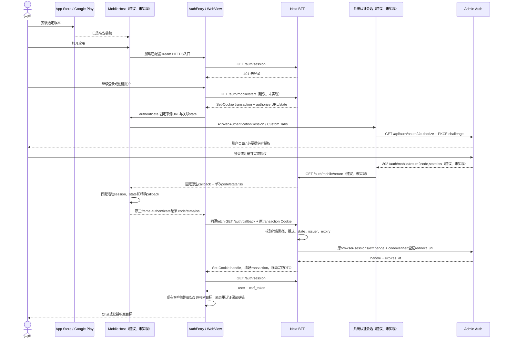
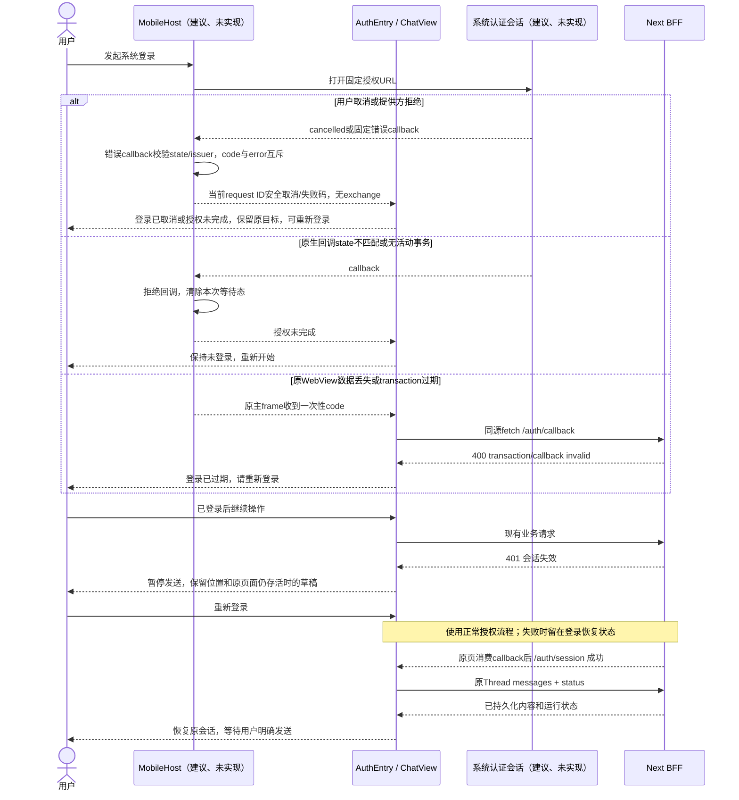
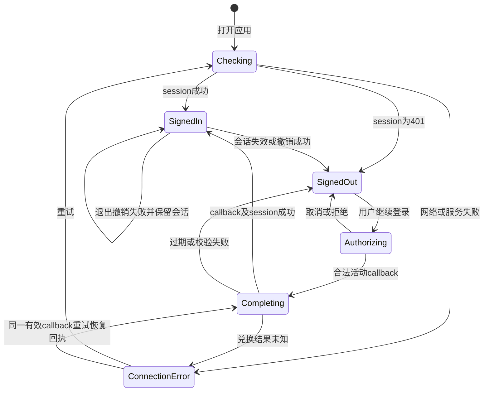
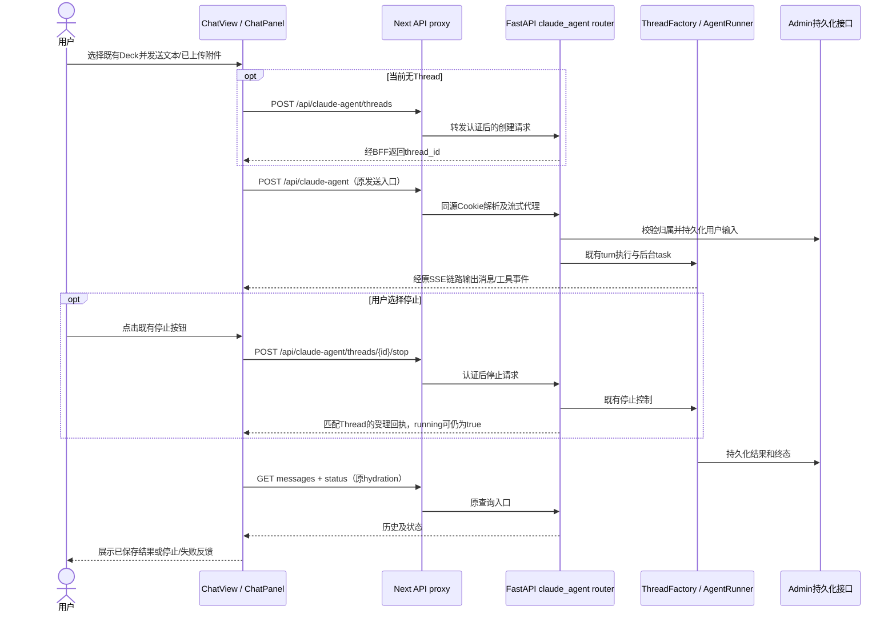
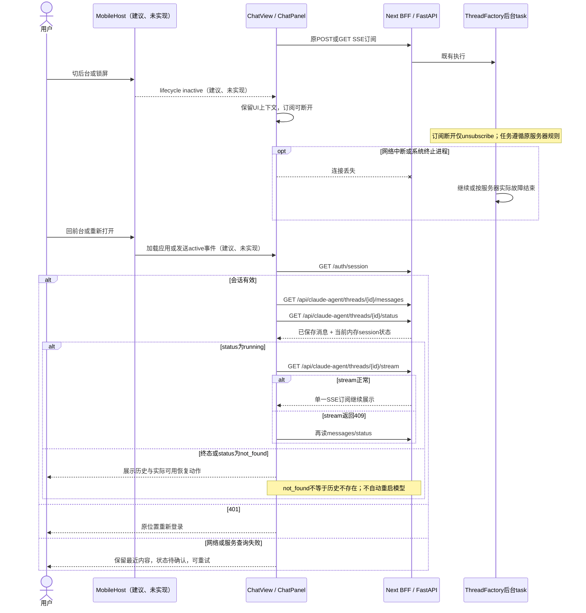
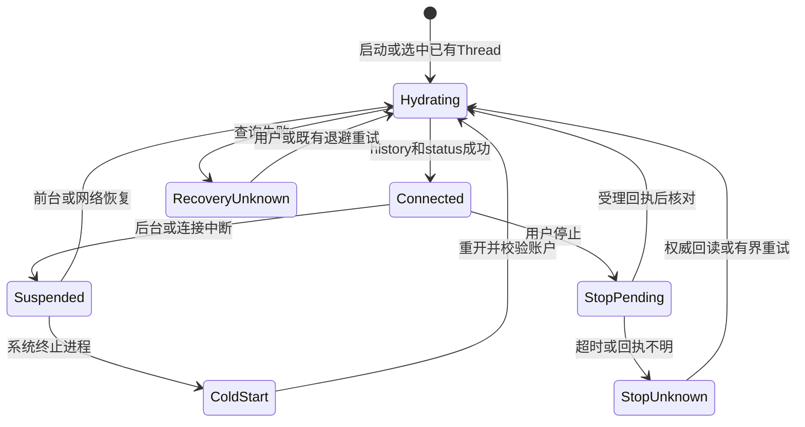
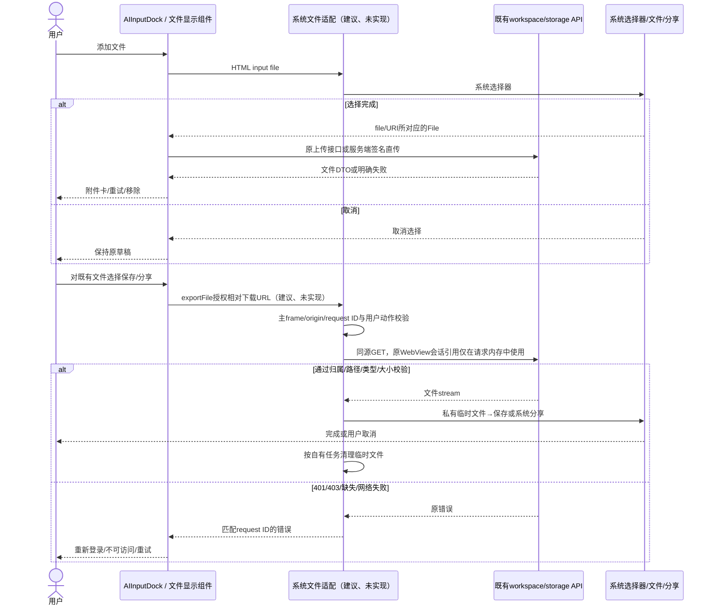

<!-- [Input] 端侧Python要求提出前的四份移动应用设计原文。 -->
<!-- [Output] 历史原文及原路径和摘要，保留前稿图示与文档检查回执。 -->
<!-- [Pos] 历史快照；当前规则以原路径的现行稿为准。 -->
<!-- [Sync] 2026-10-24: 用户确认原生宿主、Admin公网独立及Dream Python端侧运行后保存前稿。 -->

# 端侧Python要求之前的移动应用设计历史

以下内容按原文件保存，代码围栏内的相对引用按所列原路径解释。历史检查结果只适用于该快照。

## 原路径：docs/prd/dream-workspace/mobile-app.md
原文SHA-256：`75959b42c070f83973964779ac44a86ebb3b23f1bf55d9127fc67ef7a0f0e72e`

``````markdown
<!-- [Input] 当前 Chat、Dream、Deck、Settings 产品设计及移动应用路线判断。 -->
<!-- [Output] iOS、Android 首发用户任务、页面骨架、交互规则和验收入口。 -->
<!-- [Pos] Dream 工作台业务目录内的移动应用产品需求；技术打包由 deploy/mobile-app-release.md 定义。 -->
<!-- [Sync] 2026-10-24: 完成文档方案；原生容器、授权交接和平台适配均待实现。 -->

# Ink & Memory 移动应用产品需求

## 背景与问题

用户需要在 iOS 和 Android 安装 Ink & Memory，使用已有账户继续对话和创作，在离开应用后重新查看结果。当前产品已提供窄屏导航、对话、Dream 重入和文件阅读；应用安装、系统授权返回、设备文件保存和移动生命周期仍缺少完整交付路径。

[路线判断](../../deploy/mobile-app-release.md#路线判断)选择轻量原生容器加载现有 HTTPS 应用。共享网页继续承载产品界面和业务操作，服务器继续执行 Agent 与文件任务。[正式交互设计](../../design/story-workspace/mobile-app-interaction.md)定义时序和恢复，[评审及实施验收](../../exec/mobile-app-design-review-20261024.md)记录交付条件。

## 目标与边界

首发提供安装、登录、选择既有思维模式、发送文本与附件、查看流式结果、停止任务、重新进入历史会话、阅读 Dream 产物及保存分享文件的完整流程。现有 Web 继续使用同一组业务规则、导航、视觉样式和权限。

工作假设：首发面向可访问现有服务的用户，通过 App Store 和 Google Play 分发免费应用，使用既有账户权益；应用内购买及外部购买引导暂缓。发布地区、经营主体和账号资格由发布负责人在实施首项确认。中国大陆与其他 Android 商店需逐渠道补齐前提，当前方案保留对应工作项。

| 范围 | 首发处理 | 取舍依据 |
| --- | --- | --- |
| Chat | 完整支持既有文本、附件、思维模式选择、工具问题、队列、停止和历史 | 当前核心入口，继续使用同一 Thread |
| Dream | 支持已有 Run 重入、原会话继续、Project/Episode 阅读、既有初稿确认 | 复用既有窄屏顺序视图与业务动作 |
| Decks | 支持浏览和选择已授权 Deck；已有管理页保持可达，作为受限支持验证 | 首发无需新增手机专属 Deck 编辑器；复杂配置继续复用现页 |
| Settings | 支持账户、退出、语言、主题、权益与用量只读、隐私及删除账户入口 | 登录、隐私和商店分发的必要任务；删除能力待实现 |
| Writing、Timeline、Analysis | 保留 More 内既有入口，作为受限支持检查阅读、编辑、报告重开 | 沿用现有产品范围；首发不重设计这些页面 |
| 资源授权、工具审批 | 已配置资源继续使用；新授权需经系统认证与真实回跳验收 | 外部授权逐提供方核对，未通过的连接操作给出明确不可用反馈 |
| 文件 | 系统选择器、已有预览、保存、系统分享、在其他应用打开 | 移动端接收输入与带走成果所需 |
| 语音输入、本地终端、离线任务、推送、后台常驻 | 暂缓 | 当前语音服务关闭；Agent 与工作区在服务器；核心旅程无这些依赖 |
| 新增桌面安装包 | 范围外 | 目标平台限定 iOS、Android |

受限支持表示保留入口并完成相邻回归，相关缺陷按首发影响处理。未通过授权或窄屏验收的动作在应用中提供具体原因及恢复入口；不得静默提交、丢弃数据或引导未验收的任务流程。

## 概念与规则

### 安装与首次进入

- 首次启动显示品牌启动画面，随后进入现有登录入口或 Chat；无权限请求集合、服务器地址表单和重复欢迎页。
- 启动失败显示“暂时无法连接”、重试和隐私/支持入口。网络恢复后用户可重试，已有页面保持可读时显示连接反馈。
- 登录后的默认入口保持 Chat。最近会话标识可用于重新打开已持久化 Thread；无有效目标时进入历史首页，账户归属由服务器重新检查。
- 更新安装保留系统允许保留的会话与偏好；重新校验账户后读取服务器历史。卸载清除设备会话，服务器历史按账户规则保留。

### 登录、授权与退出

- 账户、密码、注册和身份校验继续由现有认证中心处理。手机登录使用系统管理的认证会话，登录入口复用当前品牌、提供方和错误文案；密码输入位于认证中心页面。
- Google 授权在系统认证会话中进行。返回应用后，仅完成原登录事务并重新读取账户。授权取消保留登录页和原目标，显示“登录已取消”，用户可重新发起。
- 登录失效时保留当前会话位置和原页面仍存活时的草稿，暂停发送，显示重新登录入口；重新登录由原页面完成会话交接，再恢复历史与运行状态，避免文档重载清空草稿；页面已被系统销毁时按进程重开规则处理。
- 退出登录调用现有撤销流程，成功后清除该设备账户缓存和受保护临时文件。撤销失败显示重试，页面维持原会话状态。退出只影响本客户端的 Dream 会话，系统认证中心可能保留单点登录；账号切换通过认证中心明确选择。
- 退出应用与退出登录为独立操作。关闭应用不触发停止任务或退出登录。

### 对话、前后台和恢复

- 发送、运行中排队、问题回答和停止沿用 [Chat Send](../Chat%20Send.md) 与 [排队输入](../chat/queued-input.md)；发送按钮和停止按钮共用既有操作位置。运行中队列只接收纯文本；附件保留在输入草稿，主轮结束后由用户明确发送，不自动入队。
- 应用离开前台时，服务器按原有规则继续任务。应用重新进入前台后先读取原会话，再显示运行、完成、失败或等待用户处理的真实状态。
- 流中断显示“连接已中断，正在读取会话状态”；保留已显示内容，恢复结果覆盖临时判断。正在读取状态时保留停止入口及其现有锁定规则。
- 进程被系统终止后，通过历史恢复已发送消息与已保存结果。未发送文字和未完成上传仅在当前进程存活期间保留；首发不承诺进程终止后的草稿恢复。重新选择附件后由用户再次发送。
- 请求发出后无法确认送达时，显示“发送结果待确认”和“刷新会话”。回读历史、运行状态与相关队列后才能提供再次发送；队列读取失败单独提示，已成功读取的普通历史继续可用；自动重发会产生重复任务，首发流程禁止自动重发。
- 匹配停止回执表示请求已受理，页面显示“正在停止”；服务器确认本轮已结束后，按已保存结果展示完成、已停止或失败；已保存结果为取消才显示已停止，缺少结果时显示状态待确认。失败、超时和未知状态继续显示状态核对与重试。服务端重启后的执行延续按既有能力处理，页面可恢复历史并提示用户显式继续。

### 附件、链接与隐私

- 点击附件使用系统文件选择器；取消选择返回原输入区。文件类型、大小和数量取现有服务配置，上传成功前禁止发送该附件。
- 预览沿用现有图片、文本和文件卡片；复杂文件通过系统“打开”或“分享”。保存/分享失败保留文件卡片并提供重试，用户取消分享后停留当前页。服务器附件和产物完整支持保存分享；仅在页面本地生成的长图、草图和图表保留页面内显示，移动端本地Blob导出暂缓，相关操作显示当前限制。
- 已上传文件仍在服务器授权工作区，保存或分享才产生用户选择的设备副本。退出后清理应用私有临时副本；用户已导出到其他位置的文件由用户管理。
- 普通外部链接打开系统浏览器，返回后保留会话。应用内链接继续原路由；登录回调只用于当前授权事务。通用业务链接唤起应用暂缓，应用内既有导航继续支持。
- 首发使用系统文件选择与分享，不申请相册全量、定位、通讯录、通知或麦克风权限。
- 用户发送个人内容给第三方 AI 前，页面披露提供方、内容范围和用途并取得明确许可。最小交互为发送前的行内披露与同意操作，已有许可可复用；缺少许可记录能力时需在实施中确定可复核方式，首发发布前关闭该缺口。
- Settings 的账户区域增加“删除账户”入口，进入后展示关联数据和法定保留范围，完成必要身份核验及一次明确删除确认。删除完成后退出；失败时显示具体恢复方式。接口及认证中心数据处理待实施核对。
- Google Play 首发在生成结果的现有消息操作菜单加入“举报内容”，填写原因并在应用内提交；结果显示收到或重试。服务端反馈接收能力待实现。Apple 的内容措施按实际分发与内容规则核对。

### 页面和操作

继续使用纸面视觉、现有字体及语义颜色；共享字体的移动分发许可需纳入依赖核查。Chat、Dream、Decks、More 保持现有顺序。More 继续承载其他模块和 Settings，界面无需原生重复导航栏。

返回顺序为：关闭系统选择器/预览/弹窗 → 退出当前详情 → 返回来源列表。Android 系统返回先交给键盘，再按页面层级处理，根页交给系统；iOS 保留页面返回入口，侧滑只在合法页面历史中启用，认证中继与callback消费不进入页面历史。取消、返回和切换页面均不触发 Agent。

键盘显示时，输入框、附件状态和主操作按钮始终位于可见区域；底部栏目导航在编辑期间收起，键盘关闭后恢复。输入区按可见高度增长并内部滚动，消息区独立滚动；页面整体不与消息区形成竞争纵向滚动。用户上翻历史时，流式内容保留其阅读位置并显示现有回到底部入口。软件键盘与硬件键盘组合输入均沿用现有发送规则。

### 桌面参照骨架

```text
┌ 主导航 ─────────┬ 栏目 / 当前会话 ───────────────────┬ 可选历史/文件面板 ┐
│ Chat           │ [思维模式] [历史] [文件]             │ [关闭]           │
│ Dream          ├ 消息列表：区域内纵向滚动 ───────────┤ 列表独立滚动      │
│ Decks          │ 消息 / 工具确认 / 结果文件           │ 文件→预览弹窗     │
│ More           │ [生成结果操作菜单→举报]              │ 历史→原Thread     │
│ └ Settings     ├ 发送前披露（需要许可时） ────────────┴─────────────────┤
│                │ 附件托盘 / 排队卡 / 输入框（超高内部滚动）              │
│                │ [附件→系统选择器] [思维模式]                 [发送/停止]│
└────────────────┴──────────────────────────────────────────────────────┘
Settings → 账户 / 隐私 / 退出 / 删除账户详情（最终删除确认）
登录入口 → 系统认证会话 → 返回原目标；文件预览 → 保存 / 系统分享
```

### 窄屏：首页与 Chat 骨架

```text
┌ 系统顶部安全区域 ──────────────────┐
│ 当前会话       [历史] [文件]        │
├ 消息列表：区域内纵向滚动 ───────────┤
│ 用户输入 / Agent 回复 / 工具问题     │
│ 文件卡→全屏预览→保存/分享            │
│ 消息操作→举报内容表单                │
│ 连接/恢复反馈；空内容给出开始入口     │
├ 发送前披露（需要许可时） ────────────┤
│ 附件托盘 / 排队卡                    │
│ 输入框：增长至可见范围内上限后内滚动 │
│ [附件] [思维模式]        [发送/停止]  │
├ 底部导航（键盘关闭时） ──────────────┤
│ Chat      Dream      Decks     More │
└ 系统底部安全区域 ───────────────────┘
键盘打开：顶部/消息区压缩，输入区在键盘上方，底部导航收起。
历史/文件：全宽列表→选择→回原会话；关闭恢复原滚动位置。
```

### 窄屏：其他必要页面与弹窗关系

```text
启动连接失败           登录入口             Dream工作台
┌────────────────┐   ┌────────────────┐   ┌ ← Dream  项目/分集 ┐
│ 品牌           │   │ 品牌 / 登录提示 │   │ [初稿] [同步]       │
│ 暂时无法连接   │   │ [继续登录]      │   │ 模块/内容单列滚动   │
│ [重试]         │   │ [创建账户]      │   │ [原会话→Chat]       │
│ 隐私 / 支持    │   │ 隐私 / 错误反馈 │   │ Chat Dream Decks More│
└────────────────┘   └──────┬─────────┘   └─────────────────────┘
                        系统认证会话
                  登录/注册/提供方选择→取消或回原目标
Settings → 账户详情 → 删除说明/核验 → 一次删除确认 → 退出
消息操作 → 举报表单（原因/提交/取消）→ 收到反馈或重试
文件卡 → 全屏预览（正文内滚动）→ 系统保存/分享 → 原会话
```

加载使用现有骨架；真正空列表显示开始入口；读取失败显示重试并保留最近内容；会话无权限返回可访问列表；文件无法预览仍提供已授权的保存/打开入口。弹窗正文内部滚动、底部操作固定可见，焦点关闭后回到触发控件。登录、举报、删除等新增交互均为建议，当前代码尚未包含移动容器及相关闭环。

## 验收归属

完整平台、安装升级、认证、流式任务、生命周期、文件、键盘、Web 回归和商店验收矩阵见 [实施与验收矩阵](../../exec/mobile-app-design-review-20261024.md#后续验收矩阵)。本稿仅完成设计，验证状态以执行记录为准。
``````

## 原路径：docs/design/story-workspace/mobile-app-interaction.md
原文SHA-256：`c1d302508b98ec16d2ed34ef8d035a501e205714e6669f1d98e92d3d107b998a`

``````markdown
<!-- [Input] 移动应用 PRD、现有 AuthEntry/BFF/ChatView/ChatPanel/文件接口及推荐远程WebView路线。 -->
<!-- [Output] 移动安装到重入的业务交互、状态、正常/异常时序及新增接口最小合同。 -->
<!-- [Pos] Story Workspace 正式移动交互设计；新增平台能力全部待实现。 -->
<!-- [Sync] 2026-10-24: 保留现有Thread生命周期，补充系统授权、文件导出和发布必需业务入口。 -->

# iOS 与 Android 正式交互设计

## 背景与问题

已有窄屏 Chat 与 Dream 页面需要进入可安装应用，处理系统认证、键盘、文件选择和前后台变化。页面状态、网络订阅和服务器任务状态分别由现有模块维护。原生宿主只提供平台事件与系统操作，服务器继续执行任务。

产品范围、桌面/窄屏骨架和视觉规则见 [移动应用 PRD](../../prd/dream-workspace/mobile-app.md)；方案选择、源码证据与签名发布见 [技术设计](../../deploy/mobile-app-release.md)。下图按当前真实模块和接口命名，标有“建议、未实现”的参与模块和入口为后续工作。

## 目标与边界

完成安装→首次启动→授权→Chat→核心任务→结果→退出/再次进入的旅程；复用原 Thread、Run、查询、流、停止、文件与账户边界。共享页面和服务器的业务规则保持一致。原生容器不拥有 Agent 状态机，不承诺操作系统后台运行，不建立离线业务数据库。

### 用户旅程与页面行为

| 阶段 | 用户操作 | 反馈与返回 |
| --- | --- | --- |
| 安装/升级 | 从选定商店安装或更新 | 点击图标进入；保留可用会话，校验后读取原历史 |
| 首次启动 | 等待现有HTTPS应用加载 | 品牌启动画面；错误页重试，不申请无关权限 |
| 未登录 | 继续登录或创建账户 | 系统认证会话展示Admin账户页面；完成后返回原目标 |
| Chat首页 | 选择思维模式或历史会话 | 使用现有入口；空会话首次发送才创建所需业务实体 |
| 执行 | 发送文字、上传附件、回答工具问题、运行中排队 | 原消息流、队列卡片、问答和发送/停止位置 |
| 结果 | 阅读回复、Dream/分集产物、预览/保存/分享文件 | 阅读位置稳定；返回原会话与当前分集 |
| 离开/重入 | 切后台、锁屏、关闭进程、再次打开 | 重新校验会话并回读历史/状态；不自动发送和停止 |
| 退出 | Settings→退出 | 撤销成功后登录页；失败保留会话并显示重试 |

## 概念与规则

### 认证状态与凭证归属

当前 `AuthEntry` 使用Admin表单，`/auth/start` 和 `/auth/callback` 执行PKCE，`/auth/session`只返回用户和CSRF。移动方案将认证页面放入系统管理会话，通过原WebView的加密transaction Cookie完成交接；密码与OAuth token归Admin/服务端，页面和宿主只消费授权URL、一次性code、state与issuer。

移动登录入口与系统页面使用一致品牌和提供方。规范OAuth错误回调中code与error互斥，错误仍核对活动state及允许issuer，仅返回安全错误码，error_description正文不经bridge转交；错误不调用exchange或设置handle。系统认证中心必须在登录、注册和Google返回后继续原authorize上下文；这是Admin注册及实现核验前提。现有Device Flow保持CLI用途。

### 正常业务时序：安装与授权



移动transaction只由服务器固定配置选择登记URI；现有Web流程继续使用原 `/auth/start` 和原callback绑定。系统中继没有WebView Cookie，无法兑换或认定成功。原页面通过同源fetch消费移动callback，服务器按加密transaction模式返回严格完成DTO，普通Web事务保持原303；调用方禁止自动跟随意外重定向并在失败时保持未登录。原生收到回调仍需最终 `/auth/session` 成功才能进入账户页面。临时code的未知结果沿用原exchange回执恢复，用户明确重新登录时建立新transaction。

### 异常与恢复时序：授权取消、会话失效



Android Custom Tabs 无可靠“用户关闭即取消”统一回调时，宿主返回前台核对活动session；未收到合法callback显示“登录尚未完成”，提供继续或重新登录。新transaction替代旧transaction后拒绝旧callback。登录过程遇到进程终止直接重新开始，避免凭回调重建身份。



### 核心任务和流式显示

`ChatView` 与 `ChatPanel`继续拥有hydration、输入队列和SSE；`threadStop`继续拥有停止回执。前后台事件通过同一协调入口合并，禁用第二套原生parser/reducer。



用户运行中继续发送时调用既有inputs队列合同，队列只支持纯文本；附件保留输入草稿，主轮结束后由用户明确发送，不自动入队。界面沿用队列卡片；首发不改写主turn与队列的状态定义。停止与发送使用当前单一操作位规则，草稿存在时显示发送，空草稿且运行中显示停止。

### 异常与恢复时序：断网、后台、进程重开



恢复读取覆盖history、status与已有queue数据；各读取结果分别反馈。queue失败时显示排队消息读取失败并提供原重试，已成功读取的普通历史继续可用；没有权威任务结果时保持未知，禁止重放未知队列。提交发送的响应未知时，先比对最新消息和queue，不能借前台事件重复提交。停止响应未知时保持既有stop锁和回读，匹配回执只表示受理；running仍为true时显示正在停止，status确认running=false后，按history中的completed/cancelled/error等持久化结果映射完成/已停止/失败；缺少终态时保持待确认。只有权威状态允许解除，cancelled才显示已停止。

### 生命周期与业务状态

| 客户端状态 | 事件 | 服务器任务语义 | 页面处理 |
| --- | --- | --- | --- |
| 前台已连接 | 接收流 | 由原runtime维护 | 保留阅读位置与现有输入行为 |
| 后台/锁屏 | OS挂起网页或连接 | 任务可能继续 | 不发送stop、不创建新Thread |
| 前台恢复中 | active、network online | 先查询 | 会话→history/status/queue→running才接流 |
| 进程结束 | 设备清理 | 无自动取消动作 | 重开按已保存历史恢复；未发送草稿不保证保留 |
| 服务端重启 | 内存session缺失 | 历史可仍存在，执行恢复按现有规则 | 显示历史及可继续操作，不宣布自动续跑 |
| 停止未知 | 网络或回执失败 | 尚未确认停止 | 保留状态核对与重试，禁止假完成 |



此图只定义客户端展示/连接状态。服务器running、终态和not_found从现有查询解释，新增客户端状态不写入数据库。

### 文件交互



服务器文件入口统一覆盖FileSidebar、FileMessagePart、WorkspaceFileReference，允许的相对下载路径为`/api/workspace/files/download`及`/api/storage/file/{encoded_key}`，服务器执行原权限和归属校验。本地生成长图、草图、图表Blob首发保留页面内显示，保存分享暂缓并明确反馈限制。普通Web保持现有Blob下载。移动容器不接收跨域下载地址和任意服务器路径，不把鉴权头交给其他应用。外部分享只传用户选中的文件URI及临时读取许可。工作区模式关闭、Thread不归属、文件缺失时复用现有具体反馈。

### 输入、滚动与平台操作

- 共用 `StoryWorkspaceSidebar` 的底部导航与 `ChatPanel` 非滚动输入区；移动适配只调整可见viewport、安全区和键盘占位。iOS使用安全区和可见viewport校验；Android使用WindowInsets/IME resize，避免原生resize与网页重复扣减。
- 键盘打开收起底部导航，输入区位于键盘之上；关闭后恢复导航与原阅读位置。长草稿内部滚动，消息区独立纵向滚动，代码/表格只在自身范围横向滚动。
- Android返回先关闭IME，再关闭预览/弹窗，再退出详情；根页由系统处理。iOS页面返回与合法侧滑遵守同一层级；禁止滑回登录code页面再次兑换。
- 系统外链返回与认证返回分别处理。普通外链返回只恢复页面，认证callback必须匹配活动事务。原生宿主不把所有回到前台事件当作授权成功。
- 文字缩放、VoiceOver/TalkBack、焦点返回、触控目标、暗色模式、横竖屏与分屏按现有视觉体系验证；不再增加一套原生Chat导航。

### 发布必需业务补充（建议、未实现）

| 入口 | 最小输入与处理 | 成功/失败与依赖 |
| --- | --- | --- |
| Settings→账户→删除账户 | `POST /api/account/deletion`：现有身份+CSRF、必要重新认证证明、明确确认；幂等请求ID；服务器解析主体，禁止客户端userId授权；Admin执行删除及关联数据/法定保留规则 | 完成后撤销会话并退出；执行中显示实际处理状态，未知结果用同一请求ID查询/重试。具体状态查询入口先复用Admin已有合同，缺少时作为实施前依赖；禁止在未知时重复删除或伪造完成 |
| 消息菜单→举报内容 | `POST /api/content-reports`：threadId、messageId、选定原因、幂等request ID；服务器核对归属和消息存在，按声明用途解析最小所需内容进入已确认反馈接收渠道 | 收到回执后显示已提交；网络未知时同ID重试；缺少接收能力时明确失败并阻断Google Play发布。无应用外邮箱替代闭环 |
| 首次向已披露AI提供方发送 | 原消息输入旁说明提供方、文本/附件/已选择资源范围和用途；用户明确同意后调用原发送入口，取消则保留草稿 | 先核对现有账户设置/消息元数据能否记录许可与版本；适用许可不存在时不传输。无需全局授权中心或新的独立页面 |
| 移动权益视图 | 复用Settings权益/用量读取；基于host capability显示消费型界面 | 无购买、升级、价格导购或支付外链；未获权益按当前服务返回说明，不通过移动页面另发payment intent。普通Web原商业功能保持现义 |

账户删除涉及身份及数据处理，举报涉及反馈留存，具体Admin合同在实施前核验；两项拟议路径允许由已存在且满足职责的公开接口替代。新增持久化能力统一按Admin Drizzle/capability规则先行，当前设计不预设新表。删除与举报均需服务器幂等及明确回执，不能仅完成前端弹窗即记为交付。

## 验收与评审入口

[验收矩阵与实施工作项](../../exec/mobile-app-design-review-20261024.md#后续验收矩阵)分别记录iOS/Android、首次安装/升级、认证、任务、停止、恢复、文件、输入、Web回归及商店路径。本轮Mermaid语法与文档检查只能证明文档结构，功能、真机、真实账户/模型与发布状态保持待执行。
``````

## 原路径：docs/deploy/mobile-app-release.md
原文SHA-256：`179ac91b415240255abae6b616bc160276f2d58a5135c0e4067b1920dd9a674f`

``````markdown
<!-- [Input] Dream 当前源码、参考工程只读证据及 2026-10-24 官方框架和商店资料。 -->
<!-- [Output] iOS/Android 路线判断、架构、认证、构建、制品、渠道和更新合同。 -->
<!-- [Pos] 移动应用技术打包发布设计；本轮无工程初始化、构建、签名和发布操作。 -->
<!-- [Sync] 2026-10-24: 选定远程 HTTPS WebView 与最小平台宿主；全部新增能力标记为建议。 -->

# iOS 与 Android 打包发布设计

## 路线判断

**推荐：Swift/WKWebView 与 Kotlin/Android WebView 两个轻量原生宿主，加载既有 HTTPS Dream 应用；共享现有 React 界面、Next BFF、FastAPI 和 Admin。** 首发只维护一套业务界面与执行协议，平台宿主负责系统认证会话、文件选择/导出、窗口安全区域、返回和生命周期事件。服务器继续运行 Node、Python、Agent、终端工具和工作区。

选择依据：当前 Next 应用使用动态认证和 API Route Handlers，REST/SSE 固定同源；加载已部署站点可以保留 Cookie、CSRF、流式代理与业务路由。本地 Web 资源方案需要先拆分客户端构建入口、跨源认证和 API 来源。参考项目的 Electron/ASAR/macOS 组装流程适用于桌面，移动工程需从官方平台工具链建立。

推荐方案具备完整首发路径，发布依赖尚未满足。系统授权交接、真机生命周期、文件导出、商店隐私与账户删除、Google Play 内容举报及权益模式审核均为发布门槛。App Store 4.2 的效用与移动体验需要实际审核，原生容器形式无法保证获批。[Apple 最低功能要求](https://developer.apple.com/app-store/review/guidelines/#minimum-functionality)；查阅日期：2026-10-24。

产品规则及骨架由 [移动应用 PRD](../prd/dream-workspace/mobile-app.md)所有；业务图和交互状态由 [正式设计](../design/story-workspace/mobile-app-interaction.md)所有；工作项、评审与后续验收由 [执行记录](../exec/mobile-app-design-review-20261024.md)所有。

## 事实、建议和验证边界

- **当前代码事实**：以下 Dream 源码证据，基线 `310f30bbc5c3366db7e74c497149fb38999bd2dd`；开始时工作区无未提交改动。
- **参考项目能力**：只读参考根目录 `/Users/dmeck/project/Codex-Original-Functionality-Round52-Delivery`，基线 `e3fe334a9e9a5fd5b990ea580b0971ae49614fa3`；当时有 3307 项 status 输出，主要在 `work/semantic-recovery-restart`，本轮未修改该仓库。
- **拟议方案**：原生宿主、目录、配置、新接口、平台适配及发布流程均待实现。本文命令职责为后续设计，当前没有可执行移动脚本。
- **待验证事项**：源码读取证明调用结构，未证明 WebView、真机、服务运行、真实账户、模型、签名或商店结果。

### Dream 当前入口与复用边界

下表路径相对目标仓库；行号为本轮源码基线。

| 能力 | 当前事实与证据 | 移动处理 |
| --- | --- | --- |
| 构建与路由 | [package.json](../../frontend/package.json#L6):6–11、37–39 为 pnpm 10.28.1、Next 16.1.6、React 19.1.0；[next.config.js](../../frontend/next.config.js#L17):17–21 仅默认/standalone；[Dockerfile](../../frontend/Dockerfile#L9):9–40 在服务器构建并运行 Node | 复用服务器构建；原生安装包不包含 Next server |
| React 页面 | [layout.tsx](../../frontend/app/layout.tsx#L81):81–100 为 document Server Component；[client-shell.tsx](../../frontend/app/client-shell.tsx#L15):15–26 动态加载 `_dream/App`；[catch-all page](../../frontend/app/[[...path]]/page.tsx#L6):6–9 承载产品路由 | 直接加载同一页面与客户端组件 |
| 运行时依赖 | [API handler](../../frontend/app/api/[[...path]]/route.ts#L7):7–15 与 [auth/start](../../frontend/app/auth/start/route.ts#L7):7–10、[auth/callback](../../frontend/app/auth/callback/route.ts#L7):7–10 为 Node、force-dynamic | 完整应用无法直接静态导出；构建期 Server Components 本身无需全部移除，阻碍来自运行时认证/代理等依赖 |
| 服务来源 | [apiBase.ts](../../frontend/app/_dream/lib/apiBase.ts#L22):22、39–51 固定 REST/SSE 同源 | 设备 origin 使用真实 HTTPS Dream；修改 runtime API_BASE_URL 无法单独支持本地资源 |
| 登录入口 | [AuthEntry](../../frontend/app/_dream/components/Auth/AuthEntry.tsx#L47):47、63–74 获取 `/auth/options`，顶层 POST Admin 表单；[handlers](../../frontend/app/api/_auth/handlers.ts#L33):33–82 投影 action 和 PKCE | 身份校验、注册与 Google secret 留在 Admin；手机增加系统认证交接 |
| Cookie 与 CSRF | [login-boundary](../../frontend/app/api/_auth/login-boundary.ts#L120):120–154、275–308 固定 origin、回调、HttpOnly/SameSite=Lax/Secure、Origin 与 `x-ink-csrf` | 保留 WebView 同源会话；令牌不进入网页或原生存储 |
| 会话与代理 | [handlers](../../frontend/app/api/_auth/handlers.ts#L74):74–110 在服务器 exchange/resolve；[api-proxy](../../frontend/app/api/_auth/api-proxy.ts#L14):14–26 Cookie 优先；[_http-proxy](../../frontend/app/api/_http-proxy.ts#L37):37–83 透传 stream、AbortSignal 并清除内部头 | 移动页面继续使用现有 Browser Session 和 SSE；独立 Bearer 通道维持现义 |
| 任务执行与恢复 | [thread_factory](../../backend/claude_agent/thread_factory.py#L453):453–479 后台 task 与订阅解耦；[claude_agent router](../../backend/routers/claude_agent.py#L2789):2789–2835 查询内存状态；[ChatView](../../frontend/app/_dream/components/chat/ChatView.tsx#L787):787–855 回读历史/状态；[ChatPanel](../../frontend/app/_dream/components/chat/ChatPanel.tsx#L933):933–984 断流恢复 | 前台事件触发同一恢复函数；无客户端后台执行承诺 |
| 停止 | [threadStop](../../frontend/app/_dream/components/chat/threadStop.ts#L38):38–82、137–177 有界幂等及 Thread 回执；[stop route](../../backend/routers/claude_agent.py#L2920):2920–2942 | 保留现有停止锁定、未知态和回执；stop_requested/running=true只表示正在停止，按实际终态显示结果 |
| 附件与文件 | [AIInputDock](../../frontend/app/_dream/components/chat/AIInputDock.tsx#L301):301–340、567–575；[useFileUpload](../../frontend/app/_dream/hooks/useFileUpload.ts#L95):95–111、198–236；[FileSidebar](../../frontend/app/_dream/components/dashboard/FileSidebar.tsx#L235):235–254 为 fetch→Blob→object URL→download | 复用上传、预览 DTO；为原生导出委派认证 URL；单独监听 DownloadListener 覆盖不足 |
| 路径与归属 | [workspaceFileAccess](../../frontend/app/_dream/components/chat/workspaceFileAccess.ts#L37):37–63 按 Thread/path 构造读取；[workspace router](../../backend/routers/workspace.py#L356):356–407、709–760 校验归属/路径并 no-store | 原生只接受这些授权路径，无设备或服务器任意路径访问 |
| 服务器工作区 | [service.py](../../backend/claude_agent/service.py#L1908):1908–1935、2327–2348 决定 workspace；[agent_runner](../../backend/libs/claude_agent_kit/server/agent_runner.py#L3902):3902–3925、3969–3973、4043–4048 执行 SDK | 手机不携带 Node、PTY、Bash、CLI 和服务器文件系统 |
| 窄屏 | [StoryWorkspaceSidebar](../../frontend/app/_dream/components/story-workspace/layout/StoryWorkspaceSidebar.tsx#L4):4、13；[Layout CSS](../../frontend/app/_dream/components/story-workspace/layout/StoryWorkspaceLayout.css#L1067):1067–1085、1221–1247；[ChatPanel](../../frontend/app/_dream/components/chat/ChatPanel.tsx#L1514):1514–1528 | 已有底部导航与安全区；键盘、viewport-fit、生命周期仍需适配 |
| 语音与商业入口 | [server.py](../../backend/server.py#L600):600–605 关闭 speech WebSocket；[productApi](../../frontend/app/_dream/api/productApi.ts#L13):13–18、623–645 包含 payment-intents；[订阅页](../../frontend/app/_dream/views/story-workspace/StoryWorkspaceSubscriptionPage.tsx#L230):230–236、335–357 显示套餐 | 暂缓语音；数字权益需要单独审核，移动视图限定只读 |

静态导出判断依据为当前动态入口与 [Next.js static export 官方限制](https://nextjs.org/docs/app/guides/static-exports)及 [BFF export 限制](https://nextjs.org/docs/app/guides/backend-for-frontend)，查阅日期 2026-10-24。本轮未执行 `next build` 或试改 `output: export`。

### 参考能力映射

以下 `R` 表示上述参考根目录；文件和行号可直接定位。只借鉴流程、责任划分及制品追溯，复制具体源码或二进制需要独立授权核查。

| 参考模块或流程 | 当前作用 | 可借鉴内容 | 移动端适配要求 | 证据 |
| --- | --- | --- | --- | --- |
| package 与 runtime build | 重建工程包0.2.0，vendor目标Electron42.1.0；esbuild 编译 Main、CJS Preload、React Renderer，生成 ASAR | 入口清单、输入图、锁定版本、构建后来源摘要 | 平台宿主各自构建，排除 Electron/Preload/ASAR | `R/package.json:2–6,25–36,140–158`；`R/scripts/build-application-runtime.mjs:40–75,141–174` |
| macOS build/sign/verify | Darwin arm64 检查、外部输入 hash、`.app` 组装、ad-hoc 签名、Mach-O/ZIP 校验 | 构建前条件、签名后校验、产物摘要 | 替换为 Xcode 归档和 Gradle 制品；iOS 分发身份需重新登记 | `R/build-sign-verify-original-ui-macos-arm64.sh:36–67,77–109` |
| deliverables | Skeleton/Frameworks/ASAR 组合应用，输出源码包和 SHA256SUMS | 分开源码、应用、验证说明；留存摘要 | `.xcarchive`/符号/IPA 与 APK/AAB 独立管理 | `R/scripts/package-original-ui-deliverables.mjs:8–30,38–47` |
| CodexAppServerSidecar | 桌面启动 `codex app-server`，监听本机随机 WebSocket | 展示与执行模块所有权 | Dream 服务器承担执行，移动端无需 sidecar | `R/src/entries/main-runtime.ts:311–315`；`R/src/main/runtime/codex-app-server-sidecar.ts:95–108` |
| LocalNodePtyBackend | 本机 node-pty 启动 shell | 宿主接口隔离 | 不进入移动安装包 | `R/src/main/terminal/node-pty-backend.ts:59–77` |
| CodexMobilePage | 桌面手机连接引导、MFA 和客户端状态；文案要求手机在 ChatGPT 访问保持唤醒的 Mac | 取消、错误、重试及权限反馈方式 | Ink 使用自己的登录与服务器，配对协议无复用授权 | `R/src/renderer/mobile/codex-mobile-page.tsx:25–51` |
| mobile protocol/service | Electron IPC 调用 ChatGPT REST；本机 JSON 保存设置；开关仅读 clients 并写设置 | DTO、分页、鉴权失败与重试组织 | 不复制 OpenAI endpoint、token、业务常量 | `R/src/shared/mobile/codex-mobile-protocol.ts:38–65`；`R/src/main/mobile/codex-mobile-service.ts:55–67,166–219,231–249` |
| Sparkle updater / Windows policy | macOS 原生更新与 Windows Store 身份规则 | 版本、渠道身份、更新失败状态 | 由目标移动商店更新；不引入 Sparkle 或自下载原生更新 | `R/src/main/updater/desktop-updater-service.ts:134–220`；`R/src/main/automations/windows-store-updater-policy.ts:4–9,62–92` |
| vendor manifest | 原 DMG、ASAR、node-pty hash 与签名前后来源 | 每项二进制的来源、许可、平台和摘要 | 官方移动依赖独立清单 | `R/vendor/node-pty-electron42-darwin-arm64/VENDOR-MANIFEST.json:1–29` |

`MobileQrArtwork` 是 `<i>` 与按钮构成的示意图，未编码配对 URL（`R/src/renderer/mobile/codex-mobile-page.tsx:9–13`）；当前 Mobile 为 Partial，仍需第二设备实际批准（`R/docs/parity/Codex-Original-Feature-Inventory.md:51`）。文件扫描未发现 Xcode project、Podfile、Gradle、AndroidManifest、Capacitor、Expo 或 Flutter 工程标记，根包无移动打包命令。移动连接状态与独立移动工程分别记录。

#### 来源和分发条件

根包 `private: true`、README 声明证据重建且为非官方源码（`R/package.json:4–5`、`R/README.md:3`），扫描未发现覆盖根源码的 LICENSE/NOTICE。`R/resources/renderer/original-ui/README.md:3–7` 记录 CSS/字体从原 ASAR 提取，hash 仅证明来源。node-pty 的 MIT 许可要求保留声明（vendor 内 `node_modules/node-pty/LICENSE:1–19,23–43`），覆盖范围限定该组件。原始应用 Skeleton、Frameworks、Codex CLI、字体、商标及整套源码的复制分发授权仍待核验。

`R/scripts/materialize-node-pty-electron42-vendor.mjs:74–109` 的 vendor 目标固定 Electron42/Darwin/arm64；`R/scripts/build-application-runtime.mjs:113–133` 写入 OpenAI Sparkle feed、公钥和原版本。移动方案全部排除这些制品与发布身份；不从参考仓库复制文件。目标仓库自身字体、图标和前端依赖的分发许可仍需在首个构建前形成清单。

### 历史文档差异及影响

| 差异 | 当前依据 | 处理 |
| --- | --- | --- |
| 参考 README 停留 Round52 的 3/16/20 统计 | `R/package.json:134–139` 已有 Round84/85；功能清单 `:9–10` 为35 Implemented/4 Partial | 引用当前脚本，旧统计保留历史 |
| work 子树称无完整 APP、包版本0.1.0 | `R/work/semantic-recovery-restart/README.md:11–12` 对应 checkpoint；根工程已含应用组装 | 两个源码位置分别定位 |
| README-ZH 称 DMG 仅分析输入 | `R/README-ZH.md:64–65` 与 macOS 脚本 `:13,31,44,66,79` 强制 DMG 并抽取 node-pty 存在差异 | 不复用旧输入清单 |
| 参考连接、云任务和 SSH 的交付标题 | `R/docs/delivery/round-84-README.md:22,42` 未点击 Allow；round85 `:26` 云账户与完整链路受限 | 仅记录已观察局部能力 |
| Dream 历史 Vite/Cloud 发布说明 | [deploy/README](../../deploy/README.md#L25):25–30、[发布索引](README.md)已有漂移说明；[release-system-design](release-system-design.md)保留历史 | 当前方案采用 Next/pnpm，同源 BFF |
| docker-entrypoint 跨源注释和 desktop-only 文件头 | [docker-entrypoint](../../frontend/docker-entrypoint.sh#L10):10–20 与 apiBase 同源实现存在差异；[Layout](../../frontend/app/_dream/components/story-workspace/layout/StoryWorkspaceLayout.tsx#L2):2 与 responsive CSS 存在差异 | 本轮只登记，后续拥有对应代码的任务同步注释 |

## 候选路线比较

| 维度 | A：远程 HTTPS + 最小原生宿主（推荐） | B：本地 Web 资源 + Capacitor | C：React Native/Expo 产品界面 |
| --- | --- | --- | --- |
| 代码/业务复用 | DOM、编辑器、Markdown、路由和 DTO 直接共享 | 客户端组件可复用；先拆静态入口和 server-only 依赖 | 复用 TypeScript DTO/部分逻辑；DOM、编辑器和布局需重建 |
| Next 服务端 | 完整保留服务器运行 | BFF 仍须远程部署，本地资源须重新定义 origin/认证/路由 | 建立原生 API 客户端，仍需服务端 BFF 或独立token流程 |
| 认证/流式/生命周期 | 同源会话和 SSE 原样消费；新增系统授权交接及前台恢复 | 本地 origin 引入 Cookie/CORS/CSRF 和 streaming 路径调整 | 新增原生网络层、流式解析和恢复集成 |
| 原生与商店 | 两套小宿主维护；效用、隐私、文件和输入体验需审核证据 | 插件生态可用，商店要求同样适用 | 原生控件适配较强，产品界面维护面扩大 |
| 包/Web/服务版本 | Web 与服务协同发布，保持旧宿主 bridge 兼容 | 包内资源固定版本，API 与旧包兼容期更长 | 两套产品界面和客户端协议长期并行 |
| 长期成本 | 最低业务重写，承担站点可用性和两平台宿主测试 | 首期拆分较高；增加资源打包与版本面 | 首期和持续业务同步成本最高 |
| 迁移条件 | 固定 bridge 边界可复用到后续资源包 | 需要离线启动或明显前端延迟收益时重新评估 | 真实证据证明富编辑/系统交互无法满足核心任务时重新评估 |

B 的常规工作流将 `webDir` 的静态产物复制入平台工程，当前完整 Next 产物不满足该输入。Capacitor 的 `server.url` 官方标注为 live reload、生产用途排除，故 A 使用平台 WebView API，不将该配置作为上线捷径。[Capacitor config](https://capacitorjs.com/docs/config)、[workflow](https://capacitorjs.com/docs/basics/workflow)。C 使用平台原生组件，React 语法相同无法直接复用现有 DOM 组件：[React Native core components](https://reactnative.dev/docs/intro-react-native-components)。查阅日期均为2026-10-24。

PWA 可保留 Web 的添加到主屏幕体验，无法单独交付本任务所需的 App Store/Google Play 签名原生制品，首发不增加第四条客户端路线。A 的适用前提为服务稳定可访问、联网使用和完整 WebView 验收；若 4.2 审核确认核心效用不足，先修订实际移动任务和交互，再判断路线，避免并行实现三套客户端。

## 架构与代码归属（建议、未实现）

```text
mobile/ios/                  Swift 宿主、WKWebView、系统认证、文件导出、签名配置
mobile/android/              Kotlin 宿主、WebView、Custom Tabs、文件选择/分享、Gradle wrapper
mobile/contracts/            bridge JSON schema、公开构建配置 schema、无秘密的版本兼容说明
frontend/app/_dream/          共享产品界面；最小 mobileHost adapter 与现有恢复函数集成
frontend/app/auth/mobile/     start、return 两个薄 Route Handler
frontend/app/api/_auth/       原 BFF 扩展 transaction 校验与登记 redirect URI
scripts/mobile/              平台构建/校验/归档脚本
.github/workflows/           iOS 与 Android 独立签名工作流
```

以上目录均为建议，本轮未创建。`mobile/contracts` 只承载双方真实使用的协议与配置，首发不生成通用插件框架。iOS 使用系统 WebKit/AuthenticationServices/UIKit，Android 使用平台 WebView、AndroidX WebKit/Browser/Core 与 Activity 组件；精确版本在后续工程任务按官方稳定版本及许可证锁定。前端继续唯一 pnpm workspace；不复制 `_dream` 或创建第二个前端。

宿主只暴露 `capabilities`、`authenticate`、`exportFile` 和 lifecycle 事件；普通链接由原生导航 delegate 处理，上传沿用 input/file chooser。消息包含协议版本、request ID、固定类型及严格字段；响应匹配 request ID，取消返回取消态。只有已配置 Dream HTTPS origin 的主 frame 可调用；iOS 检查 frameInfo/mainFrame/securityOrigin，Android 使用 AndroidX WebKit 的精确 allowedOriginRules 并核验 isMainFrame。MCP iframe、外部网页、重定向后的其他来源均无原生权限。禁止通配来源、通用命令执行、任意路径读取与远程扩展 bridge。[Android bridge 安全](https://developer.android.com/privacy-and-security/risks/insecure-webview-native-bridges)、[AndroidX messaging](https://developer.android.com/develop/ui/views/layout/webapps/native-api-access-jsbridge)、[Apple frameInfo](https://developer.apple.com/documentation/webkit/wkscriptmessage/frameinfo)；2026-10-24。

### 最小配置与兼容

| 所有者 | 配置入口 | 规则 |
| --- | --- | --- |
| 签名原生包 | 公开 build config：Dream HTTPS origin、允许导航路径、Admin authorization origin、固定原生回调 URI、应用ID、渠道、appVersion/buildNumber、bridgeVersion | 发布负责人从已确认部署注入；构建校验无 userinfo/query/fragment、无通配和测试回环地址；用户界面无服务器地址编辑器 |
| Next BFF | 复用 `INK_DREAM_PUBLIC_ORIGIN`、`INK_DREAM_BFF_REDIRECT_URI`、server-only secret；新增 mobile registered redirect URI 和 native callback 精确配置 | 固定服务器配置选择 mobile transaction；不接受请求提供任意 redirect；公开配置无 server secret |
| 共享页面 | 根据握手得到的 host capabilities 选择平台呈现；业务权限继续由服务器校验 | 无宿主时保持当前 Web 行为；客户端平台字段只控制呈现和调用适配 |
| 发布清单 | app SHA、Web/后端/Admin版本、所需 auth capability、bridge 支持范围及允许渠道 | 当前无手机 schema，发布清单采用仓库版本化文件；不新增数据库配置系统 |

此处配置属于工程发布输入：default 为现有 Web 行为和最小 bridge；desired 为评审后的版本化发布清单；effective 为安装包内公开配置与服务实际部署版本；revision 为对应源码 SHA/包构建号。仅发布回执核对全部值后标记生效；登录页不展示这些实现字段。所有部署执行同一生产路径，宿主能力通过握手表达，业务代码不按 development/test/production 标签改变行为。

## 网络与认证（建议、未实现）

首发连接公开、稳定的 Dream HTTPS origin；Next 经现有 server transport 访问 FastAPI/Admin，设备不接触内部地址。iOS ATS 保持默认严格策略，Android 禁止 cleartext/mixed content，TLS 错误中止。WebView 与共享 REST/SSE 同源，无需放宽 CORS 或 SameSite。外部链接经 HTTPS scheme/目标校验后由系统浏览器打开；禁用任意自定义 scheme、file/javascript 导航及跨源自动下载。上传签名 URL 只由既有服务生成，并按既有来源配置和过期规则使用。

### 授权交接协议

系统认证会话与 WebView Cookie 容器相互独立。首发统一从应用登录入口打开 iOS ASWebAuthenticationSession / Android Custom Tabs，密码和第三方提供方由 Admin 页面处理；应用不采集密码。Android缺少Custom Tabs提供方时可用已安装的系统浏览器完成相同固定回调；无可用浏览器时提示无法打开登录并提供重试，禁止在嵌入WebView中降级执行Google授权。[Google OAuth policy](https://developers.google.com/identity/protocols/oauth2/policies)禁止嵌入式 Google 授权，[ASWebAuthenticationSession](https://developer.apple.com/documentation/authenticationservices/aswebauthenticationsession)提供系统管理的认证回调；2026-10-24。

| 入口 | 行为和数据 | 状态 |
| --- | --- | --- |
| `GET /auth/mobile/start` | WebView 请求；严格校验相对 return_to；服务器创建 PKCE、state、nonce、expiry 和 transaction ID，并记录固定 mobile registered redirect URI/模式；通过原加密 HttpOnly transaction Cookie 保存；返回 allowlisted authorize URL、state 与回调匹配信息，无 verifier/token | 建议、未实现 |
| Admin `/api/auth/oauth2/authorize` | 系统认证会话打开；注册的 browser client 使用 S256；首次登录/注册/Google 后继续原 authorize 上下文 | 已有入口，移动上下文保持与新增精确 URI 注册待跨仓库核验 |
| `GET /auth/mobile/return` | Admin 登记的 HTTPS 回调；仅接受单值 code/state/iss 或规范 error，校验静态 issuer/格式；重定向到包与服务器配置一致的固定原生回调。无 WebView Cookie，无法宣布登录成功或兑换 | 建议、未实现 |
| 原生固定 callback | 当前待完成认证 session 匹配 scheme/host/path/state；将单次code/state/iss交回原主frame的authenticate结果，原页面以同源fetch调用 `/auth/callback`；无活动事务/重复回调拒绝 | 建议、未实现 |
| `GET /auth/callback` | 消费 WebView 原 transaction Cookie；校验当前消费路径、state/issuer/expiry/模式，并使用当次登记的 mobile redirect URI+PKCE 调用原 Admin exchange；设置原handle Cookie，清除transaction；移动事务返回严格完成DTO `{authenticated:true,return_to}`，页面再读取session并由原客户端路由恢复目标；普通Web事务继续原303 | 已有入口，移动分支绑定适配未实现 |
| `/auth/session`、`POST /auth/logout` | 读取 user+csrf；按既有 Origin+CSRF 撤销当前 handle | 直接复用 |

现 transaction 严格六字段（login-boundary.ts:171–208），必须以服务器配置扩展 schema；现 `boundary.callbackUri` 同时承担消费路径校验与 exchange redirect URI（:214–220、handlers.ts:76–78），须拆分为严格绑定的两项，保持普通 Web 路径规则。Admin `/browser-sessions/exchange` 接收 redirect_uri（[admin-client](../../frontend/app/api/_auth/admin-client.ts#L221):221–225）；客户端注册、capability 和授权中心登录上下文需后续核对，不能仅凭 Dream 设计宣告兼容。

原生回调参数code与error互斥；错误回调仍匹配当前state及允许issuer，安全映射access_denied/服务错误，不转交error_description正文，不调用exchange或设置handle。成功原生回调只携一次性 authorization code 和关联字段，禁止 access/refresh token、handle、verifier、密码进入 URL、bridge、剪贴板或日志。响应 `Cache-Control: no-store`、`Referrer-Policy: no-referrer`，回调页不加载分析脚本，边缘访问日志对 code/state 查询脱敏；中继固定目标并拒绝重复/未知参数。匹配的回调交回原主frame后清除native待处理state和临时URL，移动callback由原页面fetch消费，不写入导航history；完成后立即丢弃短时code引用。重认证成功更新AuthContext并调用原hydration，原页面存活时保留草稿；首次登录也使用同一消费路径。URI 被其他应用拦截仍需原加密 Cookie/PKCE 才能兑换；该风险须做双应用攻击模拟验证。进程终止导致原事务丢失时重新登录，禁止凭回调重建成功态。通用业务 Universal Links/App Links 首发暂缓，固定认证 scheme 为必要入口。

WebView 使用持久 Cookie store，handle 仅为不透明会话引用，OAuth token 保留服务器。原生不新增 Keychain/Keystore token 仓库；系统 Cookie 存储由操作系统保护。后续若改变为原生 token 登录，需另行评审安全存储及退出撤销。Device Flow 面向 CLI，返回 token，无法替代此 Browser Session 交接。

## 流式、生命周期与文件

原生进入前台/网络恢复事件汇入现有 ChatView/ChatPanel hydration，先 `GET /api/claude-agent/threads/{id}/messages`、`GET .../status`，running 时才 `GET .../stream`。只保留一个活动订阅，合并短时间内事件，沿用既有退避/去重策略。`status.not_found` 表示内存 session 缺失，历史仍可能存在；stream 409 回读 status/history；服务异常保持未知状态；queue读取失败单独反馈，已成功读取的普通历史继续可用，禁止重放未知队列。SSE断开、锁屏和进程结束均不发送 stop，不保证服务器重启后自动续跑。运行中inputs队列仅支持文本，已有附件保留草稿，主轮结束后由用户发送（[ChatPanel](../../frontend/app/_dream/components/chat/ChatPanel.tsx#L1620):1620–1623、[router](../../backend/routers/claude_agent.py#L2006):2006–2008）。停止使用 `POST /api/claude-agent/threads/{id}/stop`；匹配回执表示受理，`stop_requested=true,running=true`继续显示正在停止。status确认`running=false`后，按history中的`completed/cancelled/error`等持久化结果映射完成/已停止/失败；缺少终态时保持待确认，禁止把受理或断流当作已停止。持久化错误值依据为[service.py](../../backend/claude_agent/service.py#L2762):2762；停止回执依据为[ThreadFactory.stop_thread](../../backend/claude_agent/thread_factory.py#L1075):1075–1097。

文件选择用 WKWebView 文件 input 与 Android onShowFileChooser，保留 multiple/MIME/取消语义。上传继续现有 FormData/签名直传，不通过原生重建业务上传。Android 权限使用系统文档选择器的 URI 授权，拒绝全盘权限。

现下载为 Blob+`a.download`。共享文件导出适配覆盖 FileSidebar、FileMessagePart 和 WorkspaceFileReference 的服务器文件入口，仅在宿主存在时委派 `exportFile`；参数是既有授权相对下载 URL、展示文件名和用户选择动作，具体允许 `/api/workspace/files/download` 与 `/api/storage/file/{encoded_key}`，仍执行原服务器归属与路径校验。后两项消费入口证据：[FileMessagePart](../../frontend/app/_dream/components/chat/FileMessagePart.tsx#L61):61–62、[WorkspaceFileReference](../../frontend/app/_dream/components/chat/WorkspaceFileReference.tsx#L305):305–312。Web保留原Blob行为。仅在页面本地生成的长图/草图/图表Blob首发暂缓保存分享，保留页面内显示及明确限制；不为此新增上传/存储接口。宿主以 WebView Cookie store 的当前 handle 在内存中对同一 origin 执行 HTTPS GET，逐跳校验地址、权限状态、MIME、大小和文件名；OAuth token不参与。可用的 iOS WKDownload 路径需验证继承认证及错误反馈；Android 使用受控应用下载流程，避免将 Cookie 写入系统下载队列或外域。禁止将任意 URL、Blob URL、base64 巨大文件、服务器绝对路径作为通用下载接口。

下载写应用私有临时文件，完成后 iOS UIActivityViewController/系统文件保存，Android ACTION_CREATE_DOCUMENT/内容URI与临时读取授权；分享/打开通过系统面板。只导出用户明确选择的文件；取消、失败、退出、下一次启动按任务归属清理临时副本。正文、文件名、鉴权头不进入常规日志，已导出到用户位置的文件不自动删除。[WKDownload](https://developer.apple.com/documentation/webkit/wkdownload)、[Android onShowFileChooser](https://developer.android.com/reference/android/webkit/WebChromeClient#onShowFileChooser(android.webkit.WebView,android.webkit.ValueCallback%3Candroid.net.Uri[]%3E,android.webkit.WebChromeClient.FileChooserParams))；2026-10-24。

## 平台工程与发布路径（建议、未实现）

### iOS

- 原生工程归 `mobile/ios`；使用 Xcode 与系统 SDK，工程/方案/构建设置纳入 Git。首发拟定最低 iOS **16.4**，依据当前 Next 默认 Safari16.4 基线，后续按 WebKit 真机确认；[Next browser support](https://nextjs.org/docs/architecture/supported-browsers)，2026-10-24。
- Apple 当前要求2026-04-28起上传使用 Xcode26+、iOS26 SDK+，2026-09-09起 deployment target 至少 iOS13。工程最低运行版本、构建 SDK 与商店提交要求分别配置；Xcode minor 与构建机 macOS 从官方兼容表锁定稳定组合，本轮未检查本机安装。[Upcoming requirements](https://developer.apple.com/news/upcoming-requirements/)、[Xcode requirements](https://developer.apple.com/xcode/system-requirements)，2026-10-24。
- 发布主体先提供 Apple Developer Program、App Store Connect 应用权限、Team ID 和自有域名控制权；bundle ID 由主体登记，本文无硬编码业务 ID。`CFBundleShortVersionString` 表示发布版本，`CFBundleVersion` 为该应用上传构建号并递增；callback scheme 从登记应用身份确定。
- 首发使用 explicit App ID、匹配 bundle ID/能力的 Apple Distribution 签名和 App Store provisioning profile；自动签名或受控 profile 由团队明确选择。证书私钥在签名机临时 Keychain/CI Secret，App Store Connect API key 限制上传权限。模拟器包、开发签名真机包和商店归档分开。
- 路径：干净源码与锁定依赖 → `xcodebuild archive` 产生 `.xcarchive` → 校验应用身份、entitlements、签名和配置 → 导出/上传 App Store Connect → 内部 TestFlight → 外部 TestFlight 审核 → 正式 App Review → 手动/分阶段发布。`.ipa` 按导出用途生成，无法仅凭文件存在证明商店可发布。
- 保存 archive、dSYM、导出配置无秘密副本、IPA（如生成）、摘要、ASC build ID、TestFlight/审核回执。TestFlight 有测试有效期，无法承担长期正式分发；企业签名和临时签名不作为公开发行替代。

官方依据：[账号注册](https://developer.apple.com/programs/enroll/)、[App Store profile](https://developer.apple.com/help/account/provisioning-profiles/create-an-app-store-provisioning-profile/)、[归档分发](https://developer.apple.com/documentation/xcode/distributing-your-app-for-beta-testing-and-releases)、[TestFlight](https://developer.apple.com/help/app-store-connect/test-a-beta-version/testflight-overview/)；2026-10-24。

### Android

- 工程归 `mobile/android`，使用 Android Studio/Gradle wrapper、AGP 和其兼容 JDK；精确稳定版本及校验摘要在工程初始化任务锁定。首发拟定 minSdk29（Android10），与可持续更新 WebView 的设备范围对齐；需要系统 WebView 达到 Next 默认 Chromium111+且支持所用 messaging 能力，版本判断之外执行 feature detection，缺少能力时提示更新系统组件，禁止降为宽权限 bridge。[Chrome Android要求](https://support.google.com/chrome/answer/95346?co=GENIE.Platform%3DAndroid&hl=en)、[WebView providers](https://github.com/chromium/chromium/blob/main/android_webview/docs/webview-providers.md)，2026-10-24。Chrome与系统WebView独立更新，Chrome版本无法替代WebView检测。
- 截至查阅日，Play 新应用/更新自2026-08-31须 target Android16/API36+；compileSdk采用与target/AGP兼容的稳定SDK，minSdk独立。[Play target API](https://support.google.com/googleplay/android-developer/answer/11926878?hl=en)，2026-10-24。
- applicationId 由发布主体登记后保持稳定；versionName 对应发布版本，versionCode 单调递增。所需条件为 Play Console 开发者账号、身份/设备/付款资料核验、应用权限和签名策略。新个人账号可能需12名测试者连续14天封闭测试后申请正式权限，具体按账号创建日期及 Console 判断。
- 签名：本地/受控真机测试使用可追溯的签名 APK；Google Play 用 upload key 签 AAB，Play App Signing 的 app signing key 签实际安装 APK。记录两项证书指纹，OAuth/链接绑定使用最终安装签名。测试密钥与正式身份分开，后续同包升级必须同签名；不能用不同 key 的侧载 APK覆盖 Play 包。
- 路径：源码与wrapper/依赖锁定 → Gradle测试/assemble生成测试APK → 真机安装升级 → bundle生成签名AAB → 校验包名/版本/证书/权限/制品内容 → internal testing → 按账号要求closed testing → production审核 → 分阶段发布。AAB无法直接当APK安装，应验证Play生成的实际拆分安装结果。
- 首发直接满足64位16KB page size兼容，扫描所有传递依赖 `.so` 并检查对齐/16KB设备启动。当前[技术页](https://developer.android.com/guide/practices/page-sizes)与[2025公告](https://android-developers.googleblog.com/2025/05/prepare-play-apps-for-devices-with-16kb-page-size.html)存在生效日期调整，当前页写2027-02-01起不兼容更新不可发布；发布前以现行规则和Console复核，首发不依赖延期。纯平台宿主须核对最终包，源码无手写JNI无法证明传递依赖无原生库。
- 中国大陆 Android 渠道尚未选定；每个确认渠道另列账号/主体/备案/隐私SDK/制品/签名和测试依赖。首次选择Play App Signing前决定是否需要与其他渠道保持同一签名身份；渠道差异采用构建配置，不新增业务运行路径。

官方依据：[Android signing](https://developer.android.com/studio/publish/app-signing)、[AAB](https://developer.android.com/guide/app-bundle)、[个人账号测试](https://support.google.com/googleplay/android-developer/answer/14151465?hl=en)；2026-10-24。

## 最小构建与制品管理（建议、未实现）

1. 发布负责人选定源码SHA、移动版本、目标渠道和服务兼容清单；确认工作区差异归属，移动脚本拒绝混入未记录输入。共享 Web 使用现有 `pnpm --dir frontend install --frozen-lockfile` 与 build 流程，构建在后续授权任务执行，原生包不重复嵌入站点资源。
2. 后续 `scripts/mobile` 分别提供 validate-config、平台build、verify、archive职责。依赖锁文件、Gradle wrapper校验、Android dependency verification/locking、Xcode/SDK/JDK版本以及许可证/SBOM一并留存。无第三方包的iOS宿主记录系统依赖；引入SPM后提交解析锁文件。
3. 未签名检查与签名job分开；签名job只消费相同SHA的已核验输入。证书、p12、profile私钥、keystore、API JSON与密码不得提交Git、打进包或写常规日志；CI从secret manager临时注入，禁用shell tracing并限制下载权限。
4. 签名后再次核验identity/version/entitlements/permissions/allowed origins/调试开关及摘要；iOS开发调试与Android WebView debugging在正式制品关闭。禁止复制参考OpenAI更新feed、公钥、品牌和二进制。
5. 发布制品清单记录源码SHA、锁文件hash、工具链版本、app ID、version/build、bridge版本、服务兼容范围、平台/架构、文件大小/SHA256、证书公开指纹、CI run ID、测试/审核回执。清单排除凭证、用户正文、登录回调参数和签名私钥。
6. 原始archive/dSYM、APK/AAB、Android mapping与native symbols（存在时）、校验回执按团队发布留存政策加密归档，至少覆盖支持版本与故障追踪期；保留时长由发布负责人确定。CI只负责构建和受控上传，正式渠道放量以通过验收的具体制品为对象。

本轮没有初始化工程或新工作流，不创建应用内打包页面、发布中台或远程构建服务。

## 版本更新与故障恢复

远程Web内容与服务端按现有发布体系协同发布；原生bridge采用明确版本和capabilities握手。服务必须继续支持已分发包声明的bridge协议；新增可选字段不能破坏旧包，未知操作拒绝并显示可恢复反馈。删除旧能力前统计受支持版本和发布覆盖，必要时通过商店发布新包并保留过渡；最低支持版本来自版本化兼容清单，首发不新增通用远程配置平台。

Web页面、API与Next静态chunk要匹配同一发布，旧页面遇到chunk失配时先保留已提交任务位置并安全刷新；不重发任务。服务端先提供兼容API，再发布共享页面，最后分发依赖新bridge的安装包。若某个Web功能要求新宿主，应按capabilities提供现有可用操作和商店升级入口。业务权限和敏感校验不能依赖客户端版本字段。

| 故障 | 操作 | 范围 |
| --- | --- | --- |
| 构建失败 | 相同SHA修复可重跑；输入变更重新生成版本/清单 | 无对外制品时不影响已安装应用 |
| 上传超时/结果未知 | 先查商店build ID/版本状态，确认缺失再重传；不能重复生成同号不同内容 | 保存原始制品与receipt |
| 审核拒绝 | 按具体原因修订功能/资料，代码变化生成更高构建号 | 不保证仅修改审核备注即可解决体验问题 |
| 放量异常 | 暂停/停止后续发布，发布更高build/versionCode修复包 | 已安装用户保留当前包；商店暂停不执行降级卸载 |
| Web/服务回归 | 采用已验证兼容的服务器/网页版本回退，保留任务数据与API兼容 | 回退不恢复客户端二进制；数据迁移另按Admin合同 |
| 域名/认证不可达 | 原生连接失败页给重试；恢复现有服务配置 | 不切换到任意host或放松TLS |

原生代码和权限变化通过商店更新；禁止自行下载执行native代码、替换签名身份或将Web更新用于规避审核。远程内容的实际功能仍受渠道规则约束。[Apple软件要求](https://developer.apple.com/app-store/review/guidelines/#software-requirements)、[Play更新](https://support.google.com/googleplay/android-developer/answer/9859350?hl=en)、[Play代码规则](https://support.google.com/googleplay/android-developer/answer/16559646?hl=en)；2026-10-24。

## 平台发布要求与明确前提

| 事项/触发条件 | 当前证据 | 处理要求及发布门槛 | 官方依据（2026-10-24查阅） |
| --- | --- | --- | --- |
| 自有Web应用容器 | 目标为自己的完整任务界面；尚无真机或审核回执 | 提供输入/文件/生命周期/恢复的实测记录、审核账号、服务可达性、任务演示和审核说明；效用不足先修订产品体验 | [Apple4.2](https://developer.apple.com/app-store/review/guidelines/#minimum-functionality)、[Play Spam](https://support.google.com/googleplay/android-developer/answer/9899034?hl=en-GB) |
| 隐私声明/数据申报 | 账户、对话、日记/创作内容、附件和AI服务调用已有业务 | 公布可访问政策、支持及数据保留说明，申报实际收集/共享/传输/删除，覆盖WebView和SDK；不申报为“无数据” | [Apple App Privacy](https://developer.apple.com/app-store/app-privacy-details/)、[Play Data safety](https://support.google.com/googleplay/android-developer/answer/10787469?hl=en) |
| 第三方AI接收个人内容 | 服务端调用AI，当前未核实移动明确许可闭环 | 在传输前披露数据范围/提供方/目的并取得明确许可；沿用现有消息操作及用户设置能力，必要的许可记录合同另核对，未完成不得提交 | [Apple5.1.2](https://developer.apple.com/app-store/review/guidelines/#privacy)、[Play User Data](https://support.google.com/googleplay/android-developer/answer/10144311?hl=en) |
| required-reason API/SDK | 原生依赖尚未锁定 | 核对PrivacyInfo.xcprivacy、实际API理由、第三方SDK清单及签名；系统WebView无法豁免依赖核查 | [Privacy manifest](https://developer.apple.com/documentation/bundleresources/privacy-manifest-files)、[SDK要求](https://developer.apple.com/support/third-party-SDK-requirements/) |
| Google主账户登录 | AuthEntry包含Google入口 | 逐项判断Apple4.8适用性；若触发则由Admin提供符合要求的等效登录选项并完成账户关联；需要新增Sign in with Apple时作为发布依赖，不建立独立手机账户 | [Apple4.8](https://developer.apple.com/app-store/review/guidelines/#sign-in-with-apple) |
| 账户创建 | 当前注册入口已存在；未找到账户删除业务入口 | Settings内可发起真实删除、必要核验与结果反馈；Admin定义关联数据删除/法定保留；Play另需卸载后可访问的Web删除资源。仅隐藏注册按钮无法关闭现有建号链路 | [Apple删除](https://developer.apple.com/support/offering-account-deletion-in-your-app/)、[Play删除](https://support.google.com/googleplay/android-developer/answer/13327111?hl=en) |
| 数字Token/订阅 | productApi含payment-intents，套餐页显示权益 | 首发拟为免费纯消费客户端：显示已购权益/用量，移除应用内购买/升级/价格导购与外部支付引导，路由和外部导航均检查；服务器继续原有权限校验。此呈现限定只作用宿主，Web维持现有行为。发布负责人按地区确认3.1.3(f)/Play消费型资格；若不满足，先选择允许的权益模式或补齐渠道支付，再发布 | [Apple3.1](https://developer.apple.com/app-store/review/guidelines/#payments)、[Play Payments](https://support.google.com/googleplay/android-developer/answer/9858738?hl=en)、[纯消费解释](https://support.google.com/googleplay/android-developer/answer/10281818?hl=en) |
| 生成式AI输出 | 当前有流式生成；本轮未找到专用内容举报闭环，analysis reports属分析报告 | Google Play需要应用内消息举报及接收处理、防受限内容措施；先核对已有反馈渠道能否复用。Apple按实际内容与发布规则确定控制，不默认创建社区审核系统 | [Play AI](https://support.google.com/googleplay/android-developer/answer/13985936?hl=en)、[官方解释](https://support.google.com/googleplay/android-developer/answer/14094294?hl=en) |
| 原生权限 | 现语音服务关闭，文件选择可用系统picker | 只声明网络/必需能力，按系统组件选择文件；未来摄像/麦克风等需由实际任务触发并补用途与拒绝恢复 | [Apple隐私](https://developer.apple.com/app-store/review/guidelines/#privacy)、[Android文件选择](https://developer.android.com/reference/android/webkit/WebChromeClient) |
| 地区/主体 | 地区、商店账号、证书和渠道均未知 | 默认App Store/Play为候选渠道；大陆分发先核对APP备案/网络资源/经营及内容资质；欧盟等地区另核对主体信息和渠道特定义务 | [MIIT APP备案通知](https://www.miit.gov.cn/zwgk/zcwj/wjfb/tz/art/2023/art_920db564162e4312916a01bed6540ad8.html)、[Apple地区信息](https://developer.apple.com/help/app-store-connect/reference/app-information/app-information/) |

删除账户、举报和许可仅补齐实际发布条件。拟议业务入口分别为 `POST /api/account/deletion`、`POST /api/content-reports`（**建议、未实现**），具体DTO/幂等/归属校验见正式交互稿；已有反馈/删除接口可满足时直接替换为该公开入口。Admin authority和持久化合同需后续核实，缺少capability应阻断操作和发布，禁止Dream自行建表。首发不预设新数据库表、离线数据库、双向同步、推送、通用插件或多渠道中台。

官方资料的条款为查阅日快照，工具链、SDK、商店和地区要求在实际发布前复核。Google AI帮助页部分直连触发反自动化限制，采用官方搜索摘要及官方解释交叉核对；政策适用性最终需在目标Console与审核中确认。
``````

## 原路径：docs/exec/mobile-app-design-review-20261024.md
原文SHA-256：`353ce27711b3012082e8612a9a3b4370a434e96da3aaa0b5280b0e130946b020`

``````markdown
<!-- [Input] 用户本轮分析设计范围、两个仓库源码、官方资料与独立评审。 -->
<!-- [Output] 优化执行依据、问题收敛、评审修订、实施依赖、验收矩阵和文档检查回执。 -->
<!-- [Pos] iOS/Android 移动应用方案的项目执行记录；实现与发布状态独立记录。 -->
<!-- [Sync] 2026-10-24: 形成方案和验收计划；本轮仅执行文档验证。 -->

# 移动应用设计评审与实施计划

## 交付范围和当前状态

| 交付物 | 路径 | 状态 |
| --- | --- | --- |
| 问题判断、参考映射、推荐路线与发布合同 | [mobile-app-release.md](../deploy/mobile-app-release.md) | 方案已编写，见下方最终评审 |
| 产品规则、范围、桌面/窄屏骨架 | [mobile-app.md](../prd/dream-workspace/mobile-app.md) | 方案已编写 |
| 正常/异常时序、状态、平台操作与接口建议 | [mobile-app-interaction.md](../design/story-workspace/mobile-app-interaction.md) | 方案已编写 |
| 评审、实施依赖、后续验收及本轮文档检查 | 本文件 | 按下文分项记录 |

本轮授权仅为目标仓库相关文档修改，参考仓库只读。代码、依赖安装、原生工程初始化、实际构建、证书、商店提交、正式发布、模型调用、数据库及服务操作均未执行。方案完成、文档技术检查、平台技术验证、真实业务验收和发布分别记账。

## 执行依据与问题收敛

首次规划前已完成一次提示词优化；后续资料补齐及常规修订沿用同一范围。

**Optimized Prompt：**

作为熟悉Next.js、React、iOS、Android、跨平台客户端与商店发布的技术负责人，只读核对 `/Users/dmeck/project/ink-dream-memory` 和 `/Users/dmeck/project/Codex-Original-Functionality-Round52-Delivery`。先读目标AGENTS、相关目录合同、现行PRD/设计/架构及git status，保护未提交工作；参考仓库禁止写入。依据真实入口查明Next运行时与静态导出约束、登录Cookie/PKCE/OAuth所有权、API/流/停止/恢复、附件/文件、窄屏输入及Agent执行位置。核对参考构建脚本、桌面依赖、mobile实际用途和来源许可，区分现状、参考能力、建议与未知，关键判断给文件行号。按发现、定义、方案比较和交付收敛形成两至三条可行路线，选定一条完整首发路径。以现有业务目录保存移动PRD、交互和技术打包发布方案，覆盖页面骨架、正常/异常时序、状态转换、iOS/Android账号签名制品渠道、版本兼容及失败恢复。查阅截至2026-10-24官方资料并附日期和链接；地区、账号、证书、渠道未知时记录假设和依赖。独立评审覆盖与复杂度，直接删减过度设计，提供实施工作项与包含双平台/安装升级/认证/任务/生命周期/文件/键盘/Web回归/商店的验收矩阵。本轮只修改相关文档并验证清单、引用、图示一致性和Mermaid语法；禁止实现、安装、工程初始化、构建、签名、商店提交、模型调用、凭证读取、数据库或服务改动。汇报准确区分方案、技术验证、真实业务验收和发布。

| 阶段 | 发现或决策 | 交付处理 |
| --- | --- | --- |
| 发现 | 目标为Next16运行时BFF应用，有窄屏界面和服务器执行/恢复；参考为Electron桌面重建，无移动工程证据 | 技术稿记录源码入口、行号、漂移和参考许可边界 |
| 定义 | 安装和持续发布是核心；缺口集中在宿主/系统登录交接/输入文件/生命周期与商店前提 | 首发维护同一套业务界面；原生只处理具体平台差异 |
| 比较 | 远程Web宿主、本地资源Capacitor和React Native均有迁移路径；后两项需要扩大客户端改造 | 选择远程HTTPS+最小平台宿主，登记切换路线的证据条件 |
| 收敛 | 应用商店效用与数字权益规则存在实际发布依赖；账户删除、AI披露/许可及Play举报须补齐 | 以完整首发门槛和后续工作项收敛，不增加推送/离线同步/本地Runtime/发布中台 |

### 基线和读取边界

目标HEAD `310f30bbc5c3366db7e74c497149fb38999bd2dd`，初始 `git status --short` 输出为空。参考HEAD `e3fe334a9e9a5fd5b990ea580b0971ae49614fa3`，status有3307行，主要位于work子树。只读查看package、README、构建脚本、模块及许可，不将参考历史测试结论当本轮验证。

首次发现命令尝试读取不存在的根 `package.json` 和 docs各层 `README.md`，`rg`返回2；随后按真实frontend根与`.folder.md`索引继续。个别无匹配搜索返回1，按“当前搜索范围未发现”记录。未以文件名扫描证明完整运行能力；关键结论以真实实现及图示合同为准。

## 设计评审

| 评审项 | 发现 | 处理方式 | 修订结果 | 剩余依赖 |
| --- | --- | --- | --- | --- |
| 双平台完整路径 | 现有仓库无移动原生工程 | 定义宿主、安装/升级、使用、归档签名、测试轨道和商店流程 | 两个平台均可追踪至验收项 | 账号、工程实现、签名与商店执行 |
| 参考能力准确性 | desktop build、mobile引导与独立原生工程边界需明确 | 基于当前脚本和mobile源码映射，保留Partial状态 | 移动能力无名称推断，历史README差异已登记 | 复制文件时的独立许可核验；当前方案无复制 |
| 静态导出 | 动态BFF、同源API、server-only Runtime无法随静态资源执行 | 保留Next服务器，比较本地资源路线代价 | 首发无静态导出重构、无手机内Node服务 | 服务可用性、WebView实测 |
| 容器框架选择 | Capacitor server.url官方限定live reload | 选择平台WebView API与最小宿主 | 删除生产server.url依赖 | 两个平台宿主实现 |
| 登录与凭证 | 系统浏览器Cookie无法自动形成WebView会话；旧callback严格匹配单URI | 保留PKCE/handle；增加start/return，拆分消费路径与登记URI绑定 | 无token转交、无Cookie跨容器复制、无新登录数据库 | Admin精确URI注册、登录上下文、幂等exchange核验 |
| 流式与生命周期 | 后台task与订阅解耦，not_found为内存状态 | 复用history/status/stream、queue与threadStop | 不新增后台常驻或原生SSE状态机 | 双平台前后台/网络/重开验收 |
| 输入与导航 | 现有底栏/安全区可复用，键盘覆盖未验收 | 原布局内适配viewport、IME、返回和滚动 | 无重复原生导航或Chat重写 | 真机键盘、辅助功能与相邻Web回归 |
| 文件 | 现下载通过Blob，普通DownloadListener覆盖不足 | upload复用选择器，exportFile限定授权相对URL | 删除通用任意URL/路径和大Blob bridge | Cookie内存请求、保存/分享及临时文件清理实测 |
| 业务范围 | Dream/Chat已拥有完整业务协议 | 复用现入口，More功能受限支持，语音暂缓 | 无原生业务界面重写、无新Run状态机 | 保留入口的窄屏/外部授权回归 |
| 数字权益 | 已存在payment-intents和套餐 | 首发消费型呈现，逐地区判断支付规则 | 删除移动支付入口、导购与外链假设；Web仍用原规则 | 合规权益模式确认；不满足时需先修订方案 |
| 隐私/删除/AI | 账户创建和AI内容触发渠道要求，当前删除/举报闭环缺证据 | Settings删除、消息举报、AI披露许可作为发布依赖 | 必要入口有职责和失败反馈，复用Admin/现有反馈优先 | 数据处理合同、许可记录、Google Play接收处理 |
| 新增复杂度 | 平行客户端、离线库、推送与发布平台缺业务触发 | 仅保留平台宿主、最小bridge、两项认证路由及必要发布补充 | 无离线同步/本地CLI/插件平台/新表预设 | 后续新需求单独评审 |
| 版本和恢复 | Web远程交付仍需兼容已安装包 | 明确bridge能力协商、服务先行、上传未知查询、修复包递增 | 暂停分发、服务回退与客户端修复分别定义 | 支持版本政策与具体发布清单 |
| 图示与验收 | 页面骨架、认证状态和任务状态需对应实际模块 | PRD内直接放骨架；正式稿内放正常/异常/状态图 | 以同一接口清单和矩阵复核，建议显式标注 | 语法/引用检查回执见后文；运行验证待执行 |

**评审结论：待满足明确前提后通过。** 现有复用边界和首发路径满足分析设计目标；实施启动前需确认地区/主体/权益模式与Admin认证适配可行性。商店提交前必须完成删除、隐私许可、适用登录要求、Play举报及双平台验收。任一核心前提不成立时，只修改受影响设计并重新评审，禁止把本结论用于直接发布。

### 独立评审记录

两次只读独立评审分别负责参考工程/需求复杂度和目标源码/业务语义。参考评审确认来源、Partial状态、DMG漂移、最小宿主与发布依赖准确，并纠正工程包版本0.2.0与Electron42.1.0的称谓。目标源码评审指出并已修订：

| 发现 | 最终修订 | 来源依据 |
| --- | --- | --- |
| 停止受理可能仍running | 正文、业务图和A09统一为受理→回读→按实际终态显示 | `backend/claude_agent/thread_factory.py:1075–1097` |
| 顶层callback重载与草稿保留冲突 | 移动transaction统一由原页面同源fetch消费callback并返回严格DTO，原页存活时保留草稿；Web保持303 | `handlers.ts:74–85`与React页面重载边界 |
| 单独FileSidebar导出无法覆盖消息文件 | 覆盖FileMessagePart/WorkspaceFileReference及workspace/storage授权下载路径；本地生成Blob导出列暂缓 | `FileMessagePart.tsx:61–62`、`WorkspaceFileReference.tsx:305–312` |

队列附件限制、queue独立失败反馈和OAuth错误回调也已同步至规则、图示和验收矩阵。最终目标源码聚焦复核确认上述闭环，结论维持“待满足明确前提后通过”。已按`backend/claude_agent/service.py:2762`统一history的`turnStatus=error`与status运行状态的职责，缺少持久化终态时保持待确认。参考流程与复杂度评审确认修订后的推荐范围与依赖一致。

## 后续实施工作项

负责人为建议职责，具体人员由项目负责人分配；本轮没有派发代码实现。

| 工作项 | 负责人职责 | 依赖 | 交付物/验收条件 |
| --- | --- | --- | --- |
| M01 发布决策 | 产品/发布负责人 | 地区、主体、账号类型/创建日期、现有商店应用情况 | 明确App Store/Play及可选大陆渠道，确认消费型权益模式、应用ID所有权和许可清单；不满足消费型条件先调整权益方案 |
| M02 身份合同核验 | Admin/认证负责人 | M01、现有browser client与exchange合同 | 验证移动精确redirect、登录/注册/provider上下文、单次code/重试回执、4.8登录选项与删除能力；先设计后实现capability |
| M03 最小平台工程 | iOS/Android负责人 | M01、技术稿配置与来源清单 | 两个宿主、公开构建配置、平台锁文件、最小bridge、安全导航、无本地Runtime；仅建立必要原生目录 |
| M04 授权交接 | 前端/BFF/原生/认证负责人 | M02、M03 | start/return、transaction schema/URI绑定、系统认证、cancel/expiry/replay/进程终止完整测试，Web原登录回归 |
| M05 共享界面适配 | 前端/平台负责人 | M03 | 原导航内的IME/viewport、安全区、返回、lifecycle→既有hydration、原停止/队列规则；无新增业务状态机 |
| M06 文件适配 | 前端/平台负责人 | M03、现有file API | 系统选择、原上传、三个服务器文件入口受限导出、预览、保存、分享、失败/取消、退出/启动清理；本地生成Blob导出暂缓，无任意URL读取 |
| M07 发布必需业务 | 产品/认证/服务负责人 | M01、M02、法律与数据说明 | 账户删除及Web资源、第三方AI披露许可、适用等效登录、Play举报及接收处理；按现有Admin能力复用，必要schema由Admin前置 |
| M08 构建制品 | 发布/平台负责人 | M03、M04、M07、账号与签名 | 最小CI/脚本、同SHA签名、iOS archive、APK/AAB、符号、hash、公开指纹和审核信息；secret仅签名job可用 |
| M09 平台技术验收 | 测试/平台负责人 | M04–M08、测试设备与账号 | 完成本表后续矩阵的provider-free/平台部分，隔离故障注入单独标明，不冒充真实业务 |
| M10 真实业务验收 | 业务/测试负责人 | M09、用户后续明确授权 | 本机正常Dream/Admin/Gateway与指定真实账户/实体执行公开入口，Run/请求/结算可在正常Admin查询；保留回执 |
| M11 测试分发与发布 | 发布负责人 | M10、商店材料、地区前提和审核 | TestFlight/Play轨道安装升级，审核通过，具体制品分阶段发布与恢复记录 |

项目顺序：M01/M02消除核心前提 → M03及必要业务适配 → 授权/输入/文件/生命周期 → 构建与双平台验收 → 真实业务验收 → 测试分发/审核/发布。工程工作并行时保持明确文件所有权，签名与正式上传留在后续授权任务。

## 后续验收矩阵

“iOS、Android分别”要求两个平台各自留存回执，不能以一个平台结果代替另一个。当前所有行均为**计划、未执行**。真实模型调用仅在M10获得后续授权后执行，测试账号与正式签名材料本轮不读取。

| ID/平台 | 场景 | 预期结果 | 验证方式 | 执行前提 |
| --- | --- | --- | --- | --- |
| A01 iOS、Android分别 | 首次商店安装/冷启动 | 真实签名包可安装，正确品牌与服务来源，默认Chat/登录 | 真机从TestFlight/Play测试轨道安装；记录包版本和来源 | M01/M03/M08，测试资格和可访问服务 |
| A02 iOS、Android分别 | 从上一受支持版本升级 | 同应用身份升级，保留可用Cookie/偏好，历史可读 | 测试轨道连续升级，记录签名/版本与前后账户 | 两个可升级版本、同签名及兼容服务 |
| A03 iOS、Android分别 | 邮箱登录/注册/第三方登录 | 原Admin账户登录，handle只在WebView，token不在日志/URL | 测试账户登录及安全网络回执，验证原Web登录 | M02/M04，提供方配置；4.8适用项就绪 |
| A04 iOS、Android分别 | 系统授权取消/拒绝/回调错误 | 未登录态保留目标，错误state/issuer/重复callback拒绝 | 真机取消、构造无秘密错误回调、有界重放 | M04，专用测试账户；不操作真实凭据 |
| A05 iOS、Android分别 | 授权中杀进程/过期/系统数据被清理 | 重新开始登录，无假成功、无错误账户 | 平台生命周期与可控过期技术验证 | 测试构建、可删除测试会话，不改变生产认证规则 |
| A06 iOS、Android分别 | 会话失效/退出失败/退出成功/换账户 | 失效暂停发送；原页fetch重认证保留草稿；撤销失败保留；成功清理本客户端且重新校验归属 | 测试账户公开入口，服务故障注入单列技术回执 | M04、正常撤销与测试故障注入环境 |
| A07 iOS、Android分别 | 思维模式/既有Thread/新任务/工具问题 | 原DTO和权限，首发消息正确持久化，问题回答可继续 | 先隔离provider-free合同；后M10真实业务/模型 | M05，模型/权限就绪，M10需另行授权 |
| A08 iOS、Android分别 | 流式展示/运行中队列/滚动 | 单一流，无重复输出；纯文本队列重开可见；附件不入队；队列失败独立反馈；上翻不跳回底部 | 控制流技术场景和真实业务各留回执 | M05、既有queue/stream合同 |
| A09 iOS、Android分别 | 停止及停止结果未知 | 匹配回执显示受理/正在停止；status确认running=false后按history的completed/cancelled/error映射完成/已停止/失败；缺终态待确认；未知继续核对，无自动重发 | 断网/响应丢失有界技术验证，后正常停止验收 | M05、stop合同、测试服务与后续真实授权 |
| A10 iOS、Android分别 | 网络断开/恢复，发送结果未知 | history/status/queue优先，无自动重复任务，保留最近内容 | 飞行模式/网络切换并比对服务器消息/任务记录 | M05、测试网络与可复核线程 |
| A11 iOS、Android分别 | 运行中后台/锁屏/回前台 | 服务器任务按原规则运行，回前台恢复原Thread和唯一订阅 | 真机生命周期+服务记录；前后不额外调用模型 | M05，provider-free场景先行，M10后真实场景 |
| A12 iOS、Android分别 | 系统终止进程/手动重开 | 已保存消息/Run结果恢复；未发送草稿无错误送出 | 杀进程重开并核对历史、账户和文件 | M05；稳定可查询持久化记录 |
| A13 iOS、Android分别 | 服务器session丢失/stream409/查询失败 | not_found不抹历史，回读后给准确恢复入口 | 隔离服务故障注入/可控fake provider | 独立可删除fixture，禁止停止用户服务 |
| A14 iOS、Android分别 | 系统文件选择/取消/上传失败重试 | 原草稿保留、上传规则一致，成功前不能发送该文件；运行中附件不入队，结束后用户发送 | 系统picker真机与原upload API回执 | M06、非敏感测试附件、类型大小配置 |
| A15 iOS、Android分别 | 预览/保存/分享/外部打开 | 三个服务器文件入口只访问授权路径；保存分享完成/取消/失败反馈；本地生成Blob限制明确，临时副本清理 | 同源认证文件、不同MIME、无权限/重定向/路径攻击验证 | M06、可删除文件与分享目标应用 |
| A16 iOS、Android分别 | 外部链接/认证链接/页面返回 | 外链用系统浏览器，原会话保留；任意scheme/frame调用拒绝 | 真机链接、iframe和错误origin技术验证 | M03/M04，固定allowlist与活动事务 |
| A17 iOS、Android分别 | 窄屏/横屏/键盘/中文组合/长输入 | 主操作可见；IME不误发；导航收起恢复；无整体横向溢出 | 真机软件/硬件键盘，旋转/分屏，文字缩放 | M05，最低与当前受支持系统/WebView |
| A18 iOS、Android分别 | VoiceOver/TalkBack、暗色、焦点 | 结果/错误可读，操作可达，弹窗关闭焦点归位 | 平台辅助功能人工验收 | M05/M06，真实设备 |
| A19 iOS、Android分别 | Dream重入、初稿/同步、分集、More页面 | 原Run/Thread/分集归属，无重复初始化，受限功能反馈明确 | 既有实体的阅读/操作技术场景，后M10真实验收 | 原业务合同与测试实体、外部连接授权条件 |
| A20 Web | 桌面/窄屏相邻回归 | 原登录、流、停止、队列、文件Blob下载、偏好和商业页正常 | 复用生产公开入口的既有browser harness，host缺省场景 | 共享代码实施后，已安装Chrome与隔离技术fixture |
| A21 iOS | archive/export/签名/安装/测试分发 | Team/bundle/entitlements正确，archive/符号/hash可追溯，TestFlight安装可用 | Xcode归档签名校验、ASC回执、真机安装 | M08、Developer账号/profile/key、合适macOS/Xcode |
| A22 Android | APK/AAB/签名/16KB/Play拆分安装 | appId/version/证书正确，AAB通过校验，Play实际包可启动升级 | Gradle制品校验、apksigner/bundletool、16KB设备、Play轨道 | M08、受控密钥、targetSDK符合当次要求 |
| A23 iOS、Android分别 | 隐私/AI许可/删除账户/举报 | 传输前披露许可可复核，真实删除/保留正确；Play举报应用内收到 | 测试账户执行、服务回执、Web删除资源检查；材料交叉审查 | M07、Admin与反馈接收、地区条款确认 |
| A24 iOS、Android分别 | 只读权益和支付入口检查 | 无手机购买/外部支付引导，原权益可消费，Web原路径回归 | 所有移动入口/深链/外链/套餐状态枚举；产品/渠道审查 | M01/M07，确认消费型适用性 |
| A25 iOS、Android分别 | 商店审核与正式发布 | 实际制品审核通过，正确地区/轨道放量，服务和支持可访问 | ASC/Play正式回执与安装样本 | M10/M11、账号/地区/备案/隐私与审核材料 |
| A26 iOS、Android分别 | 上传未知/拒绝/暂停/修复/服务回退 | 查状态后重试；旧包可用；修复号递增；不承诺二进制降级 | 测试轨道和兼容版本演练，发布回执比对 | M08/M09，专用测试发布操作授权 |

## 本轮文档验证回执

验证由`luna_test_runner`在目标工作区执行，使用现有Node、Mermaid、Playwright及本机Chrome，只解析离线文档。检查范围为4份新稿与7份直接关联索引/目录合同，共11个文档路径；应用源码变更为0。下表记录实际执行的检查进程命令，输出捕获与退出码由runner回执提供。临时脚本路径仅作为本轮命令证据，未加入仓库。

| 实际命令 | 退出码 | 关键结果 |
| --- | --- | --- |
| `git status --short && git diff --stat && git diff --name-only` | 0 | 11个指定docs路径；7个已跟踪索引/合同修改及4份新稿，参考仓库只读 |
| `node /tmp/ink-mobile-doccheck-20261024-final/doc-check.mjs /Users/dmeck/project/ink-dream-memory` | 0 | 最终术语修订快照：11文件、117本地链接、路径/行锚/索引/变更范围错误0 |
| `node /tmp/ink-mobile-doccheck-20261024-final/style-check.mjs /Users/dmeck/project/ink-dream-memory` | 0 | 4份新稿、回执追加前810行；格式及禁用词错误0 |
| `node /tmp/ink-mobile-doccheck-20261024-final/semantic-check.mjs /Users/dmeck/project/ink-dream-memory` | 0 | callback一致性7项、停止语义6项，失败0 |
| `node /tmp/ink-mobile-doccheck-20261024-final/diagram-consistency.mjs /Users/dmeck/project/ink-dream-memory` | 0 | 7图；未标注建议参与模块0，未知时序端点0；6个建议参与模块、6条建议接口消息已标注 |
| `node /tmp/ink-mobile-doccheck-20261024-final/mermaid-browser-check.mjs /Users/dmeck/project/ink-dream-memory` | 0 | 本机Chrome离线解析7图：5个时序图、2个状态图，失败0 |
| `git diff --check` | 0 | 无输出，文档diff格式通过 |

首次Node直接解析的实际命令与回执如下，失败仅涉及Mermaid在Node中的DOMPurify依赖；随后使用本机Chrome离线解析通过，未安装依赖或浏览器。

```sh
node --input-type=module - <<'NODE'
import mermaid from './frontend/node_modules/mermaid/dist/mermaid.esm.mjs';
mermaid.initialize({startOnLoad:false, securityLevel:'strict'});
let failed=0;
for (const src of ['sequenceDiagram\n participant A\n A->>A: hi','stateDiagram-v2\n [*] --> Ready']) {
  try { await mermaid.parse(src); console.log('NODE_PARSE_OK'); }
  catch (e) { console.log('NODE_PARSE_ERROR', String(e.message||e)); failed++; }
}
process.exitCode=failed?1:0;
NODE
```

该Node进程退出码1，关键输出为`NODE_PARSE_OK`和`NODE_PARSE_ERROR purify.addHook is not a function`。此项记为harness失败，无法用于判断图示或业务缺陷。首次禁用词`rg`搜索退出码1表示无匹配，最终独立style检查退出码0。

目标源码与参考流程的语义判断由两项独立只读评审完成；自动字符串/端点检查仅作为一致性辅助，无法证明运行时行为。回执追加后的聚焦复核已完成，结果见本节末尾。

未执行：依赖安装、原生工程初始化、应用构建、签名、真机安装、测试分发、商店提交、真实账户/模型、数据库及服务操作。后续验收矩阵全部保持计划状态。


最终聚焦复核：上述doc-check、style-check、semantic-check、diagram-consistency及`git diff --check`均退出0；11文件、117本地链接、回执追加后4稿841行，错误0；7张图沿用最后一次Chrome解析通过结果。其后仅追加本行结果说明。独立runner已关闭自建Chrome且无残留headless进程；主Agent已删除本轮明确命名的临时检查目录和五个文档生成/修订脚本，未清理用户服务或文件。

本轮状态：方案与设计评审已完成，文档清单/引用/图示一致性/Mermaid检查已完成；移动技术验证、真实业务验收及商店发布均未执行。
``````

