<!-- [Input] 2026-10-27归属修正前的五份移动设计原文。 -->
<!-- [Output] 带原路径与SHA-256的完整历史正文。 -->
<!-- [Pos] 迁移前历史快照；现行方案归docs/design/multi-platform/。 -->

# 跨平台归属修正前的设计原文

状态：历史。现行方案见[跨平台设计索引](../../design/multi-platform/README.md)。以下原文相对引用按记录的原路径解释，围栏内完整保存原始正文与图示源码。

## mobile-react-native-interaction.md

原路径：`docs/design/story-workspace/mobile-react-native-interaction.md`

SHA-256：`1703c8b51108631321c275a05071555aeda268d296995673bc9f6e9f7c3c6ddd`

````markdown
<!-- [Input] 现有Dream业务、React Native原生界面、HTTP业务访问和App级后端管理要求。 -->
<!-- [Output] 原生移动端业务旅程、正常与异常时序、页面状态及验收条件；工作台创建模块退出端侧范围。 -->
<!-- [Pos] Dream移动应用React Native目标交互设计；产品规则归现有PRD，实例生命周期归运行时架构。 -->
<!-- [Sync] 2026-10-27: 首次定义React Native通过本机HTTP复用原业务的设计；相关原生界面和管理模块尚未实现。 -->

# React Native 移动应用业务交互设计

## 背景与问题

用户要求iOS、Android通过React Native构建原生界面，Dream Python与Claude继续在端侧运行，界面通过HTTP调用现有业务接口。App需要独立的后端管理模块处理运行时生命周期；后端采用中介者模式协调现有业务服务。2026-10-27用户明确将Dream工作台创建模块排除：端侧隐藏相关入口，创建、初始生成、审核确认页面及流程退出原生适配范围。

现有实现使用WebView加载React/Next页面，已有端侧Python、Node和原Claude兼容代码。当前页面依赖DOM、CSS、浏览器Cookie及Next BFF；React Native界面需要迁移视图和平台访问代码。当前源码证据与技术职责见[运行时架构](mobile-runtime-architecture.md#react-native目标架构2026-10-27)。

方案比较：继续WebView可保持现有页面，实现进度继续有效；React Native原生页面满足用户本轮选择，需要界面迁移；React Native外层包裹全部现有网页仍保留网页渲染。目标方案采用React Native原生主界面，保留正常网页登录所需的网页界面，以及确有网页协议需求的已有内容。

## 目标与边界

- 移动主导航使用Chat、Decks、More；保留范围内业务的操作、权限、数据与计费规则。
- 首页、导航、More、快捷操作及应用内链接均不提供Dream工作台创建入口；创建、初始生成和审核确认页退出移动适配。Web模块、服务端接口与已有数据保留。
- React Native界面通过App内Next BFF的HTTP入口访问端侧Python；公网Admin/Gateway保留原有职责。
- 可移植界面组件通过RN Web供Next网页渐进复用，Web继续使用原部署；网页与原生的必要交互差异各自适配。
- 登录继续使用现有网页登录、原表单、OAuth/PKCE、Cookie、CSRF、会话检查及退出入口。
- 后端中介者协调既有服务；生命周期管理器负责本地运行时实例，两者分别定义所有权。
- 本文为目标设计。React Native页面、后端管理器及新增中介者接线均待实施；现有WebView的业务回执保留原适用范围。

本稿关联[移动PRD及页面骨架](../../prd/dream-workspace/mobile-app.md#react-native原生界面目标)、[iOS差异](mobile-ios-interaction.md#react-native目标接入)、[Android差异](mobile-android-interaction.md#react-native目标接入)、[实例生命周期](mobile-runtime-architecture.md#实例所有权与生命周期)和[部署设计](../../deploy/mobile-app-release.md)。

## 概念与规则

| 对象 | 用户行为与规则 |
| --- | --- |
| 应用启动 | 原生界面显示现有品牌与启动进度；本地运行时就绪后检查原会话。启动失败显示原因及一次用户触发的重试入口。 |
| 工作区 | 保留现有栏目、会话、Dream和文件入口；平台技术状态仅在影响操作时提供反馈。 |
| 登录界面 | 打开同App内的原网页登录页面；密码、注册及Google入口继续执行原业务。关闭登录界面保留原工作区导航目标，受保护操作等待登录。 |
| 任务 | 使用原Run、Thread、message和Session身份；界面挂载、后台、断网、HTTP断开均不产生业务终态。 |
| 停止 | 用户点击原停止操作；后端返回原停止回执后，界面按原状态/history更新。取消HTTP读取只关闭当前订阅。 |
| 后端启动失败 | 在现有启动区域显示失败与重试；重试复用已启动组件，禁止产生重复后端实例。 |
| 公网不可达 | 保留当前页面和未提交输入，显示原请求错误；本机运行时维持实际状态。恢复网络后先查询原状态与历史。 |
| 退出账户 | 使用原退出接口清理原会话与当前账户展示；后端进程保留，任务执行规则沿用现有业务。 |

主界面使用原生列表、文本、输入、按钮和导航组件，复用原视觉token、文案及范围内业务规则。原Chat中的既有消息、附件和结果继续按原权限读取；本轮不新增Dream工作台原生页面。富文本、Markdown、代码、表格、终端与MCP App的渲染适配逐项验收；已有网页协议内容的受限WebView保留原权限与来源校验。

工作台创建的界面排除保持在移动菜单、页面和专属接口调用范围。原Agent工具、Deck、后端路由与账户权限继续按原合同执行，禁止通过隐藏页面更改这些能力。

| 页面归属 | 保留的用户操作 | 原模块与迁移边界 |
| --- | --- | --- |
| Chat | 历史、会话、输入、队列、工具问题、停止、结果与附件 | [ChatPanel](../../../frontend/app/_dream/components/chat/ChatPanel.tsx)、原Thread与消息接口；迁移视图，复用原状态规则 |
| Decks | 列表、详情、编辑、版本及既有权限内操作 | [DeckManager](../../../frontend/app/_dream/components/DeckManager.tsx)、[原Deck HTTP客户端](../../../frontend/app/_dream/api/voiceApi.ts#L1292)与[Deck接口](../../../backend/routers/voices.py#L99)；简单查询沿原路由 |
| More及其现有栏目 | Writing、Timeline、Analysis、Settings等原范围内入口 | 按原业务归属复用已有设计与接口，逐页核对DOM/编辑器依赖；未完成页面保持实施缺口 |
| 正常网页登录 | 密码、注册、Google、错误重试、取消与退出 | 原AuthEntry、Admin与Next BFF；原生仅接入页面导航和HTTP Cookie |
| Dream工作台创建 | 端侧无创建、初始生成或审核确认入口 | 退出原生页面、路由注册、快捷入口及专项业务验收；Web与数据保留 |

### 页面、滚动与返回

桌面与窄屏骨架直接定义在PRD。消息列表和文件内容分别滚动，输入框增高后内部滚动，长代码/表格在内容区域横滚。键盘显示时保持输入和发送/停止可见。底部导航按原响应式规则避让键盘。

iOS安全区域沿用当前页面主背景色，返回手势关闭当前详情或回到来源栏目。Android返回先处理键盘和系统弹窗，再关闭当前详情或返回上一业务页面。附件选择取消、登录取消、分享取消均返回来源页面并保留未提交输入；普通取消操作保持现有确认规则。

### 正常网页登录与HTTP会话

1. 原生界面通过HTTP读取原`GET /auth/session`。未登录时显示原登录入口，并以受限WebView加载现有`AuthEntry`。
2. 用户通过原`/auth/options`、网页form、Admin及`/auth/start`、`/auth/callback`完成登录。密码与授权码由原流程处理。
3. 平台会话适配器将原BFF Cookie接入原生HTTP客户端的Cookie存储；Cookie值保持在原生层，原生界面只接收原`/auth/session`的公开用户信息和`csrf_token`。会话适配器为建议、未实现。
4. 后续写请求携带原Cookie及`x-ink-csrf`，请求来源、Host和回调继续满足原BFF校验；登录过期使用原错误及重新登录入口。禁止将原生HTTP客户端接入结果推定为已完成Cookie适配。
5. Google继续使用现有授权页面及已登记回调。系统浏览器返回App的关联、Cookie回流及取消需要双平台独立验证；该验证为Google入口的发布前提。

## 正常业务时序

下列新增参与者均标注“建议、未实现”；HTTP路径、已有模块和返回结果保持现有命名。

### 启动、登录与进入工作区

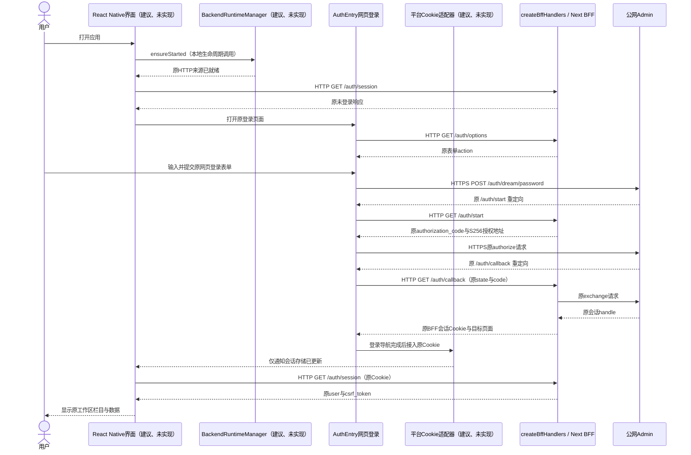

### Chat发送、流式结果与停止

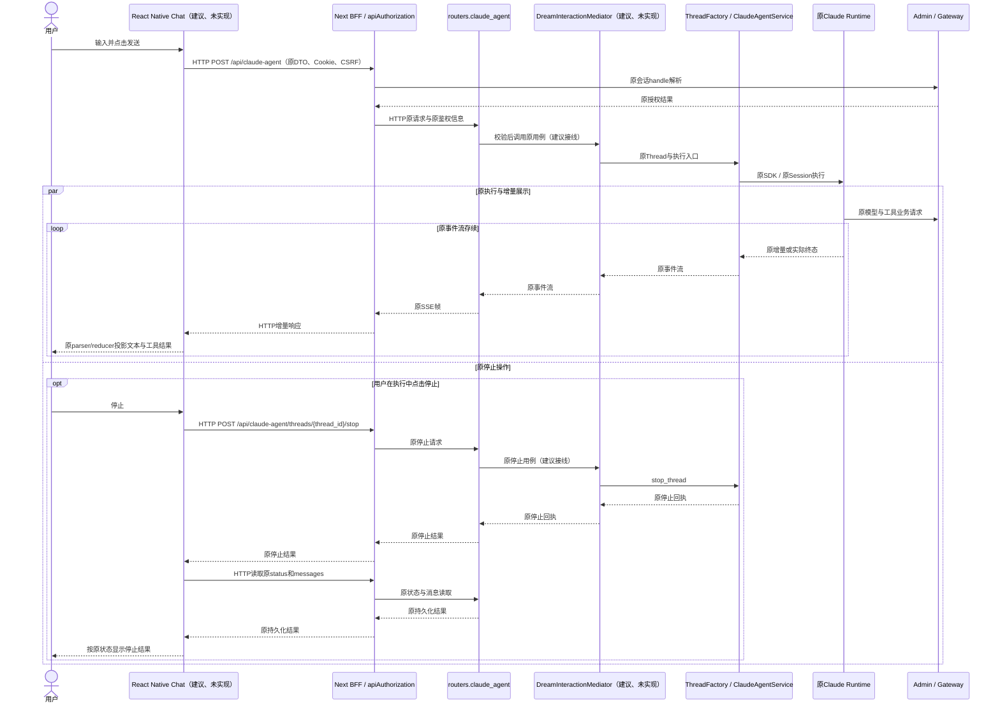

图中流式过程包含原消息提交、权限和持久化顺序，现有Factory/Service继续负责这些行为。中介者转交原执行结果，禁止重新定义发送、停止、审批或结算规则。

### 附件、上传与结果文件

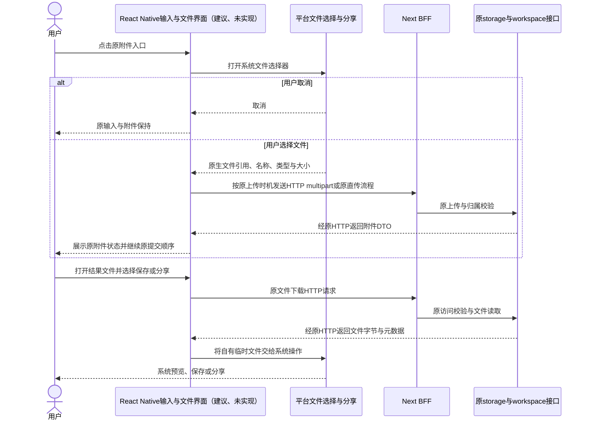

原`useFileUpload`的直传与服务端上传选择、附件DTO及workspace写入顺序继续保留。原生文件URI到HTTP上传体的转换属于平台适配。大文件采用流式读取，临时文件由对应上传/预览实例释放；系统取消保持原页面与业务记录。

## 异常与恢复时序

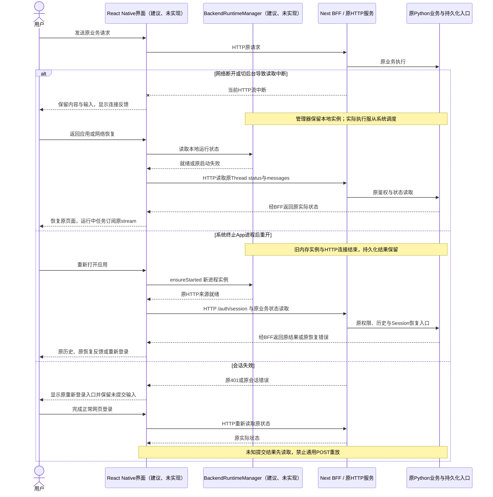

HTTP断开、App后台与业务停止分别处理。普通重连优先读取状态与历史，再订阅原`GET /api/claude-agent/threads/{thread_id}/stream`。恢复只使用范围内业务已有、具备明确幂等与恢复合同的入口。缺少恢复证据时展示原错误，不创建替代Run/Thread/Session。管理器和中介者均不主动查询或调度Dream工作台创建、审核确认任务。

后端启动失败发生在业务请求前：现有启动区域显示失败，用户点击重试后仅重试可安全初始化的组件。Node或CPython要求同进程单次初始化时，管理器返回需重新打开应用的明确结果；页面禁止循环重启解释器。

## 页面状态转换

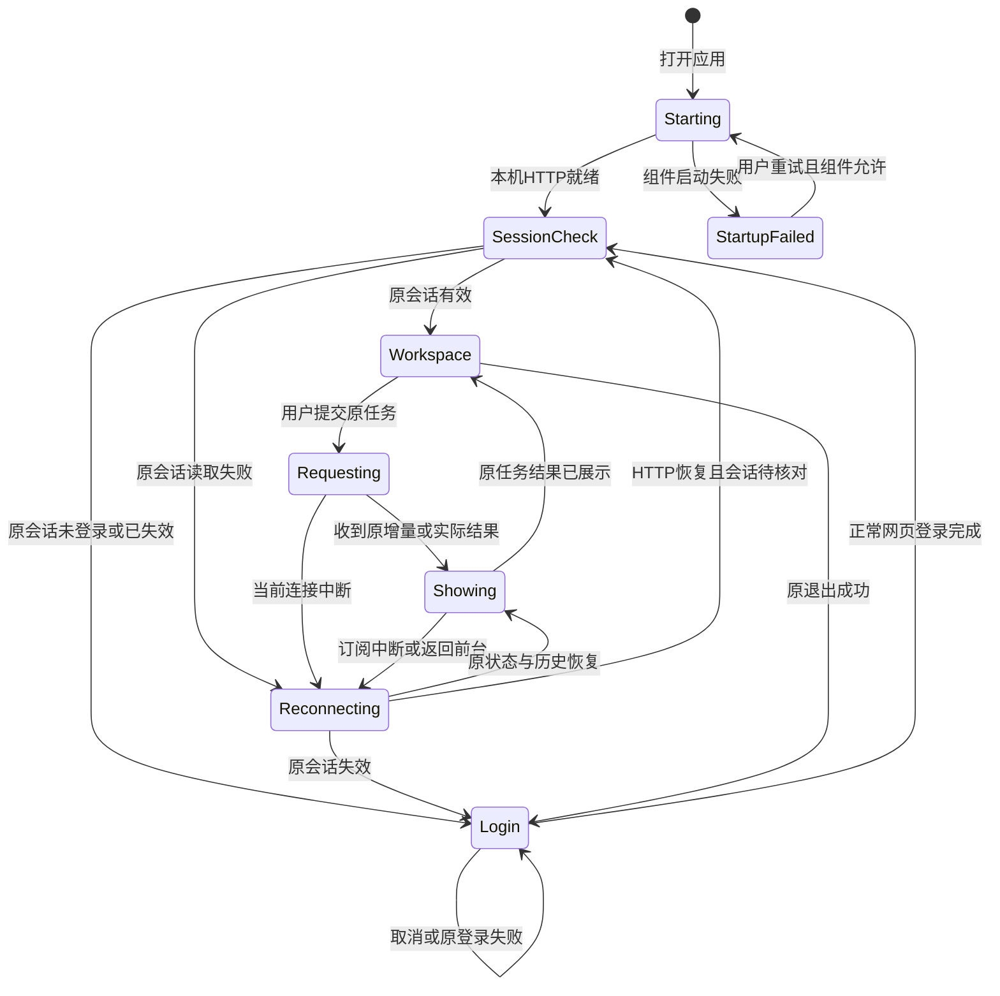

这些状态定义界面展示。后端管理器状态、Run状态、Thread执行状态与确认派发状态分别由各自所有者维护；“本机HTTP就绪”表示运行时装配完成，账户授权与业务成功单独判断。

## 双平台验收计划

以下各项分别在iOS Simulator、物理iPhone和Android目标执行，当前状态均为待实施后验收。

| 验收项 | 预期结果 | 验证方式与执行前提 |
| --- | --- | --- |
| 首次安装与启动 | 一个App级后端实例，原HTTP入口实际可达 | 清洁安装包，核对进程/组件身份、startup状态及原会话响应 |
| 升级与重开 | 原账户、历史与Session可读取，旧运行实例结束 | 上一版本包、同签名覆盖升级、原业务数据与容器路径检查 |
| 正常登录与取消 | 原表单与回调，取消后原页面保持 | 真实账户、已登记来源；分别验证Cookie与CSRF接入 |
| Google与会话失效 | 原授权、取消、返回及重新登录反馈 | 双平台回调与浏览器前提具备；保留原权限范围 |
| Chat流式与停止 | 首帧增量可见，原停止回执与消息保存一致 | HTTP逐帧观察、原模型明确选择与调用预算、正常Admin回查 |
| 工作台创建模块排除 | 首页、导航、More、快捷操作与应用内链接均无创建或审核确认入口 | 检查移动路由/菜单清单及界面，移动UI不调用创建/确认专属HTTP；Web入口、Agent权限与既有数据保持 |
| 断网及前后台 | 查询实际状态后恢复订阅，未知提交不重发 | 有界真实任务，记录HTTP、系统调度与原任务状态 |
| 进程终止重开 | 新运行时实例，原历史与支持的恢复路径 | 保留业务持久化和原Session，核对重复模型调用 |
| 附件与文件 | 原上传时机/DTO，保存分享取消反馈一致 | 原文件业务、系统选择器、上传进度与访问权限回查 |
| 窄屏、键盘与返回 | 发送/停止可见、安全区主色一致、返回位置保持 | 两平台不同屏幕、输入法、长内容与原主题 |
| 相邻Web回归 | 原HTTP、登录、parser、状态与权限合同保持 | 现有Web核心旅程及DTO/SSE合同测试 |
| 构建安装与发布 | 两平台签名包可安装升级，渠道材料符合要求 | 原发布设计中的账号、签名、渠道与资格前提 |

## 证据与评审结论

- 当前Web界面：[AuthEntry](../../../frontend/app/_dream/components/Auth/AuthEntry.tsx#L49)、[ChatPanel](../../../frontend/app/_dream/components/chat/ChatPanel.tsx#L1466)。
- 原认证及HTTP：[createBffHandlers](../../../frontend/app/api/_auth/handlers.ts#L30)、[apiAuthorization](../../../frontend/app/api/_auth/api-proxy.ts#L10)、[CSRF校验](../../../frontend/app/api/_auth/login-boundary.ts#L275)。
- 原业务：[Chat提交](../../../backend/routers/claude_agent.py#L1056)、[停止](../../../backend/routers/claude_agent.py#L2922)、[上传](../../../frontend/app/_dream/hooks/useFileUpload.ts#L104)。[原工作台创建路由](../../../backend/routers/story_workspace.py#L883)保留服务端实现，退出移动交互与验收。
- 官方资料：[React Native环境](https://reactnative.dev/docs/set-up-your-environment)、[原生组件](https://reactnative.dev/docs/intro-react-native-components)、[Native Modules](https://reactnative.dev/docs/turbo-native-modules-introduction)、[网络](https://reactnative.dev/docs/network)，查阅日期2026-10-27。

设计评审结论：**待满足明确前提后通过**。业务入口、HTTP合同、原网页登录、任务状态与持久化边界已定义；React Native视图迁移、Cookie/CSRF接入、HTTP增量读取、管理器实例释放和两平台真实业务回执为实施依赖。本轮文档检查仅验证清单、引用与图示，不构成React Native构建或真实业务验收。
````

## mobile-runtime-architecture.md

原路径：`docs/design/story-workspace/mobile-runtime-architecture.md`

SHA-256：`fc7a33649859cb448c3dd6ff133a9bcaa974baee05c4a7c3d91286e8f06a38d5`

````markdown
<!-- [Sync] 2026-10-27: React Native目标采用HTTP业务访问、App级BackendRuntimeManager和应用服务中介者；工作台创建模块退出端侧适配。 -->
<!-- [Sync] 2026-10-26: completed confirmation recovery reuses scoped Chat history and the original artifact Hook, preserving source identity and avoiding a second model call. -->
<!-- [Sync] 2026-10-26: 冻结插件缓存根变化由原packer修复manifest派生地址，保留插件冻结、用户文件与Session。 -->
<!-- [Sync] 2026-10-26: 同消息原Factory图片绑定冲突使用严格原receipt恢复，当前尝试与原绑定、权限和计费保持。 -->
<!-- [Sync] 2026-10-26: 当前已授权Run的原文件读取恢复其已接受确认，复用OAuth历史及原精确claim/lease/Factory/ACK。 -->
<!-- [Sync] 2026-10-26: 原Admin同Run上下文读取兼容已采用，原确认派发与完整业务继续单独验收。 -->
<!-- [Sync] 2026-10-26: 前后台专项记录首次143与原重试完成，系统挂起和deadline关系待无模型诊断。 -->
<!-- [Sync] 2026-10-26: 原Chat长任务、续期、停止与同Session恢复取得回执，生产续期逻辑及期限保持。 -->
<!-- [Sync] 2026-10-26: iOS绑定原confirmation worker处理显式确认消息，全局领取循环保持关闭。 -->
<!-- [Sync] 2026-10-26: 原Dream真实创建取得8份文件、pending_review及正常消息/结算回执；完整确认和真机继续验收。 -->
<!-- [Sync] 2026-10-26: 原Dream插件制品按原摘要随包恢复，原CLI校验绑定端侧Worker，Admin元数据保持。 -->
<!-- [Sync] 2026-10-26: 原插件venv/pip接线固定guest Python和离线wheels，原初始化和缓存规则保持，Simulator技术通过。 -->
<!-- [Sync] 2026-10-26: iOS HTTP仅观测原Dream创建失败的状态及登记错误码，原响应和业务校验保持。 -->
<!-- [Sync] 2026-10-26: 双目标原SDK/Runner通过；Runtime退出等待原文件操作，Session仅遍历应用数据根内目录。 -->
<!-- [Sync] 2026-10-26: 明确旧隔离原型内后续工作已停止；端侧采用普通env关闭Claude命令沙箱。 -->
<!-- [Sync] 2026-10-26: Simulator原Bash真实任务完成；物理设备路径别名与Worker退出等待进入目标复验。 -->
<!-- [Sync] 2026-10-25: iOS原SDK工具/停止/恢复与原Runner技术通过；关闭额外命令沙箱，保留系统隔离和原业务。 -->
<!-- [Sync] 2026-10-25: iOS只投影原页面主题到安全区和系统外观，原业务bridge及键盘内容边界保持。 -->
<!-- [Sync] 2026-10-25: 普通env逐字节复核；独立XCTest同App进程Bash资格通过，生产工具接线继续待完成。 -->
<!-- [Sync] 2026-10-25: 原Stop有界响应等待保留Service清理，引用共用停止交互及真实验收缺口。 -->
<!-- [Sync] 2026-10-25: 原Chat inputs定时读取限制单个在途请求，组件结束传递AbortSignal，原队列及状态规则保持。 -->
<!-- [Sync] 2026-10-25: 连续容器变化通过完整Runtime目录名验证中间UUID，保留原JSONL与排他重命名规则。 -->
<!-- [Sync] 2026-10-25: iOS恢复检查匹配固定Node长路径格式，排他调整同容器UUID变化目录，保留原记录与校验。 -->
<!-- [Sync] 2026-10-25: 按原前后端env文件归属装配，Gateway地址采用现有公网Admin。 -->
<!-- [Sync] 2026-10-25: 新建Admin连接继续复现会话超时，撤回Connection close候选，原连接与认证规则保持。 -->
<!-- [Sync] 2026-10-25: 按用户要求复用普通env与原登录代码，撤回新增Admin客户端类型，记录本机产物凭证边界。 -->
<!-- [Input] 现有React/Next/Python、RN/HTTP目标、正常网页登录合同及端侧范围。 -->
<!-- [Output] RN目标的执行位置、App管理器、中介者、实例生命周期及既有实现与阻断清单。 -->
<!-- [Sync] 2026-10-25: 定义强制sandbox的iOS外部命令拒绝后端，保留原设置和权限；完整工具资格独立记录。 -->
<!-- [Sync] 2026-10-25: 公网只读核验确认服务身份阻断；区分SDK进程API声明、CPython限制与iOS应用执行资格。 -->
<!-- [Sync] 2026-10-25: 原Next standalone与原ASGI在应用进程接线，保留原网页登录和服务身份校验。 -->
<!-- [Pos] 移动技术架构；业务规则仍归原模块和接口。 -->
<!-- [Sync] 2026-10-25: Node 24应用进程宿主与原SDK Transport已实现，Simulator原Runtime initialize通过；完整业务继续验收。 -->
<!-- [Sync] 2026-10-25: 独立iPhone执行以端侧Runtime移植、网页会话接入和公开数据权限为前置。 -->
<!-- [Sync] 2026-10-25: 改用公网Admin认证，iPhone开发relay收敛为Dream Web端口。 -->
<!-- [Sync] 2026-10-25: 记录iOS Simulator应用宿主完成原BFF会话和真实Chat。 -->
<!-- [Sync] 2026-10-25: 定义iOS局域网开发拓扑并记录原React/BFF页面可达证据。 -->
<!-- [Sync] 2026-10-25: 删除原生认证所有权、替代业务和新存储/任务协议。 -->

# 移动端运行时架构

## 背景与问题

现有实现采用Swift/WKWebView、Kotlin/Android WebView和端侧Dream Python。2026-10-27目标设计调整为React Native原生界面通过HTTP复用现有业务，由App级模块管理端侧后端生命周期。用户明确排除Dream工作台创建模块的端侧展示与适配。现有WebView实现和下文阶段回执保留各自执行范围；React Native目标尚未实现。

当前iOS应用运行真实CPython/FastAPI、24个原业务路由模块和原ThreadFactory，并在同应用Node24中启动原Claude Runtime。关闭Mac relay的Simulator已验证原SDK协议、原Dream Runner、原user MCP与Session broker、本地ASGI增量响应和取消；完整账户业务继续接入。此前签名安装包通过relay取得原React页面，Simulator经公网Admin完成正常登录和一次Mac执行的Chat；该回执保留原执行位置。物理设备重复、完整路由、移动授权和工具资格按各自回执推进。[PRD](../../prd/dream-workspace/mobile-app.md)、[共享交互](./mobile-app-interaction.md)、[iOS](./mobile-ios-interaction.md)、[Android](./mobile-android-interaction.md)和[发布稿](../../deploy/mobile-app-release.md)分别定义对应领域。

## 目标与边界

目标复用Next BFF、DTO、鉴权、存储、Agent、SSE parser、停止和恢复，迁移范围内的原生页面。现有React DOM页面继续服务Web，正常网页登录继续使用原网页。公网Admin独立承担现有账户、OAuth和数据服务，数据库合同保持原状。工作台创建及审核确认退出端侧入口与适配；原服务端模块保留。

保留范围内业务和权限；工作台创建模块按用户明确范围隐藏。移动专属认证、原生用户令牌仓库、设备码流程、数据API代理、替代Agent、后台落库、全局worker领取、离线数据库与同步系统均退出本次设计。

## React Native目标架构（2026-10-27）

### 当前事实、目标与方案比较

| 分类 | 依据及结论 |
| --- | --- |
| 当前代码事实 | [frontend/package.json](../../../frontend/package.json#L8)使用Next构建，依赖React DOM、Tiptap与网页渲染组件；[AuthEntry](../../../frontend/app/_dream/components/Auth/AuthEntry.tsx#L67)和[ChatPanel](../../../frontend/app/_dream/components/chat/ChatPanel.tsx#L1466)包含DOM/CSS。React Native需要迁移这些视图。 |
| 当前代码事实 | [EmbeddedDreamBackend](../../../mobile/ios/InkMemory/EmbeddedDreamBackend.swift#L9)已有应用共享实例和串行启动队列；`start`先初始化Python，再启动Node，最后绑定原后端与Next。当前模块缺少本文完整生命周期状态和RN接入。 |
| 当前代码事实 | [ios.py](../../../backend/mobile_runtime/ios.py#L62)初始化ASGI，[运行时绑定](../../../backend/mobile_runtime/ios.py#L87)装配原Factory、路由、HTTP和Next；[IOSFactoryOwner.close](../../../backend/mobile_runtime/ios_factory.py#L55)已有资源策略与Factory清理。 |
| 当前代码事实 | [apiAuthorization](../../../frontend/app/api/_auth/api-proxy.ts#L10)与[CSRF](../../../frontend/app/api/_auth/login-boundary.ts#L275)属于原BFF；[Chat路由](../../../backend/routers/claude_agent.py#L1056)及[现有应用协调服务](../../../backend/services/deck/story_workflow_application.py#L1123)继续拥有原业务入口。 |
| 拟议方案 | React Native承担原生界面；普通HTTP承担全部业务请求；App级BackendRuntimeManager管理本地运行实例；后端应用服务按中介者模式协调。新增名称均为建议、未实现。 |
| 待验证 | RN所选版本与现有原生工程、React依赖、Node/CPython库共存；原Cookie/CSRF接入；HTTP增量流；移动实例释放；内存峰值；双平台构建和真实业务。 |

继续WebView可复用全部网页视图，现有实现保留验证价值。React Native原生视图需要界面迁移，符合用户本轮目标。仅用RN包裹全部网页仍保留网页渲染；直接把Next服务器、Python或Claude放入RN JavaScript运行时缺少对应运行能力，退出方案。

官方资料于2026-10-27查阅：[环境与构建工具](https://reactnative.dev/docs/set-up-your-environment)、[原生组件](https://reactnative.dev/docs/intro-react-native-components)、[既有App集成](https://reactnative.dev/docs/integration-with-existing-apps)、[Turbo Native Modules](https://reactnative.dev/docs/turbo-native-modules-introduction)、[Hermes](https://reactnative.dev/docs/hermes)。工程保留Xcode/Gradle与既有签名路径；Hermes承担RN界面JavaScript，原Node继续承担Next和Claude。React Native的原生打包能力独立于Python/Node/Claude制品与渠道资格，发行检查继续按原发布稿执行。

### Next到React Native的迁移映射与Web兼容

Web继续使用Next.js与原部署入口，原页面支持渐进迁移。目标为可移植视图使用RN组件，移动端原生渲染，Web通过`react-native-web`渲染；网页编辑器、原生文件操作等必要差异保留平台实现。RN入口位于`mobile/react-native/`，业务共用原HTTP与后端。旧DOM转RN仍需适配；共享组件减少后续重复维护，无法自动转换已有HTML/CSS。

| 当前内容 | 移动迁移处理 | Web处理 |
| --- | --- | --- |
| 可移植视图、DOM与CSS | 改写为共享RN组件、样式与原生导航 | 经RN Web渐进接入Next；旧页面继续使用 |
| 网页编辑器、原生文件选择等差异 | 必要的`.native.tsx`适配 | 必要的`.web.tsx`适配，保留Web交互 |
| DTO、SSE parser/reducer和纯计算 | 核对`ai`、流API等依赖后提取共用 | 调用相同逻辑，业务合同保持 |
| Cookie/CSRF、OAuth与Route Handlers | 首阶段保留原Next BFF，通过HTTP访问 | 原BFF路径保持 |
| Python业务、Factory、Claude及工具 | 复用端侧组件与原权限 | 原运行拓扑与业务入口保持 |

移除Next BFF需要另行迁移其认证、代理和服务端运行职责。当前设计不将该工作绑定到RN视图迁移，不变更Web入口或要求Web改用RN。中介者提取影响的共享业务必须执行Web相邻回归。

RN Web为建议、未实现的依赖。官方[配置说明](https://necolas.github.io/react-native-web/docs/setup/)定义将Web构建中的`react-native`映射到`react-native-web`，原生构建继续解析真正的RN。当前仓库使用Next App Router，实施前需要验证包转译、客户端边界、SSR/hydration、样式及现有React版本/override的一致性。官方[Expo与Next集成说明](https://docs.expo.dev/guides/using-nextjs/)记录其adapter的App目录限制，本文不采用该adapter的配置范例；该资料不构成当前仓库构建回执。两份资料查阅日期2026-10-27。

共享可移植视图建议位于`frontend/shared/ui/`，仅在Web与原生两个消费者实际共用时提取；不新增发布包或通用UI框架。原生后端管理模块只在原生入口引用，Web服务启动与部署生命周期保持原实现。工作台创建和审核确认页面保留Web原实现，退出共享视图迁移及原生适配。

React Hooks继续使用：`useState`、`useEffect`、`useLayoutEffect`和`useRef`在RN中保留对应用途。迁移判断依据是Hook内部的平台访问、Ref目标、事件类型和返回视图。[ActivitySidebar](../../../frontend/app/_dream/components/chat/ActivitySidebar.tsx#L6)的React导入可复用；[DOM Ref](../../../frontend/app/_dream/components/chat/ActivitySidebar.tsx#L50)、[document与焦点处理](../../../frontend/app/_dream/components/chat/ActivitySidebar.tsx#L69)及HTML按钮需要原生适配。原状态、筛选与业务回调继续核对复用。官方[原生布局测量](https://reactnative.dev/docs/the-new-architecture/layout-measurements)直接使用`useRef`和`useLayoutEffect`，查阅日期2026-10-27。

2026-10-27只读源码盘点：`frontend/app/_dream`排除测试后有137个TSX文件、46,592行，33个CSS文件、13,210行；Chat目录43个TSX、15,527行；工作台目录42个TSX、9,315行，其中含共用内容。69个TSX文本命中浏览器对象或类型，属于待核对候选。目录统计存在包含关系，禁止相加作为工作量；代码行数包含可复用逻辑，禁止等同于重写行数。

按一名熟悉项目的全职工程师作计划级粗估：正常网页登录、Chat、HTTP流、停止与重开恢复闭环约3–5人周；保留业务全面原生化累计约10–16人周。该估算覆盖移动视图与会话/HTTP接入、管理器和相邻回归；额外Android运行库移植、未解决的真机Claude兼容及渠道审核周期单列。先完成核心切片，再依据实际复用比例修订，当前无逐组件实施工期承诺。

### HTTP与原生运行控制

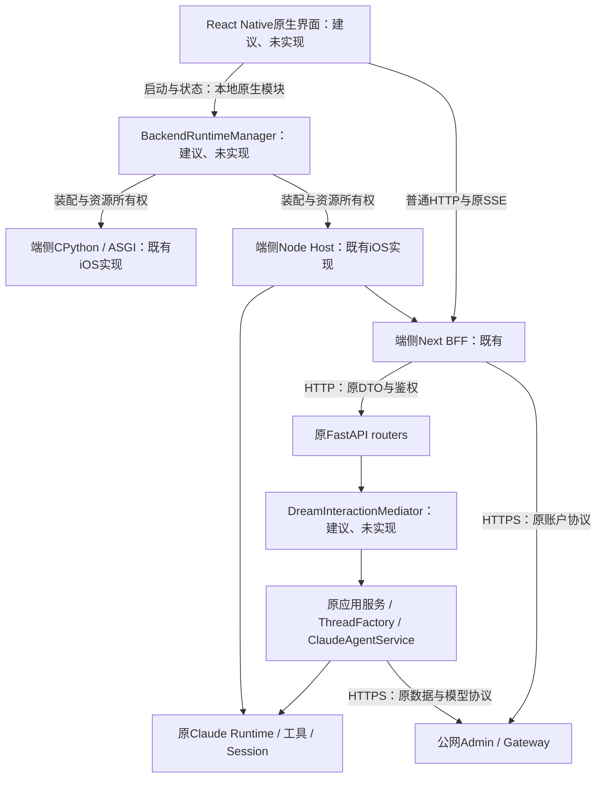

1. 主界面使用RN原生组件；Web保持现有React DOM。DTO、parser/reducer和纯业务计算在依赖核对后抽取共用，禁止复制第二套业务状态机。登录和已有网页协议内容按实际需求保留受限WebView。
2. `DreamHttpClient`为建议的薄HTTP客户端名称，绑定管理器公开的原本机BFF来源。业务继续使用`/api/**`、`/auth/**`与原multipart/SSE协议。端侧ASGI HTTP来源供原BFF使用，禁止借中介者绕过鉴权直接调用Factory。
3. 本机HTTP限定loopback绑定；端口、来源与callback按现有env和登记配置确定。端口占用保留启动失败，禁止随机切换来源绕过回调校验。公网通信继续使用HTTPS。
4. RN原生模块仅公开启动、公开运行事实和生命周期订阅，必要的文件/系统操作按实际入口接入。业务DTO、正文、流式结果及停止请求走HTTP；既有WebView的`runtime.request/read/cancel`保持原用途，RN业务不新增对应RPC接线。
5. HTTP客户端必须验证Cookie、`x-ink-csrf`、Origin、上传体、下载、增量读取、Abort和错误状态。禁止推定RN的fetch与浏览器ReadableStream、Cookie或FormData完全一致。若所选版本缺少所需增量能力，仅补充原生HTTP流读取适配，保持原URL、headers、status和SSE字节。
6. 登录沿用原AuthEntry、form、PKCE及BFF；原Cookie接入原生HTTP存储为明确实施项，Cookie值保留原生层。公开Client ID及原env键保持原配置方式；服务端密钥仍由其原消费者持有，进入RN bundle的配置单独核查，禁止复制Node/Python私有env至界面JavaScript。

### App级后端管理器

`BackendRuntimeManager`为建议、未实现的原生应用模块。iOS由App组合根持有，复用`EmbeddedDreamBackend.shared`及现有Python/Node启动代码。Android主进程的应用级管理器持有原生Service连接，既有私有`:dream_runtime`进程中的Service持有Python/Node；业务仍通过loopback HTTP，Binder仅处理运行时控制。现状依据为[AndroidManifest](../../../mobile/android/app/src/main/AndroidManifest.xml#L28)与[DreamRuntimeService](../../../mobile/android/app/src/main/java/com/inkmemory/mobile/runtime/DreamRuntimeService.kt#L14)，后者当前返回未接入能力。RN Root、页面、Activity或Scene只订阅状态，禁止各自创建运行时；本文不新增独立守护进程。

管理器公开`ensureStarted()`、`getStatus()`及状态订阅；名称为建议、未实现。并发`ensureStarted`共享同一个启动结果；RN热重载、页面重挂载、Android配置变化和重新进入前台均不重复初始化。返回的公开事实只含组件状态、当前本机来源与失败码；凭证和业务正文保留原所有者。

内部职责为：读取原配置与资源 → 初始化一次CPython → 启动一次原Node Host → 绑定原Factory与ASGI → 启动原HTTP及Next → 核对原组件所有权和实际HTTP响应 → 发布Ready。Ready表示本地组件可接收原协议请求，账户、模型、数据库和公网可用性分别通过原业务入口判断。

管理器内部释放以停止接收新请求、结束已许可的订阅、调用现有close和释放自有句柄为顺序。活跃业务仍由原停止/清理协议处理，页面卸载、退出登录与进入后台均不触发全局shutdown。已有库仅支持进程内单次初始化时，失败结果明确要求新App进程，禁止销毁后循环重新初始化Python或Node。

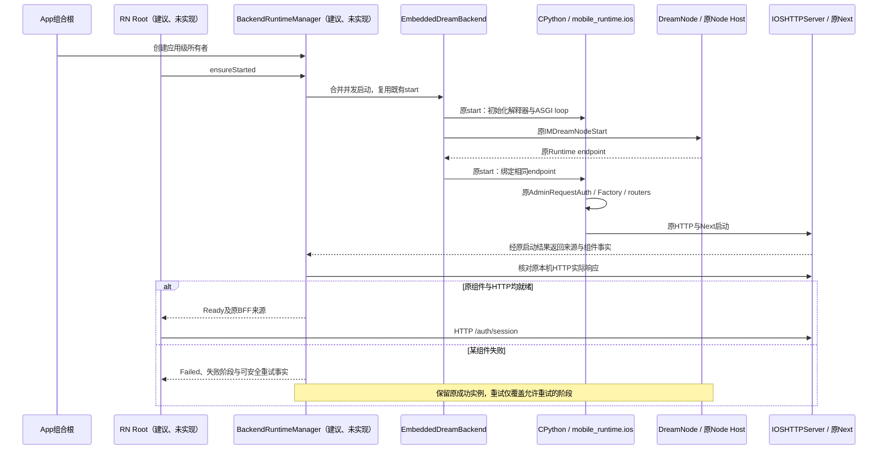

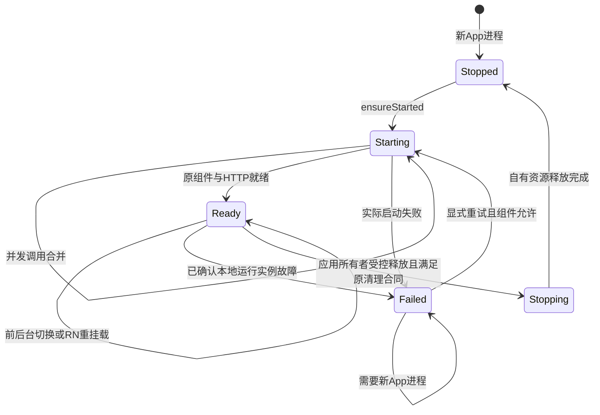

公网超时、401和模型错误沿原HTTP反馈，管理器保留本地实际状态。操作系统挂起属于调度状态；管理器禁止将其改写为Stopped、任务取消或任务成功。系统结束某个进程时，该进程内实例结束，终止回调与最后一次写入均无保证；下一次启动创建或重新关联实际运行实例，通过原HTTP读取持久化事实。Android主进程与runtime Service分别观察进程退出和Binder断开，禁止由Activity销毁推定后端退出，也不通过后台自动拉起维持常驻。

### 后端应用服务中介者

`DreamInteractionMediator`为建议、未实现的Python应用服务对象，按后端组合根注入原服务；Python模块不导入React Native、原生控件或页面对象。它接收已经通过原HTTP边界校验的用例输入和请求上下文，协调原Factory/应用服务并返回原DTO或原异步事件流。

| 用例职责 | 原执行所有者 | 中介者处理 |
| --- | --- | --- |
| Chat发送、继续及工具审批 | 原路由校验、ThreadFactory、ClaudeAgentService、原SDK | 转交原输入和上下文，保持Thread锁、资源策略、权限和持久化顺序 |
| 原停止操作 | 原`stop_thread`及Service清理 | 转交显式停止，返回原回执；HTTP disconnect只结束订阅 |
| 历史、状态和恢复 | 原Admin数据服务、Thread/Session读取 | 委托原查询与恢复合同，不补发未知结果的写请求 |
| 附件与文件 | 原storage/workspace及其应用服务 | 继续原HTTP入口与归属校验；没有跨服务协调需求的路由保持原实现 |
| 工作台创建与审核确认 | 现有Web及原后端 | 端侧入口退出范围，管理器和中介者不新增主动创建、扫描、确认或适配 |

优先复用已有应用协调服务。仅将确有跨服务协调的代码移入中介者；简单查询和直转路由保留原委托，禁止为全部路由增加空包装。中介者使用具体用例方法，禁止引入通用命令总线、动态插件注册、额外队列、数据库表或新的业务HTTP接口。Web与RN继续共用同一路由和用例实现。

建议源码归属：RN页面与薄HTTP客户端位于`mobile/react-native/`；生命周期组合根位于现有`mobile/ios/`及`mobile/android/`；Python中介者按实际用例放入`backend/services/`并由现有组合根注入。共享DTO与parser仅在依赖核对后提取，当前设计不新增共享框架或代码包。

### 实例所有权与生命周期

下表为目标所有权。当前代码仅具备表中注明的原组件；新增管理器、中介者与RN实例尚未接线。

| 实例 | 创建者与作用域 | 创建/就绪条件 | 释放或结束 | 持久化与重开规则 |
| --- | --- | --- | --- | --- |
| App主进程 | iOS/Android系统，单次主进程 | 用户打开或系统创建 | 系统终止或进程退出 | 新进程重新装配/关联实际组件；禁止依赖终止回调落库 |
| Android runtime Service / 进程 | 原私有`:dream_runtime`服务，由应用管理器绑定 | 原Service绑定成功且原运行组件就绪 | 原Service释放或该进程被终止 | 与主进程分别观察；断开后显式重连核对，禁止后台常驻 |
| BackendRuntimeManager | App主进程组合根，一个逻辑所有者 | 原生App初始化后，页面订阅前 | 应用所有者受控释放或主进程终止 | 内存状态不持久化为业务状态 |
| RN Hermes / Root | RN宿主，每个实际RN运行时 | 原生RN装配完成 | RN运行时销毁或进程终止 | Root重挂载可重订阅，后端所有者保持 |
| Web RN Web组件 | 原Next渲染与浏览器文档 | 共享组件构建及SSR/客户端边界通过 | 原Web文档或渲染范围结束 | 浏览器关闭不停止Web服务；不导入原生后端管理器 |
| CPython解释器 | iOS原EmbeddedDreamBackend；Android由runtime Service持有 | 原资源、扩展与初始化成功 | 所属进程退出；显式finalize须独立资格验证 | 不把解释器对象序列化，不默认支持原地重启 |
| ASGI loop / App / HTTP监听 | 原`mobile_runtime.ios`组合根，App级 | 原配置、Factory与路由绑定 | 原lifespan/监听关闭并等待自有句柄 | 重开装配相同业务路由，不复活旧内存任务 |
| Node Host | 原DreamNode，App级 | 原库与Runtime endpoint已核对 | 原受控清理或进程终止 | Hermes与Node分别持有引擎，不相互替代 |
| Next BFF / 本机HTTP | 原Node启动代码，App级 | 原来源、回调配置和ASGI来源有效 | 原HTTP监听与Worker关闭 | 原Cookie/CSRF及env合同保持 |
| DreamInteractionMediator | Python组合根，App级 | 所需原服务注入完成 | 随组合根释放 | 禁止持有全局“当前用户”；身份来自单个HTTP请求 |
| HTTP请求上下文 | 原BFF与路由依赖，每个请求 | 原Cookie、CSRF、鉴权与DTO通过 | 响应结束、断连或请求取消 | 未知写结果通过原查询确认，禁止通用重放 |
| HTTP/SSE订阅 | 页面HTTP客户端与原服务，每次连接 | 原请求获准并返回响应头 | 正常EOF、断连、取消订阅或页面结束 | 重连读取原status/messages并订阅原stream；断连不等于stop |
| ThreadFactory / policy owner | 原IOSFactoryOwner或Android对应组合根，App级 | 原运行时与资源策略装配 | 原`close`、Factory `aclose`及refresher停止 | 原LKG/default/desired/effective/revision合同保持 |
| Thread执行 / Runner | 原Factory，按原Thread与执行范围 | 原锁、admission与权限允许 | 原终态及原清理完成 | 原持久化和Session恢复；同Thread并发规则保持 |
| SDK client / Claude Worker | 原SDK连接所有者 | 原`IOSClaudeTransport.connect` | 原`close`及Worker退出等待 | 原连接范围继续沿用；禁止强制每页面一个Worker |
| Claude Session文件 | 原Runtime，原身份与工作区归属 | 原执行创建或校验既有Session | 按原用户数据保留合同 | JSONL与Session身份保留，升级路径按原容器校验 |
| MCP连接与guest命令 | 原SDK/MCP/命令所有者 | 原工具、权限、cwd与临时目录有效 | 原关闭、停止、超时与句柄等待 | 工具副作用与结果按原持久化；禁止退出时猜测成功 |
| 网页登录视图与Cookie接入 | 登录操作与平台会话适配器 | 原AuthEntry与本机BFF就绪 | 关闭视图；原logout按合同清理Cookie | 视图关闭保留原Cookie；RN可读取原公开会话结果 |
| 文件选择/上传/预览 | 当前用户操作与原文件服务 | 系统选择及原访问校验通过 | 取消、完成或对应视图结束 | 原附件记录保留；只清理该实例自有临时文件 |

### 平台与实施资格

iOS复用现有Swift/Objective-C/C++与嵌入式运行库，RN通过官方原生模块接入生命周期事实。Android复用现有Kotlin工程及明确的运行时service所有者；Activity销毁不承担App后端终止职责。两平台分别核对HTTP来源、文件URI、Cookie、系统返回及构建配置。

官方[AppState](https://reactnative.dev/docs/appstate)仅提供前后台等通知；[Apple生命周期](https://developer.apple.com/documentation/uikit/managing-your-app-s-life-cycle)与[Android Activity生命周期](https://developer.android.com/guide/components/activities/activity-lifecycle)分别约束系统调度与组件重建，查阅日期2026-10-27。本设计保持前台业务路径，不新增后台常驻、推送、自动业务调度或全局确认扫描。

实施顺序：原生工程集成RN并证明原组件共存 → 管理器单实例与失败恢复 → 原网页登录Cookie/CSRF与HTTP增量 → 范围内Chat/Decks/More及文件页面 → 双平台真实业务和构建发布资格。工作台创建模块全程退出端侧适配。原业务时序与验收见[RN正式交互稿](mobile-react-native-interaction.md)。

### 主要风险与通过条件

| 风险 | 影响 | 最小控制与通过条件 |
| --- | --- | --- |
| DOM迁移与平台差异 | 旧视图需要适配，富文本和MCP网页内容成本较高 | 可移植RN视图经RN Web共用；必要差异保留平台实现；禁止承诺自动转换或100%视图共用 |
| RN Web与Next兼容 | 当前App Router、React依赖及样式可能存在构建/水合差异 | 先验证一个共享页面的生产构建、SSR/水合与交互，避免使用不支持App目录的adapter示例 |
| 网页会话接入原生HTTP | 登录页面成功后，原生请求仍可能401/403或无法正确退出 | 两平台核对Cookie属性、原来源、CSRF、取消、失效和退出，保持BFF原校验 |
| HTTP流与取消差异 | 首帧被缓冲、末帧丢失、HTTP取消误作任务停止 | 原SSE字节与parser合同、真实首帧/终态、Stop、重连与持久化一致后再迁移更多页面 |
| Hermes/Node/CPython共存 | 增加包体、峰值内存、启动耗时与链接复杂度 | 先构建真实集成包，测量冷启动、空闲/任务峰值与现有资源策略；沿原配置处理，禁止降低admission或权限绕过失败 |
| 生命周期与部分初始化 | 重挂载重复启动、原生库无法原地重启、残留监听或命令句柄 | App级单所有者；并发启动和逐阶段失败检查；验证close与新进程恢复，不默认支持解释器重启 |
| Android运行库资格 | 当前service仅有未接入响应，iOS回执无法替代Android | 先取得Python、Node/Claude、ABI与HTTP实际回执，按原渠道签名安装测试 |
| 共享中介者改动影响Web | 服务调用顺序、锁、身份或流终态漂移 | 只提取具体协调用例；Web与RN共用同一生产路由，执行原合同与相邻Web回归 |
| 原生制品与渠道资格 | RN构建成功无法覆盖内嵌运行库来源、签名和应用审核要求 | 沿原发布稿逐项核对制品来源、许可证、签名和渠道条件，真实提交前重新查阅官方要求 |

最小实施切片为“原网页登录 → 原Chat真实流式任务 → 原停止 → 普通重开恢复”，先在iOS Simulator独立通过，再取得物理iPhone与Android同项回执。该切片用于验证迁移前提，保留范围内其余业务的后续实施与验收责任。

## 事实、方案与待验证

以下保留现有WebView实现及此前已授权业务的阶段事实。工作台创建与确认的代码、历史图示和回执保留原范围；这些内容不构成React Native端侧适配工作项。

### 已接受确认消息的进程重开恢复

发现：iOS仅绑定原确认worker，首次确认提交调用原`StoryWorkspaceDreamConfirmationCoordinator.schedule`；应用进程终止后，持久确认仍保留，原进程内调度任务随进程结束。定义：已保存的用户确认需要按原actor、Thread、Run和message ID继续执行。全局worker扫描会超出当前账户与端侧工作区范围；重复确认会改变用户操作，两个方案退出候选。

选定接线：原`GET /api/story-workspace/workflow-runs/{workflow_run_id}/dream-files`先调用`story-workspace-artifact.authority`并校验当前用户和本地工作区。仅`RunStatus.CONFIRMED`、`confirmation_accepted=true`且`confirmation_dispatched=false`读取原`chat-message.list`。`AdminStoryWorkspaceConfirmationData.pending_dispatch`核对原消息角色、metadata解码、actor、Thread、Run、命令摘要及message ID；重复或损坏消息拒绝恢复。原协调器按精确message ID调用`story-workspace-confirmation.claim-turn`，Admin裁定lease，原`turn_owner`、Factory、续租与ACK继续负责执行。GET响应继续返回实际文件与原确认事实，调度受理不写入成功状态。

当前候选已实现该接线，77项无模型测试通过；包内采用、实际claim续接与真实业务结果待独立核对。该路径用于现有业务进程恢复，复用单一生产入口；无新增HTTP接口、DTO、数据库、用户确认、全局扫描或替代执行器。停止、失败及未取得lease时保留原等待反馈和原协调器重试规则；终态Run与已ACK消息只读取结果。[交互时序及状态](mobile-ios-interaction.md#已保存dream确认的进程重开恢复)直接列明正常恢复和拒绝分支。

源码依据：[原文件读取入口](../../../backend/services/deck/story_workflow_application.py#L341)、[Run授权后的恢复条件](../../../backend/services/deck/story_workflow_application.py#L613)、[原OAuth确认消息校验](../../../backend/services/admin_data/story_workspace_confirmation_data.py#L365)及[既有精确claim协调器](../../../backend/services/story_workspace/dream_confirmation_service.py#L378)。

目标观察已确认同一消息取得claim并进入原Factory，随后原模型目录读取因缺少`AdminGatewayRuntime`返回`ADMIN_CONFIGURATION_INVALID`，模型请求0。修订复用[原`AdminRequestAuth.gateway_runtime`](../../../backend/services/admin_data/request_auth.py#L302)：首次确认提交和恢复读取分别绑定当前OAuth actor的回调，原协调器在精确claim及Workflow/Deck校验后创建同Thread/Run的gateway-cli grant，保持原scope、TTL、目录资格和订阅校验。原`ClaudeAgentRunRequest.admin_gateway_runtime`传入该owner，执行前启动续期，结束时关闭Gateway与persistence owner；scope不足或OAuth失效时在Factory前拒绝。原claim绑定persistence grant继续使用，新增Admin授权接口和宽凭证回退均排除。90项无模型检查与四份生产源的候选构建通过，实际同消息续接继续验收。

同消息恢复的后续目标观察已越过原模型目录和上下文装配，在`ImageGenerationProvider.bind_turn`收到`OPERATION_REQUEST_CONFLICT`，模型请求0。候选修订按[原图片绑定恢复合同](../claude-agent/image-generation-implementation-notes.md#同消息执行重试的绑定恢复)读取同消息已提交的严格原回执，核对actor/Thread/Run及全部业务字段，保留首次绑定ID、Factory当前尝试和稳定Gateway幂等键。Admin、历史回执、权限、图像来源及单次执行约束保持，实际同消息业务继续待验收。

原确认的完成回复已保存、后置同步失败时，重新领取仍沿用原message ID、claim、授权owner及Factory的Thread锁。`AdminTurnPersistence.completed_dream_confirmation_text`通过原`chat-message.list`读取，核对actor、Thread、Run、确认消息及来源kind，复用`validate_chat_history_final_projection`校验完成回复。`ClaudeAgentService`在原用户消息校验后、模型执行前读取该事实；匹配成功只重试当前ticket的原`DreamArtifactTurnHook.after_main_turn`，成功后发送原终态并由原协调器ACK。回复与Session保持，模型调用和助手写入均跳过；同步继续失败时保留原`DREAM_ARTIFACT_SYNC_FAILED_AFTER_COMMIT`及未ACK状态。未完成回复沿原Runtime执行，来源漂移、重复完成回复及非法终态拒绝恢复。

该候选处理真实生成完成后的索引失败及后续重复执行风险；使用既有接口、schema、权限和消息字段，未新增业务状态或持久化协议。236项无模型回归及16个subtests通过；普通Simulator已恢复同一确认、完成原Hook及ACK，模型请求维持4次，消息与Session保持。物理设备完整业务继续验收。原PostgreSQL索引锁参数已在Admin沿用元组摘要方式修正，现行原生构建于2026-10-26 08:23直接与公网登录页200；实际索引写入继续由同一端侧入口验证。

源码依据：[完成回复读取](../../../backend/services/admin_data/turn_persistence.py#L309)、[原Service恢复](../../../backend/claude_agent/service.py#L2570)、[原索引锁](../../../../ink-admin-memory/app/lib/dream/storyWorkspaceArtifactRepository.ts#L215)。

### 端侧部署配置：关闭Claude命令沙箱

2026-10-26 05:40运行状态补充：原Admin读取入口已原生采用同Run grant与服务端当前Workflow context匹配的兼容修订，原OAuth、grant签发、scope、TTL、claim来源及数据归属校验保持。新构建直接/公网登录页200；原Run重新进入可读取EP01，确认派发仍待恢复。该状态分别记录源码采用与完整业务验收，见[原确认续接记录](../../exec/mobile-app-design-review-20261024.md#原确认续接的精确run上下文兼容)。

2026-10-25用户明确选择沿用AutoDL已有方式。iOS与Android的端侧Dream进程在普通env中配置`INK_AGENT_SANDBOX_ENABLED=false`；复用[`resolve_sandbox_enabled`](../../../backend/libs/claude_agent_kit/server/workspace.py#L202)与原settings生成，不新增平台专属认证、设置页或部署环境判断。输出为`sandbox.enabled=false`、`failIfUnavailable=false`、`autoAllowBashIfSandboxed=false`、`allowUnsandboxedCommands=true`。缺失及非法值沿用原启用默认。

停止新增端侧逐命令文件、网络、proc及进程沙箱。保留原Claude Runtime与端侧Bash启动、stdio、退出、Stop和恢复所需执行兼容；完整命令能力继续验收。iOS系统应用沙箱、Android UID/存储权限、原工具审批、Workspace Mode、正常网页登录和API鉴权保持。批准的Bash在App权限范围内运行，逐命令域名过滤及任务间文件/进程隔离退出当前保证。原精确`.claude-tmp`及0700规则保持。

当前iOS候选已装配关闭值；原SDK通过Bash、共享文件、权限拒绝、MCP、恢复、中断及运行中命令停止/描述符清理，原Dream Runner通过。2026-10-26 Simulator原账户已完成一次真实Bash临时记录写入/读回、流式终态及正常Admin消息和Gateway结算；完整工具覆盖与真机分别验收。Android尚未接线。关闭Claude沙箱配置与补齐命令执行分别验收。此前逐命令隔离原型保留为历史资格来源，退出当前生产接线与发行门槛。配置依据、两平台状态和验收见[端侧部署稿](../../deploy/mobile-app-release.md#端侧claude命令沙箱配置)，变更前原文见[历史快照](../../exec/history/mobile-sandbox-before-disabled-20261025.md)。

2026-10-26同一原Thread的长Bash任务约201秒完成，三类RuntimeGrantKeeper各续期1次，原server-persistence保存新助手回复，2次模型请求在正常Gateway结算。原Session历史前缀及精确临时目录保持，目标观察测试退出0；原续期算法、授权期限及原ID恢复语义保持。此前间歇失败继续保留，完整Dream及物理设备按独立业务回执验收，见[执行记录](../../exec/mobile-app-design-review-20261024.md#原长任务续期与持久化真实回执)。

同轮普通App原Stop在Bash运行中中断等待命令，原部分消息保存为cancelled；原Session随后再次生成并保存completed回复。该阶段2次模型请求正常结算，Session历史前缀保持；工具中断、后续执行与普通重开由[实际回执](../../exec/mobile-app-design-review-20261024.md#原bash运行中停止与同session恢复)确认。生产模块及授权合同保持，完整Dream续接与物理设备仍待验收。

#### iOS基本命令兼容候选

原Next至Python的[`ios_http.py`](../../../backend/mobile_runtime/ios_http.py)对`POST /api/story-workspace/dream-runs/start`错误响应增加观察：逐帧转发原ASGI响应后，只输出固定操作名、HTTP状态和原错误登记表中的code。解析缓冲上限4096字节，超长、未知或非法响应统一记录`UNCLASSIFIED`；请求正文、查询参数、凭证、Cookie、响应正文和自由文本均不输出。原响应对象、重复响应头、发送异常及取消继续传播，诊断输出失败保留原响应结果。该适配用于定位端侧创建入口503，未增加接口、页面或业务状态。

原Dream创建返回`RUNTIME_PLUGIN_NOT_READY`时，原`AdminDreamLaunchRuntime`继续按Admin target校验本机不可变制品及CLI兼容。iOS资源阶段从既有`INK_CLAUDE_PLUGIN_RUNTIME_ROOT/artifacts`或原默认目录选取`PLATFORM_BUILTIN_SOURCES`声明内置插件，以及`KNOWN_MARKETPLACE_LOCAL_PATHS`本地catalog中指向目录内源码的插件已准备制品，逐目录核对名称和原digest，再生成随包manifest；远程来源、其他运行数据和安装元数据排除。启动由[`ios_plugin_runtime.py`](../../../backend/mobile_runtime/ios_plugin_runtime.py)复用`artifact_store.import_tree`恢复到App自有原插件根。当前工作区插件源码与已批准摘要不同，原不可变制品逐字节保留；Admin冻结锁和原Deck refs决定实际加载版本。

Dream分发失败复用原系统日志定位调用位置；新增分发诊断候选已撤回。原`DREAM_AGENT_DISPATCH_FAILED`、Run失败持久化、owner清理及取消处理保持。

[`cli.py`](../../../backend/services/claude_plugin/cli.py)提供明确的进程传输绑定，默认subprocess路径保持。iOS将同一原Runtime入口、argv、env、cwd及期限交给已有受认证Worker；原`--version`、`plugin --help`和`plugin validate`仍实际执行，原退出、兼容性和失败结果继续校验。plugin-management仅允许默认backend目录或App自有固定插件根内规范化cwd，Agent原目录范围保持；超时关闭自有连接并终止所属Worker。输出缓冲受限，正文继续由原CLI证据脱敏逻辑处理。该适配不写Admin安装记录、不改发布版本或业务权限。

drama-forge的原init profile声明Python工具环境。Dream后端继续由原生嵌入式CPython执行；插件venv、pip及原工具脚本使用同App内既有guest命令执行器中的固定Linux Python。原[`workspace_init.py`](../../../backend/services/claude_plugin/workspace_init.py)新增明确的Python执行绑定，保留最低版本、artifact槽锁、requirements摘要、依赖安装、缓存和回执；服务端继续默认subprocess。iOS实际探测目标解释器版本，venv采用copies使可执行文件位于App目录，原pip通过随包wheelhouse完成安装；原依赖约束缺少匹配资源时失败。新私有purpose为plugin-python，继续使用同一认证端点/Worker及进程清理，仅接受固定基础Python或原管理目录内venv解释器；原venv在PATH中的优先级保留。

更新安装后应用数据容器目录变化时，冻结workspace的插件版本、摘要和初始化结果继续保留。原packer按当前受管运行时根和冻结制品profile修复venv，仅将派生地址写回原manifest及pack receipt；原launcher继续验证解释器文件。该候选对应已观察到的`CLAUDE_PLUGIN_RUNTIME_MISSING`及旧容器缓存地址，详见[受管缓存根目录变化](../deck/drama-forge-workspace-init-design.md#受管缓存根目录变化)；原Session和用户文件保持，真实任务继续按实际回执验收。

命令资源锁定17份Alpine Python闭包与17份PyPI wheel的来源、版本、SHA和许可，包含Python3.12条件依赖typing-extensions。SQLite模块及库排除。watchdog原Linux wheel包含纯Python文件，准备阶段确认无二进制或签名后，仅调整平台Tag为linux_aarch64并重算WHEEL/RECORD与制品SHA，插件源码和其他载荷保持字节一致；目标安装和工具行为分别验证。该接线对应已观察到的ensure_plugin_venv启动失败，无新增业务接口、服务、数据库或沙箱。Simulator基础Python、原managed venv/pip、9项依赖导入及原dramaforge.py --help技术通过，模型调用0；完整Dream、物理设备及分发继续待验收。

2026-10-26关闭Mac relay的Simulator沿原UI创建Dream，端侧生成原8份工作台文件，人物/场景/分镜revision均1；原Run到达pending_review。正常Admin保存原助手消息，3次真实模型请求全部成功结算。当前证据覆盖创建到审核阶段，确认派发、后续消费者、长任务恢复及物理iPhone继续分别验收；具体身份与回执见[执行记录](../../exec/mobile-app-design-review-20261024.md#原dream真实创建到达审核阶段)。

现有[`DreamGuestProcess.c`](../../../mobile/ios/InkMemory/DreamGuestProcess.c)在App进程中解释运行随包Bash，挂载应用自有Data与资源目录，保持原业务绝对路径；[`DreamNodeProcess.cc`](../../../mobile/ios/InkMemory/DreamNodeProcess.cc)承接原Node ChildProcess/Pipe和同步调用的argv/env/cwd、stdio、退出与信号。其职责为执行兼容，逐命令文件、网络和proc隔离不在当前设计范围。进程generation仅用于信号句柄匹配，防止旧句柄指向复用PID。

物理iPhone的Foundation与Node可能返回`/var`和`/private/var`形式的同一应用目录。命令根初始化通过POSIX `realpath`核对同一目录，启动探针以同一解析结果构造cwd，不扩大挂载范围。原SDK传输关闭先保留5秒EOF写入宽限；Worker仍未退出时，通过现有私有连接发送`terminate`并有界等待原`exit`回执，再释放连接和MCP范围。该处理对应子进程退出等待，原CLI、JSONL、工具审批与业务状态保持。真机首测失败和修复目标回执分别记录。

Runtime Worker在原`process.exit`前等待已发出的原文件Promise完成，保留其返回值、JSONL内容及错误传播；Next Worker沿用原退出行为。两个Worker均保留`trackUnmanagedFds=false`，CPython与Node各自释放拥有的描述符。原Session定位和排他移动通过应用Data根内逐层`O_NOFOLLOW`目录句柄完成，避开读取系统父目录，拒绝根外路径、链接、碰撞及身份不符记录。2026-10-26物理iPhone原Runner/SDK两项技术测试和Simulator三项技术测试退出0；各目标原SDK/Runner使用17次固定Provider技术响应，真实模型调用0。Simulator原账户真实Bash已有单独回执，真机网页登录和模型业务仍按原入口验收。

[`host.cjs`](../../../mobile/ios/runtime/host.cjs)从锁定资源准备命令根，将执行配置传入原Runtime Worker；原Next Worker保留外部命令ENOSYS。Runtime的`TMPDIR`复用同一服务端绑定`CLAUDE_CODE_TMPDIR`，精确thread目录、0700和原权限流程保持。原SandboxManager保留原实现；资源准备仅保留Bun require到Node的兼容处理。[依赖锁定](../../../mobile/ios/guest-dependencies.json)与[资源准备](../../../mobile/ios/scripts/prepare-guest.py)记录来源、补丁、制品摘要和许可。Simulator原SDK与原Runner两项技术测试退出0。Runtime默认通过现有`CLAUDE_CODE_SHELL`选择随包Bash，保留显式配置；同步调用缺省cwd使用同一Worker会话目录。Node异步EnvironmentCleanupHook等待命令退出与uv句柄关闭，正常释放显式注销hook；native通知发送与对象释放之间使用同步屏障。原权限及业务协议保持，真实工具任务、真机执行与分发条件继续待验收。

| 分类 | 依据和影响 |
| --- | --- |
| 当前代码事实 | [AuthEntry](../../../frontend/app/_dream/components/Auth/AuthEntry.tsx#L43)读取原`/auth/options`，按原action顶层提交登录/注册/Google form；用户已指定手机沿用此流程 |
| 当前代码事实 | [createBffHandlers](../../../frontend/app/api/_auth/handlers.ts#L30)拥有options/start/callback/session/logout；Cookie、CSRF、PKCE与服务身份由原BFF保管 |
| 当前代码事实 | [browserSession](../../../frontend/app/_dream/lib/browserSession.ts#L38)与[AuthContext](../../../frontend/app/_dream/contexts/AuthContext.tsx#L20)保留原用户展示、401、错误与退出行为 |
| 当前代码事实 | [移动构建](../../../frontend/scripts/build-mobile-assets.mjs)从相同`_dream`源码生成资源；本轮删除移动制品内笔刷替换，保留原视觉资源URL |
| 当前代码事实 | [iOS组合](../../../backend/mobile_runtime/ios.py)按[原router清单](../../../backend/routers/__init__.py)装配24个原模块与公共router；真实配置200、保护接口无授权401，`businessReady=false` |
| 当前代码事实 | [AdminDataClient](../../../backend/services/admin_data/client.py#L78)要求原服务身份；当前本机包按用户要求读取普通env，服务令牌仍由原客户端取得，外部分发资格待评审 |
| 当前代码事实 | [ClaudeSDKClient构造](../../../backend/libs/claude_agent_kit/server/simple_cas_client.py#L115)默认使用原CLI传输；iOS注入同协议Transport，原npm发行目标保持macOS/Linux |
| 参考能力 | Codex参考仓库中的订阅、快照缓冲、generation隔离及失败保留输入，只用于平台通信稳定性；不改Dream状态、UI、存储或认证 |
| 已实现平台适配 | iOS开发构建从`DREAM_LAN_HOST`取得Mac地址，在手机127.0.0.1监听5173并字节透明转发Dream Web；WebView继续访问`http://localhost:5173/`，网页表单导航到公网Admin，原Cookie与callback协议保持 |
| 当前验证事实 | 物理iPhone app-hosted测试启动宿主后，Mac原Next收到`GET / 200`；iOS Simulator应用宿主完成原密码登录、session 200和真实Chat；物理设备休眠后无线调试隧道不可用 |
| 待验证 | 物理iPhone独立执行、原账号登录/Chat、端侧授权与持久化、Bash及第三方stdio工具；Simulator同应用原Runtime、流、取消和JSONL恢复已有技术回执 |

参考仓库只读：`/Users/dmeck/project/Codex-Original-Functionality-Round52-Delivery`。具体来源与分发条件保留于[参考能力映射](../../deploy/mobile-app-release.md#参考能力映射)。

## 执行位置与代码归属

下图记录此前Mac relay开发联调接线。`Mac原Next`参与页面、认证和Chat链路，该布局的通过范围为容器联调。独立iPhone执行资格由本文末尾的实施边界单独核定。

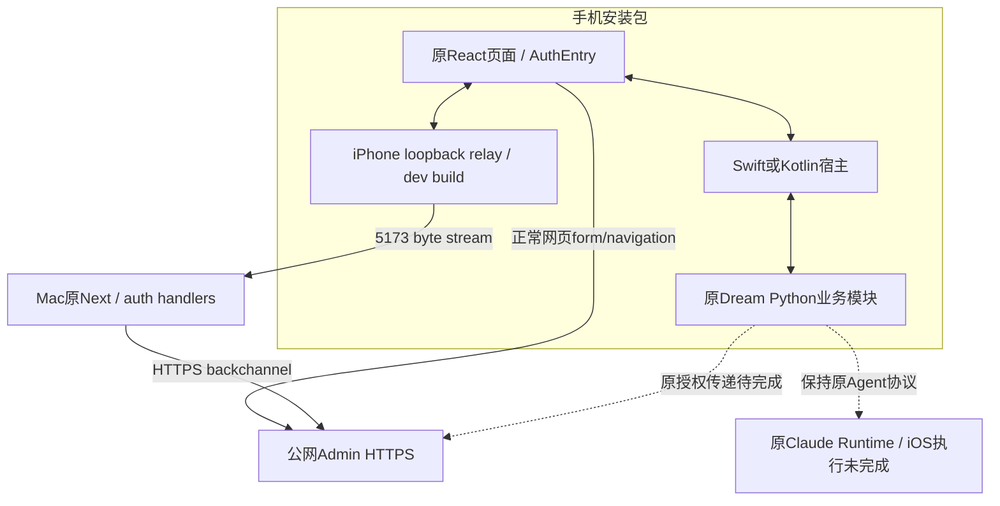

| 层 | iOS | Android | 归属 |
| --- | --- | --- | --- |
| React | WKWebView WebContent | Android WebView renderer | `frontend/app/_dream/**`唯一业务源码 |
| 原BFF | 原Next standalone在应用Node Worker执行；原Mac relay联调回执单独保留，独立Simulator原账号会话与保护读取已通过，Google与完整业务待验收 | 未实现 | `frontend/app/api/_auth/**`与原auth Route Handlers |
| 宿主 | Swift、UIKit、WKWebView | Kotlin、WebView、Binder | `mobile/ios/**`、`mobile/android/**` |
| Python | 应用进程内CPython、持久ASGI loop、24个原router与原Factory | 私有service中嵌入Python，未完成 | `backend/mobile_runtime/**`组合入口，业务继续归原模块 |
| 共享传输 | 来源/generation校验与进程内调用 | 来源/generation校验与Binder调用 | `mobile/shared/bridge/contract.json`及各语言镜像 |
| 业务数据、执行记录和附件 | 原Repository/API/workspace合同 | 同左 | 不新增账户目录业务、迁移或存储分层 |

静态React构建不包含Next服务器运行能力；完整Next无法直接静态导出。iOS独立路径复用原Next standalone，将相同React、Route Handlers、HTTP proxy与BFF放入应用进程。原Mac relay保留历史联调职责。公网Admin继续校验已登记的Dream来源和callback；当前沿用已登记的localhost来源，IPv4替代来源保留原拒绝反馈。原BFF的Cookie、CSRF、PKCE和服务身份要求保持。

## 最小平台协议

当前清单为10 methods、3 events、7 errors。已删除原生`auth.*`及`auth.callback`。用户登录、会话、退出和授权回调继续使用原HTTP/form/BFF入口。

| 方法组 | 平台职责 |
| --- | --- |
| `app.getInfo`、`runtime.getCapabilities` | 公开构建身份与技术运行事实 |
| `lifecycle.getState`、生命周期/网络事件 | 页面可见性与连通状态；不写入任务状态 |
| `runtime.request/response.read/cancel` | 传递原method/path/body、status/headers/body及取消；完整流未接通 |
| `file.pick/save`、`share.open`、`external.open` | 为原业务文件与系统操作提供适配；不定义附件上传和存储规则 |

本地bridge只允许包内应用来源主frame；远程认证/外链页面无bridge权限。请求ID和page generation只匹配通信结果。拒绝自由host、身份覆盖header、服务凭证、任意shell和文件路径。

`mobileRuntimeTransport`当前是受控的临时fetch适配。FormData、Request/URL对象、HTML form、图片、链接、WebSocket及原BFF必须逐项保持原浏览器行为，不能将未支持类型改为新的产品流程。应用挂载前的`python/localTransport`检查仅表示技术装配状态；不新增Chat/Dream功能隐藏规则。

## 业务保持与生命周期

iOS外观由现有页面CSS token与`theme.ts`提供。`MobileHostViewController`的主文档UserScript只读取`--color-bg-app`及`data-theme-mode`，私有`inkAppearance`消息仅携带颜色和主题模式；原业务bridge合同保持。`InkMemoryApp`将颜色填充到容器安全区，并按显式模式或系统模式选择系统外观。原WebView与键盘安全区、Cookie、HTTP、运行时和权限保持。正常、失败保留与模式转换见[iOS交互](./mobile-ios-interaction.md#页面与操作)。

正常网页登录见[共享时序](./mobile-app-interaction.md#正常业务时序)。iOS/Android保留第一方Cookie并允许原HTTPS form/navigation；静态资源CSP保留正常HTTPS表单、连接及原图片来源。iOS局域网开发包的Web origin保持`http://localhost`，5173字节relay不改HTTP字段；公网Admin使用已登记来源和callback。发布拓扑仍需HTTPS与现行来源配置，不放宽原服务校验。

原附件继续按`useFileUpload`上传，`AIInputDock`按原逻辑写workspace；平台只提供文件输入或系统保存/分享。原任务、工具权限、计费、资源策略default/desired/effective/revision及临时目录0700保持原定义；Claude命令沙箱采用本文端侧关闭配置。

生命周期通知只传给页面。进入后台不增加提交/落库，不自动续跑或补发；系统终止后按原状态/history/JSONL恢复。Stop、断流和进程退出均不能被宿主改写为新业务终态。

iOS系统可挂起后台App；现有[`observeLifecycle`](../../../mobile/ios/InkMemory/MobileHostViewController.swift#L251)只发布状态，宿主当前无额外后台时间申请或后台执行模式。原Python线程、Node Worker及guest命令服从同一App的系统调度，原命令deadline和错误传播保持。2026-10-26查阅Apple[生命周期](https://developer.apple.com/documentation/uikit/managing-your-app-s-life-cycle)及[有限后台执行](https://developer.apple.com/documentation/uikit/extending-your-app-s-background-execution-time)。当任务错误时，后续动作由原Claude和业务恢复入口处理；宿主不推断任务成功。

本轮前后台任务的首次Bash返回143，原Claude重试后保存completed；实际3次请求超过验收阶段2次上限。该回执证明本次结果可恢复，缺少精确后台时长及退出源诊断，完整专项保持未通过。后续采用现有无模型fixture定位计时与退出，真实复验先落实有界观察；不修改生产deadline或增加后台常驻。事实与依赖见[执行记录](../../exec/mobile-app-design-review-20261024.md#前后台恢复诊断与有界验收)。

## 阻断与下一步

| 工作项 | 最小处理与验收 |
| --- | --- |
| 原网页登录接入 | Simulator应用宿主已核对原form、callback、Cookie、`/auth/session`及一次Chat；补充物理iPhone同项回执 |
| 完整端侧后端 | 保留原组合与服务所有权；逐条证明原路由、身份与持久化可在手机工作 |
| Claude执行 | 取得真实iOS制品或符合原协议的移植证据；不换模型调用、工具或Agent业务 |
| 传输与文件 | 保留原流、取消、FormData、文件DTO与HTTP错误；通过完整原用户旅程 |
| 平台与发布 | 独立iOS/Android验证、签名、升级和渠道验收；发布前重新核对官方规则 |

现阶段不声明完整手机登录、完整Dream或已发布。当前代码与回执见[复审记录](../../exec/mobile-app-design-review-20261024.md#本轮复审验收矩阵)。

## 独立iPhone执行的实施边界

独立执行要求：包内React调用设备端Dream Python，设备端运行原Agent编排、工具、流与恢复；公网Admin提供既有账户/数据服务，模型服务承担推理；Mac限构建和调试。`DREAM_LAN_HOST` relay属于开发接线，不能作为此项验收路径。

### 当前执行阻断

| 边界 | 当前源码与结果 | 必需交付 |
| --- | --- | --- |
| Python → Claude Runtime | [SimpleClaudeAgentSDKClient](../../../backend/libs/claude_agent_kit/server/simple_cas_client.py#L115)创建`ClaudeSDKClient`；SDK `SubprocessCLITransport.connect()`使用`anyio.open_process`启动CLI | 在同一应用进程内承载原Runtime，并为SDK提供同一JSONL/control协议传输；流、interrupt、权限、MCP、session/resume逐项验收 |
| Runtime系统工具 | 运行源码`/Users/dmeck/project/ink-claude-code-dream/src/utils/shell.ts:1,316`依赖`child_process.spawn`；原`BashTool`与sandbox使用系统shell | iOS没有现有执行模型对应的通用shell子进程环境；移植须说明每个工具的执行方式和原权限语义。删除Bash/stdio工具后不能声明完整原CLI兼容 |
| MCP stdio | [agent_runner](../../../backend/libs/claude_agent_kit/server/agent_runner.py#L2231)以`sys.executable -I -c`启动原用户MCP | 将同源MCP handler接入可用的进程内传输并保留工具schema、授权、隔离与取消；不可用的外部stdio命令继续列兼容缺口 |
| Admin数据权限 | [AdminDataClient](../../../backend/services/admin_data/client.py#L81)同时取得service token和用户授权；Admin `app/lib/auth/serviceIdentity.ts:20–27`执行对应校验 | 复用普通backend env及原AdminDataClient，用户、scope、资源归属与purpose grant校验保持；本轮撤回新增Admin授权分支，外部分发凭证范围待评审 |
| 正常网页登录/BFF | `frontend/app/api/_auth/**`依赖Node、服务凭证与服务器Cookie密钥；原Next随包执行并读取原frontend env，独立Simulator会话已建立 | 保留原网页交互，完成可发行的会话接入与回调所有权；Device Flow和原生独立登录保持排除 |
| 完整后端与流 | 首次核查时装配11个模块并缓存完整body；当前装配24个原router，`NativeASGITransport`执行有背压的增量read/cancel | Simulator流及取消通过；原账户、Admin权限、持久化与原SSE用户旅程待验收 |

### 可复用运行时核对

以下官方或项目维护者资料于2026-10-25查阅；网页声明和本地代码审计分别作为证据。

| 路线 | 依据 | 当前处理 |
| --- | --- | --- |
| 现有Bun原生CLI | [Bun目标列表](https://bun.sh/docs/bundler/executables#supported-targets)仅提供macOS/Linux/Windows；Runtime `scripts/build-core-prune.ts:223–236`只接受darwin/linux四个平台 | 缺少iOS制品；修改Mach-O平台标记或继续用macOS arm64不能完成移植 |
| Node.js Mobile | [发布页](https://github.com/nodejs-mobile/nodejs-mobile/releases)提供18.20.4 iOS库；[API差异](https://nodejs-mobile.github.io/docs/api/differences/#child-processes)明确不支持child_process/cluster；原Runtime要求Node≥22 | 库可以承载部分JS，无法直接承载原CLI/工具链；本轮不增加依赖 |
| Swift-bun 0.1.0 | [项目README](https://github.com/1amageek/swift-bun)声明实验性兼容、无通用child_process与native addons，要求iOS26/Swift6.2/Xcode26 | 当前iPhone为18.0.1、Xcode16.4/Swift6.1.2；该库未满足当前设备及工具完整性条件 |
| 同源进程内Runtime移植 | 复用现有Runtime源码与SDK协议，替换运行时平台适配 | 尚未实现；需要独立的原Runtime执行、工具及恢复回执。当前应用保留真实unavailable状态 |

[CPython subprocess官方文档](https://docs.python.org/3.13/library/subprocess.html)明确iOS不支持该模块的进程创建。[Claude Code系统要求](https://code.claude.com/docs/en/setup#system-requirements)未提供iOS运行目标。原生测试`testTargetInterpreterProcessExecutionBoundary`直接调用包内目标解释器的subprocess，记录实际错误；测试通过只证明限制存在。

### 实施顺序与通过条件

1. 在可支持当前设备的进程内JS宿主中启动同源Runtime，完成SDK初始化、单轮、流、interrupt、权限及resume合同；保持Runtime源码所有权与发布来源要求。
2. 对Bash、stdio MCP、插件、输入输出、停止与恢复逐项取得端侧执行证据，保留原工具审批。端侧部署采用既有关闭Claude命令沙箱配置；原工具执行兼容继续完成。
3. 原Next与Python分别读取现有frontend/backend env，沿原服务身份、用户授权、DTO和capability连接公网Admin；外部分发前审查现有凭证范围。
4. 装配剩余后端依赖和原router，接通同一ASGI流/取消与React文件输入。
5. 在构建`DREAM_LAN_HOST`为空、Mac Dream业务服务不可达的条件下，以原账号执行登录、Chat、工具、停止、重开恢复和文件操作；公网Admin、Gateway与正常业务记录共同核验。

当前判定：完整独立iPhone执行未通过。原Runtime与SDK在同应用Worker中执行，原自有MCP使用原handler和原SDK内存传输；通用Bash、第三方stdio工具、Google回调与完整真实业务继续待完成。容器联调、应用内fixture技术验证、真实账户业务和物理iPhone资格分别记录。

## iOS兼容代码实施更新

本节更新同日兼容性核查的Node候选与实现状态。[fogtape Node.js Mobile 24.21.0-0](https://github.com/fogtape/nodejs-mobile/releases/tag/v24.21.0-0)提供设备和arm64 Simulator slice，符合原Runtime的Node≥22、<25版本范围；维护者制品与源码来源于2026-10-25核对。该库独立于前表的上游18.20.4发行线。当前先使用此精确制品验证进程内路径。

| 模块 | 已实现职责 | 资格与剩余验证 |
| --- | --- | --- |
| `mobile/ios/InkMemory/DreamNode.m` | 应用内启动Node事件循环，使用应用私有目录、0600端点文件和同应用PID绑定；跨线程Foundation对象由ARC管理 | Simulator已加载Node24.21.0并启动原Runtime；应用冷启动及真机继续独立验证 |
| `mobile/ios/runtime/host.cjs` | 固定127.0.0.1随机私有端口、应用内随机凭据、固定原Runtime/Next入口；SDK独立Worker，Next持久Worker，按流反压转发stdio字节 | 运行于应用进程；不接受远程目标或自选入口；异常与并发合同继续验证 |
| `mobile/ios/runtime/worker.mjs` | 原Runtime使用会话独立的模块状态、env、argv和工作目录；相对文件操作使用当前会话目录 | 原Node模块继续执行工具；文件、权限、恢复和不支持的系统调用逐项取得回执 |
| `backend/mobile_runtime/ios_claude_transport.py` | 接入原`ClaudeSDKClient(transport=...)`，复用精确SDK的参数编码、JSONL解析及control路由，替换进程创建与stdio传输 | 原SDK0.2.145与Runtime0.1.12在Simulator完成initialize、流、Write、SDK MCP、权限拒绝、Worker重建后的JSONL恢复及interrupt；模型响应来自应用内fixture |
| `backend/mobile_runtime/asgi_transport.py`、`ios_http.py`与`ios.py` | 在持久事件循环执行原ASGI应用，头部即时返回，按需读取最多65536字节，校验document/request/stream归属并转发disconnect | Simulator原生测试已验证增量响应及pending read并行取消；HTTP断流保持独立于原Agent任务生命周期 |
| `mobile/ios/scripts/prepare-node.py`与`bundle-node.py` | 校验Node SHA-256和原公开Runtime archive SHA-512，只复制55个原JavaScript文件，适配`import.meta.require`并保留逐文件摘要、原版权及Node依赖许可 | Darwin可执行文件、ripgrep及其他桌面二进制均排除；新iOS制品资格单独建立 |
| `mobile/ios/scripts/prepare-python.py` | 准备原SDK/MCP、目标rpds、PyYAML、cryptography46.0.3/OpenSSL3.5.9和原锁定Pillow12.3.0 iOS wheels | 设备与Simulator依赖制品已准备；Simulator原Runner、ES256、AES-GCM篡改拒绝与PNG/JPEG/WebP编解码通过，物理设备继续验证 |

`SubprocessCLITransport.connect()`继续服务原桌面/服务器路径；iOS使用同协议Transport和原Runtime工作线程。该适配保留原SDK控制状态机和Agent循环。任意Bash、第三方stdio MCP及Node原生扩展的可用性继续依据目标执行回执，禁止从initialize通过推导全部工具通过。

正常网页登录、Admin权限、Dream持久化与React入口保持原业务合同。应用启动绑定本机Node与Python后继续报告`businessReady=false`。当前独立入口加载原Next和原AuthEntry，账户状态与失败反馈由原BFF处理；原技术探针继续记录完整业务资格。

原`SimpleClaudeAgentSDKClient`新增可选Transport构造器，原`ClaudeAgentRunner`新增可选CLI入口，原`ClaudeAgentThreadFactory`新增可选Runner构造器。默认调用保持原解析与运行路径；iOS组合通过这三个现有边界绑定同应用Runtime。兼容代码保留原query/control、权限、Service、EventBus、admission与turn/resume/cancel语义。原Runner/MCP等421项Provider-free回归通过；24-router/Factory消费者改动的207项回归通过。Simulator原Runner与user MCP通过，模型响应来自应用内fixture；真实模型和账户业务独立验收。


### 当前设备内组合

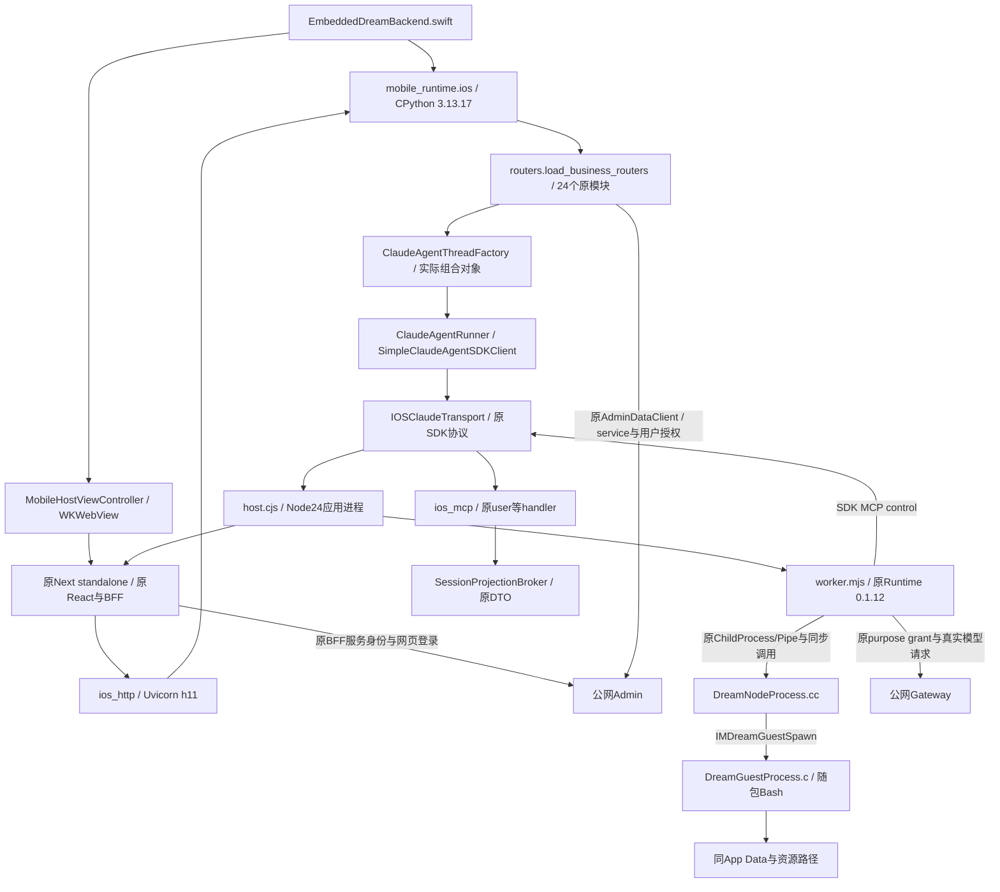

`ios_factory.py`组合原admission、资源策略provider/refresher、Runtime policy store和原Factory。`runtime_owner.get_thread_factory()`返回实际对象；服务器继续取得原`agent_factory`实例。原路由、Guidance、launch、confirmation、reentry与Reflections共用此入口，保留原请求与执行语义。

端侧`ios.py`为原`StoryWorkspaceDreamConfirmationCoordinator`绑定同一AdminRequestAuth提供的原worker。用户提交原确认接口后，原`schedule(dispatch)`仅按持久化message_id领取本次确认，继续使用原claim、lease、turn owner、消息持久化和ACK。端侧不调用全局`start()`或无message_id的领取扫描；确认失败重试与进程重开后的领取所有权继续按原合同验收，缺少回执时保留未完成状态。原Admin接口、权限和表结构保持。

2026-10-26原确认提交已将本次Run保存为confirmed，原执行页及EP01 reader可读取3镜头文件。续接调用[`turn_owner`](../../../backend/services/admin_data/story_workspace_confirmation_data.py#L429)时，原claim-turn签发的server-persistence grant包含当前run_id；当前公网Admin的[`workflowContextHandler`](../../../../ink-admin-memory/app/lib/dream/workflowContextHandler.ts#L30)拒绝全部非空runId，返回DELEGATION_ENTITY_DENIED。公网发布源的只读核对确认该条件存在。完整续接所需合同为：保留原service、purpose、精确Thread校验，并校验服务端解析的workflow_run_id与grant.runId相等后读取当前上下文。当前未修改Admin或改用宽范围凭证，未跳过校验；依赖及实际记录见[确认回执](../../exec/mobile-app-design-review-20261024.md#原确认提交及当前授权依赖)。

`DreamPython.m`注册内建`_dream_native.available_memory()`。iPhone使用`os_proc_available_memory()`的实际进程剩余额度，0按原低内存比较处理；Simulator使用Mach `host_statistics64`返回的真实free/inactive页。采样适配复用`AgentResourceSnapshot`和原admission比较，不修改配额与lease。Apple接口及SDK头文件于2026-10-25核对：[os_proc_available_memory](https://developer.apple.com/documentation/os/os_proc_available_memory)。Admin策略权限缺失时，原provider返回`unavailable`并保留default/LKG；状态维持原default/desired/effective/revision定义。

`ios_mcp.py`验证原Runner的0600私有MCP文件和固定模块入口，再把user、Editor、Story及image原server factory接到原SDK内存传输。远程MCP头部仍留在私有文件，连接关闭时恢复原投影；同步broker调用在单独线程执行。Simulator已验证原user handler到原Session broker/DTO；其他自有MCP保持各自业务验收项。

Node Worker使用固定签名资源入口，关闭`trackUnmanagedFds`，避免Worker退出时清理CPython已经复用的进程文件描述符。SDK关闭后检查本轮工作区文件描述符和HTTP fixture socket归属，当前目标测试通过。此适配处理进程共享描述符所有权，完整工具集仍需按工具执行回执确认。

### 后续授权与前端接线条件

| 对象 | 当前所有权与处理条件 | 剩余工作 |
| --- | --- | --- |
| 正常网页登录 | 原AuthEntry表单、原BFF Cookie/CSRF/PKCE、Admin密码和Google认证；原Next standalone随包 | 原BFF已读取普通frontend env并保留表单、callback、session和logout；Google系统浏览器回调待完成 |
| Admin用户数据 | 原AdminDataClient同时发送用户access token与service token；现有公开Editor API仅覆盖Editor | 原生产request/data owner已装配，独立Simulator Thread/Deck读取200，真实Chat消息写入通过；完整业务继续按原用户、scope、资源归属和合同验收 |
| Gateway与持久化 | 原turn创建purpose/thread/run绑定的gateway-cli与server-persistence grant | 独立Simulator真实Chat已取得正常Admin消息和Gateway结算；续期、撤销、receipt及其他任务继续逐项验证 |
| 系统工具 | 原Read/Write与自有MCP已有部分目标回执，Bash及任意stdio进程仍需iOS执行实现 | 逐工具补齐平台执行，禁止借用Mac执行、放宽权限或替换Agent循环 |
| 当前工作区入口 | 独立路径加载应用内原Next和原React；原技术探针保留完整业务未就绪事实 | 原页面运行、原网页登录、原后端真实业务分别验收；原生测试与历史Mac业务回执分别记录 |


Workspace Mode关闭时，原Service保留`cwd=None`并只创建原thread runtime根及`.claude-tmp`。原Runner沿用`cwd or os.getcwd()`，iOS启动时把进程默认目录设为包内backend源码；Node host仅额外接受该固定目录，保留线程工作区路径校验。Simulator原Runner以`cwd=None`完成单轮，原user MCP和工作区开启路径共同通过；应用内fixture共4次请求。

历史ENOSYS阶段：`worker.mjs`通过固定Node24的`process_wrap`和`spawn_sync`原生绑定返回`UV_ENOSYS`，由Node原ChildProcess代码生成stream、callback与错误结果。该阶段Bash返回`is_error=true`及ENOSYS，原Read相对路径、Write、SDK MCP、权限拒绝、resume和interrupt通过。后续候选按本文基本命令兼容接线，完整执行资格继续待完成；以下沙箱初始化与隔离原型章节保留当时实现和失败状态。Node移动API资料于2026-10-25核对：[Node.js Mobile API差异](https://code.janeasystems.com/nodejs-mobile/nodejs-apis-differences)。

#### iOS强制沙箱初始化兼容

历史实现记录，2026-10-25端侧关闭部署决策已取代本节选型。以下保留当时失败、源码适配及技术验证依据；当前实施采用普通env关闭配置，停止扩展逐命令沙箱。

本节原文中的“选定适配”“当前采用”及强制沙箱验收要求均归属该历史阶段，退出当前实施和发布前置项。原权限审批由现有工具权限链路负责，关闭Claude命令沙箱的部署值按本文首节执行。

2026-10-25第二次原Chat提交完成用户消息持久化与HTTP200。原Runtime随后因桌面sandbox-runtime的unsupported platform检查退出，真实模型请求数为0。原协议fixture此前使用默认沙箱设置，该技术回执缺少生产`enabled=true`、`failIfUnavailable=true`组合覆盖。

选定适配位于现有iOS Node Worker与固定版本Runtime的Base SandboxManager：`ios-process-boundary.mjs`固定外部进程原生绑定为不可改写、不可重新配置的ENOSYS实现；Base SandboxManager仅在该边界校验成功后初始化iOS执行后端，每次命令包装均抛出ENOSYS。外部命令全部拒绝，命令产生的文件及网络副作用均无法启动。原settings转换、强制初始化检查、权限判定、Workspace Mode、精确`.claude-tmp`与Read/Write/MCP实现保持。该适配提供模型与进程内工具的启动条件，Bash执行资格继续未支持。

方案评审：关闭沙箱会改变现有权限配置；伪装macOS仍依赖桌面Seatbelt与命令进程；新增命令解释器需要独立语义和工具验收。当前采用外部命令全部拒绝的最小iOS后端。平台判断基于实际`process.platform`及冻结的原生绑定，普通env保持原配置，不增加测试环境业务分支。缺少或被修改的进程边界必须导致初始化失败。

固定archive的源码和适配后文件分别记录SHA256；prepare脚本要求四个Base函数标记各出现一次，仅修改该平台适配点，CLI强制沙箱检查保留。Provider-free验收须在启用且强制沙箱条件下覆盖原SDK流、Read/Write、Bash拒绝、MCP、权限拒绝、恢复和中断；通过后再执行一次原账号可见Chat。真实Chat成功、完整工具资格和物理iPhone分别记录。

Worker通过Node内建diagnostics channel记录原HTTP请求的失败类别、闭集格式错误码与毫秒耗时。日志排除URL、headers、正文、凭据和异常原文；异常订阅保持原请求参数、响应和SDK stdout。该诊断用于原BFF和Runtime网络失败，原业务超时与重试保持。2026-10-25查阅[Undici Diagnostics Channel](https://undici.nodejs.org/api/DiagnosticsChannel)。

iOS Next worker曾对现有env指定的Admin来源验证`Connection: close`，三次原BFF读取返回200；随后的原会话检查在新建连接时继续出现30秒超时。该候选已撤回，原fetch、连接策略、Cookie、授权、CSRF、PKCE、期限与返回流保持。当前保留固定操作与阶段诊断，HTTPS根因和真实结束恢复稳定性继续待验证。对照结果见[执行记录](../../exec/mobile-app-design-review-20261024.md#2026-10-25-原node-bff恢复查询定位)。配置继续使用原env键。

原[`ClaudeAgentThreadFactory.stop_thread()`](../../../backend/claude_agent/thread_factory.py)对同一运行任务发送首次取消；原响应等待以`asyncio.shield(bg_task)`保留已开始的Service清理，期限到达返回原running快照。重复Stop继续同一清理，原部分回复仍由原AdminTurnPersistence保存。该修复适用于共用Factory，原3秒与客户端10秒配置、权限、DTO和终态保持。143项及19子用例技术回归通过。原首段新回复触发Stop的独立Simulator验收退出0，取得原受理DTO、页面终态及正常部分助手is_partialtrue/turnStatuscancelled记录；原Session前缀保持，Gateway按现有取消语义结算。此前空闲Stop及账户503失败保留于执行记录，完整工具、文件和物理iPhone继续验收。正常、异常与状态图及原文保存见[停止交互设计](../claude-agent/claude-agent-stop-interaction.md)。

原[`ChatPanel`](../../../frontend/app/_dream/components/chat/ChatPanel.tsx)保留2秒inputs轮询节奏；上一读取未完成时跳过该轮tick，后续tick在请求结束后恢复读取。effect结束时清除timer并取消其AbortController，原[`fetchThreadInputs`](../../../frontend/app/_dream/components/chat/threadInputQueue.ts)只把可选signal传给原fetch。原手动队列操作、DTO校验、凭证、错误及状态转换保持；轮询失败保留当前原展示规则。真实组件6秒虚拟时钟用例在修复前发出4个请求，修复后只保留1个；原Stop、队列及提交停止15项聚焦回归通过，真实结束延迟按分层ASGI与浏览器EOF回执继续定位。

修复后的原账户追问已取得ASGI finish/EOF、浏览器EOF、页面停止按钮退出、正常消息及Gateway结算。ASGI与浏览器均记录1143字节，原Session继续增长且原前缀与inode保持。该次端到端结束验收通过；原inputs读取仍观察到503和长等待，网络稳定性、真实运行中停止及完整系统工具继续独立验收。命令、失败/修复回归及真实分层回执见[执行记录](../../exec/mobile-app-design-review-20261024.md#2026-10-25-队列读取重叠修复与结束状态定位)。


当前组合和权限的关键源码：[iOS绑定与路由装配](../../../backend/mobile_runtime/ios.py#L61)、[原24-router顺序](../../../backend/routers/__init__.py#L6)、[实际Factory读取](../../../backend/claude_agent/runtime_owner.py#L22)、[iOS Factory](../../../backend/mobile_runtime/ios_factory.py#L19)、[自有MCP适配](../../../backend/mobile_runtime/ios_mcp.py#L18)、[ASGI传输](../../../backend/mobile_runtime/asgi_transport.py#L31)、[Native内存接口](../../../mobile/ios/InkMemory/DreamPython.m#L12)。

Admin授权缺口由实际入口确认：[AdminDataClient](../../../backend/services/admin_data/client.py#L86)始终取得service token；[BFF capabilities](../../../frontend/app/api/_auth/admin-client.ts#L212)沿原服务客户端调用；公网Admin的[requireDreamService](../../../../ink-admin-memory/app/lib/auth/serviceIdentity.ts#L14)验证confidential client，[capabilities权限](../../../../ink-admin-memory/app/lib/auth/capabilitiesHandler.ts#L17)要求原服务scope，[browser session handlers](../../../../ink-admin-memory/app/lib/auth/browserSessionHandler.ts#L10)仍经此入口。仅把现有BFF放入手机无法取得这些服务器权限；该段保留env接入前的缺口依据。当前本机调试装配按本文末节复用原配置；用户、scope、资源归属及purpose grant校验继续沿原入口执行。


### 原Next与原ASGI的最小接线

方案比较：静态React资源缺少原Route Handlers、服务端代理和BFF；提取另一套移动BFF会增加会话与请求行为的维护面。当前选择复用原Next standalone，沿用已经嵌入的Node24，再通过原Uvicorn/h11连接同一ASGI实例。新增对象仅对应原前后端HTTP通信和iOS Worker生命周期；保留原登录、API和数据合同。

| 模块 | 执行与约束 | 验证边界 |
| --- | --- | --- |
| `prepare-next.py` | 在忽略的`Next/build-source`准备原源码、共享合同与既有依赖，排除`.env`；只调整standalone和构建并发配置 | 原Next16.1.6生产构建与TypeScript已完成；原Web开发目录和进程保持 |
| `bundle-next.py` | 复制standalone、原public与static，将依赖符号链接重定位到包内；排除桌面原生扩展并记录源码/lock/file摘要 | 打包校验拒绝未识别的外部路径；原Sharp图像优化继续待资格验证 |
| `host-config.json` | 定义缺省IPv4回环Web origin；普通env优先提供已登记的localhost来源，监听只接受IPv4/IPv6回环；端口占用返回失败 | Simulator与Mac共享网络内核；必须取得应用Worker的实际listening事件，再验证原页面200 |
| `host.cjs` / `worker.mjs` | 固定签名Next入口、持久Worker、独立env、原Node HTTP；同PID私有status报告实际监听与失败 | Web启动观测重试复用既有Worker；后端origin改变或Worker终止明确失败；不转到Mac |
| `ios_http.py` | 原Uvicorn0.38.0与h11在持久ASGI loop监听随机IPv4回环端口；复用同一个应用和已进入的lifespan | HTTP连接断开保持原ASGI行为；不复制任何业务路由、状态机或鉴权 |
| `MobileHostViewController` | 等待Node/Python/Next启动，再通过WKWebView加载原页面；第一方Cookie继续由WebKit保管 | 原BFF配置缺失保留503与原登录错误；完整登录按原配置和已登记callback验证，当前本机env装配见本文末节 |

本机准备命令见[mobile README](../../../mobile/README.md)。Next standalone与目录配置于2026-10-25查阅官方资料：[output](https://nextjs.org/docs/app/api-reference/config/next-config-js/output)、[distDir](https://nextjs.org/docs/app/api-reference/config/next-config-js/distDir)。官方资料说明standalone与资源复制规则；iOS应用内运行资格由本项目目标测试单独确认。

早期无env目标回执：关闭relay后，18项原生检查通过；原Next与原ASGI在同应用内返回页面、原static、原public proxy和增量SSE，WKWebView运行原React登录卡片；原auth/options返回503配置失败。该阶段结果保留于[追加回执](../../exec/mobile-app-design-review-20261024.md#同日后续原next-standalone与原asgi应用内http)。当前普通env配置和原账户真实Chat结果见本文末节及[独立终态复验](../../exec/mobile-app-design-review-20261024.md#独立simulator原chat终态复验通过)。

iOS Xcode当前只打包原Next入口；`bundle-next.py`清理该目标旧增量`web/`产物。旧静态资源脚本保留手动使用记录，Android仍沿用其既有静态资源构建。当前iOS未增加第二套业务页面或请求实现。


### 公网授权与系统进程复核

本节保留env接入前的只读核验与范围判断。当前本机配置装配见下一节；公网Admin代码与原校验保持。

2026-10-25仅执行两项无Cookie、无Authorization的公网GET。`/api/auth/.well-known/openid-configuration`返回200，issuer为`https://ink-admin.suoxya.com/api/auth`，包含authorization_code、client_credentials、refresh_token及device_code通用grant声明；`/api/internal/dream/v1/capabilities`返回401、`DREAM_SERVICE_REQUIRED`。原应用内`/auth/options`的503配置失败与此服务身份要求共同构成账户链路阻断。原邮箱密码表单及授权码流程继续保留。

| 边界 | 当前源码与公开响应 | 处理与恢复前提 |
| --- | --- | --- |
| 原BFF会话 | [AdminBffClient](../../../frontend/app/api/_auth/admin-client.ts#L164)每次内部调用取得service token，再交换/解析原opaque handle；[Admin requireDreamService](../../../../ink-admin-memory/app/lib/auth/serviceIdentity.ts#L14)要求配置的confidential service identity | 现有服务器service secret保留服务器所有权；端侧完整会话资格缺失，原错误保留 |
| 数据与purpose grant | [AdminDataClient](../../../backend/services/admin_data/client.py#L81)同时使用服务与用户身份；[原delegation创建](../../../../ink-admin-memory/app/lib/auth/delegationHandler.ts#L18)经内部服务鉴权 | 原公开renew/revoke/receipt只消费已签发grant；端侧缺少合法首发grant与完整数据授权，真实业务验收保持未通过 |
| 公开Editor | [handlePublicEditorOperation](../../../../ink-admin-memory/app/lib/dream/editorSessionHandler.ts#L71)使用原Editor actor与session范围 | 维持Editor原操作范围；完整Dream数据调用仍受原内部入口约束 |
| OAuth metadata | 公网discovery声明`private_key_jwt`等服务器通用方法；[实际Dream service catalog](../../../../ink-admin-memory/app/lib/auth/oauthClientCatalog.ts#L145)使用client_secret_basic | 当前Dream设备授权资格须由实际已登记client、scope、来源和callback共同证明；通用metadata字段仅记录服务器能力 |

iPhoneOS18.5 SDK的`usr/include/spawn.h:60`声明`posix_spawn`自iOS2.0可用，`unistd.h:449`声明`execve`。SDK声明覆盖编译期符号，应用执行资格继续按平台约束与目标回执核定。当前CPython3.13.17的`_can_fork_exec=false`及errno45证明目标Python标准库的执行边界；Node Worker的ENOSYS由本项目平台适配返回，覆盖Simulator误用Mac进程的风险；两项回执均未执行物理iPhone的native posix_spawn。

官方资料于2026-10-25复核：[PEP730的POSIX限制](https://peps.python.org/pep-0730/#posix-compliance)、[Python3.13移动平台说明](https://docs.python.org/3.13/library/intro.html#mobile-platforms)、[Apple DTS对iOS子进程的说明](https://developer.apple.com/forums/thread/747499)。iOS普通应用缺少现有Bash/任意stdio命令所依赖的通用子进程模型。保留原Agent、工具、权限和数据范围的完整方案，仍需合法端侧授权合同与经过审查的系统工具执行方案；当前实现继续列明兼容缺口。


### 应用内Bash目标资格原型

历史资格记录。基础Bash/stdio执行回执可用于后续兼容工作，额外沙箱守卫退出当前实施范围。

2026-10-25，独立XCTest bundle在现有Dream App进程运行ARM64 Linux ELF解释核心及真实Bash。上游固定为`OpenMinis/ish-arm64`的`c5c264da19148512167aa493d7bd4e50aae1b74e`；临时realfs-only补丁删除fakefs与SQLite运行依赖，关闭native offload和JIT。该原型仅链接具名资格测试bundle，现行App/Runtime目标继续使用原命令拒绝边界。

[`InkGuestRunFixture`](../../../mobile/ios/InkMemoryTests/guest_fixture.c#L77)使用单独的guest init和子任务，向解释核心传入自有stdin/stdout/stderr管道。guest退出保留App进程；宿主标准描述符保持。原生资源安装会重设ELF资源的执行权限，[目标fixture](../../../mobile/ios/InkMemoryTests/PosixCompatibilityTests.m#L12)仅在自己的临时目录恢复原guest mode和软链数据；原执行权限检查保持。已验证管道、数组、命令替换、子命令、后台作业等待、文件写入和退出码7。Simulator目标用例退出0、1项通过；同一核心的iPhoneOS静态库编译通过，物理设备执行待验证。

[`build-posix-qualification.py`](../../../mobile/ios/scripts/build-posix-qualification.py)校验源版本和9文件补丁SHA，构建资格bundle并签名现有App的自有副本。原Next/Python、普通env与现有业务代码从原App复制，脚本不安装或启动App。该fixture未调用模型，未进入原Claude `child_process`入口；Bash工具、任意第三方stdio、取消/超时、目录与网络权限等价性、原SDK/Runtime接线和真机验证继续为后续工作项。执行回执见[系统命令兼容原型](../../exec/mobile-app-design-review-20261024.md#2026-10-25-应用内系统命令执行兼容原型)。

### 原Node进程接口目标资格

历史资格记录。保留原Node进程行为证据，原Claude工具接线继续按当前关闭沙箱部署决策完成。

本节原文末段的guarded realfs和完整文件/网络隔离后续工作已停止。argv/env/cwd、stdio、退出和停止所需的进程接口兼容沿用当前执行方案，普通env关闭配置保持。

[`node_process_binding.cc`](../../../mobile/ios/InkMemoryTests/node_process_binding.cc)以当前Node Mobile头文件注册具名linked binding，使用原Node事件循环和AsyncResource交付退出通知。[`node_process_fixture.mjs`](../../../mobile/ios/InkMemoryTests/node_process_fixture.mjs)在独立资格Worker中替换`process_wrap.Process`构造器；Node原`ChildProcess`、Pipe、流事件和错误处理继续执行。原Node24实际内建源码使用八个位置参数调用`Process.spawn`；适配保留参数顺序，连接原Pipe对象与私有宿主fd。

[`node_guest_fixture.c`](../../../mobile/ios/InkMemoryTests/node_guest_fixture.c)执行传入的完整file/argv/env/cwd，按传入PATH查找可执行文件；缺少PATH时使用POSIX缺省搜索目录。核心保留guest PID1并回收子任务，每次调用创建独立guest进程组。原生绑定将Darwin信号编号转换为Linux guest信号；`ChildProcess.kill`发送给指定guest PID，原`process.kill`通过所属Worker的`process._kill`适配发送给已登记guest PID或负PID对应的组。未登记PID返回ESRCH，host PID只支持当前进程存在性检查；自终止及后代所有权仍列后续实施范围。宿主0/1/2描述符保持，非guest线程保留原SIGUSR1与SIGPIPE行为。

[`NodeProcessCompatibilityTests`](../../../mobile/ios/InkMemoryTests/NodeProcessCompatibilityTests.m)已在Simulator App宿主取得原Node→原生→实际Bash回执，覆盖stdin、分段stdout、stderr、文件写入、退出7、ENOENT、并发与进程组SIGTERM。同一资格包的原`spawnSync`、`execFileSync`与`execSync`通过262144字节双向管道、PATH与shebang、ignore/继承fd、EACCES/cwd错误、ETIMEDOUT和合计输出ENOBUFS检查。同步等待只阻塞所属Worker；私有管道使用非阻塞读写，guest线程继续运行，原Next/Python属于各自线程。Node原公开接口继续转换编码和错误对象。

同步输出阈值按stdout与stderr合计字节执行；主错误与管道错误分别保留首项，结果优先返回主错误。EPIPE保留子进程自然退出结果；超时发送原killSignal、关闭私有管道并等待guest退出。2026-10-25查阅[Node24同步进程源码](https://raw.githubusercontent.com/nodejs/node/v24.x/src/spawn_sync.cc)与[Node24进程API](https://raw.githubusercontent.com/nodejs/node/v24.x/doc/api/child_process.md)，该合同与原实现一致。资格包保留当前Node内建源码与实际目标回执，源码分支资料用于合同核对。

测试只执行明确脚本，原Agent循环、权限与业务状态保持。[`build-node-process-qualification.py`](../../../mobile/ios/scripts/build-node-process-qualification.py)复用前述来源与资源准备脚本，构建独立bundle并向自有App副本添加资格Worker；现行Xcode目标、Runtime Worker与生产ENOSYS绑定保持。

后续实现范围：原Claude工具入口、额外fd/IPC、后代/会话所有权和PID复用、Worker退出与资源回收、完整文件和网络权限等价性及物理设备。当前guarded realfs资格根按显式传入的路径数组限制读取和写入，基本路径、fd与精确临时目录取得目标资格；原Runtime配置投影和完整隔离继续待完成。原`workspace.py`的敏感路径与精确临时目录规则保留。生产进程边界仅在必要合同取得实际回执后调整。Node资格结果与原Claude工具真实业务验收分别记录。

### guest网络原语资格与原sandbox接线

历史隔离原型，退出当前生产接线、后续实施及发行门槛。以下原文保留当时实现和验证范围。

本节原文中的“继续实施”“仍待接线”及完整隔离资格均为已停止的历史工作项。

当前资格实现复用固定guest核心的`tgroup.fs_context`；`tgroup_copy()`在fork时继承该字段。宿主在cwd和exec前绑定不可变范围，范围记录保留到资格App退出，覆盖原进程退出后仍存活的后代。Node/Python原宿主网络继续由原模块执行，限制作用于guest命令。

[`node_guest_fixture.c`](../../../mobile/ios/InkMemoryTests/node_guest_fixture.c)在固定arm64系统调用表接入socket/connect限制：网络关闭时拒绝INET socket，指定代理范围仅允许TCP连接到`127.0.0.1`或`::1`的HTTP/SOCKS代理端口。connect使用单次复制并验证的sockaddr及保留引用的fd，guest并发修改原地址或关闭并复用fd后无法替换该次native connect目标。UDP、其他地址/端口、named Unix socket、本地监听、ancillary message和mount/chroot/namespace入口保持拒绝。前三项stdio中的已连接宿主socket返回ENOSYS，原调用方fd保持。

2026-10-25目标资格覆盖网络关闭、同机其他端口、保留文档地址、UDP、fork继承、并发不同范围、配置输入复制及缺少范围拒绝。App内指定TCP端口接收3次，其他端口接收0次；原Node管道、同步/异步执行和停止回归保持。该TCP服务属于明确命名的验证fixture，原Claude域名过滤代理仍待接线。

原sandbox配置、allow/deny优先级、精确`.claude-tmp`、文件路径/fd操作、符号链接、跨进程/proc fd、PID与会话归属、Unix/message API及范围回收继续实施。当前检查覆盖本轮创建的网络连接；完整隔离资格依赖上述边界闭合。生产Runtime继续执行原ENOSYS拒绝；正常网页登录、业务权限、原env和原Session保持。目标命令与回执见[本轮执行记录](../../exec/mobile-app-design-review-20261024.md#2026-10-25-原sandbox配置的guest执行隔离)。

### guest文件原语资格

历史隔离原型，退出当前生产接线、后续实施及发行门槛。以下原文保留当时实现和验证范围。

本节原文中的scope投影、继承fd校验及文件隔离后续工作均已停止；既定thread临时目录与0700规则继续执行。

版本5资格绑定的[`ExecutionScope`](../../../mobile/ios/InkMemoryTests/node_process_binding.cc#L250)同时复制四组`filesystem`路径数组和HTTP/SOCKS端口。数组使用原`denyRead`、`allowRead`、`allowWrite`、`denyWrite`字段名；本轮由独立验证Worker显式注入，原Runtime配置到scope的投影继续待实现。路径必须为规范化绝对字面路径，包含未展开glob、NUL或相对组件的输入保持拒绝。读规则按匹配路径具体程度处理allowRead，等长denyRead保持拒绝；写规则需要allowWrite匹配，denyWrite保持优先。原始配置与平台转换的完整等价性单独验收。

[`node_guest_filesystem_fixture.c`](../../../mobile/ios/InkMemoryTests/node_guest_filesystem_fixture.c)复制原realfs的`fs_ops`和`fd_ops`，仅替换权限相关操作；固定核心与realfs-only补丁保持。路径操作通过[`parent_fd`](../../../mobile/ios/InkMemoryTests/node_guest_filesystem_fixture.c#L111)逐级保留目录fd，所有组件与最终open使用O_NOFOLLOW。原guest VFS继续解析Linux路径和符号链接。guest目录变更、检查与普通文件I/O使用同一锁；FIFO阻塞I/O与flock等待释放该锁，保持对端执行。

每个打开文件保存原路径与创建scope。内容读写、pread/pwrite、目录枚举、fsetattr及共享可写mmap同时检查原路径与实际fd路径，范围不匹配、路径越出mount根或移动到禁止位置时拒绝。已取消目录项且仍由相同scope持有的fd保留原范围。继承的普通文件在移交前校验实际宿主位置和读写方向；当前管道允许，socket继续拒绝。继承fd后续每次I/O、proc访问和已有inode别名继续属于完整隔离工作项。

原固定Runtime的`generateReadRules`允许目录元数据，当前适配保留该行为；目录内容继续由readdir执行读取校验。新guest在scope绑定前读取根目录元数据，符合该元数据边界。对已存在目录执行mkdir返回EEXIST，mkdir -p按原工具行为继续；创建新目录仍执行写权限检查。精确`.claude-tmp`由同一allowWrite数组表达，其父目录、相邻目录与整个/tmp保持原限制。

[`node_guest_mmap_fixture.S`](../../../mobile/ios/InkMemoryTests/node_guest_mmap_fixture.S)使用固定Linux arm64 openat/read/write/mmap/exit ABI。构建脚本以现有Xcode assembler生成无重定位指令，封装为显式guest ELF；同一解释核心执行这些指令，宿主保持解释执行。probe以stdin握手等待验证Worker将已打开文件移动到denyWrite位置，随后请求共享可写mmap，要求返回EACCES且文件字节保持。

普通文件、目录、硬链接、chmod/utime、FIFO、取消目录项后的fd、13项拒绝、读写符号链接、精确临时目录0700、两个继承fd、已打开fd移动、共享mmap、并发范围和不可变数组已取得Simulator资格回执；原Node进程、网络和停止用例同场执行。原`.env`、网页登录、业务权限与原Session保持，生产Runtime冻结ENOSYS。原Runtime规则投影、proc/进程范围、已有inode别名、已有映射的权限变化、继承fd持续校验、Unix/message API及范围回收继续实施。当前结果属于原语技术验证，完整Claude工具真实业务、真机与发行独立记录。

### guest进程身份与proc守卫：编译状态

历史隔离原型。本轮三次目标执行均退出65，未取得版本6通过回执；后续调试随用户关闭沙箱决策停止。基本命令执行适配继续，进程沙箱新增工作退出当前范围。

本节原文中的版本6验证、pidfd、proc守卫及完整Runtime配置投影后续工作均已停止，已有失败回执保留。

版本6资格来源为每次spawn创建独立身份，fork后代继承该身份；同一文件/网络配置模板的两次spawn分别持有身份值。[`new_invocation_scope`](../../../mobile/ios/InkMemoryTests/node_guest_fixture.c#L92)创建记录，原Node Worker以PID和身份值登记调用。guest kill/tkill/tgkill与native停止接口通过[`scoped_signal`](../../../mobile/ios/InkMemoryTests/node_guest_fixture.c#L120)检查目标归属；宿主进程信号继续保持独立。

[`proc_access`](../../../mobile/ios/InkMemoryTests/node_guest_fixture.c#L163)复用文件路径规则并核对guest PID归属。构建脚本在自有输出目录生成proc task查找守卫，在原pids_lock持有期间再次检查任务身份；生成来源和派生archive各自保存摘要。固定原型源码、原九文件补丁及base archive保持，派生archive仅链接到具名XCTest资格副本。

2026-10-25该版本Simulator bundle编译、链接与本地资格签名退出0，日志含`NODE_FIXTURE_BUILD_OK production_project_edits=0`。版本6目标安装、执行、跨调用信号/proc拒绝及原用例回归待验证；已有版本5回执仅覆盖其当时来源。pidfd、身份回收、完整Runtime配置/代理投影及原工具接线继续列为后续工作。生产ENOSYS、普通App安装和当前业务记录保持。该阶段详细命令见[版本6编译记录](../../exec/mobile-app-design-review-20261024.md#2026-10-25-guest逐调用身份与proc守卫编译)。

### 普通env装配与原网页登录

2026-10-25用户明确要求App Client ID、PKCE和其他现有参数沿用普通env，不新增客户端类型或平台认证模式。本轮撤回新增的13个Admin文件改动及`publicClient.ts`，保留Admin原未提交改动；未部署Admin代码，未修改数据库。

当前本机构建由[资源阶段](../../../mobile/ios/scripts/bundle-node.py)把现有`backend/.env`复制为应用`app/.env`，把`frontend/.env.local`复制到原Next server目录，权限0600。[Python入口](../../../backend/mobile_runtime/ios.py)使用原python-dotenv，[Node入口](../../../mobile/ios/runtime/host.cjs)使用Node `loadEnvFile`读取原前端配置；原BFF和AdminDataClient继续读取同名配置。配置值保留在Node/Python，原React继续读取原公开接口；原Cookie、CSRF、PKCE、scope、资源归属及数据DTO保持。包内原后端监听地址由宿主提供，工作区、文件根与原`INK_CLAUDE_PLUGIN_RUNTIME_ROOT`绑定应用数据容器；原插件管理模块继续拥有目录布局和制品校验。

当前本机调试产物包含现有Dream服务身份与BFF Cookie配置，外部分发前须完成凭证范围评审；该产物仅用于本轮本机验收。原Admin用户权限、服务校验和计费逻辑保持。公网核验确认`http://localhost:5173`回调已登记，两个IPv4替代地址返回`DREAM_ORIGIN_DENIED`。本任务早先启动的Mac Next进程已结束，应用内Next监听相同localhost地址；私有Node status、同PID和实际listening事件共同确认执行所有权。

Google登录包含两段：Google返回公网Admin的原`/api/auth/callback/google`；Admin完成Dream授权并返回应用。前段继续使用原Google服务端配置；iOS系统浏览器会话与返回应用的衔接待实现和验证。Client ID属于应用配置，PKCE verifier由原BFF逐次生成；Google服务端密钥保留Admin。2026-10-25查阅[Google OAuth政策](https://developers.google.com/identity/protocols/oauth2/policies)与[Apple网页认证会话](https://developer.apple.com/documentation/authenticationservices/authenticating-a-user-through-a-web-service)。


原受保护数据入口由`create_production_admin_request_auth(AdminDataConfig.from_env())`创建，`app.state.admin_request_auth`与`configure_default_claude_mcp_service(owner.client)`复用服务器原装配。初次env接入仅装配router，保护接口缺少该owner而返回503；现已补齐。原JWT验签、当前principal、scope、资源归属和frozen Reflections合同继续由同一生产类处理。

独立Simulator现有网页会话、账户匹配、CSRF、Thread与Deck读取已取得实际200回执，152.281秒，测试退出0；本阶段无模型调用。早先密码表单提交建立的正常会话由WebKit保留，后续检查先验证已有会话所属账户。测试邮箱按此前已验收Thread的归属核对为`dmeck@suoxya.com`，初始`suoxua.com`拼写在当前认证库无记录；未改账户数据。普通env的现有Admin超时项由10秒调整为30秒，保留原失败与重试语义。记录见[执行回执](../../exec/mobile-app-design-review-20261024.md#普通env接线与原登录验收)。


原Chat准备依赖`services.memory.documents`的两版策略JSON。iOS资源清单保留原`services/memory/policy.json`与`policy-v2.json`，原记忆提供者和策略版本选择继续执行；目标解释器导入检查覆盖该资源依赖。

2026-10-25独立Simulator第五次原Chat完成真实模型回复、页面停止按钮退出、原消息持久化及Gateway结算。原SDK/Runtime在应用进程内执行，公网Admin/Gateway保留账户、数据和计费职责；Mac原Next保持停止。该次终态测试退出0，原Next增量SSE与EOF聚焦测试退出0。第四次终态超时和间歇认证失败的根因继续待证实，真实停止/恢复、文件、完整工具及物理iPhone继续验收；原始回执见[独立终态记录](../../exec/mobile-app-design-review-20261024.md#独立simulator原chat终态复验通过)。

### iOS长路径会话恢复

固定Runtime0.1.12的`sessionStoragePortable.sanitizePath`在Node使用`Math.abs(djb2Hash(cwd)).toString(36)`，逐UTF-16 code unit计算signed32值；Bun使用Wyhash。两者仅在净化后的目录名超过200个UTF-16单元时追加各自后缀。此数值定义Runtime磁盘格式。Simulator真实Thread路径为253个单元，原Runtime文件存在；Dream原恢复检查按Bun后缀查询而返回缺失，追问在模型调用前终止。

`session_files.py`在实际iOS平台计算固定Node格式；其余平台保留原Bun格式。当前项目、config home、UUID、普通文件、no-follow目录遍历和记录Session匹配校验保持，不创建替代会话。目标fixture在长路径和非BMP字符下同时验证原Runtime写入、Dream精确查找与原SDK第二次恢复；该阶段目标复验通过。真实同会话追问已恢复原Session、取得新回复和正常结算，页面结束反馈未通过，保留独立验收项。

Xcode重新安装已实际改变Simulator的Data容器UUID；原transcript随应用数据保留，目录名仍包含旧cwd。仅对显式原config home，`ios_session_storage.relocate_current_runtime_project`验证指定Session的普通JSONL、记录Session ID、原cwd及其精确Node目录名。原cwd与当前cwd只允许同一个`Containers/Data/Application`或`Containers/Bundle/Application`路径中的容器UUID不同，其他组件保持逐项相同；只在同一配置目录的`projects/`中识别原目录。候选重复、目标已存在、目录/记录链接、内容损坏和Session不匹配均保持原失败处理，禁止合并、覆盖或新会话回退。

连续安装会形成中间容器目录，原JSONL首条cwd保持最初值。`_project_matches_container_record`先核对该cwd与当前cwd只差同一容器UUID；目录名与原cwd的完整Node格式一致时继续原处理。目录已调整过时，从现存目录名读取UUID候选，只替换记录cwd中的同一UUID组件，再通过固定Node算法重算完整目录名及长路径后缀。只有目录名完全匹配且候选cwd与当前cwd仍只差同一容器UUID时，才进入原排他调整。其他项目目录、中间目录缺少可核对UUID或存在多个匹配目录时，保持原失败处理。

路径验证直接读取原JSONL与现存目录名，保持原Session ID、正文、inode及既有config home。验收包含连续Data/Bundle容器变化、原记录未追加时的第二次调整、其他项目目录及多候选拒绝、目标已存在和原SDK恢复。单测、目标Runtime fixture与真实业务结果分别写入执行记录。

连续容器修复的34项回归及目标Runtime fixture通过后，原账户同一Session追问取得POST200、新模型回复、正常助手completed记录及Gateway结算。原Session18273→27275字节，原前缀与inode保持，生产查找已将目录调整到当前容器。页面停止按钮在回复后180秒仍显示，完整旅程保持未通过；当前缺少终帧与页面结束的对应证明。该次结果见[修复后原账户追问验收](../../exec/mobile-app-design-review-20261024.md#2026-10-25-修复后原账户追问验收)。

符合条件时，通过已打开的目录描述符和`renameatx_np(..., RENAME_EXCL)`排他重命名完整项目目录；原JSONL正文、Session ID、辅助文件与权限保持，随后执行原精确恢复检查。系统调用不可用或失败时按原`CLAUDE_RESUME_STORAGE_UNAVAILABLE`处理。2026-10-25查阅[Apple排他重命名说明](https://developer.apple.com/documentation/foundation/urlresourcevalues/volumesupportsexclusiverenaming)，并核对执行机iPhoneOS18.5 SDK的`usr/include/sys/stdio.h:37,52`：`RENAME_EXCL=0x4`、`renameatx_np`自iOS10.0提供。目标fixture仅在自有记录中模拟旧容器UUID，检查原字节保留、原生拒绝覆盖及原SDK恢复；30项单测、12个subtest和iOS目标协议fixture均通过。真实追问保留同一Session文件的原9271字节前缀并追加新记录；页面结束反馈失败，技术资格与真实旅程结果分别记录于[执行回执](../../exec/mobile-app-design-review-20261024.md#独立simulator原chat终态复验通过)。
````

## mobile-ios-interaction.md

原路径：`docs/design/story-workspace/mobile-ios-interaction.md`

SHA-256：`a6ddfa0e6c2d45faa9c139146198e1e12132b740c01d02cb1ee80d9d2bd0d6ea`

````markdown
<!-- [Sync] 2026-10-26: recovery of an already completed confirmation reuses its saved reply and retries workspace synchronization without repeating generation. -->
<!-- [Sync] 2026-10-26: 已保存Dream确认在当前用户重开同Run时经原消息claim恢复，保留等待与实际ACK反馈。 -->
<!-- [Sync] 2026-10-26: 前后台切换遵循系统挂起及原失败/恢复反馈，专项回执保留首次工具失败与原重试结果。 -->
<!-- [Sync] 2026-10-26: Dream原审核操作栏位于窄屏主导航上方，确认内容和提交规则保持。 -->
<!-- [Sync] 2026-10-25: 关闭命令沙箱的原SDK Bash/停止/恢复和Runner技术通过；真实工具业务与真机继续验收。 -->
<!-- [Sync] 2026-10-25: 原inputs读取重叠修复后，同会话真实追问取得分层EOF、页面终态与正常持久化结算。 -->
<!-- [Sync] 2026-10-25: 原Chat终态与普通重开通过；同步原会话目录适配、失败反馈及真实追问复验范围。 -->
<!-- [Sync] 2026-10-25: 原登录读取失败提供页面重载，重新执行同一会话/options读取，表单和授权规则保持。 -->
<!-- [Sync] 2026-10-25: 明确系统安全区与Settings搜索输入视口。 -->
<!-- [Sync] 2026-10-25: 保留原网页登录，普通env接线进入本机验收；Google系统浏览器与应用回调待实现。 -->
<!-- [Input] 当前Dream网页业务、Swift/WKWebView宿主及iPhone Python执行回执。 -->
<!-- [Output] iOS容器、正常网页登录、平台交互、失败恢复与未完成项。 -->
<!-- [Pos] iOS独立正式交互设计；复用原业务状态与共享React。 -->
<!-- [Sync] 2026-10-25: 原Next和原ASGI在应用内通信，加载原登录卡片，保留未授权与配置失败反馈。 -->
<!-- [Sync] 2026-10-25: 区分关闭relay后的原后端/Runtime技术回执与此前Mac联调业务回执。 -->
<!-- [Sync] 2026-10-25: 公网Admin网页登录与完整Chat在Simulator应用宿主通过。 -->
<!-- [Sync] 2026-10-25: Simulator应用宿主完成原网页密码登录、BFF会话与真实Chat。 -->
<!-- [Sync] 2026-10-25: 删除原生账户流程与业务改写，保留正常网页表单。 -->

<!-- [Sync] 2026-10-27: 增加RN目标，复用原iOS运行库与网页登录；工作台创建退出端侧范围。 -->

# Ink & Memory iOS交互设计

## React Native目标接入

目标采用RN原生主界面，正常网页登录保留受限WKWebView。[RN交互稿](mobile-react-native-interaction.md)定义HTTP业务、范围与时序，[运行时架构](mobile-runtime-architecture.md#实例所有权与生命周期)定义实例生命周期。以下旧图示和回执保留WebView实现归属。

App组合根持有BackendRuntimeManager（建议、未实现），复用`EmbeddedDreamBackend.shared`、CPython、Node和Next；Scene、页面与RN Root重建只更新订阅。WKWebView Cookie接入原生HTTP存储时保持原来源、HttpOnly与CSRF，Cookie值保留原生层。Google系统浏览器回调独立验收。

安全区沿原主题，键盘和返回遵循iOS操作。后台保留实例并服从系统调度；进程重开后按原HTTP读取历史与Session。工作台创建、初始生成和审核确认退出端侧菜单、页面和适配清单。

## 背景与问题

iOS使用Swift/WKWebView加载现有React，Dream Python在应用进程内运行。物理iPhone已经执行CPython 3.13.17、FastAPI和11个原业务模块，原生8项测试通过。此前iOS Simulator容器通过Mac联调路径完成原网页登录、BFF会话与一次真实Chat。当前关闭Mac relay的独立Simulator已运行24个原业务路由、原Factory/Runner、原Claude Runtime和原user MCP；应用内fixture已验证原协议及工具。第五次原Chat提交取得真实模型回复，原React已显示且停止按钮退出，正常Admin已保存消息和结算。第四次停止按钮持续显示的现象在复验中未复现，根因仍待证实。物理iPhone独立业务与完整工具执行仍待完成。

本稿采用[移动PRD](../../prd/dream-workspace/mobile-app.md)和[共享交互](./mobile-app-interaction.md)的原网页业务。前稿的原生登录、Keychain账户令牌、独立回调、新任务状态和附件先导入流程已删除。

## 目标与边界

- Swift负责WKWebView、解释器装配、消息传输、键盘/安全区和生命周期通知。
- 页面、原登录表单、账户、任务、附件、权限、存储和计费继续由现有业务实现负责。
- 公网Admin以HTTPS提供现有账户和数据服务；localhost Dream client继续使用既有来源与callback配置。
- 完整BFF和Claude兼容问题作为实施阻断；容器不通过另建认证、放宽校验或替代Agent绕过。

端侧部署按[现有关闭配置](../../deploy/mobile-app-release.md#端侧claude命令沙箱配置)运行Claude命令，iOS系统应用沙箱及原工具审批保持。页面、确认入口与业务状态不增加沙箱管理流程。当前iOS候选包已装配关闭值，原SDK Bash/停止/恢复及原Runner技术用例通过；端侧Bash、停止和恢复继续按实际结果验收。

## 概念与规则

| 模块 | 归属和现状 |
| --- | --- |
| `MobileHostViewController` | WKWebView、来源/generation、生命周期及加载失败处理；本轮允许原HTTPS顶层form/navigation |
| `AppURLSchemeHandler` | 保留原静态资源适配；独立iOS路径从应用内原Next HTTP加载原页面 |
| `EmbeddedDreamBackend` / `DreamPython` | 串行初始化CPython，并行调用持久ASGI loop；响应读取与取消可并行执行 |
| `mobile_runtime.ios` | Native Runtime就绪后，同一ASGI实例装配公共路由与原24个业务模块；原DTO与鉴权保留，`businessReady=false` |
| `AuthEntry` / 原Next BFF | 原网页登录和会话所有权；相同Next standalone在应用Node Worker执行，原Cookie/CSRF/PKCE和服务身份校验保持 |
| 原Claude SDK/CLI | 原SDK协议接到同应用Node24 Worker中的原Runtime；原Runner、user MCP、Read/Write、拒绝、恢复和停止已有Simulator技术回执；Bash与完整业务继续待完成 |

源码证据：[iOS宿主](../../../mobile/ios/InkMemory/MobileHostViewController.swift)、[解释器](../../../mobile/ios/InkMemory/DreamPython.m)、[原登录卡片](../../../frontend/app/_dream/components/Auth/AuthEntry.tsx#L34)、[原BFF](../../../frontend/app/api/_auth/handlers.ts#L30)、[端侧组合](../../../backend/mobile_runtime/ios.py#L61)。

### 页面与操作

页面骨架复用[PRD正文](../../prd/dream-workspace/mobile-app.md#页面骨架)。iPhone单栏、iPad按可见宽度使用原响应式布局；原页面、栏目、弹窗和提交条件保持一致。WKWebView位于系统安全区内，顶部操作避开状态栏和刘海。窄屏Settings搜索框使用16px字号，输入聚焦保持页面视口。键盘出现时输入和主操作可见；消息区与输入区分别滚动。原登录卡片中的Email、Password、Login、Google和Register继续使用原form，不增加原生登录页。

安全区底色从原页面`--color-bg-app`读取，`data-theme-mode`继续由`theme.ts`管理。原生UserScript只在主文档观察现有主题属性与系统主题变化，通过私有`inkAppearance`外观消息将背景与模式传给`MobileHostViewController`。背景接受现有`#RRGGBB`值，模式接受原`light/dark/system`；字段缺失或格式错误时保留当前外观，下次有效消息继续更新。SwiftUI背景仅延伸至容器安全区，原WebView与键盘内容边界保持；显式主题同步系统文字/指示条，跟随系统时恢复系统外观。原业务bridge的methods/events、账户和任务状态保持。

Dream工作台的原审核操作栏位于窄屏主导航上方，沿用同一主导航高度和安全区尺寸。人物、场景、分镜列表及编辑区继续在原页面滚动，“确认并继续”、当前修改数量和revision可见可达。原审核内容、提交条件、接口与权限保持；桌面操作栏继续使用原位置。

WKWebView使用持久`WKWebsiteDataStore`，保持第一方Cookie。正常HTTPS顶层导航允许加载；远程页面无法通过主frame来源检查调用bridge。系统文件选择、导出和分享只适配原业务操作，不改变上传时机、附件DTO或文件归属。

`AuthEntry`在`AuthContext.authError`或options读取失败时显示`Try again`。点击调用`window.location.reload()`，原`AuthProvider`与`AuthEntry`重新读取同一`/auth/session`及`/auth/options`；原401、DTO、Cookie与CSRF处理保持。重载重置未提交表单内容，密码和Google授权继续通过原顶层form。凭证错误保留原编辑/提交交互。

## 正常业务时序

下图定义原网页登录业务。独立Simulator的原表单、会话、CSRF与Thread/Deck/模型目录读取已通过；完整模型任务按后文实际提交回执验收。

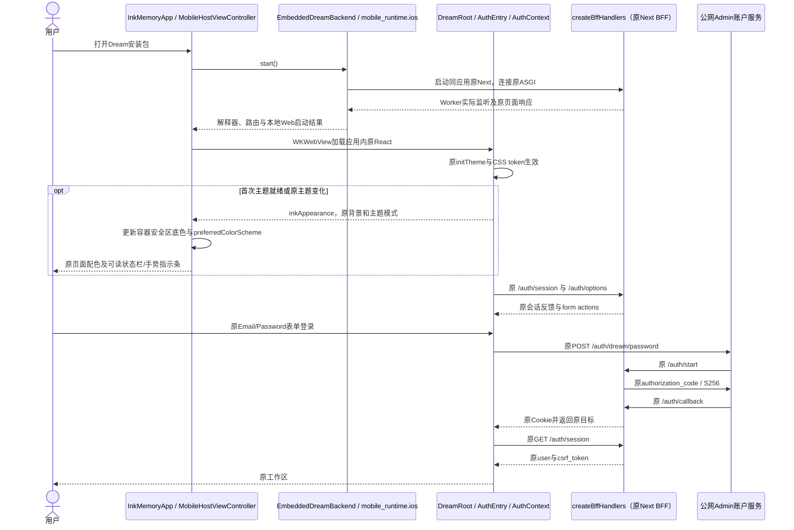

## 异常与恢复时序

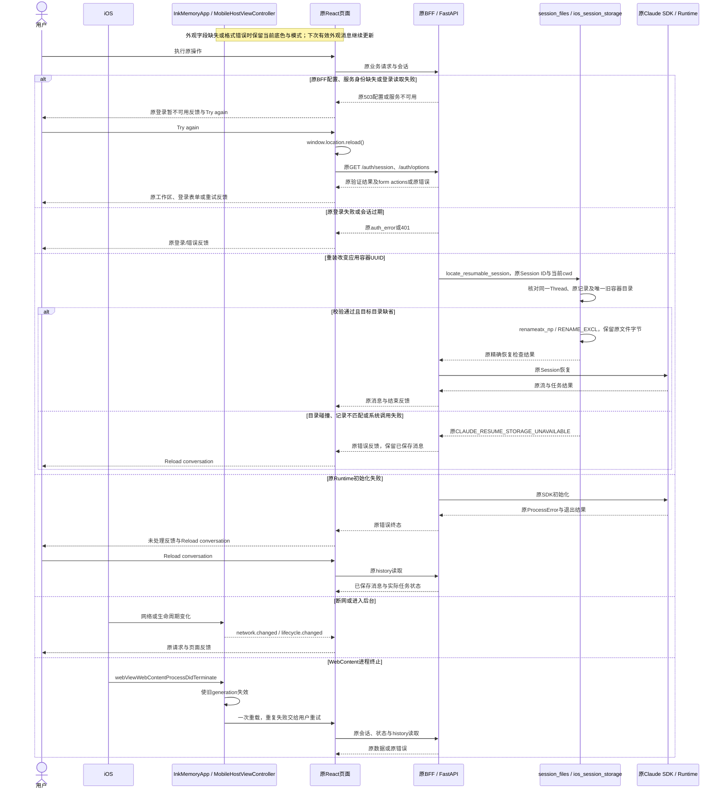

宿主不在后台主动新增业务写入或任务终态。Python进程被系统终止后，只能按原持久化和恢复入口读取实际结果。

用户切出应用后，端侧执行可能随系统挂起；回到应用时展示原任务结果、工具失败和实际保存的消息。原Claude的后续执行沿现有业务处理，宿主不补发任务或替换结果。2026-10-26模拟器专项中首次工具失败，原重试后回复完成；本次后台时序诊断及验收调用次数控制仍有缺口，[专项验收保持未通过](../../exec/mobile-app-design-review-20261024.md#前后台恢复诊断与有界验收)。系统规则依据[Apple生命周期](https://developer.apple.com/documentation/uikit/managing-your-app-s-life-cycle)，2026-10-26查阅；物理iPhone单独验收。

共享Chat的队列后台读取在上次读取结束后继续更新，离开会话时取消已离开页面的读取；队列操作、失败反馈与状态规则保持。

## 容器状态转换

### 已保存Dream确认的进程重开恢复

用户已完成原“确认并继续”后，重新进入同一Dream保留人物、场景、分镜及确认内容。当前恢复候选已通过无模型合同检查，原账户实际续接继续验收。页面复用原等待、运行、停止和消息结果；用户无需第二次确认。以下参与模块和接口均为已有生产入口，恢复接线归`DreamArtifactApplicationService`。

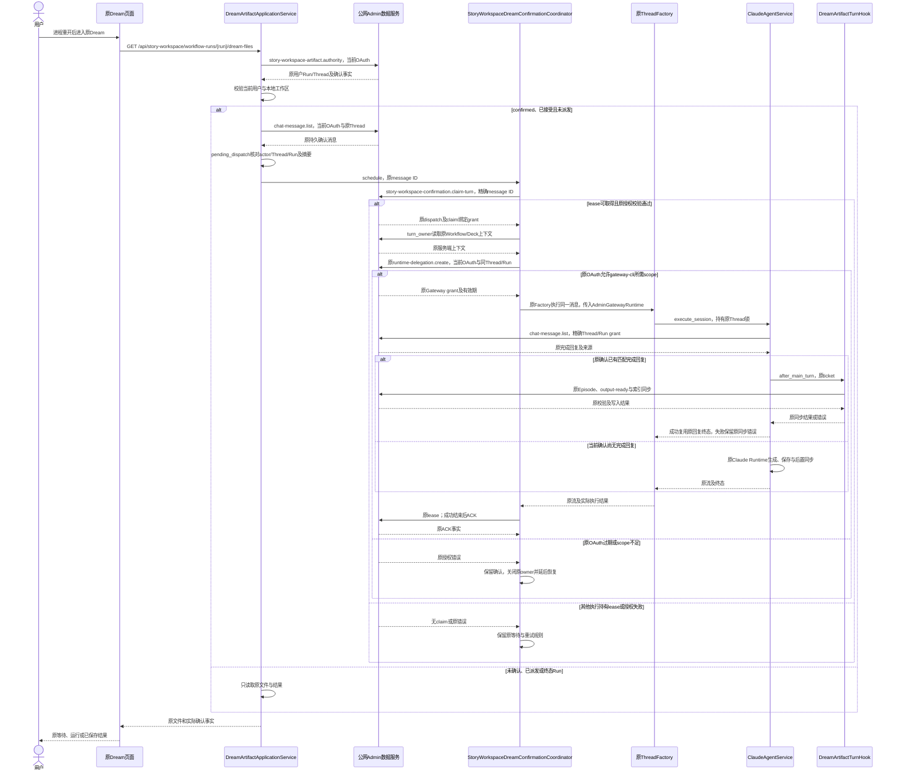

完成回复的恢复沿用原消息和文件。服务端只在相同用户、Run、Thread及确认消息均匹配，且原完成回复结构有效时重试同步；同步成功后原确认变为已派发。同步失败保留原反馈和等待，不增加用户确认、模型重发或助手消息。普通Simulator已完成该恢复，确认实际ACK且零新增模型；物理设备完整业务继续验收。

原metadata状态保持以下转换；图中dispatching不表示Run完成。损坏、重复或跨账户/Thread/Run消息停止本次恢复，原文件继续可读。

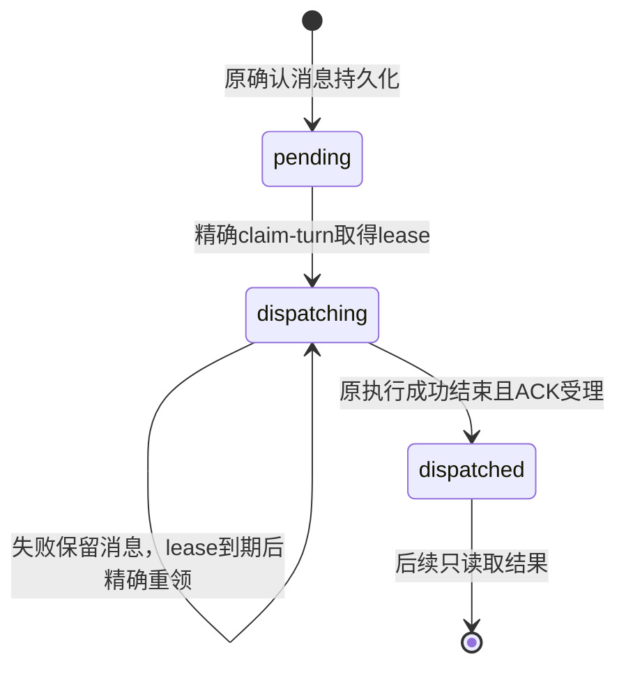

### 容器与页面外观

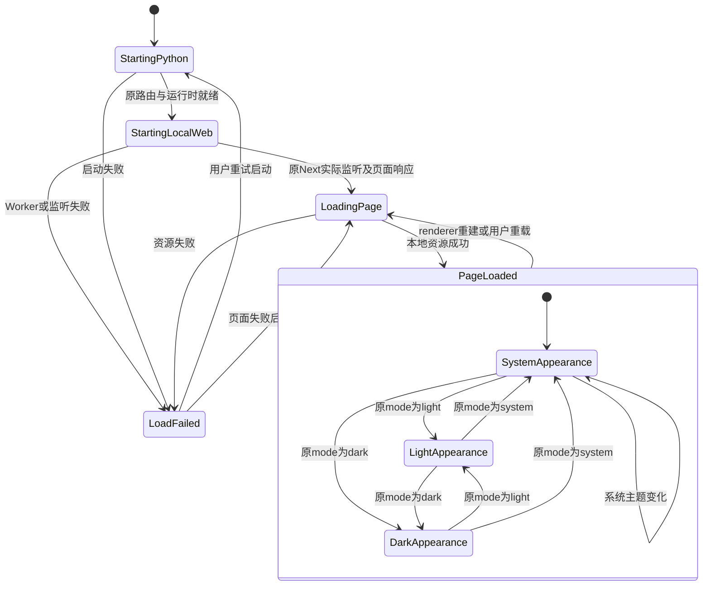

图中定义容器启动和页面外观状态。账户与Run/Thread状态采用原业务定义。bridge中已删除`auth.*`及`auth.callback`，不向网页返回用户凭证。

## 实施与验收

本轮调度修复后的第11次原会话提交完成新增回复、原Session连续性、正常消息及结算，原后端与浏览器流均结束，页面停止按钮退出。该次正常结束验收通过；真实生成中的停止、完整工具及iPhone保持后续验收项。分层回执见[执行记录](../../exec/mobile-app-design-review-20261024.md#2026-10-25-队列读取重叠修复与结束状态定位)。

当前代码保留真实Python与原业务路由，恢复正常form/navigation。此前Mac relay联调完成过一次真实Chat。当前关闭relay的独立Simulator已完成原密码登录及保护数据读取；第五次原Chat取得真实回复、原`turnStatus=completed`、消息和结算，页面停止按钮退出，终态复验通过。普通应用重开已恢复原会话与已完成消息。同会话真实追问暴露长路径格式和重装后的容器目录变化，兼容代码通过目标系统调用及原SDK恢复fixture；第七次提交恢复原Session并取得新增真实回复和结算，页面结束反馈失败。早期包通过ENOSYS拒绝Bash；后续候选已装配关闭配置，原SDK Bash、运行中停止和恢复技术验证通过，完整工具和物理iPhone业务继续验收。具体Thread、Gateway请求与回执见[独立终态复验](../../exec/mobile-app-design-review-20261024.md#独立simulator原chat终态复验通过)；此前失败原文保留。

后续顺序：Simulator同应用原Next/React与ASGI接线 → 原网页登录、合法端侧业务授权、真实模型与持久化 → 原停止/恢复与文件回归 → 物理iPhone同项业务 → 正式签名分发。每一步保持原业务合同，禁止用修改产品行为补齐技术缺口。见[验收矩阵](../../exec/mobile-app-design-review-20261024.md#本轮复审验收矩阵)和[发布稿](../../deploy/mobile-app-release.md)。

本地Web启动使用原env中已登记的localhost回环来源，宿主核对IPv4或IPv6实际监听。监听占用或Worker失败保持启动失败；宿主不切换到Mac服务。WebContent重载复用原Node/Python所有者；应用进程被系统终止后按原会话及业务恢复规则处理。当前包读取原frontend/backend env，原BFF和Python request/data owner沿原身份校验执行；配置缺失时保留原失败反馈。

关闭relay后的WKWebView已实际运行原React。早期无env包的截图`/tmp/ink-ios-local-next-20261025.png`及18项技术回执保留为历史；当前普通env包已通过原账号会话、CSRF、Thread/Deck读取、真实模型响应、第五次原Chat的页面结束反馈及普通重开后的历史读取。真实停止/恢复、文件及完整业务继续验收。


## 当前env接线与Google回调

应用内Python与Node读取现有普通env，原登录卡片、用户、Cookie、CSRF、PKCE和权限规则继续复用。当前本机安装包包含原Dream服务配置；外部分发凭证评审保持待完成。原页面及本地HTTP的通过范围由[执行回执](../../exec/mobile-app-design-review-20261024.md#普通env接线与原登录验收)记录。

Google授权页交给iOS系统浏览器会话。Google先返回公网Admin，Admin继续原授权流程，再返回应用；取消回到原登录页并保留输入。当前宿主尚未实现这段系统浏览器衔接，Google登录保持待验收。

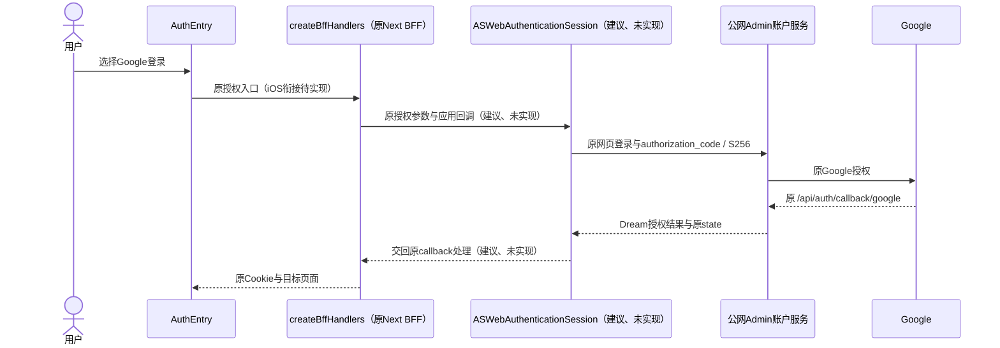

### 原Chat启动失败与恢复

当前保留原“The message was not processed”与Reload conversation反馈。Runtime初始化失败按原错误终止本次执行，已保存的用户消息保留。平台兼容完成后，通过原New或原恢复入口发起后续操作，用户权限、模型选择、消息提交和任务状态保持原业务定义。当前iOS命令兼容候选已通过原SDK Bash技术验证，真实工具业务仍待验收；该能力缺口按[端侧关闭配置与执行接线](../../deploy/mobile-app-release.md#端侧claude命令沙箱配置)和执行记录跟踪。

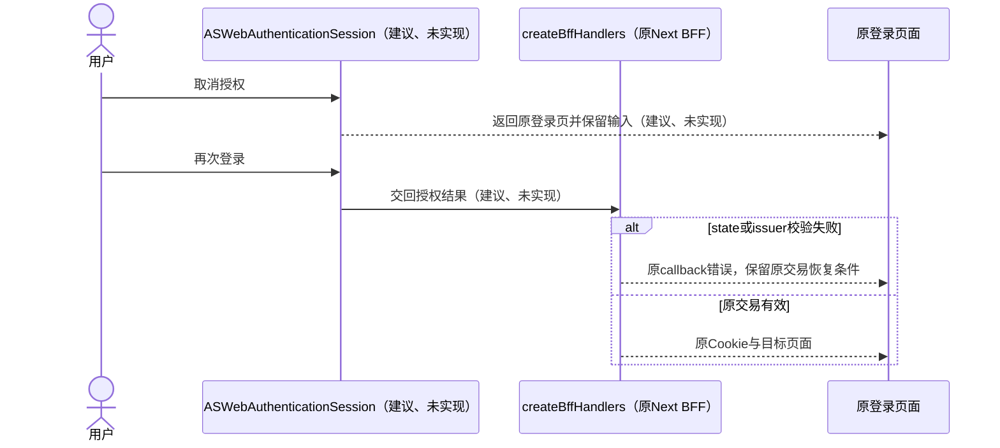
````

## mobile-android-interaction.md

原路径：`docs/design/story-workspace/mobile-android-interaction.md`

SHA-256：`9af587eed9df11d723b5eb0421c4a6b64afd5a34c9347ad4733bf908a7df1dc9`

````markdown
<!-- [Input] 当前Dream网页业务、Kotlin/WebView工程及移动平台约束。 -->
<!-- [Output] Android容器、正常网页登录、交互和验证边界。 -->
<!-- [Pos] Android独立正式交互设计；业务规则来自现有React和Python。 -->
<!-- [Sync] 2026-10-25: 端侧部署决定复用既有关闭Claude命令沙箱配置，保留Android应用隔离和原工具审批。 -->

<!-- [Sync] 2026-10-27: 增加RN目标、App级后端生命周期和HTTP业务；工作台创建退出端侧范围。 -->

# Ink & Memory Android交互设计

## React Native目标接入

目标采用RN原生主界面，正常网页登录保留受限Android WebView。[RN交互稿](mobile-react-native-interaction.md)定义HTTP业务、范围与时序，[运行时架构](mobile-runtime-architecture.md#实例所有权与生命周期)定义实例生命周期。以下保留Kotlin/WebView工程现状及旧图示。

App组合根持有BackendRuntimeManager（建议、未实现），与原runtime service明确绑定；Activity配置变化及RN Root重建复用原所有者。Python、Node/Claude及ABI继续独立验证。HTTP客户端与WebView Cookie接入保持原Cookie、CSRF、来源与权限。

返回先处理键盘、弹窗与详情，inset沿原主题。后台不新增常驻或全局扫描；进程重开按原HTTP与Session恢复。工作台创建、初始生成和审核确认退出移动展示与适配。账户与数据访问公网Admin；原文的Mac内网联调保留历史归属。

## 背景与问题

Android使用Kotlin/WebView承载现有React，计划在同应用身份内运行Dream Python。当前工程含固定appassets来源、WebMessage、私有runtime service与系统文件适配；Python和Claude尚未接入，Android构建/真机回执仍缺失。

本稿使用[PRD](../../prd/dream-workspace/mobile-app.md)与[共享交互](./mobile-app-interaction.md)中的正常网页业务；平台容器不另建账户和任务流程。

## 目标与边界

保留原网页登录、Cookie/CSRF、账户、入口、任务、附件、权限和存储。Android只负责WebView资源装配、应用内部通信、系统返回、键盘/inset、文件选择与生命周期通知。Mac上的原Admin供本轮内网联调，原认证来源与HTTPS校验保持。

私有`:dream_runtime` service只是解释器装配边界，不获得后台常驻或全局任务领取能力。当前无合格Python/Claude制品；未完成路径以技术阻断记录，不派生精简业务或远程执行。

端侧Dream进程沿用[部署稿的既有关闭配置](../../deploy/mobile-app-release.md#端侧claude命令沙箱配置)，保留Android应用UID、存储权限和原工具审批，不增加沙箱设置页。当前Android工程尚未接入该配置或完整命令执行；安装、真实业务和发布分别验收。

## 概念与规则

| 模块 | 职责与现状 |
| --- | --- |
| `MainActivity` / `WebViewAssetLoader` | 本地React资源、WebView生命周期；本轮允许原HTTPS顶层网页和资源 |
| `MobileBridgeHandler` | 仅appassets主frame可调用；page generation隔离迟到响应 |
| `DreamRuntimeService` / `IDreamRuntime` | 非导出私有服务、Binder通信；当前请求失败关闭 |
| `AndroidPlatformActions` | 系统文件选择/保存/分享适配；业务接线与资格待验证 |
| `AuthEntry` / 原Next BFF | 原form登录、callback、Cookie/CSRF和退出；Android不保存OAuth用户令牌 |

源码：[宿主](../../../mobile/android/app/src/main/java/com/inkmemory/mobile/MainActivity.kt)、[bridge](../../../mobile/android/app/src/main/java/com/inkmemory/mobile/bridge/MobileBridgeHandler.kt)、[runtime service](../../../mobile/android/app/src/main/java/com/inkmemory/mobile/runtime/DreamRuntimeService.kt)、[原登录](../../../frontend/app/_dream/components/Auth/AuthEntry.tsx#L34)。

### 页面与操作

使用[PRD正文骨架](../../prd/dream-workspace/mobile-app.md#页面骨架)与原响应式页面。Back先处理IME和当前原弹窗，再按原业务历史返回；根页面交给系统。键盘/inset保证原输入区和Login、发送/停止按钮可见，不重写原页面或原提交条件。

保持WebView第一方Cookie与原顶层form导航。远程认证页面无法调用本地bridge。文件适配需返回原业务可消费的文件输入，保留`useFileUpload`上传和`AIInputDock`写workspace顺序；原生临时副本无法定义新业务存储。

## 正常业务时序

容器到原BFF及端侧Python的完整接入均未完成。

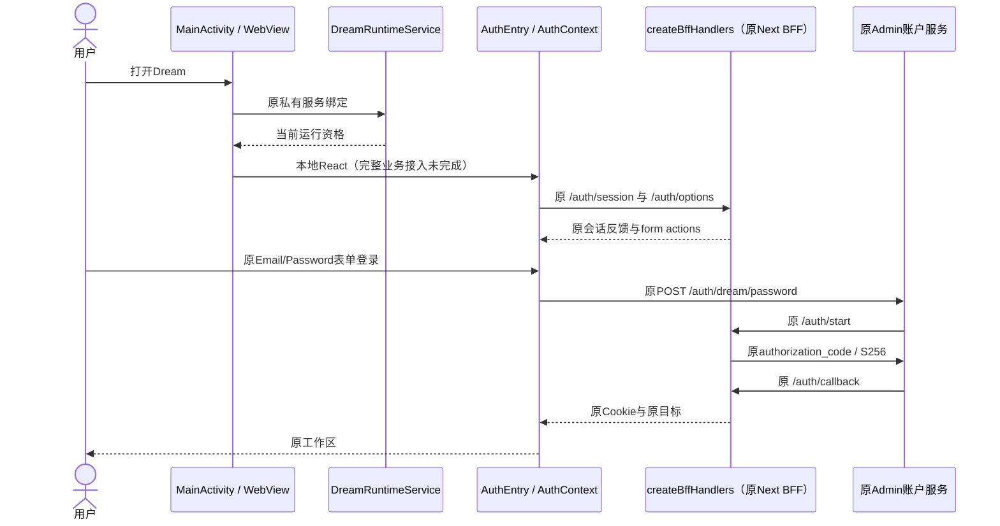

## 异常与恢复时序

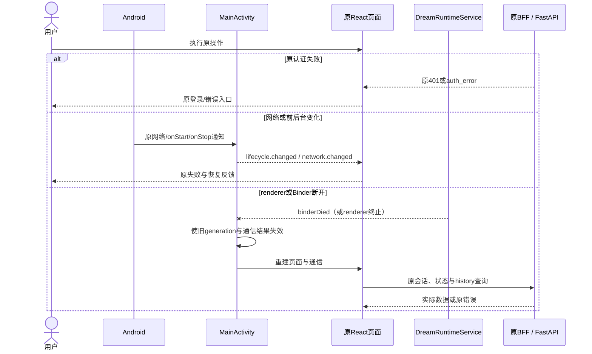

后台通知不新增业务保存、任务状态、自动重发或恢复承诺。任何任务终态均由原业务记录判断。

## 容器状态转换

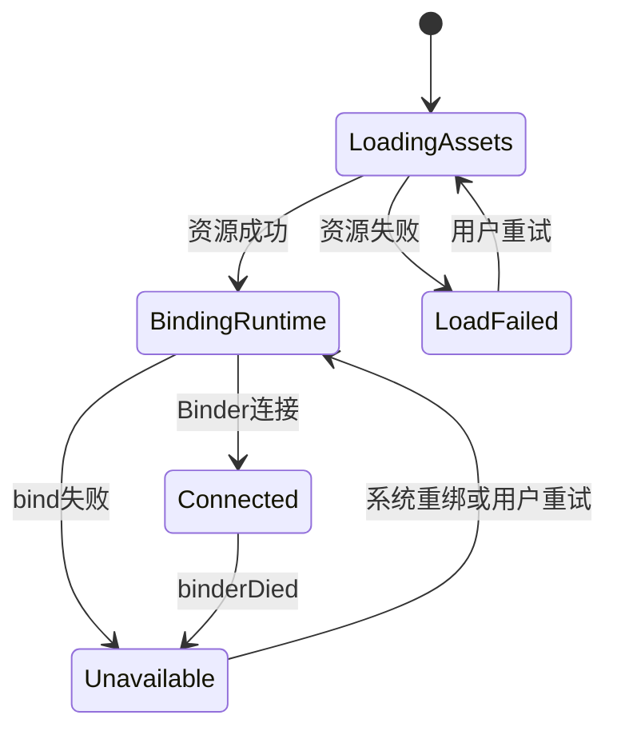

账户、Run和Thread状态继续采用原定义；本图只描述宿主通信。

## 实施与验收

原生认证methods/event已经从协议删除。文件、下载和分享只接原业务入口，不增加权限申请或产品流程。未实现的Python、Claude、BFF接线、完整流与取消继续列为阻断。Android工具链条件、安装包和真机覆盖分别验收；当前改动只取得源码/协议验证时，保留该限制。

构建、签名、APK/AAB和渠道条件见[发布稿](../../deploy/mobile-app-release.md)。共同验证见[复审矩阵](../../exec/mobile-app-design-review-20261024.md#本轮复审验收矩阵)。
````

## mobile-app-interaction.md

原路径：`docs/design/story-workspace/mobile-app-interaction.md`

SHA-256：`04589d19ce05d2205deffacfb2951975221e8f369289be95594885f42787276a`

````markdown
<!-- [Input] 当前Dream网页业务、正常网页登录要求和双原生宿主。 -->
<!-- [Output] 保持原业务的共享用户旅程、交互时序、页面状态与适配边界。 -->
<!-- [Pos] 移动共享交互；平台实现分别归iOS和Android设计。 -->
<!-- [Sync] 2026-10-25: 明确公网Admin网页登录及Simulator真实业务回执。 -->
<!-- [Sync] 2026-10-25: 原登录读取失败提供用户触发的页面重载；既有表单、会话和任务处理保持。 -->
<!-- [Sync] 2026-10-25: iOS Simulator应用宿主完成现有网页登录、会话与一次真实Chat。 -->
<!-- [Sync] 2026-10-25: 删除独立原生认证、业务能力裁剪、新任务状态和附件流程改写。 -->

<!-- [Sync] 2026-10-27: 保留WebView实现参照，RN目标与工作台创建排除由RN交互稿定义。 -->

# 移动应用共享交互

2026-10-27当前目标见[React Native正式交互稿](mobile-react-native-interaction.md)。业务继续HTTP访问，App级模块管理后端生命周期；端侧隐藏工作台创建与审核确认入口，相关流程退出适配。以下保留既有WebView实现与回执，图示适用范围为原网页路径。

## 背景与问题

移动端复用Dream网页交互和端侧Python业务。宿主提供WebView、解释器、平台输入和必要系统操作。前稿将技术缺口转成了独立认证、文件规则与业务状态，现行稿已删除这些设计。

[PRD与骨架](../../prd/dream-workspace/mobile-app.md)、[架构](./mobile-runtime-architecture.md)、[iOS](./mobile-ios-interaction.md)、[Android](./mobile-android-interaction.md)、[发布稿](../../deploy/mobile-app-release.md)与[复审记录](../../exec/mobile-app-design-review-20261024.md#2026-10-25-保留网页业务的设计复审与实现修正)共同定义范围。

## 目标与边界

保留现有登录卡片、账户、导航、任务、附件、数据归属、权限、停止和恢复。只增加对应平台的资源装配、线程/进程通信、返回、键盘、安全区和系统选择器适配。普通Web继续执行原Next/BFF业务路径。

正常图描述既有网页业务。iOS Simulator应用宿主已通过公网Admin完成该登录时序与一次真实Chat；物理iPhone和Android回执、端侧完整后端仍待验证。

## 概念与规则

| 对象 | 规则与来源 |
| --- | --- |
| 登录页面 | 现有`AuthEntry`，原表单action、注册、Google及错误反馈；会话/options读取失败显示页面重载入口 |
| 会话 | 原`/auth/session`、BFF Cookie/CSRF；原`/auth/logout`成功后清理 |
| 任务 | 原FastAPI路由、Runner、持久化、SSE parser和既有状态 |
| 附件 | 原`useFileUpload`与`AIInputDock`流程；系统选择器仅提供文件输入 |
| 平台生命周期 | 向页面报告可见性与网络；无额外业务写入、自动重发或终态推断 |
| 容器启动 | 资源/解释器/传输技术状态；不定义账户状态或隐藏业务入口规则 |

不增加原生认证bridge、原生用户令牌仓库、替代Agent、后台保存协议、本机/云端新文件栏目或第二套业务UI。

## 正常业务时序

```mermaid
sequenceDiagram
  actor U as 用户
  participant H as WebView宿主
  participant R as AuthEntry / AuthContext
  participant B as createBffHandlers（原Next BFF）
  participant A as 公网Admin认证服务
  U->>H: 打开Dream安装包
  H->>R: 加载原React页面
  R->>B: GET /auth/session
  B-->>R: 原401未登录响应
  R-->>U: 原AuthEntry登录卡片
  R->>B: GET /auth/options
  B-->>R: password_action / google_action
  U->>R: 输入账号密码并点击Login
  R->>A: POST /auth/dream/password（原顶层form）
  A->>B: 原 /auth/start 授权流程
  B->>A: 原authorization_code + S256
  A->>B: GET /auth/callback（原state/code）
  B->>A: 原exchange与会话handle
  B-->>R: 原Cookie并返回原目标
  R->>B: GET /auth/session
  B-->>R: user + csrf_token
  R-->>U: 原工作区
```

账号验证、OAuth与会话处理继续由公网Admin和原BFF执行。当前独立iOS包在应用内运行原Next和端侧Python，沿用现有前后端env及权限传递；原账户、消息持久化与真实模型已有阶段回执，结束反馈稳定性和完整工具继续待验收。早期Mac relay回执保留于执行历史。

## 异常与恢复时序

```mermaid
sequenceDiagram
  actor U as 用户
  participant H as WebView宿主
  participant R as 原React业务页面
  participant B as 原BFF / FastAPI业务入口
  U->>R: 登录、读取或提交原操作
  alt 会话或登录入口读取失败
    B-->>R: 原503或请求失败
    R-->>U: 原错误信息与Try again
    U->>R: Try again
    R->>R: window.location.reload()
    R->>B: 原GET /auth/session、/auth/options
    B-->>R: 原验证结果及form actions或原错误
  else 原认证失败或会话失效
    B-->>R: 原401或auth_error反馈
    R-->>U: 原登录/错误入口
  else 网络断开
    H-->>R: network.changed
    B--xR: 原请求失败
    R-->>U: 原失败与重试反馈
  else 页面或应用进程终止
    H->>H: 重建WebView与page generation
    H->>R: 重新加载原页面
    R->>B: 原会话、状态与历史查询
    B-->>R: 实际已保存结果或原错误
    R-->>U: 原页面反馈
  end
  U->>R: 按原入口重试或重新登录
  R->>B: 原公开业务入口
```

宿主无权根据断流、后台或进程终止写入业务完成/取消状态。已有停止回执与任务终态分别按原实现处理。

## 页面状态转换

```mermaid
stateDiagram-v2
  [*] --> Loading: 原AuthContext读取会话
  Loading --> SignedOut: 原未登录响应
  Loading --> Ready: 原会话有效
  Loading --> Error: 原读取失败
  SignedOut --> Loading: 原表单或Google流程返回
  SignedOut --> SignedOut: 取消或原登录失败反馈
  Ready --> SignedOut: 原退出成功
  Ready --> Ready: 原退出失败并显示错误
  Error --> Loading: Try again重载原页面或重开
```

图中状态为页面展示概念，后端Run/Thread状态沿原定义。平台generation仅隔离旧页面响应，不作为业务revision、任务状态或持久化字段。

## 平台交互与复用

- iOS保持WKWebView第一方Cookie，允许原HTTPS form/navigation；远程页面无本地bridge权限。
- Android保持WebView第一方Cookie，允许原HTTPS网页及资源；桥接限定appassets主frame。
- 键盘、安全区、滚动和返回由平台适配，原业务弹窗、按钮和提交条件保持一致。
- 附件、预览、下载、分享、外链与授权取消按原入口反馈；只为实际系统操作添加适配。
- Codex参考的订阅、快照、旧响应隔离只用于现有Dream页面的通信可靠性；不引入其任务状态、界面、文件存储或认证协议。

验收见[复审矩阵](../../exec/mobile-app-design-review-20261024.md#本轮复审验收矩阵)。
````
