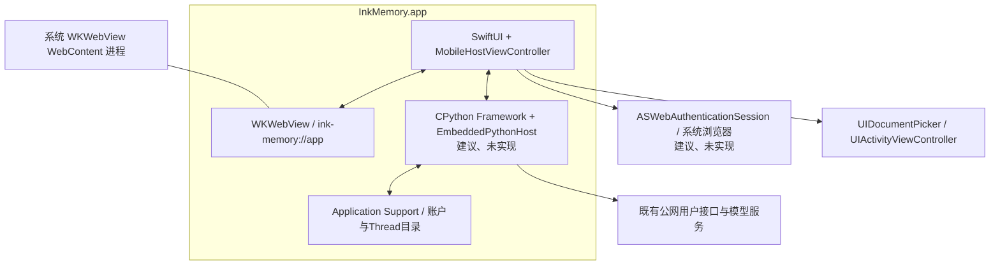
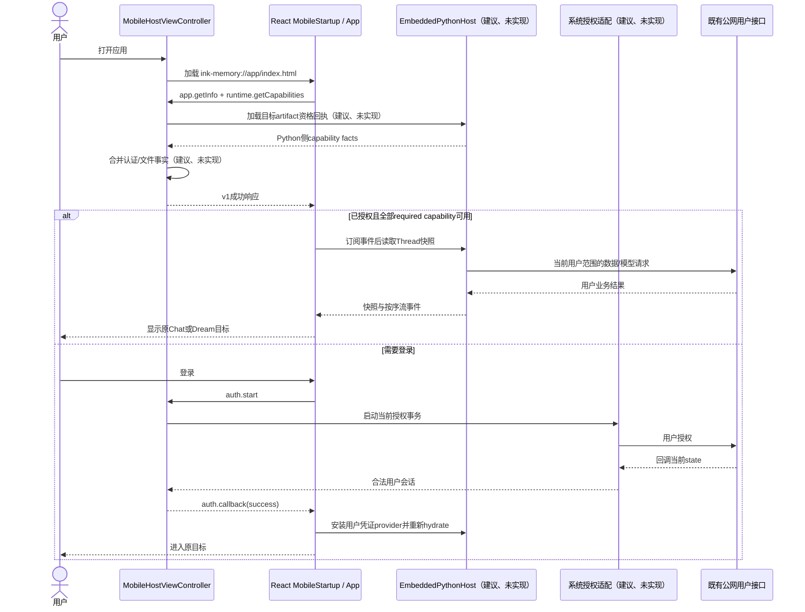
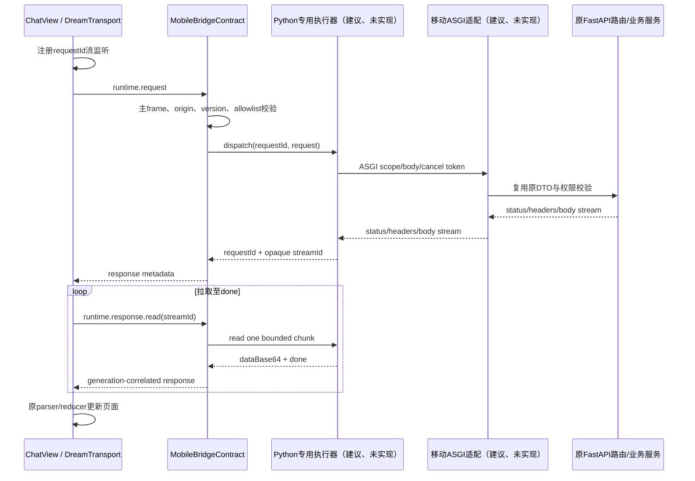
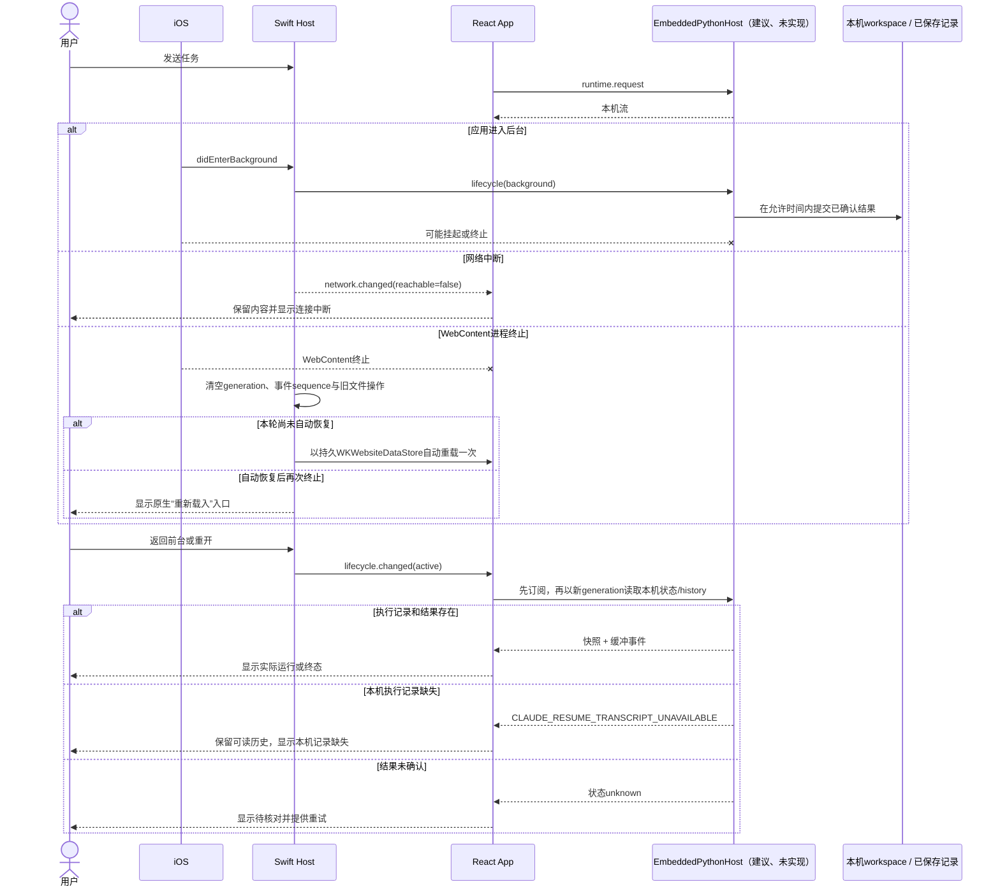
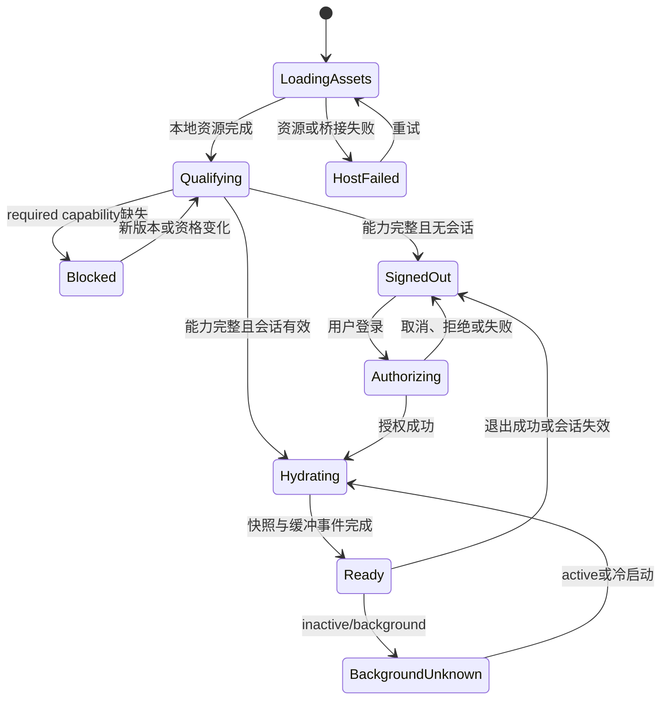
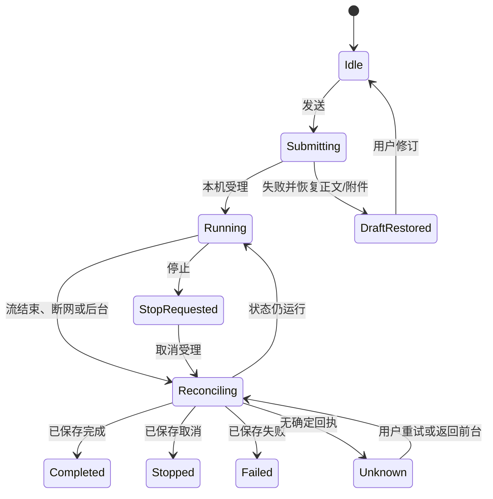

<!-- [Input] iOS设计和实施记录收敛前的完整原文。 -->
<!-- [Output] 历史方案、图示和验证回执，供范围修订追溯。 -->
<!-- [Pos] 2026-10-24 iOS收敛前历史；现行稿继续在原路径维护。 -->
<!-- [Sync] 2026-10-24: 保留原文和SHA-256，当前实现以原路径最新稿为准。 -->

# iOS范围收敛前历史

## 原文件 `docs/design/story-workspace/mobile-ios-interaction.md`

SHA-256: `df0d1c07fefa2b428d5c1182e321c3c43aca3f4b6689b12c743f4600392cf015`

<!-- original:start docs/design/story-workspace/mobile-ios-interaction.md -->
<!-- [Input] 移动PRD、共用运行时架构、Swift/WKWebView代码切片及iOS平台规则。 -->
<!-- [Output] iOS安装、启动、授权、任务、文件、生命周期、宿主恢复和真机门槛的独立交互设计。 -->
<!-- [Pos] Ink & Memory iOS正式交互设计；技术共用规则链接移动运行时架构。 -->
<!-- [Sync] 2026-10-24: 对齐generation隔离、有界WebContent恢复、启动超时、真机预检及当前设备阻断。 -->
<!-- [Sync] 2026-10-24: 对齐持久WebKit存储、WebContent恢复、能力组合与空外链白名单。 -->

# Ink & Memory iOS 交互设计

## 背景与问题

iOS 应用使用 Swift/WKWebView 承载随包 React 页面，并在同一应用身份内装配 Dream Python。当前 Swift 宿主能够加载固定`ink-memory://app`来源、按Web文档固定page generation、丢弃陈旧异步结果、执行一次自动renderer恢复、显示原生重试页、提供受门禁保护的选择/保存/分享适配、执行HTTPS外链策略并上报生命周期和网络变化。发行外链host allowlist为空，当前不会打开外部链接。CPython Framework、完整Python依赖、公开客户端认证、本地ASGI transport与Claude Runtime尚未取得资格，完整业务页面继续由能力门禁拦截。

[移动PRD](../../prd/dream-workspace/mobile-app.md)定义用户范围，[共用架构](./mobile-runtime-architecture.md)定义协议和职责，[发布设计](../../deploy/mobile-app-release.md)定义构建、签名和渠道门槛。iOS 文档只定义 iOS 页面行为和平台差异。

## 目标与边界

- 用户从 App Store/TestFlight 安装后直接进入本地宿主；页面资源不依赖远程网页可用性。
- Swift 管理 WKWebView、系统浏览器授权、Keychain、文件选择/导出/分享、外链、网络和应用生命周期。
- Dream Python 以合格 CPython Framework 进入应用进程内专用执行器；当前未实现。
- Claude CLI 现有子进程路径不具备 iOS 资格。执行能力保持 unavailable，直至经审查的移动 runtime 达到既有工具、权限、取消和恢复合同。
- 后台时间只用于提交已确认状态；任务没有后台持续运行保证。
- Admin 继续独立公网部署，本设计不包含 Admin 改造。

## 概念与规则

| 对象 | iOS职责 | 当前状态 |
| --- | --- | --- |
| `MobileHostViewController` | 持久WKWebsiteDataStore、主frame来源、generation、陈旧回调、WebContent有界恢复、UIKit平台能力 | 已实现宿主切片 |
| `AppURLSchemeHandler` | 固定本地资源来源、GET/HEAD限制、资源根目录约束与SPA fallback；未合格API明确失败 | 已实现宿主切片 |
| `RuntimeCapabilities` | 返回app/build/bridge与完整capability快照 | 已实现固定unavailable事实；尚未加载Python artifact回执或合并Native事实 |
| `LocalFileStore` | 将用户选择文件复制到 Application Support、返回opaque handle并清理陈旧页面未接收副本 | 已实现首段；账户/Thread业务归属待接入 |
| `EmbeddedPythonHost` | CPython 初始化、串行调度、ASGI lifespan 与关闭 | 建议、未实现 |
| `DreamTransport` | React 请求、流、取消与 Python 路由映射 | 建议、未实现 |

实现证据：[`MobileHostViewController.swift`](../../../mobile/ios/InkMemory/MobileHostViewController.swift#L39)创建持久存储、固定来源WebView和键盘行为，[同文件](../../../mobile/ios/InkMemory/MobileHostViewController.swift#L85)校验main frame/origin并固定generation，[同文件](../../../mobile/ios/InkMemory/MobileHostViewController.swift#L138)处理主文档错误与有界WebContent恢复，[同文件](../../../mobile/ios/InkMemory/MobileHostViewController.swift#L246)拒绝陈旧文件回调并清理未交付副本；[`AppURLSchemeHandler.swift`](../../../mobile/ios/InkMemory/AppURLSchemeHandler.swift#L51)限制method、解码路径与资源根目录；[`NativeCapabilityRegistry.swift`](../../../mobile/ios/InkMemory/NativeCapabilityRegistry.swift#L29)集中路由、返回生命周期/网络快照并对未合格能力失败关闭；[`RuntimeCapabilities.swift`](../../../mobile/ios/InkMemory/RuntimeCapabilities.swift#L19)明确Python、Claude Runtime、公开认证、本地transport与业务文件资格；[`mobileBridge.ts`](../../../frontend/app/_dream/platform/mobileBridge.ts#L143)实现有界等待和pending清理；[`entry.tsx`](../../../frontend/mobile/entry.tsx#L45)在前台/网络恢复时重新hydrate。

启动门禁按`python`、`publicClientAuth`、`localTransport`三项判断。`claudeRuntime`单独控制Agent创建与推进，业务级feature gate尚未接入；当前三项启动能力均不可用，完整App不会挂载。文件能力可单独可用，无法提升Agent执行资格。能力读取使用共享`responsePolicy.startupTimeoutMs`，原生消息无响应时进入可重试状态并清除pending调用。错误页显示具体reason code，用户可在后续合格版本中重试。

## 平台拓扑



Swift 主线程只处理 UIKit 和桥接路由。Python 初始化和业务调用在专用串行执行器运行，结果回到主线程发送给 WebView。扩展模块作为签名 Framework 随包进入；运行时不执行 pip 安装或下载新二进制。

## 页面与操作

### iPhone 页面骨架

```text
┌ 顶部安全区 ─────────────────────────┐
│ 当前会话                 [历史][文件]│
├ 消息区（独立纵向滚动） ──────────────┤
│ 用户输入 / Agent 流 / 工具问题        │
│ 本机状态：启动中/运行/待核对/失败      │
│ 文件卡 → 预览 → 分享/存储到“文件”     │
├ 附件与队列 ──────────────────────────┤
│ 输入框（增高后内部滚动）              │
│ [附件] [思维模式]          [发送/停止]│
├ 键盘关闭时底栏 ──────────────────────┤
│ Chat       Dream       Decks     More│
└ 底部安全区 ─────────────────────────┘
```

键盘出现时底栏收起，输入框跟随键盘顶部，消息区保留用户阅读锚点。交互式侧滑只回到有效业务历史；授权系统页、文件选择器和分享页由系统返回规则管理。预览和设置以 sheet/full-screen cover 呈现，关闭后焦点回到来源控件。

### iPad 页面骨架

```text
┌ 侧栏 ────────┬ 会话与消息（独立滚动） ─────────┬ 历史/文件详情 ┐
│ Chat         │ 当前会话 / 状态 / 消息流         │ 选择后显示     │
│ Dream        │                                   │ 可关闭/独立滚动│
│ Decks        ├ 附件 / 队列 / 输入 / 发送或停止 ─┴───────────────┤
│ More         │                                                   │
└──────────────┴───────────────────────────────────────────────────┘
```

横竖屏和 Split View 使用可见宽度决定单栏/双栏；固定设备类型不决定布局。安全区由原生容器提供，React 页面只处理自身布局一次。

## 正常业务时序



## React–Swift–Python 调用时序



## 异常与恢复时序



WKWebsiteDataStore保留页面存储。每次主文档导航先清除旧generation；新文档首个合格bridge请求固定当前generation，后续不匹配请求返回`PROTOCOL_MISMATCH`。WebContent连续终止只自动重载一次，后续由用户触发重新载入。Python任务、Thread状态和已保存结果继续按本机执行记录与history核对。

## 状态转换

### 应用运行时



### 任务



## 文件、授权与外链

- 附件使用 `UIDocumentPickerViewController`，选中项复制到应用容器后返回 `ink-file:<uuid>`；网页不接收原始绝对路径。
- 保存使用系统 document exporter，分享使用 `UIActivityViewController`。取消保留文件卡和原页面状态。
- `external.open`只接收无userinfo、无自定义port且host精确命中`INKAllowedExternalHosts`的绝对HTTPS URL。当前数组为空，bridge调用与用户点击均拒绝。OAuth回调由独立活动授权事务处理。
- 公开授权落地后使用AuthenticationServices管理事务，state/issuer/callback与发起事务匹配。现有Web登录为绝对POST form，移动CSP禁止该路径；`InkMemoryApp`尚无callback接收，`auth.*`返回能力不可用。
- 文件首段代码完成系统动作和opaque handle，当前`files`能力仍不可用；账户/Thread目录、附件DTO与Python workspace接线仍需实现。

## 当前实现、未实现与阻断

| 范围 | 结果 |
| --- | --- |
| 已实现代码切片 | Xcode工程、SwiftUI入口、持久WKWebsiteDataStore、固定本地来源、GET/HEAD与资源根约束、文档generation固定、陈旧回调清理、WebContent一次自动恢复、原生重试页、v1白名单、启动超时、固定能力快照、受门禁保护的系统文件适配、HTTPS外链allowlist校验、生命周期和网络快照/事件 |
| 已实现页面反馈 | React能力门禁显示平台、应用版本、桥接版本和逐项状态；原生导航失败页提供重新载入 |
| 未实现 | CPython Framework、扩展模块、Python执行器、artifact receipt加载/能力合并、ASGI transport、pull-based流源、公开授权/callback、账户目录、Claude业务feature gate和完整App API适配 |
| 阻断 | 当前 Claude CLI 依赖子进程；iOS无对应执行模型；公开用户接口覆盖和服务秘密边界未闭合 |
| 验证边界 | 13项React bridge/transport单元、9项Swift宿主单元、arm64 iPhoneOS无签名编译及模拟器安装启动通过；模拟器页面显示真实unavailable能力。已连接iPhone完成只读预检，Developer Mode、DDI、Team、签名身份和正式bundle ID尚未就绪，未执行真机安装启动。当前结果无法证明Python、CLI、真机业务、签名分发或审核；工程尚无AppIcon资源，外链allowlist尚未配置 |

## iOS发布与验收入口

iOS 16.4为共享页面拟定最低版本；最终deployment target取CPython、原生扩展和共享页面交集。构建号递增，归档保留`.xcarchive`、dSYM、hash和审核构建ID。[真机预检脚本](../../../mobile/ios/scripts/check-device-readiness.sh)只读取设备/Xcode/签名状态并隐藏设备、Team和证书标识。Apple Developer Program、Team、bundle ID、development/distribution certificate、profile、App Store Connect权限、AppIcon与release外链allowlist均为后续前提。

完整验收见[评审矩阵](../../exec/mobile-app-design-review-20261024.md#后续验收矩阵)。官方资料查阅日期为 **2026-10-24**：[Python iOS](https://docs.python.org/3/using/ios.html)、[Apple后台执行](https://developer.apple.com/documentation/uikit/extending-your-app-s-background-execution-time)、[归档与分发](https://developer.apple.com/documentation/xcode/distributing-your-app-for-beta-testing-and-releases)、[App Review Guidelines](https://developer.apple.com/app-store/review/guidelines/)。


<!-- original:end -->

## 原文件 `docs/exec/mobile-app-design-review-20261024.md`

SHA-256: `756cd6dce761c041b0347f06743b710c8454edb74ea6507ab1ec830518e7c946`

<!-- original:start docs/exec/mobile-app-design-review-20261024.md -->
<!-- [Input] 双原生宿主、端侧Python、当前代码切片、独立公网边界、源码与官方资料。 -->
<!-- [Output] 优化执行依据、设计判定、iOS宿主实施、代码评审、后续工作项、验收矩阵及验证回执。 -->
<!-- [Pos] 移动架构、双平台设计和第一实现切片的现行项目执行记录。 -->
<!-- [Sync] 2026-10-24: 记录连接iPhone后的iOS宿主强化、模拟器启动、真机预检与签名阻断。 -->
<!-- [Sync] 2026-10-24: 对齐能力门禁、限域传输、平台配置、代码评审与最终验证回执。 -->

# 端侧移动应用设计评审与后续工作

## 交付与范围

| 交付物 | 现行文档 | 状态 |
| --- | --- | --- |
| 问题判断、兼容证据、参考映射、架构和发布 | [技术稿](../deploy/mobile-app-release.md) | 供审查；完整原CLI本地发行不通过 |
| 用户任务、设备内执行、页面骨架 | [移动PRD](../prd/dream-workspace/mobile-app.md) | 目标设计，能力待实现 |
| 运行时与代码归属 | [共用架构](../design/story-workspace/mobile-runtime-architecture.md) | WebView、Native、Python、bridge和公网边界已定义 |
| 共享用户旅程与状态 | [共享交互](../design/story-workspace/mobile-app-interaction.md) | 正常/异常、任务与恢复语义已定义 |
| iOS平台交互 | [iOS设计](../design/story-workspace/mobile-ios-interaction.md) | 独立拓扑、骨架、时序、状态图和当前实施证据已完成 |
| Android平台交互 | [Android设计](../design/story-workspace/mobile-android-interaction.md) | 独立拓扑、骨架、时序和状态图已完成 |
| 第一实现切片 | `frontend/mobile/**`、`frontend/app/_dream/platform/**`、`backend/mobile_runtime/**`、`mobile/**` | 共享资源/协议/资格门禁/宿主代码已落盘；完整业务受门禁 |
| 原始远程宿主四稿与旧检查回执 | [历史快照](history/mobile-app-remote-host-before-device-python-20261024.md) | 原文保留，已退出当前路线 |

用户最终要求：保留Swift/WKWebView与Kotlin/Android WebView；Dream Python在设备运行；核对Claude CLI兼容；原生宿主定义WebView、内置进程和共享系统能力；参考Codex恢复语义；Admin独立公网部署；完成设计评审和方案代码。跨端框架讨论保留为选型记录，用户最终选择原生宿主。

本轮已增加设计文档、第一实现切片和iOS宿主强化，并执行本机具备条件的构建、单元、模拟器启动和连接设备预检。未调用真实模型，未修改数据库、业务数据或运行服务，未创建或修改凭证证书，未提交商店或发布。外部Admin没有改造、部署、migration或版本发布任务。

## 优化执行依据与收敛

本次实质范围更新前完成一次提示词优化；常规资料补齐与评审修订沿用同一执行依据。

**Optimized Prompt：**

在Ink & Memory现有Next.js/React/Python和只读Codex参考源码基础上，完成双原生宿主的可审查设计与第一实现切片。iOS使用Swift/WKWebView，Android使用Kotlin/Android WebView；一个签名安装包承载随包React资源、原生宿主和端侧Dream Python。明确WebView、原生平台能力、嵌入Python、Claude Runtime、公网用户服务和应用私有文件的所有权；使用版本化method/event白名单形成uni-app风格语言桥接，无Lua、动态反射或自由URL。分别编写iOS与Android正式设计稿，包含页面骨架、正常/异常时序、React-Native-Python调用、运行时与任务状态。参考Codex的先订阅后hydrate、事件缓冲、generation隔离、提交失败恢复草稿、Stop与终态分离、resume后重取流所有权语义，不复制其源码、协议、资源或二进制。实现共享React移动构建入口、bridge合同与校验、Python资格边界、Swift/Kotlin轻量宿主和明确能力门禁；Python、公开认证、本地ASGI未合格时禁止挂载完整业务，Claude Runtime未合格时阻止Agent创建与推进，所有路径禁止远程代跑。Admin保持独立公网部署，不修改其代码、schema、部署或服务身份。执行前端/协议/Python单元、可用平台构建和文档/Mermaid检查；Android工具链缺失时记录前置失败。禁止真实模型、凭证、签名、商店提交和正式发布。最终逐层区分设计、代码、静态/编译、Python、CLI、真实业务、签名和发布状态。

**Optional Enhancers：** 后续任务可在B01–B03逐项闭合后增加真机性能预算、TestFlight/Play测试轨道自动化和渠道材料模板；每项以真实账号、签名资格和明确发布授权为前提。

### iOS实施计划优化

连接iPhone后的实施计划再次执行一次提示词优化，后续常规编码与验证沿用该结果。

**Optimized Prompt：**

在Ink & Memory当前未提交工作基础上完成可审查的iOS实现：保护用户和其他Agent改动，只修改iOS宿主、共享移动bridge/启动入口及对应文档；使用Swift/WKWebView加载随包React资源，强化main-frame origin校验、每文档generation所有权、陈旧异步回调清理、导航/renderer有界恢复、生命周期和网络快照、键盘安全区、脱敏日志及本地资源根目录约束；为原生启动响应设置共享超时并提供可重试反馈。先审计仓库与本机是否存在可签名的iOS CPython、完整依赖和Claude Runtime制品；缺少目标artifact时保持`python`、`localTransport`、`publicClientAuth`、`claudeRuntime`和`files`失败关闭。使用已连接iPhone执行只读设备/签名预检；只尝试现有自动签名条件，禁止创建、导入、删除证书或profile。执行React/Swift单元、模拟器安装启动、generic iPhoneOS无签名编译和签名探针，准确区分代码实现、模拟器技术验证、真机安装、端侧Python、真实业务、签名和发布状态。

**Optional Enhancers：** Developer Mode、Team、证书、bundle ID和合格CPython artifact到位后，继续执行真机安装启动、WebView origin/localStorage、前后台、renderer恢复及stdlib-only Python smoke；完整Dream与Claude Runtime仍受B01–B03门槛约束。

| 阶段 | 决策依据 | 本轮交付 |
| --- | --- | --- |
| 发现 | UI可共享，当前Python启动依赖服务机密、CLI、stdio进程及本机记录 | 源码/官方兼容矩阵，区分解释器和完整业务 |
| 定义 | 用户需要设备执行，远程宿主前提已失效；Admin公网独立不改变现有服务间协议 | 三项核心阻断与外部范围边界 |
| 比较 | 原CLI全本地、进程内替代runtime、远程执行三条路线 | 原CLI双平台不通过；替代runtime为待审查候选，远程方案退出 |
| 交付 | 原生宿主和端侧Python目标保留，发行前置条件清晰 | PRD、共享架构、双平台设计、发布稿、第一代码切片与分层回执 |

## 核心阻断与设计判定

| ID | 发现 | 处理方式 | 修订结果 | 剩余依赖 |
| --- | --- | --- | --- | --- |
| B01 本地Agent执行 | iOS不支持当前CLI子进程模型；官方CLI无手机目标；Android无项目移动制品资格 | 将CPython与CLI分开，审计stdio/Bash/插件/Notion/恢复完整依赖 | 撤销完整CLI可随包运行结论；不改远程执行，替代runtime独立候选 | 可审查的本地实现及能力等价范围；iOS原方案明确阻断 |
| B02 公开客户端权限 | 当前Python/Next BFF要求服务secret，用户token仍附服务token | 禁止service secret/token/client_credentials上端，只核对既有公开用户能力 | 移除Admin新接口/注册URI/capability/部署任务；现内部客户端无法直接发行 | 现公网用户级权限能否覆盖消息/Run/资源/结算/回执；缺少即继续阻断 |
| B03 Python与ABI | 后端含Pydantic-core/crypto/Pillow/cffi等，当前锁无手机加载证据 | 两平台解释器/扩展/ABI/签名资格分开 | 嵌入方式有官方路径，整个backend运行未证明 | 精确版本交集与手机真机import/启动资格 |

**最终设计评审：待满足明确前提后通过。** 设计已经给出两个平台的安装、页面、端侧进程、桥接、Python、构建与发布路径，并用能力门禁约束未完成环节。明确前提为B01移动Claude Runtime、B02公开用户权限和B03平台Python/原生扩展资格闭合。

**当前发行评审：不通过。** 判定对象为“保持现有完整Dream及Claude CLI，双平台端侧运行并正常商店发行”。B01–B03仍未闭合，第一代码切片只建立宿主、协议和失败关闭路径，不能进入签名或商店发布。

原生宿主与端侧Python目标保持为已选方向。进程内Agent候选涉及权限、工具、插件、MCP、恢复及成本，当前只保留资格接口与能力门禁；公开用户接口缺口不自动扩展为Admin任务。

## 设计评审与修订

| 评审项 | 发现 | 处理方式 | 修订结果 | 剩余依赖 |
| --- | --- | --- | --- | --- |
| 运行位置 | 旧稿加载远程页面并由服务器执行 | 保存旧稿，现行稿改为随包资源+本机Python | 实际手机包内执行成为验收条件 | 移动装配与真实运行证据 |
| 当前源码复用 | React/DTO/路由有复用面，Next动态BFF和全startup无法复制 | 同一frontend根增加esbuild移动入口、显式bridge和临时限域fetch shim | 移动资源从`_dream`唯一源码生成，Next继续拥有Web；移动产物替换5个远程brush URL | 完整API/HTML资源/FormData/WebSocket/认证逐项迁入显式适配并回归 |
| CLI能力 | “能运行Python”无法推出SDK/CLI可运行 | 官方平台与项目fork版本分开，逐项进程/工具审计 | B01明确不通过，Android实验不代表iOS | 合格移动实现与独立平台验证 |
| 公网服务范围 | 前稿安排Admin注册、协议及后端业务 | 改为现有公开能力消费核验 | 无Admin开发/部署/数据库任务，无虚构删除/举报接口 | B02和渠道资格缺口供审查 |
| 生命周期 | asyncio task在设备被挂起/终止时无法持续执行 | 重写状态与异常时序，区分已保存内容和内存执行 | 无后台常驻/自动续跑/准时调度承诺 | 真机锁屏/后台/kill验证 |
| 恢复与跨设备 | 原CLI恢复要求本机workspace/JSONL | history阅读、文件可读、执行恢复分开 | 缺记录失败关闭，不新建/改绑/自动同步 | runtime本地记录合同及设备文件可用性 |
| 文件归属 | 旧稿全为服务器文件 | 本地workspace与云storage区分，选择先准备本地 | 不隐含云上传/同步；导出用户文件不自动删除 | 附件DTO和云端用户权限覆盖 |
| Stop/队列 | 回执可仍running，队列仅纯文本 | 保留原受理/终态与queue独立反馈 | running=false+history真实结果才结束展示；附件不自动排队 | 适配后端到端一致性 |
| 认证与秘密 | 移动公开客户端无法保守服务器机密 | Native安全存储只接合法用户授权，公开接口不足阻断 | 无Keychain包装service secret方案 | B02 |
| 引入复杂度 | 本地目标触发新的runtime/embedding/transport工作 | 只列有具体需求的入口和平台层 | 无离线DB、同步、通用插件/发布平台；替代runtime不默认实施 | 用户审查候选能力范围 |
| 平台发布 | Python嵌入合法路径与CLI技术阻断不同 | 账号/签名/扩展/动态代码/隐私/支付逐项定义 | 无“Python一律不能上架”结论，无法跳过B01–B03 | 后续账号/地区/实际制品/审核 |
| 图示和验证 | 共享稿无法表达两平台进程和系统行为 | 新增共用架构、iOS稿和Android稿；图中逐项标记当前/建议 | 双平台各有拓扑、骨架、正常/异常、调用和状态图 | Mermaid、链接与最终代码行号检查 |
| 桥接抽象 | Lua会增加第三种运行语言和动态执行面 | 使用JSON清单、TS/Swift/Kotlin/Python类型镜像和固定白名单 | 满足共享系统组件调用，无Lua与动态插件机制 | 流事件、业务path allowlist和生成/一致性验证 |
| iOS宿主 | 需要固定本地来源和平台文件能力 | 落盘Xcode/持久WKWebView、WebContent重载、opaque文件句柄、外链策略与生命周期 | 未合格Python/CLI/auth/transport明确返回不可用；外链allowlist为空 | Xcode26+iOS26、AppIcon、Python Framework、真机和release配置 |
| Android宿主 | 需要WebView与端侧Python容器 | 落盘UI进程+非导出`:dream_runtime`私有服务、Binder和文件批次回滚 | 进程职责清楚，后台终止进入恢复流程；外链allowlist为空 | Gradle bootstrap、Android SDK36、CPython ABI与实际构建 |

## iOS宿主实施回执

### 范围收敛

**Optimized Prompt：** 根据用户“过度设计”的反馈收缩当前iOS实现。保留Swift/WKWebView加载同源随包React、必要的来源/请求校验、页面generation隔离和启动失败反馈。删除本轮尚无调用方的原生文件副本管理、通用平台registry、重复原生错误页面和设备预检脚本；启动超时直接由移动入口负责，移除共享可配置超时框架。共享React业务保持单一来源，Python与Claude CLI沿用已核验阻断，缺少实际制品时准确反馈。只修改本任务代码和对应文档，保留已有验证历史，执行必要编译、单元与文档检查。当前交付定义为可编译的iOS宿主，完整端侧Dream继续标记未完成。

**Optional Enhancers：** 实际Python装配或首个系统能力接线产生需求后，再增加对应方法与验证。

本轮把iOS从首段容器推进到可运行的宿主切片。实现范围保持在WKWebView、系统能力边界、共享React入口和失败关闭状态；端侧Python、公开用户认证、本地ASGI和Claude Runtime没有合格制品，能力状态未提升。

| 实施项 | 当前行为 | 代码证据 | 状态 |
| --- | --- | --- | --- |
| Web文档隔离 | 首个合格主frame请求固定当前generation；不同generation返回`PROTOCOL_MISMATCH`；导航和renderer终止重置 | [`MobileBridgeContract.swift`](../../mobile/ios/InkMemory/MobileBridgeContract.swift#L70)、[`MobileHostViewController.swift`](../../mobile/ios/InkMemory/MobileHostViewController.swift#L85) | 已实现并有Swift单元 |
| 异步回调 | 所有registry结果回主线程；陈旧picker回调不回送，已复制副本按opaque handle清理 | [`MobileHostViewController.swift`](../../mobile/ios/InkMemory/MobileHostViewController.swift#L246)、[`LocalFileStore.swift`](../../mobile/ios/InkMemory/LocalFileStore.swift#L89) | 已实现；业务文件能力继续关闭 |
| renderer与导航恢复 | 主文档错误显示原生重试页；WebContent连续失败只自动重载一次；成功加载重置预算 | [`MobileHostViewController.swift`](../../mobile/ios/InkMemory/MobileHostViewController.swift#L138) | 已实现；故障注入UI测试待真机条件 |
| 本地资源 | 仅`GET`/`HEAD`、固定origin、单次解码后拒绝残余编码/控制字符/反斜线，并验证标准化路径在`web/`根目录 | [`AppURLSchemeHandler.swift`](../../mobile/ios/InkMemory/AppURLSchemeHandler.swift#L51) | 已实现并有Swift单元 |
| 启动等待 | `app.getInfo`和`runtime.getCapabilities`使用共享10秒上限；超时清除pending并显示重试 | [`contract.json`](../../mobile/shared/bridge/contract.json)、[`mobileBridge.ts`](../../frontend/app/_dream/platform/mobileBridge.ts#L143)、[`entry.tsx`](../../frontend/mobile/entry.tsx#L45) | 已实现并有TypeScript单元 |
| 生命周期与网络 | `lifecycle.getState`返回当前应用状态和最新reachable/unknown；active或网络恢复触发重新hydrate | [`NativeCapabilityRegistry.swift`](../../mobile/ios/InkMemory/NativeCapabilityRegistry.swift#L29)、[`entry.tsx`](../../frontend/mobile/entry.tsx#L81) | 已实现并有Swift单元 |
| 键盘与方向 | WebView支持交互式收键盘；SwiftUI保留keyboard safe area；iPhone/iPad方向清单完整 | [`InkMemoryApp.swift`](../../mobile/ios/InkMemory/InkMemoryApp.swift)、[`Info.plist`](../../mobile/ios/InkMemory/Info.plist) | 已实现；真机输入回归待签名条件 |
| 真机预检 | 输出设备数量、配对、Developer Mode、DDI、Team、签名身份和bundle配置状态，不输出标识符或凭证 | [`check-device-readiness.sh`](../../mobile/ios/scripts/check-device-readiness.sh) | 已实现，当前退出2 |

连接设备审计识别到一台已配对的物理iPhone，设备处于开机解锁后的有线连接状态。Developer Mode关闭，DDI服务不可用；Xcode工程未配置Development Team，Keychain有效codesigning identity为0，bundle identifier仍为占位值。generic iPhoneOS无签名编译通过；常规签名构建在provisioning阶段以“requires a development team”退出。当前没有可安装签名制品，真机安装和启动没有执行。

仓库、本机SDK和现有模拟器App均未发现`Python.xcframework`、iOS标准库或libpython。完整依赖中的`aiohttp`、`cffi`、`cryptography`、`pydantic-core`和`websockets`没有锁定iOS wheel；现有Claude SDK仍通过`anyio.open_process`启动CLI，项目CLI发行白名单只有darwin/linux四项目标。iOS能力快照继续准确返回unavailable。

### 独立审计证据

前端审计确认`_dream/**`可作为独立浏览器资源图构建。当前移动入口临时替换`globalThis.fetch`并只路由相对字符串`/api/**`与`/auth/**`，完整业务中的FormData、HTML资源/导航、WebSocket和现有POST form仍未覆盖；显式transport、文件handle和系统授权适配继续列M05/M07。认证审计确认现有Next BFF Cookie/CSRF与移动public client属于不同合同。流式适配保留ReadableStream、AbortSignal、EOF、错误body与响应校验。

iOS/Runtime审计确认当前SDK通过subprocess启动CLI，iOS端须使用3.13+合格Framework和已签名原生扩展回执，普通桌面import探针不能提升移动资格。Android/参考审计确认私有runtime service、Binder、固定appassets origin适合宿主边界；Codex的hydrate缓冲、generation、草稿恢复、Stop和resume语义可复用。参考仓库未发现覆盖整仓复制分发的许可，设计只引用语义和路径。

独立范围、源码、身份和平台审计已完成，修订记录如下；设计结论为待满足明确前提后通过，发行结论继续为不通过。历史快照回执只适用于前稿。

| 独立评审发现 | 当前修订 |
| --- | --- |
| 新发行配置术语与现有resource-policy混淆 | 删除另一套default/desired/effective/revision定义，明确原policy合同与B02/M05未闭合 |
| agent_factory导入期读取策略 | 在源码矩阵补导入期依赖，禁止仅改startup就宣称可嵌入 |
| runtime职责包含持久化 | 图示改为runtime调用模型，Python业务模块保留原持久化职责 |
| 状态图缺正常完成/失败及回读仍运行分支 | 补Running→Hydrating、Hydrating→Running/Ready，保留原工具确认业务规则 |
| 既有插件/脚本/调度被称默认新增 | 改为现有能力移动支持待审查，不静默缩减 |
| 附件组件职责与授权取消图 | 明确useFileUpload和AIInputDock分别职责，正常授权图只表示成功 |
| 商店矩阵缺显式正式分发结果 | A26补审核通过、选定地区/轨道分发和实际安装样本 |
| `claudeRuntime`从应用门禁移除后无业务feature gate | 明确应用required三项；M07覆盖Chat/Dream/Writing Agent创建、发送、建议、评论与工具确认入口，历史和Terminal结果保持可读 |
| 现有Auth POST与移动CSP冲突 | 移动认证维持unavailable；后续系统授权、callback、安全存储和会话投影独立接线 |
| Python探针与Native快照未组合 | 明确资格事实来自目标artifact回执；Native组合根加载与合并列M05/M06 |

独立聚焦复核确认上述修订闭合：设计文档通过内容与范围评审，完整原CLI双平台发行资格继续不通过。该评审为只读文档/源码审查，无运行验证。

## 后续工作项

第一代码切片已完成到宿主、协议和资格门禁。后续按门槛顺序推进；阻断成立时停止完整业务、签名和发布工作。

| 工作项 | 建议负责人职责 | 依赖与边界 | 交付物/验收条件 |
| --- | --- | --- | --- |
| M00 宿主与门禁切片（已完成） | 前端/移动/Python负责人 | 不依赖服务secret、模型或完整Python | 共享React资源构建、v1 bridge、Python资格边界、iOS/Android宿主容器和明确unavailable状态；iOS已包含generation隔离、有界恢复、启动超时及真机预检，验证结果见本稿末尾 |
| M01 决策审查 | 产品/技术负责人 | 当前四稿、B01–B03 | 确定原CLI保留要求与替代runtime是否进入后续设计，确认功能范围/地区/账号；不默认改公网服务 |
| M02 权限资格核对 | 移动/安全负责人 | 只用既有公开文档与用户授权能力，不读服务secret | 逐业务列用户客户端可用入口、scope/刷新/归属/回执；覆盖不足写明B02，不绕过检查 |
| M03 Python依赖资格 | iOS/Android负责人 | 独立允许的技术任务，精确依赖清单 | 两端解释器/扩展来源、ABI、签名、import与启动最小回执；无服务/模型调用 |
| M04 Agent兼容决策 | Runtime负责人 | B01官方限制和项目精确fork清单 | iOS原CLI子进程路径不成立的明确结论；Android可行性分开；候选runtime工具/权限/MCP/取消/恢复差异及成本供审查 |
| M05 共享资源与传输 | 前端/移动/Python负责人 | 资源、bridge和限域fetch shim首段已完成；业务接线依赖M01/M02/M04 | 完成显式transport、ASGI组合、target receipt加载/能力合并、业务path allowlist、FormData/文件/WebSocket/认证适配及payload schema校验；保留原业务入口/parser |
| M06 平台与文件 | 两平台/后端负责人 | 宿主容器和平台动作首段已完成；Python/账户接线依赖M02–M05 | 完成解释器、账户目录、picker到workspace、生命周期和真实本地执行位置 |
| M07 核心业务资格 | 业务/Runtime/测试负责人 | M06、合格本地runtime和公开权限 | 接入`claudeRuntime`业务feature gate，覆盖Chat/Dream/Writing Agent/建议/评论/工具确认；完成原队列/Stop/工作区/恢复全流程与缺能力反馈，无远程替代 |
| M08 构建签名CI | 发布/平台负责人 | M03–M07与账号签名 | Python/扩展/资源同SHA打包、IPA/归档/APK/AAB、符号/摘要/秘密扫描、ABI与16KB记录 |
| M09 渠道资格 | 产品/发布负责人 | 地区/权益及已有账户反馈能力 | 隐私/AI许可/登录/删除/举报/付费模式及动态代码说明，缺口写为发行阻断 |
| M10 真机技术与真实业务 | 测试/业务负责人 | M07–M09、后续明确授权 | 实际手机安装包内执行，用户指定账户/实体与正常公网服务，记录可复核结果；Mac服务不冒充手机运行 |
| M11 测试分发/正式发布 | 发布负责人 | B01–B03关闭、M10、渠道审核通过 | TestFlight/Play真实安装升级、审核、放量、暂停与修复回执 |

当前授权覆盖设计、第一代码切片、iOS宿主实施及现有条件下的设备预检/构建/模拟器验证。购买账号、创建或修改证书/profile、真实模型、测试分发和正式发布仍待后续任务。

## 后续验收矩阵

以下矩阵是后续完整验收计划。M00已经执行的资源构建、bridge/Python单元、静态检查和可用平台编译只记录为技术验证，未满足任何需要嵌入Python、真实账户、真机、签名、渠道或商店的验收项。iOS、Android分别留证据；原CLI兼容缺失直接记录阻断。Provider-free技术验证与真实业务/模型验收分开；真实验收必须在实际手机包内执行，并使用经后续授权的真实账户与既有公网业务，保留正常记录。

| ID/平台 | 场景 | 预期结果 | 验证方法 | 执行前提 |
| --- | --- | --- | --- | --- |
| A01 iOS、Android分别 | Python嵌入与本机执行位置 | 实际包内解释器/模块执行，资源与ABI匹配，无Mac/远程后端代跑 | 设备进程、模块路径、无正文本机回执及网络调用边界 | M03、专用测试构建，后续授权 |
| A02 iOS、Android分别 | 原生扩展加载 | 固定Pydantic-core/crypto/Pillow/cffi及所有活跃依赖可import | 真机目标ABI最小import、签名与依赖清单 | 正确解释器ABI及平台制品 |
| A03 iOS | 原CLI/SDK子进程 | 现路径按官方限制记录不兼容，不用模拟器/Node替代证明 | 源码/官方证据；有明确新本地实现才做相应资格 | M04架构决策；当前B01阻断 |
| A04 Android | 原CLI及工具链 | 官方目标、ABI、执行入口、stdio/工具/sandbox逐项有证据 | APK实际运行验证；Termux不计 | 经审查的可行本地制品与M04，当前无资格 |
| A05 iOS、Android分别 | 服务机密排除 | 安装包/资源/日志/配置无server secret、服务token/私钥 | 制品静态扫描、依赖配置核对、授权调用记录 | M02/M08；不读取或输出秘密正文 |
| A06 iOS、Android分别 | 公开用户业务权限 | 用户级scope覆盖消息/Run/文件/结算/回执，越权拒绝 | 已有公开入口逐项contract验证 | M02；缺覆盖保持B02，不能创建替代云代理 |
| A07 iOS、Android分别 | 首装/冷启动 | 页面与Python就绪后进入；失败明确重试，无不可用核心伪装 | 实际包安装、启动失败技术场景 | M06/M08、合格能力 |
| A08 iOS、Android分别 | 版本升级 | 同签名身份升级，保留账户目录/偏好/记录，兼容不损坏 | 上一受支持包→新包，文件清单与历史回读 | 两版本/同签名、非敏感自有数据 |
| A09 iOS、Android分别 | 登录/取消/拒绝/过期 | 系统认证匹配活动事务，用户凭证仅安全存储，原页草稿保留 | 真实系统流程及错误回调技术验证 | 已有公开授权能力、M02 |
| A10 iOS、Android分别 | 失效/退出/换账户 | 失效暂停联网；撤销失败保留；成功锁定文件，跨账户拒绝 | 测试用户公开入口、目录/凭证验证 | M06、可删除测试会话 |
| A11 iOS、Android分别 | 核心Chat/Dream | 本地编排，原DTO/权限/思维模式/问题/初稿规则一致 | 先provider-free公开入口，再获授权真实模型全流程 | M07及B01/B02/B03通过 |
| A12 iOS、Android分别 | 流式/文本队列/停止 | 单一流；附件不排队；Stop仅受理，history真实终态决定显示 | 丢响应/断流技术合同，后正常真机业务 | 合格runtime与现有持久化合同 |
| A13 iOS、Android分别 | 断网与发送未知 | 本地已有内容保留；联网操作失败明确，无自动重发 | 飞行模式/网络切换、任务与记录对照 | M07、自有测试记录 |
| A14 iOS、Android分别 | 后台/锁屏/前台 | 实际暂停/中断据实反馈，恢复先核对，无持续执行承诺 | 设备OS生命周期、模型连接与本机状态回执 | M06/M07；不新增常驻服务 |
| A15 iOS、Android分别 | kill/重开/缺JSONL | 内存丢失不冒充运行；缺原记录失败关闭，云历史可读范围分开 | 真机终止、自有记录移除故障注入单列技术验证 | 可删除测试账户目录，禁止操作用户现有workspace |
| A16 iOS、Android分别 | 换设备/重装 | 不自动改绑/建新会话，不承诺本机文件自动恢复 | 两设备或重新安装测试账户，查绑定与文件来源 | 明确可删除测试数据，后续授权 |
| A17 iOS、Android分别 | 附件导入/本地准备/发送 | 用户选择仅准备本地，云传输按实际请求许可，DTO路径合法 | picker取消/类型大小/云传输网络记录 | M06、非敏感附件及公开文件能力 |
| A18 iOS、Android分别 | 本机/云文件预览保存分享 | 来源区分、Thread归属正确、系统动作取消/失败反馈，临时副本清理 | 三个既有文件入口、两类路径及本地Blob边界 | M06、测试文件与目标应用 |
| A19 iOS、Android分别 | MCP/插件/Bash/Notion | 仅有资格的本地能力可用；缺失明确，不关闭sandbox伪通过 | 每工具实际协议/权限/副作用和恢复验收 | M04选择的可行runtime、最小允许能力 |
| A20 iOS、Android分别 | 资源/启动worker | 原算法/lease保持，本平台指标可追溯，无全局共享任务误领取 | 平台资源provider与组合入口合同检查 | M05/M06，清晰owner/capability |
| A21 iOS、Android分别 | 窄屏/键盘/返回/辅助功能 | 主操作可见、IME不误发、滚动独立、VoiceOver/TalkBack可达 | 真机软件/硬件键盘、旋转/分屏、文字缩放 | M06 |
| A22 Web | 共享代码回归 | 原Next/BFF登录、流/队列/Stop、文件、偏好和商业页正常 | 复用既有Chrome harness与公开入口 | 共享代码实现后，隔离fixture；当前不运行 |
| A23 iOS | 签名/归档/安装/TestFlight | Framework/Python/资源签名正确，版本/符号/hash可追溯 | Xcode/ASC/TestFlight真实回执 | M08、账号/profile、门槛关闭 |
| A24 Android | APK/AAB/ABI/16KB/安装 | appId/version/签名正确，所有so可加载，Play拆分包正常 | Gradle/apksigner/bundletool、16KB设备与Play测试轨道 | M08及合格ABI/密钥 |
| A25 iOS、Android分别 | 隐私/AI许可/删除/举报/权益 | 数据声明符合本地和公网行为，已有渠道闭环可用 | 应用操作/服务回执/材料审查 | M09；缺口不作为已实现 |
| A26 iOS、Android分别 | 上传未知/审核/正式发布/暂停/修复 | 查构建状态再重传；审核通过后按选定地区/轨道正式分发并留实际安装样本；暂停不降级旧包，修复号递增 | 受控测试分发、审核/正式发布及安装回执 | M11及后续发布授权 |

## 本轮文档验证

当前交付使用文档链接、文件头、禁用术语、Mermaid语法、Git空白、协议单元、移动资源、Python资格边界和可用平台工程检查。每项回执只证明该命令覆盖的技术范围。

| 实际命令 | 退出码 | 关键结果 |
| --- | --- | --- |
| `python - <<'PY'`（内联Markdown链接与行锚检查器） | 0 | 19份本轮修改的现行稿/索引，162个本地链接，64个行锚，错误0；历史快照保留原文并排除 |
| `cd frontend && node <<'NODE'`（Playwright+本机Chrome+本地Mermaid 11.17.2） | 0 | 共享架构、共享交互、iOS和Android共20张图，离线parse错误0 |
| `python - <<'PY'`（内联四行文件头与禁用术语检查器） | 0 | 7份移动现行稿、1560行，缺失文件头0，禁用术语错误0 |
| `git diff --check` | 0 | 无输出 |
| `cd frontend && corepack pnpm mobile:test` | 0 | 13项bridge、启动超时、transport、流、取消与校验单元通过 |
| `cd frontend && corepack pnpm mobile:typecheck` | 0 | 移动入口和协议TypeScript检查通过 |
| `cd frontend && node ../mobile/scripts/check-bridge-contract.mjs` | 0 | 共享response policy有效；TS/Python/Swift/Kotlin镜像与清单一致：13 methods、4 events、7 errors；payload schema仍列M05 |
| `cd frontend && corepack pnpm mobile:build`及`check-web-assets.mjs` | 0 | 由`_dream`生成13个清单文件并逐项校验SHA-256；生成资源无`files.svgbox.net`引用 |
| `cd frontend && corepack pnpm build` | 0 | Next 16.1.6生产构建完成；原Web动态路由继续保留 |
| `cd backend && PYTHONPATH=. .venv/bin/python -m pytest tests/test_mobile_runtime.py -q` | 0 | 8项目标制品资格、能力门禁和失败关闭单元通过；未装配解释器、ASGI或CLI |
| `xcodebuild ... build`（generic iPhoneOS、禁用签名） | 0 | arm64 iPhoneOS技术构建`BUILD SUCCEEDED`，13个Web清单文件通过校验；未生成可安装签名制品，Xcode 16.4工具链未达到当前上传最低要求 |
| `xcodebuild ... test`（iOS 18.6 Simulator、禁用签名） | 0 | 9项Swift generation、资源路径、生命周期和能力门禁单元通过，`TEST SUCCEEDED` |
| `simctl install` + `simctl launch` + screenshot（iPhone 16 Pro Simulator） | 0 | 本地资源、WKWebView bridge和能力响应成功；页面进入真实unavailable能力状态；模拟器已终止并关机 |
| `mobile/ios/scripts/check-device-readiness.sh` | 2 | 一台物理iPhone已配对；Developer Mode关闭、DDI不可用、Team缺失、签名身份0、bundle ID占位；输出已脱敏 |
| `xcodebuild ... build`（generic iPhoneOS、常规签名） | 65 | provisioning阶段明确要求Development Team；未创建/导入证书或profile，未执行安装 |
| `cd mobile/android && sh scripts/check-toolchain.sh` | 1 | JDK 17.0.15可用；缺Gradle 9.6 bootstrap与Android SDK platform 36，未执行Gradle unit、assemble、APK或AAB |
| `python - <<'PY'`（移动边界静态检查） | 0 | 固定来源、私有Android service、iOS外链配置和Python边界共5项，错误0 |

文档与代码验证不能证明解释器/CLI/ABI、真实手机业务或真实模型。连接设备只完成只读资格预检；真机签名、安装、启动、测试分发、商店审核和正式发布均未执行。前稿历史回执不作为现行端侧运行证据。

<!-- original:end -->
