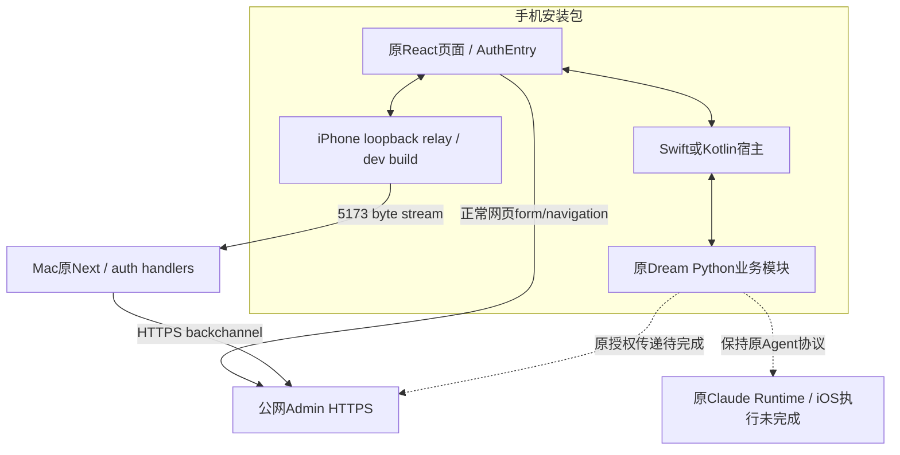
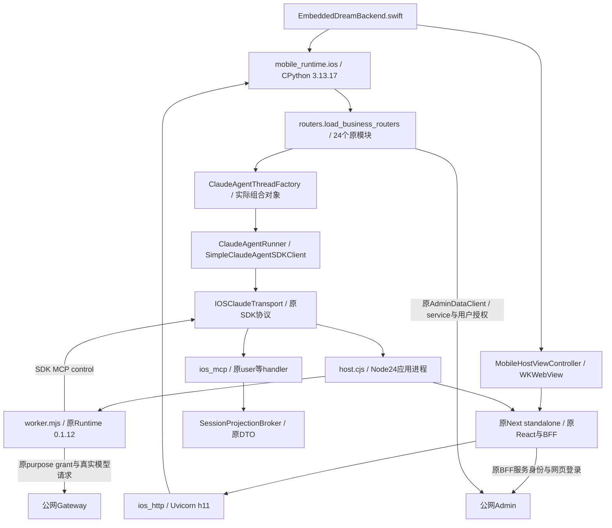
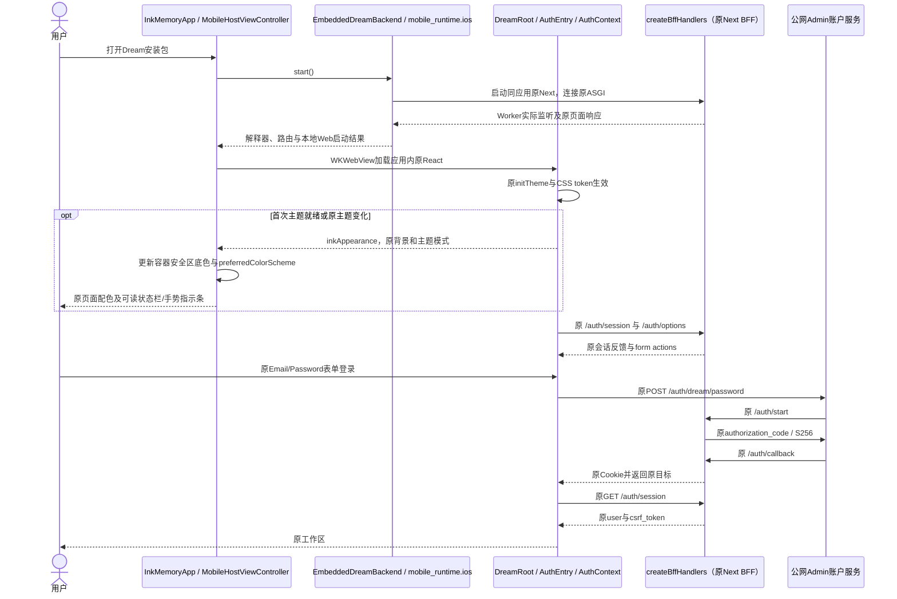
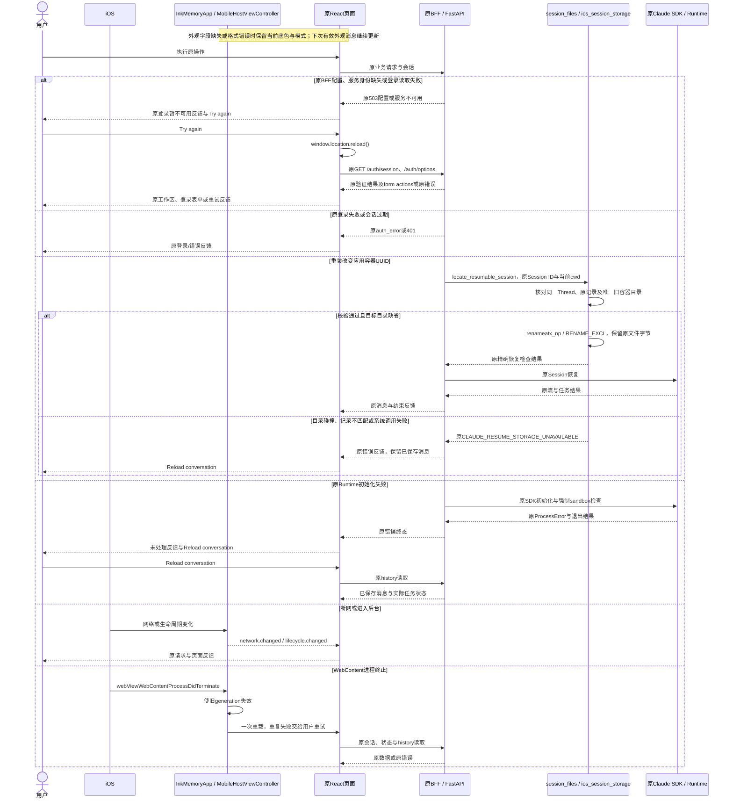
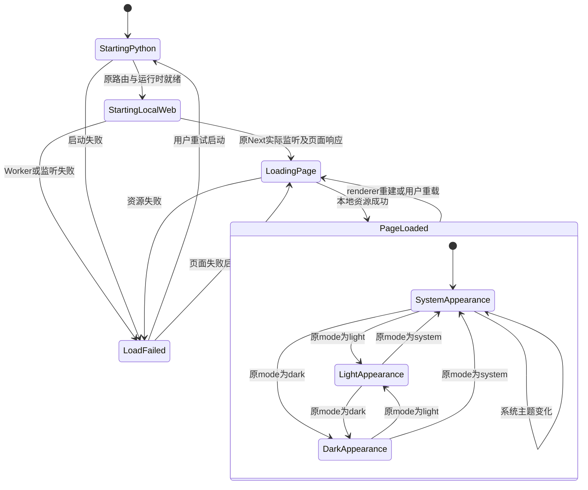
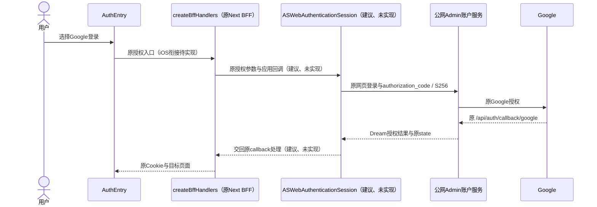
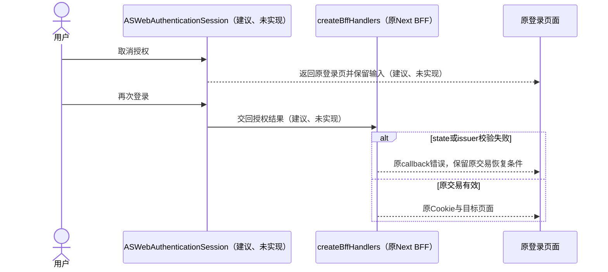

<!-- [Input] 用户决定端侧禁用Claude命令沙箱前的三份现行文档。 -->
<!-- [Output] 原文及SHA-256，保存被取代的沙箱设计和技术验证范围。 -->
<!-- [Pos] 历史快照；现行部署采用INK_AGENT_SANDBOX_ENABLED=false。 -->

# 端侧关闭Claude命令沙箱前原文

2026-10-25用户决定沿用AutoDL配置并停止新增端侧逐命令沙箱适配。以下原文保留历史来源，实施计划以现行部署稿为准。

## docs/deploy/mobile-app-release.md

SHA-256: `cb4bc5c1e7000f56f0567790492ace562368783ed27654a8142e2ddc04fda781`

~~~~markdown
<!-- [Sync] 2026-10-25: 原普通env字节一致；Bash App宿主资格用例通过，完整工具与正式发布继续待完成。 -->
<!-- [Sync] 2026-10-25: 同步原Session真实追问、普通重开与页面结束反馈间歇失败，发行资格保持。 -->
<!-- [Sync] 2026-10-25: 本机构建保留原前端与后端env文件及配置消费者。 -->
<!-- [Sync] 2026-10-25: 记录普通env本机装配；外部分发前保留凭证范围评审和完整业务门槛。 -->
<!-- [Sync] 2026-10-25: 增加Node24原Runtime独立Simulator回执与制品来源，发行资格保持未通过。 -->
<!-- [Input] 现有Next/React/Python代码、原网页登录合同、双原生宿主与只读参考项目。 -->
<!-- [Output] 保持业务的打包判断、平台发行、账号/制品条件和验证阻断。 -->
<!-- [Sync] 2026-10-25: 随包原Next standalone、原public/static与Uvicorn/h11接线，保留原授权失败。 -->
<!-- [Pos] iOS/Android技术打包发布设计；当前业务行为由原模块所有。 -->
<!-- [Sync] 2026-10-25: 记录公网Admin拓扑、Simulator业务验收与更新后的开发签名IPA。 -->
<!-- [Sync] 2026-10-25: 记录iOS Simulator安装包宿主的正常登录与真实业务回执。 -->
<!-- [Sync] 2026-10-25: 记录iOS开发签名app/IPA与业务测试包，保持真机业务验收和正式发行门槛。 -->
<!-- [Sync] 2026-10-25: 删除移动专属认证、替代Agent、文件和任务业务变更方案。 -->

# Ink & Memory 移动打包与发布

## 路线判断

保留用户选定的Swift/WKWebView、Kotlin/Android WebView与端侧Dream Python。共享React资源和原业务代码，原Next BFF继续承担现有网页认证职责，公网Admin独立提供账户和数据服务。iOS开发签名app/IPA、端侧Python、Wi-Fi安装启动和原React页面已有历史回执。关闭relay后的原24个业务路由、原Factory/Runner、Node24原Runtime与自有MCP已有Simulator技术回执；原网页登录、独立真实模型回复、正常Admin持久化/结算及第五次Chat页面终态通过。普通重开与原Session真实追问已有回执，第七次提交的页面结束反馈失败；后续原Session追问与首段回复停止已取得实际回执；稳定性扩展、完整工具、物理设备与渠道资格待完成。完整业务发行资格维持不通过。

[PRD](../prd/dream-workspace/mobile-app.md)、[架构](../design/story-workspace/mobile-runtime-architecture.md)、[共享交互](../design/story-workspace/mobile-app-interaction.md)、[iOS](../design/story-workspace/mobile-ios-interaction.md)、[Android](../design/story-workspace/mobile-android-interaction.md)和[复审记录](../exec/mobile-app-design-review-20261024.md#2026-10-25-保留网页业务的设计复审与实现修正)承载现行范围。原历史快照保留原文，退出实现依据。

## 发现与问题定义

| 当前事实 | 证据 | 影响 |
| --- | --- | --- |
| Next 16.1.6 / React 19.1、动态Route Handlers与原BFF | [package](../../frontend/package.json)、[auth handlers](../../frontend/app/api/_auth/handlers.ts#L30)、[API Route](../../frontend/app/api/[[...path]]/route.ts) | 完整Next静态导出不可行；静态React资源无法执行原BFF |
| 原Dream登录使用网页form | [AuthEntry](../../frontend/app/_dream/components/Auth/AuthEntry.tsx#L43) | 容器必须支持原表单、导航、Cookie、callback；不改用设备码或原生登录 |
| 内部数据客户端同时要求用户和服务身份 | [client](../../backend/services/admin_data/client.py#L78)、[config](../../backend/services/admin_data/config.py#L68) | 原BFF与服务秘密留在服务器；移动授权接入缺口保留 |
| Python依赖原生扩展与后台组合 | [pyproject](../../backend/pyproject.toml)、[server](../../backend/server.py) | 逐项验证目标扩展；全局worker所有权保持原部署 |
| 原SDK与Runtime传输 | [simple_cas_client](../../backend/libs/claude_agent_kit/server/simple_cas_client.py#L115)、[iOS Transport](../../backend/mobile_runtime/ios_claude_transport.py#L143) | 服务器默认CLI子进程；iOS注入同协议传输并运行原Runtime Worker；Bash及第三方stdio继续待完成 |
| 原业务路由与执行模块 | [mobile_runtime.ios](../../backend/mobile_runtime/ios.py#L61)、[原路由清单](../../backend/routers/__init__.py#L6)、[原生测试](../../mobile/ios/InkMemoryTests/EmbeddedDreamBackendTests.swift) | 物理iPhone保留早期11模块回执；独立Simulator已装配24模块、原Factory/Runner/MCP；账户、模型与完整业务验收待完成 |
| 原视觉资源被移动构建额外替换 | [构建脚本](../../frontend/scripts/build-mobile-assets.mjs) | 本轮移除笔刷替换，原UI和来源URL继续复用 |

## Python 与 Claude CLI 官方兼容矩阵

| 项目 | 已核对依据 | 结论 |
| --- | --- | --- |
| CPython iOS嵌入 | [Python 3.13 iOS](https://docs.python.org/3.13/using/ios.html)，2026-10-25查阅 | Framework、扩展包装和签名有实际路径；完整Dream依赖另行验证 |
| iOS subprocess | [Python subprocess](https://docs.python.org/3.13/library/subprocess.html)，2026-10-25查阅 | 原CLI/stdio调用模型无法直接使用 |
| Claude Code平台 | [官方setup](https://code.claude.com/docs/en/setup#system-requirements)，2026-10-25查阅 | 官方支持平台无iOS/Android；fork须独立验证 |
| 项目当前发行目标 | [发布校验](../../scripts/verify_claude_registry_release.py#L50) | 仅darwin/linux的arm64/x64；iOS/Android制品缺失 |
| 本机已安装CLI | `file`与`xcrun vtool -show-build`实际读取 | Mach-O arm64、platform MACOS；root包0.1.12与平台包0.1.5存在版本不匹配；不作为手机运行时 |
| Node.js Mobile | [上游release](https://github.com/nodejs-mobile/nodejs-mobile/releases)、[维护者24.21.0-0制品](https://github.com/fogtape/nodejs-mobile/releases/tag/v24.21.0-0)、[API差异](https://code.janeasystems.com/nodejs-mobile/nodejs-apis-differences)，2026-10-25查阅 | 当前实现固定Node24.21.0-0库并校验SHA-256；同应用运行原Runtime JavaScript，排除桌面可执行文件；外部进程返回ENOSYS，完整工具及真机资格独立验证 |

Android Python嵌入需独立验证ABI、依赖、16 KB page size与原工具调用；iOS结果不替代Android回执。兼容缺口不授权替换Agent、权限、工具或恢复语义。

## 候选路线与收敛

| 路线 | 复用、服务端与维护影响 | 决策 |
| --- | --- | --- |
| 原生WebView宿主＋端侧Python | 复用React与Python；需原Next BFF接入、扩展和Claude兼容；两平台只维护薄宿主 | 用户选定路线；继续按原业务集成，阻断须实际解决 |
| WebView加载已部署完整Dream | 原网页/BFF复用高；业务和Python继续在部署主机执行 | 不满足端侧Python目标，退出本轮实现 |
| React Native等重写原页面 | React语法可复用，DOM/CSS/编辑器与原网页登录需改造；CLI问题仍存在 | 不新增第二套业务实现 |

Electron面向桌面运行时，无法由macOS制品生成iOS/Android包。Capacitor/Tauri可组织宿主，无法自动补齐原BFF、Python和CLI；当前已选轻量原生宿主，不增加框架依赖。PWA的Web分发无法证明端侧Python执行。

## 架构、网络和认证

共享页面、原BFF、端侧Python和平台宿主职责见[架构](../design/story-workspace/mobile-runtime-architecture.md#执行位置与代码归属)。移动构建只处理资源位置和hash；不复制BFF服务器秘密，不将原生账户令牌仓库或新Admin设备API作为发行路径。

包内页面与public资源沿原构建复用；原第三方图片来源继续按原实现联网读取。本轮不生成视觉替代资源，不声明全部页面内容可离线使用。

Admin已独立部署在`https://ink-admin.suoxya.com`。Dream BFF通过HTTPS backchannel访问公网Admin，WebView按`/auth/options`返回的HTTPS action执行正常网页表单；localhost Dream client、callback、Cookie/CSRF和OAuth目录配置保持原校验。本轮不启动Docker、不迁移、不初始化账户。

原网页邮箱/密码/注册/Google表单、会话失效、退出和取消保持原合同。bridge无`auth.*`或`auth.callback`。原文件上传、停止、队列、Run/Thread状态、持久化、资源策略和计费保持原实现。平台生命周期只通知页面，不新增后台落库、调度、自动续跑或业务终态。

## 平台打包发布路径

### iOS

- 工程归属`mobile/ios/InkMemory.xcodeproj`；Xcode编译Swift、CPython Framework、目标扩展、Node库及原Next standalone/React资源。当前development target为16.4，发布前核对全部依赖交集。
- 应用标识、version/build、Team和entitlements由工程/受控构建配置提供。当前本机Personal Team用于已连接iPhone开发安装，正式发行资格另行提供。
- 本机调试：开发签名 → 安装 → 正常应用启动 → Dream原网页登录和完整任务验证。证书/私钥继续由Xcode与Keychain管理，禁止写入仓库或产物资源。
- 当前开发制品：`mobile/ios/build/InkMemory-development-20261025.ipa`与`mobile/ios/build/SHA256SUMS`。制品使用当前开发profile，包内Dream Web上游为`192.168.0.103:5173`，Admin表单和BFF backchannel使用公网HTTPS；IPA不含测试bundle，ZIP、深层签名、登记设备和SHA-256已校验。该制品只用于本轮已登记设备联调。
- 正式路径：合格工具链和发行账号 → Archive → 签名/entitlement/profile校验 → `.xcarchive`、dSYM、IPA留存 → App Store Connect/TestFlight → 测试通过 → 审核及选定地区发行。
- 待提供Apple Developer Program、发行Team/角色、App Store Connect记录、应用图标、必要分发证书/profile和商店材料。现有开发安装不表示具备这些条件。

### Android

- 工程归属`mobile/android/`；Gradle/Kotlin编译WebView宿主、目标Python/扩展与共享资源。当前工程minSdk29、compile/target36；构建前重核工具链兼容矩阵和发布时渠道要求。
- applicationId/versionName/versionCode由受控配置提供；versionCode递增。测试APK签名安装；Play使用签名AAB、upload key及Play App Signing，保留mapping/native symbols。
- 所需前提：合格Android SDK/Gradle/JDK、设备ABI/16 KB验证、受控签名密钥与恢复责任、Play账号和应用记录。当前缺少Android完整构建/真机回执。
- 发布地区和渠道尚未指定，工作假设为受控测试及后续Google Play。中国大陆或其他商店由明确渠道要求单独确定，不自动增加多渠道平台。

### 最小构建与制品流程

源码SHA和干净范围 → 锁定依赖/下载hash与许可 → iOS独立目录构建原Next standalone与React资源、Android沿用现有资源准备 → 平台编译 → 有界回归 → 受控签名 → 签名/标识/权限/ABI校验 → 安装验证 → 留存制品与回执 → 测试分发 → 审核/发布。

留存version/build、源码SHA、资源hash、CPython/扩展/CLI身份、工具链、签名公开指纹、构建日志、测试结果、符号和渠道构建ID。签名秘密位于Keychain/CI secret或受控keystore，不进入源码、bundle、日志或文件清单。CPython framework元数据差异及Rust传递许可清单属于发行前置项，详见原实施回执。

仅按实际构建需要组织脚本和CI，不新增应用内打包页面或发布中台。

## 更新与恢复

客户端、Web/BFF、Python与Admin按现有DTO/schema capability兼容；不按环境名选择另一套业务。升级保留平台允许保留的数据和原业务记录，不新增同步/迁移协议。

上传失败先查渠道构建状态，确认缺失后重传同一制品；签名/版本冲突按渠道要求修复新build。暂停发行只停止新增分发；已安装应用通过递增修复版本更新。服务端回退需兼容已安装客户端和原已发布schema，不通过回退恢复已撤销会话或修改历史结算。

## 商店和地区前提

| 适用事项 | 触发与当前依据 | 处理要求 |
| --- | --- | --- |
| 隐私声明和数据安全 | 原账户、正文、附件和模型请求 | 声明原数据处理及平台权限，核对第三方依赖 |
| Google等第三方登录 | 现有AuthEntry提供Google | 按发布渠道重核等效登录适用条件；缺口先评审，当前不新增登录业务 |
| 账户删除 | 原产品提供账户能力 | 核对现有可用闭环与渠道要求，缺口不得写成已实现 |
| 数字内容支付 | 仅在安装包实际提供购买时触发 | 核对既有权益入口和地区/渠道规则，不新增支付系统 |
| AI披露、内容政策和最小功能 | 原Chat/Dream模型内容和核心任务 | 核对原业务与平台材料；核心任务未运行时不提交可用性声明 |
| 本地网络/文件权限 | 实际连接Mac或使用原附件入口 | 仅按所需系统操作配置权限与用途；保留原业务行为 |

商店与工具链资料保留原2026-10-24查阅范围，实际发布前按当日官方资料重核：[Apple Review](https://developer.apple.com/app-store/review/guidelines/)、[Apple分发](https://developer.apple.com/documentation/xcode/distributing-your-app-for-beta-testing-and-releases)、[Play目标API](https://developer.android.com/google/play/requirements/target-sdk)、[Android 16 KB](https://developer.android.com/guide/practices/page-sizes)。本次复审只修正业务边界，不构成渠道合规或发布验收。

### 参考能力映射

以下 `R` 表示上述参考根目录；文件和行号可直接定位。只借鉴流程、责任划分及制品追溯，复制具体源码或二进制需要独立授权核查。

| 参考模块或流程 | 当前作用 | 可借鉴内容 | 移动端适配要求 | 证据 |
| --- | --- | --- | --- | --- |
| package 与 runtime build | 重建工程包0.2.0，vendor目标Electron42.1.0；esbuild 编译 Main、CJS Preload、React Renderer，生成 ASAR | 入口清单、输入图、锁定版本、构建后来源摘要 | 平台宿主各自构建，排除 Electron/Preload/ASAR | `R/package.json:2–6,25–36,140–158`；`R/scripts/build-application-runtime.mjs:40–75,141–174` |
| macOS build/sign/verify | Darwin arm64 检查、外部输入 hash、`.app` 组装、ad-hoc 签名、Mach-O/ZIP 校验 | 构建前条件、签名后校验、产物摘要 | 替换为 Xcode 归档和 Gradle 制品；iOS 分发身份需重新登记 | `R/build-sign-verify-original-ui-macos-arm64.sh:36–67,77–109` |
| deliverables | Skeleton/Frameworks/ASAR 组合应用，输出源码包和 SHA256SUMS | 分开源码、应用、验证说明；留存摘要 | `.xcarchive`/符号/IPA 与 APK/AAB 独立管理 | `R/scripts/package-original-ui-deliverables.mjs:8–30,38–47` |
| CodexAppServerSidecar | 桌面启动 `codex app-server`，监听本机随机 WebSocket | 展示与执行模块所有权 | 当前Dream执行位置为服务器；本轮端侧Python/CLI资格按兼容矩阵核定 | `R/src/entries/main-runtime.ts:311–315`；`R/src/main/runtime/codex-app-server-sidecar.ts:95–108` |
| LocalNodePtyBackend | 本机 node-pty 启动 shell | 宿主接口隔离 | 不进入移动安装包 | `R/src/main/terminal/node-pty-backend.ts:59–77` |
| CodexMobilePage | 桌面手机连接引导、MFA 和客户端状态；文案要求手机在 ChatGPT 访问保持唤醒的 Mac | 取消、错误、重试及权限反馈方式 | Ink 使用既有公网账户与本机执行边界，配对协议无复用授权 | `R/src/renderer/mobile/codex-mobile-page.tsx:25–51` |
| mobile protocol/service | Electron IPC 调用 ChatGPT REST；本机 JSON 保存设置；开关仅读 clients 并写设置 | DTO、分页、鉴权失败与重试组织 | 不复制 OpenAI endpoint、token、业务常量 | `R/src/shared/mobile/codex-mobile-protocol.ts:38–65`；`R/src/main/mobile/codex-mobile-service.ts:55–67,166–219,231–249` |
| Sparkle updater / Windows policy | macOS 原生更新与 Windows Store 身份规则 | 版本、渠道身份、更新失败状态 | 由目标移动商店更新；不引入 Sparkle 或自下载原生更新 | `R/src/main/updater/desktop-updater-service.ts:134–220`；`R/src/main/automations/windows-store-updater-policy.ts:4–9,62–92` |
| vendor manifest | 原 DMG、ASAR、node-pty hash 与签名前后来源 | 每项二进制的来源、许可、平台和摘要 | 官方移动依赖独立清单 | `R/vendor/node-pty-electron42-darwin-arm64/VENDOR-MANIFEST.json:1–29` |

`MobileQrArtwork` 是 `<i>` 与按钮构成的示意图，未编码配对 URL（`R/src/renderer/mobile/codex-mobile-page.tsx:9–13`）；当前 Mobile 为 Partial，仍需第二设备实际批准（`R/docs/parity/Codex-Original-Feature-Inventory.md:51`）。文件扫描未发现 Xcode project、Podfile、Gradle、AndroidManifest、Capacitor、Expo 或 Flutter 工程标记，根包无移动打包命令。移动连接状态与独立移动工程分别记录。

#### 来源和分发条件

根包 `private: true`、README 声明证据重建且为非官方源码（`R/package.json:4–5`、`R/README.md:3`），扫描未发现覆盖根源码的 LICENSE/NOTICE。`R/resources/renderer/original-ui/README.md:3–7` 记录 CSS/字体从原 ASAR 提取，hash 仅证明来源。node-pty 的 MIT 许可要求保留声明（vendor 内 `node_modules/node-pty/LICENSE:1–19,23–43`），覆盖范围限定该组件。原始应用 Skeleton、Frameworks、Codex CLI、字体、商标及整套源码的复制分发授权仍待核验。

`R/scripts/materialize-node-pty-electron42-vendor.mjs:74–109` 的 vendor 目标固定 Electron42/Darwin/arm64；`R/scripts/build-application-runtime.mjs:113–133` 写入 OpenAI Sparkle feed、公钥和原版本。移动方案全部排除这些制品与发布身份；不从参考仓库复制文件。目标仓库自身字体、图标和前端依赖的分发许可仍需在首个构建前形成清单。

### 历史文档差异及影响

| 差异 | 当前依据 | 处理 |
| --- | --- | --- |
| 参考 README 停留 Round52 的 3/16/20 统计 | `R/package.json:134–139` 已有 Round84/85；功能清单 `:9–10` 为35 Implemented/4 Partial | 引用当前脚本，旧统计保留历史 |
| work 子树称无完整 APP、包版本0.1.0 | `R/work/semantic-recovery-restart/README.md:11–12` 对应 checkpoint；根工程已含应用组装 | 两个源码位置分别定位 |
| README-ZH 称 DMG 仅分析输入 | `R/README-ZH.md:64–65` 与 macOS 脚本 `:13,31,44,66,79` 强制 DMG 并抽取 node-pty 存在差异 | 不复用旧输入清单 |
| 参考连接、云任务和 SSH 的交付标题 | `R/docs/delivery/round-84-README.md:22,42` 未点击 Allow；round85 `:26` 云账户与完整链路受限 | 仅记录已观察局部能力 |
| Dream 历史 Vite/Cloud 发布说明 | [deploy/README](../../deploy/README.md#L25):25–30、[发布索引](README.md)已有漂移说明；[release-system-design](release-system-design.md)保留历史 | 当前方案采用 Next/pnpm，同源 BFF |
| docker-entrypoint 跨源注释和 desktop-only 文件头 | [docker-entrypoint](../../frontend/docker-entrypoint.sh#L10):10–20 与 apiBase 同源实现存在差异；[Layout](../../frontend/app/_dream/components/story-workspace/layout/StoryWorkspaceLayout.tsx#L2):2 与 responsive CSS 存在差异 | 本轮只登记，后续拥有对应代码的任务同步注释 |

### iOS原Web资源构建补充

`prepare-next.py`在忽略目录准备原Next源码和共享bridge合同，使用当前已安装依赖。原`frontend/.next`、用户Web服务及`.env`保持原状。原Next构建启用standalone后，`bundle-next.py`复制trace依赖、public和static，重定位包内依赖链接，排除桌面原生模块并记录摘要。原Next BFF在应用Node Worker中运行，原HTTP proxy通过Uvicorn/h11连接同一Dream ASGI实例。发布前须核对原Next/React及依赖许可、目标设备运行、Web来源/callback、合法原授权与完整业务。

早期无env包缺少原service secret与BFF Cookie配置，原认证入口返回503；该阶段回执保留。当前本机包按下节装配普通env，已通过原网页登录、独立真实模型回复、页面终态及正常Admin持久化与结算。此前开发IPA继续保留原Mac relay接线；本次独立Simulator测试不更新该IPA，不产生新发布记录。

iOS Xcode已移除重复静态资源phase，独立入口统一为包内原Next；资源打包只清理当前目标的旧`web/`生成物。原共享React源码与Android构建保持。

## 普通env本机调试产物

2026-10-25用户要求直接复用普通env。当前iOS本机资源阶段复制现有`backend/.env`到应用`app/.env`供Python读取，并复制现有`frontend/.env.local`到原Next server目录供Node读取；React业务源码、登录、权限与Admin代码保持。当前包包含原Dream服务身份与BFF配置，本机调试验收与外部分发资格分别核定。商店候选制品的凭证范围评审、账号业务、完整工具、真机、归档及渠道门槛继续保留；本轮未提交商店或执行正式发布。新回执见[普通env与原登录](../exec/mobile-app-design-review-20261024.md#普通env接线与原登录验收)。

2026-10-25再次核对已安装Simulator App：原`backend/.env`和`frontend/.env.local`各一份，内容与源文件逐字节一致，检查退出0，配置值缺省。独立App-hosted Bash资格用例通过，生产Runtime外部命令继续保留ENOSYS；该资格包仅用于兼容测试。完整工具接线、物理设备、授权范围和渠道核验继续按既有门槛执行，未新增正式制品或发布记录。
~~~~

## docs/design/story-workspace/mobile-runtime-architecture.md

SHA-256: `22f08ce709f049e27ff98b998c09a97fd02f2e92120521a883e1e735b64f20f1`

~~~~markdown
<!-- [Sync] 2026-10-25: 资格包版本6补充逐调用身份、信号和proc守卫；当前编译通过，目标运行待验证。 -->
<!-- [Sync] 2026-10-25: iOS只投影原页面主题到安全区和系统外观，原业务bridge及键盘内容边界保持。 -->
<!-- [Sync] 2026-10-25: 普通env逐字节复核；独立XCTest同App进程Bash资格通过，生产工具接线继续待完成。 -->
<!-- [Sync] 2026-10-25: 原Stop有界响应等待保留Service清理，引用共用停止交互及真实验收缺口。 -->
<!-- [Sync] 2026-10-25: 原Chat inputs定时读取限制单个在途请求，组件结束传递AbortSignal，原队列及状态规则保持。 -->
<!-- [Sync] 2026-10-25: 连续容器变化通过完整Runtime目录名验证中间UUID，保留原JSONL与排他重命名规则。 -->
<!-- [Sync] 2026-10-25: iOS恢复检查匹配固定Node长路径格式，排他调整同容器UUID变化目录，保留原记录与校验。 -->
<!-- [Sync] 2026-10-25: 按原前后端env文件归属装配，Gateway地址采用现有公网Admin。 -->
<!-- [Sync] 2026-10-25: 新建Admin连接继续复现会话超时，撤回Connection close候选，原连接与认证规则保持。 -->
<!-- [Sync] 2026-10-25: 按用户要求复用普通env与原登录代码，撤回新增Admin客户端类型，记录本机产物凭证边界。 -->
<!-- [Input] 现有React/Next/Python实现、正常网页登录合同及用户确认的双原生宿主。 -->
<!-- [Output] 保持原业务的执行位置、平台传输、源码归属与阻断清单。 -->
<!-- [Sync] 2026-10-25: 定义强制sandbox的iOS外部命令拒绝后端，保留原设置和权限；完整工具资格独立记录。 -->
<!-- [Sync] 2026-10-25: 公网只读核验确认服务身份阻断；区分SDK进程API声明、CPython限制与iOS应用执行资格。 -->
<!-- [Sync] 2026-10-25: 原Next standalone与原ASGI在应用进程接线，保留原网页登录和服务身份校验。 -->
<!-- [Pos] 移动技术架构；业务规则仍归原模块和接口。 -->
<!-- [Sync] 2026-10-25: Node 24应用进程宿主与原SDK Transport已实现，Simulator原Runtime initialize通过；完整业务继续验收。 -->
<!-- [Sync] 2026-10-25: 独立iPhone执行以端侧Runtime移植、网页会话接入和公开数据权限为前置。 -->
<!-- [Sync] 2026-10-25: 改用公网Admin认证，iPhone开发relay收敛为Dream Web端口。 -->
<!-- [Sync] 2026-10-25: 记录iOS Simulator应用宿主完成原BFF会话和真实Chat。 -->
<!-- [Sync] 2026-10-25: 定义iOS局域网开发拓扑并记录原React/BFF页面可达证据。 -->
<!-- [Sync] 2026-10-25: 删除原生认证所有权、替代业务和新存储/任务协议。 -->

# 移动端运行时架构

## 背景与问题

用户选择Swift/WKWebView、Kotlin/Android WebView和端侧Dream Python，要求保持现有网页业务。前稿通过新认证、手机令牌provider、附件本地准备、额外任务状态与业务入口门禁处理平台缺口，现行架构已删除这些方案。

当前iOS应用运行真实CPython/FastAPI、24个原业务路由模块和原ThreadFactory，并在同应用Node24中启动原Claude Runtime。关闭Mac relay的Simulator已验证原SDK协议、原Dream Runner、原user MCP与Session broker、本地ASGI增量响应和取消；完整账户业务继续接入。此前签名安装包通过relay取得原React页面，Simulator经公网Admin完成正常登录和一次Mac执行的Chat；该回执保留原执行位置。物理设备重复、完整路由、移动授权和工具资格按各自回执推进。[PRD](../../prd/dream-workspace/mobile-app.md)、[共享交互](./mobile-app-interaction.md)、[iOS](./mobile-ios-interaction.md)、[Android](./mobile-android-interaction.md)和[发布稿](../../deploy/mobile-app-release.md)分别定义对应领域。

## 目标与边界

复用原React页面、Next BFF、DTO、鉴权、存储、Agent、SSE parser、停止和恢复。原生宿主仅承载解释器、WebView、通信、资源、输入与系统操作。公网Admin独立承担现有账户、OAuth和数据服务，业务代码和数据库合同保持原状。

不增加移动专属认证、原生用户令牌仓库、设备码流程、数据API代理、替代Agent、业务能力裁剪、后台落库、全局worker领取、离线数据库或同步系统。

## 事实、方案与待验证

| 分类 | 依据和影响 |
| --- | --- |
| 当前代码事实 | [AuthEntry](../../../frontend/app/_dream/components/Auth/AuthEntry.tsx#L43)读取原`/auth/options`，按原action顶层提交登录/注册/Google form；用户已指定手机沿用此流程 |
| 当前代码事实 | [createBffHandlers](../../../frontend/app/api/_auth/handlers.ts#L30)拥有options/start/callback/session/logout；Cookie、CSRF、PKCE与服务身份由原BFF保管 |
| 当前代码事实 | [browserSession](../../../frontend/app/_dream/lib/browserSession.ts#L38)与[AuthContext](../../../frontend/app/_dream/contexts/AuthContext.tsx#L20)保留原用户展示、401、错误与退出行为 |
| 当前代码事实 | [移动构建](../../../frontend/scripts/build-mobile-assets.mjs)从相同`_dream`源码生成资源；本轮删除移动制品内笔刷替换，保留原视觉资源URL |
| 当前代码事实 | [iOS组合](../../../backend/mobile_runtime/ios.py)按[原router清单](../../../backend/routers/__init__.py)装配24个原模块与公共router；真实配置200、保护接口无授权401，`businessReady=false` |
| 当前代码事实 | [AdminDataClient](../../../backend/services/admin_data/client.py#L78)要求原服务身份；当前本机包按用户要求读取普通env，服务令牌仍由原客户端取得，外部分发资格待评审 |
| 当前代码事实 | [ClaudeSDKClient构造](../../../backend/libs/claude_agent_kit/server/simple_cas_client.py#L115)默认使用原CLI传输；iOS注入同协议Transport，原npm发行目标保持macOS/Linux |
| 参考能力 | Codex参考仓库中的订阅、快照缓冲、generation隔离及失败保留输入，只用于平台通信稳定性；不改Dream状态、UI、存储或认证 |
| 已实现平台适配 | iOS开发构建从`DREAM_LAN_HOST`取得Mac地址，在手机127.0.0.1监听5173并字节透明转发Dream Web；WebView继续访问`http://localhost:5173/`，网页表单导航到公网Admin，原Cookie与callback协议保持 |
| 当前验证事实 | 物理iPhone app-hosted测试启动宿主后，Mac原Next收到`GET / 200`；iOS Simulator应用宿主完成原密码登录、session 200和真实Chat；物理设备休眠后无线调试隧道不可用 |
| 待验证 | 物理iPhone独立执行、原账号登录/Chat、端侧授权与持久化、Bash及第三方stdio工具；Simulator同应用原Runtime、流、取消和JSONL恢复已有技术回执 |

参考仓库只读：`/Users/dmeck/project/Codex-Original-Functionality-Round52-Delivery`。具体来源与分发条件保留于[参考能力映射](../../deploy/mobile-app-release.md#参考能力映射)。

## 执行位置与代码归属

下图记录此前Mac relay开发联调接线。`Mac原Next`参与页面、认证和Chat链路，该布局的通过范围为容器联调。独立iPhone执行资格由本文末尾的实施边界单独核定。

| 层 | iOS | Android | 归属 |
| --- | --- | --- | --- |
| React | WKWebView WebContent | Android WebView renderer | `frontend/app/_dream/**`唯一业务源码 |
| 原BFF | 原Next standalone在应用Node Worker执行；原Mac relay联调回执单独保留，独立Simulator原账号会话与保护读取已通过，Google与完整业务待验收 | 未实现 | `frontend/app/api/_auth/**`与原auth Route Handlers |
| 宿主 | Swift、UIKit、WKWebView | Kotlin、WebView、Binder | `mobile/ios/**`、`mobile/android/**` |
| Python | 应用进程内CPython、持久ASGI loop、24个原router与原Factory | 私有service中嵌入Python，未完成 | `backend/mobile_runtime/**`组合入口，业务继续归原模块 |
| 共享传输 | 来源/generation校验与进程内调用 | 来源/generation校验与Binder调用 | `mobile/shared/bridge/contract.json`及各语言镜像 |
| 业务数据、执行记录和附件 | 原Repository/API/workspace合同 | 同左 | 不新增账户目录业务、迁移或存储分层 |

静态React构建不包含Next服务器运行能力；完整Next无法直接静态导出。iOS独立路径复用原Next standalone，将相同React、Route Handlers、HTTP proxy与BFF放入应用进程。原Mac relay保留历史联调职责。公网Admin继续校验已登记的Dream来源和callback；当前沿用已登记的localhost来源，IPv4替代来源保留原拒绝反馈。原BFF的Cookie、CSRF、PKCE和服务身份要求保持。

## 最小平台协议

当前清单为10 methods、3 events、7 errors。已删除原生`auth.*`及`auth.callback`。用户登录、会话、退出和授权回调继续使用原HTTP/form/BFF入口。

| 方法组 | 平台职责 |
| --- | --- |
| `app.getInfo`、`runtime.getCapabilities` | 公开构建身份与技术运行事实 |
| `lifecycle.getState`、生命周期/网络事件 | 页面可见性与连通状态；不写入任务状态 |
| `runtime.request/response.read/cancel` | 传递原method/path/body、status/headers/body及取消；完整流未接通 |
| `file.pick/save`、`share.open`、`external.open` | 为原业务文件与系统操作提供适配；不定义附件上传和存储规则 |

本地bridge只允许包内应用来源主frame；远程认证/外链页面无bridge权限。请求ID和page generation只匹配通信结果。拒绝自由host、身份覆盖header、服务凭证、任意shell和文件路径。

`mobileRuntimeTransport`当前是受控的临时fetch适配。FormData、Request/URL对象、HTML form、图片、链接、WebSocket及原BFF必须逐项保持原浏览器行为，不能将未支持类型改为新的产品流程。应用挂载前的`python/localTransport`检查仅表示技术装配状态；不新增Chat/Dream功能隐藏规则。

## 业务保持与生命周期

iOS外观由现有页面CSS token与`theme.ts`提供。`MobileHostViewController`的主文档UserScript只读取`--color-bg-app`及`data-theme-mode`，私有`inkAppearance`消息仅携带颜色和主题模式；原业务bridge合同保持。`InkMemoryApp`将颜色填充到容器安全区，并按显式模式或系统模式选择系统外观。原WebView与键盘安全区、Cookie、HTTP、运行时和权限保持。正常、失败保留与模式转换见[iOS交互](./mobile-ios-interaction.md#页面与操作)。

正常网页登录见[共享时序](./mobile-app-interaction.md#正常业务时序)。iOS/Android保留第一方Cookie并允许原HTTPS form/navigation；静态资源CSP保留正常HTTPS表单、连接及原图片来源。iOS局域网开发包的Web origin保持`http://localhost`，5173字节relay不改HTTP字段；公网Admin使用已登记来源和callback。发布拓扑仍需HTTPS与现行来源配置，不放宽原服务校验。

原附件继续按`useFileUpload`上传，`AIInputDock`按原逻辑写workspace；平台只提供文件输入或系统保存/分享。原任务、权限、计费、资源策略default/desired/effective/revision、临时目录0700与sandbox规则保持原定义。

生命周期通知只传给页面。进入后台不增加提交/落库，不自动续跑或补发；系统终止后按原状态/history/JSONL恢复。Stop、断流和进程退出均不能被宿主改写为新业务终态。

## 阻断与下一步

| 工作项 | 最小处理与验收 |
| --- | --- |
| 原网页登录接入 | Simulator应用宿主已核对原form、callback、Cookie、`/auth/session`及一次Chat；补充物理iPhone同项回执 |
| 完整端侧后端 | 保留原组合与服务所有权；逐条证明原路由、身份与持久化可在手机工作 |
| Claude执行 | 取得真实iOS制品或符合原协议的移植证据；不换模型调用、工具或Agent业务 |
| 传输与文件 | 保留原流、取消、FormData、文件DTO与HTTP错误；通过完整原用户旅程 |
| 平台与发布 | 独立iOS/Android验证、签名、升级和渠道验收；发布前重新核对官方规则 |

现阶段不声明完整手机登录、完整Dream或已发布。当前代码与回执见[复审记录](../../exec/mobile-app-design-review-20261024.md#本轮复审验收矩阵)。

## 独立iPhone执行的实施边界

独立执行要求：包内React调用设备端Dream Python，设备端运行原Agent编排、工具、流与恢复；公网Admin提供既有账户/数据服务，模型服务承担推理；Mac限构建和调试。`DREAM_LAN_HOST` relay属于开发接线，不能作为此项验收路径。

### 当前执行阻断

| 边界 | 当前源码与结果 | 必需交付 |
| --- | --- | --- |
| Python → Claude Runtime | [SimpleClaudeAgentSDKClient](../../../backend/libs/claude_agent_kit/server/simple_cas_client.py#L115)创建`ClaudeSDKClient`；SDK `SubprocessCLITransport.connect()`使用`anyio.open_process`启动CLI | 在同一应用进程内承载原Runtime，并为SDK提供同一JSONL/control协议传输；流、interrupt、权限、MCP、session/resume逐项验收 |
| Runtime系统工具 | 运行源码`/Users/dmeck/project/ink-claude-code-dream/src/utils/shell.ts:1,316`依赖`child_process.spawn`；原`BashTool`与sandbox使用系统shell | iOS没有现有执行模型对应的通用shell子进程环境；移植须说明每个工具的执行方式和原权限语义。删除Bash/stdio工具后不能声明完整原CLI兼容 |
| MCP stdio | [agent_runner](../../../backend/libs/claude_agent_kit/server/agent_runner.py#L2231)以`sys.executable -I -c`启动原用户MCP | 将同源MCP handler接入可用的进程内传输并保留工具schema、授权、隔离与取消；不可用的外部stdio命令继续列兼容缺口 |
| Admin数据权限 | [AdminDataClient](../../../backend/services/admin_data/client.py#L81)同时取得service token和用户授权；Admin `app/lib/auth/serviceIdentity.ts:20–27`执行对应校验 | 复用普通backend env及原AdminDataClient，用户、scope、资源归属与purpose grant校验保持；本轮撤回新增Admin授权分支，外部分发凭证范围待评审 |
| 正常网页登录/BFF | `frontend/app/api/_auth/**`依赖Node、服务凭证与服务器Cookie密钥；原Next随包执行并读取原frontend env，独立Simulator会话已建立 | 保留原网页交互，完成可发行的会话接入与回调所有权；Device Flow和原生独立登录保持排除 |
| 完整后端与流 | 首次核查时装配11个模块并缓存完整body；当前装配24个原router，`NativeASGITransport`执行有背压的增量read/cancel | Simulator流及取消通过；原账户、Admin权限、持久化与原SSE用户旅程待验收 |

### 可复用运行时核对

以下官方或项目维护者资料于2026-10-25查阅；网页声明和本地代码审计分别作为证据。

| 路线 | 依据 | 当前处理 |
| --- | --- | --- |
| 现有Bun原生CLI | [Bun目标列表](https://bun.sh/docs/bundler/executables#supported-targets)仅提供macOS/Linux/Windows；Runtime `scripts/build-core-prune.ts:223–236`只接受darwin/linux四个平台 | 缺少iOS制品；修改Mach-O平台标记或继续用macOS arm64不能完成移植 |
| Node.js Mobile | [发布页](https://github.com/nodejs-mobile/nodejs-mobile/releases)提供18.20.4 iOS库；[API差异](https://nodejs-mobile.github.io/docs/api/differences/#child-processes)明确不支持child_process/cluster；原Runtime要求Node≥22 | 库可以承载部分JS，无法直接承载原CLI/工具链；本轮不增加依赖 |
| Swift-bun 0.1.0 | [项目README](https://github.com/1amageek/swift-bun)声明实验性兼容、无通用child_process与native addons，要求iOS26/Swift6.2/Xcode26 | 当前iPhone为18.0.1、Xcode16.4/Swift6.1.2；该库未满足当前设备及工具完整性条件 |
| 同源进程内Runtime移植 | 复用现有Runtime源码与SDK协议，替换运行时平台适配 | 尚未实现；需要独立的原Runtime执行、工具及恢复回执。当前应用保留真实unavailable状态 |

[CPython subprocess官方文档](https://docs.python.org/3.13/library/subprocess.html)明确iOS不支持该模块的进程创建。[Claude Code系统要求](https://code.claude.com/docs/en/setup#system-requirements)未提供iOS运行目标。原生测试`testTargetInterpreterProcessExecutionBoundary`直接调用包内目标解释器的subprocess，记录实际错误；测试通过只证明限制存在。

### 实施顺序与通过条件

1. 在可支持当前设备的进程内JS宿主中启动同源Runtime，完成SDK初始化、单轮、流、interrupt、权限及resume合同；保持Runtime源码所有权与发布来源要求。
2. 对Bash、stdio MCP、插件与sandbox逐项取得等价平台执行证据。要求保留通用shell子进程时，当前iOS执行模型无法满足完整工具兼容。
3. 原Next与Python分别读取现有frontend/backend env，沿原服务身份、用户授权、DTO和capability连接公网Admin；外部分发前审查现有凭证范围。
4. 装配剩余后端依赖和原router，接通同一ASGI流/取消与React文件输入。
5. 在构建`DREAM_LAN_HOST`为空、Mac Dream业务服务不可达的条件下，以原账号执行登录、Chat、工具、停止、重开恢复和文件操作；公网Admin、Gateway与正常业务记录共同核验。

当前判定：完整独立iPhone执行未通过。原Runtime与SDK在同应用Worker中执行，原自有MCP使用原handler和原SDK内存传输；通用Bash、第三方stdio工具、Google回调与完整真实业务继续待完成。容器联调、应用内fixture技术验证、真实账户业务和物理iPhone资格分别记录。

## iOS兼容代码实施更新

本节更新同日兼容性核查的Node候选与实现状态。[fogtape Node.js Mobile 24.21.0-0](https://github.com/fogtape/nodejs-mobile/releases/tag/v24.21.0-0)提供设备和arm64 Simulator slice，符合原Runtime的Node≥22、<25版本范围；维护者制品与源码来源于2026-10-25核对。该库独立于前表的上游18.20.4发行线。当前先使用此精确制品验证进程内路径。

| 模块 | 已实现职责 | 资格与剩余验证 |
| --- | --- | --- |
| `mobile/ios/InkMemory/DreamNode.m` | 应用内启动Node事件循环，使用应用私有目录、0600端点文件和同应用PID绑定；跨线程Foundation对象由ARC管理 | Simulator已加载Node24.21.0并启动原Runtime；应用冷启动及真机继续独立验证 |
| `mobile/ios/runtime/host.cjs` | 固定127.0.0.1随机私有端口、应用内随机凭据、固定原Runtime/Next入口；SDK独立Worker，Next持久Worker，按流反压转发stdio字节 | 运行于应用进程；不接受远程目标或自选入口；异常与并发合同继续验证 |
| `mobile/ios/runtime/worker.mjs` | 原Runtime使用会话独立的模块状态、env、argv和工作目录；相对文件操作使用当前会话目录 | 原Node模块继续执行工具；文件、权限、恢复和不支持的系统调用逐项取得回执 |
| `backend/mobile_runtime/ios_claude_transport.py` | 接入原`ClaudeSDKClient(transport=...)`，复用精确SDK的参数编码、JSONL解析及control路由，替换进程创建与stdio传输 | 原SDK0.2.145与Runtime0.1.12在Simulator完成initialize、流、Write、SDK MCP、权限拒绝、Worker重建后的JSONL恢复及interrupt；模型响应来自应用内fixture |
| `backend/mobile_runtime/asgi_transport.py`、`ios_http.py`与`ios.py` | 在持久事件循环执行原ASGI应用，头部即时返回，按需读取最多65536字节，校验document/request/stream归属并转发disconnect | Simulator原生测试已验证增量响应及pending read并行取消；HTTP断流保持独立于原Agent任务生命周期 |
| `mobile/ios/scripts/prepare-node.py`与`bundle-node.py` | 校验Node SHA-256和原公开Runtime archive SHA-512，只复制55个原JavaScript文件，适配`import.meta.require`并保留逐文件摘要、原版权及Node依赖许可 | Darwin可执行文件、ripgrep及其他桌面二进制均排除；新iOS制品资格单独建立 |
| `mobile/ios/scripts/prepare-python.py` | 准备原SDK/MCP、目标rpds、PyYAML、cryptography46.0.3/OpenSSL3.5.9和原锁定Pillow12.3.0 iOS wheels | 设备与Simulator依赖制品已准备；Simulator原Runner、ES256、AES-GCM篡改拒绝与PNG/JPEG/WebP编解码通过，物理设备继续验证 |

`SubprocessCLITransport.connect()`继续服务原桌面/服务器路径；iOS使用同协议Transport和原Runtime工作线程。该适配保留原SDK控制状态机和Agent循环。任意Bash、第三方stdio MCP及Node原生扩展的可用性继续依据目标执行回执，禁止从initialize通过推导全部工具通过。

正常网页登录、Admin权限、Dream持久化与React入口保持原业务合同。应用启动绑定本机Node与Python后继续报告`businessReady=false`。当前独立入口加载原Next和原AuthEntry，账户状态与失败反馈由原BFF处理；原技术探针继续记录完整业务资格。

原`SimpleClaudeAgentSDKClient`新增可选Transport构造器，原`ClaudeAgentRunner`新增可选CLI入口，原`ClaudeAgentThreadFactory`新增可选Runner构造器。默认调用保持原解析与运行路径；iOS组合通过这三个现有边界绑定同应用Runtime。兼容代码保留原query/control、权限、Service、EventBus、admission与turn/resume/cancel语义。原Runner/MCP等421项Provider-free回归通过；24-router/Factory消费者改动的207项回归通过。Simulator原Runner与user MCP通过，模型响应来自应用内fixture；真实模型和账户业务独立验收。

### 当前设备内组合

`ios_factory.py`组合原admission、资源策略provider/refresher、Runtime policy store和原Factory。`runtime_owner.get_thread_factory()`返回实际对象；服务器继续取得原`agent_factory`实例。原路由、Guidance、launch、confirmation、reentry与Reflections共用此入口，保留原请求与执行语义。

`DreamPython.m`注册内建`_dream_native.available_memory()`。iPhone使用`os_proc_available_memory()`的实际进程剩余额度，0按原低内存比较处理；Simulator使用Mach `host_statistics64`返回的真实free/inactive页。采样适配复用`AgentResourceSnapshot`和原admission比较，不修改配额与lease。Apple接口及SDK头文件于2026-10-25核对：[os_proc_available_memory](https://developer.apple.com/documentation/os/os_proc_available_memory)。Admin策略权限缺失时，原provider返回`unavailable`并保留default/LKG；状态维持原default/desired/effective/revision定义。

`ios_mcp.py`验证原Runner的0600私有MCP文件和固定模块入口，再把user、Editor、Story及image原server factory接到原SDK内存传输。远程MCP头部仍留在私有文件，连接关闭时恢复原投影；同步broker调用在单独线程执行。Simulator已验证原user handler到原Session broker/DTO；其他自有MCP保持各自业务验收项。

Node Worker使用固定签名资源入口，关闭`trackUnmanagedFds`，避免Worker退出时清理CPython已经复用的进程文件描述符。SDK关闭后检查本轮工作区文件描述符和HTTP fixture socket归属，当前目标测试通过。此适配处理进程共享描述符所有权，完整工具集仍需按工具执行回执确认。

### 后续授权与前端接线条件

| 对象 | 当前所有权与处理条件 | 剩余工作 |
| --- | --- | --- |
| 正常网页登录 | 原AuthEntry表单、原BFF Cookie/CSRF/PKCE、Admin密码和Google认证；原Next standalone随包 | 原BFF已读取普通frontend env并保留表单、callback、session和logout；Google系统浏览器回调待完成 |
| Admin用户数据 | 原AdminDataClient同时发送用户access token与service token；现有公开Editor API仅覆盖Editor | 原生产request/data owner已装配，独立Simulator Thread/Deck读取200，真实Chat消息写入通过；完整业务继续按原用户、scope、资源归属和合同验收 |
| Gateway与持久化 | 原turn创建purpose/thread/run绑定的gateway-cli与server-persistence grant | 独立Simulator真实Chat已取得正常Admin消息和Gateway结算；续期、撤销、receipt及其他任务继续逐项验证 |
| 系统工具 | 原Read/Write与自有MCP已有部分目标回执，Bash及任意stdio进程仍需iOS执行实现 | 逐工具补齐平台执行，禁止借用Mac执行、放宽权限或替换Agent循环 |
| 当前工作区入口 | 独立路径加载应用内原Next和原React；原技术探针保留完整业务未就绪事实 | 原页面运行、原网页登录、原后端真实业务分别验收；原生测试与历史Mac业务回执分别记录 |

Workspace Mode关闭时，原Service保留`cwd=None`并只创建原thread runtime根及`.claude-tmp`。原Runner沿用`cwd or os.getcwd()`，iOS启动时把进程默认目录设为包内backend源码；Node host仅额外接受该固定目录，保留线程工作区路径校验。Simulator原Runner以`cwd=None`完成单轮，原user MCP和工作区开启路径共同通过；应用内fixture共4次请求。

`worker.mjs`通过固定Node24的`process_wrap`和`spawn_sync`原生绑定返回`UV_ENOSYS`，由Node原ChildProcess代码生成stream、callback与错误结果。此边界在物理iPhone与Simulator共同生效，避免Simulator调用Mac shell、Git或stdio可执行文件。原Bash工具在目标协议测试返回`is_error=true`及ENOSYS，记录为未支持；原Read相对路径、Write、SDK MCP、权限拒绝、resume和interrupt继续通过。Node移动API限制于2026-10-25核对：[Node.js Mobile API差异](https://code.janeasystems.com/nodejs-mobile/nodejs-apis-differences)。

#### iOS强制沙箱初始化兼容

2026-10-25第二次原Chat提交完成用户消息持久化与HTTP200。原Runtime随后因桌面sandbox-runtime的unsupported platform检查退出，真实模型请求数为0。原协议fixture此前使用默认沙箱设置，该技术回执缺少生产`enabled=true`、`failIfUnavailable=true`组合覆盖。

选定适配位于现有iOS Node Worker与固定版本Runtime的Base SandboxManager：`ios-process-boundary.mjs`固定外部进程原生绑定为不可改写、不可重新配置的ENOSYS实现；Base SandboxManager仅在该边界校验成功后初始化iOS执行后端，每次命令包装均抛出ENOSYS。外部命令全部拒绝，命令产生的文件及网络副作用均无法启动。原settings转换、强制初始化检查、权限判定、Workspace Mode、精确`.claude-tmp`与Read/Write/MCP实现保持。该适配提供模型与进程内工具的启动条件，Bash执行资格继续未支持。

方案评审：关闭沙箱会改变现有权限配置；伪装macOS仍依赖桌面Seatbelt与命令进程；新增命令解释器需要独立语义和工具验收。当前采用外部命令全部拒绝的最小iOS后端。平台判断基于实际`process.platform`及冻结的原生绑定，普通env保持原配置，不增加测试环境业务分支。缺少或被修改的进程边界必须导致初始化失败。

固定archive的源码和适配后文件分别记录SHA256；prepare脚本要求四个Base函数标记各出现一次，仅修改该平台适配点，CLI强制沙箱检查保留。Provider-free验收须在启用且强制沙箱条件下覆盖原SDK流、Read/Write、Bash拒绝、MCP、权限拒绝、恢复和中断；通过后再执行一次原账号可见Chat。真实Chat成功、完整工具资格和物理iPhone分别记录。

Worker通过Node内建diagnostics channel记录原HTTP请求的失败类别、闭集格式错误码与毫秒耗时。日志排除URL、headers、正文、凭据和异常原文；异常订阅保持原请求参数、响应和SDK stdout。该诊断用于原BFF和Runtime网络失败，原业务超时与重试保持。2026-10-25查阅[Undici Diagnostics Channel](https://undici.nodejs.org/api/DiagnosticsChannel)。

iOS Next worker曾对现有env指定的Admin来源验证`Connection: close`，三次原BFF读取返回200；随后的原会话检查在新建连接时继续出现30秒超时。该候选已撤回，原fetch、连接策略、Cookie、授权、CSRF、PKCE、期限与返回流保持。当前保留固定操作与阶段诊断，HTTPS根因和真实结束恢复稳定性继续待验证。对照结果见[执行记录](../../exec/mobile-app-design-review-20261024.md#2026-10-25-原node-bff恢复查询定位)。配置继续使用原env键。

原[`ClaudeAgentThreadFactory.stop_thread()`](../../../backend/claude_agent/thread_factory.py)对同一运行任务发送首次取消；原响应等待以`asyncio.shield(bg_task)`保留已开始的Service清理，期限到达返回原running快照。重复Stop继续同一清理，原部分回复仍由原AdminTurnPersistence保存。该修复适用于共用Factory，原3秒与客户端10秒配置、权限、DTO和终态保持。143项及19子用例技术回归通过。原首段新回复触发Stop的独立Simulator验收退出0，取得原受理DTO、页面终态及正常部分助手is_partialtrue/turnStatuscancelled记录；原Session前缀保持，Gateway按现有取消语义结算。此前空闲Stop及账户503失败保留于执行记录，完整工具、文件和物理iPhone继续验收。正常、异常与状态图及原文保存见[停止交互设计](../claude-agent/claude-agent-stop-interaction.md)。

原[`ChatPanel`](../../../frontend/app/_dream/components/chat/ChatPanel.tsx)保留2秒inputs轮询节奏；上一读取未完成时跳过该轮tick，后续tick在请求结束后恢复读取。effect结束时清除timer并取消其AbortController，原[`fetchThreadInputs`](../../../frontend/app/_dream/components/chat/threadInputQueue.ts)只把可选signal传给原fetch。原手动队列操作、DTO校验、凭证、错误及状态转换保持；轮询失败保留当前原展示规则。真实组件6秒虚拟时钟用例在修复前发出4个请求，修复后只保留1个；原Stop、队列及提交停止15项聚焦回归通过，真实结束延迟按分层ASGI与浏览器EOF回执继续定位。

修复后的原账户追问已取得ASGI finish/EOF、浏览器EOF、页面停止按钮退出、正常消息及Gateway结算。ASGI与浏览器均记录1143字节，原Session继续增长且原前缀与inode保持。该次端到端结束验收通过；原inputs读取仍观察到503和长等待，网络稳定性、真实运行中停止及完整系统工具继续独立验收。命令、失败/修复回归及真实分层回执见[执行记录](../../exec/mobile-app-design-review-20261024.md#2026-10-25-队列读取重叠修复与结束状态定位)。

当前组合和权限的关键源码：[iOS绑定与路由装配](../../../backend/mobile_runtime/ios.py#L61)、[原24-router顺序](../../../backend/routers/__init__.py#L6)、[实际Factory读取](../../../backend/claude_agent/runtime_owner.py#L22)、[iOS Factory](../../../backend/mobile_runtime/ios_factory.py#L19)、[自有MCP适配](../../../backend/mobile_runtime/ios_mcp.py#L18)、[ASGI传输](../../../backend/mobile_runtime/asgi_transport.py#L31)、[Native内存接口](../../../mobile/ios/InkMemory/DreamPython.m#L12)。

Admin授权缺口由实际入口确认：[AdminDataClient](../../../backend/services/admin_data/client.py#L86)始终取得service token；[BFF capabilities](../../../frontend/app/api/_auth/admin-client.ts#L212)沿原服务客户端调用；公网Admin的[requireDreamService](../../../../ink-admin-memory/app/lib/auth/serviceIdentity.ts#L14)验证confidential client，[capabilities权限](../../../../ink-admin-memory/app/lib/auth/capabilitiesHandler.ts#L17)要求原服务scope，[browser session handlers](../../../../ink-admin-memory/app/lib/auth/browserSessionHandler.ts#L10)仍经此入口。仅把现有BFF放入手机无法取得这些服务器权限；该段保留env接入前的缺口依据。当前本机调试装配按本文末节复用原配置；用户、scope、资源归属及purpose grant校验继续沿原入口执行。

### 原Next与原ASGI的最小接线

方案比较：静态React资源缺少原Route Handlers、服务端代理和BFF；提取另一套移动BFF会增加会话与请求行为的维护面。当前选择复用原Next standalone，沿用已经嵌入的Node24，再通过原Uvicorn/h11连接同一ASGI实例。新增对象仅对应原前后端HTTP通信和iOS Worker生命周期；保留原登录、API和数据合同。

| 模块 | 执行与约束 | 验证边界 |
| --- | --- | --- |
| `prepare-next.py` | 在忽略的`Next/build-source`准备原源码、共享合同与既有依赖，排除`.env`；只调整standalone和构建并发配置 | 原Next16.1.6生产构建与TypeScript已完成；原Web开发目录和进程保持 |
| `bundle-next.py` | 复制standalone、原public与static，将依赖符号链接重定位到包内；排除桌面原生扩展并记录源码/lock/file摘要 | 打包校验拒绝未识别的外部路径；原Sharp图像优化继续待资格验证 |
| `host-config.json` | 定义缺省IPv4回环Web origin；普通env优先提供已登记的localhost来源，监听只接受IPv4/IPv6回环；端口占用返回失败 | Simulator与Mac共享网络内核；必须取得应用Worker的实际listening事件，再验证原页面200 |
| `host.cjs` / `worker.mjs` | 固定签名Next入口、持久Worker、独立env、原Node HTTP；同PID私有status报告实际监听与失败 | Web启动观测重试复用既有Worker；后端origin改变或Worker终止明确失败；不转到Mac |
| `ios_http.py` | 原Uvicorn0.38.0与h11在持久ASGI loop监听随机IPv4回环端口；复用同一个应用和已进入的lifespan | HTTP连接断开保持原ASGI行为；不复制任何业务路由、状态机或鉴权 |
| `MobileHostViewController` | 等待Node/Python/Next启动，再通过WKWebView加载原页面；第一方Cookie继续由WebKit保管 | 原BFF配置缺失保留503与原登录错误；完整登录按原配置和已登记callback验证，当前本机env装配见本文末节 |

本机准备命令见[mobile README](../../../mobile/README.md)。Next standalone与目录配置于2026-10-25查阅官方资料：[output](https://nextjs.org/docs/app/api-reference/config/next-config-js/output)、[distDir](https://nextjs.org/docs/app/api-reference/config/next-config-js/distDir)。官方资料说明standalone与资源复制规则；iOS应用内运行资格由本项目目标测试单独确认。

早期无env目标回执：关闭relay后，18项原生检查通过；原Next与原ASGI在同应用内返回页面、原static、原public proxy和增量SSE，WKWebView运行原React登录卡片；原auth/options返回503配置失败。该阶段结果保留于[追加回执](../../exec/mobile-app-design-review-20261024.md#同日后续原next-standalone与原asgi应用内http)。当前普通env配置和原账户真实Chat结果见本文末节及[独立终态复验](../../exec/mobile-app-design-review-20261024.md#独立Simulator原Chat终态复验通过)。

iOS Xcode当前只打包原Next入口；`bundle-next.py`清理该目标旧增量`web/`产物。旧静态资源脚本保留手动使用记录，Android仍沿用其既有静态资源构建。当前iOS未增加第二套业务页面或请求实现。

### 公网授权与系统进程复核

本节保留env接入前的只读核验与范围判断。当前本机配置装配见下一节；公网Admin代码与原校验保持。

2026-10-25仅执行两项无Cookie、无Authorization的公网GET。`/api/auth/.well-known/openid-configuration`返回200，issuer为`https://ink-admin.suoxya.com/api/auth`，包含authorization_code、client_credentials、refresh_token及device_code通用grant声明；`/api/internal/dream/v1/capabilities`返回401、`DREAM_SERVICE_REQUIRED`。原应用内`/auth/options`的503配置失败与此服务身份要求共同构成账户链路阻断。原邮箱密码表单及授权码流程继续保留。

| 边界 | 当前源码与公开响应 | 处理与恢复前提 |
| --- | --- | --- |
| 原BFF会话 | [AdminBffClient](../../../frontend/app/api/_auth/admin-client.ts#L164)每次内部调用取得service token，再交换/解析原opaque handle；[Admin requireDreamService](../../../../ink-admin-memory/app/lib/auth/serviceIdentity.ts#L14)要求配置的confidential service identity | 现有服务器service secret保留服务器所有权；端侧完整会话资格缺失，原错误保留 |
| 数据与purpose grant | [AdminDataClient](../../../backend/services/admin_data/client.py#L81)同时使用服务与用户身份；[原delegation创建](../../../../ink-admin-memory/app/lib/auth/delegationHandler.ts#L18)经内部服务鉴权 | 原公开renew/revoke/receipt只消费已签发grant；端侧缺少合法首发grant与完整数据授权，真实业务验收保持未通过 |
| 公开Editor | [handlePublicEditorOperation](../../../../ink-admin-memory/app/lib/dream/editorSessionHandler.ts#L71)使用原Editor actor与session范围 | 维持Editor原操作范围；完整Dream数据调用仍受原内部入口约束 |
| OAuth metadata | 公网discovery声明`private_key_jwt`等服务器通用方法；[实际Dream service catalog](../../../../ink-admin-memory/app/lib/auth/oauthClientCatalog.ts#L145)使用client_secret_basic | 当前Dream设备授权资格须由实际已登记client、scope、来源和callback共同证明；通用metadata字段仅记录服务器能力 |

iPhoneOS18.5 SDK的`usr/include/spawn.h:60`声明`posix_spawn`自iOS2.0可用，`unistd.h:449`声明`execve`。SDK声明覆盖编译期符号，应用执行资格继续按平台约束与目标回执核定。当前CPython3.13.17的`_can_fork_exec=false`及errno45证明目标Python标准库的执行边界；Node Worker的ENOSYS由本项目平台适配返回，覆盖Simulator误用Mac进程的风险；两项回执均未执行物理iPhone的native posix_spawn。

官方资料于2026-10-25复核：[PEP730的POSIX限制](https://peps.python.org/pep-0730/#posix-compliance)、[Python3.13移动平台说明](https://docs.python.org/3.13/library/intro.html#mobile-platforms)、[Apple DTS对iOS子进程的说明](https://developer.apple.com/forums/thread/747499)。iOS普通应用缺少现有Bash/任意stdio命令所依赖的通用子进程模型。保留原Agent、工具、权限和数据范围的完整方案，仍需合法端侧授权合同与经过审查的系统工具执行方案；当前实现继续列明兼容缺口。

### 应用内Bash目标资格原型

2026-10-25，独立XCTest bundle在现有Dream App进程运行ARM64 Linux ELF解释核心及真实Bash。上游固定为`OpenMinis/ish-arm64`的`c5c264da19148512167aa493d7bd4e50aae1b74e`；临时realfs-only补丁删除fakefs与SQLite运行依赖，关闭native offload和JIT。该原型仅链接具名资格测试bundle，现行App/Runtime目标继续使用原命令拒绝边界。

[`InkGuestRunFixture`](../../../mobile/ios/InkMemoryTests/guest_fixture.c#L77)使用单独的guest init和子任务，向解释核心传入自有stdin/stdout/stderr管道。guest退出保留App进程；宿主标准描述符保持。原生资源安装会重设ELF资源的执行权限，[目标fixture](../../../mobile/ios/InkMemoryTests/PosixCompatibilityTests.m#L12)仅在自己的临时目录恢复原guest mode和软链数据；原执行权限检查保持。已验证管道、数组、命令替换、子命令、后台作业等待、文件写入和退出码7。Simulator目标用例退出0、1项通过；同一核心的iPhoneOS静态库编译通过，物理设备执行待验证。

[`build-posix-qualification.py`](../../../mobile/ios/scripts/build-posix-qualification.py)校验源版本和9文件补丁SHA，构建资格bundle并签名现有App的自有副本。原Next/Python、普通env与现有业务代码从原App复制，脚本不安装或启动App。该fixture未调用模型，未进入原Claude `child_process`入口；Bash工具、任意第三方stdio、取消/超时、目录与网络权限等价性、原SDK/Runtime接线和真机验证继续为后续工作项。执行回执见[系统命令兼容原型](../../exec/mobile-app-design-review-20261024.md#2026-10-25-应用内系统命令执行兼容原型)。

### 原Node进程接口目标资格

[`node_process_binding.cc`](../../../mobile/ios/InkMemoryTests/node_process_binding.cc)以当前Node Mobile头文件注册具名linked binding，使用原Node事件循环和AsyncResource交付退出通知。[`node_process_fixture.mjs`](../../../mobile/ios/InkMemoryTests/node_process_fixture.mjs)在独立资格Worker中替换`process_wrap.Process`构造器；Node原`ChildProcess`、Pipe、流事件和错误处理继续执行。原Node24实际内建源码使用八个位置参数调用`Process.spawn`；适配保留参数顺序，连接原Pipe对象与私有宿主fd。

[`node_guest_fixture.c`](../../../mobile/ios/InkMemoryTests/node_guest_fixture.c)执行传入的完整file/argv/env/cwd，按传入PATH查找可执行文件；缺少PATH时使用POSIX缺省搜索目录。核心保留guest PID1并回收子任务，每次调用创建独立guest进程组。原生绑定将Darwin信号编号转换为Linux guest信号；`ChildProcess.kill`发送给指定guest PID，原`process.kill`通过所属Worker的`process._kill`适配发送给已登记guest PID或负PID对应的组。未登记PID返回ESRCH，host PID只支持当前进程存在性检查；自终止及后代所有权仍列后续实施范围。宿主0/1/2描述符保持，非guest线程保留原SIGUSR1与SIGPIPE行为。

[`NodeProcessCompatibilityTests`](../../../mobile/ios/InkMemoryTests/NodeProcessCompatibilityTests.m)已在Simulator App宿主取得原Node→原生→实际Bash回执，覆盖stdin、分段stdout、stderr、文件写入、退出7、ENOENT、并发与进程组SIGTERM。同一资格包的原`spawnSync`、`execFileSync`与`execSync`通过262144字节双向管道、PATH与shebang、ignore/继承fd、EACCES/cwd错误、ETIMEDOUT和合计输出ENOBUFS检查。同步等待只阻塞所属Worker；私有管道使用非阻塞读写，guest线程继续运行，原Next/Python属于各自线程。Node原公开接口继续转换编码和错误对象。

同步输出阈值按stdout与stderr合计字节执行；主错误与管道错误分别保留首项，结果优先返回主错误。EPIPE保留子进程自然退出结果；超时发送原killSignal、关闭私有管道并等待guest退出。2026-10-25查阅[Node24同步进程源码](https://raw.githubusercontent.com/nodejs/node/v24.x/src/spawn_sync.cc)与[Node24进程API](https://raw.githubusercontent.com/nodejs/node/v24.x/doc/api/child_process.md)，该合同与原实现一致。资格包保留当前Node内建源码与实际目标回执，源码分支资料用于合同核对。

测试只执行明确脚本，原Agent循环、权限与业务状态保持。[`build-node-process-qualification.py`](../../../mobile/ios/scripts/build-node-process-qualification.py)复用前述来源与资源准备脚本，构建独立bundle并向自有App副本添加资格Worker；现行Xcode目标、Runtime Worker与生产ENOSYS绑定保持。

后续实现范围：原Claude工具入口、额外fd/IPC、后代/会话所有权和PID复用、Worker退出与资源回收、完整文件和网络权限等价性及物理设备。当前guarded realfs资格根按显式传入的路径数组限制读取和写入，基本路径、fd与精确临时目录取得目标资格；原Runtime配置投影和完整隔离继续待完成。原`workspace.py`的敏感路径与精确临时目录规则保留。生产进程边界仅在必要合同取得实际回执后调整。Node资格结果与原Claude工具真实业务验收分别记录。

### guest网络原语资格与原sandbox接线

当前资格实现复用固定guest核心的`tgroup.fs_context`；`tgroup_copy()`在fork时继承该字段。宿主在cwd和exec前绑定不可变范围，范围记录保留到资格App退出，覆盖原进程退出后仍存活的后代。Node/Python原宿主网络继续由原模块执行，限制作用于guest命令。

[`node_guest_fixture.c`](../../../mobile/ios/InkMemoryTests/node_guest_fixture.c)在固定arm64系统调用表接入socket/connect限制：网络关闭时拒绝INET socket，指定代理范围仅允许TCP连接到`127.0.0.1`或`::1`的HTTP/SOCKS代理端口。connect使用单次复制并验证的sockaddr及保留引用的fd，guest并发修改原地址或关闭并复用fd后无法替换该次native connect目标。UDP、其他地址/端口、named Unix socket、本地监听、ancillary message和mount/chroot/namespace入口保持拒绝。前三项stdio中的已连接宿主socket返回ENOSYS，原调用方fd保持。

2026-10-25目标资格覆盖网络关闭、同机其他端口、保留文档地址、UDP、fork继承、并发不同范围、配置输入复制及缺少范围拒绝。App内指定TCP端口接收3次，其他端口接收0次；原Node管道、同步/异步执行和停止回归保持。该TCP服务属于明确命名的验证fixture，原Claude域名过滤代理仍待接线。

原sandbox配置、allow/deny优先级、精确`.claude-tmp`、文件路径/fd操作、符号链接、跨进程/proc fd、PID与会话归属、Unix/message API及范围回收继续实施。当前检查覆盖本轮创建的网络连接；完整隔离资格依赖上述边界闭合。生产Runtime继续执行原ENOSYS拒绝；正常网页登录、业务权限、原env和原Session保持。目标命令与回执见[本轮执行记录](../../exec/mobile-app-design-review-20261024.md#2026-10-25-原sandbox配置的guest执行隔离)。

### guest文件原语资格

版本5资格绑定的[`ExecutionScope`](../../../mobile/ios/InkMemoryTests/node_process_binding.cc#L250)同时复制四组`filesystem`路径数组和HTTP/SOCKS端口。数组使用原`denyRead`、`allowRead`、`allowWrite`、`denyWrite`字段名；本轮由独立验证Worker显式注入，原Runtime配置到scope的投影继续待实现。路径必须为规范化绝对字面路径，包含未展开glob、NUL或相对组件的输入保持拒绝。读规则按匹配路径具体程度处理allowRead，等长denyRead保持拒绝；写规则需要allowWrite匹配，denyWrite保持优先。原始配置与平台转换的完整等价性单独验收。

[`node_guest_filesystem_fixture.c`](../../../mobile/ios/InkMemoryTests/node_guest_filesystem_fixture.c)复制原realfs的`fs_ops`和`fd_ops`，仅替换权限相关操作；固定核心与realfs-only补丁保持。路径操作通过[`parent_fd`](../../../mobile/ios/InkMemoryTests/node_guest_filesystem_fixture.c#L111)逐级保留目录fd，所有组件与最终open使用O_NOFOLLOW。原guest VFS继续解析Linux路径和符号链接。guest目录变更、检查与普通文件I/O使用同一锁；FIFO阻塞I/O与flock等待释放该锁，保持对端执行。

每个打开文件保存原路径与创建scope。内容读写、pread/pwrite、目录枚举、fsetattr及共享可写mmap同时检查原路径与实际fd路径，范围不匹配、路径越出mount根或移动到禁止位置时拒绝。已取消目录项且仍由相同scope持有的fd保留原范围。继承的普通文件在移交前校验实际宿主位置和读写方向；当前管道允许，socket继续拒绝。继承fd后续每次I/O、proc访问和已有inode别名继续属于完整隔离工作项。

原固定Runtime的`generateReadRules`允许目录元数据，当前适配保留该行为；目录内容继续由readdir执行读取校验。新guest在scope绑定前读取根目录元数据，符合该元数据边界。对已存在目录执行mkdir返回EEXIST，mkdir -p按原工具行为继续；创建新目录仍执行写权限检查。精确`.claude-tmp`由同一allowWrite数组表达，其父目录、相邻目录与整个/tmp保持原限制。

[`node_guest_mmap_fixture.S`](../../../mobile/ios/InkMemoryTests/node_guest_mmap_fixture.S)使用固定Linux arm64 openat/read/write/mmap/exit ABI。构建脚本以现有Xcode assembler生成无重定位指令，封装为显式guest ELF；同一解释核心执行这些指令，宿主保持解释执行。probe以stdin握手等待验证Worker将已打开文件移动到denyWrite位置，随后请求共享可写mmap，要求返回EACCES且文件字节保持。

普通文件、目录、硬链接、chmod/utime、FIFO、取消目录项后的fd、13项拒绝、读写符号链接、精确临时目录0700、两个继承fd、已打开fd移动、共享mmap、并发范围和不可变数组已取得Simulator资格回执；原Node进程、网络和停止用例同场执行。原`.env`、网页登录、业务权限与原Session保持，生产Runtime冻结ENOSYS。原Runtime规则投影、proc/进程范围、已有inode别名、已有映射的权限变化、继承fd持续校验、Unix/message API及范围回收继续实施。当前结果属于原语技术验证，完整Claude工具真实业务、真机与发行独立记录。

### guest进程身份与proc守卫：编译状态

版本6资格来源为每次spawn创建独立身份，fork后代继承该身份；同一文件/网络配置模板的两次spawn分别持有身份值。[`new_invocation_scope`](../../../mobile/ios/InkMemoryTests/node_guest_fixture.c#L92)创建记录，原Node Worker以PID和身份值登记调用。guest kill/tkill/tgkill与native停止接口通过[`scoped_signal`](../../../mobile/ios/InkMemoryTests/node_guest_fixture.c#L120)检查目标归属；宿主进程信号继续保持独立。

[`proc_access`](../../../mobile/ios/InkMemoryTests/node_guest_fixture.c#L163)复用文件路径规则并核对guest PID归属。构建脚本在自有输出目录生成proc task查找守卫，在原pids_lock持有期间再次检查任务身份；生成来源和派生archive各自保存摘要。固定原型源码、原九文件补丁及base archive保持，派生archive仅链接到具名XCTest资格副本。

2026-10-25该版本Simulator bundle编译、链接与本地资格签名退出0，日志含`NODE_FIXTURE_BUILD_OK production_project_edits=0`。版本6目标安装、执行、跨调用信号/proc拒绝及原用例回归待验证；已有版本5回执仅覆盖其当时来源。pidfd、身份回收、完整Runtime配置/代理投影及原工具接线继续列为后续工作。生产ENOSYS、普通App安装和当前业务记录保持。该阶段详细命令见[版本6编译记录](../../exec/mobile-app-design-review-20261024.md#2026-10-25-guest逐调用身份与proc守卫编译)。

### 普通env装配与原网页登录

2026-10-25用户明确要求App Client ID、PKCE和其他现有参数沿用普通env，不新增客户端类型或平台认证模式。本轮撤回新增的13个Admin文件改动及`publicClient.ts`，保留Admin原未提交改动；未部署Admin代码，未修改数据库。

当前本机构建由[资源阶段](../../../mobile/ios/scripts/bundle-node.py)把现有`backend/.env`复制为应用`app/.env`，把`frontend/.env.local`复制到原Next server目录，权限0600。[Python入口](../../../backend/mobile_runtime/ios.py)使用原python-dotenv，[Node入口](../../../mobile/ios/runtime/host.cjs)使用Node `loadEnvFile`读取原前端配置；原BFF和AdminDataClient继续读取同名配置。配置值保留在Node/Python，原React继续读取原公开接口；原Cookie、CSRF、PKCE、scope、资源归属及数据DTO保持。包内原后端监听地址由宿主提供，工作区、文件根与原`INK_CLAUDE_PLUGIN_RUNTIME_ROOT`绑定应用数据容器；原插件管理模块继续拥有目录布局和制品校验。

当前本机调试产物包含现有Dream服务身份与BFF Cookie配置，外部分发前须完成凭证范围评审；该产物仅用于本轮本机验收。原Admin用户权限、服务校验和计费逻辑保持。公网核验确认`http://localhost:5173`回调已登记，两个IPv4替代地址返回`DREAM_ORIGIN_DENIED`。本任务早先启动的Mac Next进程已结束，应用内Next监听相同localhost地址；私有Node status、同PID和实际listening事件共同确认执行所有权。

Google登录包含两段：Google返回公网Admin的原`/api/auth/callback/google`；Admin完成Dream授权并返回应用。前段继续使用原Google服务端配置；iOS系统浏览器会话与返回应用的衔接待实现和验证。Client ID属于应用配置，PKCE verifier由原BFF逐次生成；Google服务端密钥保留Admin。2026-10-25查阅[Google OAuth政策](https://developers.google.com/identity/protocols/oauth2/policies)与[Apple网页认证会话](https://developer.apple.com/documentation/authenticationservices/authenticating-a-user-through-a-web-service)。

原受保护数据入口由`create_production_admin_request_auth(AdminDataConfig.from_env())`创建，`app.state.admin_request_auth`与`configure_default_claude_mcp_service(owner.client)`复用服务器原装配。初次env接入仅装配router，保护接口缺少该owner而返回503；现已补齐。原JWT验签、当前principal、scope、资源归属和frozen Reflections合同继续由同一生产类处理。

独立Simulator现有网页会话、账户匹配、CSRF、Thread与Deck读取已取得实际200回执，152.281秒，测试退出0；本阶段无模型调用。早先密码表单提交建立的正常会话由WebKit保留，后续检查先验证已有会话所属账户。测试邮箱按此前已验收Thread的归属核对为`dmeck@suoxya.com`，初始`suoxua.com`拼写在当前认证库无记录；未改账户数据。普通env的现有Admin超时项由10秒调整为30秒，保留原失败与重试语义。记录见[执行回执](../../exec/mobile-app-design-review-20261024.md#普通env接线与原登录验收)。

原Chat准备依赖`services.memory.documents`的两版策略JSON。iOS资源清单保留原`services/memory/policy.json`与`policy-v2.json`，原记忆提供者和策略版本选择继续执行；目标解释器导入检查覆盖该资源依赖。

2026-10-25独立Simulator第五次原Chat完成真实模型回复、页面停止按钮退出、原消息持久化及Gateway结算。原SDK/Runtime在应用进程内执行，公网Admin/Gateway保留账户、数据和计费职责；Mac原Next保持停止。该次终态测试退出0，原Next增量SSE与EOF聚焦测试退出0。第四次终态超时和间歇认证失败的根因继续待证实，真实停止/恢复、文件、完整工具及物理iPhone继续验收；原始回执见[独立终态记录](../../exec/mobile-app-design-review-20261024.md#独立Simulator原Chat终态复验通过)。

### iOS长路径会话恢复

固定Runtime0.1.12的`sessionStoragePortable.sanitizePath`在Node使用`Math.abs(djb2Hash(cwd)).toString(36)`，逐UTF-16 code unit计算signed32值；Bun使用Wyhash。两者仅在净化后的目录名超过200个UTF-16单元时追加各自后缀。此数值定义Runtime磁盘格式。Simulator真实Thread路径为253个单元，原Runtime文件存在；Dream原恢复检查按Bun后缀查询而返回缺失，追问在模型调用前终止。

`session_files.py`在实际iOS平台计算固定Node格式；其余平台保留原Bun格式。当前项目、config home、UUID、普通文件、no-follow目录遍历和记录Session匹配校验保持，不创建替代会话。目标fixture在长路径和非BMP字符下同时验证原Runtime写入、Dream精确查找与原SDK第二次恢复；该阶段目标复验通过。真实同会话追问已恢复原Session、取得新回复和正常结算，页面结束反馈未通过，保留独立验收项。

Xcode重新安装已实际改变Simulator的Data容器UUID；原transcript随应用数据保留，目录名仍包含旧cwd。仅对显式原config home，`ios_session_storage.relocate_current_runtime_project`验证指定Session的普通JSONL、记录Session ID、原cwd及其精确Node目录名。原cwd与当前cwd只允许同一个`Containers/Data/Application`或`Containers/Bundle/Application`路径中的容器UUID不同，其他组件保持逐项相同；只在同一配置目录的`projects/`中识别原目录。候选重复、目标已存在、目录/记录链接、内容损坏和Session不匹配均保持原失败处理，禁止合并、覆盖或新会话回退。

连续安装会形成中间容器目录，原JSONL首条cwd保持最初值。`_project_matches_container_record`先核对该cwd与当前cwd只差同一容器UUID；目录名与原cwd的完整Node格式一致时继续原处理。目录已调整过时，从现存目录名读取UUID候选，只替换记录cwd中的同一UUID组件，再通过固定Node算法重算完整目录名及长路径后缀。只有目录名完全匹配且候选cwd与当前cwd仍只差同一容器UUID时，才进入原排他调整。其他项目目录、中间目录缺少可核对UUID或存在多个匹配目录时，保持原失败处理。

路径验证直接读取原JSONL与现存目录名，保持原Session ID、正文、inode及既有config home。验收包含连续Data/Bundle容器变化、原记录未追加时的第二次调整、其他项目目录及多候选拒绝、目标已存在和原SDK恢复。单测、目标Runtime fixture与真实业务结果分别写入执行记录。

连续容器修复的34项回归及目标Runtime fixture通过后，原账户同一Session追问取得POST200、新模型回复、正常助手completed记录及Gateway结算。原Session18273→27275字节，原前缀与inode保持，生产查找已将目录调整到当前容器。页面停止按钮在回复后180秒仍显示，完整旅程保持未通过；当前缺少终帧与页面结束的对应证明。该次结果见[修复后原账户追问验收](../../exec/mobile-app-design-review-20261024.md#2026-10-25-修复后原账户追问验收)。

符合条件时，通过已打开的目录描述符和`renameatx_np(..., RENAME_EXCL)`排他重命名完整项目目录；原JSONL正文、Session ID、辅助文件与权限保持，随后执行原精确恢复检查。系统调用不可用或失败时按原`CLAUDE_RESUME_STORAGE_UNAVAILABLE`处理。2026-10-25查阅[Apple排他重命名说明](https://developer.apple.com/documentation/foundation/urlresourcevalues/volumesupportsexclusiverenaming)，并核对执行机iPhoneOS18.5 SDK的`usr/include/sys/stdio.h:37,52`：`RENAME_EXCL=0x4`、`renameatx_np`自iOS10.0提供。目标fixture仅在自有记录中模拟旧容器UUID，检查原字节保留、原生拒绝覆盖及原SDK恢复；30项单测、12个subtest和iOS目标协议fixture均通过。真实追问保留同一Session文件的原9271字节前缀并追加新记录；页面结束反馈失败，技术资格与真实旅程结果分别记录于[执行回执](../../exec/mobile-app-design-review-20261024.md#独立Simulator原Chat终态复验通过)。
~~~~

## docs/design/story-workspace/mobile-ios-interaction.md

SHA-256: `0a6ed6460667a93b66d1bedee79f35cc390cc31b60ba79125eea83132897aed6`

~~~~markdown
<!-- [Sync] 2026-10-25: 现有CSS主题同步原生安全区与系统外观，正常/恢复时序及外观状态覆盖。 -->
<!-- [Sync] 2026-10-25: 原inputs读取重叠修复后，同会话真实追问取得分层EOF、页面终态与正常持久化结算。 -->
<!-- [Sync] 2026-10-25: 原Chat终态与普通重开通过；同步原会话目录适配、失败反馈及真实追问复验范围。 -->
<!-- [Sync] 2026-10-25: 原登录读取失败提供页面重载，重新执行同一会话/options读取，表单和授权规则保持。 -->
<!-- [Sync] 2026-10-25: 明确系统安全区与Settings搜索输入视口。 -->
<!-- [Sync] 2026-10-25: 保留原网页登录，普通env接线进入本机验收；Google系统浏览器与应用回调待实现。 -->
<!-- [Input] 当前Dream网页业务、Swift/WKWebView宿主及iPhone Python执行回执。 -->
<!-- [Output] iOS容器、正常网页登录、平台交互、失败恢复与未完成项。 -->
<!-- [Pos] iOS独立正式交互设计；复用原业务状态与共享React。 -->
<!-- [Sync] 2026-10-25: 原Next和原ASGI在应用内通信，加载原登录卡片，保留未授权与配置失败反馈。 -->
<!-- [Sync] 2026-10-25: 区分关闭relay后的原后端/Runtime技术回执与此前Mac联调业务回执。 -->
<!-- [Sync] 2026-10-25: 公网Admin网页登录与完整Chat在Simulator应用宿主通过。 -->
<!-- [Sync] 2026-10-25: Simulator应用宿主完成原网页密码登录、BFF会话与真实Chat。 -->
<!-- [Sync] 2026-10-25: 删除原生账户流程与业务改写，保留正常网页表单。 -->

# Ink & Memory iOS交互设计

## 背景与问题

iOS使用Swift/WKWebView加载现有React，Dream Python在应用进程内运行。物理iPhone已经执行CPython 3.13.17、FastAPI和11个原业务模块，原生8项测试通过。此前iOS Simulator容器通过Mac联调路径完成原网页登录、BFF会话与一次真实Chat。当前关闭Mac relay的独立Simulator已运行24个原业务路由、原Factory/Runner、原Claude Runtime和原user MCP；应用内fixture已验证原协议及工具。第五次原Chat提交取得真实模型回复，原React已显示且停止按钮退出，正常Admin已保存消息和结算。第四次停止按钮持续显示的现象在复验中未复现，根因仍待证实。物理iPhone独立业务与完整工具执行仍待完成。

本稿采用[移动PRD](../../prd/dream-workspace/mobile-app.md)和[共享交互](./mobile-app-interaction.md)的原网页业务。前稿的原生登录、Keychain账户令牌、独立回调、新任务状态和附件先导入流程已删除。

## 目标与边界

- Swift负责WKWebView、解释器装配、消息传输、键盘/安全区和生命周期通知。
- 页面、原登录表单、账户、任务、附件、权限、存储和计费继续由现有业务实现负责。
- 公网Admin以HTTPS提供现有账户和数据服务；localhost Dream client继续使用既有来源与callback配置。
- 完整BFF和Claude兼容问题作为实施阻断；容器不通过另建认证、放宽校验或替代Agent绕过。

## 概念与规则

| 模块 | 归属和现状 |
| --- | --- |
| `MobileHostViewController` | WKWebView、来源/generation、生命周期及加载失败处理；本轮允许原HTTPS顶层form/navigation |
| `AppURLSchemeHandler` | 保留原静态资源适配；独立iOS路径从应用内原Next HTTP加载原页面 |
| `EmbeddedDreamBackend` / `DreamPython` | 串行初始化CPython，并行调用持久ASGI loop；响应读取与取消可并行执行 |
| `mobile_runtime.ios` | Native Runtime就绪后，同一ASGI实例装配公共路由与原24个业务模块；原DTO与鉴权保留，`businessReady=false` |
| `AuthEntry` / 原Next BFF | 原网页登录和会话所有权；相同Next standalone在应用Node Worker执行，原Cookie/CSRF/PKCE和服务身份校验保持 |
| 原Claude SDK/CLI | 原SDK协议接到同应用Node24 Worker中的原Runtime；原Runner、user MCP、Read/Write、拒绝、恢复和停止已有Simulator技术回执；Bash与完整业务继续待完成 |

源码证据：[iOS宿主](../../../mobile/ios/InkMemory/MobileHostViewController.swift)、[解释器](../../../mobile/ios/InkMemory/DreamPython.m)、[原登录卡片](../../../frontend/app/_dream/components/Auth/AuthEntry.tsx#L34)、[原BFF](../../../frontend/app/api/_auth/handlers.ts#L30)、[端侧组合](../../../backend/mobile_runtime/ios.py#L61)。

### 页面与操作

页面骨架复用[PRD正文](../../prd/dream-workspace/mobile-app.md#页面骨架)。iPhone单栏、iPad按可见宽度使用原响应式布局；原页面、栏目、弹窗和提交条件保持一致。WKWebView位于系统安全区内，顶部操作避开状态栏和刘海。窄屏Settings搜索框使用16px字号，输入聚焦保持页面视口。键盘出现时输入和主操作可见；消息区与输入区分别滚动。原登录卡片中的Email、Password、Login、Google和Register继续使用原form，不增加原生登录页。

安全区底色从原页面`--color-bg-app`读取，`data-theme-mode`继续由`theme.ts`管理。原生UserScript只在主文档观察现有主题属性与系统主题变化，通过私有`inkAppearance`外观消息将背景与模式传给`MobileHostViewController`。背景接受现有`#RRGGBB`值，模式接受原`light/dark/system`；字段缺失或格式错误时保留当前外观，下次有效消息继续更新。SwiftUI背景仅延伸至容器安全区，原WebView与键盘内容边界保持；显式主题同步系统文字/指示条，跟随系统时恢复系统外观。原业务bridge的methods/events、账户和任务状态保持。

WKWebView使用持久`WKWebsiteDataStore`，保持第一方Cookie。正常HTTPS顶层导航允许加载；远程页面无法通过主frame来源检查调用bridge。系统文件选择、导出和分享只适配原业务操作，不改变上传时机、附件DTO或文件归属。

`AuthEntry`在`AuthContext.authError`或options读取失败时显示`Try again`。点击调用`window.location.reload()`，原`AuthProvider`与`AuthEntry`重新读取同一`/auth/session`及`/auth/options`；原401、DTO、Cookie与CSRF处理保持。重载重置未提交表单内容，密码和Google授权继续通过原顶层form。凭证错误保留原编辑/提交交互。

## 正常业务时序

下图定义原网页登录业务。独立Simulator的原表单、会话、CSRF与Thread/Deck/模型目录读取已通过；完整模型任务按后文实际提交回执验收。

## 异常与恢复时序

宿主不在后台主动新增业务写入或任务终态。Python进程被系统终止后，只能按原持久化和恢复入口读取实际结果。

共享Chat的队列后台读取在上次读取结束后继续更新，离开会话时取消已离开页面的读取；队列操作、失败反馈与状态规则保持。

## 容器状态转换

图中定义容器启动和页面外观状态。账户与Run/Thread状态采用原业务定义。bridge中已删除`auth.*`及`auth.callback`，不向网页返回用户凭证。

## 实施与验收

本轮调度修复后的第11次原会话提交完成新增回复、原Session连续性、正常消息及结算，原后端与浏览器流均结束，页面停止按钮退出。该次正常结束验收通过；真实生成中的停止、完整工具及iPhone保持后续验收项。分层回执见[执行记录](../../exec/mobile-app-design-review-20261024.md#2026-10-25-队列读取重叠修复与结束状态定位)。

当前代码保留真实Python与原业务路由，恢复正常form/navigation。此前Mac relay联调完成过一次真实Chat。当前关闭relay的独立Simulator已完成原密码登录及保护数据读取；第五次原Chat取得真实回复、原`turnStatus=completed`、消息和结算，页面停止按钮退出，终态复验通过。普通应用重开已恢复原会话与已完成消息。同会话真实追问暴露长路径格式和重装后的容器目录变化，兼容代码通过目标系统调用及原SDK恢复fixture；第七次提交恢复原Session并取得新增真实回复和结算，页面结束反馈失败。原强制沙箱已接入iOS外部命令拒绝后端；Bash返回ENOSYS，稳定结束反馈、真实停止、完整工具和物理iPhone业务继续验收。具体Thread、Gateway请求与回执见[独立终态复验](../../exec/mobile-app-design-review-20261024.md#独立Simulator原Chat终态复验通过)；此前失败原文保留。

后续顺序：Simulator同应用原Next/React与ASGI接线 → 原网页登录、合法端侧业务授权、真实模型与持久化 → 原停止/恢复与文件回归 → 物理iPhone同项业务 → 正式签名分发。每一步保持原业务合同，禁止用修改产品行为补齐技术缺口。见[验收矩阵](../../exec/mobile-app-design-review-20261024.md#本轮复审验收矩阵)和[发布稿](../../deploy/mobile-app-release.md)。

本地Web启动使用原env中已登记的localhost回环来源，宿主核对IPv4或IPv6实际监听。监听占用或Worker失败保持启动失败；宿主不切换到Mac服务。WebContent重载复用原Node/Python所有者；应用进程被系统终止后按原会话及业务恢复规则处理。当前包读取原frontend/backend env，原BFF和Python request/data owner沿原身份校验执行；配置缺失时保留原失败反馈。

关闭relay后的WKWebView已实际运行原React。早期无env包的截图`/tmp/ink-ios-local-next-20261025.png`及18项技术回执保留为历史；当前普通env包已通过原账号会话、CSRF、Thread/Deck读取、真实模型响应、第五次原Chat的页面结束反馈及普通重开后的历史读取。真实停止/恢复、文件及完整业务继续验收。

## 当前env接线与Google回调

应用内Python与Node读取现有普通env，原登录卡片、用户、Cookie、CSRF、PKCE和权限规则继续复用。当前本机安装包包含原Dream服务配置；外部分发凭证评审保持待完成。原页面及本地HTTP的通过范围由[执行回执](../../exec/mobile-app-design-review-20261024.md#普通env接线与原登录验收)记录。

Google授权页交给iOS系统浏览器会话。Google先返回公网Admin，Admin继续原授权流程，再返回应用；取消回到原登录页并保留输入。当前宿主尚未实现这段系统浏览器衔接，Google登录保持待验收。

### 原Chat启动失败与恢复

当前保留原“The message was not processed”与Reload conversation反馈。强制沙箱初始化失败按原错误终止本次执行，已保存的用户消息保留。平台兼容完成后，通过原New或原恢复入口发起后续操作，用户权限、模型选择、消息提交和任务状态保持原业务定义。当前iOS外部命令全部拒绝，Bash工具执行尚未支持；该能力缺口由[架构稿](./mobile-runtime-architecture.md#ios强制沙箱初始化兼容)和执行记录跟踪。

~~~~
