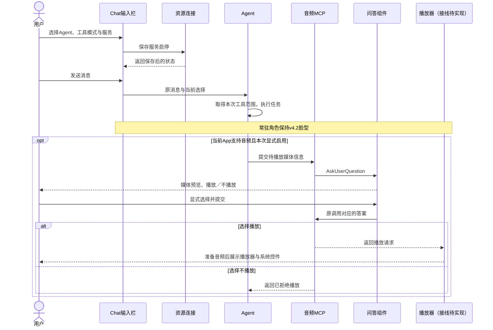
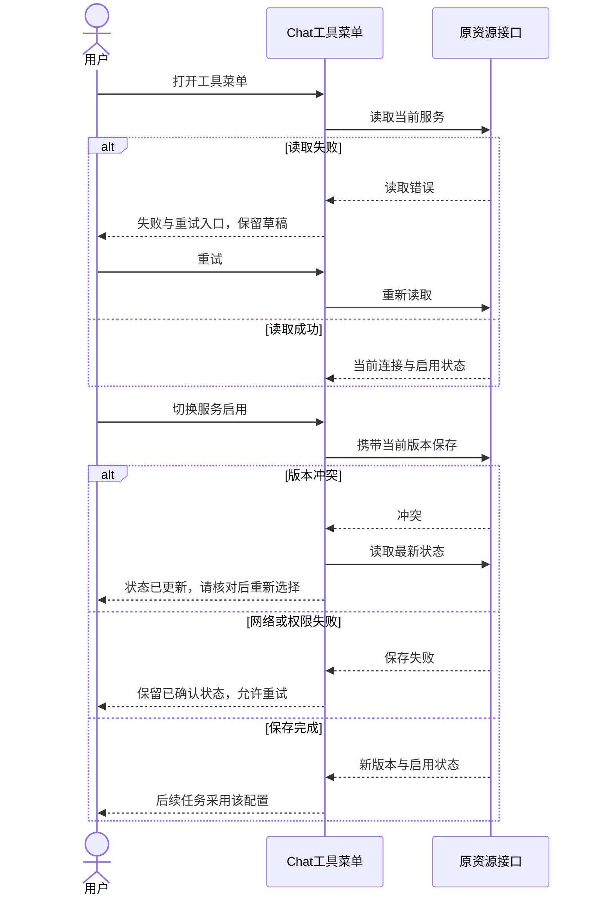
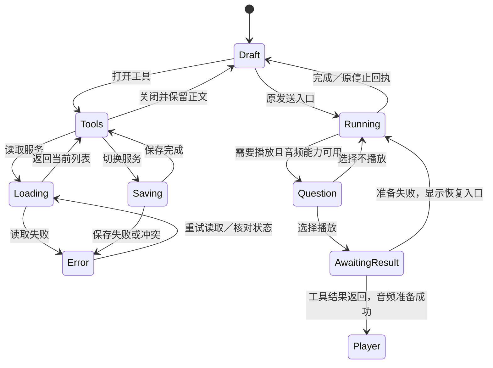

<!-- [Input] Agent入口替换与模型组件迁移前现行稿。 -->
<!-- [Output] 修订前原文与全部图示保留。 -->
<!-- [Pos] 历史设计；现行规则由同目录专项稿所有。 -->

# Agent与模型组件迁移前原文

````markdown
<!-- [Input] Chat输入栏与工具交互需求、Better Chatbot参考和现有双端组件。 -->
<!-- [Output] Agent选择、工具菜单、发送及恢复规则，包含双端骨架和业务图。 -->
<!-- [Pos] Chat模块独立前端交互设计；资源连接管理、音频播放器分别由专项稿所有。 -->
<!-- [Sync] 2026-11-13: 从设置／播放器设计中独立定义Chat工具前端需求。 -->

# Chat：Agent与工具输入栏

## 背景与问题

[前端需求](https://app.notion.com/p/40b30b7547c380cd9930c384ab35023c#41630b7547c380089ecac4937f23425b)要求采用Better Chatbot输入栏的交互结构，并更新Chat的Agent选择与工具菜单。用户在对话里需要直接识别当前Agent、可用工具和发送状态。资源连接页的布局只能覆盖连接管理。

本稿独立归属Chat模块。参考[PromptInput](https://github.com/keinsaasforever/better-chatbot/blob/main/apps/web/src/components/prompt-input.tsx)的输入区、附件与底部操作行，以及[工具选择菜单](https://github.com/keinsaasforever/better-chatbot/blob/main/apps/web/src/components/tool-select/index.tsx)的分组和选择反馈。产品继续使用现行主题、Agent目录、对话及权限规则。

## 目标与边界

- 更新Web与App的Chat输入栏，覆盖附件、Agent选择、工具菜单和发送／停止。
- Agent选择保留当前卡片结构分组与搜索；已有对话的Agent归属由原对话信息维护。
- 工具菜单展示当前服务状态和启停，明确变更影响后续任务。菜单范围依据当前Chat已接入能力确定：Agent、原Skill入口、工具调用模式及MCP连接。当前Chat缺少可选工作流与工具预设的数据链路，菜单不展示这两项。源码核对记录见开发稿。
- 远程服务的新增、认证、详情、移除由[资源连接设计](../resource-connections/mcp-tool-management.md)所有。工作台导航中“远程资源链接”位于“设置”下方，Chat提供对应管理入口。
- 音频媒体询问与播放器样式由[独立组件设计](../mobile-app/ios-system-player.md)所有；本稿仅定义Chat中的入口和交接。

## 概念与规则

### 功能身份

| 对象 | 职责与用户操作 |
| --- | --- |
| Agent | 接收用户消息，按照当前对话与可用工具执行任务；用户在新对话输入栏选择Agent |
| 工具服务（MCP） | 提供工具及执行结果；服务启用后，后续任务按连接与授权状态取得可用能力 |
| 工具菜单 | 展示服务状态、启停和管理入口；本身不执行Agent任务 |
| 问答组件 | 展示Agent提出的问题并提交用户选择；播放询问包含媒体信息 |
| 播放器与iOS系统组件 | 用户选择播放、音频工具返回播放请求后，呈现音频准备与实际播放状态 |
| 常驻角色 | 正常状态展示v4.2脸型主体；用户尚未选择播放时保持角色状态 |

服务启用、工具调用权限、问题回答和实际播放分别反馈。`mobile_clock_audio`保持Low-Sensitivity分类，使用AskUserQuestion采集“播放／不播放”；全访问设置仍需收集本次回答。

### 输入栏

输入栏上部为正文与附件预览，底部为紧凑操作行：添加附件、Agent、工具和发送／停止。附件加号打开上传文件／手绘入口。原草稿编辑、中文输入、粘贴、上传进度和失败恢复继续沿现有行为。

Agent触发展示当前选择和图标；展开后可搜索、按卡片结构分组选择、查看当前选中项。选择后关闭面板并返回输入栏。切换Agent保留正文及已完成附件，发送沿当前页面原有Agent上下文。

工具按钮展开向上的面板，窄屏面板适应可用宽度与键盘。面板依次提供工具调用模式、MCP服务搜索与状态、管理入口。显示服务名称、连接／认证状态和启用状态，计数来自实际列表。服务清单独立滚动，消息区和输入正文保持原位置。

### 选择生效与保存

| 项目 | 默认 | 用户期望 | 实际采用 | 版本与反馈 |
| --- | --- | --- | --- | --- |
| Agent | 原页面默认选择 | 当前新对话选择 | 发送时采用原对话入口的Agent；已有对话保留原归属 | 原Agent目录与对话身份 |
| 工具调用模式 | 原自动模式 | 当前输入栏自动／手动选择 | 随本次消息提交，沿原权限规则执行 | 原提交身份；全访问沿原设置显示 |
| MCP服务启停 | 原创建默认启用 | 当前开关操作 | 保存成功后影响后续任务；进行中任务保持既有工具范围 | 连接版本由原保存回执更新 |
| App音频工具 | 关闭 | 当前设备选择 | 设备播放器能力就绪且本次请求显式启用时可供Agent使用 | 设备运行内选择；能力失效／账户切换重置 |

MCP开关沿资源页的同一账户与工作区配置保存，影响该范围后续任务；面板明确显示此范围。保存中阻止重复操作，成功后更新启用状态。失败保留已确认状态并提供重试；版本冲突刷新状态，提示用户核对并重新选择。未取得当前任务的加载回执时显示“已启用”，加载成功状态等待实际依据。

### 音频正常业务

1. 用户启用本机音频工具并发送消息，Agent开始执行任务，常驻角色保持v4.2脸型。
2. Agent需要播放时调用音频工具，Chat通过AskUserQuestion展示媒体标题、来源、时长和“播放／不播放”；选项无默认值。
3. 用户选择“不播放”后继续对话并保留角色。用户选择“播放”后显示等待结果，收到音频工具的播放请求再交接播放器。
4. 音频准备成功后展示播放器与系统播放控件。准备失败给出重试反馈，恢复路径见播放器专项。

设备播放能力未接通的版本显示不可用原因，并禁用选择；Web显示“仅App可用”。音频组件预览与后端工具完成状态分别记录，真实播放验收单列。

## 桌面骨架

```text
工作台导航                    Chat
…                             消息列表（独立纵向滚动）
设置                          ┌──────────────────────────────────────────┐
远程资源链接                  │ 正文／附件预览                           │
                              │ [+] [Agent图标 当前Agent ▾] [工具 ▾] [↑] │
                              └──────────────────────────────────────────┘
                                               ↑ 展开工具面板
                              ┌ 工具 ───────────────────────────────────┐
                              │ 调用模式  自动／手动（或完全访问）        │
                              │ [搜索服务]                                │
                              │ MCP服务  · 已启用 n                       │
                              │ 服务名  连接状态              [启用开关] │
                              │ …服务列表独立滚动…                        │
                              │ App设备工具  音频播放器／仅App可用        │
                              │ [管理远程资源链接]                        │
                              └──────────────────────────────────────────┘
```

## 窄屏骨架

```text
┌ Chat ───────────────────────┐
│ 消息列表：独立纵向滚动      │
│ 问答卡：媒体信息／播放选择   │
├─────────────────────────────┤
│ 输入正文／附件预览          │
│ [+] [当前Agent ▾] [工具 ▾]  │
│                        [↑]  │
└─────────────────────────────┘
工具面板：Web锚定弹层／App原生弹层；宽度受视口限制
标题与关闭入口固定，服务列表滚动，管理入口可达
软键盘显示时面板与输入操作保持可见，关闭后保留草稿
工作台窄屏导航：…／设置／远程资源链接（按此顺序）
```

## 正常业务时序



## 异常与恢复时序



## 状态转换



## 验收

| 场景 | 预期 |
| --- | --- |
| 新对话选Agent后发送 | 选择可搜索、有选中反馈；原发送入口采用当前Agent |
| 工具菜单启停服务 | 保存回执更新状态，失败／冲突可恢复，进行中任务范围保持 |
| 菜单与附件／手绘 | 可关闭与返回，草稿和附件保留；键盘操作和触摸均可达 |
| 运行中编辑与停止 | 原排队发送及无草稿时停止行为保持 |
| Web与App窄屏 | 无页面横向溢出，发送、关闭及管理入口可达 |
| 音频能力缺失 | 开关禁用并说明状态，普通任务保持可发送 |
| 播放询问 | 媒体信息和选择先出现；播放器在用户选择及工具结果之后展示 |

开发接口与组件接线见[Chat前端开发设计](../../design/claude-agent/chat-agent-tool-composer.md)。组件实施、隔离技术验证与真实业务验收由[执行记录](../../exec/chat-tools-frontend-20261113.md)分别登记。

````
