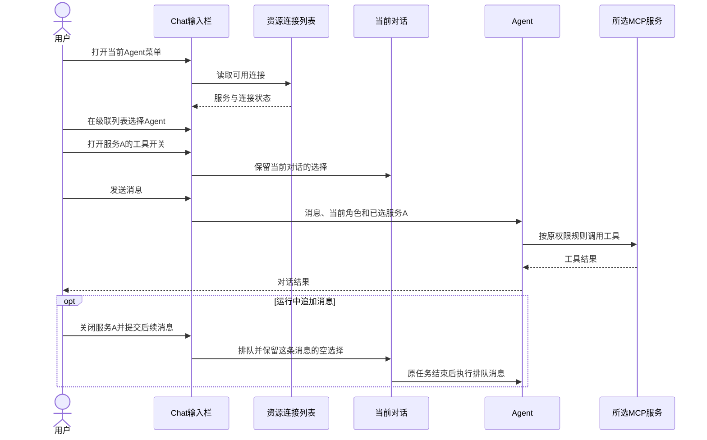
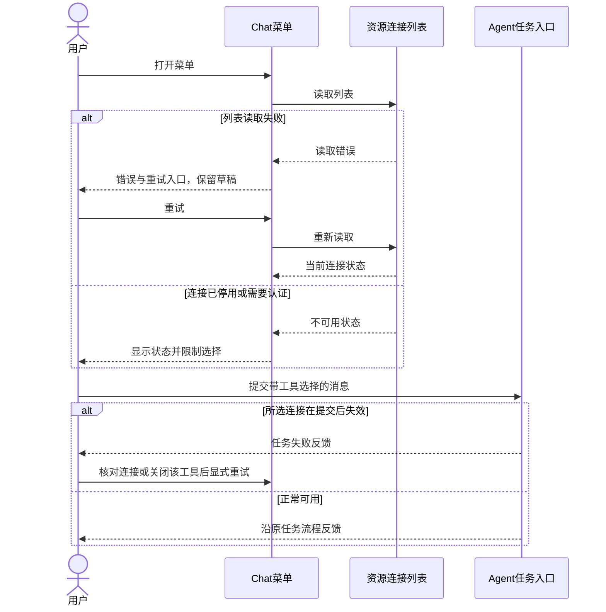
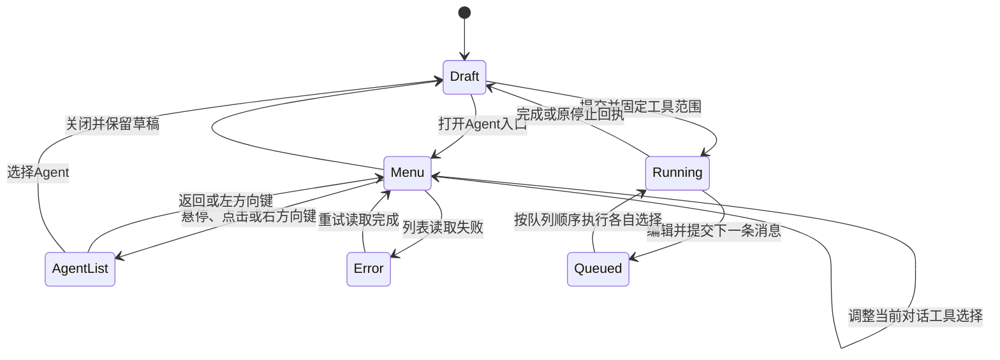
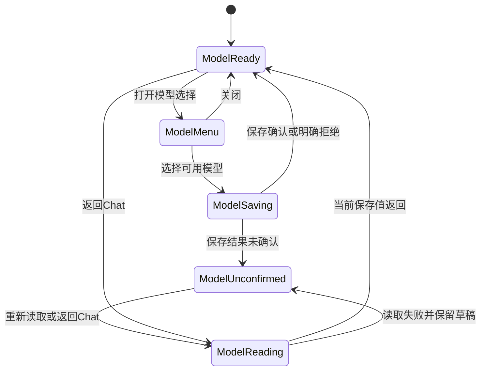

<!-- [Input] 当前Chat、参考级联菜单、用户指定的对话工具范围及独立模型选择。 -->
<!-- [Output] Chat输入栏的产品规则、两端骨架、业务时序、恢复及验收。 -->
<!-- [Pos] Chat产品交互设计；连接配置、音频系统组件与开发接口分别由专项维护。 -->
<!-- [Sync] 2026-11-13: 统一中文菜单排版；连接管理由设置承担，工作台更多保留五项。 -->
<!-- [Sync] 2026-11-13: 工具按当前对话选择，随每条消息提交；桌面Agent采用侧向级联菜单。 -->

# Chat Agent、工具与模型输入栏

## 背景与问题

用户在同一输入栏中选择Agent、模型和本次对话使用的工具。参考菜单通过分组、右侧子菜单和开关呈现这些操作。原候选实现将Chat开关保存到资源连接设置，导致其他对话的后续任务一起受影响。

本次修订将工具选择归属当前对话，保留资源设置的连接、认证及管理操作。模型目录、模型偏好和Agent目录沿现有产品行为。

## 目标与边界

- 输入栏保留一个“当前Agent”入口、独立模型入口和原发送／停止操作。
- 桌面Agent选择从主菜单右侧展开；右侧空间不足时向左展开。窄屏和App在同一个面板内进入／返回Agent列表。
- MCP服务开关选择当前对话可使用的服务工具，每条消息按提交时的选择执行。
- 资源连接设置维护服务地址、认证和连接可用状态。Chat开关的操作范围为当前对话。
- 音频工具仍由[独立播放器设计](../mobile-app/ios-system-player.md)维护；播放器能力就绪后才开放选择。

选型依据：现有Agent目录、模型目录及发送流程可复用。采用参考菜单的分组与级联结构；工作流、工具预设和参考项目内置工具缺少当前Chat数据及执行入口，现行菜单展示已有能力。

## 概念与规则

| 对象 | 用户任务与范围 |
| --- | --- |
| Agent | 选择当前对话的角色；已有对话沿原卡片结构内的Agent范围选择 |
| 工具选择 | 选择当前对话后续消息可调用的MCP服务；每个服务开关包含该服务提供的工具 |
| 资源连接 | 在“设置”的资源页面配置连接及认证；已停用或需要认证的连接在Chat中显示对应状态 |
| 模型 | 独立选择现有模型目录中的可用项，沿现有偏好保存与恢复规则 |
| 播放询问 | Agent需要播放时，先显示媒体信息和“播放／不播放”；用户提交播放选择、工具返回播放请求后准备播放器 |

工具开关默认关闭。选择在当前页面运行期间按对话分别保留；关闭菜单、切换对话再返回可恢复当前运行期间的选择。页面重新加载或App重启后回到关闭，服务器长期保存的对话工具偏好退出本次实现范围。新建对话的首条消息保留提交前的选择。

配置状态定义：default为关闭；desired为当前对话待提交的选择；effective为每条消息提交时固定的工具范围；revision沿消息身份与排队顺序标识各次提交。资源连接的配置版本继续由资源设置维护。

运行中的任务和已提交的排队消息保留各自工具范围。切换开关影响后续提交。未选择远程工具的消息使用空选择。原权限模式和工具执行确认继续生效，选择工具不增加一次确认弹窗。

## 桌面骨架

```text
┌ Chat对话区：原消息与纵向滚动 ──────────────────────────────────┐
│                                                                │
├ 输入区：正文、附件及原编辑操作 ─────────────────────────────────┤
│ 输入内容                                                       │
│ [+] [Agent图标 当前Agent ▾] [当前模型 ▾]           [发送／停止]  │
└──────────────┬─────────────────────────────────────────────────┘
               │ 打开分组菜单
       ┌ Agent与工具 ────────────────┐
       │ 智能体                  ›  │ ┌ Agent列表 ────────────┐
       ├────────────────────────────┤ │ 搜索                  │
       │ 自动／逐步确认              │ │ 当前角色 ✓            │
       ├ MCP服务 ───────────────────┤ │ 其他可选角色          │
       │ 搜索服务                    │ └───────────────────────┘
       │ 服务A               [开关] │   列表独立纵向滚动
       │ 服务B               [开关] │
       ├ 设备工具 ──────────────────┤
       │ 音频播放器       能力未就绪 │
       └────────────────────────────┘
         服务列表独立纵向滚动
```

主菜单和Agent子菜单同时可见。悬停、点击或右方向键进入子菜单；左方向键返回主菜单；选择后关闭并更新当前Agent名称。Escape或点击外部关闭，正文与附件保留。模型入口独立打开模型面板，包含搜索、当前勾选、可用状态与原默认标记。

## 窄屏与App骨架

```text
┌ Chat消息区 ─────────────────┐
│ 原消息及独立纵向滚动        │
├ 输入区 ─────────────────────┤
│ 正文与附件                  │
│ [+] [当前Agent ▾] [模型 ▾] ↑ │
└─────────────────────────────┘
┌ Agent与工具            [关闭]┐
│ 智能体                    › │
│ 自动／逐步确认              │
│ MCP服务搜索                 │
│ 服务A                [开关] │
│ 服务B                [开关] │
│ 音频播放器       能力未就绪 │
└─────────────────────────────┘
          ↓ 点击智能体
┌ [返回] Agent列表       [关闭]┐
│ 搜索                        │
│ 当前角色 ✓                  │
│ 其他角色                    │
└─────────────────────────────┘
```

面板内容纵向滚动。窄屏使用底部面板，关闭、返回和选项保持可达。发送／停止沿原输入栏行为；运行中保留排队发送。

## 中文菜单排版与导航

Agent入口、模型入口及弹层采用现有界面文字样式，中文与英文名称使用一致的字号层级和行高。标题、分组、选项及辅助说明分层呈现；图标、勾选、箭头和开关分别占用固定位置并垂直居中。长Agent名称和服务名称单行截断，模型名称在选项内换行，推荐标记保持完整。输入栏四项操作保持同排。

桌面Agent子菜单与主菜单分列，搜索与返回入口可达，角色列表独立滚动。窄屏和App在当前面板内进入角色列表，返回后保留工具选择与草稿。明暗主题均使用现有页面配色。

工作台桌面侧栏通过“设置”进入资源管理；窄屏和App的“更多”包含写作、时间线、回顾、主题、设置五项。设置内资源页面及原管理跳转继续可用。

## 正常业务时序



Agent负责判断是否调用工具；MCP负责工具协议和结果；菜单负责采集当前对话的选择。音频播放器负责用户选择播放后的实际媒体操作。音频工具的Low-Sensitivity权限与播放问答由[音频接线](../../design/multi-platform/mobile-clock-audio-frontend.md)维护。

## 异常与恢复时序



## 状态转换



## 模型偏好状态转换



## 验收

| 场景 | 预期 |
| --- | --- |
| 桌面级联 | 主菜单与Agent子菜单并列；悬停、左右键、搜索及选择可用 |
| 窄屏／App | 同面板进入和返回Agent列表，无横向溢出 |
| 对话工具范围 | A对话的开关影响A后续消息；B初始关闭；返回A恢复本次页面运行中的选择 |
| 连接设置 | Chat切换后，设置页的服务启用及连接版本保持原值 |
| 首条消息 | 新建对话后首条请求包含提交前选择，后续消息可调整 |
| 排队 | 每条排队消息保存提交时的工具选择，前一任务的工具范围独立 |
| 连接失效 | 显示不可用状态；加载失败提供反馈和显式恢复操作 |
| 原输入行为 | 正文、附件、发送、停止和模型保存恢复保持原入口 |
| 音频 | 当前能力未就绪时禁用；开放后先询问，再按工具结果准备播放器 |

[开发设计](../../design/claude-agent/chat-agent-tool-composer.md)维护接口及模块时序；[本轮执行记录](../../exec/chat-thread-tools-20261113.md)维护实现与验证证据。修订前原文和业务图分别保留在[Thread范围修订前](agent-tool-composer-before-thread-tools-20261113.md)与[Agent／模型修订前](agent-tool-composer-before-agent-model-20261113.md)。

中文呈现、导航修订与隔离截图见[本轮执行记录](../../exec/chat-composer-zh-navigation-20261113.md)。

独立提交与合并前验证见[集成回执](../../exec/chat-agent-tools-pr-20261113.md)。
