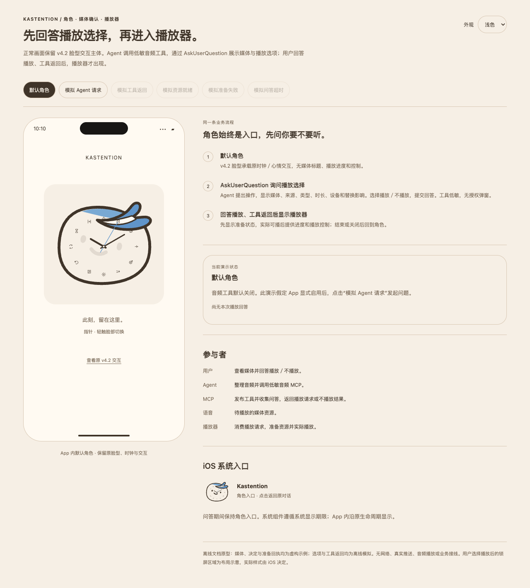
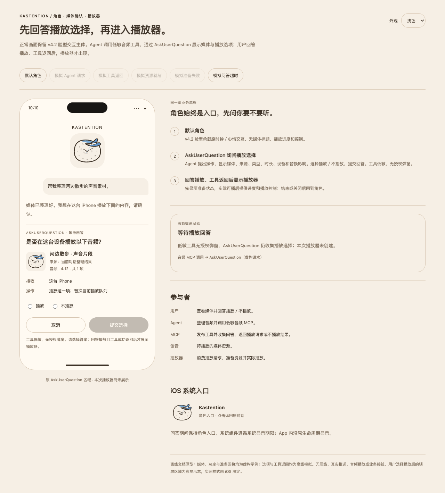
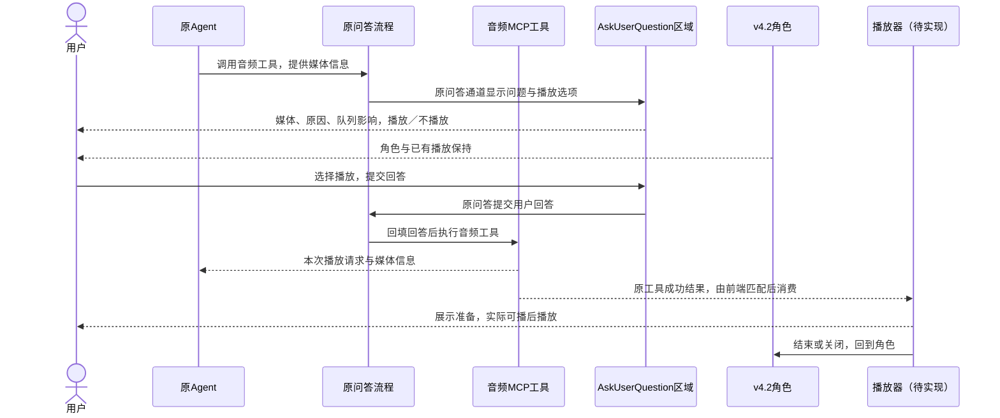
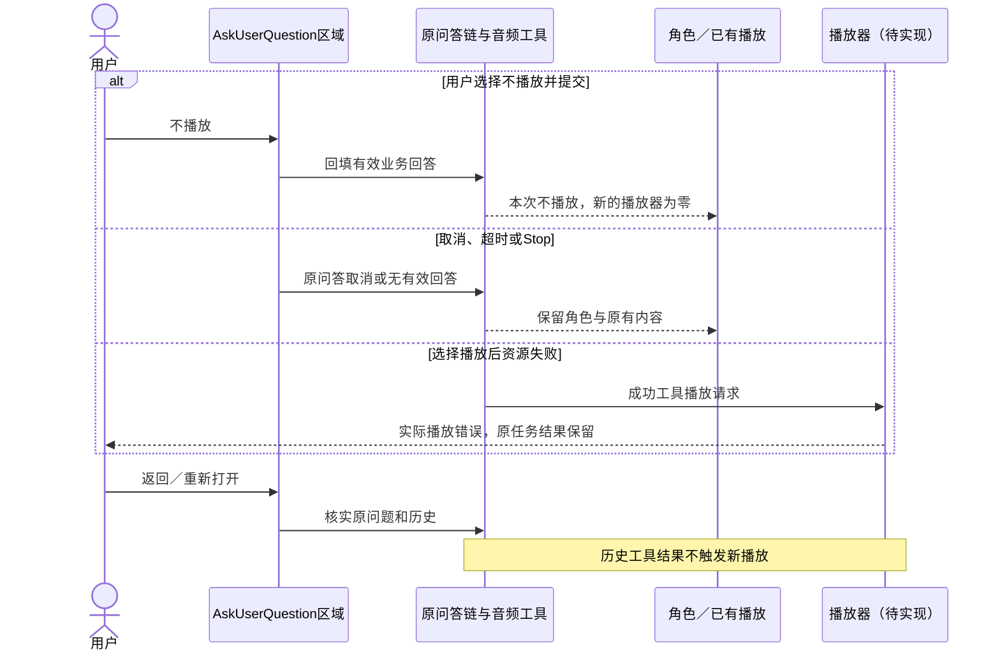
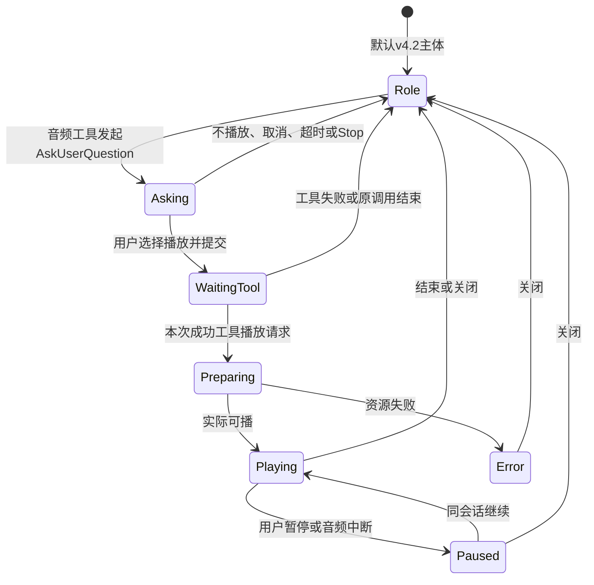

<!-- [Sync] 2026-11-13: 工具入口与输入栏归Chat独立设计，音频播放专项边界保持。 -->
<!-- [Sync] 2026-11-12: Web/App共用MCP连接卡片；音频仍App专属，设备卡选择与AskUserQuestion分开。 -->
<!-- [Input] 用户定义的端侧平台工具、AskUserQuestion问答、低敏权限与v4.2角色。 -->
<!-- [Output] 默认角色、媒体问答和用户选择播放后播放器的产品交互。 -->
<!-- [Pos] 组件产品稿；后端MCP与前端接入分别由multi-platform专项合同定义。 -->
<!-- [Sync] 2026-11-04: mobile_clock_audio为低敏工具，使用AskUserQuestion收集播放选择，无额外工具授权。 -->

# iOS角色、音频问答与播放器设计

## 背景与问题

用户需要在正常状态保留v4.2脸型交互主体。Agent需要播放时，通过App提供的音频工具发起媒体问答，展示将播放的内容；用户选择播放后再出现播放器。

音频问答沿现有AskUserQuestion交互，提供播放选择。音频工具为Low-Sensitivity Tools，工具授权弹窗为零。问题中的播放决定由用户回答，低敏权限与自动授权设置均不代替该回答。

[原需求背景](https://app.notion.com/p/40b30b7547c380cd9930c384ab35023c#db930b7547c383b0917501d0ea510ed0)、[修订前原文与图示](../../design/multi-platform/history/ios-player-before-mcp-entry-20261104.md)保留。[后端与原生合同](../../design/multi-platform/ios-system-player-technical.md)定义工具，[前端接入设计](../../design/multi-platform/mobile-clock-audio-frontend.md)定义问答与组件接线。

## 目标与边界

默认显示[原v4.2脸型组件](../Kastention-一体化时间时钟-v4.2-离散跳针与发丝.html)，保持时钟／开心／悲伤形态和原主题。App设备音频工具默认关闭，播放器能力就绪且用户通过[Chat工具菜单](../chat/agent-tool-composer.md)显式启用后，Agent才获得该工具。Web与App共用[MCP连接管理](../resource-connections/mcp-tool-management.md)，音频播放能力由App提供，Web显示仅App可用。

音频工具描述已有音频与播放原因，收集用户选择，返回对应结果。实际资源准备、播放、系统控制由播放器承担。后端工具接入与前端播放器分别验收；本轮前端媒体预览、结果消费及原生播放保持待实现。

“常驻”定义默认角色入口。App内沿原前台生命周期显示；iOS系统区域沿系统允许期限呈现。角色或问答提示均不授予持续后台计算能力。

## 概念与规则

### 参与者与模块身份

| 对象 | 职责 |
| --- | --- |
| 用户 | 发起任务，查看媒体，回答“播放／不播放”，或取消本次问答 |
| Agent | 整理音频，调用已启用的音频工具，等待用户回答及工具结果 |
| 音频MCP工具 | 定义可传入的音频信息，沿AskUserQuestion收集选择，生成播放请求或不播放结果 |
| AskUserQuestion问答区域 | 展示问题、媒体与选项，提交原问题的回答；独立工具授权步骤为零 |
| 语音／音频 | 已有媒体资源，包含标题、来源和已知时长，作为播放器输入 |
| v4.2角色组件 | 默认主体与原形态交互；等待回答、用户选择不播放及取消时保持 |
| 播放器 | 消费用户选择播放后的成功工具结果，准备资源并反馈实际播放状态 |
| iOS系统组件 | 显示角色入口或真实媒体状态；不承担Agent编排或音频工具执行 |

### 用户流程

1. Agent执行原任务，画面保持v4.2角色。
2. Agent调用音频工具，携带音频列表、标题、来源、已知时长、播放原因及替换／追加影响。
3. 现有AskUserQuestion区域显示“是否在这台设备播放以下音频？”，提供“播放／不播放”选项。默认未选择；用户选中后提交回答。工具授权弹窗和第二次接收确认均为零。
4. 用户选择播放并提交后，应用等待音频工具执行结果；点击提交和回答提交成功均不直接创建播放器。
5. 工具返回本次播放请求后，才展示播放器准备状态。实际媒体可播后显示进度和控制。
6. 选择不播放后，工具返回本次不播放结果；取消、超时或原任务停止时沿原问答取消。上述情况保持角色或已有播放，本次新播放器为零。
7. 媒体结束或用户关闭播放器后返回角色。已确认队列中的暂停、继续、定位和上下项直接操作；新Agent媒体由新工具调用再次询问。

### 问题内容与呈现

问答展示Agent与原对话、音频标题与列表、来源、类型“音频”、已知时长、播放原因、接收“这台设备”、当前内容将被替换或追加的影响。未知时长省略数字，长列表独立滚动，选项与提交入口保持可见。

三个阶段：

| 阶段 | 显示与操作 | 新播放器 |
| --- | --- | --- |
| 默认角色 | v4.2脸型、蓝色发丝、原指针与时位，保留原形态交互 | 无 |
| 等待回答／等待工具结果 | 原问答区域显示媒体与播放选项；角色及已有播放保持 | 无 |
| 用户选择播放，工具成功返回 | 先展示准备，再按真实引擎状态显示播放、暂停和失败 | 此时创建 |

自动授权设置只控制工具权限；AskUserQuestion始终收集本次播放选择。选择“不播放”属于有效业务回答，用户取消属于原问答取消，两种情况均不创建播放器。媒体、列表或操作变化时，新的工具调用重新询问。

App通知中心与系统入口帮助用户回到原对话的这条问题。打开入口、点击封面、Agent文字回复和音频文件生成均不提交播放回答。已有播放时，新问答不打断当前内容；新播放请求成功后按所展示的替换／追加范围处理一次。

## 样式与页面骨架

[离线交互预览](ios-system-player/preview.html)默认角色；可演示音频问题、选择回答、工具返回、播放器准备及播放。所有媒体、回答与工具结果均为虚构示例。





播放器参考[浅色](ios-system-player/player-light.png)与[深色](ios-system-player/player-dark.png)。角色路径、蓝色发丝、三针与十二时位复用原素材，主题沿[v3.1规范](ui-guidelines/README.md#03-色彩与主题)。系统封面采用静态图形，原前台时钟动效保持；系统控件实际布局由iOS决定。

桌面评审骨架（Web业务保持原路径）：

```text
┌ 默认角色 ─────────────┬ 原对话／AskUserQuestion ─────────┐
│ v4.2脸型、时钟与心情 │ 是否播放以下音频？               │
│ 原交互保持           │ 标题、来源、时长、原因及队列影响 │
│                      │ 媒体列表（独立滚动）             │
│                      │ ○ 播放    ○ 不播放               │
│                      │ [取消] [提交选择]                │
└──────────────────────┴─────────────────┬───────────────┘
                选择播放且工具成功返回后 ↓
                           播放器准备 → 实际播放
```

窄屏：

```text
默认：                       需要播放时：
┌ 原App／系统入口 ─────┐      ┌ 原对话（消息区滚动）─────┐
│                     │      │ Agent音频请求            │
│    v4.2脸型主体      │      ├ 原AskUserQuestion区域 ───┤
│    原时钟／心情      │      │ 是否播放以下音频？       │
│                     │      │ 媒体信息（可滚动）       │
│ 无媒体标题与控制    │      │ ○ 播放    ○ 不播放       │
└─────────────────────┘      │ [取消] [提交选择]        │
                              └──────────────────────────┘
                              提交回答 → 等待工具结果
                              播放请求成功 → 播放器准备
```

应用内屏保继续沿整层触摸关闭规则。系统入口只返回App，用户在原问题中选择回答。

## 正常业务时序



图中MCP问答由原运行时和问题区域协作完成；工具handler在用户回答回填后执行，前端媒体呈现和播放器接线待实现。

## 不播放、取消与失败恢复



## 状态转换



## 验收条件

| 场景 | 通过条件 |
| --- | --- |
| 默认角色 | 默认无新媒体会话和控制；原脸型、时钟及心情交互保持 |
| 工具权限与问答 | 音频工具低敏，独立授权弹窗为零；普通与自动授权设置下均收集播放回答 |
| 用户播放选择 | 先显示媒体，再回答；播放器在用户选择播放且工具成功返回后出现 |
| 不播放与取消 | 两种结果分别反馈，本次新播放器均为零 |
| 工具与资源结果 | 工具返回请求与实际播放分别反馈；资源失败保留原任务结果 |
| 重复与恢复 | 同一调用单次消费；旧结果、历史加载、账户切换零新播放和零自动重发 |
| 原业务 | 原AskUserQuestion、笔记批准、Thread、Stop、草稿及屏保交互保持 |

后台计算与音频播放分别依赖适用系统能力。等待用户期间保留原业务状态，释放无实际进展的系统许可。前端和原生实施、系统显示期限及真机播放分别验收。
