<!-- [Sync] 2026-11-03: Kastention产品需求目录及文件名迁移；同步文档引用，业务定义与执行行为保持。 -->
<!-- [Sync] 2026-11-03: Deck功能展示名统一为Kastention与卡片结构；原概念、接口、数据及历史定义保持。 -->
<!-- [Sync] 2026-11-02: v3.1采用Kastention与卡片结构；历史v3.0出版物保留原文。 -->
<!-- [Input] 现行移动产品、色彩Token、组件源码与页面规则。 -->
<!-- [Output] Kastention应用UI规范v3.1；含桌面/窄屏骨架、组件样例与术语。 -->
<!-- [Pos] mobile-app下的规范出版源文件；色值与业务行为引用原所有者。 -->
<!-- [Sync] 2026-11-02: 从历史品牌概念稿重整为应用规范；图示为文档示意，设备与业务资格单列。 -->
<!-- [Sync] 2026-11-02: 正文聚焦Ink & Memory设计规则、章节结构与版本沿革。 -->

<!-- page: cover -->
# Kastention

> 命名说明（2026-11-03）：Deck 功能的英文展示名称统一为 **Kastention**，中文统一为 **卡片结构**。本文保留 Deck 的原有概念定义、业务规则与技术标识；页面文字按[现行命名规则](../../kastention/kastention.md#当前功能名称)显示。

应用界面设计规范

APP UI GUIDELINES / v3.1 / 2026.11.02

记录当下，回望经验。

规范文档 · 移动应用为主，桌面布局提供参照。

版本3.1更新应用名称；版本3.0完成文档重整。图中内容为虚构示例，页面为规范示意；界面实现与设备验收依据原专项记录。

<!-- page: guide -->
## 01 阅读与使用

### 背景与问题

历史v2.1围绕品牌官网首屏、角色概念和图像生成说明展开。应用设计与开发需要可直接查阅的样式、组件状态、页面骨架和交互反馈。

### 目标与边界

本规范沿用应用已有视觉语言。默认品牌为Kastention，中文应用称谓为卡片结构。业务导航、账户、权限、保存、运行与恢复继续由原模块负责。交付范围为文档和示意图。

### 概念与规则

“现行”表示已在指定源码或设计中找到依据；“规范示意”表示用于解释规则的重绘；“建议、未实现”表示需要后续单独评估的改动；“待验证”表示缺少对应测量或设备证据。

| 阅读任务 | 页码 | 内容 |
| --- | --- | --- |
| 了解视觉基础 | 3-7 | 原则、色彩、字体、布局、图形 |
| 查阅组件 | 8-10 | 操作、输入、列表、反馈与浮层 |
| 查看页面应用 | 11-14 | Chat、写作、回顾、更多 |
| 检查状态与可访问性 | 15-16 | 恢复、对比度、触摸与键盘 |
| 理解术语和来源 | 17-19 | 术语、依据与维护 |

资料采用顺序：现行业务规则与具体组件 → 色彩及平台来源 → 本规范的表达整理。发现冲突时记录对象、来源与待处理项，保留各来源职责。

<!-- page: principles -->
## 02 视觉原则

纸张、笔记、手写、安静工具台构成现行视觉语言。内容占据主要阅读区域，暖色纸面承载长文，小面积色彩帮助辨认操作与反馈。

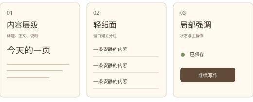

### 内容先行

通过标题、正文、辅助说明和留白建立层级。装饰图形放在内容边缘、品牌区或空状态，保留正文阅读空间。

### 按页面职责分区

Settings连接器详情和Deck条目沿现行轻纸面与列表规则。更多页沿MoreNavigationContent的卡片与用途说明。Chat输入框保留原输入容器。分区规则按组件适用范围查阅。

### 品牌素材

标志、角色和启动插画使用当前已确认资产。历史PDF中的角色名称、三维造型和官网文案保留在原稿；本规范以纸张和笔迹构成图示，新增角色设定数量为零。

### 规范阅读结构

文档按照“视觉基础 → 组件 → 页面应用 → 交互状态”的顺序组织。图示说明布局与使用规则，正文标注适用范围和状态。Kastention的色值、图标、字体与业务入口均由现行资料确定。

<!-- page: color -->
## 03 色彩与主题

语义Token按用途命名，使同一对象随主题获得对应颜色。图中按亮色和暗色声明块取样；实际Web颜色由选择器、系统媒体规则和CSS层叠共同决定。

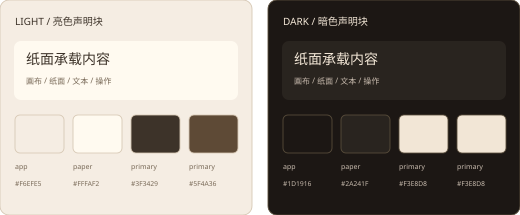

| Token后缀（统一前缀--color-） | 亮色 | 暗色声明块 |
| --- | --- | --- |
| bg-app / bg-paper | #F6EFE5 / #FFFAF2 | #1D1916 / #2A241F |
| text-primary | #3F3429 | #F3E8D8 |
| text-secondary | #7A6A59 | #C8BCAE |
| action-primary | #5F4A36 | #F3E8D8 |
| border-paper | #D8C7B3 | #5A4D3D |

文字层级按用途选择。状态色结合文字或图标；链接保持可辨认的交互提示。颜色数值与对比度分开检查，当前缺口见第16页。

默认主题模式为system。系统暗色媒体块中的背景#1F1B16、主文本#F3EEE6与暗色声明块分别维护。Web后置媒体选择器在系统暗色时匹配system及dark；Native显式dark使用dark投影，system按系统外观选择。完整取值见原色彩文档，跨组合页面测量待验证。

色彩完整定义沿[color_system](../../color_system/README.md)。本页为查阅摘要，扩展色值先进入原色彩合同。

<!-- page: typography -->
## 04 字体与阅读层级

展示文字使用项目已有手写字体；功能信息优先保证辨读与完整表达。Native的InkLabel按字符段选择Excalifont与中文字体，普通Text及Web控件继续各自字体规则。

| 对象 | 当前依据 | 使用规则 |
| --- | --- | --- |
| 中文手写 / 拉丁展示 | Xiaolai / Excalifont | 用于现行品牌和对应标签，字体回退可阅读 |
| 写作移动正文 | 18px / 1.6倍行高 | 默认行框28.8px，文字缩放后同步排版 |
| 写作桌面正文 | 18px / 1.8倍行高 | 默认行框32.4px，保持桌面稿纸规则 |
| 更多页名称 / 说明 | Native数值19 / 13 | 行高与换行沿原组件；单位按平台解释 |

图中标题、正文和辅助信息用于展示相对层级，应用全局字号量表继续沿现行组件；本轮新增字号配置数量为零。

长名称可在空间受限处省略，并提供完整辅助功能名称。正文保持自然换行，编辑正文保留用户输入的换行。字体加载失败使用原后备字体；成功后保持文字、光标和阅读位置。

文档正文使用嵌入式中文字体，样张使用项目Xiaolai；文档版式与应用字体适用范围分别记录。

<!-- page: layout -->
## 05 布局、间距与安全区域

布局由可用宽度、内容长度、安全区域和键盘共同决定。页面骨架先明确固定区域与滚动区域，再核对内容触达。

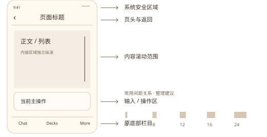

### 间距与对齐

图中4、8、12、16、24展示常用间距关系，属于整理建议。实际组件保留现行数值；MoreNavigationContent当前使用12、16、26等数值。后续修改按页面需求评审。

### 平台单位

Web使用CSS px。Apple原生界面使用pt，Android设计常用dp及字体sp。React Native样式数值由平台渲染解释，标注时注明来源；图纸比例与设备物理像素分别核对。

### 滚动与键盘

内容区负责正文滚动，输入区随键盘保持可达。安全区域由所属宿主处理；局部网页按已有边界排版。写作心情展开后，问候、选项与说明共同纵滚，原页头返回入口保持可达。

本规范图框用于表达区域关系。触摸、旋转、系统文字缩放、软键盘和小屏可达性仍需按平台验收。

<!-- page: geometry -->
## 06 图标、圆角与纸面

图标与文字共同说明操作，独立图标提供辅助功能名称。项目图标沿现行Icons、react-icons及Native矢量组件；下图为线条关系示意。

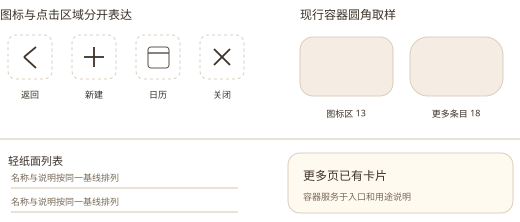

| 对象 | 当前取样 | 适用范围 |
| --- | --- | --- |
| 更多页图标区域 | 44 × 44，圆角13 | MoreNavigationContent图标承载 |
| 更多页条目 | 圆角18 | 既有更多页卡片 |
| Chat输入容器 | 窄屏16，宽屏20 | AIInputDock.native |
| 轻纸面列表 | 分隔与留白 | Settings连接器、Deck具体页面 |

图标笔画保持清楚，基于视觉中心对齐。当前项使用文本、细线、对勾或现行选中表达；状态色作为辅助。

圆角描述容器用途与层级，组件原值继续有效。普通内容避免层层套用面板；弹窗、输入框和更多页卡片保留各自承载职责。

品牌图形采用少量笔迹、页边线和星点，图形避开正文、焦点和状态提示。

<!-- page: controls -->
## 07 操作与输入组件

主操作表达当前任务的关键动作；次操作提供返回、关闭和原辅助动作。文字准确说明结果，点击区域覆盖完整控件。

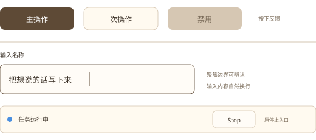

| 状态 | 视觉与反馈 | 行为依据 |
| --- | --- | --- |
| 默认 / 按下 | 文字清晰，按下反馈局部出现 | 现行按钮与Pressable |
| 聚焦 | 输入边界可辨认，键盘可达 | 现行focus Token与编辑器 |
| 禁用 | 说明当前条件，暴露disabled语义 | 读取、上传或原提交限制 |
| 运行中 | 原Stop入口可达，状态持续可见 | Chat原任务状态 |
| 停止收尾 | 显示Stopping，等待状态核对 | 原Stop受理与恢复规则 |
| 失败 | 在所属区域显示原因与恢复入口 | 原组件错误反馈 |

输入保持草稿、附件与原快捷键。运行中的文本输入沿原队列规则处理；结果未知或停止待核对时按原限制提交。读取恢复沿当前Thread核对，用户消息提交由原发送动作负责。

图中按钮形态是取样整理。暗色主按钮的现行前景组合存在对比度缺口，详见第16页；本轮应用代码改动数量为零。

<!-- page: feedback -->
## 08 列表、标签与反馈

列表让用户扫描名称、说明和状态；标签表达属性或选择结果。反馈放在发生问题的对象附近，保留下一步操作。

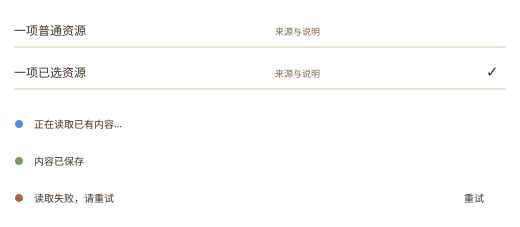

### 列表与选中

设置和资源条目沿原页面分隔方式。资源选中使用右侧对勾；更多页沿已有用途说明和卡片。名称、状态和辅助信息保持稳定的对齐关系。

### 加载与空状态

首次读取显示原加载提示，相关操作按原条件暂不可用。已有数据刷新失败时保留可用内容并显示原重试。空状态说明当前内容，并链接现有可执行入口。

### 保存与失败

本地变化、请求中和保存完成分别表达。心情选择失败保留当前值并提供同一选择的保存重试；回顾报告保存失败使用原重试保存入口。

### 文案

使用完整、具体的句子说明对象、结果和下一步。图中示例“读取失败，请重试”用于展示反馈位置，产品实际文案沿原本地化键。

<!-- page: overlays -->
## 09 弹窗、详情与返回

弹窗承载当前任务的局部操作；关闭和返回回到明确来源。内容较长时，正文滚动与操作区域分别布局。

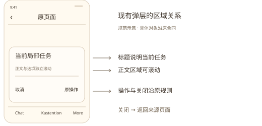

| 现有对象 | 交互规则 |
| --- | --- |
| 更多页 | 窄屏完整菜单，写作/时间线/回顾/主题/设置保持同层 |
| 写作心情 | 占编辑区域，选项即确认，返回更多取消尚未提交选择 |
| 回顾重分析 | 使用既有选择与确认，展示本次分析内容和来源 |
| 回顾详情手柄 | 原详情组件中拖动调整高度，正文继续独立滚动 |
| 文件预览 | 原关闭、下载和素材复用入口，关闭回到原页面 |

背景操作的可达性和焦点由原弹层所有者管理。Native系统返回与Web关闭沿原入口；草稿是否跨关闭保留依据具体组件生命周期说明。

文档整理新增确认弹窗数量为零。现有重分析、权限和删除确认继续按各业务规则执行。

<!-- page: chat -->
## 10 页面应用：Chat

用户在同一对话中阅读、输入并查看任务反馈。图示取自现行页面区域关系，所有正文为虚构示例。

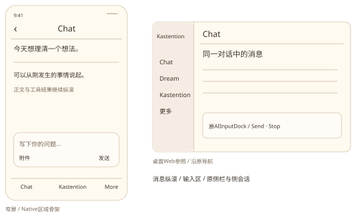

### 桌面骨架

原侧栏负责导航；主区包含原页头、消息纵滚区和AIInputDock；活动、文件与原侧会话按既有入口展开。

### 窄屏骨架

页头保留原动作；消息区独立纵滚；输入区位于原底部栏目上方。Native底部沿Chat、Kastention、More三个栏目（中文中间栏目为卡片结构），Web可达栏目沿其原导航配置。

### 交互与反馈

首次发送按原流程创建对话；选择历史时读取原Thread。任务运行中保留增量正文与Stop。Stop受理后显示Stopping，原状态确认结束后恢复普通输入。网络中断先读取同一对话状态与历史。

依据：ChatPage.native、AIInputDock.native、useNativeChatThread.native。图中省略原队列、权限确认、工具结果和附件细节；各功能继续沿原合同。完整时序与恢复规则见正式交互稿。

<!-- page: writing -->
## 11 页面应用：写作

从“更多 → 写作”进入原写作页面，编辑、心情、工具和保存反馈各有明确区域。

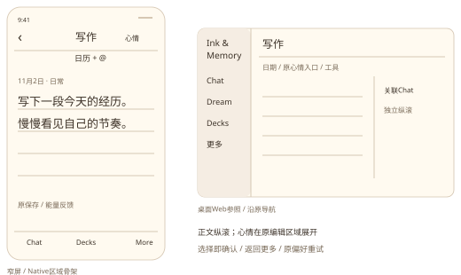

### 桌面骨架

侧栏、原工具与写作画布保持，心情沿原正文入口；关联Chat打开后分栏。正文与关联对话分别纵滚。

### 窄屏骨架

页头包含返回更多、写作和当前心情；日历、新建、Agent保持原工具组。日期和标签自然换行，正文与建议卡共同纵滚，保存反馈位于原区域。

### 心情与恢复

心情展开时，问候、立方体和说明共同滚动。点击可选项沿原反馈返回正文；返回更多取消未提交回调。保存失败保留当前选择，原重试只保存同一选择偏好。

移动正文18px、1.6倍行高；稿纸横线与每段实际行框对齐。打开选择器先收起键盘，回到正文由用户主动聚焦。打开关联Chat和发送前的笔记准备继续沿现行写作合同。

<!-- page: reflections -->
## 12 页面应用：回顾

用户查看已有报告、进入报告正文，或主动发起原分析任务。页面将阅读、任务反馈与配置入口按现行关系组织。

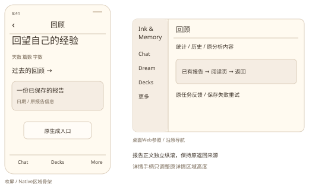

### 桌面骨架

主区展示原标题、统计、报告历史和分析区域；选择报告进入原阅读页，返回恢复原来源。详情浮层沿原手柄与正文滚动规则。

### 窄屏骨架

页头提供返回更多；统计、历史、生成入口和原分析内容在正文纵滚。报告阅读页提供返回入口；配置与重分析使用已有弹层。

### 状态与反馈

打开历史报告仅负责阅读。分析由原用户动作触发，已保存报告、生成中、失败和保存失败分别显示。历史读取失败提供原重试；报告保存失败使用重试保存。

同日重分析沿既有内容选择与确认。图示简化数据，保留原业务范围；Native完整视觉一致性、VoiceOver和真机触摸资格按专项验收记录判断。

<!-- page: more -->
## 13 页面应用：更多与设置

更多页提供写作、时间线、回顾、主题和设置五项同层入口。现行组件在同页分组展示用途，主题入口同时显示当前外观。

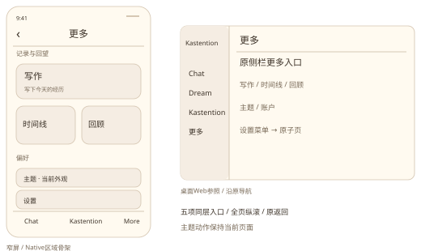

### 桌面骨架

StoryWorkspaceSidebar沿原展开和路由入口显示更多内容；主题与账户继续原所有者。设置页面使用既有菜单、子页和返回关系。

### 窄屏骨架

写作条目在上；时间线与回顾并列；主题和设置位于偏好分组。整页内容纵滚，返回和原底部栏目保持可达。此布局来自MoreNavigationContent。

### 主题

更多页主题动作从当前有效主题切换到另一显式主题。设置中可选择light、dark或system；system跟随系统。当前模式与当前有效主题共同决定文字反馈。保存失败显示原局部错误，用户可再次操作。

设置字段、保存按钮、读取和失败恢复按原子页执行。本规范新增设置项、主题系统及全局导航入口数量均为零。

<!-- page: states -->
## 14 交互状态与恢复

状态反馈让用户理解当前动作是否已受理、内容是否可用以及下一步操作。页面显示状态与任务最终结果分别核对。

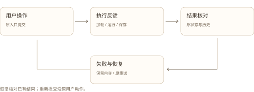

| 条件 | 用户可见反馈 | 恢复动作 |
| --- | --- | --- |
| 首次读取 | 原加载提示，受影响操作暂不可用 | 读取完成后显示内容 |
| 刷新失败且有内容 | 保留原内容与错误反馈 | 原读取重试 |
| 写作偏好保存失败 | 当前选择保留，保存失败 | 保存同一选择 |
| Chat停止已受理 | Stopping与已收到正文 | 核对同一任务状态 |
| Chat结果待核对 | 原结果未知提示 | 原历史与状态读取 |
| 回顾报告保存失败 | 原报告与保存失败提示 | 原重试保存 |

原状态读取负责核对已经发生的操作。用户消息、分析生成及文件上传继续由各自原入口提交。返回、关闭和切换栏目按组件生命周期处理，本轮新增自动提交与任务调度数量为零。

正常、异常和状态转换图归[正式交互设计](../../../design/multi-platform/ui-guidelines-interaction.md)。本页为产品阅读摘要。

<!-- page: accessibility -->
## 15 可访问性与测量缺口

正文普通文本按WCAG 2.2对比度4.5:1目标检查；大文本阈值与例外沿标准定义。测量取不透明Token组合，实际页面还需覆盖透明叠加、背景与全部状态。

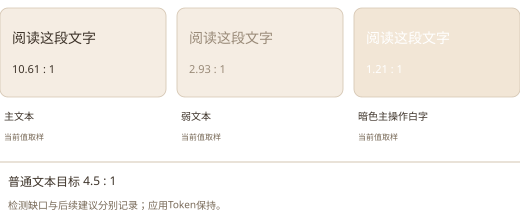

| 现行取样 | 对比度 | 普通文本4.5:1结果 |
| --- | --- | --- |
| 主文本#3F3429 / 亮色画布#F6EFE5 | 10.61:1 | 达标 |
| 辅助文本#7A6A59 / 亮色画布 | 4.56:1 | 达标，接近阈值 |
| 弱文本#9A8A78 / 亮色画布 | 2.93:1 | 存在缺口 |
| 链接#4A90E2 / 亮色画布 | 2.88:1 | 存在缺口 |
| 白字#FFFFFF / 暗色主操作#F3E8D8 | 1.21:1 | 存在缺口 |

该按钮配对见AnalysisView.native中使用primary的Action；各组件按实际前景和背景分别检查。建议、未实现：后续在原Token合同中评估弱文本、链接与该按钮前景的配对。深棕#3F3429配暗色主操作背景的取样为10.00:1，用于说明可行方向。

触摸区域按平台检查：Apple建议至少44 × 44pt；Web WCAG 2.5.8规定24 × 24 CSS px及间距等例外。两者分别适用，图标视觉尺寸与点击区域分别测量。Android、系统文字放大、键盘、读屏和减少动态效果均保留待验证状态。

来源：[W3C文本对比度](https://www.w3.org/WAI/WCAG22/Understanding/contrast-minimum)、[W3C目标尺寸](https://www.w3.org/WAI/WCAG22/Understanding/target-size-minimum)、[Apple界面设计](https://developer.apple.com/design/tips/)。

<!-- page: glossary-a -->
## 16 专业术语 · 基础

术语用于准确说明设计对象。以下例子均对应本规范中的实际内容。

| 中文 / 英文 | 定义 | 产品中的例子 |
| --- | --- | --- |
| 设计系统 / Design System | 可复用的视觉规则、组件和使用约定 | 色彩合同、原组件与页面规则共同指导设计 |
| 设计变量 / Design Token | 以名称保存可复用设计值 | --color-bg-app描述应用画布颜色 |
| 语义变量 / Semantic Token | 按用途命名的设计变量 | text-secondary随主题映射为辅助文本色 |
| 字体层级 / Typography Scale | 不同信息级别的字体关系 | 页面标题、正文、辅助说明分别展示 |
| 行高 / Line Height | 相邻文本行框的垂直节奏 | 写作移动正文18px × 1.6 = 28.8px |
| 栅格 / Grid | 帮助内容对齐与分栏的参考结构 | 桌面侧栏与主内容区按区域对齐 |
| 间距层级 / Spacing Scale | 用于表达分组关系的间距集合 | 更多页12间隔、16内边距与26分组间隔 |
| 安全区域 / Safe Area | 避开系统遮挡的内容可用区域 | 页头避开状态栏，操作避开底部手势区 |

以上术语解释现行对象。图示中的整理建议使用明确状态标记，后续改动继续由对应产品与组件评审。

<!-- page: glossary-b -->
## 17 专业术语 · 交互

| 中文 / 英文 | 定义 | 产品中的例子 |
| --- | --- | --- |
| 触摸目标 / Touch Target | 接收点击或触摸的有效区域 | 小图标可以由更大的Pressable接收操作 |
| 组件变体 / Component Variant | 同类组件因用途形成的样式或结构 | 更多页行式条目和并列条目 |
| 交互状态 / Interaction State | 用户操作或系统反馈形成的显示状态 | 默认、聚焦、禁用、运行和失败 |
| 操作暗示 / Affordance | 帮助用户判断可执行操作的外观线索 | 右侧箭头提示进入详情 |
| 操作反馈 / Feedback | 对动作受理、执行和结果的可见回应 | Stopping、保存失败和重试入口 |
| 信息架构 / Information Architecture | 内容、入口及层级的组织方式 | 更多下的五项同层入口 |
| 可访问性 / Accessibility | 支持不同能力和辅助技术的使用要求 | 对比度、完整名称、键盘和文字放大 |
| 状态恢复 / State Recovery | 重新读取已有状态并恢复当前显示 | 重新进入同一Thread核对历史与任务 |

### 使用方式

在需求中描述用户任务和操作反馈，在设计中标明页面与状态，在技术合同中保留实际组件、字段与接口名称。新增术语需要对应的设计对象和具体例子。

<!-- page: sources -->
## 18 来源、维护与交付状态

### 依据索引

表中路径以仓库为起点；完整链接保存在本文件中。

| 规则范围 | 当前来源 |
| --- | --- |
| 产品范围、导航和双端骨架 | [docs/prd/mobile-app/mobile-app.md](../mobile-app.md) |
| 色彩及亮暗主题 | [docs/prd/color_system/](../../color_system/README.md)；[frontend/app/_dream/styles/tokens.css](../../../../frontend/app/_dream/styles/tokens.css) |
| Native颜色与字体 | [frontend/src/components/inkColors.ts](../../../../frontend/src/components/inkColors.ts)；[InkLabel.native.tsx](../../../../frontend/src/components/InkLabel.native.tsx) |
| 写作排版与心情 | [docs/design/multi-platform/writing-mobile-layout.md](../../../design/multi-platform/writing-mobile-layout.md) |
| 跨平台和恢复 | [react-native-web-project-structure.md](../../../design/multi-platform/react-native-web-project-structure.md) |
| 本轮业务时序和状态图 | [docs/design/multi-platform/ui-guidelines-interaction.md](../../../design/multi-platform/ui-guidelines-interaction.md) |
| 诊断、取舍和验证 | [docs/exec/ui-guidelines-review-20261102.md](../../../exec/ui-guidelines-review-20261102.md) |

### 版本沿革

[历史v2.1 PDF](../../Ink%20%26%20Memory%20UI%20Design%20v2.pdf)保留原文。v3.0围绕应用视觉规则、组件、页面骨架和交互状态组织内容，现行入口与历史文件分别维护。

### 可编辑与导出

本文件维护正文；assets中的SVG维护可编辑矢量图。export_pdf.py中的图形定义负责重新生成SVG与PDF，修改图形后同步导出。导出命令与本机字体前提见评审记录。PDF为生成物，正式交互稿独立维护业务图。

### 交付状态

文档结构、规范示意、术语与本轮范围评审已交付。应用代码、设备操作与真实业务验收沿原专项资格；可访问性取样缺口与平台待验证项保留在第16页和评审矩阵。
