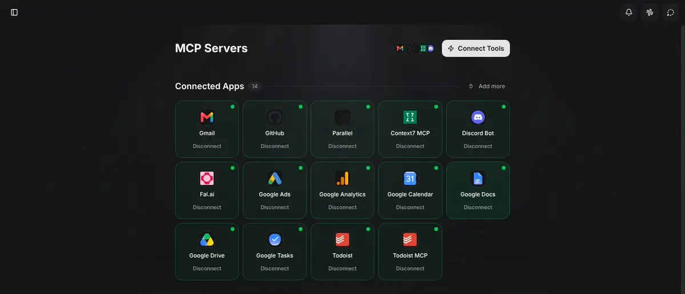

<!-- [Sync] 2026-11-13: Chat工具按当前Thread和逐条消息选择；资源设置只管理连接及认证。 -->
<!-- [Sync] 2026-11-13: 工作台通过设置进入资源管理，Chat工具交互独立归Chat模块。 -->
<!-- [Input] 用户新增Notion前端参考、原Settings资源链接与Web/Native MCP管理能力。 -->
<!-- [Output] 共用MCP卡片管理与设备工具选择的产品规则、页面骨架及验收。 -->
<!-- [Pos] 资源连接业务PRD；技术接线与时序归独立资源前端稿；Chat选择交互归Chat专项。 -->
<!-- [Sync] 2026-11-12: Web与App共用连接工具交互，音频工具保持App专属、默认关闭及问答。 -->

# Web与App工具连接管理

## 背景与问题

[用户新增前端需求](https://app.notion.com/p/40b30b7547c380cd9930c384ab35023c#41530b7547c380f48038c931c30580b8)要求Web和App采用相同的MCP工具加载交互。参考图包含页面主标题、连接工具按钮、已连接数量、服务卡片、连接状态及断开入口。

现有设置已具备资源链接、MCP列表、新增连接、认证、详情及使用策略。新增设计在原入口组织卡片，明确“连接服务”“允许在Chat选择”和“回答是否播放”的职责。原[音频组件设计](../mobile-app/ios-system-player.md)继续维护角色、问答与播放器。

## 目标与边界

Web与App共用信息结构和操作含义，分别适配鼠标、键盘与触摸。原资源链接保持远程／本地连续结构，Notion、飞书等专属连接入口沿原业务。MCP卡片由真实连接列表生成；用户通过“连接工具”进入原新增流程，通过卡片进入原详情。

资源页维护连接卡片、快捷启停与连接生命周期。Chat工具菜单、Agent选择与输入栏由[Chat独立设计](../chat/agent-tool-composer.md)维护；组件实施与验收见[本轮执行记录](../../exec/chat-tools-frontend-20261113.md)。设备工具播放接线保持单列。外部应用商店、额外连接器、远端设备发现、跨端资源分发、多Agent控制与心跳系统退出当前界面范围。

## 概念与规则

### 对象与职责

| 对象 | 用户目标与行为 |
| --- | --- |
| 工具连接 | 配置并认证一个MCP服务，查看其实际提供的能力 |
| 服务启用 | 允许当前用户在Chat选择这个连接的工具；具体调用沿原权限规则处理 |
| Agent | 在当次可用工具范围内选择和执行工具 |
| MCP服务／工具 | 发布能力与参数，处理工具调用，返回结果 |
| 设备工具 | 当前设备支持的能力；音频播放器属于App设备工具 |
| 问答组件 | 采集本次问题的回答；音频工具使用AskUserQuestion |
| 播放器／系统组件 | 根据用户播放选择后的工具结果准备音频，显示实际播放状态 |

连接、服务启用、工具权限和问题回答分别处理。开启服务不直接运行工具，开启音频能力不直接播放；低敏工具的调用权限与播放问答保持独立。

### 页面与卡片

用户通过工作台“设置”进入原资源页面。原设置深链与内部管理跳转继续可用；页面保持两个连续区域：

1. **远程资源链接**：原专属连接器入口保持；MCP区域展示“连接工具”按钮、已连接数量与卡片网格。
2. **本地资源链接**：保留已有本地连接及能力信息。音频工具选择归Chat当前对话，Web显示“仅App可用”。

MCP服务卡包含名称、已有图标或通用工具图标、最近确认状态、是否启用及“管理”入口。卡片标题／主体进入详情，快捷操作独立可达。数量从当前列表计算；“已连接”仅统计已确认连接状态，待授权、停用、失败分别展示，零结果显示明确空态。

布局参考：



本图用于结构对照。Dream沿现行主题、字色、圆角与间距；卡片数量和列数随真实数据与可用空间变化。截图中的应用名称和绿色状态不作为本产品预置数据。

### 连接工具与详情

“连接工具”打开原新增MCP服务表单，收集当前后端允许的名称、传输方式和地址／预置配置。认证要求由原服务判断。成功后显示对应卡片及实际状态；失败保留已填写内容，继续使用原错误和恢复入口。

需要登录时进入原授权流程；等待授权可取消；取消后保持原连接记录与现有凭据。进入详情自动读取实际工具清单；列表卡片不通过批量连接远端服务换取绿色状态。

卡片只展示实际服务能力。配置存在、已连接、待授权、停用和工具清单读取失败分别反馈。旧工具清单保留最近信息，缺少当前可用结论时不宣称工具已经加载。

### 启用、停用与认证

已配置服务提供启用／停用操作。停用保留连接信息，影响后续任务；当前运行的任务按已取得的工具范围继续，原停止入口保持。启用后按当前认证与平台能力决定可用范围。

“退出认证”沿原认证入口清除对应认证，不与停用合并。“移除”沿原可移除范围及原确认处理，不复用为卡片的快捷断开动作。截图中的Disconnect对应本稿卡片的“停用”操作；认证与移除在详情中分别表达。

保存期间显示“正在保存”，完成后按实际回执更新。失败保留已确认状态并说明保存失败，允许重新选择；版本冲突先读取当前状态并提示核对，不静默覆盖另一处修改。停用操作不增加确认弹窗。

### 设备音频工具

音频播放器开关归Chat当前对话，默认关闭；当前能力未就绪时禁用。资源设置维护连接及认证，工具选择由[Chat产品稿](../chat/agent-tool-composer.md)维护。

App提交消息时按当前对话选择携带音频type，播放问答继续显示媒体信息及播放／不播放选项。播放器在用户选择播放、工具返回请求并完成音频准备后展示。

### 配置状态

| 对象 | 默认 | 用户期望 | 实际采用 | 版本与保存反馈 |
| --- | --- | --- | --- | --- |
| MCP连接 | 沿原创建合同默认启用；配置、连接与认证状态仍以回执分别判断 | 当前启用选择 | 后续消息按当前对话选择及原账户、工作区、认证和能力取得服务范围 | 沿原连接版本保存；处理中、已保存、失败、冲突分别表达 |
| 设备音频工具 | 关闭 | 当前对话选择 | 本机能力就绪、当次请求显式选择且工具调用模式允许时可提供音频工具 | 每次选择与提交分别取得快照；旧提交回执不改写新选择，不增加后端公开版本字段 |
| 工具权限 | 沿原自动／手动／禁用与全访问设置 | 通过原设置页管理 | 由原运行时判定，问答表单继续采集输入 | 资源页沿原权限设置；Chat工具菜单维护原输入栏的调用模式 |

前端只能显示取得回执支持的状态。连接已启用、当次请求已选择、实际工具已提供为三个独立事实；页面展示“已启用”与对应连接／授权状态，设备卡展示“已选择”；缺少当次加载回执时不显示“本轮已加载”。

## 桌面页面骨架

```text
工作台 > 设置 > 资源                                      [连接工具 +]
远程资源链接
[原Notion入口] [原飞书入口]
MCP服务 · 已连接 n
┌ 图标 资料服务 ────────┐ ┌ 图标 日程服务 ────────┐ ┌ 图标 工具服务 ───┐
│ 已连接 · 已启用       │ │ 等待授权             │ │ 已停用           │
│ [管理] [停用]         │ │ [继续授权] [管理]    │ │ [启用] [管理]    │
└──────────────────────┘ └──────────────────────┘ └──────────────────┘
卡片随空间排列；页面统一纵向滚动，卡片内无嵌套滚动。
本地资源链接
┌ 现有本地连接与设备能力 ──────────────────────────────────────────┐
│ 原本地连接信息与能力状态                                        │
│ 音频工具选择入口：Chat当前对话                                   │
└─────────────────────────────────────────────────────────────────┘
```

## 窄屏页面与弹窗骨架

```text
┌ 资源链接 ─────────────────────┐
│ [连接工具 +]                  │
│ 远程资源链接                  │
│ 原Notion／飞书入口             │
│ MCP服务 · 已连接 n            │
│ ┌ 资料服务 ─────────────────┐ │
│ │ 已连接 · 已启用           │ │
│ │ [管理] [停用]             │ │
│ └───────────────────────────┘ │
│ 其余卡片；整页纵向滚动        │
│ 本地资源链接                  │
│ 设备能力信息                 │
└───────────────────────────────┘
连接工具 → 原新增表单：
┌ 添加MCP服务 ─────────[关闭]───┐
│ 名称、传输、地址/预置配置     │
│ 正文独立滚动；键盘不挡操作   │
├ 原错误反馈 ──────────────────┤
│ [取消] [添加]                │
└───────────────────────────────┘
卡片管理 → 原详情页 → 返回原列表与滚动位置。
```

## 正常、失败与恢复

打开页面读取当前连接列表；点击连接工具进入原新增／授权流程；配置成功后显示真实卡片；Chat按每条消息的选择加载可用服务。修改启用失败保留本地选择并提供明确重试；授权取消、列表读取失败、能力不可用及账户变化沿原资源边界处理。

正式正常时序、异常恢复和状态图归[前端接入设计](../../design/claude-agent/mcp-tool-management-frontend.md)，本稿维护页面结构与产品规则。

## 验收条件

| 场景 | 通过条件 |
| --- | --- |
| 两端结构 | Web和App均有连接工具入口、真实服务卡与状态；窄屏无横向溢出，按钮可达 |
| 配置与授权 | 复用原表单与认证，失败保留输入，取消不删除旧凭据，详情沿原工具清单 |
| 启停 | 明确影响后续任务；保存、失败与冲突可辨认；启停不取消当前任务 |
| 状态真实性 | 计数、连接、启用、认证与能力分别来自实际结果，不将停用等同未配置 |
| 平台工具 | Chat音频工具App专属、默认关闭，能力未就绪不可选择；Web不发送音频type |
| 问答与组件 | 启用不自动播放；AskUserQuestion回答后由成功播放请求驱动播放器 |
| 范围 | 原账户、Thread、工具权限与MCP Apps策略保持；多Agent调度、设备网关与心跳控制入口为零 |

连接卡片、Chat工具选择和逐条请求已接入；技术验证由[本轮执行记录](../../exec/chat-thread-tools-20261113.md)维护。原生播放器、真实连接及播放验收待完成。

工作台资源导航修订及设置深链验证见[本轮执行记录](../../exec/chat-composer-zh-navigation-20261113.md)。
